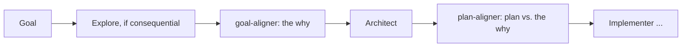

# Behaviour alignment — shared reference for `goal-aligner` and `plan-aligner`

**User direction, 2026-10-30.** Both alignment roles read this file first. It holds what the two
share — the question, the frame, the calibration cases, the lenses and the evidence rule — so the
two role files carry only their own procedure and cannot drift apart on the substance.

## The question

**Why is this being done — and does what we are about to build deliver the behaviour the player
would want and expect because of that why?**

Not whether it can be built, not how well, not how fast; other roles own all of that. The alignment
roles catch the idea that is internally coherent, technically sound, and wrong about the world it
is meant to work in.



- **`goal-aligner`** (opus) settles the why and the player's expectations before anything is
  planned. This is where getting it right matters most: a wrong why survives every later gate.
- **`plan-aligner`** (sonnet) checks the plan against the why and expectations the goal check
  recorded. It does not re-derive them.

## The frame: DCS World, not the real world

What matters is how the simulation behaves and what a DCS player expects of it. Real-world doctrine
and physics count only insofar as DCS models them and the player would notice. Where DCS departs
from reality, DCS wins.

The roles in the cockpit are fixed by root `CLAUDE.md`, "Whose job is whose": the **pilot** (the
player) flies, navigates and fires; **Petrovich** detects and identifies contacts, and helps the
pilot evade or line up. He works the seat the player is not in, and knows only what he could have
perceived.

## Calibration cases

Three assumptions that reached planning or code before the user caught them. None is a coding
error; each is a correct build of an idea that makes no sense in the sim — and each would have been
caught by asking *why*.

| assumption made | the why it broke | lens |
|---|---|---|
| The debug view (POV and top-down) drew Petrovich's **scan plan** | The view exists to see where Petrovich **actually looks**. The plan answers a question nobody asked | Purpose |
| A detected unit was placed at **ownship elevation** | Ground units are *on the ground*, at the terrain elevation where they stand | World truth |
| The missile was guided to the **group centrepoint** — ground between two units | A missile is guided to **hit one unit**. A centroid is a bookkeeping point, not a target | Unit of action |

Add a case here when a new one is caught — it is the most useful thing either role can read.

## The lenses

Most are silent most of the time; that is correct.

1. **Purpose** — what is this *for*, from the pilot's seat? Does what it produces serve that, or a
   neighbouring thing that was easier to get at?
2. **World truth** — does every quantity assumed match how the simulated world is? Ground units on
   terrain, ships at sea level, line of sight blocked by ridges, trees and buildings where the map
   has them.
3. **Unit of action** — what does the action act on in the world? A missile hits one unit; a callout
   names something the pilot can find; a slew points at something that exists. Watch for an
   internal grouping (cluster, contact, centroid, track) leaking into an action that needs a real
   object.
4. **Bounded knowledge** — any step that uses DCS truth Petrovich could not have perceived is
   omniscience, however convenient.
5. **Whose job** — does it take over the pilot's job, or leave Petrovich's undone?
6. **Crew sense** — would a competent human front-seater say or do this, at this moment, in these
   words?
7. **The envelope** — does it hold where Mi-24 operations happen: low (roughly 50–800 m AGL),
   manoeuvring, near terrain, ranges of a few kilometres?
8. **The non-obvious case** — walk one or two concrete vignettes off the happy path: a unit on a
   slope, a group of one, a contact behind a ridge, ownship in a hard turn, two targets equally
   close.

And the project's own test: **would the pilot notice and use this?**

## Evidence: the agent's knowledge of DCS can be wrong; the user's is not

- A concern grounded in **the user's own words, a sortie log, or a project invariant** is a finding.
- A concern grounded only in **the agent's own understanding of DCS or the Mi-24** is a **question
  for the user**, answerable in one line — never presented as fact.

Where the user's words live: `docs/acceptance/` (sortie feedback and acceptance notes, by `grep`),
`docs/concept/PETROBRAIN_SYSTEM.md`, `plans/<feature>/explore-notes.md` where an Explore ran, and
both search stores:

```sh
python3 .claude/scripts/memory-search.py <terms>   # every role's memory
.claude/scripts/gq.sh "<question>"                 # the documented design
```

A miss in either means *not indexed yet*, never *does not exist*.

## Shared rules

- **No technical review** — architecture, code, feasibility, performance, security, tests. Mixing it
  in buries the finding that matters.
- **No redesign.** Say what does not make sense and what would; Architect decides how.
- **No invoking other agents, no talking to the user** — write the questions; the main loop asks.
- Read code only to confirm what an existing behaviour does, when the goal or plan depends on it.

## Output: `plans/<feature>/alignment.md`

One file per feature, **appended to, never overwritten**: `## Goal check — <date>` written by
`goal-aligner`, `## Plan check — <date>` by `plan-aligner`. A re-check after reassessment is a new
dated section. The goal check's **Why** and **Player expectations** are the contract the plan check
tests against.

**Verdicts:** **ALIGNED** — nothing found, one line. **CONCERNS** — settle them (with the user where
only they can answer), then proceed. **MISALIGNED** — reassess the goal or plan before the next
stage; that is the role doing its job, not an escalation to route around.

## Handoff (both roles)

Both run with `isolation: "worktree"`. Commit everything written — `alignment.md` and any
agent-memory file — inside the worktree (a detached-HEAD commit is fine), and report the **sha**,
the **file list** and a clean `git status --porcelain`. Bash heredocs and `>>` are refused inside a
worktree; use the Write and Edit tools.
