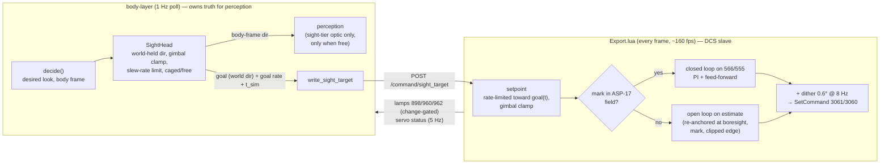

# BL-B80 — the 9K113 sight: Petrovich's simulated sight, with the DCS sight as its slave (v2)

Re-plan, 2026-10-22. Supersedes `plan-v1-position-model.md` (built, reviewed, never flown), whose
premises — AI axis is a position target, 874/876 are a readback, DCS's AI overlay must be kept
on — were overturned by probe runs 1–10 (`docs/acceptance/2026-10-22-9k113-ai-latency-probe.md`).
Specification: `explore-notes.md`, sections from "Explore 2026-10-22 (after probe runs 1–8)" on.

### Goal

Give Petrovich a **simulated 9K113 sight** — gyro world-stabilised, gimbal-limited (±60° az,
+20/−15° el, airframe frame), slew-rate-limited (20°/s az, 10°/s el) — that **is** his sight for
perception, and make the real DCS sight a **best-effort slave** of it: open-loop outside the
ASP-17 field, closed-loop on the ASP-17 mark inside it (target ±0.02° there), with a tiny dither
always on, gated on the real lamps (960 READY for the guidance unit, 898 Л5 for gyro alignment).

### The picture



```mermaid
stateDiagram-v2
  [*] --> off
  off --> caged: arg 886 on (any cause)
  caged --> free: Л5 arg 898 lit (~T+10 s)
  free --> caged: 898 off while 886 on (unexpected; treat as re-alignment)
  caged --> off: 886 off
  free --> off: 886 off (pilot, DCS hard-manoeuvre auto-off, our write)
  note right of caged: sight = airframe boresight\nno sight perception\nno DCS writes
  note right of free: world-held, slews ≤20/10 °/s\nperception through it\nDCS slaved to it
```

**The inference that shapes the inside-HUD loop, and what it rests on.** Run 10's 0.06–0.10°
steady error matches *heading drift (~0.07°/s) ÷ loop gain (1 /s)*: the probe held a target fixed
in the **airframe** frame while the real sight is **world**-held, so every yaw was a ramp
disturbance a proportional loop on an integrating plant cannot null. In this design the setpoint is
a **world** direction converted to airframe axes every frame, so the sight and the setpoint drift
together under yaw and that disturbance vanishes. What remains is target motion from own
translation (≈0.02°/s at 3.5 km closing) — handled by feed-forward plus an integral term. **This
rests on the AI-axis rate adding to the world-held direction** (pilot's reading, and consistent with
runs 6–7); Flight B measures it. If it holds, the P loop alone may already be near ±0.02°, which is
why Stage 5 (precision) is gated on Flight B's numbers rather than built blind.

### What survives from the v1 branch, and what is removed

| v1 piece | fate | why |
|---|---|---|
| `home_phase` derived from observed arg 886 every poll (`logger.run_once`), command block no longer sets it | **keep** | settled direction; independent of channel model |
| sight-tier-only gating of sight-derived input into `_apply_active_gaze` | **keep, re-sourced** | same seam now carries the simulated head's direction instead of 874/876 |
| alignment cap of sight-tier optic → `BINOCULAR_OPTIC` right after `decide_optic` | **keep, re-gated** | gate becomes "head not `free`" (Л5 898), not a timer |
| `sight_target` op plumbing: `CommandSender.send_sight_target`, `POST /command/sight_target`, `AircraftLayerClient.write_sight_target`, Lua `handle_sight_target_command` + bound check, `sight_effector.write_sight_target` | **keep, reshaped** | new payload (world goal in degrees + rate + `t_sim`); validation pattern unchanged |
| `extract_json_number_field` exponent/non-finite fix + `test_exponent_float_fix.py` | **keep as is** | a real parser bug fix, model-independent |
| `EXPORT_SCRIPT_VERSION`/`EXPECTED_EXPORT_VERSION` paired bump | **keep** (bump again) | convention |
| Lua `sight_rate_limit_step` | **keep** | reused for the setpoint's slew limit |
| Lua `run_sight_pointing`: position re-assertion, centre-target 0.5° bias, 874/876-based AI-off detector, ShowMenu presses (detector and OBSERV-off), `ai_believed_on`, `AI_OFF_*`, Lua `GYRO_ALIGNMENT_S` | **remove** | position model; the overlay is not needed (axis works with it off, runs 2–10) and pressing ShowMenu would switch ED's AI on — a likely second writer to device 7 (`2026-10-22-9k113-ai-axis-obedience-prior-art.md` finding 1) |
| `sight_azimuth_deg_to_raw`, `sight_elevation_raw_to_deg`/`_deg_to_raw`, `_SIGHT_ELEVATION_*` constants | **remove** | position-model conversions of a demand echo |
| `GYRO_ALIGNMENT_S` tunable, `in_gyro_alignment`, `observ_observed_since_sim`, `refresh_readback(now_sim)` | **remove** | Л5 lamp replaces the timer (five runs: lit at T+10.0 s) |
| `advance_sight_aim`'s `sight_az_raw`/`sight_elev_raw` readback preference; trace's elevation "readback" path | **remove** | 874/876 echo the demand (runs 1–10) — reading them as position is now a known-wrong claim |
| `docs/acceptance/2026-10-22-bl-b80-sight-pointing-sortie.md` | **superseded** (header added) | must not be flown |

**Overlay logic: removed entirely.** Nothing in v2 presses ShowMenu.

### Affected Modules / Files

**aircraft-layer**
- `dcs-export/Export.lua` — remove `run_sight_pointing` (above); add `run_sight_servo(t)` (per
  frame): setpoint, world↔airframe rotation, mark conversion, open/closed loop, dither, stall flag;
  add lamps 898/960/962 to `push_cockpit_switch_state`; **drop 874/876 from that feed's change
  gate and payload** (they would change every frame under dither and flood it); new 5 Hz
  `sight_servo` line; extend `push_slew_trace` with servo internals; version bump.
- `src/schema/cockpit_switch.py` — `align_lamp`/`ready_lamp`/`launch_perm_lamp: bool | None`
  (optional, older Export.lua never sends them); `sight_az`/`sight_elev` stay optional and go absent.
- `src/schema/sight_servo.py` (new), `src/collector/cache.py`, `src/collector/server.py`,
  `src/api/server.py` — `GET /sight_servo/latest`, same shape as `/cockpit_switch/latest`.
  **Departure, stated:** a second feed rather than more fields on `cockpit_switch`, because that
  feed is change-gated and the servo status changes every frame — a different rate class.
- `src/api/server.py`, `src/collector/command_sender.py` — `sight_target` payload reshaped.
- `tests/test_sight_target.py` (reshape), `tests/test_sight_servo_api.py` (new),
  `tests/test_sight_servo_lua.py` (new — pure-math Lua functions run under `luajit`/`lua5.1`,
  **skipped without one**, the precedent `test_dcs_export_lua_syntax.py::test_loads_as_lua` set).
- `dcs-export/Export.probe-9k113-calibration.lua` (new probe, Stage 0) — reuses
  `Export.probe-9k113-dither.lua`'s logging/loop scaffold rather than starting fresh.

**body-layer**
- `src/belief/sight_head.py` (new) — `SightHead` (frozen) + `advance_sight_head(...)`, the **only**
  construction site besides the runner's `default_factory` (grep-enforced, `MissionMemory.append`
  precedent). New module because it is new physical state with no existing home: `sight_effector`
  is the cockpit-write module, `optic_policy` is intent. It removes no duplication; it adds none.
- `src/perception/geometry.py` — `world_direction_from_body(...)` (inverse of
  `body_relative_direction`'s rotation, built on it as `heading_relative_to_body_relative` is),
  with a round-trip test.
- `src/belief/sight_effector.py` — v1 removals; `GuidanceUnitState` gains `align_observed`,
  `ready_observed`, `launch_perm_observed`; `refresh_readback` reads them; `sight_ready` becomes
  `ready_observed is True` (the BL-B66 seam doing what it was left for); `write_sight_target`
  reshaped to (goal az/el world, rates, `t_sim`).
- `src/belief/optic_policy.py` — `advance_sight_aim` back to the pass-through for unaided/binocular
  (v1 readback params removed); sight-tier actual aim comes from the head.
- `src/logger.py` — runner field `sight_head`; advance it every poll after `decide_optic`; cap
  re-gated on `sight_head.mode is not "free"`; `_apply_active_gaze` takes the head's body direction
  for sight-tier optics; `write_sight_target` sends goal every poll while the head is `free`.
- `src/belief/crew_console.py` — no new utterances (see Decisions); `sight_ready` source changes.
- `src/aircraft_client.py` — `write_sight_target` payload; `get_sight_servo_latest()`.
- `src/sight_trace_writer.py` — columns: desired (body), head (body + world + mode), DCS servo
  (mode, mark-derived body dir, error, stalled) from the servo feed; 874/876 no longer labelled
  "readback".
- `src/tuning.py` consumers / `config/defaults.toml` — remove `GYRO_ALIGNMENT_S`; add
  `belief.sight_head.SLEW_AZ_DPS` (20.0, lo 5, hi 40) and `SLEW_EL_DPS` (10.0, lo 2, hi 20),
  `status="sourced"` (`Devices_specs/9K113.lua` `h_axis_velocity`/`v_axis_velocity`). Gimbal
  limits are **not** new constants: read from `SIGHT_WIDE_OPTIC.regard_*` (one source of truth).
  Regenerate and check the **rendered** `defaults.toml` first sentence.

**Lua-side constants (no tuning mechanism outside body-layer — noted, not improvised):** dither
amplitude/frequency (0.6° / 8 Hz az, elevation component as run 10), Kp (3), Ki, integrator clamp,
mark scale and boresight per axis, field edges, stale-target timeout, extrapolation cap, stall
thresholds, status rate. Grouped in one commented block so a flight-to-flight retune is one diff.

### Design detail

**Simulated head (`SightHead`), per poll.** Fields: `mode: off|caged|free`, `world_az_true_deg`,
`world_el_deg` (above horizon; `None` unless `free`), `goal_world_*` + `goal_rate_*` (what was last
sent). Inputs: observed 886 and 898 (one poll lagged, same lag v1 accepted), attitude (heading,
pitch, bank from ownship telemetry), the decision's desired look **if** the decision is sight-tier,
`dt`. In `free`: current body dir = world→body at this attitude; goal = desired (clamped to
gimbal) or, with no sight-tier desire this poll (glance away, binocular, capped), the head's own
current direction — **it holds, it does not snap back**; step each body axis toward goal by ≤
rate·dt; clamp to gimbal (a held direction that leaves the gimbal envelope is dragged at the stop,
as the real head is); store back as world. `caged`: body (0,0). Entering `free` from `caged`:
world dir = boresight at that poll's attitude. `off`: all `None`.

**Perception** through the sight uses the head's body direction, only in `free`, only for a
sight-tier optic. Perceiving along the slew path is correct (he looks through the glass as it
moves); nothing is perceived along a direction the head has not reached.

**Wire (`sight_target`)**, sent every poll while `free`: goal az (true, deg), goal el (deg), goal
rate az/el (deg/s, world), `t_sim` (DCS model time of the telemetry the decision used). Goal rate
= finite difference of the desired world direction across consecutive polls **while the look
target is the same contact** (`look_contact_id` unchanged), else 0 — belief-only input. Bounds:
az ∈ [−360, 360], el ∈ [−90, 90], |rate| ≤ 30 °/s, all finite; enforced in the API **and** in
Lua (v1's two-sided pattern). Fixed device 7 / cmds 3060/3061 — no widening of the write surface.

**Why goal, not head position, on the wire.** Lua re-runs the same rate limit (`sight_rate_limit_
step`) from the same start (boresight at alignment) toward the same goals, so its setpoint tracks
the body-layer head to within one poll without any resync — sending the head's position plus a
rate instead overshoots by up to 20° whenever a slew ends between polls. The cost is a second
3-line rate limiter in Lua; the Python one is the truth for perception.

**Export.lua `run_sight_servo(t)`, per frame.**
1. 886 off → reset all servo state, write nothing. 898 off → `caged`: estimate := boresight, no
   writes. No fresh target, or target older than the stale timeout (3 s) → `hold`: dither only
   (zero-mean, no net motion — the gyro holds the world direction anyway).
2. goal(t) = goal + rate·clamp(t − t_sim, 0, cap); setpoint ← rate-limited toward goal(t) in
   airframe axes at the frame's attitude (`LoGetSelfData` heading/pitch/bank), gimbal-clamped,
   stored world.
3. Mark: 566 → az, 555 → el (the probe's channels; 565/556 logged alongside), converted with the
   calibrated scale/boresight. **Valid** when OBSERV on, aligned, and not at a clip edge.
4. **Closed loop** when the setpoint is inside the field (minus margin) and the mark is valid:
   e = setpoint_body − mark_body; u = Kp·e + I + ff, ff = 3 × goal world rate (rate = u/3 °/s per
   degree-of-command); I += Ki·e·dt, clamped, frozen while stalled or saturated. Estimate := mark.
5. **Open loop** otherwise: u = sat(Kp·(setpoint − estimate)) + ff; estimate += modelled obeyed
   rate·dt (deadzone 0.18° modelled). **Re-anchors**: boresight at alignment; the mark whenever
   valid; a **clipped** mark is a half-plane fact (the sight is beyond that edge) — if the estimate
   contradicts it, project the estimate to edge + 1°, which is what breaks the "estimate says
   inside, sight stuck outside, loop never engages" deadlock.
6. u += dither (0.6° sin 8 Hz az; elevation component cos, run 10's ratio); saturate ±1 unit;
   `SetCommand(3061, u_az/60)`, `SetCommand(3060, u_el_units)` every frame.
7. Stall: |u_loop| ≥ 1.5° for ≥ 0.4 s with mark motion < eps (run 8's definition) → `stalled`
   flag + count. **Report only** — no recovery trick has evidence (stick park refuted, overlay
   inconclusive); dither is the remedy and is already on.
8. Status line at 5 Hz: mode (`off|caged|hold|open|closed`), setpoint body, mark body (or null),
   error, `stalled`, stall count, 962. Per-frame internals (u_p, u_i, ff, dither, mark args) to the
   existing `push_slew_trace` debug log.

**Candidate, measurement pending — "hold still, re-wobble to correct" (user, 2026-10-22).** User,
verbatim: *"what about wobble movement > stop > wobble movement? if that is reliable, we can point
the sight at target and stop. If the sight drifts or target moves then wobble move to realign.
Would that work? That'd help with the ATGM guindace."* A stopped sight is world-held (run 10:
moved 0.001 of 0.011 mark units over a 3 s pause), so once on target, writing **nothing** removes
the dither's own ~0.03° p-p from the final seconds; a correction is then made by resuming dither
plus the loop. Evidence so far is one case (run 10 T: 3 s off, then a 0.5° step landed in 1.28 s),
and run 9 shows the restart must be **with** dither — a plain step after a dither block stalled at
once. **Not settled; the plan does not depend on it.** It slots in as a third closed-loop sub-mode,
`still`: entered when |e| < a still-band for a dwell time, left (back to `closed`, dither on, I
reset) when |e| exceeds a re-wobble threshold or the goal moves. It is gated on **probe run 11**:
stop→re-wobble reliability and latency over stops of 2/5/10/20 s and corrections of 0.05° and 0.5°.
If run 11 says reliable, `still` is built in Stage 5; if not, Stage 5 is PI only. Re-wobble
latency (1.28 s once) is the number that decides whether it suits a moving target — at ATGM
ranges the LOS drifts ≈0.02°/s, so a stop longer than ~1 s needs a correction.

**Calibration (mark scale and boresight).** Near boresight — where an ATGM is launched (962 is the
launch-permission lamp) — scale error barely matters (5% at 0.5° = 0.025°) but **boresight offset
error counts in full**, so boresight is calibrated directly: slow sweeps through boresight in each
axis, boresight = midpoint of 962's rising and falling edges in both sweep directions. Scale: free
sight, zero command, gentle heading change → slope of mark against `LoGetSelfData` heading (run 5's
method, many frames instead of two points); same with pitch for elevation. **Elevation is the open
end**: rest reads 555 = 0.556 but caged-at-boresight reads ≈ 0.833 (runs 5, pilot's alternating
run), and 555's clip edges are unknown — if 555 clips at or near the 9K113 boresight, an
inside-HUD elevation loop is impossible and elevation stays open-loop. Elevation has **never** been
closed-loop-tested, with or without dither.

**Readiness.** `sight_ready` := 960 observed lit. Unchanged around it: OBSERV-on is refused with
`render_unable("GUIDANCE_NOT_READY")` while not ready; one "Guidance unit ready." on readiness. The
four-switch power-up sequence is unchanged and still writes the switches; it just no longer
*declares* readiness. Gyro alignment: Л5 898, via the head's `caged` mode. Both lamps are read
from the observed args, never inferred from our own writes.

### Co-moving Fields

Built from construction sites, not the narrative: `GuidanceUnitState` — `default_factory` at
`logger.py:492`, `replace()` in `sight_effector` (`start_power_up`, `advance_power_up`,
`refresh_readback`) and `logger.py` ≈3238/3304/3323/3343/3356; `OpticState` — fresh constructions
at `optic_policy.py:2364` and `:2443` (both already carry `actual_aim_*` forward; keep it so);
`SightHead` — new, one constructor function + one `default_factory`, grep-enforced. Lua state is
module-level, reset in two places: the 886-off branch and `LuaExportStop`.

| Field | Written by | Transition | Must hold true after |
|---|---|---|---|
| `observ_observed` | external (886) | any OBSERV edge | equals 886; `home_phase` follows next poll |
| `home_phase` | derived from `observ_observed` | 886 on / off | `SIGHTING` / `SCANNING`; the command drain block never writes it |
| `align_observed` | external (898) | 886 on (898 still off) | `False`; head `caged` |
| `SightHead.mode` | internal (`advance_sight_head`) | 886 on | `caged`, world dir `None`, no `sight_target` sent |
| `SightHead.mode` | internal | 898 rises | `free`, world dir = boresight at that attitude, goal = same |
| `SightHead.mode` | internal | 898 falls while 886 on | `caged`, world dir `None` (treated as re-alignment) |
| `SightHead.*` | internal | 886 off (pilot, DCS auto-off, our write) | `off`, every direction/goal/rate `None` |
| sight-tier optic cap | derived, every poll | head not `free` | `optic_decision.optic` is never sight-tier; recomputed, never latched |
| `OpticState.actual_aim_*` | from head (sight-tier) / pass-through (other) | sight-tier ↔ non-sight optic | sight-tier: equals head body dir; the head itself is **not** reset by a non-sight poll |
| `ready_observed` / `sight_ready` | external (960) | 960 rises / falls | `sight_ready` equals it; OBSERV-on gated on it; announcement latch per Decision 2 |
| everything above | `reset_for_new_mission` | mission restart | defaults (`off`, `None`, `False`) |
| Lua goal/setpoint/estimate/I/stall | internal | 886 off, or `LuaExportStop` | all `nil`/0; nothing written |
| Lua estimate | internal | 898 rises | boresight; I = 0 |
| Lua I | internal | open ↔ closed switch, stall, saturation | reset on entering closed; frozen while stalled/saturated |
| Lua goal | external (`sight_target`) | no message for > stale timeout | mode `hold`; dither only |
| Lua `still` sub-mode (candidate, Stage 5, run 11 pending) | internal | |e| > re-wobble threshold, goal moves, mark invalid, or 886/898 edge | back to `closed` with dither on and I = 0 — never left `still` across any reset above |

### Implementation Plan

0. **Calibration probe (aircraft-layer probe script only; can fly in parallel with Stages 1–2).**
   `Export.probe-9k113-calibration.lua`: (a) boresight sweeps az and el through 962's window, both
   directions, ~0.3°/s, dither on; (b) zero-command heading and pitch steps for mark scale;
   (c) elevation closed loop on 555 with dither (first ever) and 555 clip edges; (d) azimuth P loop
   with a **world-frame** target (setpoint fixed in world, converted per frame) — the direct test
   of the inference above; (e) an AI-axis rate during a steady turn, to tell whether the rate adds
   in airframe or world axes. **Flight A** (below). Output: a research note with the numbers.
1. **Removal commit (both subprojects, no new behaviour).** Everything marked *remove* in the
   table; `advance_sight_aim` back to pass-through; tests that asserted v1 behaviour are deleted
   with the code they tested, not rewritten. Separate commit so the surviving diff is reviewable.
2. **Lamps and readiness (both subprojects; testable without DCS except the lamp values).** 898,
   960, 962 on the cockpit-switch feed; 874/876 out of it; schema + `GuidanceUnitState` +
   `refresh_readback`; `sight_ready` from 960. Tests: lamp parsing, `None` leaves prior value,
   OBSERV-on refused while 960 off, announcement latch.
3. **Simulated head and perception (body-layer only; fully testable without DCS).**
   `sight_head.py`, `world_direction_from_body`, runner wiring, cap re-gated, `_apply_active_gaze`
   reading the head. Tests: world hold through a 30° turn (body az changes by −30°, world
   constant); stop-dragging at ±60°; per-axis rate limits over several 1 s polls; caged → free
   seeds boresight; 886 off resets; glance-away holds the head; perception never sight-tier while
   `caged`; a wiring test through `run_once` (the recurring leaf-tested/wiring-untested defect,
   three prior instances) and a mutation of that wiring to show the test catches it.
4. **Slave servo, proportional (aircraft-layer + body-layer send).** `run_sight_servo` steps 1–8
   with Kp only (I = 0) and Stage 0's calibration constants; reshaped `sight_target`; servo status
   feed; body-layer sends goal every poll while `free`; trace columns. Pure-math Lua functions
   (rotation, mark conversion, setpoint step, PI step, clip re-anchor) tested under `luajit` against
   Python reference vectors from `geometry.py`/`sight_head.py`. **Flight B.**
5. **Inside-HUD precision (aircraft-layer; only if Flight B misses ±0.02°, or for the terminal
   phase).** Integral term with anti-windup and feed-forward tuning, from Flight B's slew trace;
   plus the `still` sub-mode (hold still, re-wobble to correct) **only if probe run 11 shows
   stop→re-wobble is reliable**. Run 11 can fly any time — it needs only a probe script, and its
   answer decides Stage 5's shape, not Stages 0–4. **Flight C.**

Stages 1–4 are one batch (one performance and one security pass after Stage 4). Stage 0 is a
probe, outside the batch. Stage 5 is its own batch if built.

**Flights — each says what it measures.**
- **Flight A** (Stage 0 probe, air start): mark scale both axes; az and el boresight from 962
  edges; 555 clip edges and whether 555 can be closed-loop at all; P-loop steady error with a
  world-frame target (prediction: well under run 10's 0.06–0.10°); AI-rate frame in a turn.
  **Plus one cold start** (can be the same session): time from `PWR` to 960 lit (expected
  3–5 min), confirming 960 is the READY lamp.
- **Flight B** (Stage 4, air start, pilot seat, no operator axes bound): OBSERV on → mark at
  boresight ~10 s, then Petrovich's search moves it (mark leaves/re-enters the field as legs cross
  it); in a 20° turn the mark holds world direction; a contact ahead within the field → mark
  settles on Petrovich's simulated direction; logged: settle time, last-2 s RMS error (target
  ≤ 0.02°), stall count/duration per minute; a hard manoeuvre DCS auto-off → `home_phase`
  `SCANNING` within one poll, head `off`, no writes; OBSERV back on → caged ~10 s, no sight reports
  in that window; no ShowMenu ever.
- **Probe run 11** (probe script, any time): stop→re-wobble — after a dithered hold on target,
  stop writing for 2/5/10/20 s, then correct by 0.05° and 0.5° with dither back on; per case:
  responded or not, latency to first motion, settle time, world-hold drift during the stop.
  Decides whether Stage 5 includes `still`.
- **Flight C** (Stage 5, only if built): Flight B's precision rows again, and with `still` built,
  the error during stops and the re-wobble latency in real use.

### Risks & Unknowns

- **The ±0.02° is servo precision against the simulated direction, not against the vehicle.**
  Inside the HUD the mark will sit where *belief* puts the target, which can be tens of metres
  (≈0.2–0.5° at 3 km) off the real vehicle. For gun/rocket line-up that is honest and probably
  fine; for an ATGM it is the miss. Decision 1.
- **Elevation inside the field may not be closable** (555 boresight/clip unknown; never
  closed-loop-tested). Flight A decides; fallback is open-loop elevation, which the pilot sees as
  an elevation error he cannot be told about.
- **Intermittent obedience is not explained**, only suppressed by dither (22/22 + 7/7 steps, two
  runs). If it returns, outside the field nothing can see it; inside, the stall flag records it.
- **Open-loop estimate drifts** when DCS ignores commands outside the field. Harmless to the pilot
  (he cannot see it there); costs acquisition time when the setpoint enters the field. The
  clipped-edge re-anchor bounds the worst case.
- **`min_slew_velocity = rad(0.07)`** (`Devices_specs/9K113.lua`) may impose a minimum obeyed rate
  → a small limit cycle at the setpoint. Visible in Flight B's wobble numbers.
- **Gimbal limits are sourced, not file-verified**: ±60° az user-supplied (2026-09-11), +20/−15°
  el from the manual §3.4 (`optics.py`); DCS's own are native (`av9K113::initLimits`), unreadable
  from Lua. The DCS head stops where DCS stops it; ours where the manual says. A mismatch shows as
  the DCS sight lagging at a stop — outside the HUD, invisible.
- **Lua math has a Python twin.** The rotation and rate limit exist in both; the luajit test is the
  only thing keeping them equal, and it skips on a machine without luajit.
- **960 on a cold start is unconfirmed.** If it never lights, Petrovich never reports ready and
  refuses OBSERV for the whole sortie. Flight A's cold start is therefore before any merge.
- **No investigator dispatch**, deliberately: every remaining unknown (mark calibration, 555
  edges, AI-rate frame, 960 cold-start timing) is a live behaviour, not something the installed
  files hold — the files have been read for this (`Devices_specs/9K113.lua`, `lamps.lua`,
  `mainpanel_init.lua`) and the answers are native. Flights A–B are the instrument.

### Decisions Requiring User Input

> **ANSWERED 2026-10-22 (pilot), verbatim — these override the recommendations below:**
> 1. *"actual position. This same question was discussed and explored earlier, search for it.
>    Crux: Petrovich can \*see\* the target and point sight at it even if belief about world
>    location is incorrect."* — The earlier exploration is
>    `docs/acceptance/2026-10-15-9k113-sight-direction.md` §2–§3: *"The 9K113 itself is very
>    precise on where it is pointing"*; belief about *where the target is in the world* is built
>    by cross-reference (coarse azimuth + the view + landmarks). So **while Petrovich has the
>    target resolved in the sight, the sight aims at the target's actual position** (the
>    associated object's true direction); belief's world location stays as imprecise as it is.
>    This is a sanctioned channel in the plan, scoped to sight aim only — it must not feed the
>    belief's position estimate. In scope for BL-B80 (not deferred to BL-B67).
> 2. *"only on change"* — "Guidance unit ready" spoken only on an observed 960 off→on edge.
> 3. *"nothing new"* — nothing spoken for alignment or stalls; both logged.
> 4–5. Not answered; the recommendations stand (intent elevation checks unchanged; Stage 5 only if
>    Flight B misses ±0.02°).


1. **Where does the terminal-phase ATGM aim come from?** The servo can put the mark within 0.02°
   of a direction; belief cannot supply a direction that good. A real operator holds the crosshair
   on the hull through ×10 optics — which, for Petrovich, means letting the *associated object's*
   true position steer the sight while he has the target resolved in the narrow sight: a sanctioned
   ground-truth channel like `detection_trace_writer`, and a no-omniscience question only you can
   answer. **Recommendation:** not decided here — BL-B80 ships the servo against belief's direction
   (fine for line-up, honest), and this is the first question of BL-B67's explore. Say if you want
   it decided before Stage 5, because Stage 5's value depends on it.
2. **"Guidance unit ready" on a warm air start**, where 960 is lit from t ≈ 0. **Recommendation:**
   announce only on an observed off→on edge — silent on air starts, spoken once on a cold start
   when the unit actually comes up.
3. **What Petrovich says during gyro alignment, and if the sight stalls.** **Recommendation:**
   nothing new — he has already said "Observ on."; the ~10 s is short and expected; a stall is a
   DCS-commanding problem the pilot cannot act on. Both are logged.
4. **Elevation limits in Petrovich's *intent*** (BL-B80 entry: *"Might leave the vertical limit
   out"*). **Recommendation:** leave the intent checks as they are; the simulated head now clamps
   at +20/−15° physically, so an over-ambitious intent only looks along the stop. No reason to
   touch a check that has shipped wrong four times.
5. **Build Stage 5 (PI precision) only if Flight B misses ±0.02°.** **Recommendation:** yes —
   the world-frame setpoint is predicted to remove the dominant error source, and measuring first
   costs one flight against a stage that may be unnecessary. Your "wobble → stop → wobble"
   idea is folded in as Stage 5's candidate `still` mode, built only if probe run 11 shows the
   restart is reliable; it is the natural terminal-phase mode for BL-B67 if it is.

### Second-order effect

Unblocks `[[BL-B67]]` and moves its hardest question to the front: not "can the sight be pointed"
(this answers it) but "what is allowed to point it precisely" (Decision 1). It also retires
`[[BL-B63]]` as a dependency for *pointing* — the per-frame loop lives in Export.lua — though a
faster goal-rate update may still want it for tracking a manoeuvring target. `[[BL-B66]]`'s Stage
4b trace semantics change (874/876 are no longer a position), and its readiness seam is finally
filled by a real lamp.
