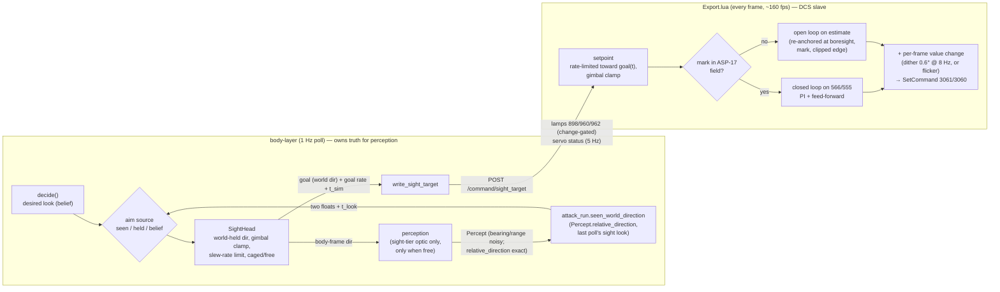

# BL-B80 — the 9K113 sight: Petrovich's simulated sight, with the DCS sight as its slave (v2)

Re-plan, 2026-10-22. Supersedes `plan-v1-position-model.md` (built, reviewed, never flown), whose
premises — AI axis is a position target, 874/876 are a readback, DCS's AI overlay must be kept
on — were overturned by probe runs 1–10 (`docs/acceptance/2026-10-22-9k113-ai-latency-probe.md`).
Specification: `explore-notes.md`, sections from "Explore 2026-10-22 (after probe runs 1–8)" on.

### Goal

Give Petrovich a **simulated 9K113 sight** — gyro world-stabilised, gimbal-limited (±60° az,
+20/−15° el, airframe frame), slew-rate-limited (20°/s az, 10°/s el) — that **is** his sight for
perception, and make the real DCS sight a **best-effort slave** of it: open-loop outside the
ASP-17 field, closed-loop on the ASP-17 mark inside it (target ±0.02° there), with an invisible or
tiny per-frame value change always on (flicker or dither — whichever run 11 says keeps the axis
obeyed), gated on the real lamps (960 READY for the guidance unit, 898 Л5 for gyro alignment).
**While Petrovich has the target resolved in the sight, the sight aims at what he sees** — the
target's actual direction, through the existing ownship-relative channel — not at belief's
imprecise world location, which stays exactly as imprecise as it is now ("Aim source", below).

*Amended 2026-10-22 (second pass), from the pilot's answer to Decision 1. What changed: the Goal,
the picture, a new "Aim source" design section with "What the pilot experiences", Stage 3b,
Affected Files (`attack_run.py`, `sight_head.py`, `logger.py`, `sight_trace_writer.py`,
`body-layer/CLAUDE.md`, two fence tests), the Co-moving Fields rows marked *seen aim*, Flight B's
rows, Risks (the first risk is replaced), Decision 1 (resolved, pointer), the second-order effect,
and the per-frame mechanism made agnostic between dither and flicker (run 11). Everything else is
unchanged.*

*Amended 2026-10-26 (third pass), from `docs/acceptance/2026-10-26-sortie-feedback.md` §2 (the
pilot flew the merged v2 build and saw the DCS mark moving inside the HUD while the debug view
showed the simulated sight pointing well to the side). What changed, all aircraft-layer-only: a
new "### v3 — the real sight never leaves the ASP-17 field (edge park)" section immediately before
"### Implementation Plan" replaces Design-detail steps 3–5's field-validity gate and open-loop
branch, superseding them in place (marked inline, not deleted); a new Stage 6; new Risks and one
Decision. **Nothing under `body-layer/` changes** — the wire shape, `SightHead`, and the "Aim
source" rule are all untouched; this is purely how `Export.lua` slaves the real sight to the goal
it already receives.

### The picture



```mermaid
stateDiagram-v2
  [*] --> off
  off --> caged: arg 886 on (any cause)
  caged --> free: Л5 arg 898 lit (~T+10 s)
  free --> caged: 898 off while 886 on (unexpected; treat as re-alignment)
  caged --> off: 886 off
  free --> off: 886 off (pilot, DCS hard-manoeuvre auto-off, our write)
  note right of caged: sight = airframe boresight\nno sight perception\nno DCS writes
  note right of free: world-held, slews ≤20/10 °/s\nperception through it\nDCS slaved to it
```

**The inference that shapes the inside-HUD loop, and what it rests on.** Run 10's 0.06–0.10°
steady error matches *heading drift (~0.07°/s) ÷ loop gain (1 /s)*: the probe held a target fixed
in the **airframe** frame while the real sight is **world**-held, so every yaw was a ramp
disturbance a proportional loop on an integrating plant cannot null. In this design the setpoint is
a **world** direction converted to airframe axes every frame, so the sight and the setpoint drift
together under yaw and that disturbance vanishes. What remains is target motion from own
translation (≈0.02°/s at 3.5 km closing) — handled by feed-forward plus an integral term. **This
rests on the AI-axis rate adding to the world-held direction** (pilot's reading, and consistent with
runs 6–7); Flight B measures it. If it holds, the P loop alone may already be near ±0.02°, which is
why Stage 5 (precision) is gated on Flight B's numbers rather than built blind.

### What survives from the v1 branch, and what is removed

| v1 piece | fate | why |
|---|---|---|
| `home_phase` derived from observed arg 886 every poll (`logger.run_once`), command block no longer sets it | **keep** | settled direction; independent of channel model |
| sight-tier-only gating of sight-derived input into `_apply_active_gaze` | **keep, re-sourced** | same seam now carries the simulated head's direction instead of 874/876 |
| alignment cap of sight-tier optic → `BINOCULAR_OPTIC` right after `decide_optic` | **keep, re-gated** | gate becomes "head not `free`" (Л5 898), not a timer |
| `sight_target` op plumbing: `CommandSender.send_sight_target`, `POST /command/sight_target`, `AircraftLayerClient.write_sight_target`, Lua `handle_sight_target_command` + bound check, `sight_effector.write_sight_target` | **keep, reshaped** | new payload (world goal in degrees + rate + `t_sim`); validation pattern unchanged |
| `extract_json_number_field` exponent/non-finite fix + `test_exponent_float_fix.py` | **keep as is** | a real parser bug fix, model-independent |
| `EXPORT_SCRIPT_VERSION`/`EXPECTED_EXPORT_VERSION` paired bump | **keep** (bump again) | convention |
| Lua `sight_rate_limit_step` | **keep** | reused for the setpoint's slew limit |
| Lua `run_sight_pointing`: position re-assertion, centre-target 0.5° bias, 874/876-based AI-off detector, ShowMenu presses (detector and OBSERV-off), `ai_believed_on`, `AI_OFF_*`, Lua `GYRO_ALIGNMENT_S` | **remove** | position model; the overlay is not needed (axis works with it off, runs 2–10) and pressing ShowMenu would switch ED's AI on — a likely second writer to device 7 (`2026-10-22-9k113-ai-axis-obedience-prior-art.md` finding 1) |
| `sight_azimuth_deg_to_raw`, `sight_elevation_raw_to_deg`/`_deg_to_raw`, `_SIGHT_ELEVATION_*` constants | **remove** | position-model conversions of a demand echo |
| `GYRO_ALIGNMENT_S` tunable, `in_gyro_alignment`, `observ_observed_since_sim`, `refresh_readback(now_sim)` | **remove** | Л5 lamp replaces the timer (five runs: lit at T+10.0 s) |
| `advance_sight_aim`'s `sight_az_raw`/`sight_elev_raw` readback preference; trace's elevation "readback" path | **remove** | 874/876 echo the demand (runs 1–10) — reading them as position is now a known-wrong claim |
| `docs/acceptance/2026-10-22-bl-b80-sight-pointing-sortie.md` | **superseded** (header added) | must not be flown |

**Overlay logic: removed entirely.** Nothing in v2 presses ShowMenu.

### Affected Modules / Files

**aircraft-layer**
- `dcs-export/Export.lua` — remove `run_sight_pointing` (above); add `run_sight_servo(t)` (per
  frame): setpoint, world↔airframe rotation, mark conversion, open/closed loop, dither, stall flag;
  add lamps 898/960/962 to `push_cockpit_switch_state`; **drop 874/876 from that feed's change
  gate and payload** (they would change every frame under dither and flood it); new 5 Hz
  `sight_servo` line; extend `push_slew_trace` with servo internals; version bump.
- `src/schema/cockpit_switch.py` — `align_lamp`/`ready_lamp`/`launch_perm_lamp: bool | None`
  (optional, older Export.lua never sends them); `sight_az`/`sight_elev` stay optional and go absent.
- `src/schema/sight_servo.py` (new), `src/collector/cache.py`, `src/collector/server.py`,
  `src/api/server.py` — `GET /sight_servo/latest`, same shape as `/cockpit_switch/latest`.
  **Departure, stated:** a second feed rather than more fields on `cockpit_switch`, because that
  feed is change-gated and the servo status changes every frame — a different rate class.
- `src/api/server.py`, `src/collector/command_sender.py` — `sight_target` payload reshaped.
- `tests/test_sight_target.py` (reshape), `tests/test_sight_servo_api.py` (new),
  `tests/test_sight_servo_lua.py` (new — pure-math Lua functions run under `luajit`/`lua5.1`,
  **skipped without one**, the precedent `test_dcs_export_lua_syntax.py::test_loads_as_lua` set).
- `dcs-export/Export.probe-9k113-calibration.lua` (new probe, Stage 0) — reuses
  `Export.probe-9k113-dither.lua`'s logging/loop scaffold rather than starting fresh.

**body-layer**
- `src/belief/sight_head.py` (new) — `SightHead` (frozen) + `advance_sight_head(...)`, the **only**
  construction site besides the runner's `default_factory` (grep-enforced, `MissionMemory.append`
  precedent). New module because it is new physical state with no existing home: `sight_effector`
  is the cockpit-write module, `optic_policy` is intent. It removes no duplication; it adds none.
- `src/perception/geometry.py` — `world_direction_from_body(...)` (inverse of
  `body_relative_direction`'s rotation, built on it as `heading_relative_to_body_relative` is),
  with a round-trip test.
- `src/belief/sight_effector.py` — v1 removals; `GuidanceUnitState` gains `align_observed`,
  `ready_observed`, `launch_perm_observed`; `refresh_readback` reads them; `sight_ready` becomes
  `ready_observed is True` (the BL-B66 seam doing what it was left for); `write_sight_target`
  reshaped to (goal az/el world, rates, `t_sim`).
- `src/belief/optic_policy.py` — `advance_sight_aim` back to the pass-through for unaided/binocular
  (v1 readback params removed); sight-tier actual aim comes from the head.
- `src/logger.py` — runner field `sight_head`; advance it every poll after `decide_optic`; cap
  re-gated on `sight_head.mode is not "free"`; `_apply_active_gaze` takes the head's body direction
  for sight-tier optics; `write_sight_target` sends goal every poll while the head is `free`.
- `src/belief/crew_console.py` — no new utterances (see Decisions); `sight_ready` source changes.
- `src/aircraft_client.py` — `write_sight_target` payload; `get_sight_servo_latest()`.
- `src/sight_trace_writer.py` — columns: desired (body), head (body + world + mode), DCS servo
  (mode, mark-derived body dir, error, stalled) from the servo feed; 874/876 no longer labelled
  "readback".
- `src/belief/attack_run.py` (*seen aim*) — factor `_tier1_alignment`'s first half (undo the
  look's yaw, giving the world-frame offset) into a private `_seen_world_offset(percept)` used by
  both, and add **one public function** `seen_world_direction(contact) -> SeenDirection | None`
  (`az_true_deg`, `el_deg`, `t_look`, all floats; no attitude, no ownship displacement — the
  direction *as seen at the look*). `_tier1_alignment`'s outputs must not change (its existing
  tests pass unmodified — the refactor's regression gate).
- `src/belief/sight_head.py` (*seen aim*) — `select_sight_goal(...)` (aim source
  `seen`/`held`/`belief`) and the head fields it needs (Co-moving Fields). The only caller of
  `seen_world_direction`.
- `src/logger.py` (*seen aim*) — record `last_sight_look_sim` (t_sim of the latest poll whose
  applied optic was sight-tier with the head `free`); pass the look contact to the head advance.
- `src/sight_trace_writer.py` (*seen aim*) — `aim_source` column and the belief-derived
  direction alongside the goal, so post-flight `|seen − belief|` is computable. Write-only, as
  every trace is.
- `tests/test_attack_run.py` — existing `relative_direction` fence unchanged; new
  `test_sight_head.py` fences F2/F3 (below).
- `body-layer/CLAUDE.md` — Invariants: one new bullet (exact text in "Aim source"); Belief module
  list: `attack_run.py`'s line gains *"and `seen_world_direction`, whose one caller is
  `sight_head.py`"*; new line for `sight_head.py`.
- `src/tuning.py` consumers / `config/defaults.toml` — remove `GYRO_ALIGNMENT_S`; add
  `belief.sight_head.SLEW_AZ_DPS` (20.0, lo 5, hi 40) and `SLEW_EL_DPS` (10.0, lo 2, hi 20),
  `status="sourced"` (`Devices_specs/9K113.lua` `h_axis_velocity`/`v_axis_velocity`). Gimbal
  limits are **not** new constants: read from `SIGHT_WIDE_OPTIC.regard_*` (one source of truth).
  Regenerate and check the **rendered** `defaults.toml` first sentence. *Seen aim* adds
  `belief.sight_head.SEEN_AIM_HOLD_S` (3.0, lo 0.0, hi 10.0, `status="agreed-guess"`): how long
  the sight keeps tracking the last seen direction after the target drops out of the glass, before
  falling back to belief. First sentence must say that.

**Lua-side constants (no tuning mechanism outside body-layer — noted, not improvised):** the
per-frame value-change mechanism — **one** selector, `SERVO_WOBBLE = "dither" | "flicker"`, with
its parameters (dither 0.6° / 8 Hz az, elevation component as run 10; flicker amplitude, default
from run 11 within ±1e-5…1e-3 unit), Kp (3), Ki, integrator clamp,
mark scale and boresight per axis, field edges, stale-target timeout, extrapolation cap, stall
thresholds, status rate. Grouped in one commented block so a flight-to-flight retune is one diff.

### Design detail

**Simulated head (`SightHead`), per poll.** Fields: `mode: off|caged|free`, `world_az_true_deg`,
`world_el_deg` (above horizon; `None` unless `free`), `goal_world_*` + `goal_rate_*` (what was last
sent). Inputs: observed 886 and 898 (one poll lagged, same lag v1 accepted), attitude (heading,
pitch, bank from ownship telemetry), the decision's desired look **if** the decision is sight-tier,
`dt`. In `free`: current body dir = world→body at this attitude; goal = `select_sight_goal`'s
choice ("Aim source": seen / held / belief-desired), clamped to gimbal, or, with no sight-tier desire this poll (glance away, binocular, capped), the head's own
current direction — **it holds, it does not snap back**; step each body axis toward goal by ≤
rate·dt; clamp to gimbal (a held direction that leaves the gimbal envelope is dragged at the stop,
as the real head is); store back as world. `caged`: body (0,0). Entering `free` from `caged`:
world dir = boresight at that poll's attitude. `off`: all `None`.

**Perception** through the sight uses the head's body direction, only in `free`, only for a
sight-tier optic. Perceiving along the slew path is correct (he looks through the glass as it
moves); nothing is perceived along a direction the head has not reached.

**Wire (`sight_target`)**, sent every poll while `free`: goal az (true, deg), goal el (deg), goal
rate az/el (deg/s, world), `t_sim` (DCS model time of the telemetry the decision used; for a
`seen`/`held` goal, the look's own `t_sim`). Goal rate = finite difference of the desired world
direction across consecutive polls **while the look target is the same contact**
(`look_contact_id` unchanged), else 0 — belief-only input for a `belief` goal; for a `seen` goal,
the finite difference across consecutive seen looks of that contact ("Aim source"). Bounds:
az ∈ [−360, 360], el ∈ [−90, 90], |rate| ≤ 30 °/s, **`t_sim` finite and ≥ 0**, all finite;
enforced in the API **and** in Lua (v1's two-sided pattern) — a missing or non-finite `t_sim`
rejects the whole command, exactly like a non-finite `az`/`el` (security plan review, required
change; `t_sim` feeds `clamp(t − t_sim, 0, cap)` directly). Fixed device 7 / cmds 3060/3061 — no widening of the write surface.

**Why goal, not head position, on the wire.** Lua re-runs the same rate limit (`sight_rate_limit_
step`) from the same start (boresight at alignment) toward the same goals, so its setpoint tracks
the body-layer head to within one poll without any resync — sending the head's position plus a
rate instead overshoots by up to 20° whenever a slew ends between polls. The cost is a second
3-line rate limiter in Lua; the Python one is the truth for perception.

**Export.lua `run_sight_servo(t)`, per frame.**
1. 886 off → reset all servo state, write nothing. 898 off → `caged`: estimate := boresight, no
   writes. No fresh target, or target older than the stale timeout (3 s) → `hold`: dither only
   (zero-mean, no net motion — the gyro holds the world direction anyway).
2. goal(t) = goal + rate·clamp(t − t_sim, 0, cap); setpoint ← rate-limited toward goal(t) in
   airframe axes at the frame's attitude (`LoGetSelfData` heading/pitch/bank), gimbal-clamped,
   stored world.
3. **SUPERSEDED by v3 (2026-10-26), below.** Mark: 566 → az, 555 → el (the probe's channels;
   565/556 logged alongside), converted with the calibrated scale/boresight. ~~**Valid** when
   OBSERV on, aligned, and not at a clip edge.~~ This line never actually checked the mark's own
   raw value against a clip edge — see v3's "Root cause" for what it checked instead, and why that
   is the sortie bug.
4. **SUPERSEDED by v3, below.** ~~**Closed loop** when the setpoint is inside the field (minus
   margin) and the mark is valid: e = setpoint_body − mark_body; u = Kp·e + I + ff, ff = 3 × goal
   world rate (rate = u/3 °/s per degree-of-command); I += Ki·e·dt, clamped, frozen while stalled
   or saturated. Estimate := mark.~~ "the field" here meant the ±60°/+20°/−15° **gimbal** limits,
   not the ASP-17's own ~±4.3° readable window — v3's root cause.
5. **SUPERSEDED by v3, below.** ~~**Open loop** otherwise: u = sat(Kp·(setpoint − estimate)) + ff;
   estimate += modelled obeyed rate·dt (deadzone 0.18° modelled). **Re-anchors**: boresight at
   alignment; the mark whenever valid; a **clipped** mark is a half-plane fact (the sight is beyond
   that edge) — if the estimate contradicts it, project the estimate to edge + 1°, which is what
   breaks the "estimate says inside, sight stuck outside, loop never engages" deadlock.~~ v3 drops
   open loop entirely; the half-plane re-anchor idea survives, narrowed to the new `homing`
   sub-mode.
6. u += the per-frame value change: **dither** (measured: 0.6° sin 8 Hz az; elevation component
   cos, run 10's ratio) **or flicker** (run 11: an alternating ±ε on the written value, ε far
   below the 0.003-unit deadzone, so no visible motion) — one selector, everything downstream
   identical; saturate ±1 unit; `SetCommand(3061, u_az/60)`, `SetCommand(3060, u_el_units)` every
   frame. The guarantee the servo needs is only "the written value differs from last frame's";
   step 7's stall flag is how a failure of either shows.
7. Stall: |u_loop| ≥ 1.5° for ≥ 0.4 s with mark motion < eps (run 8's definition) → `stalled`
   flag + count. **Report only** — no recovery trick has evidence (stick park refuted, overlay
   inconclusive); dither is the remedy and is already on.
8. Status line at 5 Hz: mode (`off|caged|hold|open|closed`), setpoint body, mark body (or null),
   error, `stalled`, stall count, 962. Per-frame internals (u_p, u_i, ff, dither, mark args) to the
   existing `push_slew_trace` debug log. **Extended by v3**: mode's `open` string becomes `homing`
   (its meaning changed, not just its name — see v3's "Root cause"); two new fields,
   `field_target_azimuth_deg`/`field_target_elevation_deg`; a new `mark_clipped: bool`.

**Candidate, measurement pending — "hold still, re-wobble to correct" (user, 2026-10-22).** User,
verbatim: *"what about wobble movement > stop > wobble movement? if that is reliable, we can point
the sight at target and stop. If the sight drifts or target moves then wobble move to realign.
Would that work? That'd help with the ATGM guindace."* A stopped sight is world-held (run 10:
moved 0.001 of 0.011 mark units over a 3 s pause), so once on target, writing **nothing** removes
the dither's own ~0.03° p-p from the final seconds; a correction is then made by resuming dither
plus the loop. Evidence so far is one case (run 10 T: 3 s off, then a 0.5° step landed in 1.28 s),
and run 9 shows the restart must be **with** dither — a plain step after a dither block stalled at
once. **Not settled; the plan does not depend on it.** It slots in as a third closed-loop sub-mode,
`still`: entered when |e| < a still-band for a dwell time, left (back to `closed`, dither on, I
reset) when |e| exceeds a re-wobble threshold or the goal moves. It is gated on a **stop→re-wobble
probe** (formerly "run 11"; run 11 is now the flicker probe, `probe/9k113-flicker`, so this becomes
run 12 unless run 11's script already includes it): reliability and latency over stops of
2/5/10/20 s and corrections of 0.05° and 0.5°. **If run 11 shows flicker keeps the axis obeyed,
`still` loses its reason to exist** — its only purpose was removing the dither's visible
~0.03° p-p, and flicker has none — and Stage 5 is PI only without that probe. If dither stays and
the stop→re-wobble probe says reliable, `still` is built in Stage 5; if not, Stage 5 is PI only.
Re-wobble
latency (1.28 s once) is the number that decides whether it suits a moving target — at ATGM
ranges the LOS drifts ≈0.02°/s, so a stop longer than ~1 s needs a correction.

**Calibration (mark scale and boresight).** Near boresight — where an ATGM is launched (962 is the
launch-permission lamp) — scale error barely matters (5% at 0.5° = 0.025°) but **boresight offset
error counts in full**, so boresight is calibrated directly: slow sweeps through boresight in each
axis, boresight = midpoint of 962's rising and falling edges in both sweep directions. Scale: free
sight, zero command, gentle heading change → slope of mark against `LoGetSelfData` heading (run 5's
method, many frames instead of two points); same with pitch for elevation. **Elevation is the open
end**: rest reads 555 = 0.556 but caged-at-boresight reads ≈ 0.833 (runs 5, pilot's alternating
run), and 555's clip edges are unknown — if 555 clips at or near the 9K113 boresight, an
inside-HUD elevation loop is impossible and elevation stays open-loop. Elevation has **never** been
closed-loop-tested, with or without dither.

**Readiness.** `sight_ready` := 960 observed lit. Unchanged around it: OBSERV-on is refused with
`render_unable("GUIDANCE_NOT_READY")` while not ready; one "Guidance unit ready." on readiness. The
four-switch power-up sequence is unchanged and still writes the switches; it just no longer
*declares* readiness. Gyro alignment: Л5 898, via the head's `caged` mode. Both lamps are read
from the observed args, never inferred from our own writes.

### Aim source: the sight points at what he sees (Decision 1, answered 2026-10-22)

Pilot, verbatim: *"actual position. This same question was discussed and explored earlier, search
for it. Crux: Petrovich can \*see\* the target and point sight at it even if belief about world
location is incorrect."* The earlier exploration is two documents, and they say the same thing:
`docs/acceptance/2026-10-15-9k113-sight-direction.md` §2–§3 (*"The 9K113 itself is very precise on
where it is pointing"*; the world location is built by cross-reference) and
`docs/acceptance/2026-10-14-attack-run-guidance-direction.md`'s **two mechanisms** — *"there's the
belief where the unit is on the map… Then there's 'I'm looking at it, I can tell where it is
relative to ownship'… that is what we need for guidance."*

**No new exception is needed, because the channel already exists.** `plans/attack-run/plan.md`
Decision 16 built exactly this datum for the second of those two mechanisms:

- `naked_eye_source._build_observation` sets `Observation.relative_direction` **only** for a cluster
  admitted this poll through the active optic **with a clear live sightline** — truth-to-truth
  geometry (cluster centroid incl. its real altitude, minus ownship), yaw-removed at the look's own
  heading, passed through `perturbed_relative_direction` at `RELATIVE_DIRECTION_SIGMA_DEG = 0.0`
  (§20, *"Relative direction while he's looking at it -> exact."*).
- `percept_of` carries it into `Percept`; `belief/attack_run.py` is its **only** reader under
  `belief/`, grep-fenced (`test_attack_run.py::test_belief_never_references_relative_direction_
  except_sanctioned_readers`). `_tier1_alignment` already turns it into a current direction.
- `belief/position_belief.py` / `Contact` position never read it — they fuse `bearing_deg`/`range_m`,
  which carry `BEARING_SIGMA_DEG = 3.0`, the range sigma and the per-object systematic bias that
  never averages out. **That is why belief stays off while the sight is on**: the two channels are
  already separate, and this design adds a consumer to one without touching the other.

So the sight goal becomes the **second consumer of an already-sanctioned perception datum**, reached
through one new public function on the already-fenced reader. Preferred over a new exception
module (the brief's fallback) because it adds no new file allowed to see truth, keeps the existing
fence untouched, and reuses the re-rotation code that has flown in BL-14 — *do not reinvent the
wheel*. Preferred over computing the aim inside perception and handing it to the effector directly,
because perception→effector would be a new path around `belief/` with its own fence, where this one
inherits a fence that exists and is tested.

**The selection rule, per poll, inside `advance_sight_head` (`select_sight_goal`):**

| condition (all evaluated on the head's own state, Co-moving Fields) | aim source | goal sent |
|---|---|---|
| head `free`; decision sight-tier; look contact C unchanged; `seen_world_direction(C)` is not `None`; its `t_look == last_sight_look_sim` (C was admitted on the latest **sight-tier** poll, so it was inside the sight's FOV along the head's direction) | `seen` | the seen direction, `t_sim = t_look`; rate = finite difference against the previous `seen` look of C, else 0 |
| head `free`; same C; was `seen`, the condition above now fails (LOS blocked, left the FOV, a binocular/unaided poll, a hands-busy poll); `now − last_seen_t_look ≤ SEEN_AIM_HOLD_S` | `held` | the last seen goal and its rate, unchanged (Lua and the head extrapolate it, capped as already specified) — he keeps tracking as he last saw it move |
| otherwise (no look contact, C changed, hold expired, never seen) | `belief` | today's design: the decision's desired direction, rate from belief, `t_sim` = poll telemetry |

Notes on the rule:
- **"Through the sight" is checked by the runner, not by the percept.** `Percept` carries no optic,
  and a binocular look also produces an exact `relative_direction`. `last_sight_look_sim` is what
  makes a binocular look of C *not* steer the sight — a test case of its own.
- **Direction as seen, stamped with the look time.** The goal is the world direction at the look
  (ownship at the look), `t_sim = t_look`; extrapolation by the finite-difference rate covers both
  ownship translation and target motion across the ≤ 1 poll until the next look. No ownship
  displacement re-projection is done for the sight (unlike `_tier1_alignment`), because the rate
  already contains it and doing both double-counts.
- **Belief → seen transition** jumps the goal by belief's error (≈0.2–0.5° at 3 km, more close in).
  The head and the Lua setpoint cover that inside one poll at 20°/s.
- **`held` is not new knowledge**: it continues the last thing he saw at the rate he saw it move.
  At `SEEN_AIM_HOLD_S = 3.0` and the Lua extrapolation cap, a target that stopped behind a ridge is
  overshot by at most its own speed × the cap — then belief takes over.

**Where the true direction may go, and where it may not — grep-enforced.**

| fence | rule | test |
|---|---|---|
| F1 (exists) | `relative_direction`/`RelativeDirection` appear under `belief/` only in `percept.py`, `attack_run.py` | `test_attack_run.py`, unchanged |
| F2 (new) | `seen_world_direction` appears in `src/` only in `belief/attack_run.py` and `belief/sight_head.py` | `test_sight_head.py` |
| F3 (new) | `sight_head` is imported in `src/` only by `logger.py` and `sight_trace_writer.py`; nothing under `belief/` or `mission_memory/` imports it, and `belief/tools.py`/`tool_api.py`/`crew_console.py`/`speech.py` never mention `SightHead` | `test_sight_head.py` |
| F4 (new, behavioural) | **differential no-leak test**: one `run_once` scenario run twice — once as built, once with `seen_world_direction` monkeypatched to `None` — with a target inside the sight FOV under both aims and belief deliberately offset by its systematic bias. `ContactStore` position estimates, `MissionMemory` appends, every utterance and every `TOOL_SET` result must be **identical**; only the head direction and the wire goal may differ | `test_logger.py` |

The one-directional path is therefore: **perception → `Percept.relative_direction` →
`attack_run.seen_world_direction` → `sight_head` goal → (a) perception gaze next poll, (b)
`sight_target` wire, (c) the slew trace file.** (a) is where he looks, which is what a crewman
holding the crosshair on a hull does; it can change *how many* looks he gets (the target stays
central), never what any look reports. Nothing reads (b) or (c) back.

**Planned `body-layer/CLAUDE.md` edit** — Invariants, inserted directly after the no-omniscience
bullet (which itself is unchanged):

> - **The ownship-relative channel has exactly two consumers, and neither is a position.**
>   `Percept.relative_direction` is exact while he is looking at the target
>   (`RELATIVE_DIRECTION_SIGMA_DEG = 0.0`, attack-run §20) and is read under `belief/` only by
>   `attack_run.py` (fence: `test_attack_run.py`). What `attack_run` derives from it reaches exactly
>   two places: the attack-run alignment words, and — through `attack_run.seen_world_direction`,
>   whose one caller is `belief/sight_head.py` — the 9K113 sight goal (BL-B80; fences:
>   `test_sight_head.py`). Neither path writes `Contact` position, `PositionBelief`,
>   `MissionMemory`, a `TOOL_SET` result or any other speech, and a differential test proves the
>   sight path changes none of them. This is the same perception datum given a second consumer,
>   not a second exception beside `detection_trace_writer.py`; a third consumer is a user decision.

**What the pilot experiences.**
- Searching (no target, or a target not yet in the glass): unchanged — the mark goes where his
  simulated sight goes, slewing at 20/10 °/s, holding world direction through turns.
- He gets the target in the sight (it was called on belief's direction, which is off by tens of
  metres): **within about a second the mark steps onto the vehicle itself** and stays there through
  turns and closure — ±0.02° from the servo on top of the aim point. That step is the visible moment
  "he found it in the glass".
- Petrovich's **words do not get better**: the callout bearing, range, landmark reference and what
  is remembered after the mission keep their current error. The pilot may notice the mark sitting on
  the hull while the called position is a little off — that is the design, and the same split the
  attack run already has (exact *"come left"*, approximate *"two o'clock, two kilometres"*).
- The target goes behind a ridge or out of the field: the mark keeps tracking as it last moved for
  up to 3 s, then returns to belief's direction (a visible small jump off the hull).
- Several vehicles too close to separate in the glass are one cluster: the mark sits on their
  centroid, between hulls if they are side by side (Risks).

### Co-moving Fields

Built from construction sites, not the narrative: `GuidanceUnitState` — `default_factory` at
`logger.py:492`, `replace()` in `sight_effector` (`start_power_up`, `advance_power_up`,
`refresh_readback`) and `logger.py` ≈3238/3304/3323/3343/3356; `OpticState` — fresh constructions
at `optic_policy.py:2364` and `:2443` (both already carry `actual_aim_*` forward; keep it so);
`SightHead` — new, one constructor function + one `default_factory`, grep-enforced. Lua state is
module-level, reset in two places: the 886-off branch and `LuaExportStop`.

| Field | Written by | Transition | Must hold true after |
|---|---|---|---|
| `observ_observed` | external (886) | any OBSERV edge | equals 886; `home_phase` follows next poll |
| `home_phase` | derived from `observ_observed` | 886 on / off | `SIGHTING` / `SCANNING`; the command drain block never writes it |
| `align_observed` | external (898) | 886 on (898 still off) | `False`; head `caged` |
| `SightHead.mode` | internal (`advance_sight_head`) | 886 on | `caged`, world dir `None`, no `sight_target` sent |
| `SightHead.mode` | internal | 898 rises | `free`, world dir = boresight at that attitude, goal = same |
| `SightHead.mode` | internal | 898 falls while 886 on | `caged`, world dir `None` (treated as re-alignment) |
| `SightHead.*` | internal | 886 off (pilot, DCS auto-off, our write) | `off`, every direction/goal/rate `None` |
| sight-tier optic cap | derived, every poll | head not `free` | `optic_decision.optic` is never sight-tier; recomputed, never latched |
| `OpticState.actual_aim_*` | from head (sight-tier) / pass-through (other) | sight-tier ↔ non-sight optic | sight-tier: equals head body dir; the head itself is **not** reset by a non-sight poll |
| `ready_observed` / `sight_ready` | external (960) | 960 rises / falls | `sight_ready` equals it; OBSERV-on gated on it; announcement latch per Decision 2 |
| `SightHead.aim_source`, `seen_contact_id`, `last_seen_goal_*`/`_rate_*`, `last_seen_t_look` (*seen aim*) | internal (`select_sight_goal`) | `seen` look of C | source `seen`; `seen_contact_id = C`; last-seen fields = this look; rate from the previous `seen` look of C only |
| same | internal | condition fails, same C, within `SEEN_AIM_HOLD_S` | source `held`; last-seen fields **unchanged** (not refreshed from belief) |
| same | internal | hold expires, look contact changes or becomes `None` | source `belief`; `seen_contact_id`, last-seen fields `None`; goal rate from belief only (never a seen/belief finite difference) |
| same | internal | head leaves `free` (898 falls, 886 off) | source `belief`, last-seen fields `None` — a re-alignment never resumes an old seen track |
| `last_sight_look_sim` (*seen aim*) | runner, every poll | poll whose applied optic is sight-tier with head `free` | equals that poll's `t_sim`; **not** updated on a binocular/unaided/hands-busy/capped poll |
| everything above | `reset_for_new_mission` | mission restart | defaults (`off`, `None`, `False`, source `belief`) |
| Lua goal/setpoint/estimate/I/stall | internal | 886 off, or `LuaExportStop` | all `nil`/0; nothing written |
| Lua estimate | internal | 898 rises | boresight; I = 0 |
| Lua I | internal | open ↔ closed switch, stall, saturation | reset on entering closed; frozen while stalled/saturated |
| Lua goal | external (`sight_target`) | no message for > stale timeout | mode `hold`; dither only |
| Lua `still` sub-mode (candidate, Stage 5, run 11 pending) | internal | |e| > re-wobble threshold, goal moves, mark invalid, or 886/898 edge | back to `closed` with dither on and I = 0 — never left `still` across any reset above |
| Lua `field_target_body_az/el_deg` (v3, new) | internal (`sight_clip_to_field_body_deg`, every frame, recomputed fresh — never held across frames) | setpoint moves in/out of the inset ASP-17 field, or moves while already outside it | equals the rate-limited setpoint when inside; the radial projection onto the inset field edge when outside, **continuously tracking the moving intersection point** as the setpoint slides (pilot's clarification, 2026-10-26) — **never** equals a point outside the field, and never a stale/held value from an earlier frame |
| Lua `sight_mode` (v3) | internal | mark reading on either axis within `ASP17_FIELD_MARGIN_DEG` of its own raw clip bound | `homing` (was `open`); the `closed` branch is never entered on a clipped mark reading, regardless of how far outside the field the setpoint itself is |

### v3 (2026-10-26) — the real sight never leaves the ASP-17 field (edge park)

**Decision** (`docs/acceptance/2026-10-26-sortie-feedback.md` §2, pilot verbatim): *"Option 2...
The way it works is the ASP-17 shows direction to 9K113 sight by parking the cross hair to edge of
HUD. Like a line drawn from boresight point in HUD to 9K113 position outside visible HUD area and
then the cross is shown where that line intersects the HUD limits. We could use that logic, but
achieve it by moving the sight to that position. Keep it just within the HUD limit so that we do
get a read back value."* Inset margin: *"As close to edge while still keeping the read back
values."*

**Clarified same day, verbatim, and load-bearing — this is continuous tracking, not a one-shot
park**: *"'parks where the line from boresight toward the simulated sight meets the field edge' ->
yes and it keeps it at the intersect point as the simulated sight moves and thus the intersect
point moves."* So `field_target` (below) is not computed once when the sim sight first leaves the
field and then held — it is recomputed every frame from that frame's own setpoint, exactly like
the inside-field case already is. The real sight slides continuously along the field edge,
tracking the moving intersection point, for as long as the sim sight stays outside the field; it
re-centres smoothly onto the sim sight's own direction the moment that direction re-enters the
field (`scale` passing back through 1.0, no mode change, no re-anchor). This is how the design
below is written — `sight_clip_to_field_body_deg` is called every frame inside `run_sight_servo`,
never on a transition edge — but is stated here explicitly because it is also the single easiest
way to misread "parks at the edge" as a one-off action.

So: the real DCS sight's commanded target is never the simulated sight's raw direction once that
direction leaves the ASP-17's own readable field (**measured ≈ ±4.3° azimuth**,
`docs/acceptance/2026-10-22-9k113-ai-latency-probe.md` line 423; elevation's own clip edges were
never measured, "Calibration" above). It is that direction **radially projected from boresight
onto the inset field edge** when outside, and the direction itself when inside. The real sight is
therefore always closed-loop on the ASP-17 mark; **open loop is removed, not kept as a fallback.**
Perception, `SightHead`, and the "Aim source" rule are all unaffected — Petrovich's own simulated
sight stays free within the ±60°/+20°/−15° gimbal limits exactly as `v2` built it; only what
`Export.lua` commands the real head toward changes.

```
   sim sight (desired, outside) ●
                                /
        +--------------------/-+   ASP-17 field (≈ ±4.3° az)
        |                 ○    |   ○ = field_target = projection of the
        |               /      |       desired direction onto the inset
        |             ⊕        |       field edge -- this is what the
        +----------------------+       closed loop tracks, always
```

**Root cause, confirmed by reading `run_sight_servo` (not reasoned about blind).** The existing
`setpoint_inside_field` gate (Design detail, step 4, above) compares the **setpoint** against
`GIMBAL_AZ_HALF_DEG`/`GIMBAL_EL_UP_DEG`/`GIMBAL_EL_DOWN_DEG` (60°/+20°/−15°, minus
`FIELD_MARGIN_DEG`) — the sight's full mechanical slew envelope, not the ASP-17's own ~±4.3°
readable window. So a simulated direction anywhere up to ~58° off boresight was read as "inside
the field," and the **closed** branch ran: `e_az = setpoint_body_az_deg − sight_mark_body_az_deg`,
with `sight_mark_body_az_deg` built from the mark's raw argument (566), which *physically cannot
exceed* the ASP-17's own ±4.3° window — it saturates there regardless of where the real sight
actually is. The closed branch's `u_az`/`u_el` have **no saturation at all** before the final
write-command clamp (±1.5 raw units, ≈±90°/±30° equivalent) — unlike the (now-removed) open
branch, which was capped at `OPEN_LOOP_SAT_DEG = 6.0`. So a 20° simulated direction produced
`e_az ≈ 20 − 4.3 ≈ 15.7°`, `u_az ≈ Kp·15.7 ≈ 47°` before the write clamp: the servo drove the real
sight hard against (or past) its own clip trying to close an error against a target the mark
geometrically cannot represent, while the mark's number stayed pinned near the clip edge — reading
as "the mark is moving [near the HUD edge]" while the debug view correctly showed the simulated
sight pointing well off to the side. **This is the fifth occurrence of this subsystem's own
recurring defect class** — a field-of-regard-shaped bound gets checked against the wrong frame or
the wrong magnitude (`.claude/agent-memory/dod/project_recurring_field_of_regard_enforcement_gap.md`,
occurrences 1–4, all on this same 9K113 sight). The pattern each time: a bound that exists and is
correctly *named* gets reused for a check it was never sized for. Flagged loudly here for Reviewer
and Security, not left to a fifth near-miss review pass.

**The fix has three parts: two independent and both required to close the bug (fixing only one
reproduces a narrower version of it), plus a third that is a correctness refinement needed for
the continuous-tracking behaviour specifically (without it the bug is closed but the edge-tracking
motion is wrong while sliding):**

1. **What the mark-validity gate checks.** Replace `setpoint_inside_field` (setpoint vs. gimbal
   limits) with a check of the **mark's own raw reading** against the ASP-17's own clip bound —
   `sight_mark_is_clipped(mark_raw, boresight_raw, field_half_deg, deg_per_unit, margin_deg)`,
   true when `|mark_raw-derived degrees| ≥ field_half_deg − margin_deg` on either axis. This is
   what step 3's old comment ("not at a clip edge") already claimed to do and never did.
2. **What the closed loop is commanded toward.** Replace `setpoint_body_az/el_deg` as the error
   loop's reference with `field_target_body_az/el_deg` — the setpoint **radially projected onto
   the inset ASP-17 field** (new pure function, `sight_clip_to_field_body_deg`, same style as
   `sight_world_to_body`/`sight_rate_limit_step`):

   ```lua
   -- scale = 1 when (set_az, set_el) is already inside the inset field;
   -- otherwise the largest scale ≤ 1 that brings it exactly onto the
   -- nearer field edge, per axis, taking the smaller of the two scales
   -- (whichever axis hits its edge first) -- the standard ray-to-box
   -- clip, not a circular one, because the mark is two independent
   -- linear gauges (azimuth 565/566, elevation 555/556), not a cone.
   local function sight_clip_to_field_body_deg(set_az_deg, set_el_deg,
           field_az_half_deg, field_el_half_deg)
       local scale = 1.0
       if set_az_deg ~= 0.0 then
           scale = math.min(scale, field_az_half_deg / math.abs(set_az_deg))
       end
       if set_el_deg ~= 0.0 then
           scale = math.min(scale, field_el_half_deg / math.abs(set_el_deg))
       end
       return set_az_deg * scale, set_el_deg * scale, scale < 1.0
   end
   ```

3. **What feeds the loop's feed-forward term while sliding along the edge.** The feed-forward
   (`ff = FF_GAIN * sight_goal_rate_*_deg_s`, step 4/6 above) exists to anticipate a *moving*
   target, and currently uses the raw world-goal's own rate (`sight_goal_rate_az/el_deg_s`, what
   `SightHead` reports for the simulated sight's own motion). That is the right rate while
   `field_target == setpoint` (inside the field). It is the **wrong** rate while outside: the point
   the loop is actually tracking is `field_target`, and because `scale` itself changes continuously
   as the setpoint moves (not just the setpoint's raw azimuth/elevation), `field_target`'s own rate
   along the boundary can be smaller than the raw goal's rate (sliding tangentially near a corner),
   larger (radial component collapsing as the setpoint swings past perpendicular to the boresight),
   or opposite in sign at a corner crossing. Feed-forward on the wrong rate while sliding either
   lags or overshoots the edge-tracking motion — exactly the kind of error this fix exists to
   remove. **Fix: feed-forward on `field_target`'s own per-frame finite difference**
   (`(field_target_body_az_deg - previous-frame's field_target_body_az_deg) / dt`, same pattern as
   every other per-frame rate already computed in this file — no new external state, no body-layer
   change), used in place of `sight_goal_rate_*_deg_s` whenever `scale < 1.0` that frame; the raw
   goal rate is used unchanged whenever `scale == 1.0` (inside the field), since there
   `field_target` and the goal move identically and the finite difference would just reconstruct
   the same number one frame late for no benefit.

   Doing (2) without (1) would still saturate `u` against an achievable target (no more runaway
   command), but a *stale or stuck* mark reading right at the clip (DCS having briefly ignored the
   drive, or the real head still catching up after an `OBSERV`/alignment edge) would still be
   trusted as ground truth for the error term. Doing (1) without (2) would correctly refuse to
   trust a clipped mark, but the loop would still be *steering toward* an off-field setpoint
   whenever the gate (now correctly narrow) says "not valid," reproducing the open-loop branch's
   drift under a different name. Both together: the loop is always closed, always steering toward
   a point the mark can represent, and the mark-validity gate is a transient/safety signal, not the
   everyday path.

**Merged mode, replacing the old closed/open split.** With `field_target` always inside the field,
the mark should read valid in steady state — the old "open" branch's everyday role disappears.
What remains, renamed `homing` (its meaning changed with the rename — see Co-moving Fields): the
narrow, transient case where the mark reading itself is invalid (missing, or at/near its own clip)
despite `field_target` being inset — e.g., the first frame or two after `caged → free`, or after
`OBSERV` cycles with the real head left pointing stale from before this fix deploys. In `homing`,
reuse the half-plane re-anchor idea step 5 already had (a clipped mark is a known half-plane
fact), bounded by a capped push (`HOMING_SAT_DEG`, inherits the old `OPEN_LOOP_SAT_DEG = 6.0`
value as a starting point — not re-derived, since its role — bound a transient correction, never
sustain one — is unchanged) toward `field_target`, so the mark re-enters validity within a frame
or two and `closed` resumes. **`homing` is not a mode the pilot should see often or for long**; if
it recurs or persists, that is itself the DCS-ignoring-the-drive signal the sortie feedback's point
D asked to make observable (below).

**Handling DCS ignoring the drive inside the field (point D).** Unchanged mechanism (the existing
stall detector, step 7, already does this for the `closed` branch) plus one addition: `homing`
persisting beyond `STALL_WINDOW_S` with no mark motion is now also counted toward
`sight_stall_count`/`sight_stalled`, rather than being a mode with no stall accounting of its own
(the old open branch never fed the stall detector). **Not a new state machine with an externally-
written co-moving field** (step 6a's trigger does not fire here — `sight_mode` is one internal
field, not two independently-written phase fields), but the existing Co-moving Fields table is
updated above for the renamed/added rows regardless, since this change touches what they mean.

**Field constants (new, Lua-only — same "no tuning mechanism outside body-layer" posture the
plan already states for this file's constants).**

| constant | default | source | status |
|---|---|---|---|
| `ASP17_FIELD_AZ_HALF_DEG` | 4.3 | measured, `2026-10-22-9k113-ai-latency-probe.md` line 423 | measured |
| `ASP17_FIELD_EL_HALF_DEG` | 4.3 (= az's value) | **placeholder** — 555's own clip edges were never measured; this assumes the same raw-unit field width as azimuth (both axes currently share `MARK_DEG_PER_UNIT_* = 1/0.039`, itself a placeholder) | needs-flight |
| `ASP17_FIELD_MARGIN_DEG` | 0.5 | **guess** — small relative to a ~4.3° field (the old `FIELD_MARGIN_DEG = 2.0` was sized for a 58°-margin gimbal check and would eat more than half this field); the pilot's own wording ("as close to edge while still keeping the read back values") asks for this to shrink once a flight shows how close the mark can sit to 0.333/0.667 before the readback itself gets noisy | needs-flight |

`FIELD_MARGIN_DEG`/`GIMBAL_*` stay exactly as they are (still correctly used elsewhere: the gimbal
clamp on the setpoint itself, step 2, is unchanged and unaffected by this fix). The two margin
concepts are **not the same constant and must not be merged under one name** — conflating a
60°-scale margin with a 4.3°-scale margin is precisely the cross-domain-coupling shape this file's
elevation-conversion functions already warn about (`implementation.md`, "Notable Discoveries").

**Affected Modules / Files (all in addition to the v2 table above; none of v2's body-layer rows
change).**

- `aircraft-layer/dcs-export/Export.lua` — new pure functions `sight_clip_to_field_body_deg`,
  `sight_mark_is_clipped` (placed, like every other pure helper in this file, above
  `run_sight_servo`'s own `local function` declaration, since it is called from inside it); new
  constants table above; `run_sight_servo`'s steps 3–5 rewritten per "The fix" above; `sight_mode`
  string `"open"` → `"homing"`; `push_sight_servo_state` gains `field_target_azimuth_deg`/
  `field_target_elevation_deg`/`mark_clipped`; version bump.
- `aircraft-layer/src/schema/sight_servo.py` — `SightServoState` gains `field_target_azimuth_deg`/
  `field_target_elevation_deg: float | None` and `mark_clipped: bool`; docstring's five-mode list
  updated (`"open"` → `"homing"`), still passed through verbatim, no enum validation added (same
  "this layer carries the raw values and decides nothing" rule the module docstring already
  states).
- `aircraft-layer/tests/test_sight_servo_lua.py` — new `TestSightClipToFieldBodyDeg` (pure
  function, reference computed inline with `math`, no body-layer import — same module-
  independence note the file's own docstring already carries) and `TestSightMarkIsClipped`; extend
  `TestRunSightServoObservOffWrites`'s mock-run harness with a new
  `TestRunSightServoFieldPark` class (below).
- `aircraft-layer/tests/test_sight_servo_api.py` — the one test using `"open"` as an example wire
  value is relabelled `"homing"` for clarity (the schema does not validate the string, so this is
  documentation, not a behavioural fix).
- `body-layer/CLAUDE.md` — one clause added to the `--slew-trace` paragraph noting the trace now
  also carries `field_target_*`/`mark_clipped` once a `sight_servo` sample exists (`src/
  sight_trace_writer.py` — new columns, same "write-only" posture every other trace column has).
- `notes/the-9k113-sight-bl-b64.md` — new bullet for DoD to harvest: this is occurrence 5 of the
  recurring field-of-regard-enforcement defect, and the first occurrence where the bound checked
  against the *wrong magnitude* (not just the wrong frame, occurrence 4's shape) produced a
  user-visible, flight-observed symptom rather than being caught by review first.

**Tests (`TestRunSightServoFieldPark`, mock-run harness extending `_run_servo_off_sequence`'s
pattern).** All exercised against the real, extracted `run_sight_servo` body, not a reproduction:

- A setpoint 20° off boresight (well outside the ASP-17 field, well inside the gimbal limits) with
  a mocked mark reading that tracks `field_target` (not the raw 20° setpoint) converges — the
  commanded correction shrinks toward zero as the mocked mark approaches the *projected* point,
  not the 20° point. **Named mutation this must catch**: reverting `field_target` back to the raw
  setpoint reproduces exactly the sortie's own symptom — an unbounded growing command against a
  mark that cannot move past the field edge — and the test must fail against that reversion.
- A mocked mark reading held exactly at the clip edge (566 = 0.667) with `field_target` safely
  inset: mode must be `homing`, not `closed` — this is the regression test for the root cause
  itself (the old code, given this exact input, reported `closed` because its gate never looked at
  the mark's own value). **This is the test to run red against the pre-fix code** before writing
  the fix, to confirm it actually reproduces the bug, not just a plausible-sounding description of
  it.
- `homing` with the mark clipped on the right edge recovers to `closed` once the mocked mark moves
  back inside the margin — one frame's worth of improvement is enough, no multi-frame settle
  required at the mock level.
- A setpoint that oscillates in and out of the field (crossing the ASP-17 boundary every few
  frames, the ordinary "searching" case) never produces a `field_target` outside
  `ASP17_FIELD_AZ_HALF_DEG - ASP17_FIELD_MARGIN_DEG`/`ASP17_FIELD_EL_HALF_DEG - ...` on either axis,
  for any sampled setpoint magnitude up to the full gimbal range — a property test over a small
  grid of setpoint values, not just the two or three cases above.
- `homing`'s capped push feeds the existing stall detector (point D): a mark held fixed at the
  clip for longer than `STALL_WINDOW_S` while `homing` sets `sight_stalled`/increments
  `sight_stall_count`, matching the `closed` branch's own behaviour — the old open branch's
  silence here is the gap this closes.
- **Continuous edge-tracking, not a one-shot park** (the pilot's clarification): a setpoint swept
  smoothly from 10° to 40° azimuth while held a few degrees outside the elevation field (a
  tangential slide along the az edge, not a radial approach) produces a `field_target_body_az_deg`
  sequence that moves smoothly and monotonically with it, frame to frame, never jumping or
  sticking at one value while the setpoint keeps moving — the regression case for "parks once"
  instead of "tracks continuously."
- **Feed-forward uses the edge point's own rate, not the raw goal's rate, while sliding**: with a
  mocked `sight_goal_rate_az_deg_s` deliberately set to a value that does **not** match
  `field_target`'s own frame-to-frame finite difference (constructed so the two rates differ in
  sign), the commanded correction must track the finite-difference rate. **Named mutation this
  must catch**: feeding `sight_goal_rate_*_deg_s` into `ff` unconditionally (reverting part 3 only,
  parts 1–2 left fixed) passes every other test above but fails this one — the bug it reproduces
  is edge-tracking lag/overshoot, not the original runaway-command bug, which is exactly why part
  3 needs its own test rather than relying on parts 1–2's tests to catch its absence.
- The stall detector needs no change to handle a *moving* `field_target`: its own definition
  (commanding a real correction for `STALL_WINDOW_S` with the **mark** not moving) is already
  defined in terms of mark motion, not target motion, so a sliding edge goal that the real sight
  successfully follows never trips it — worth one explicit test (mark tracking a sliding
  `field_target` cleanly) precisely because it is easy to assume stall needs touching here and it
  does not.

**Risks & Unknowns (v3-specific, in addition to the v2 list above — most of which still applies
unchanged: elevation closability, intermittent obedience, gimbal-limit sourcing, the Lua/Python
math twin).**

- **`ASP17_FIELD_EL_HALF_DEG` is a guess, not a measurement** — if the real elevation field is
  much narrower than 4.3°, `field_target`'s elevation component will still occasionally land
  outside the true window and reproduce a smaller version of the same symptom on that axis alone;
  if much wider, the margin is overly conservative and the real sight parks further from the true
  edge than it needs to. Flight A (already in the v2 plan, not yet flown with this fix) is where
  this gets measured; ship the placeholder, tighten after.
- **`ASP17_FIELD_MARGIN_DEG = 0.5°` is also a guess.** Too small and dither/measurement noise could
  intermittently clip the mark right at the edge (false `homing` churn); too large and the real
  sight parks visibly short of the HUD edge, which is the opposite of what the pilot asked for
  ("as close to edge while still keeping the read back values"). Needs a flight to tune down.
- **`homing` churn at the field boundary.** A setpoint sitting exactly at the field edge (the
  pilot's own 3 o'clock example, or any target near boresight's perpendicular) could flicker
  between `closed` and `homing` frame to frame if the margin is too tight relative to dither's own
  ~0.03° p-p noise on the mark. The property test above samples near the boundary deliberately to
  surface this before a flight does.
- **This fix cannot be verified by the existing Flight A/B cards as written** — neither names a
  case where the simulated sight is held well outside the ASP-17 field. The next sortie (before or
  as part of Flight B) must add exactly that case: call a target well off boresight (3+ o'clock,
  reproducing the pilot's own observation), watch the real ASP-17 cross hair park near the HUD
  edge rather than drift/peg, then bring the target back toward boresight and confirm the cross
  hair tracks it smoothly back in. Air start, per this project's own 9K113 testing convention.

**Decisions Requiring User Input (v3-specific).**

> **ANSWERED 2026-10-26 (pilot), verbatim:** *"Elevation - measure in flight."* Read as: the
> elevation clip edges (555) are measured on the next air-start flight and
> `ASP17_FIELD_EL_HALF_DEG` / the margin are set from that measurement. The build carries the
> placeholder only so that flight can run; the trace must log raw 555 at the clip transitions so
> the edges can be read off it. The value is not to be trusted, or tuned by eye, before then.

1. **Ship the elevation field half-angle/margin as guesses (above), or hold elevation closed-loop
   back until 555's clip edges are measured** (e.g., freeze elevation at boresight, azimuth-only
   field park, until Flight A's numbers land)? **Recommendation:** ship the guess — it is the same
   posture the rest of v2 already ships under (mark scale/boresight are also placeholders pending
   Flight A), and an elevation field park that is somewhat mis-sized is still strictly better than
   the current unbounded-command bug; freezing elevation entirely would leave the exact symptom
   the pilot reported, just on one axis only, for no evidenced benefit. Say if you'd rather hold it
   back.
2. Everything else in this section (the `"open"` → `"homing"` rename, the two-constant split
   instead of reusing `FIELD_MARGIN_DEG`, `HOMING_SAT_DEG` inheriting the old `OPEN_LOOP_SAT_DEG`
   value) is local, reversible, and does not change product behaviour beyond what this section
   already specifies — not escalated, per `AGENTS.md`'s Escalation Rules.

**Second-order effect.** Tightens, not widens, `[[BL-B67]]`'s inherited foundation: the ATGM run
was already going to depend on the mark being trustworthy near boresight (where ATGM launch
happens, per the v2 "Calibration" section) — this fix is what makes "trustworthy" true for a mark
reading in the first place, rather than one that can be driven to represent a position it
physically cannot hold. Also closes out occurrence 5 of the field-of-regard-enforcement pattern
(`.claude/agent-memory/dod/project_recurring_field_of_regard_enforcement_gap.md`) specifically for
this subsystem's *last* remaining field-of-regard-shaped check — every other one on this sight
(gimbal clamp, intent's ±60° azimuth cap) was already checked against its own correct frame/
magnitude before this pass.

### Implementation Plan

> **Probe run 11 result (2026-10-22, `docs/acceptance/2026-10-22-9k113-ai-latency-probe.md` on
> `probe/9k113-flicker`), folded in before building:** the pilot's rule is confirmed — DCS takes
> the axis only when the value changes (constant pulses 3 of 10 moved; flicker of any size
> ±1e-5…1e-3, 18 of 18). Holding with **dither 0.6° / 8 Hz gave 0.006–0.013° RMS** (meets the
> ±0.02° ATGM budget: the dither carries small corrections across the 0.18° deadzone); flicker alone
> left 0.04–0.06°. A stopped sight drifts ~0.003–0.005°/s. So: **`SERVO_WOBBLE` default `"dither"`
> (0.6°, 8 Hz), always on**; `"flicker"` (±1e-4) kept as the alternative; **the `still` sub-mode is
> dropped** (stopping drifts and gains nothing). Stage 5 (PI precision) is expected to be
> unnecessary — Flight B checks the world-frame hold against ±0.02°.


0. **Calibration probe (aircraft-layer probe script only; can fly in parallel with Stages 1–2).**
   `Export.probe-9k113-calibration.lua`: (a) boresight sweeps az and el through 962's window, both
   directions, ~0.3°/s, dither on; (b) zero-command heading and pitch steps for mark scale;
   (c) elevation closed loop on 555 with dither (first ever) and 555 clip edges; (d) azimuth P loop
   with a **world-frame** target (setpoint fixed in world, converted per frame) — the direct test
   of the inference above; (e) an AI-axis rate during a steady turn, to tell whether the rate adds
   in airframe or world axes. **Flight A** (below). Output: a research note with the numbers.
1. **Removal commit (both subprojects, no new behaviour).** Everything marked *remove* in the
   table; `advance_sight_aim` back to pass-through; tests that asserted v1 behaviour are deleted
   with the code they tested, not rewritten. Separate commit so the surviving diff is reviewable.
2. **Lamps and readiness (both subprojects; testable without DCS except the lamp values).** 898,
   960, 962 on the cockpit-switch feed; 874/876 out of it; schema + `GuidanceUnitState` +
   `refresh_readback`; `sight_ready` from 960. Tests: lamp parsing, `None` leaves prior value,
   OBSERV-on refused while 960 off, announcement latch.
3. **Simulated head and perception (body-layer only; fully testable without DCS).**
   `sight_head.py`, `world_direction_from_body`, runner wiring, cap re-gated, `_apply_active_gaze`
   reading the head. Tests: world hold through a 30° turn (body az changes by −30°, world
   constant); stop-dragging at ±60°; per-axis rate limits over several 1 s polls; caged → free
   seeds boresight; 886 off resets; glance-away holds the head; perception never sight-tier while
   `caged`; a wiring test through `run_once` (the recurring leaf-tested/wiring-untested defect,
   three prior instances) and a mutation of that wiring to show the test catches it.
3b. **Seen aim (body-layer only; fully testable without DCS; same batch).** `attack_run`
   refactor + `seen_world_direction`; `select_sight_goal`; `last_sight_look_sim`; trace column;
   `SEEN_AIM_HOLD_S`; the `body-layer/CLAUDE.md` edit. Tests: `_tier1_alignment` unchanged (its
   existing tests, unmodified); `seen_world_direction` equals the truth geometry it was built from
   (and `None` without a `relative_direction`); the selection table row by row — **a binocular
   look of C with an exact `relative_direction` does not steer the sight**; C changing drops the
   seen track at once; `held` for exactly `SEEN_AIM_HOLD_S` then `belief`; rate never differenced
   across a seen/belief pair; 898 falling clears the track; F2/F3 fences (each exercised — the
   fenced name must actually appear in the sanctioned file); **F4 differential no-leak test**; a
   `run_once` wiring test that a seen look moves the next poll's wire goal onto the true direction
   while the contact's believed position is unchanged, plus a mutation (goal from belief) the test
   catches. Placed after Stage 3 because it needs the head; before Stage 4 so Flight B flies it.
4. **Slave servo, proportional (aircraft-layer + body-layer send).** `run_sight_servo` steps 1–8
   with Kp only (I = 0) and Stage 0's calibration constants; reshaped `sight_target`; servo status
   feed; body-layer sends goal every poll while `free`; trace columns. Pure-math Lua functions
   (rotation, mark conversion, setpoint step, PI step, clip re-anchor) tested under `luajit` against
   Python reference vectors from `geometry.py`/`sight_head.py`. **Flight B.**
5. **Inside-HUD precision (aircraft-layer; only if Flight B misses ±0.02°, or for the terminal
   phase).** Integral term with anti-windup and feed-forward tuning, from Flight B's slew trace;
   plus the `still` sub-mode (hold still, re-wobble to correct) **only if run 11 keeps dither
   (flicker fails) and the stop→re-wobble probe shows the restart is reliable**. Both probes can fly
   any time — they need only a probe script — and their answers decide Stage 5's shape and Stage
   4's `SERVO_WOBBLE` default, not Stages 0–3b. **Flight C.**
6. **ASP-17 field park (v3, aircraft-layer only; fully testable without DCS via the luajit pure-
   math/mock-run pattern already used for Stages 4/5).** `sight_clip_to_field_body_deg`,
   `sight_mark_is_clipped`, the merged closed/`homing` mode, part 3's feed-forward switch, the new
   constants table, `push_sight_servo_state`'s new fields, the `"open"`→`"homing"` rename, the
   `body-layer/CLAUDE.md` clause. Tests: the `TestRunSightServoFieldPark` class above (including
   the red run against the pre-fix code confirming the root-cause reproduction), the continuous-
   tracking/tangential-slide test, the feed-forward-rate test and its named mutation, the stall-
   while-sliding test, the boundary-property test. **Does not touch body-layer** — no body-layer
   checks need re-running beyond confirming nothing in that subproject changed. Lands on
   `feature/9k113-sight-pointing` ahead of Flight B (which has not been flown or had its card
   written yet, so this is a revision to an unflown build, not a fix to a merged one). The next
   sortie's card (to be written once this stage is implemented) must add the case Risks names
   below: hold the target well outside the ASP-17 field and watch the real cross hair park and
   slide at the edge rather than drift or peg.

Stages 1–4 (with 3b) are one batch (one performance and one security pass after Stage 4). Stage 0 is a
probe, outside the batch. Stage 5 is its own batch if built. **Stage 6 is its own batch** (one
performance and one security pass after it) — it lands on the same branch as Stages 1–4 but after
that batch's own passes already ran, and changes the servo's control logic enough (removing a
whole branch, adding two new per-frame pure functions) to warrant its own pass rather than being
folded silently into an already-approved batch.

**Flights — each says what it measures.**
- **Flight A** (Stage 0 probe, air start): mark scale both axes; az and el boresight from 962
  edges; 555 clip edges and whether 555 can be closed-loop at all; P-loop steady error with a
  world-frame target (prediction: well under run 10's 0.06–0.10°); AI-rate frame in a turn.
  **Plus one cold start** (can be the same session): time from `PWR` to 960 lit (expected
  3–5 min), confirming 960 is the READY lamp.
- **Flight B** (Stage 4, air start, pilot seat, no operator axes bound): OBSERV on → mark at
  boresight ~10 s, then Petrovich's search moves it (mark leaves/re-enters the field as legs cross
  it); in a 20° turn the mark holds world direction; a contact ahead within the field → mark
  settles on Petrovich's simulated direction; logged: settle time, last-2 s RMS error (target
  ≤ 0.02°), stall count/duration per minute; a hard manoeuvre DCS auto-off → `home_phase`
  `SCANNING` within one poll, head `off`, no writes; OBSERV back on → caged ~10 s, no sight reports
  in that window; no ShowMenu ever.
  **Seen aim rows** (a stationary identified vehicle, 2–4 km, inside the ASP-17 field, narrow
  sight): trace `aim_source` goes `belief` → `seen` within one poll of the target being admitted
  through the sight; **the mark sits on the real vehicle** — pilot's eye on the ASP-17 plus a
  screenshot, and servo error (setpoint − mark) last-2 s RMS ≤ 0.02°; **belief stays off** — trace
  `|seen − belief|` stays at its usual size (expected 0.2–0.5° at 3 km) and the belief-truth log's
  position error for that contact is not smaller at the end of the look than at its start; the
  callout bearing/range is unchanged in quality. Then mask it (turn it out of the field, or a ridge):
  `held` for ≤ 3 s, then `belief`, mark steps off the hull. Optional: one moving vehicle, to see the
  rate extrapolation hold the mark on it between polls.
- **Probe run 11** (`probe/9k113-flicker`, any time): does an invisible per-frame value flicker
  (±1e-5…1e-3 unit) keep the AI axis obeyed as dither does (pilot's hypothesis: DCS acts on an axis
  only when its value changes)? Decides `SERVO_WOBBLE`'s default; if flicker works, `still` is moot.
- **Stop→re-wobble probe** (run 12, or folded into run 11; only needed if dither stays): after a
  dithered hold on target, stop writing for 2/5/10/20 s, then correct by 0.05° and 0.5° with dither
  back on; per case: responded or not, latency to first motion, settle time, world-hold drift during
  the stop. Decides whether Stage 5 includes `still`.
- **Flight C** (Stage 5, only if built): Flight B's precision rows again, and with `still` built,
  the error during stops and the re-wobble latency in real use.

### Risks & Unknowns

- ~~The ±0.02° is servo precision against the simulated direction, not against the vehicle.~~
  **Resolved by Decision 1's answer** (seen aim): while the target is resolved in the sight the
  setpoint *is* the vehicle's direction. What remains is listed below.
- **Aim point is the DCS unit's reference point, not the hull centre.** `relative_direction` is
  built from the cluster centroid's `alt_m`, which is the object's position — likely near its base.
  For a 2.4 m-high BTR at 3.5 km, base vs centre is ≈0.02°, i.e. the whole vertical budget. Flight
  B's screenshot shows it; if low, a fixed half-height offset per classification is a later,
  separate change (the class is perceived, so this is not a truth leak).
- **Merged clusters aim at a centroid.** Vehicles the optic cannot separate (clustering's angular
  (S) criterion) are one cluster, and the mark sits between them. Through ×10 narrow at 3–4 km this
  needs vehicles within a few metres of each other; side-by-side parked vehicles are the case.
  Honest (it is what he can resolve), but for an ATGM it is a miss. BL-B67's concern.
- **The seen goal is one poll old plus extrapolation.** A target manoeuvring between looks (turning
  vehicle) is off by its acceleration × ~1 s²/2 until the next look. Stationary and steady targets
  are covered by the rate. A faster look cadence is `[[BL-B63]]`'s, not this plan's.
- **Seen aim changes how often he sees the target, not what he reports.** Holding the crosshair on
  the hull keeps it central, so admissions may be more continuous; each look still carries its own
  noise and the never-averaging systematic bias. F4 proves single-look identity; the long-run
  "more looks" effect is legitimate (a real operator holding on target sees it more) and belief's
  fused floor bounds it. Named so nobody reads a slightly tighter track as a leak — or a leak as
  that.
- **`held` overshoots a target that stopped while hidden** by up to its speed × the extrapolation
  cap, for ≤ `SEEN_AIM_HOLD_S`. Visible only inside the field, and only during masking.
- **Elevation inside the field may not be closable** (555 boresight/clip unknown; never
  closed-loop-tested). Flight A decides; fallback is open-loop elevation, which the pilot sees as
  an elevation error he cannot be told about.
- **Intermittent obedience is not explained**, only suppressed by dither (22/22 + 7/7 steps, two
  runs). If it returns, outside the field nothing can see it; inside, the stall flag records it.
- ~~**Open-loop estimate drifts** when DCS ignores commands outside the field. Harmless to the
  pilot (he cannot see it there); costs acquisition time when the setpoint enters the field. The
  clipped-edge re-anchor bounds the worst case.~~ **SUPERSEDED by v3 (2026-10-26)**: this is
  exactly the risk the pilot's sortie observation proved wrong — not harmless, because the gate
  that was supposed to keep this drift invisible used the wrong field size. v3 removes the branch
  this risk was about. See v3's own Risks for what replaces it.
- **`min_slew_velocity = rad(0.07)`** (`Devices_specs/9K113.lua`) may impose a minimum obeyed rate
  → a small limit cycle at the setpoint. Visible in Flight B's wobble numbers.
- **Gimbal limits are sourced, not file-verified**: ±60° az user-supplied (2026-09-11), +20/−15°
  el from the manual §3.4 (`optics.py`); DCS's own are native (`av9K113::initLimits`), unreadable
  from Lua. The DCS head stops where DCS stops it; ours where the manual says. A mismatch shows as
  the DCS sight lagging at a stop — outside the HUD, invisible.
- **Lua math has a Python twin.** The rotation and rate limit exist in both; the luajit test is the
  only thing keeping them equal, and it skips on a machine without luajit.
- **960 on a cold start is unconfirmed.** If it never lights, Petrovich never reports ready and
  refuses OBSERV for the whole sortie. Flight A's cold start is therefore before any merge.
- **No investigator dispatch**, deliberately: every remaining unknown (mark calibration, 555
  edges, AI-rate frame, 960 cold-start timing) is a live behaviour, not something the installed
  files hold — the files have been read for this (`Devices_specs/9K113.lua`, `lamps.lua`,
  `mainpanel_init.lua`) and the answers are native. Flights A–B are the instrument.

### Decisions Requiring User Input

> **ANSWERED 2026-10-22 (pilot), verbatim — these override the recommendations below:**
> 1. *"actual position. This same question was discussed and explored earlier, search for it.
>    Crux: Petrovich can \*see\* the target and point sight at it even if belief about world
>    location is incorrect."* — The earlier exploration is
>    `docs/acceptance/2026-10-15-9k113-sight-direction.md` §2–§3: *"The 9K113 itself is very
>    precise on where it is pointing"*; belief about *where the target is in the world* is built
>    by cross-reference (coarse azimuth + the view + landmarks). So **while Petrovich has the
>    target resolved in the sight, the sight aims at the target's actual position** (the
>    associated object's true direction); belief's world location stays as imprecise as it is.
>    This is a sanctioned channel in the plan, scoped to sight aim only — it must not feed the
>    belief's position estimate. In scope for BL-B80 (not deferred to BL-B67).
> 2. *"only on change"* — "Guidance unit ready" spoken only on an observed 960 off→on edge.
> 3. *"nothing new"* — nothing spoken for alignment or stalls; both logged.
> 4–5. Not answered; the recommendations stand (intent elevation checks unchanged; Stage 5 only if
>    Flight B misses ±0.02°).


1. **RESOLVED 2026-10-22 → "Aim source: the sight points at what he sees"** (design section above;
   Stage 3b). The original question and recommendation stay below for the record; the
   recommendation (ship against belief's direction, defer to BL-B67) is **superseded**.
   **Where does the terminal-phase ATGM aim come from?** The servo can put the mark within 0.02°
   of a direction; belief cannot supply a direction that good. A real operator holds the crosshair
   on the hull through ×10 optics — which, for Petrovich, means letting the *associated object's*
   true position steer the sight while he has the target resolved in the narrow sight: a sanctioned
   ground-truth channel like `detection_trace_writer`, and a no-omniscience question only you can
   answer. **Recommendation:** not decided here — BL-B80 ships the servo against belief's direction
   (fine for line-up, honest), and this is the first question of BL-B67's explore. Say if you want
   it decided before Stage 5, because Stage 5's value depends on it.
2. **"Guidance unit ready" on a warm air start**, where 960 is lit from t ≈ 0. **Recommendation:**
   announce only on an observed off→on edge — silent on air starts, spoken once on a cold start
   when the unit actually comes up.
3. **What Petrovich says during gyro alignment, and if the sight stalls.** **Recommendation:**
   nothing new — he has already said "Observ on."; the ~10 s is short and expected; a stall is a
   DCS-commanding problem the pilot cannot act on. Both are logged.
4. **Elevation limits in Petrovich's *intent*** (BL-B80 entry: *"Might leave the vertical limit
   out"*). **Recommendation:** leave the intent checks as they are; the simulated head now clamps
   at +20/−15° physically, so an over-ambitious intent only looks along the stop. No reason to
   touch a check that has shipped wrong four times.
5. **Build Stage 5 (PI precision) only if Flight B misses ±0.02°.** **Recommendation:** yes —
   the world-frame setpoint is predicted to remove the dominant error source, and measuring first
   costs one flight against a stage that may be unnecessary. Your "wobble → stop → wobble"
   idea is folded in as Stage 5's candidate `still` mode, built only if probe run 11 shows the
   restart is reliable; it is the natural terminal-phase mode for BL-B67 if it is. *(Amended
   2026-10-22: run 11 is now the flicker probe; `still` is gated on flicker failing **and** the
   stop→re-wobble probe succeeding — see the `still` paragraph and Stage 5.)*

6. **New, 2026-10-22 (seen aim): the aim point on the vehicle.** The seen direction points at the
   DCS unit's reference point, probably near its base — ≈0.02° low on a BTR at 3.5 km, the whole
   vertical budget. **Recommendation:** fly Flight B as designed and look; if the mark sits low,
   add a half-height offset per perceived class as a separate change. Say if you already know where
   DCS puts a ground vehicle's position point, or want the offset now.

### Second-order effect

Unblocks `[[BL-B67]]` and answers what would have been its hardest question — "what is allowed to
point it precisely" — here, with the seen aim (Decision 1, answered). BL-B67 inherits a sight that
already sits on the vehicle while it is in the glass; what is left to it is the terminal phase's
own problems (merged clusters, aim point on the hull, manoeuvring targets, keeping the look through
launch). It also retires
`[[BL-B63]]` as a dependency for *pointing* — the per-frame loop lives in Export.lua — though a
faster goal-rate update may still want it for tracking a manoeuvring target. `[[BL-B66]]`'s Stage
4b trace semantics change (874/876 are no longer a position), and its readiness seam is finally
filled by a real lamp.
