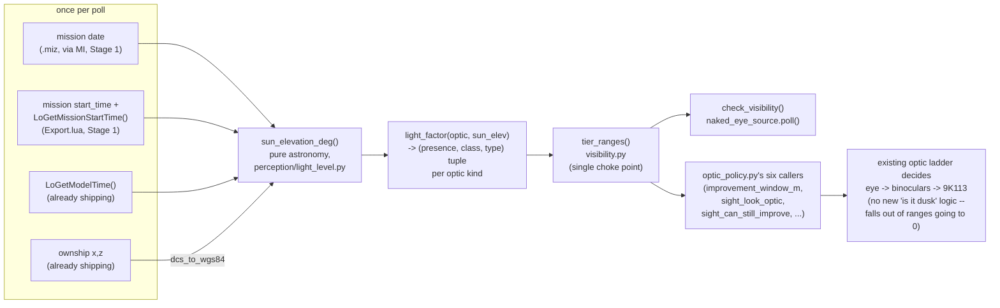
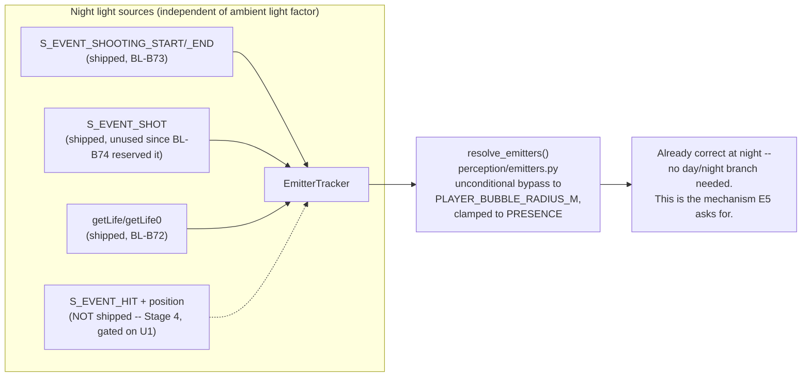

### Goal

Make Petrovich's detection/classification/type ranges fall off with real light level (sun
elevation, derived from the mission's own date/time/position), and add presence-only "light
source" detections at night for things that give off light (firing, burning, explosions once
exposed, missile/rocket launches), so a low-light sortie plays differently from a noon one and the
pilot can trust what Petrovich does and does not report.

### Amendment 2026-11-25 (main loop) — user answers to U1/U2

- **U1 (explosions):** *"as recommended"* — deferred to its own item, `[[BL-B136]]`. Stage 6 below
  is no longer part of BL-B124; its text stays as the outline BL-B136 points at.
- **U2 (start time):** *"ok, but easier still would be mission wall clock time from DCS, if it is
  available."* It is: in the mission scripting state, `timer.getAbsTime()` returns seconds since
  00:00 of the mission's start day (it keeps counting past 86 400 across midnight), and
  `env.mission.date` carries `{Year, Month, Day}`. The firing-events Hook already runs a 1 Hz
  `net.dostring_in("scripting", …)` poll whose return string ends in `timer.getTime()`
  (`petrobrain-firing-events-hook.lua`, `EVENT_POLL_CODE`). **So Stage 1 is replaced**: that poll
  also returns `timer.getAbsTime()` and the mission date, the collector exposes them, and
  body-layer takes date + clock time straight from DCS. This **drops** the `.miz` date threading
  through MI-3/MI-6 and the `LoGetMissionStartTime()` Export read and its units probe. What still
  needs one live check: that `env.mission.date` and `timer.getAbsTime()` are readable from that
  state (expected — both are standard mission-scripting API) and that `getAbsTime()` matches the
  cockpit clock; it rides the dawn-pass sortie. Between 1 Hz samples body-layer advances the clock
  with `LoGetModelTime()` (sun moves ~0.004°/s, so even raw 1 Hz is ample). Missing either value
  once the mission runs = error (Q6), never a daylight fallback. Where this amendment and older
  text below disagree, **this amendment wins** (the "Affected modules" MI-3/MI-6 and `Export.lua`
  bullets, the first diagram's inputs, Stage 1, U2).
- **Hybrid channel (plan check Finding 1):** user, 2026-11-25: *"\"DCS's own AI Petrovich puts in
  its target list\" this will be phased out. Ignore this path completely."* `HybridPerceptionSource`
  (ED's `list_indication`) gets **no** light gate and is not touched by this work; the light factor
  applies to the naked-eye/optic path only.

### Inputs read in full

`plans/bl-b124-light-level/explore-notes.md`, `plans/bl-b124-light-level/alignment.md` (verdict
CONCERNS, E1–E10, open assumptions, Q1–Q7 — all answered in the explore-notes' later sections
except the ones this plan still carries forward, see "Decisions requiring user input" and "Open
assumptions" below), `body-layer/ROADMAP/BL-B124.md`, `body-layer/ROADMAP/BL-B22.md` (factor 2),
`docs/concept/detection-in-non-perfect-conditions.md`, `body-layer/research/
2026-09-26-condition-factors-first-analysis.md`, `body-layer/ROADMAP/BL-B94.md` (deferred, but its
"one named light-level param" framing is exactly what Stage 1 builds), `body-layer/src/perception/
emitters.py`, `plans/emitter-visibility/plan.md`, `body-layer/ROADMAP/BL-B72.md`/`BL-B73.md`,
`body-layer/src/perception/cockpit_mask.py`, `body-layer/src/perception/visibility.py`,
`body-layer/src/perception/optics.py`, `body-layer/src/belief/optic_policy.py`. Investigator's two
new notes (below) and this session's own reading of `body-layer/src/body.py`,
`body-layer/src/perception/naked_eye_source.py`, `world-model/src/coordinates/__init__.py`,
`mission-interpreter/src/miz/{tree,reader}.py`, `mission-interpreter/src/runtime/compact.py`.

### Investigator findings (2026-11-25, commit `e8ed84ed`)

Dated notes: `mission-interpreter/research/2026-11-25-mission-date-and-start-time-for-light-level.md`,
`aircraft-layer/research/2026-11-25-mission-start-time-and-light-level-export-api.md`.

1. **Mission date.** `RawMission.date` (`{Year, Month, Day}`) exists at the `.miz`-reading layer
   and nowhere above it — `MissionUnderstanding` (MI-3) and `RuntimeMissionUnderstanding` (MI-6
   `compact.py`) both lack it entirely; it isn't dropped, it never existed past the raw layer.
   **Schema-only addition, no new DCS read**: thread `date` from `RawMission` through MI-3 → MI-6
   → body-layer's `MissionUnderstandingData`.
2. **Mission start time (clock time of day).** The `.miz`'s top-level `mission["start_time"]` key
   exists but was only ever flagged, never parsed or confirmed (units unverified — a real sample
   was not available this session). `Export.LoGetMissionStartTime()` is a **documented, shipped**
   Export API call, but `Export.lua` does not call it today — only `LoGetModelTime()` is used.
   **Cheapest path**: add one `LoGetMissionStartTime()` field to `Export.lua`'s poll (same cost
   class as any other `Lo*` getter at 5 Hz) and one live probe to confirm its return units
   (seconds-since-midnight, most likely, but unconfirmed). This is new DCS-side plumbing, small and
   low-risk, but real — not a pure schema change like (1).
3. **Ownship lat/lon.** `coordinates.dcs_to_wgs84(theatre, x, z)` is already imported and used
   in-process by body-layer (`mission_memory/admission.py`, `marks.py`) — no change needed, sun
   elevation math calls it directly from ownship telemetry's x/z.
4. **Explosions as a light source.** **Not available today.** The production firing-events Hook's
   `ALLOWED_KINDS` excludes `S_EVENT_HIT`, and even the kinds it does forward (`S_EVENT_DEAD`/
   `S_EVENT_CRASH`) carry no resolved position — only `S_EVENT_SHOT` gets `x`/`z` resolved today.
   Adding this needs a Hook-script diff (new event kind plus position resolution for it), the same
   `pcall`-guarded mechanism already proven live for `S_EVENT_SHOT`, not a new channel.
5. **Missile/rocket launch position.** **Confirmed, no new DCS read.** `S_EVENT_SHOT`'s wire entry
   already carries `initiator`, `t_sim`, and a frozen launch `x`/`z` resolved once at event time
   (built for `[[BL-B74]]`, unused since). `collector.firing_receiver.EmitterTracker` already has
   the latch/watchdog shape a "visible a few seconds" window needs
   (`FIRING_MIN_VISIBLE_S`/`FIRING_WATCHDOG_S`, mission-restart reset) — its `_apply()` currently
   treats `S_EVENT_SHOT` as a deliberate no-op, reserved for `[[BL-B74]]`'s name (`LAUNCH_SMOKE`).

**Consequence for scoping:** (1)+(3)+(5) are schema/wiring-only — no new DCS read, no new risk.
(2) is one small, well-understood `Export.lua` addition plus a probe. (4) is genuinely new Hook
plumbing with an unverified live question (whether it's worth the effort now, see U1 below).

### Design Overview (diagrams)

The key architectural finding: **two independent mechanisms, not one.** The ambient light factor
(top diagram) shrinks the *ordinary* detection ranges. The emitter bypass (bottom diagram) already
ignores range/light entirely and already reaches `PLAYER_BUBBLE_RADIUS_M` — exactly what the user
asked for light sources — so firing and burning need **zero changes** at night; only two new
emitter kinds (explosion, launch flash) are new work, and they reuse the existing bypass, never a
parallel path.

### Co-moving fields

Not triggered — no phase/mode state machine with externally- and internally-written fields is
introduced. The optic ladder (`OpticPhase`, `SIGHTING`/`GLASSING`/`SCANNING`) is untouched;
`light_factor` is a per-poll *input* recomputed fresh every poll from sun elevation, not a stored
mode field, so there is nothing for a construction site to drop.

### Affected modules / files

- `mission-interpreter/src/miz/tree.py`, `reader.py`, `schema/understanding.py` (MI-3),
  `runtime/compact.py` (MI-6) — thread `date` (Year/Month/Day) through to
  `RuntimeMissionUnderstanding`. New field, additive, existing tests unaffected.
- `aircraft-layer/dcs-export/Export.lua` — add `LoGetMissionStartTime()` to the existing 5 Hz poll,
  alongside `LoGetModelTime()`. One probe to confirm return units before trusting it in body-layer.
- `body-layer/src/belief/mission_phase.py` — `MissionUnderstandingData` gains `date`.
- `body-layer/src/perception/light_level.py` (new) — pure astronomy (`sun_elevation_deg(date,
  start_time_s, model_time_s, lat, lon)`) + the anchored per-optic, per-tier factor curve +
  `light_factor(optic: Optic, sun_elevation_deg: float) -> tuple[float, float, float]`. No DCS
  import, fully unit-testable.
- `body-layer/src/perception/visibility.py` — `tier_ranges()` gains a `light_factor: tuple[float,
  float, float] = (1.0, 1.0, 1.0)` parameter (true no-op default), multiplying each tier threshold
  the same way `optic.presence_range_mult` etc. already do. `check_visibility()` gains the same
  parameter, threaded straight through to its one internal `tier_ranges()` call.
- `body-layer/src/perception/naked_eye_source.py` — `poll()` gains a `light_factor` parameter
  (or a setter mirroring `reset_for_new_mission`), passed to its one `check_visibility()` call site.
- `body-layer/src/belief/optic_policy.py` — thread the same `light_factor` tuple through all six
  existing `tier_ranges()` call sites (`improvement_window_m`, `location_gain_for`,
  `sight_look_optic`, `sight_can_still_improve`, and the two more at lines ~1509/1554) and up
  through their own callers to `decide()`'s entry point. **This is the single choke point** — every
  one of these functions already decides "is it worth raising this instrument" purely from
  `tier_ranges()` output, so once light factor shrinks a tier's range to near zero, the ladder
  naturally stops raising that instrument. No new "is it dusk" branch anywhere in this file.
- `body-layer/src/body.py` — compute `light_factor` once per poll (mission date + start_time +
  `LoGetModelTime()` + ownship lat/lon via `dcs_to_wgs84`) and pass it into both the naked-eye
  source and every `optic_policy` call this poll makes. **Missing/unreadable mission date or
  start_time is a startup/runtime error** (user, Q6) — same fail-loud posture as the missing
  world-model store, not a silent daylight fallback.
- `body-layer/src/perception/emitters.py` — `EmitterKind.LAUNCH_SMOKE`'s reserved name is *not*
  reused (it names BL-B74's long decaying smoke tail, explicitly out of scope here per the user's
  "smoke trail, though that we do not see in the dark"). Add a new, separate
  `EmitterKind.LAUNCH_FLASH` (missile/rocket launch, a few seconds, no decay) and, gated on U1,
  `EmitterKind.EXPLOSION`.
- `aircraft-layer/collector/firing_receiver.py` — `EmitterTracker._apply()` gains a branch for
  `S_EVENT_SHOT` producing a short-lived `LAUNCH_FLASH` entry (reusing the existing latch/watchdog
  shape, a fixed few-second visible window via a new tunable), instead of today's no-op.
- Gated on U1: `aircraft-layer/dcs-export/petrobrain-firing-events-hook.lua` — add `S_EVENT_HIT`
  (or similar) to `ALLOWED_KINDS` with position resolution, mirroring `S_EVENT_SHOT`'s existing
  `pcall`-guarded `getPosition()`.
- `body-layer/src/tuning.py` / `config/defaults.toml` — every new behaviour constant below is
  declared through `tuning.real`/`tuning.table`, not a bare literal.

### Behaviour constants, checked against existing declarations

Grepped `body-layer/src/tuning.py` and `config/defaults.toml` for existing light/elevation/flash
constants before adding new ones: none exist today under `perception.light_level.*` or
`perception.emitters.*` beyond `FIRE_LIFE_FRACTION_MAX` (burning threshold, unrelated). New
constants, all `status="judgement"` (first-cut estimates per the explore-notes, to be narrowed by
the test card, same posture `FIRE_LIFE_FRACTION_MAX` itself carries):

- `perception.light_level.SIGHT_FULL_DARK_SUN_ELEV_DEG` (default −12.0) — below this, the 9K113
  (both wide and narrow) sees nothing but light sources.
- `perception.light_level.EYE_FULL_DAYLIGHT_SUN_ELEV_DEG` (default +6.0) — above this, naked eye
  and binoculars are at their full clear-day ranges.
- The three measured anchor points (−5.3°/−3.5°/+0.3°, explore-notes' conversion from the user's
  2020-06-01 mission date; the alignment doc's −6/−4/−0.5 was a pre-date estimate and is superseded) and their per-optic, per-tier factors from
  `docs/concept/detection-in-non-perfect-conditions.md` are declared as data inside
  `light_level.py`, not as individual tunables — the shape (which anchors exist, in what order) is
  a code structure, not a dial; only the two end-point elevations above and the flash duration
  below are genuinely "a sortie will want to move this" constants.
- `perception.emitters.LAUNCH_FLASH_DURATION_S` (default 4.0, lo=2.0, hi=10.0) — how long a
  missile/rocket launch stays a light source after `S_EVENT_SHOT`. "A few seconds" per the user;
  no measurement exists yet.

### Implementation Plan

1. **Stage 1 — SUPERSEDED by the 2026-11-25 amendment above (date and wall clock from the firing
   Hook's scripting-state poll).** Original text kept for the record: **mission date/time reaches body-layer.** Thread `RawMission.date` through MI-3/MI-6
   to `MissionUnderstandingData`. Add `LoGetMissionStartTime()` to `Export.lua`'s poll and one probe
   card to confirm its units on the Windows box before body-layer trusts it. No behaviour change
   yet — this stage only makes the data available. **Needs a flight** (the probe).
2. **Stage 2 — `perception/light_level.py`, pure and fully unit-tested.** Sun-elevation astronomy
   (date + start_time + model_time + lat/lon → sun elevation degrees) and the anchored
   `light_factor(optic, sun_elevation_deg)` curve (piecewise-linear between the measured anchors,
   flat at 1.0 above the full-day elevation, flat at 0.0 below the full-dark elevation). No DCS
   import; testable with synthetic dates/positions against hand sun-elevation checks (e.g. a known
   solstice/equinox table). No flight needed.
3. **Stage 3 — thread `light_factor` through `tier_ranges()`/`check_visibility()`/`optic_policy.py`,
   default `(1.0,1.0,1.0)`.** Mechanical, behaviour-identical-when-omitted, same posture as every
   other additive parameter in this codebase (`forest`, `live_los_coverage`, `group_salient`).
   Reviewable on its own because nothing should change in any existing test. No flight needed.
4. **Stage 4 — wire the real value into `body.py`'s poll loop; missing date/time is an error.**
   This is where behaviour actually changes. Needs a flight: the dawn pass over a BTR-60 from
   about −65 to +35 min around sunrise (test card below).
5. **Stage 5 — `EmitterKind.LAUNCH_FLASH`.** `EmitterTracker._apply()`'s `S_EVENT_SHOT` branch,
   `resolve_emitters()` folds it in alongside `BURNING`/`FIRING`. Needs a flight: a missile or
   rocket launch at night, to check the flash duration and the "presence only, no class/type" rule.
6. **Stage 6 — moved to `[[BL-B136]]` (U1, deferred).** Outline: **`EmitterKind.EXPLOSION`.** Hook-script diff for `S_EVENT_HIT` position
   resolution, collector branch, `resolve_emitters()` fold. Only if the user takes U1's "build it
   now" option; otherwise becomes its own backlog entry.

Stages 1–3 are safe to batch for performance/security review (no behaviour change); Stage 4 changes
real behaviour and should get its own pass; Stages 5–6 are independent of 1–4 and of each other
(two different emitter kinds, two different DCS events) and can each get their own pass once built,
per root `CLAUDE.md`'s "batch of stages actually executed together" rule.

### Test card outline

1. **Dawn pass, BTR-60, broadside, ownship ~200 m AGL** (matches the user's own measurement setup).
   Fly from about sunrise −65 min to +35 min, calling out in real time: when the 9K113 (narrow,
   then wide) first detects; when binoculars first detect; when the naked eye first detects; when
   the naked eye reaches its full daylight detection range. This turns Stage 4's two first-cut end
   points (`SIGHT_FULL_DARK_SUN_ELEV_DEG`, `EYE_FULL_DAYLIGHT_SUN_ELEV_DEG`) from estimates into
   measurements.
2. **Night light-source row.** At full dark, fly near a unit that fires, a burning wreck, and (once
   Stage 5 is flown) a missile/rocket launch. Confirm: presence-only, no class/type, decays
   normally once the light stops, visible out to roughly the player bubble radius, nothing else in
   the scene is visible.
3. **Pilot-seat cockpit mask row** (user's own reminder, recorded in `BL-B124.md` and the
   explore-notes): the user sits in the pilot seat and measures what its cockpit frame occludes
   (the mask Petrovich will need whenever he sits there, i.e. the player is in the CPG seat), for
   a future per-seat mask. Measurement only — do
   not build the per-seat mask in this work; it stays a separate item as the user asked.

### Risks & Unknowns

- ~~`LoGetMissionStartTime()`'s return units are unconfirmed~~ — superseded by the 2026-11-25
  amendment: the open live check is now that `timer.getAbsTime()`/`env.mission.date` are readable
  from the firing Hook's scripting-state poll and that the clock matches the cockpit clock (rides
  the dawn-pass sortie).
- The two end-point elevations (`SIGHT_FULL_DARK_SUN_ELEV_DEG`, `EYE_FULL_DAYLIGHT_SUN_ELEV_DEG`)
  and `LAUNCH_FLASH_DURATION_S` are first-cut estimates, not measurements — the test card narrows
  them, consistent with how `FIRE_LIFE_FRACTION_MAX` was handled.
- Weather is out of scope; until it exists, an overcast dusk reads as clear-sky dusk — known and
  accepted, not a defect of this work (same posture BL-B22 already states).
- The per-poll astronomy call (Stage 2) is cheap (closed-form, no DB/network), but it is now
  called from inside `optic_policy.py`'s hot decision path on every poll via `light_factor` — worth
  a performance look at the batch review (Stage 3), not because it is expected to be costly, but
  because it is new work inside a function that already runs every poll for every candidate.
- Aircraft (airborne targets) use the same light factor as ground units — explicitly accepted as a
  simplification per the user's answer, the twilight-sky-silhouette effect is known and ignored.

### Second-order effect

Once `tier_ranges()` carries a `light_factor` parameter, any future conditions work (BL-B22 factor
3, weather) has a ready-made slot to compose into the same tuple rather than inventing a second
multiplier chain — this plan's Stage 3 plumbing is reusable, not single-purpose. It also settles,
by construction, the open question in BL-B22 about whether a condition factor needs to be
per-optic/per-tier (it does, and this is now the second feature built that way, after rain would be
the third).

### Decisions requiring user input

- **U1: build `EmitterKind.EXPLOSION` (Stage 6) now, or defer it as its own backlog item?**
  Investigator confirmed this needs new Hook plumbing (`S_EVENT_HIT` is not forwarded today, and no
  forwarded event carries a resolved position) — unlike `LAUNCH_FLASH`, which is free. Recommend:
  defer to its own backlog item (own ID, filed from this entry) and ship Stages 1–5 as BL-B124;
  why: the explore-notes list explosions third in the user's light-source list but the cost here is
  categorically different from the other three (new Hook event + position resolution vs. reusing
  an existing channel), and nothing in Stages 1–5 depends on it — the light-source mechanism is
  proven by launch flash and burning/firing either way.
- **U2: how precisely should `LoGetMissionStartTime()`'s probe determine units before Stage 1 is
  considered done** — is a single Windows-box probe sufficient, or does the user want it checked
  against a second mission with a different start time to rule out an off-by-one/timezone
  assumption? Recommend: one probe is enough to unblock Stage 1; a second data point is cheap
  insurance and can ride the same sortie as the Stage 4 dawn pass if the user is already flying
  that day.
