# BL-B67 — the ATGM attack run on the 9K113: plan

Written 2026-10-29 by Architect, against `feature/bl-b67-atgm-run` @ `6b3d7f3a`; **revised the same
day at `8fda0189`** for the user's answers to its six decisions (`explore-notes.md`, "seventh
round"). The revision's main change: **launch and impact now come from `S_EVENT_SHOT` and the
weapon object it carries**, over the existing firing-events Hook bridge. The fire-button feed is
gone, and so is name-matching the world-object list to find our missile.
**Governing inputs, in precedence order:** `plans/bl-b67-atgm-run/explore-notes.md` (the user's
words, rounds 1–7) > `body-layer/ROADMAP/BL-B67.md` > `docs/concept/9K113.md` "attack / ATGM".
Desk recon: `aircraft-layer/research/2026-10-29-bl-b67-loadout-and-atgm-object-recon.md`; bridge:
`aircraft-layer/research/2026-09-24-damage-and-firing-events-over-mission-bridge.md`.
**Premise (user, 2026-10-29):** `[[BL-B80]]` sight pointing is, or will be, accurate. Flight A does
not gate this plan. It gates live acceptance only.

### Goal

When the pilot says `engage <what> <where> missiles`, Petrovich runs a 9K113 ATGM attack. He brings
OBSERV up, arms, selects a loaded pylon and keeps the crosshair on **one unit**. He gives
azimuth-only guidance. If the run starts out of range he says "Out of range", then "In range" once
when it comes in. He announces the launch with the missile word and flight time, stays silent
while the missile flies (urgent threats he can see through the sight still get through), and says
"Impact" when it is gone. Then he resets the transmitter and selects the next missile (or says "No
more missiles"). He keeps tracking until `disengage`, which turns the selector OFF and leaves
OBSERV on.

---

### What the pilot hears — mock run

Target a BTR at 6.5 km, Shturm loaded on stations 1–4, OBSERV off at the start.

| t (s) | Pilot | Petrovich says | Petrovich does |
|---|---|---|---|
| 0 | "Engage BTR two o'clock missiles" | "BTR, two o'clock, six and a half kilometres." *(existing engage readback)* | run starts; weapons-arm trigger (existing) |
| 0 | | "Observ on, wait." | observ-on trigger; selects station 1 (knob step 1) |
| 1 | | "Two o'clock." *(BL-14 o'clock register)* | sight caged until alignment lamp 898 → free |
| ~11 | | "Out of range." *(run started beyond 5,000 m, so said once)* | sight slews to the target and stays on it, no glance-aways |
| 25 | | "Come right." | |
| 40 | | "In range." *(once per run, belief range ≤ 5,000 m)* | |
| 46 | | "Lined up." *(one gate: azimuth only)* | then guidance silence, as BL-14 |
| 52 | *fires* | | `S_EVENT_SHOT`: initiator = us, guided missile, weapon object exists |
| ≤54 | | "Shturm, 13 seconds." *(4,500 m ÷ 345 m/s)* | spoken on the poll the event arrives, ≤ ~2 s after the press |
| 54–65 | | *(silence)*. Only "Taking fire" from a shooter **inside the sight's field** gets through | crosshair held on the one unit |
| ≤67 | | "Impact." | the weapon object stopped existing (`isExist()` false) |
| ≤68 | | | presses Radiation Reset (arg 882), 1 s after impact |
| ≤69 | | "Come left." *(guidance resumes; no range call, already said this run)* | station 1 empty → turns knob to station 2 |
| … | *second attack* | … | |
| 140 | | "Impact." … "No more missiles." | last station empty: keeps tracking for guns/rockets |
| 150 | "Disengage" | "Attack run off." *(existing)* | selector → OFF; **OBSERV stays on** |

**Edge cases, one line each:**

| Situation | Petrovich says | Run |
|---|---|---|
| run **starts** in range | neither range word, ever | as above |
| guidance unit not ready at `engage … missiles` | "Unable, guidance unit not ready." | not started |
| no ATGM loaded at `engage … missiles` | "No more missiles." | tracking run (guns/rockets can follow) |
| `S_EVENT_SHOT` for us but no weapon object (**failed launch**) | nothing | logged; treated as not launched: stays Tracking, no impact word, no reset |
| station count drops with **no** `S_EVENT_SHOT` (jettison or failed launch) | nothing (or "No more missiles." if that emptied the last station) | logged; after the grace window, knob to the next loaded station |
| missile gone within the same poll as the launch (very short shot) | "Shturm, 1 second." then "Impact." | as above |

```mermaid
stateDiagram-v2
    [*] --> Refused: engage … missiles, guidance unit not ready
    Refused --> [*]: "Unable, guidance unit not ready."
    [*] --> Preparing: engage … missiles
    Preparing --> Tracking: OBSERV observed on, station selected
    Preparing --> Empty: no ATGM loaded ("No more missiles")
    Tracking --> InFlight: LaunchEvent (SHOT, ours, guided, weapon exists)
    Preparing --> InFlight: same
    Tracking --> Tracking: FailedLaunch (SHOT, no weapon), logged only
    Tracking --> Selecting: selected station emptied, no launch within grace (logged)
    InFlight --> Resetting: MissileGone ("Impact")
    InFlight --> Resetting: backstop, no gone-report (no word, ERROR logged; Decision N1)
    Resetting --> Selecting: atgm-impact sequence done (wait 1 s, press reset)
    Selecting --> Tracking: selected station still loaded, or next loaded station written
    Selecting --> Empty: none loaded ("No more missiles")
    Empty --> Empty: keeps tracking for guns/rockets
    Preparing --> [*]: disengage / drop target / lost contact / engage w/o missiles
    Tracking --> [*]: same
    InFlight --> [*]: same
    Resetting --> [*]: same
    Selecting --> [*]: same
    Empty --> [*]: same
    note right of [*]: every exit except mission restart fires atgm-run-end (selector OFF). OBSERV untouched.
```

---

### Design, in the "actions / state params / when" shape

Root `CLAUDE.md`, "Behaviour as actions and params". The **"when"** is one pure function,
`belief/atgm_run.py::decide`, modelled on `attack_run.decide` / `optic_policy.decide`
(`(state, inputs) -> (state, speech, actions)`, frozen dataclass, no I/O). `body.py` executes the
actions. Nothing else decides when.

| Kind | Name | What |
|---|---|---|
| **action** | `say(text)` | through the existing `CrewConsole._print`/scheduler path |
| **action** | `fire(trigger)` | existing `effector_engine.fire_trigger`; new triggers `atgm-impact`, `atgm-run-end` |
| **action** | `select_station(step)` | new `effector_engine.write_effector(...)`: one write, same bookkeeping as a row |
| **state param** | `station_counts` | knob step → ATGM count on that station (payload feed + step→station map) |
| **state param** | `selected_step` | Petrovich's own last commanded knob step (`AtgmRunState`) |
| **state param** | `belief_range_m` | `range_m(ownship, contact.last_position)`: belief, never truth |
| **state param** | `missile_family` | `"shturm" / "ataka" / None`: from the launch event's type name, else the selected station's store name |
| **state param** | `launch` / `failed_launch` / `missile_gone` / `own_feed_fresh` | per-poll events from `perception/own_weapons.py` (below) |
| **state param** | `impact_sequence_running` | `atgm-impact` in `EffectorRunState.runs` |
| **state param** | `observ_observed` | existing, arg 886 |

#### Reused, not rebuilt

- **The firing-events Hook bridge** (`aircraft-layer/dcs-export/petrobrain-firing-events-hook.lua`
  → `collector/firing_receiver.py` → `GET /firing/latest`) carries launch and impact. It already
  registers `S_EVENT_SHOT` (in `ALLOWED_KINDS`) and passes it to `EmitterTracker` as a no-op (the
  `[[BL-B74]]` seam). This plan adds an **own-weapon segment** to the same wire and the same
  endpoint. It does not add a second Hook, port or receiver.
- **BL-14 attack run** (`attack_run.decide`, `drain_attack_run`, `attack_target` task, scheduler
  ordering) is the guidance engine. The ATGM run is a **companion state** beside
  `runner.attack_run_state`. It is not a replacement and not a field on `AttackRunState`: that
  state is reset wholesale on every re-point (`attack_run.py:930`), which would silently drop a
  weapon field (the recurring stale-state shape,
  `.claude/agent-memory/dod/project_recurring_stale_state_on_transition.md`).
- **Azimuth-only** = one keyword on `attack_run.decide`, `vertical: bool = True`. `False` drops the
  elevation word table and the elevation half of the aligned conjunction. **This is a flagged
  departure from shipped BL-14 behaviour**, scoped to the ATGM run only (entry: "flag it rather
  than inheriting it silently").
- **Sight pointing** = `[[BL-B80]]`'s `SightHead` + `seen_world_direction`, unchanged except for
  the single-unit aim below.
- **Effector engine + sequence files** for every static switch action: two new triggers and two
  new `*.md` files, so the user can edit them like the others.
- **Readback classes** (`.claude/agent-memory/architect/feedback_readback_classes_poll_vs_read_at_need.md`):
  nothing new joins `polled.toml`. 673 and 962 are **read once at launch** (one-shot `read_args`)
  and logged, filling `GuidanceUnitState.weapon_safety_observed`/`launch_perm_observed`. No
  behaviour reads them (no range warnings at launch, round 3). The knob (963) is read once at run
  start.
- **Tunables** go through `tuning.py`: per-family speed and max range (Wikipedia figures, accepted
  round 1), the shared 400 m minimum, the unconfirmed-drop grace, and the backstop flight time.

#### Three departures, named

1. **`select_station` is a code action, not a sequence row.** The step is computed per launch
   (next loaded station). The sequence format has no parameters, and adding parameterised rows
   would change the format for one caller. `write_effector` reuses the registry resolution and
   records into `assumed_writes`/`commanded_values` exactly as a row does, so the engine keeps one
   set of bookkeeping.
2. **A momentary button sequenced as press + release rows.** `effector-sequences` deliberately did
   not design this (plan line ~852). With a known readback the existing engine already handles it
   (row 1 sees 0 and writes 1; row 2 sees the assumed 1 and writes 0). With an unknown readback it
   skips and WARNs, which is the correct fail-safe for a reset button. No engine change is needed,
   only a research note if Stage 0 shows `default_button` behaves as an absolute set.
3. **Own-weapon truth lives in `perception/`, and only events cross into `belief/`.** The Hook
   keys each of our missiles by a **Hook-local sequence number**, never a DCS object id, so no DCS
   id ever leaves the scripting state. Even that opaque number stays in
   `perception/own_weapons.py::OwnWeaponTracker`, which emits
   `OwnWeaponEvents(launch, failed_launch, missile_gone, own_feed_fresh, t_sim)` only. This is the
   same boundary `Percept` draws, and not a second exception beside `detection_trace_writer.py`:
   the crew perceives its own launch and impact through the sight.

#### Single unit, never a cluster

`Percept.relative_direction` is the **cluster centroid** (`naked_eye_source.py` ~1374). With two
parked vehicles in one cluster the crosshair lands between them: at 3.5 km, 0.02° ≈ 1.2 m, which
is a miss. The fix:

- Perception adds `Observation.aim_unit_direction: RelativeDirection | None`. It is set under
  exactly the same conditions as `relative_direction` (admitted, `live_los_clear is True`) **and**
  only for a sight-tier optic. It is the direction to the **one member nearest this poll's gaze
  centre**, which for a sight look is the sight head's own direction (`body.py` ~905). That is what
  a gunner does: he keeps the crosshair on the vehicle it is already on. It is sticky without any
  memo state. It uses the same `perturbed_relative_direction` (σ = 0.0 stays, round 2). For a
  single-member cluster it equals `relative_direction`.
- `percept_of` carries it, and `attack_run.seen_world_direction(contact, *, single_unit: bool)`
  prefers it when `single_unit` is set. `single_unit` is **derived per poll** in `body.py` as
  `runner.atgm_run_state is not None` and threaded through `advance_sight_head` →
  `select_sight_goal`. It is a decide input, not a stored field
  (`.claude/agent-memory/architect/project_lua_loop_body_limits_split.md`). Outside the ATGM run,
  BL-B80 behaviour is byte-identical.
- Fences: `aim_unit_direction` joins `relative_direction` in `test_attack_run.py`'s grep fence
  (under `belief/`, only `percept.py` and `attack_run.py`). The differential no-leak test in
  `test_sight_head.py` gains the ATGM case.

#### Keeping the look through launch

Today `SIGHTING` re-picks targets (`look_is_finished`) and glances away after `SIGHT_MAX_DWELL_S`
(30 s). A glance-away mid-flight would lose the missile. The fix is a new `optic_policy.decide`
keyword input, `sight_lock_contact_id: str | None`, derived per poll in `body.py` from
`atgm_run_state` and never stored as an `OpticState` field. While `home_phase is SIGHTING` and it
is set:

- the look target is pinned to that contact;
- the dwell break and the look-finished re-pick are skipped;
- the guidance ladder's floor is `SIGHT_WIDE_OPTIC` (ATGM guidance is 9K113-only, BL-14 explore).

**`_force_observ_off` (violent manoeuvre) still wins**: gyro safety is not traded for tracking.
The two sight-reach predicates (look-start filter and continuation stop,
`.claude/agent-memory/implementer/project_9k113_narrow_search_review_fix.md`) both honour the lock.

#### Launch and impact detection: `S_EVENT_SHOT` and the weapon object (user decision 6)

**In the Hook's scripting-state handler** (`petrobrain-firing-events-hook.lua`,
`EVENT_REGISTER_CODE`). On `S_EVENT_SHOT` whose initiator is the player (the same name comparison
`targetsOwnship` already does against `world.getPlayer()`):

- increment `PB_OWN_WEAPON_SEQ`;
- read `event.weapon` once, all `pcall`-guarded: `exists = weapon ~= nil and weapon:isExist()`,
  `typeName = weapon:getTypeName()`, and `desc = weapon:getDesc()` → `desc.category`,
  `desc.guidance`;
- if it exists, keep the object in `PB_OWN_WEAPONS[seq]`, **capped at 8** (the oldest is dropped;
  the run never has more than one in flight);
- queue `OWN_SHOT:<t>:<seq>:<type>:<category>:<guidance>:<exists01>`. `<type>` is truncated to 48
  characters and has `:;|` replaced, Hook-side.

**In the Hook's 1 Hz drain** (`EVENT_POLL_CODE`): for each kept `seq`, if
`pcall(weapon.isExist, weapon)` is not `true`, queue `OWN_GONE:<now>:<seq>` and drop it. The drain
appends these as a **fourth `|` segment**, `<count>|<t>|<entries>|<own_entries>`.
`FiringEventBatch.from_wire` must accept the old three-segment payload too, as an empty own
segment, because the deployed Hook copy can lag the repo.

**Collector** (`firing_receiver.py`): a small `OwnWeaponLedger` beside `EmitterTracker`, fed the
same batches. It works per `seq`: `{type, category, guidance, exists_at_shot, shot_t, gone_t |
None}`. It keeps entries 60 s after `gone_t`, caps at 32, and is cleared on model-time regression
(the same mission-boundary rule `EmitterTracker` uses). `GET /firing/latest` gains an `own_weapons`
key. It reports **state, not edges**, so a body-layer poll that lands between Hook drains loses
nothing.

**Body-layer `perception/own_weapons.py`**: `OwnWeaponTracker` reads the `own_weapons` map each
poll and diffs it against what it has already seen:

- a new `seq` with `exists_at_shot` and a **guided missile** (`category`/`guidance` per the
  `atgm.toml` filter, which Stage 0 Q6 fills) → `LaunchEvent(t_sim, type_name)`. The newest becomes
  the tracked missile;
- a new `seq` without `exists_at_shot` → `FailedLaunch(t_sim, type_name)`. This is the **"missile
  never seen"** case;
- the tracked `seq` gaining `gone_t` → `missile_gone`. Any cause counts (round 2);
- a new unguided `seq` (S-8 rockets also raise `S_EVENT_SHOT`) → nothing;
- `seq`s already present at the tracker's first read, or after a mission reset, are a baseline,
  never a launch;
- `own_feed_fresh` = the snapshot's `dcs_model_time_s` advanced within `FIRING_MAX_AGE_S` (the
  constant `naked_eye_source` already applies to the same feed).

**The payload feed stays, for three things the event cannot give:** which stations still hold an
ATGM (next-station selection and "No more missiles"), the missile family **before** launch (the
range calls need the family's max range), and the jettison/failed-launch log line (count drop, no
SHOT). It **no longer confirms a launch**: the coincidence window is gone.

**What "failed launch, treat as not launched" means concretely** (user decision 4):

- **The "Shturm, N seconds" callout does not wait.** The event *is* the confirmation: it arrives
  carrying the weapon object, already checked for existence at event time. So the callout is
  spoken on the poll a `LaunchEvent` arrives and never on a `FailedLaunch`. There is no extra
  confirmation step to wait for.
- **A failed launch changes no run state.** No InFlight, no impact word, no Radiation Reset, no
  backstop timer. It is logged (WARNING, with the type name) to the sight trace and the
  belief-truth log.
- **If the station's count did drop**, whether through a failed launch or a jettison with no SHOT
  at all, that is handled by the payload, not by the launch path. In Tracking, if the selected
  station's count falls and no `LaunchEvent` arrives within `ATGM_UNCONFIRMED_DROP_GRACE_S`
  (default 3.0 s: the payload feed and the Hook drain reach body-layer by different paths at
  different times), Petrovich logs "count drop without launch". If that emptied the station, he
  goes to Selecting: the knob turns to the next loaded station silently, or he says "No more
  missiles." if none is left. The grace wait matters for a second reason: it stops a count drop
  that arrives *before* its own SHOT from turning the knob under a missile that is just leaving
  the rail.

**Backstop, not a launch outcome:** a confirmed launch whose `OWN_GONE` never arrives (Hook not
loaded mid-sortie, bridge stale, so `own_feed_fresh` is false for `ATGM_MAX_FLIGHT_S`, or the
flight passes `ATGM_MAX_FLIGHT_S` = 25 s) leaves InFlight **without "Impact"**, with an ERROR
logged. After 25 s the missile is physically gone, whatever the feed says (max flight ≈ 6,000 m ÷
345 m/s ≈ 17 s). What happens next is Decision N1.

#### Own missiles must not become contacts

The missile flies down the line of sight, **inside the sight's field the whole flight**. If it
appears in `LoGetWorldObjects` (S-8 rockets do, as `C_8`), it would become a contact and a
callout. So `naked_eye_source` drops candidates whose `Name` is in `OWN_WEAPON_OBJECT_NAMES`
(`atgm.toml`: `C_8` plus whatever Stage 0 Q2 reads for the 9M114/9M120). This is **exclusion only**:
nothing finds our missile by name any more. It also fixes the rocket case (Risks).

#### Silence while the missile flies (user decision 2), and what can still reach him

The user agreed with one condition: *"since Petrovich is looking through the sight, he'll only see
SAM launch etc from that FOV."* So the rule is: in InFlight, attack-run guidance speech and routine
callouts are held until impact. Only urgent threats pass, and **an urgent threat reaches him only
through what the sight's field admits.** Each channel was checked against that:

| Channel | Reaches him outside the sight FOV during the run? | Handling |
|---|---|---|
| Naked-eye/sight perception (`check_visibility`) | **No.** Under the lock the gaze optic is sight-tier (floor `SIGHT_WIDE_OPTIC`, 11.5° field); the optic-FOV gate runs on every candidate | none needed |
| Firing events → emitters ("Taking fire", "Something firing") | **No.** The emitter bypass lifts only gates 3 (range/size) and 5 (forest). Gaze, cockpit mask, **optic FOV** and terrain LOS still apply (`visibility.py`, "Emitter bypass") | none needed; a test pins it: a firing-at-us shooter 20° off the sight axis during InFlight produces no speech |
| `bypass_gate=True` urgent path | **No live producer**: only the `!inject-urgent` test harness (`crew_console.py:5098`) builds an `UrgentCall`. The previous plan's "urgent (`bypass_gate`) still passes" named a path real threats never take | the pass-through set is defined by **event kind** (below), not by `bypass_gate` |
| **HelperAI hybrid channel** (`HybridPerceptionSource`) | **Yes.** It reads ED Petrovich's own detection list (forward hemisphere, ≤ 5 km) with no gaze or FOV gate | it can never break the silence: it never produces `CONTACT_FIRING_SEEN` (firing/`targets_ownship` come only from naked-eye emitter provenance). Its routine events are held like all routine. Pre-existing beyond this run: Decision N3 |
| `CONTACT_ENGAGEMENT_CHANGED` ("Danger <unit>") | Not a sighting: it is belief-derived from a contact already known plus ownship motion | Decision N2 |
| Own `S_EVENT_SHOT` (this plan) | Ours only, and consumed by the run machine | not speech except the launch line |
| `[[BL-B74]]` SAM-launch smoke (not built) | Must not. Its synthetic candidate goes through `check_visibility`, so FOV-gated | amend-on-merge note for `BL-B74`: keep gate 2, and ignore an ownship initiator |
| Pilot command readbacks / brain replies | Pilot-initiated | pass: he asked |

**Pass-through set in InFlight:** `CONTACT_FIRING_SEEN` with `targets_ownship` ("Taking fire",
`_FIRING_TARGETS_OWNSHIP_THREAT_BAND`), plus `CONTACT_ENGAGEMENT_CHANGED` with `engaged=True` if
Decision N2 says pass. Everything else the scheduler would emit is deferred until InFlight ends.
Deferred lines are re-rendered at speak time, per the existing deferral.

#### Range calls (user decision 1)

Per **run**, not per missile. On the first poll in Tracking or Preparing where `belief_range_m` and
the family are both known: if the range is beyond the family's max, he says "Out of range." and
arms `in_range_call_pending`. If it is within, he says nothing and the run is **done with range
calls**. "In range." is said once, the first time a pending run's range drops to max or below.
Nothing after that, for the rest of the run, including later missiles. Only the max bound is
called. Inside 400 m says nothing (round 3, "just track"). A re-point (`engage <new target>
missiles` while active) is a new engage command, so it **resets the range latches**. That is a
local, reversible choice.

---

### Affected Modules / Files

**aircraft-layer**
- `dcs-export/Export.lua`: `push_payload_state` (`LoGetPayloadInfo` + `LoGetNameByType` at the 5
  Hz tick, send on change), **defined below `safe_call`**, pcall-guarded. *(No fire-button push:
  dropped.)*
- `dcs-export/petrobrain-firing-events-hook.lua`: the own-weapon branch in the handler,
  `PB_OWN_WEAPONS`/`PB_OWN_WEAPON_SEQ`, `OWN_GONE` in the drain, the fourth segment, a header
  update. One `dcs.log` line per own SHOT/GONE (low volume).
- `src/schema/firing.py`: `OwnWeaponRawEvent`; `FiringEventBatch.own_events`; parser accepts 3 or
  4 segments.
- `src/schema/payload.py`: new `PayloadSample` (`stations[{index, name, count, container}]`,
  `current_station`, `t`).
- `src/collector/firing_receiver.py`: `OwnWeaponLedger`; `snapshot()` gains `own_weapons`.
- `src/collector/cache.py`, `server.py`, `src/api/server.py`: payload cache and
  `GET /payload/latest`. **No `/fire_button/latest`.**
- `dcs-export/Export.probe-weapons.lua` and `dcs-export/petrobrain-damage-events-probe-hook.lua`:
  **Stage 0 only**, disposable extensions (see Stage 0).
- `research/2026-10-xx-bl-b67-stage0-probe-results.md`: the Stage 0 answers.
- tests: 3- and 4-segment parsing, a sanitised type field, ledger state/retention/cap/mission
  reset, the payload schema, the API round trips.

**body-layer**
- `src/aircraft_client.py`: `get_payload_latest`. `get_firing_latest` is unchanged (new key only).
- `src/perception/own_weapons.py` (new): `OwnWeaponTracker`, `OwnWeaponEvents`, `LaunchEvent`,
  `FailedLaunch`. It holds the Hook `seq`s and exposes none.
- `src/perception/naked_eye_source.py`: `aim_unit_direction`; the `OWN_WEAPON_OBJECT_NAMES`
  exclusion.
- `src/perception/source.py`, `src/belief/percept.py`: the new field, carried through.
- `src/belief/attack_run.py`: the `vertical` keyword; `seen_world_direction(single_unit=…)`.
- `src/belief/sight_head.py`: threads `single_unit` into `select_sight_goal`.
- `src/belief/optic_policy.py`: the `sight_lock_contact_id` input.
- `src/belief/atgm_run.py` (new): `AtgmRunState`, `AtgmInputs`, `AtgmAction`, `decide`; the
  tunables; the missile-family profiles and `family_of(type_or_store_name)`.
- `src/belief/callouts.py`: the in-flight hold, i.e. defer everything except the pass-through set,
  taken as a decide input (`hold_routine: bool`, derived per poll), not stored.
- `src/belief/speech.py`: `render_observ_on_wait`, `render_range_state`, `render_atgm_launch`
  (with the singular "1 second"), `render_impact`, `render_no_more_missiles`.
- `src/belief/crew_console.py`: `_handle_engage` reads `slots["weapon"]` and sets
  `attack_run_weapon` beside `attack_run_transition`; it is reset beside it in `handle_command`.
- `src/belief/effector_engine.py`: `write_effector(state, client, registry, name, value_name,
  now_sim)`; `is_running(state, trigger)`.
- `src/belief/effector_sequences.py`: `EffectorTrigger.ATGM_IMPACT = "atgm-impact"`,
  `ATGM_RUN_END = "atgm-run-end"` + `TRIGGER_INFO`.
- `src/belief/sight_effector.py`: `refresh_from_one_shot(…)` for 673/962 at launch.
- `src/body.py`: `runner.atgm_run_state`; transition apply; the tracker per poll (one extra
  `get_firing_latest()` per poll, see Risks); derive `single_unit`/`sight_lock_contact_id`/
  `hold_routine`; execute the actions; the mission reset clears the tracker baseline and the run.
- `src/mission_memory/…`: `AttackRunPayload.weapon = "missiles"` for an ATGM run (the field
  exists).
- `src/sight_trace_writer.py` / `belief_truth_log.py`: launch, failed-launch, unconfirmed-drop,
  impact, backstop and station rows.
- `config/sequences/mi-24p/effectors.toml`: `missile_station` (`SHSCHO-KNOB-PTR`, values
  `off=0.0, s1=0.1 … s8=0.8`) and `radiation_reset` (`OP-AIM-RESET-RAD-PTR`, `pressed=1.0,
  released=0.0`).
- `config/sequences/mi-24p/atgm-impact.md`: `wait_s(1)` · `radiation_reset pressed` ·
  `radiation_reset released`.
- `config/sequences/mi-24p/atgm-run-end.md`: `missile_station off`.
- `config/sequences/mi-24p/atgm.toml` (new, aircraft data): knob step → payload station index
  (Q3), the guided-missile filter (`category`/`guidance` values, Q6), type/store name → family
  (Q6, Q1), `OWN_WEAPON_OBJECT_NAMES` (Q2). It is data, not code, because it is aircraft-specific
  like `effectors.toml`.
- Regenerated: `config/defaults.toml`, `config/sequences/triggers.md`, `switch-reference.md`.
- tests listed per stage.

**Not touched:** `polled.toml` (stays 886/898/960); `EmitterTracker`'s behaviour (an own SHOT
stays a no-op there); the audio-adapter (`WEAPON_WORDS` already has `missiles`; see Risks for the
singular). **Dropped from the previous revision:** `schema/fire_button.py`, `GET
/fire_button/latest`, `get_fire_button_latest`, the arg-741 per-frame push,
`ATGM_LAUNCH_COINCIDENCE_S`, `ATGM_OBJECT_NAMES` as an identification set.

---

### Implementation Plan

Each stage: ruff/mypy/pytest green, no DCS needed. **Batch A (Stages 1–4) depends on no Stage 0
answer** and can be built and merged before the sortie. Batch B (5–7) waits for Stage 0.

0. **Probe sortie: Windows, the user flies, ~10 min.** Two disposable extensions of existing
   probes:
   - `Export.probe-weapons.lua` (recon Probes 1–2): a one-shot key dump of every new object Name
     and a per-poll object count; `LoGetPayloadInfo()` per poll (each station's `name:count`,
     `CurrentStation`); args **963, 882** read every frame and logged on change with model time;
     scripted while straight and level, step the knob 0→8 via `performClickableAction(3038,
     n×0.1)` one step per 2 s (logs the 963 readback and `CurrentStation`), park on the first
     loaded step, and press Radiation Reset once (3029: 1, then 0 after 1 s); after each observed
     count drop, step to the next loaded station.
   - `petrobrain-damage-events-probe-hook.lua` (recon Probe 3, now mandatory): on `S_EVENT_SHOT`
     with initiator = player, log `typeName`, `getDesc().category`, `.guidance`, `.displayName`
     and `isExist()` at event time; then poll the kept weapon's `isExist()` at 5 Hz and log the
     model time it turns false. Also log `S_EVENT_HIT` when `event.weapon` is that same object.

   Card: air start, straight and level, two BTRs ~3.5 km ahead, Shturm loaded. Fire two missiles
   (wait for impact each time) and one S-8 pair if rockets are loaded. Note the clock at each
   visible impact.

   | Q | Question | Stage that depends on it |
   |---|---|---|
   | Q1 | Does `LoGetPayloadInfo` work on the Mi-24P, and what are the store names and counts per station? When does the count drop relative to the SHOT? | 4 (shape), 5 (grace default) |
   | Q2 | ATGM world-object `Name`(s) in `LoGetWorldObjects`, **for exclusion only** | 5 |
   | Q3 | Knob step → station index; is a 3038 write an absolute set? | 6 |
   | ~~Q4~~ | ~~Does arg 741 move on a HOTAS fire?~~ **Retired**: the fire button is no longer read (Decision 6, decided) | — |
   | Q5 | Does 3029 1→0 press and release Radiation Reset (882 moves)? | 6 |
   | **Q6** | Does `S_EVENT_SHOT` arrive over the bridge for **our** ATGM with `event.weapon` populated? What are its `typeName`/`category`/`guidance` (Shturm vs Ataka, vs S-8)? Does `isExist()` hold for the flight and go false at impact, and how long after the visible impact? | 5 |

   Output: a research note with the log extract. **No pipeline code in this stage.**

1. **Run skeleton (body-layer).** `attack_run_weapon` on `CrewConsole`; the `AtgmRunState`
   lifecycle in `body.py` (one construction site); the run ends with `attack_run_state`
   (disengage, drop target, lost contact, engage without `missiles`) and on mission reset;
   `attack_run.decide(vertical=False)` for the ATGM run; "Observ on, wait." + fire `observ-on` when
   886 is observed off; **"Unable, guidance unit not ready." and no run** when the guidance unit is
   not ready (decided); `sight_lock_contact_id` in `optic_policy.decide`.
   Tests: engage-with/without-weapon dispatch; the refusal path starts nothing; every Co-moving
   Fields row (build each diverged pair by hand, not only consistent sequences); `vertical=False`
   never emits an elevation word and aligns on azimuth alone; the lock pins the look and
   suppresses the dwell break; a forced OBSERV off still fires under the lock; BL-14 tests
   unchanged.

2. **Single-unit aim.** `aim_unit_direction` in perception → `Percept` →
   `seen_world_direction(single_unit=True)`; the derived `single_unit` threaded through
   `sight_head`.
   Tests: a two-member cluster aims at the member nearest the gaze centre, sticky across polls as
   the head moves; a single member equals the centroid; `single_unit=False` is byte-identical to
   today; the grep fence is extended; differential no-leak (belief/speech/memory/tools identical
   with the consumer off).

3. **The "when": `atgm_run.decide` against synthetic events, plus the in-flight hold.** States
   Preparing → Tracking → InFlight → Resetting → Selecting → Tracking/Empty, plus Refused.
   - Range calls per run (above); the launch line `"<Family>, <N> second(s)"` with `N =
     round(belief_range_m / speed)`, and an unknown family gives `"Missile."` with no time (no
     invented number); "Impact."; "No more missiles." (also at run start with no ATGM:
     tracking run, decided).
   - Failed launch is logged and changes nothing; an unconfirmed count drop is handled after the
     grace window; the backstop exit has no word.
   - Selection: stay on the selected station while it still holds an ATGM, else the next loaded
     step after `selected_step`, cyclic. Never while InFlight.
   - `callouts.py` hold: in InFlight, defer all but the pass-through set.
   - Tunables in `tuning.py` with bounds and `#:` comments: `SHTURM_SPEED_MPS` 345,
     `SHTURM_MAX_RANGE_M` 5000, `ATAKA_SPEED_MPS` 400, `ATAKA_MAX_RANGE_M` 6000,
     `ATGM_MIN_RANGE_M` 400, `ATGM_UNCONFIRMED_DROP_GRACE_S` 3.0, `ATGM_MAX_FLIGHT_S` 25.0. Check
     the **rendered** `defaults.toml`, not the comment.

   Pure-function tests, table-driven over the state diagram, including:
   - range: a run starting out of range says "Out of range." once, then "In range." once; a run
     starting in range says neither; a second missile in the same run says neither; a re-point
     resets the latches;
   - launch and impact: a re-point mid-flight keeps the missile; a launch while out of range or
     inside 400 m says only the launch line; a second launch while in flight is logged and the
     newest is tracked; launch and gone in the same poll give both lines in order;
   - failure paths: `FailedLaunch` gives no speech, no state change and no reset; a count drop
     followed by a `LaunchEvent` inside the grace window gives no selection before the launch; a
     count drop with no launch emptying the last station gives "No more missiles.";
   - the hold: a "Taking fire" event passes in InFlight, while a routine new-contact event and a
     hybrid-only contact event are deferred and spoken after "Impact."

4. **Aircraft-layer payload feed.** The payload push, schema, cache, endpoint and client method.
   Run the Lua `GETGLOBAL` bytecode check (aircraft-layer `CLAUDE.md`) on the edited `Export.lua`.
   **Q1 can only change the payload schema's field names**, which is why this stage is safe
   before Stage 0. If Q1 says `LoGetPayloadInfo` is dead on the Mi-24P, this stage is replaced by
   `Unit:getAmmo()` (recon Finding 5) as an escalation, not a silent swap.

5. **Own-weapon channel, end to end** *(needs Q6, Q2, Q1 timing)*:
   - Hook: the own-weapon branch and fourth segment. Run the `GETGLOBAL` check on the
     **extracted** `EVENT_REGISTER_CODE`/`EVENT_POLL_CODE` literals (`luac -p` does not look
     inside strings).
   - Aircraft-layer: `schema.firing` own entries; `OwnWeaponLedger`; `own_weapons` on
     `/firing/latest`.
   - Body-layer: `perception/own_weapons.py`; the own-weapon exclusion in `naked_eye_source`;
     `atgm.toml` filter/family/exclusion data.

   Tests:
   - parser: an old 3-segment payload parses with no own events; type fields are bounded;
   - ledger: a SHOT then GONE across batches; retention and cap; a mission reset clears it;
   - tracker: a new guided `seq` gives a launch; `exists=0` gives a failed launch; an unguided
     `seq` gives nothing; a baseline `seq` gives nothing; a gone report on the tracked `seq`
     gives `missile_gone`; a gone report on an older `seq` gives nothing; a stale snapshot gives
     `own_feed_fresh=False`, never an impact;
   - boundary: no `seq` leaves the module (grep fence: `belief/` imports nothing but the event
     types from `own_weapons`); exclusion drops a `C_8` candidate.

   **If Q6 shows `event.weapon` is nil, or `isExist()` does not flip,** this stage is replaced by
   the previous revision's world-object diff (new object of the carried type, gone from a fresh
   snapshot). That is an escalation to the user, not a silent swap.

6. **Effectors** *(needs Q3, Q5)*:
   - `effectors.toml` entries, the step→station map in `atgm.toml`, two triggers + sequence files,
     `write_effector`, `is_running`; the one-shot 673/962 read at launch.
   - Widen `_ABSOLUTE_WRITE_SHAPES` only if Q3/Q5 confirm, each with its research note.
   - Hands-busy (`HANDS_BUSY_DURATION_S`) on a knob turn (ЩО panel, eyes off the sight), **not**
     on the reset button (on the ПУ hand controller).
   - Regenerate `triggers.md`/`switch-reference.md`.

   Tests: engine press/release with known and unknown readback; a `write_effector` write is
   visible to a same-poll sequence row; `atgm-run-end` fires on every exit row of the Co-moving
   table.

7. **Wire the poll loop + logs.** The tracker runs per poll; actions execute after
   `drain_attack_run`; trace rows are written. Integration test on the real
   `_run_crew_text_poll_loop` thread
   (`.claude/agent-memory/implementer/feedback_poll_loop_sim_time_integration_tests.md`; mind the
   `on_ground`-defaults-True trap), driving the mock run and the edge-case table end to end
   against a fake client.

8. **Live acceptance**: a test card naming `main`, after `[[BL-B80]]` pointing accuracy;
   `#needs-flight`.

**Later, not this plan:** damage/hit reporting (round 1, "later stage"; `S_EVENT_HIT` matched to
the same kept weapon object is the obvious seam). The OBSERV-refused-by-cannon response (round 5)
is **deferred and not designed here**. Until the user decides, an OBSERV write that 886 never
confirms leaves today's behaviour: the run stays engaged, the guidance ladder caps below the sight
as it already does when `home_phase` is not `SIGHTING`, and a WARNING is logged.

---

### Co-moving Fields

Built from construction sites: `AttackRunState(` at `attack_run.py:930` (re-point reset),
`crew_console.py:3657` (the where-is-it throwaway) and `body.py:3684` (engage);
`attack_run_transition =` at `crew_console.py:2138` (reset), `3333` and `3358`;
`attack_run_state =` at `body.py:3684/3687/3826` and `drain_attack_run`'s `None` returns.
`AtgmRunState(` gets **one** site (the `body.py` transition apply); everything else uses
`replace()`. `OwnWeaponTracker` is constructed once per runner and reset only at mission reset.
*(Line numbers are at `6b3d7f3a`; the Implementer re-greps.)*

| Field | Written by | Transition | Must hold true after |
|---|---|---|---|
| `crew_console.attack_run_transition` + **`attack_run_weapon`** | external (pilot) | any command dispatch | both reset to `None` together at the `handle_command` head (beside line 2138) |
| same pair | external | `engage … missiles` | `("engage", "missiles")` set together; consumed and cleared together in `body.py` |
| `runner.attack_run_state` / **`runner.atgm_run_state`** | internal | engage missiles, guidance unit not ready | **neither** created; the refusal is spoken |
| same | internal | engage missiles, no ATGM run | both fresh; `atgm.contact_id = target`; range latches unset |
| same | internal | engage missiles, ATGM run active, **new target** | `attack_run_state` re-pointed (existing reset); `atgm` keeps `phase`/in-flight/`selected_step`, **range latches reset**, `contact_id` updated |
| same | internal | engage **without** `missiles` while ATGM active | `atgm_run_state is None`; `atgm-run-end` fired; `attack_run_state` fresh (BL-14) |
| same | external / internal | disengage · drop target · cancel · lost contact (`drain_attack_run → None`) | `atgm_run_state is None` **in the same poll**; `atgm-run-end` fired once |
| same + `OwnWeaponTracker` baseline | internal | mission (re)start | both `None`; the tracker's seen-set cleared and re-baselined on the next read; **no** `atgm-run-end` (new mission, `EffectorRunState` reset) |
| invariant | — | every poll | `atgm_run_state is not None ⇒ attack_run_state is not None` (asserted in tests) |
| `atgm.range_out_called` / `atgm.in_range_call_pending` / `atgm.range_calls_done` | internal | first known range; in range; any later poll or missile | at most one "Out of range." and one "In range." per run; `range_calls_done` never goes back to `False` within the run |
| `atgm.phase` / `atgm.in_flight_since_sim` / tracker's tracked `seq` | internal (`LaunchEvent`) | Tracking/Preparing → InFlight | all three set in the same poll; `hold_routine` true from that poll |
| same | internal (`FailedLaunch`) | Tracking | **none** changed; only a log row |
| same | internal (`missile_gone` or backstop) | InFlight → Resetting | `phase is Resetting`, `in_flight_since_sim is None`, tracker's tracked `seq` cleared; `hold_routine` false from that poll; deferred callouts released |
| `AttackRunState` speech baselines | internal | Resetting → Selecting (after impact) | replaced by `AttackRunState(last_contact_id=…)` so the next callout speaks |
| `atgm.selected_step` / `EffectorRunState.commanded_values["missile_station"]` / `assumed_writes[963]` | internal | `select_station(n)` | all three agree on step `n`; never written while `phase is InFlight` |
| `atgm.unconfirmed_drop_since_sim` | internal (payload) | selected-station count falls in Tracking | set; cleared by a `LaunchEvent` (→ InFlight) or acted on after the grace window (→ Selecting / Empty) |
| same | internal | `atgm-run-end` | `commanded_values == "off"`, `assumed_writes[963] == 0.0`, ATGM state gone |
| derived `sight_lock_contact_id`, `single_unit`, `hold_routine` | derived per poll | any | equal to `atgm.contact_id` / `atgm is not None` / `atgm.phase is InFlight`; never stored, so no construction site can drop them |
| `OpticState.home_phase` | external (886 observed) | OBSERV off, pilot or forced, mid-run | ATGM run unchanged; lock inert (not `SIGHTING`); no extra speech |
| `GuidanceUnitState.weapon_safety_observed` / `launch_perm_observed` | one-shot read | `LaunchEvent` | set from that read; otherwise left as last read |

**Readers outside the machine** (step 6a, widened): `_active_gaze(attack_run_engaged=…)` reads
`attack_run_state` (unchanged). Mission memory reads the weapon. The scheduler's hold reads
`hold_routine`. Perception's own-weapon exclusion reads `OWN_WEAPON_OBJECT_NAMES` (config, not run
state). Each gets a test that it follows the run's end.

---

### Risks & Unknowns

- **Q6 is now the load-bearing unknown.** `S_EVENT_SHOT` has never been observed arriving over
  this bridge for any weapon (recon Finding 12; the 2026-09-25 Hook probe saw SHOOTING_* and HIT,
  never SHOT, because no missile was fired). The documented payload has `weapon`, and the
  registration mechanism is measured. If Q6 fails, Stage 5 falls back to the world-object diff
  (escalation).
- **`S_EVENT_SHOT` on a jettison is assumed not to fire** ("fires a weapon"), which is what makes
  dropping the fire-button conjunction safe. This is inferred, not probed. A jettisoned launcher
  would also carry no missile-category weapon object, and the guided-missile filter would reject
  it. Stage 0 does not jettison; flagged.
- **Latency:** the Hook drains at 1 Hz and body polls at 1 Hz, so the launch line can come up to
  ~2 s after the press, and "Impact" up to ~2 s after the visible hit (plus Q6's
  isExist-after-impact lag). For a 13 s flight that is noticeable but not misleading. A faster own
  drain is a later tuning, not this plan.
- **The Stage 0 probe Hook and the production Hook both register handlers** in one scripting
  state. That is harmless (separate guards), but run the probe with the production Hook removed to
  keep the logs unambiguous.
- **One extra `GET /firing/latest` per poll** (the tracker, beside `naked_eye_source`'s own). It is
  a small JSON, 1 Hz. Sharing the one fetch would mean threading a snapshot out of
  `naked_eye_source`, which is a coupling not worth it now. A local, reversible choice.
- **Deployed-Hook version skew**: an old Hook sends three segments. The parser accepts them, so the
  run degrades to the backstop (no launch line, no impact), not a crash. The test card says to
  redeploy the Hook.
- **Own rockets already reach perception** (`C_8` in the default `"units"` list), so today's
  rocket runs may already make phantom contacts. Stage 5's exclusion fixes both cases.
- **Single-unit choice at first acquisition** follows the sight's current direction, which on the
  first look is belief-directed. In a tight cluster the first unit chosen is "the one nearest where
  he was looking", not one the pilot named. The pilot cannot name a unit within a cluster today
  anyway.
- **"missile" singular** is not in `WEAPON_WORDS`, so "engage BTR missile" would start a
  guns/rockets run. A one-word audio-adapter addition, out of scope, flagged.
- **The cannon/OBSERV quirk** can leave an ATGM run without a sight, with nothing said. Accepted
  until the user decides (deferred).
- **Knob turned during flight**: whether that breaks guidance in DCS is unknown. The design never
  does it (selection is barred in InFlight, and the unconfirmed-drop grace covers the
  count-before-SHOT ordering).
- **Mechanism vs calibration**: tunable defaults ship in the mechanism commits as declared defaults;
  any later retune is its own commit.

### Decided — seventh round (2026-10-29), the user's words

1. **Range calls:** *"per run, but only if out of range first. If run starts in range, say
   nothing."* Implemented as "Range calls" above. Supersedes the per-missile recommendation.
2. **Silence in flight:** *"agree. Though since Petrovich is looking through the sight, he'll only
   see SAM launch etc from that FOV."* Implemented as "Silence while the missile flies"; each
   channel was checked against the FOV condition (table above).
3. **Guidance unit not ready:** *"ok"*: "Unable, guidance unit not ready.", no run.
4. **Missile never seen:** *"that's probably failed launch then. Log it and treat as not
   launched."* Implemented as `FailedLaunch` + the unconfirmed-drop rule. Supersedes the
   timeout-driven reset-and-next.
5. **No ATGM loaded:** *"yes"*: "No more missiles.", tracking run.
6. **Launch signal:** *"could well use it as primary signal, it'd be very reliable"*:
   `S_EVENT_SHOT` + weapon object is primary for launch **and** impact; the fire-button feed and
   the launch coincidence are dropped.

### Decisions Requiring User Input

- **N1. A confirmed launch whose "gone" never arrives** (the Hook stopped reporting, or the flight
  passed 25 s). This is not a failed launch (the missile was seen leaving), so decision 4 does not
  cover it. **Recommend:** after `ATGM_MAX_FLIGHT_S` leave the flight silently (no "Impact"),
  press Radiation Reset and select the next missile, and log an ERROR. By 25 s the missile is
  physically gone (max flight ≈ 17 s). The alternative is to stay silent until `disengage`, which
  risks a run that never speaks again.
- **N2. "Danger <unit>" during the flight** (ownship enters a known contact's weapon envelope; no
  new sighting, so the FOV condition is not at stake). **Recommend: let it through.** Evade or
  hold the missile is the pilot's call, and he can only make it if told. The alternative is to
  hold it with the routine calls, ≤ ~17 s.
- **N3. The HelperAI hybrid channel sees outside the sight's field.** This is not introduced here:
  it is the channel's behaviour whenever he is on the sight. In this run it cannot break the
  silence, but its detections made during the flight are reported after impact. **Recommend:** a
  backlog item ("hybrid channel while sighting") rather than widening this plan.

Still owed by the user, not blocking: the "some others too" readback args (round 2).

### Second-order effect

The own-weapon segment of the firing Hook is the seam three later things reuse:
- **damage reporting**: `S_EVENT_HIT` matched to the kept weapon object;
- **a "rockets away" call**: the same SHOT branch, an unguided filter;
- **`[[BL-B74]]`**: other units' SHOT, through the same handler.

The payload feed serves any later stores-aware call. The press-and-release sequencing becomes
available to any later sequence (countermeasures, lamp test). The plan also narrows `[[BL-B95]]`
(event-driven scripting): the run's "when" sits in one pure function with named actions, so it is a
candidate first script. **Amend on merge:**
- `plans/attack-run/plan.md` Decision 15 ("the weapon slot — nothing reads it yet") is superseded
  by Stage 1; mark it `REVISED` there when Stage 1 merges (architect step 10).
- `body-layer/ROADMAP/BL-B74.md` and `plans/emitter-visibility/plan.md` Stage C: an ownship
  `S_EVENT_SHOT` is this plan's, not a launch-smoke emitter, and launch smoke must stay behind the
  optic-FOV gate. Note it there when Stage 5 merges.
