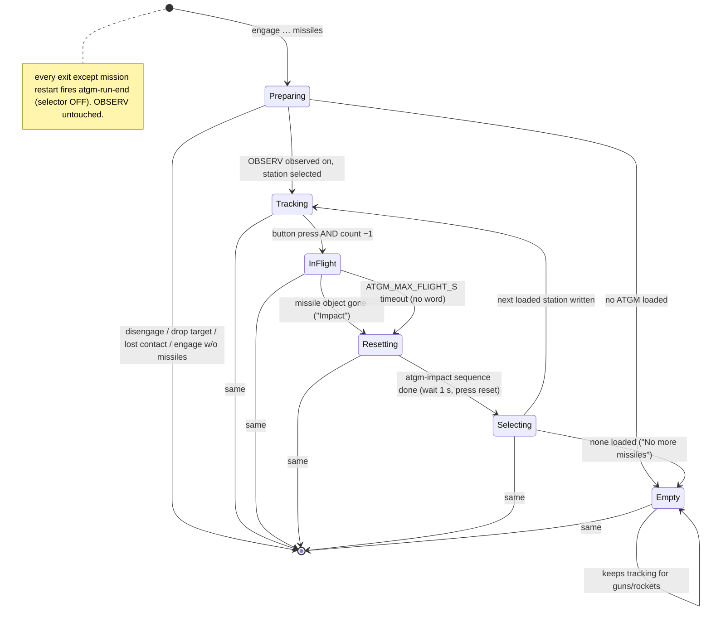

# BL-B67 — the ATGM attack run on the 9K113: plan

Written 2026-10-29 by Architect, against `feature/bl-b67-atgm-run` @ `6b3d7f3a`.
**Governing inputs, in precedence order:** `plans/bl-b67-atgm-run/explore-notes.md` (the user's
words, rounds 1–6) > `body-layer/ROADMAP/BL-B67.md` > `docs/concept/9K113.md` "attack / ATGM".
Desk recon: `aircraft-layer/research/2026-10-29-bl-b67-loadout-and-atgm-object-recon.md`.
**Premise (user, 2026-10-29):** `[[BL-B80]]` sight pointing is, or will be, accurate. Flight A does
not gate this plan; it gates live acceptance only.

### Goal

When the pilot says `engage <what> <where> missiles`, Petrovich runs a 9K113 ATGM attack: brings
OBSERV up, arms, selects a loaded pylon, keeps the crosshair on **one unit**, gives azimuth-only
guidance plus a one-time in/out-of-range call, announces the launch with missile word and flight
time, stays silent while the missile flies, says "Impact" when it is gone, resets the transmitter,
selects the next missile (or says "No more missiles"), and keeps tracking until `disengage`, which
turns the selector OFF and leaves OBSERV on.

---

### What the pilot hears — mock run

Target a BTR at 6.5 km, Shturm loaded on stations 1–4, OBSERV off at the start.

| t (s) | Pilot | Petrovich says | Petrovich does |
|---|---|---|---|
| 0 | "Engage BTR two o'clock missiles" | "BTR, two o'clock, six and a half kilometres." *(existing engage readback)* | run starts; weapons-arm trigger (existing) |
| 0 | | "Observ on, wait." | observ-on trigger; selects station 1 (knob step 1) |
| 1 | | "Two o'clock." *(BL-14 o'clock register)* | sight caged until alignment lamp 898 → free |
| ~11 | | "Out of range." *(once)* | sight slews to the target and stays on it — no glance-aways |
| 25 | | "Come right." | |
| 40 | | "In range." *(once, belief range ≤ 5,000 m)* | |
| 46 | | "Lined up." *(one gate: azimuth only)* | then guidance silence, as BL-14 |
| 52 | *fires* | "Shturm, 13 seconds." *(4,500 m ÷ 345 m/s)* | launch = button press **and** station count −1 |
| 52–65 | | *(silence)* | crosshair held on the one unit |
| 65 | | "Impact." | missile's object gone from `LoGetWorldObjects` |
| 66 | | | presses Radiation Reset (arg 882), 1 s after impact |
| 67 | | "Come left." *(guidance resumes)* | turns knob to station 2 |
| … | *second attack* | … | |
| 140 | | "Impact." … "No more missiles." | last station empty: keeps tracking for guns/rockets |
| 150 | "Disengage" | "Attack run off." *(existing)* | selector → OFF; **OBSERV stays on** |

---

### Design, in the "actions / state params / when" shape

Root `CLAUDE.md`, "Behaviour as actions and params". The **"when"** is one pure function,
`belief/atgm_run.py::decide`, modelled on `attack_run.decide` / `optic_policy.decide`
(`(state, inputs) -> (state, speech, actions)`, frozen dataclass, no I/O). `body.py` executes the
actions. Nothing else decides when.

| Kind | Name | What |
|---|---|---|
| **action** | `say(text)` | through the existing `CrewConsole._print`/scheduler path |
| **action** | `fire(trigger)` | existing `effector_engine.fire_trigger`; new triggers `atgm-impact`, `atgm-run-end` |
| **action** | `select_station(step)` | new `effector_engine.write_effector(...)` — one write, same bookkeeping as a row |
| **state param** | `loaded_atgm_steps` | knob steps whose station holds ≥1 ATGM (from the payload feed + step→station map) |
| **state param** | `selected_step` | Petrovich's own last commanded knob step (`AtgmRunState`) |
| **state param** | `belief_range_m` | `range_m(ownship, contact.last_position)` — belief, never truth |
| **state param** | `missile_family` | `"shturm" / "ataka" / None`, from the selected station's store name |
| **state param** | `launch_confirmed` / `missile_gone` | per-poll events from `perception/own_weapons.py` (below) |
| **state param** | `impact_sequence_running` | `atgm-impact` in `EffectorRunState.runs` |
| **state param** | `observ_observed` | existing, arg 886 |

#### Reused, not rebuilt

- **BL-14 attack run** (`attack_run.decide`, `drain_attack_run`, `attack_target` task, scheduler
  ordering) is the guidance engine. The ATGM run is a **companion state** beside
  `runner.attack_run_state`, not a replacement and not a field on `AttackRunState` — that state is
  reset wholesale on every re-point (`attack_run.py:930`), which would silently drop a weapon field
  (the recurring stale-state shape, `.claude/agent-memory/dod/project_recurring_stale_state_on_transition.md`).
- **Azimuth-only** = one keyword on `attack_run.decide`, `vertical: bool = True`. `False` drops the
  elevation word table and the elevation half of the aligned conjunction. **Flagged departure from
  shipped BL-14 behaviour**, scoped to the ATGM run only (entry: "flag it rather than inheriting it
  silently").
- **Sight pointing** = `[[BL-B80]]`'s `SightHead` + `seen_world_direction`, unchanged except the
  single-unit aim below.
- **Effector engine + sequence files** for every static switch action. Two new triggers, two new
  `*.md` files, so the user can edit them like the others.
- **Readback classes** (`.claude/agent-memory/architect/feedback_readback_classes_poll_vs_read_at_need.md`):
  nothing new joins `polled.toml`. 673 and 962 are **read once at launch confirmation** (one-shot
  `read_args`) and logged, filling `GuidanceUnitState.weapon_safety_observed`/`launch_perm_observed`.
  No behaviour reads them (no range warnings at launch, round 3), so polling would cost a
  continuous slot for a log line. The knob (963) is read once at run start.
- **Momentary-button capture** reuses the **PTT pattern** (`Export.lua push_ptt_state`: read every
  frame, send only on change). Not `polled.toml`: body-layer polls at **1 Hz** and
  `GET /watched_args/latest` returns a level, so a press shorter than a second is simply not there
  by the time body reads it. The collector keeps a monotonic `press_count` + `last_press_t`.
- **Tunables** through `tuning.py`: per-family speed/max range (Wikipedia figures, accepted
  round 1), shared 400 m minimum, launch coincidence window, max flight time.

#### Three departures, named

1. **`select_station` is a code action, not a sequence row.** The step is computed per launch
   (next loaded station); the sequence format has no parameters, and adding parameterised rows is a
   format change for one caller. `write_effector` reuses the registry resolution and records into
   `assumed_writes`/`commanded_values` exactly as a row does, so the engine's bookkeeping stays one.
2. **A momentary button sequenced as press + release rows.** `effector-sequences` deliberately did
   not design this (plan line ~852). With a known readback the existing engine already does it
   right (row 1 sees 0, writes 1; row 2 sees the assumed 1, writes 0); with an unknown readback it
   skips + WARNs, which is the correct fail-safe for a reset button. No engine change — only a
   research note if Stage 0 shows `default_button` behaves as an absolute set.
3. **Own-weapon truth lives in `perception/`, and only events cross into `belief/`.** Launch and
   impact need `LoGetWorldObjects` object ids. Per the no-omniscience invariant, belief never sees a
   DCS object id: `perception/own_weapons.py::OwnWeaponTracker` holds the ids and emits
   `OwnWeaponEvents(launch: LaunchEvent | None, missile_gone: bool, t_sim)` only — the same boundary
   `Percept` draws. Not a second exception beside `detection_trace_writer.py`: the crew perceives
   its own launch and impact through the sight.

#### Single unit, never a cluster

`Percept.relative_direction` is the **cluster centroid** (`naked_eye_source.py` ~1374). Two parked
vehicles in one cluster put the crosshair between them — at 3.5 km, 0.02° ≈ 1.2 m, a miss. Fix:

- Perception adds `Observation.aim_unit_direction: RelativeDirection | None`, set under exactly the
  same conditions as `relative_direction` (admitted, `live_los_clear is True`) **and** only for a
  sight-tier optic: the direction to the **one member nearest this poll's gaze centre**, which for a
  sight look is the sight head's own direction (`body.py` ~905). That is what a gunner does — keeps
  the crosshair on the vehicle it is already on — and it is sticky without any memo state. Same
  `perturbed_relative_direction` (σ = 0.0 stays, round 2). Single-member cluster ⇒ equal to
  `relative_direction`.
- `percept_of` carries it; `attack_run.seen_world_direction(contact, *, single_unit: bool)` prefers
  it when `single_unit`. `single_unit` is **derived per poll** in `body.py` as
  `runner.atgm_run_state is not None` and threaded through `advance_sight_head` →
  `select_sight_goal` — a decide input, not a stored field
  (`.claude/agent-memory/architect/project_lua_loop_body_limits_split.md`). Outside the ATGM run
  BL-B80 behaviour is byte-identical. *(Local and reversible choice; making it unconditional for
  every sight look is a one-line change later.)*
- Fences: `aim_unit_direction` joins `relative_direction` in `test_attack_run.py`'s grep fence
  (under `belief/`, only `percept.py`, `attack_run.py`); the differential no-leak test in
  `test_sight_head.py` gains the ATGM case.

#### Keeping the look through launch

Today `SIGHTING` re-picks targets (`look_is_finished`) and glances away after `SIGHT_MAX_DWELL_S`
(30 s) — a glance-away mid-flight loses the missile. New `optic_policy.decide` keyword input
`sight_lock_contact_id: str | None` (derived per poll in `body.py` from `atgm_run_state`, never an
`OpticState` field): while `home_phase is SIGHTING` and it is set, the look target is pinned to that
contact, the dwell break and look-finished re-pick are skipped, and the guidance ladder's floor is
`SIGHT_WIDE_OPTIC` (ATGM guidance is 9K113-only, BL-14 explore). **`_force_observ_off` (violent
manoeuvre) still wins** — gyro safety is not traded for tracking. The two sight-reach predicates
(look-start filter and continuation stop, `.claude/agent-memory/implementer/project_9k113_narrow_search_review_fix.md`)
both honour the lock.

#### Launch and impact detection (`perception/own_weapons.py`)

- **Launch confirmed** when, within `ATGM_LAUNCH_COINCIDENCE_S` (default 2.0 s), the fire-button
  feed's `press_count` increased **and** the payload feed's ATGM count fell by exactly one. Order
  does not matter (Stage 0 measures the lag). Count drop without press = jettison, ignored
  (round 1). Press without count drop = nothing.
- **This launch's missile** = an object id present in this poll's snapshot, absent from the
  previous poll's, whose `Name` is in `ATGM_OBJECT_NAMES` (Stage 0, Q2), first seen within the
  window; nearest to ownship if several. **Do not guess the name** (recon Finding 9): until Stage 0
  answers, the set is empty and the fallback below applies.
- **Missile gone** = that id absent from a **fresh** snapshot (its `dcs_model_time_s` advanced past
  the last one that held it). A failed or stale fetch is not an impact. Any cause counts (round 2).
- **Fallback:** no object identified, or still present, after `ATGM_MAX_FLIGHT_S` (default 25 s ≈
  6,000 m ÷ 345 m/s + margin) ⇒ `missile_gone` with `observed=False`: the run resets and selects
  next but **does not say "Impact"** (Decision 4).
- **Own weapons are excluded from perception candidates** by the same name set plus the known
  rocket name `C_8` (`2026-09-24` probe). Today's export already carries in-flight rockets under the
  default `"units"` category, so an own missile could otherwise surface as a "contact" mid-flight
  and break the silence.

---

### Affected Modules / Files

**aircraft-layer**
- `dcs-export/Export.lua` — `push_payload_state` (`LoGetPayloadInfo` + `LoGetNameByType` at the
  5 Hz tick, send on change) and `push_fire_button_state` (arg 741, every frame, send on change —
  `push_ptt_state`'s shape, **defined below `safe_call`**). Both pcall-guarded.
- `src/schema/payload.py`, `src/schema/fire_button.py` — new sibling schemas (`PayloadSample`:
  `stations[{index, name, count, container}]`, `current_station`, `t`; `FireButtonState`:
  `pressed`, `press_count`, `last_press_t`, `t`).
- `src/collector/cache.py`, `server.py`, `src/api/…` — caches; `press_count` incremented on each
  0→1 edge in the collector; `GET /payload/latest`, `GET /fire_button/latest`.
- `dcs-export/Export.probe-weapons.lua` — **Stage 0 only**, a disposable variant (see Stage 0).
- `research/2026-10-xx-bl-b67-stage0-probe-results.md` — Stage 0 answers.
- tests: schema parsing, cache edge counting, API round trip.

**body-layer**
- `src/aircraft_client.py` — `get_payload_latest`, `get_fire_button_latest`.
- `src/perception/own_weapons.py` (new) — `OwnWeaponTracker`, `OwnWeaponEvents`, `LaunchEvent`
  (`t_sim`, `station_index`, `store_name`). Holds object ids; exposes none.
- `src/perception/naked_eye_source.py` — `aim_unit_direction`; own-weapon name exclusion.
- `src/perception/source.py`, `src/belief/percept.py` — the new field, carried through.
- `src/belief/attack_run.py` — `vertical` keyword; `seen_world_direction(single_unit=…)`.
- `src/belief/sight_head.py` — thread `single_unit` into `select_sight_goal`.
- `src/belief/optic_policy.py` — `sight_lock_contact_id` input.
- `src/belief/atgm_run.py` (new) — `AtgmRunState`, `AtgmInputs`, `AtgmAction`, `decide`; the
  tunables; missile-family profiles and `family_of(store_name)`.
- `src/belief/speech.py` — `render_observ_on_wait`, `render_range_state`, `render_atgm_launch`,
  `render_impact`, `render_no_more_missiles`.
- `src/belief/crew_console.py` — `_handle_engage` reads `slots["weapon"]`, sets
  `attack_run_weapon` beside `attack_run_transition`; reset beside it in `handle_command`.
- `src/belief/effector_engine.py` — `write_effector(state, client, registry, name, value_name, now_sim)`; `is_running(state, trigger)`.
- `src/belief/effector_sequences.py` — `EffectorTrigger.ATGM_IMPACT = "atgm-impact"`,
  `ATGM_RUN_END = "atgm-run-end"` + `TRIGGER_INFO`.
- `src/belief/sight_effector.py` — `refresh_from_one_shot(…)` for 673/962 at launch.
- `src/body.py` — `runner.atgm_run_state`; transition apply; tracker per poll; derive
  `single_unit`/`sight_lock_contact_id`; execute actions; mission-reset clears.
- `src/mission_memory/…` — `AttackRunPayload.weapon = "missiles"` for an ATGM run (field exists).
- `src/sight_trace_writer.py` / `belief_truth_log.py` — launch/impact/station rows.
- `config/sequences/mi-24p/effectors.toml` — `missile_station` (`SHSCHO-KNOB-PTR`, values
  `off=0.0, s1=0.1 … s8=0.8`), `radiation_reset` (`OP-AIM-RESET-RAD-PTR`, `pressed=1.0, released=0.0`).
- `config/sequences/mi-24p/atgm-impact.md` — `wait_s(1)` · `radiation_reset pressed` · `radiation_reset released`.
- `config/sequences/mi-24p/atgm-run-end.md` — `missile_station off`.
- `config/sequences/mi-24p/atgm.toml` (new, aircraft data) — knob step → payload station index
  (Stage 0, Q3) and `ATGM_OBJECT_NAMES` (Q2). Data, not code, because it is aircraft-specific like
  `effectors.toml`.
- Regenerated: `config/defaults.toml`, `config/sequences/triggers.md`, `switch-reference.md`.
- tests listed per stage.

**Not touched:** `polled.toml` (stays 886/898/960), the audio-adapter (`WEAPON_WORDS` already has
`missiles`; see Risks for the singular).

---

### Implementation Plan

Each stage: ruff/mypy/pytest green, no DCS needed. **Batch A (Stages 1–4) depends on no Stage 0
answer** and can be built and merged before the sortie is flown. Batch B (5–7) waits for it.

0. **Probe sortie — Windows, user flies, ~10 min.** Disposable
   `Export.probe-weapons.lua` variant (recon Probes 1–2, extended):
   - every new object Name: one-shot key dump; per-poll object count;
   - `LoGetPayloadInfo()` per poll: per station `name:count`, `CurrentStation`;
   - args **741, 963, 882** read **every frame**, logged on change with model time;
   - scripted on the ground-hold or straight-and-level: step the knob 0→8 via
     `performClickableAction(3038, n×0.1)` one per 2 s (logs 963 readback and `CurrentStation`),
     then park on the first step whose station reports a count > 0; press Radiation Reset once
     (3029: 1, then 0 after 1 s);
   - after each observed count drop, step to the next loaded station.

   Card (air start, straight and level, two BTRs ~3.5 km ahead, Shturm loaded): fire one missile by
   **your normal HOTAS binding**, one by a **quick tap**; wait for impact each time. Optional, off by
   default: `S_EVENT_SHOT` via the existing damage-events hook (recon Probe 3).

   | Q | Question | Stage that depends on it |
   |---|---|---|
   | Q1 | Does `LoGetPayloadInfo` work on the Mi-24P; when does the count drop relative to the press? | 4 (shape), 5 (window) |
   | Q2 | ATGM object `Name`(s); Shturm vs Ataka distinct? how long in the list? | 5 |
   | Q3 | Knob step → station index; is a 3038 write an absolute set? | 6 |
   | Q4 | Does arg 741 move when fired by HOTAS binding? press duration? | 5 (else Decision 6) |
   | Q5 | Does 3029 1→0 press/release Radiation Reset (882 moves)? | 6 |

   Output: research note with the log extract. **No pipeline code in this stage.**

1. **Run skeleton (body-layer).** `attack_run_weapon` on `CrewConsole`; `AtgmRunState` lifecycle
   in `body.py` (one construction site); ends with `attack_run_state` (disengage, drop target,
   lost contact, engage without `missiles`) and on mission reset; `attack_run.decide(vertical=False)`
   for the ATGM run; "Observ on, wait." + fire `observ-on` when 886 is observed off (refusal path
   per Decision 3); `sight_lock_contact_id` in `optic_policy.decide`.
   Tests: engage-with/without-weapon dispatch; every Co-moving Fields row (build each diverged pair
   by hand, not only consistent sequences); `vertical=False` never emits an elevation word and
   aligns on azimuth alone; lock pins the look and suppresses the dwell break; forced OBSERV off
   still fires under lock; BL-14 tests unchanged.

2. **Single-unit aim.** `aim_unit_direction` in perception → `Percept` →
   `seen_world_direction(single_unit=True)`; derived `single_unit` threaded through `sight_head`.
   Tests: two-member cluster → aim at the member nearest the gaze centre, sticky across polls as the
   head moves; single member equals centroid; `single_unit=False` byte-identical to today; grep
   fence extended; differential no-leak (belief/speech/memory/tools identical with the consumer
   off).

3. **The "when" — `atgm_run.decide` against synthetic events.** States Preparing → Tracking →
   InFlight → Resetting → Selecting → Tracking/Empty; range latches; launch speech
   (`"<Family>, <N> seconds"`, `N = round(belief_range_m / speed)`; unknown family → `"Missile."`
   with no time — no invented number); in-flight hold (guidance speech suppressed, routine callouts
   deferred per Decision 2); "Impact."; "No more missiles."; selection = next loaded step after
   `selected_step`, cyclic. Tunables in `tuning.py` with bounds and `#:` comments
   (`SHTURM_SPEED_MPS` 345, `SHTURM_MAX_RANGE_M` 5000, `ATAKA_SPEED_MPS` 400,
   `ATAKA_MAX_RANGE_M` 6000, `ATGM_MIN_RANGE_M` 400, `ATGM_LAUNCH_COINCIDENCE_S` 2.0,
   `ATGM_MAX_FLIGHT_S` 25.0); check the **rendered** `defaults.toml`, not the comment. Pure-function
   tests, table-driven over the state diagram, including: re-point mid-flight keeps the missile;
   jettison event ignored; launch while out of range/inside 400 m says only the launch line; a
   second launch while in flight logged, newest tracked.

4. **Aircraft-layer feeds.** Payload and fire-button pushes, schemas, caches (edge counter), two
   endpoints, two client methods. Lua `GETGLOBAL` bytecode check (aircraft-layer `CLAUDE.md`) on the
   edited `Export.lua`. **Q1 can only change the payload schema's field names**, which is why this
   is safe before Stage 0; if Q1 says `LoGetPayloadInfo` is dead on the Mi-24P, this stage's payload
   half is replaced by `Unit:getAmmo()` (recon Finding 5) — an escalation, not a silent swap.

5. **Own-weapon tracker** *(needs Q1 timing, Q2 names, Q4)*. `perception/own_weapons.py` +
   own-weapon exclusion in perception; `atgm.toml` names. Tests: fixture snapshot sequences —
   press+drop → launch; drop alone → nothing; press alone → nothing; missile id appears → gone on a
   fresh snapshot; stale snapshot is not an impact; timeout fallback; no object id leaves the module
   (grep fence: `object_id` absent from `belief/` imports of `own_weapons`).

6. **Effectors** *(needs Q3, Q5)*. `effectors.toml` entries, step→station map in `atgm.toml`,
   two triggers + sequence files, `write_effector`, `is_running`; one-shot 673/962 read at launch;
   widen `_ABSOLUTE_WRITE_SHAPES` only if Q3/Q5 confirm, each with its research note. Hands-busy
   (`HANDS_BUSY_DURATION_S`) on a knob turn (ЩО panel, eyes off the sight), **not** on the reset
   button (on the ПУ hand controller). Regenerate `triggers.md`/`switch-reference.md`. Tests: engine
   press/release with known/unknown readback; `write_effector` visible to a same-poll sequence row;
   `atgm-run-end` on every exit row of the Co-moving table.

7. **Wire the poll loop + logs.** Tracker per poll beside the world-objects fetch (no extra fetch
   for objects); actions executed after `drain_attack_run`; trace rows. Integration test on the real
   `_run_crew_text_poll_loop` thread
   (`.claude/agent-memory/implementer/feedback_poll_loop_sim_time_integration_tests.md`, mind the
   `on_ground`-defaults-True trap) driving the mock run above end to end against a fake client.

8. **Live acceptance** — test card naming `main`, after `[[BL-B80]]` pointing accuracy; `#needs-flight`.

**Later, not this plan:** damage/hit reporting (round 1, "later stage"); the OBSERV-refused-by-
cannon response (round 5, **deferred — not designed here**; until the user decides, an OBSERV write
that 886 never confirms leaves today's behaviour: the run stays engaged, the guidance ladder caps
below the sight as it already does when `home_phase` is not `SIGHTING`, and a WARNING is logged).

---

### Co-moving Fields

Built from construction sites: `AttackRunState(` at `attack_run.py:930` (re-point reset),
`crew_console.py:3657` (where-is-it throwaway), `body.py:3684` (engage); `attack_run_transition =`
at `crew_console.py:2138` (reset), `3333`, `3358`; `attack_run_state =` at `body.py:3684/3687/3826`
and `drain_attack_run`'s `None` returns. `AtgmRunState(` gets **one** site (`body.py` transition
apply); everything else `replace()`.

| Field | Written by | Transition | Must hold true after |
|---|---|---|---|
| `crew_console.attack_run_transition` + **`attack_run_weapon`** | external (pilot) | any command dispatch | both reset to `None` together at `handle_command` head (beside line 2138) |
| same pair | external | `engage … missiles` | `("engage", "missiles")` set together; consumed and cleared together in `body.py` |
| `runner.attack_run_state` / **`runner.atgm_run_state`** | internal | engage missiles, no ATGM run | both fresh; `atgm.contact_id = target` |
| same | internal | engage missiles, ATGM run active, **new target** | `attack_run_state` re-pointed (existing reset); `atgm` keeps `phase`/missile/`selected_step`, **range latches reset**, `contact_id` updated |
| same | internal | engage **without** `missiles` while ATGM active | `atgm_run_state is None`; `atgm-run-end` fired; `attack_run_state` fresh (BL-14) |
| same | external / internal | disengage · drop target · cancel · lost contact (`drain_attack_run → None`) | `atgm_run_state is None` **in the same poll**; `atgm-run-end` fired once |
| same | internal | mission (re)start | both `None`; **no** `atgm-run-end` (new mission, `EffectorRunState` reset) |
| invariant | — | every poll | `atgm_run_state is not None ⇒ attack_run_state is not None` (asserted in tests) |
| `AttackRunState` speech baselines | internal | Resetting → Selecting (after impact) | replaced by `AttackRunState(last_contact_id=…)` so the next callout speaks |
| `atgm.selected_step` / `EffectorRunState.commanded_values["missile_station"]` / `assumed_writes[963]` | internal | `select_station(n)` | all three agree on step `n` |
| same | internal | `atgm-run-end` | `commanded_values == "off"`, `assumed_writes[963] == 0.0`, ATGM state gone |
| derived `sight_lock_contact_id`, `single_unit` | derived per poll | any | equal to `atgm.contact_id` / `atgm is not None`; never stored, so no construction site can drop them |
| `OpticState.home_phase` | external (886 observed) | OBSERV off, pilot or forced, mid-run | ATGM run unchanged; lock inert (not `SIGHTING`); no extra speech |
| `GuidanceUnitState.weapon_safety_observed` / `launch_perm_observed` | one-shot read | launch confirmed | set from that read; otherwise left as last read |

**Readers outside the machine** (step 6a, widened): `_active_gaze(attack_run_engaged=…)` reads
`attack_run_state` (unchanged); mission memory reads the weapon; the scheduler's in-flight hold
reads `atgm.phase is InFlight`; perception's own-weapon exclusion reads `ATGM_OBJECT_NAMES`
(config, not run state). Each gets a test that it follows the run's end.

---

### Risks & Unknowns

- **Stage 0 can invalidate Stage 4–6 shapes.** Q1 dead → `Unit:getAmmo()` (escalate). Q3 relative
  knob writes → `select_station` becomes step-by-step with readback. Q4 arg 741 static on HOTAS fire
  → Decision 6.
- **Short-range shots** (400 m ≈ 1.2 s) may never be in a 1 Hz-read snapshot; the timeout fallback
  covers it without a fabricated "Impact".
- **Own rockets already reach perception** (`C_8` in the default `"units"` list) — today's
  behaviour may already include phantom contacts during rocket runs; Stage 5's exclusion fixes both.
- **Single-unit choice at first acquisition** follows the sight's current direction, which on the
  first look is belief-directed; in a tight cluster the first unit chosen is "the one nearest where
  he was looking", not one the pilot named. The pilot cannot name a unit within a cluster today
  anyway.
- **"missile" singular** is not in `WEAPON_WORDS`; "engage BTR missile" would start a guns/rockets
  run. A one-word audio-adapter addition — out of scope, flagged.
- **1 Hz poll** makes launch→callout latency up to ~1 s plus the coincidence lag (Q1).
- **The cannon/OBSERV quirk** can leave an ATGM run without a sight with nothing said — accepted
  until the user decides (deferred).
- **Mechanism vs calibration**: tunable defaults ship in the mechanism commits as declared defaults;
  any later retune is its own commit.

### Decisions Requiring User Input

1. **"In range"/"Out of range" — once per run, or once per missile?** The spec's "once" was written
   for one missile. **Recommend once per missile**: latches reset after each impact, so the second
   attack gets its own call.
2. **"Silence" while the missile flies — guidance only, or everything routine?** **Recommend**:
   attack-run guidance and routine contact callouts held until impact; urgent threat callouts
   (`bypass_gate`) still pass — a SAM launch must not wait 15 s.
3. **`engage … missiles` while the guidance unit is not ready.** **Recommend** the existing
   "Unable, guidance unit not ready." and no run started (same gate as "Observ on").
4. **Missile never seen as an object (or name unmatched).** **Recommend** no "Impact" word; reset
   and select next after `ATGM_MAX_FLIGHT_S`, logged — so he never claims what he did not see.
5. **No ATGM loaded at `engage … missiles`.** **Recommend** say "No more missiles." (your phrase,
   one wording) and run as a tracking run, same as after the last missile.
6. **Only if Stage 0 shows arg 741 does not move on a HOTAS fire:** **recommend** using
   `S_EVENT_SHOT` (initiator = player, guided weapon) as the "pilot pressed release" half — it keeps
   your jettison distinction. The alternative is count-drop alone, which loses it.

Still owed by you, not blocking: the "some others too" readback args (round 2).

### Second-order effect

The payload feed and own-weapon tracker are exactly what the later damage-reporting stage and a
"rockets away" call need, and the press-and-release sequencing becomes available to any later
sequence (countermeasures, lamp test). It also narrows `[[BL-B95]]` (event-driven scripting): the
ATGM run's "when" sits in one pure function with named actions, so it is a candidate first script.
**Amend on merge:** `plans/attack-run/plan.md` Decision 15 ("the weapon slot — nothing reads it
yet") becomes superseded by Stage 1; mark it `REVISED` there when Stage 1 merges (architect step 10).
