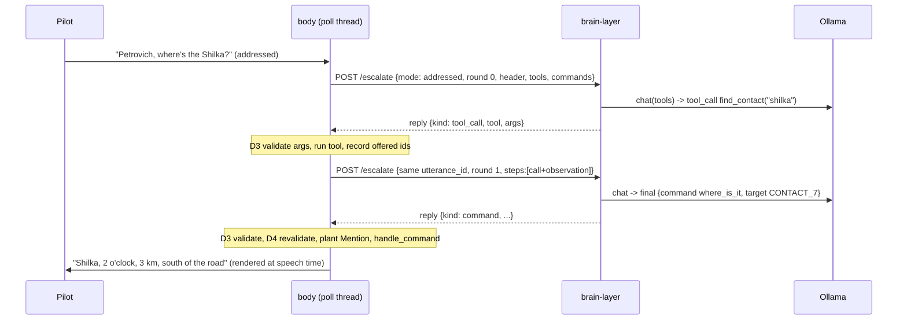

# BR-2: brain tool calls (plan)

Architect pass, 2026-10-31. Inputs are `alignment.md` (goal check, CONCERNS, E1–E9) and
`explore-notes.md`. Where they disagree, the user's verbatim answers win. Answers are cited as **A1–A10**.

### Goal

When the pilot starts with "Petrovich, …", the brain answers or acts as a crewmate would. It finds
out what Petrovich knows by calling body-owned **query tools** across belief, mission memory and the
world model. It acts by filling the **same command and slots the phrasebook uses**, executed by
`CrewConsole.handle_command`. It answers in the existing callout style wherever that can carry the
answer. Every fact spoken traces to a tool result that body produced in that turn.

---

## What exists today (read, not assumed)

**What happens on "Petrovich, report south of Gemerek" today.** The brief asked about this case.
1. audio-adapter: `opens_with_wake_word` → `verb_anchored=False` (`[[AA-B7]]`). The wire carries no
   *addressed* flag, only that routing outcome.
2. body: `classify_response` → `"fallthrough"` → `handle_line` → `_handle_utterance` →
   `parse_utterance`, which strips the vocative (`[[BL-B100]]`, `_VOCATIVE_PREFIX`, exact spellings
   only).
3. "report south of Gemerek" matches none of `parse_utterance`'s six patterns → `escalated` →
   `handle_player_utterance`. Then:
   - **default `--brain-client debug` → stderr print, silence** (E2 violated today);
   - `http` + stub decider → "Unable, no such command.";
   - `http` + Ollama → the classify prompt → at best "Report all, confirm?", with "south of Gemerek"
     lost.

**The case that contradicts A4 outright.** "Petrovich, where's the Shilka?" never reaches the brain.
`parse_utterance` strips the name, matches `^where's …`, returns `handled`, and body answers it
itself. A4 says a wake-prefixed utterance goes to the brain, so this path changes.

**Body cannot tell a wake-prefixed utterance from unanchored speech.** Both arrive as
`verb_anchored=False`. Only typed lines can be told apart, by `_VOCATIVE_PREFIX`. The fuzzy wake
match (`WAKE_FLOOR` 0.8, which admits whisper's `petrovitch`) lives in audio-adapter.

**Other facts the design rests on:**
- `TOOL_SET` (17 entries) is never dispatched. Its `fn`s take server-side context positionally
  (`store`, `enrichment`, `memory`, `now_sim`), and several take a `GeoPosition`. A model must never
  supply either (BR-1 architect memory: a client that supplies `now_sim` can manufacture staleness).
- `mission_memory` may be imported under `belief/` only by `tool_api.py` (grep-enforced). This is why
  `crew_console` gets memory writes by closure injection (`mark_here_fn`).
- Pilot commands are handlers behind `handle_command` and are not `TOOL_SET` entries (goal-check
  Finding 1). `crew-query-path`'s own second-order note: *"the brain's job becomes filling these same
  five slots from open text and calling the same handler."*
- `[[BL-B102]]`'s referent: `Mention` → `_referent_memory` → `slots={"referent": True}` on `follow`,
  `select_target`, `mark_target`, `engage` and `where_is_it`. **`handle_command` resets
  `_pending_mentions` on entry**, so a mention has to be planted directly into `_referent_memory`
  before the dispatch.
- The reply lane already has the right timing tool. `_speak_or_defer` and
  `drain_pending_positional_replies` defer a positional readback while `busy_until_sim` is set, then
  **re-render it at speech time** (E5). `drain_brain` already runs after `drain_events` in the poll
  loop (`body.py` ~4142/4163), so threat callouts win the tick (E6).
- Poll-loop order is a hazard (see Risks). One-shot runner signals (`attack_run_transition`,
  `where_is_it_requested` and the like) are consumed at `body.py` ~3799–4051. `drain_brain` (4163)
  and `_poll_transcripts` (4166) come later in the same iteration, and `handle_command` resets every
  one of those signals on entry.
- `_pending_escalations` and `_stand_by_spoken_for` are kept in sync by hand at four sites, and
  nothing prunes an escalation whose reply never arrives.

---

## Decisions

### D1: Transport. Tool calls ride the existing escalate/poll seam, and body executes them on its poll thread



- **brain-layer is stateless across rounds.** Each round is a fresh `POST /escalate` with the same
  `utterance_id`, plus `round` and the full `steps` list (call + observation). Body holds the record
  of what each tool returned. *Code owns factual state*: the brain cannot claim a tool returned
  something it did not, because validation reads body's record, not the brain's.
- **Rejected: a body-side HTTP tool server called mid-loop by brain-layer.**
  - Body has never served HTTP.
  - It would add a LAN-exposed write surface.
  - Most importantly, `ContactStore` is mutated by the poll thread and is not thread-safe, so every
    tool call would need marshalling onto the poll thread anyway.
  - Executing tools in `drain_brain` makes them thread-safe by construction, and keeps every
    validation in one place. BR-1's plan anticipated "roughly a day" for that server; this design
    does not need it.
- **D3 (newest wins) needs no change.** `JobSlot.submit` bumps the generation for each round. A new
  addressed utterance bumps it again, so the superseded turn's next round is dropped server-side, and
  body drops replies for turns it no longer tracks (today's `pending is None` path).
- **Cost:** each round waits up to one body poll (1 Hz) plus the brain's 0.2 s reply poll, so about
  1.5 s of transport per round on top of model time. Three rounds come to roughly 4–6 s, inside A5
  ("I'll likely only ask things I can wait for", ceiling 1 min). If flight shows it matters, the next
  lever is a faster brain-only drain, not a tool server.
- **How the model expresses a tool call is internal to brain-layer** and is settled by Stage 0. The
  candidates are Ollama's native `/api/chat` `tools` or a closed one-line grammar like BR-1's. Either
  way the wire to body is the same structured JSON.

### D2: `ToolSpec.fn` is unchanged and is never called with model arguments. The brain calls `BrainTool.invoke(ctx, args)`

The calling convention, decided now (the implementer memory flagged it as still free):

```python
@dataclass(frozen=True)
class ParamSpec:            # serialisable to a JSON-schema subset for the prompt / Ollama `tools`
    name: str
    kind: Literal["str", "int", "bool", "enum", "contact_ref", "place_ref", "memory_ref"]
    required: bool = False
    choices: tuple[str, ...] = ()      # enum
    lo: int | None = None; hi: int | None = None   # int
    max_len: int = 40                  # str

@dataclass(frozen=True)
class BrainTool:
    name: str                          # must equal a TOOL_SET name (test-enforced)
    params: tuple[ParamSpec, ...]
    invoke: Callable[[ToolContext, Mapping[str, object]], ToolObservation]
```

- **Where it lives:** `belief/tool_api.py`, beside `TOOL_SET` and in the one `belief/` file allowed to
  import `mission_memory`. `TOOL_SET` stays the single registry of names and descriptions;
  `BRAIN_TOOLS` is the exposure list plus the adapters. This is a new abstraction, and its
  justification is the context-binding that every exposed tool needs. One adapter per tool, written
  by hand rather than reflected (~8 small functions), following BR-1's precedent.
- **`ToolContext` is bound by body and never accepted from the wire:** `store`, `enrichment`,
  `memory`, `now_sim`, the mission phase tracker, and the turn's offered-handle table. `crew_console`
  receives a `run_brain_tool` closure built in `body.py`, the same pattern as `mark_here_fn`.
- **No exposed parameter is a coordinate.** Places are `place_ref` handles that `find_place` returned
  this turn (`P1`…). Positions come from body-owned lookups (ownship, a contact, a place). The model
  does no geometry: D5's "no arithmetic, geometry or ranking" still holds.
- **`ToolObservation`** is a compact, model-facing projection: `summary`, handles, and a few
  categorical facts (class, certainty, freshness, landmark text). It carries **no raw x/z**. Lists are
  capped at 5, with an "and N more" note.

### D3: The D10 trust boundary covers tool calls and every final reply

Validation runs in body, in pure functions. It extends `belief/brain_reply.py` and adds checks beside
the `BRAIN_TOOLS` param specs.

- **Tool calls**
  - Name ∈ `BRAIN_TOOLS`. Unknown args are rejected. Types, enums, ranges and string lengths are
    checked per `ParamSpec`.
  - Every `*_ref` must be **offered**: present in this turn's header or in an earlier observation in
    the same turn. This is the same rule as `PICK`'s, extended to places and memory entries. A contact
    that exists but was never shown to the brain this turn cannot be named.
  - On an invalid call, body does not execute it. It appends an `invalid: <why>` observation, which
    costs a round, so the model gets one chance to recover inside the round budget.
- **Final `command`**
  - Token ∈ `BRAIN_COMMANDS` (D5): an explicit allowlist, opt-in only.
  - Slots are validated against that token's slot schema.
  - `target` must be offered.
- **Final `answer`:** the form ∈ a closed set (D7), and its refs must be offered.
- **Ambiguity stays code-owned**, keeping BR-1's Measurement 3/4 finding. If a final `target`/`ref`
  came from a find result that returned two or more candidates, the reply must carry `because` words.
  Those words must pass `_validate_pick`'s existing evidence test against the other members of that
  candidate set. Otherwise the reply degrades to "which one?" over the survivors
  (`render_disambiguation`). Model quality then decides how often Petrovich asks, never whether he
  guesses.
- **D4 revalidation is unchanged.** Ids are rechecked against current belief at speech time, and a
  gone contact gets "lost him".
- **Rejection degrades, never goes silent:** to an ask if candidates exist, otherwise to an
  `unable <reason>`.

### D4: Routing is by wake word, decided by the pilot (A4)

| utterance | today | after BR-2 |
|---|---|---|
| "Petrovich, …" (any content, phrasebook phrase included) | `parse_utterance` acts if it can; otherwise BR-1 escalation | **brain turn**. `parse_utterance` still runs, as a *hint* in the payload (`partial_parse`), and is never acted on |
| unprefixed, phrasebook match | act/confirm/say again | unchanged (E1) |
| unprefixed, no verb anchor, `parse_utterance` handles | body acts | unchanged |
| unprefixed, no anchor, `parse_utterance` cannot handle | BR-1 escalation (silent under default client) | **U1, user decision.** Recommended: deterministic. "Which one?" when the code found more than one candidate, otherwise "say again"; no model call |
| "Petrovich, …" while brain unavailable | escalation into nothing | **"Unable, no brain."** (A6), immediately |

- **Wire:** audio-adapter adds `addressed: bool` to `TranscriptEvent`. It is set from the same
  `opens_with_wake_word` result that already produces `verb_anchored=False`, so the fuzzy match stays
  in one place. The change is additive, and body treats an absent field as `False`. Typed console
  lines set `addressed` from `_VOCATIVE_PREFIX`.
- **"Unable, no brain."** fires when `brain_client.available()` is false. That covers the `null` and
  `debug` clients always, and `BrainLayerClient` when its last successful poll is older than a few
  backoff periods. If brain-layer is up but Ollama is not, brain-layer replies `unable NO_BRAIN`.
- **Interaction with `[[AA-B7]]` / `[[BL-B100]]`:** both stay as they are. AA-B7 already routes the
  prefix away from the phrasebook. BL-B100's vocative strip still serves the hint parse and typed
  lines. The new part is that body stops *acting* on a `handled` parse when the line was addressed.

### D5: Which tools and commands are exposed

**Query tools (Stage 2).** All already in `TOOL_SET` (A1: belief + memory + world):

| brain tool | wraps | why the pilot needs it |
|---|---|---|
| `find_contact(text)` | `tools.find_contact` | "where's the Shilka" |
| `list_contacts(filter)` | `tools.get_contacts`, capped | "what's out there" |
| `describe_contact(contact_ref)` | `tools.describe_contact` | telling targets apart (class, group, motion, landmark) |
| `get_contact_history(contact_ref)` | the BL-8 fold | "when did we last see it" |
| `find_place(text)` | `tools.find_place` → place handles | "near Gemerek" |
| `describe_our_position()` | `tools.describe_our_position` | "where are we" (the `[[BL-B100]]` gap) |
| `recall_memory(kind?, near?: place_ref\|"ownship", include_struck?)` | `mission_memory.tools.recall_memory` | "where's mark one", "what did we mark" |

**Not exposed:** `set_attention`, `watch_area`, `scan_area`, `get_task_status`, `cancel_task`,
`acknowledge_event`, `poll_events`, `get_attention_state`, `get_situation`. The first five are action
surfaces that differ from the pilot's (Finding 1). The rest are bookkeeping, or are covered by
`list_contacts`/`describe_our_position`.

**Write tool (Stage 6):** `remember_location`, only with D8's bounds.

**Commands (Stage 3).** `BRAIN_COMMANDS` is an explicit allowlist, and every token that does not
appear in it is excluded. That includes everything BL-16 will add (A8 is honoured by construction,
not by a denylist someone has to remember).

- **Initial set:** `report` (slots), `report_all`, the `report_clock_*` / `report_bearing_*` family,
  `where_is_it` (target), `follow` (target), `select_target` (target), `drop_target`, `mark_here`,
  `mark_target` (target), `watch_nearest`, `watch_nearest_air_defence`, `cancel_task`,
  `cancel_scan`, `cancel_watch`.
- **Excluded pending U2:** `engage`, `disengage`, `weapons_armed`, `weapons_safe`, `observ_on`,
  `observ_off`, `point`. Also excluded, as never a free-speech job: `silence`, `stop_talking`,
  `radio_check`, `greeting`, `step`, and every flight token.
- **A command with a target** is dispatched the BL-B102 way (A7). Body appends
  `Mention(kind="contact", id=target)` directly to `_referent_memory`, then calls
  `handle_command(token, slots | {"referent": True})`. Readback, task, marker and cancel semantics
  are then the phrasebook's own, so E3 holds by construction. The model never fills
  `descriptor`/`clock` slots when it has a resolved id.
- **Loadout (A1, "maybe")** is out of scope. No body tool reads it, and whether DCS Export exposes it
  is an unverified DCS-internals question that needs an investigator pass before any plan depends on
  it. A loadout question gets "Unable, don't know." Filed as a follow-up.

### D6: Ollama serialisation never delays a threat callout

- **Threat callouts never touch Ollama.** The push lane and the urgent path are deterministic body
  code, so Ollama's serialisation can only delay *other brain work*. The guarantee is structural, not
  timing-based.
- **What brain work costs body, per poll:** at most **one** tool execution (one reply, one tool), on
  the poll thread, after `drain_events`. Tool results are capped. The Performance Reviewer measures
  `find_contact` with enrichment (world-model `describe_position` per candidate) at a 20–50-contact
  store.
- **Brain speech goes on the reply lane**, never the push lane. Final answers go through
  `_speak_or_defer`, tagged with the turn's `utterance_id`. They defer while the channel is busy,
  re-render positions at speech time (E5), and yield to `note_urgent`. "Stand by" is spoken only when
  the channel is modeled clear at that poll. Otherwise it is retried next poll, never queued, and
  never after the turn closes.
- **Inside brain-layer:**
  - One job, newest wins (D3).
  - Each round is one short generation, capped by `num_predict`.
  - A superseded turn's in-flight round finishes fast and is discarded; its next round is never
    started.
  - The model is kept warm (`warm_up` / `keep_alive`) so that a cold load never lands inside a turn.

### D7: Answer composition, callout style first (A3)

The brain's final reply is exactly one of:

1. **`command`.** Most questions *are* commands. "What's south of Gemerek" is `report` with a place
   slot. "Where's that Shilka" is `where_is_it` on the resolved target. The readback is the
   phrasebook's own (A3 first half, E3).
2. **`answer(form, refs)`.** For questions no command answers. A closed set of forms, each rendered by
   `belief.speech` at speech time:
   - `our_position`: `describe_our_position`'s summary.
   - `memory(refs)`: "Your mark one, 6 o'clock, 4 km, by Gemerek." This needs a new
     `render_memory_entry`, which reuses `render_contact_report`'s positional formatting from the
     entry's position relative to *current* ownship.
   - `contacts(refs ≤ 3)`: `render_contact_report` per ref, with a freshness phrase when the contact
     is not `observed` ("not seen for four minutes", from `_PHRASING_CERTAINTY`/history). For
     telling targets apart.
   - `nothing_seen(scope)`: "nothing seen", never "confirmed empty" (Finding 7), reusing
     `render_clear`/`render_no_view` semantics.
3. **`ask(refs)`.** "Which one, …?" via `render_disambiguation`, or a single-survivor confirm (D4's
   existing table).
4. **`unable(reason)`.** Closed reasons. New ones: `NO_BRAIN` ("Unable, no brain.", A6 verbatim),
   `NO_ANSWER` (budget ran out), `NO_PLACE`, `CANNOT_ANSWER`, `FIXED_COMMAND_ONLY`. Wording is in U3.
5. **`say(text, cites)`.** The model's own words, only when 1–4 cannot carry the answer (A3 second
   half). Stage 5, gated: see the Effort/value note.
   - Cap: `BRAIN_SAY_MAX_WORDS`.
   - The text may not contain a contact id, a digit, a clock or compass word, or a range unit.
     **Positions are always template-rendered at speech time**, which is what keeps them current
     (E5) and keeps a model from voicing a stale or invented bearing.
   - `cites` ⊆ offered, and the cited contacts are spoken first via `contacts(cites)`, so the
     sentence is glue over template facts rather than a fact source.
   - A rejected `say` degrades to `contacts(cites)`, or to `unable CANNOT_ANSWER`.

**What the user's A3 does to D5.** It reopens D5 ("the model never phrases") in one bounded place,
`say`, and keeps D5's guarantee: no fact reaches speech that did not come from a tool result. Recorded
as **BR-1 D5 REVISED** by a pointer in `plans/brain-layer/plan.md`, with the original kept.

Every successfully spoken answer that names a contact records it as a `Mention`, so a follow-up "it"
works (A7).

### D8: Closing `[[BL-B79]]`: the label is the pilot's words, verbatim, or nothing

`remember_location` is exposed in Stage 6 and **not before**. BL-B79's risk cannot go live early,
because no dispatcher reaches the tool until its bounds ship with it.

- The `label` must be a contiguous run of the pilot's transcript words (case- and
  punctuation-insensitive), validated body-side. That is the same verbatim-evidence discipline as
  D10's `BECAUSE`. ≤ 6 words, letters, digits and spaces only.
- So **a label is never model-authored**. BL-B79's self-amplification risk (a hallucination stored,
  then recalled as fact) is closed structurally rather than flagged, and A9/E9 follow: recall reads
  it back as "Your mark *N*, ⟨label⟩, …".
- One `remember_location` per turn. Marks are already pilot-commanded entries, so no new provenance
  field is needed. Mark that in BL-B79's resolution.
- An invalid label drops the label and keeps the mark, then reads back "Marked." The pilot still gets
  his mark.

### D9: Budget, stand-by and initiative (A5, A10)

- **`STAND_BY_AFTER_S` (2.0)** becomes a tuning constant (`lo` 0.5, `hi` 10).
- **`BRAIN_REPLY_MAX_AGE_S` (20.0)** becomes the tunable **turn budget**, with `hi = 60.0`, the user's
  hard ceiling, which the bound enforces. For an addressed turn, expiry is detected in `drain_brain`
  by age, whether or not a reply ever arrives. It pops the turn and speaks `unable NO_ANSWER`, not
  D4's silent discard (E2).
- **`BRAIN_MAX_TOOL_ROUNDS`** is a new tunable int: default 4, `lo` 1, `hi` 8. When it is exceeded,
  the turn degrades as in D3.
- **brain-layer per-round timeouts** must sit inside the body budget. brain-layer has no tuning
  loader, so these are ordinary literals, noted as wanting the mechanism (root `CLAUDE.md`).
- **No initiative (A10).** A turn only ever starts from an addressed utterance. Nothing in BR-2 calls
  the model otherwise.

---

### Co-moving Fields

The trigger fires: the per-turn state is written externally (pilot utterances, nevermind) and
internally (`drain_brain`, budget expiry). The table was built from a grep of every write site of
`_pending_escalations`, `_stand_by_spoken_for`, `_referent_memory` and
`_pending_positional_replies` in `crew_console.py` (lines 1435–1441, 1973–1974, 2001–2005,
2022–2023, 5188, 5330), plus `reset_for_new_mission`. **Fold first:** `_pending_escalations` and
`_stand_by_spoken_for` become one `_brain_turns: dict[str, BrainTurn]`. `BrainTurn` holds
`started_sim, transcript, parse, addressed, round, steps, offered, candidate_sets, stand_by_spoken,
correlation_id`. That removes a pair that today has to be updated in sync at four sites.

| Field | Written by | Transition | Must hold true after |
|---|---|---|---|
| `_brain_turns` | external (addressed utterance) | new turn | every older turn is popped silently, its deferred replies are dropped, and the new turn has `round=0`, `stand_by_spoken=False`, `offered` = header refs |
| `_pending_positional_replies` | external (addressed utterance) | new turn | no entry tagged with a popped turn's `utterance_id` remains (needs a new optional tag field on `_PendingPositionalReply`) |
| `_brain_turns[u].offered`/`.steps`/`.round` | internal (drain_brain) | valid `tool_call` | executed once; observation appended; `offered ∪=` its handles; `round += 1`; continuation POSTed |
| same | internal | invalid `tool_call` | not executed; `invalid` observation appended; `round += 1` |
| `_brain_turns` | internal | `round > BRAIN_MAX_TOOL_ROUNDS` | turn popped; degraded reply spoken (ask/unable) |
| `_brain_turns`, `_referent_memory` | internal | final `command` with target | turn popped; `Mention(target)` appended to `_referent_memory` **before** `handle_command` (which resets `_pending_mentions`) |
| `_pending_confirmation` | internal | final `ask` with one survivor | set exactly as `_handle_brain_ask` does today |
| `_brain_turns[u].stand_by_spoken` | internal | stand-by due | `True` only if actually spoken this poll |
| `_brain_turns` | internal | budget expiry | turn popped, `unable NO_ANSWER` spoken once; a late reply is discarded as untracked |
| `_brain_turns`, `_pending_positional_replies` | external (`cancel_nevermind`) | nevermind | all turns popped and their deferred replies dropped |
| all of the above | external (refused) | refusal on | `drain_brain` drains and discards (existing); turns cleared |
| all of the above | external | mission reset | `__init__` resets (existing); `_brain_turns` is in the reset list |
| runner one-shot signals | internal (brain `handle_command`) | brain command in a poll where a transcript also dispatched | **must not be clobbered** (see Risks R1) |

---

### Affected Modules / Files

- `audio-adapter/src/server.py`, `transcript_queue.py`, `command_matcher.py`: `addressed` on
  `TranscriptEvent` (additive).
- `body-layer/src/belief/audio_client.py`, `body.py` `_poll_transcripts`: carry `addressed`. `body.py`
  also builds the `run_brain_tool` closure and `ToolContext`.
- `body-layer/src/belief/crew_console.py`:
  - addressed routing (`handle_transcript`/`handle_line`/`_handle_utterance`);
  - `BrainTurn` fold;
  - turn loop in `drain_brain`;
  - brain command dispatch;
  - budget expiry;
  - nevermind;
  - the U1 deterministic fallthrough.
- `body-layer/src/belief/tool_api.py`: `ParamSpec`, `BrainTool`, `ToolContext`, `ToolObservation`,
  `BRAIN_TOOLS`, `BRAIN_COMMANDS` and the command slot schemas.
- `body-layer/src/belief/brain_reply.py`: validators for `tool_call`, `command`, `answer`, `say`, the
  ambiguity evidence rule and the new reasons.
- `body-layer/src/belief/escalation.py`, `brain_client.py`: the payload gains `mode`, `round`, `steps`,
  `tools`, `commands` and header refs. The reply kinds widen. `available()` is added to the
  `BrainClient` protocol.
- `body-layer/src/belief/speech.py`: new `_UNABLE_TEMPLATES` reasons, `render_memory_entry`, and the
  freshness phrase for `contacts`.
- `body-layer/src/belief/crew_console.py` `_handle_slotted_report`: the place slot (Stage 4).
- `body-layer/src/mission_memory/tools.py`: the label bound (Stage 6). This is where `[[BL-B79]]` is
  enforced.
- `body-layer/config/defaults.toml`: regenerated.
- `brain-layer/src/decider.py` (`ToolLoopDecider`), `prompts.py`, `ollama_client.py` (`/api/chat` if
  Stage 0 picks native tools), `server.py` (continuation rounds, `NO_BRAIN` on an Ollama failure).
- `brain-layer/tools/`: the Stage 0 probe and the acceptance bench.
- `plans/brain-layer/plan.md`: a D5 REVISED pointer. `brain-layer/ROADMAP/BR-2.md`: the plan link.

---

### Implementation Plan

**Stage 0: measure the tool-call form (Mac, needs Ollama).**
- Write the acceptance set from A1's categories (listed below) as a fixture of `{utterance, belief
  fixture, expected steps/final}`.
- Probe `qwen3:4b-instruct-2507` with native `/api/chat` tools against a closed one-line grammar.
  Record per-round latency, correctness, prompt tokens and the `num_ctx` each needs.
- Output: `brain-layer/research/2026-…-tool-call-form.md`, which picks the form, `num_ctx` and round
  cap. **Agent sandboxes have no route to Ollama (BR-1.2)**, so the main loop or the user runs the
  probe on the Mac.

**Stage 1: wake routing and the honest edges (no tools yet).** Shippable and flyable alone.
- `addressed` over the wire. Addressed lines skip acting on `parse_utterance`.
- "Unable, no brain." via `available()`.
- The `BrainTurn` fold, turn budget expiry with `NO_ANSWER`, and the tunable stand-by and budget.
- U1's unaddressed behaviour.
- Addressed turns still go to the BR-1 decider for now.
- Tests: the D4 routing table row by row; the brain unavailable/wedged cases; budget expiry speaking
  once; E1 (no change to unaddressed phrasebook behaviour).

**Stage 2: the tool loop, query tools only, template answers.**
- Body: `BRAIN_TOOLS` with adapters; validation (D3); `run_brain_tool`; continuation POSTs; the
  answer forms `our_position`, `memory`, `contacts` and `nothing_seen`; ask and unable; mentions on
  answers.
- brain-layer: `ToolLoopDecider` in the form Stage 0 chose; continuation handling; `NO_BRAIN`.
- Tests:
  - a scripted fake decider drives exact step sequences through `CrewConsole`;
  - unoffered refs are rejected;
  - an ambiguous pick without evidence becomes "which one?";
  - a contact lost between call and speech gets "lost him";
  - a superseded turn never speaks;
  - at most one tool execution per poll;
  - **the observation projection carries no x/z** (grep-style test on the serialised payload).
- The acceptance bench runs offline on the Mac.

**Stage 3: commands through `handle_command`.** `BRAIN_COMMANDS` plus slot schemas; target →
`Mention` → referent dispatch.
- **E3 differential test:** for each allowlisted token, the brain path and the phrasebook path from
  the same belief state produce identical task/attention/marker state and an identical readback.
- An excluded token (U2) gets `FIXED_COMMAND_ONLY`.
- Fix R1 (one-shot signals) here.

**Stage 4: landmark `where` on `report`.**
- `crew-query-path` Stage 5, built now because A4's own example needs it.
- A `place` slot (a place handle in brain dispatch; typed-console text resolved by
  `find_place_by_name`) plus `relation ∈ {near, north, …}`, mapped onto the existing `sector`/radius
  filter shapes.
- Voice without the wake word stays as it is: honest degradation to a bare report.

**Stage 5: `say` (A3 second half). Gated on the first flight.** Build it only after a sortie with
Stages 1–4 shows which questions the template forms cannot carry. Validator per D7.

**Stage 6: `remember_location` plus `[[BL-B79]]`** (A9, low priority). Expose the tool with D8's
bounds, add the "Your mark N, ⟨label⟩" readback, and close BL-B79.

**Stage 7: fly and tune.**
- One sortie on the acceptance categories. Calibrate `STAND_BY_AFTER_S`, the turn budget and the
  round cap.
- If U1 was accepted, remove BR-1's now-unreachable classify/discriminate prompts. Until then they
  stay on the unaddressed path.

**Acceptance set (A1 categories, no real utterances yet):**
- **Where is a contact:**
  - "Petrovich, where's the Shilka?", with one Shilka;
  - the same with two, and with "the one by the village" that discriminates them;
  - the same with a contact lost for 4 minutes ("not seen for four minutes").
- **Referents and places:**
  - "Petrovich, where is it?" right after a callout (BL-B102);
  - "Petrovich, anything near Gemerek?" and "…report south of Gemerek";
  - "Petrovich, anything near the bridge?" → "Unable, don't know that place."
- **Our position and memory:** "Petrovich, where are we?"; "…where's mark one?"; "…what did we mark?".
- **Telling targets apart:** "Petrovich, which one's the BMP?".
- **Commands:**
  - "Petrovich, keep an eye on the tank by the village" (E3);
  - "Petrovich, arm the weapons" → `FIXED_COMMAND_ONLY` (pending U2);
  - "Petrovich, turn left" → `FIXED_COMMAND_ONLY`;
  - "Petrovich, how many rockets left?" → `CANNOT_ANSWER`.

**Review cadence:** Stages 1–3 are the natural first batch, followed by one performance pass and one
security pass. The performance pass covers tool cost per poll and payload size; the security pass
covers the D3 boundary and the new wire fields. Stages 4 and 6 are their own batches. Stage 5 waits
for the flight.

---

### Risks & Unknowns

- **R1: one-shot runner signals versus poll order.** Brain commands execute in `drain_brain`
  (`body.py` ~4163), after this poll's consumers (~3799–4051) and **just before**
  `_poll_transcripts` (4166). A voice command in the same poll calls `handle_command`, which resets
  `attack_run_transition`, `where_is_it_requested`, `where_is_it_slots` and the rest, wiping a brain
  command's signal before it is consumed. Recommended fix: at most one command dispatch per poll,
  with a brain command waiting one poll if a transcript dispatched (or the reverse). The Implementer
  verifies against the real loop and does not trust these line numbers.
- **R2: small-model tool-calling quality is unmeasured** (Stage 0 exists for this). The fallback is
  the closed grammar. Worst case: the turn degrades to ask or unable, never to a wrong action (D3).
- **R3: context budget.** Tool specs, the command list and up to 4 observations may not fit
  `num_ctx=2048`. 4096 costs roughly 0.5 GB more resident (an estimate, not measured). Keep the
  system prompt, tool block and command block a byte-stable prefix so Ollama can reuse the KV cache.
- **R4: two seconds of stand-by for a question the phrasebook would have answered instantly.** "Petrovich, where's the
  Shilka" gets slower than today, by the user's choice (A4). The test card says so, so it does not
  read as a regression.
- **R5: `addressed` crosses a subproject boundary**, so audio-adapter and body-layer both run their
  gates, and the two sides of the field must agree.
- **R6: `_PendingPositionalReply` gains a tag**, and every construction site (grep) has to carry it or
  default it. This is the fresh-construction failure class from architect step 6a.
- **R7: alignment E1 is modified by A4, not violated.** A phrasebook phrase *with* the wake word now
  takes the slow path. Plan-aligner should read E1 as "unprefixed".
- **R8:** BR-1.1 and BR-1.2 have never flown. Stage 1's flight is also the first live test of the
  whole brain seam (Finding 2).

**Effort/value note.** Stage 5 (`say`) is the one stage whose cost (a free-text validator that has to
reject positions, ids and invented facts) is clear while its value is not: most of A1's categories
are carried by commands and template forms. Hence the gate on flight evidence. Everything else is
proportionate to a goal the user set as the priority.

### Second-order effect

- **Unblocks:** BR-2 makes the brain the consumer of the slotted-command surface. Every later spoken
  feature (BR-4 mission relevance, BR-5 target resolution, the BL-B95 scripting era's "player
  commands arrive as parsed slots plus raw text") inherits "brain fills the same slots and calls the
  same handler" rather than growing a second action surface.
- **Narrows:** if U1 is accepted, inbound-speech's Decision 4 REVISED AGAIN ("no anchor → brain")
  needs a REVISED pointer when this merges.
- **On merge:** `crew-query-path` Stage 5 should be amended, since it is absorbed by Stage 4 here
  (architect step 10).

### Decisions Requiring User Input

- **U1: unprefixed speech that the phrasebook and the free-text grammar both miss.** Today it goes to
  the brain, and is silent under the default client.
  - **Recommend:** never call the model without the wake word. Answer deterministically: "which
    one?" if the code found several candidates, otherwise "say again".
  - Why: it follows A4 (the pilot picks fast or slow by how he speaks) and A10 (avoid unnecessary
    model calls).
  - Effect: supersedes inbound-speech Decision 4 REVISED AGAIN's implicit second route.
- **U2: weapons and sight commands in free speech.** A2 says "read back and do". A1 says weapons
  employment is unlikely, and the pilot owns weapon deployment.
  - **Recommend** excluding `engage`, `disengage`, `weapons_armed`, `weapons_safe`, `observ_on`,
    `observ_off` and `point` from the brain in BR-2. The answer is "Unable, fixed command only." and
    the fixed phrase still works instantly. This can be relaxed later per token.
  - Flight commands are excluded regardless (A8).
- **U3: wording for the new lines.** Recommended:
  - "Unable, no brain." (yours, verbatim);
  - "Unable, no answer." (budget ran out);
  - "Unable, don't know that place.";
  - "Unable, don't know." (no tool answers it, e.g. loadout);
  - "Unable, fixed command only." (U2 and flight).
- **U4: fold `[[BR-B2]]` (Content-Length guard) and `[[BR-B3]]` (Ollama read cap) into Stage 2?**
  BR-2 multiplies the traffic through both. Each fix is about 20 lines, and BR-B2's fix already
  exists in audio-adapter. **Recommend yes.**
