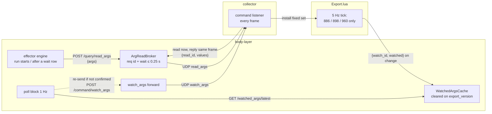

# BL-B90 — configurable cockpit effector sequences

Precedence: `plans/effector-sequences/explore-notes.md` (user's own words; its **2026-10-23**
section outranks everything below) > `docs/concept/configurable-cockpit-effector.md` ("concept,
not final truth") > `body-layer/ROADMAP/BL-B90.md` > this plan's own text.

**Revision history**

- 2026-10-21, first pass `c741149e`, revised `ca8760d9` (registry = whole Mi-24P, generated from
  ED files; sequenced after BL-B80).
- **2026-10-23, this revision (plan only, no code)** — fitted to the code after `[[BL-B80]]` v2
  merged (`a2ea382c`), and folds in the user's four 2026-10-23 answers. What changed, in one
  place:

| # | Was (2026-10-21) | Now (2026-10-23) | Why |
|---|---|---|---|
| R1 | Stage 4 "remove `GuidanceUnitState`" | **`GuidanceUnitState` stays, slimmed to readback only** (lamps + observed switches). Its sequencing fields move into the engine. | BL-B80's `SightHead`, `home_phase` derivation and `sight_ready()` read it |
| R2 | `sight_ready` refreshed from `is_complete(TAKEOFF)` | **`sight_ready` stays `sight_effector.sight_ready(state)` = the real 960 lamp** | BL-B80 v2 replaced "sequence done" with the lamp |
| R3 | "Guidance unit ready" in the takeoff file's `petrovich-says` | **Stays hard-coded, on a true observed 960 off→on edge**, with a named seam for a future `guidance-unit-ready` trigger | User: *"For now it can be hard coded, but it should really be it's own trigger"* |
| R4 | Takeoff one-shot per mission | **Every takeoff**; the engine's own implicit self-check (R12) skips what is already on — not, as first shipped, an explicit `!= on` row condition | User: *"per takeoff, the sequence file will then deal with it not being the first takeoff"*; narrowed by R12, 2026-10-23 |
| R5 | Row conditions read **commanded** state (old D3) | **Conditions (explicit and implicit) read the observed cockpit readback** | Commanded state cannot know a hot start, an air start, or a switch the pilot moved by hand — the very cases R4 makes the file handle |
| R6 | Bad file → refuse to start (explore decision 6, old D2/D3) | **Bad file → log, ignore that file, console banner, one intercom line once the intercom is up** | User decision 3, 2026-10-23 |
| R7 | Stage 3 = generic watched-args readback, needed for parity | **Not needed for *reading* this cut's six switches**: BL-B80's existing per-frame `cockpit_switch` feed already carries all six. Stage 2 adds an arg-keyed view of the existing feed (aircraft-layer Python only, no `Export.lua` change). **Superseded again, 2026-10-23** (explore-notes, "Readback rate and scope"): the user does not want switch positions riding BL-B80's per-frame push at all, regardless of parity — "we'll be reading a lot of args eventually... for switch positions the normal lower frequency poll is enough... query a set of switches when they are needed, not everything... at DCS export level if possible." So the generic low-rate/on-demand readback move is **BL-B90's own last stage** (renumbered Stage 4 below), in scope for this milestone, not a deferred/backlog item — it just runs after Stage 3's card, per the user's "let's say BL-B90 last step." | Measured from the code: `push_cockpit_switch_state` reads 773/761/885/955/886/673 + 898/960/962. User direction, 2026-10-23 (quoted in full in explore-notes' "Readback rate and scope"). |
| R8 | Global vs per-trigger queue open | **Per trigger** | User decision 1 |
| R9 | No acceptance card | **Own short re-flight card** (Stage 3, `/test-card`) | User decision 4 |
| R10 | Stage 0 placement "Implementer's call" | **Settled**: `body-layer/tools/generate_effector_registry.py`, full spec below | User: build the generator next |
| R11 | Curated registry + sequence files at `body-layer/config/effectors.toml` / `body-layer/config/effector-sequences/*.md` | **`body-layer/config/sequences/`** — `effectors.toml`, `*.md` sequence files, and the generated `switch-reference.md` all live there; the raw dump stays at `body-layer/config/effectors-raw.toml` | User, 2026-10-23: first "sequence files ... go to body-layer/sequences/", then corrected mid-Stage-1 to "body-layer/config/sequences is better" |
| R12 | Takeoff rows carry an explicit `<effector> != on` self-condition (D3/R5) | **The engine itself skips a switch row whose effector's OBSERVED readback already equals the row's target value** — no write, no step delay, no speech — for *every* trigger, not only takeoff; the takeoff file's self-conditions are removed as redundant. If that readback is still unknown after `EFFECTOR_CONDITION_READBACK_WAIT_S`, the row **writes** (an absolute-value write is harmless if the switch was already there) — this is the opposite of an explicit `condition` cell's unknown-timeout, which *skips* (D3, unchanged). Explicit `condition` cells are reserved for genuine cross-switch dependencies, which no shipped file needs this cut. | User, 2026-10-23, verbatim: *"that's kinda duplicate. Rather that condition like that, I'd expect the code to check that switch is already in set position, so no action. I'll use the conditions for real this-depends-on-some-other-condition cases."* Reversible (main loop's own call on the unknown-timeout writing rather than skipping) — flagged in `implementation.md`. |
| R13 | One flat registry + sequences directory, a device/cmd/arg collision drops *both* entries (D5) | **Per-aircraft layout**: `config/sequences/<aircraft-dir>/effectors.toml`, `.../switch-reference.md`, `.../copilot-<trigger>.md` (the `mi-24p-` filename prefix drops now the directory carries it); the raw dump moves to `config/effectors-raw/<aircraft-dir>.toml`. `<aircraft-dir>` is a sequence file's own `aircraft` header value, lower-cased (`Mi-24P` → `mi-24p`) — stated once, in `effector_registry.aircraft_dir_name`, and never re-derived elsewhere. The loader loads one registry per aircraft directory; a sequence file resolves effectors only against its own aircraft's registry, and an `aircraft` header that does not map to the directory it was found in is a file error (D5-collected, not fatal); each aircraft directory is independent — a bad registry in one disables only that aircraft's sequences, never another's. **Collision rule also changes**: the *first* curated entry (TOML file order) to claim a `(device, cmd, arg)` triple wins; every later one is rejected with a non-fatal error naming the triple and the winner — not "drop both" (superseded, see below). | User, 2026-10-23, verbatim: *"keep first. effectors.toml has to be aircraft specific. While we're only working with Mi-24P at this time, better to be ready now."* Shape (directory names, filename-prefix drop) is the main loop's own reversible choice, logged in `implementation.md`. |
| R15 REVISED | R15 below: one continuous watched set = sequence args ∪ code args | **Two readback classes** (user, option B, 2026-10-24): sequence switches get a **synchronous one-shot read** (`POST /query/read_args` → collector broker → `Export.lua` answers in the same frame) at run start and after each wait row. R12/D3 resolve against that snapshot plus engine-wide `assumed_writes`, and an unknown never blind-writes a non-absolute effector. Only `(886, 898, 960)` stay polled through `watch_args` at 5 Hz, a fixed set that sequence files cannot grow. | *"the number of switches that we use will increase ... sequences can flip any switch. Most of them we really only need a few times per flight"*; then ***"B"*** (explore-notes, "Stage 4 decisions, 2026-10-24"). |
| R15 | Stage 4 = "design as 2026-10-21, corrected for reduction" (one paragraph, not specified) | **Specified, 2026-10-24 — see "Stage 4 — watched-args readback (spec)"**. The fixed per-frame `push_cockpit_switch_state` line (9 args) is **retired whole**, lamps included; body-layer declares one watched set (sequence-file args ∪ three code-consumer args), `Export.lua` reads only those inside its existing 5 Hz export tick, raw values, change-gated, echoing a content-derived `watch_id` so body-layer knows when to re-send. `/cockpit_switch/latest` and `CockpitSwitchState` are removed; the new feed reuses Stage 2's `"args"` map shape so `effector_engine` does not change. | User, 2026-10-23 (explore-notes "Readback rate and scope"); *"Go ahead with BL-B90 last stage"*, 2026-10-24. Per-arg consumer audit in the spec: no consumer of that line reads it faster than body-layer's 1 Hz poll, and the two args the Lua servo needs per frame (886/898) it already reads itself. |
| R14 | Five triggers (`takeoff`/`observ-on`/`observ-off`/`weapons-arm`/`weapons-safe`), each `cardinality="every_time"` | **Two more**, `mission-start`/`mission-start-in-air`, both `cardinality="once"` (per mission) — fired by `logger.py`'s poll block once it has a *fresh* post-restart ownship sample (never the stale pre-restart one `GET /telemetry/latest` may still be serving), per D2's "mission (re)start re-runs the runner `__init__`" for the pending-flag fields this adds. **`TAKEOFF` no longer fires on an air start** — only a real observed ground→air transition fires it now; the air-start case fires `MISSION_START`/`MISSION_START_IN_AIR` instead. **A body-layer process start/restart against an already-running mission fires neither** (unchanged: `_check_for_new_mission`'s pre-existing first-poll rule already refused to treat that as a reset). No sequence file ships for either new trigger this cut — a trigger with no loaded file fires into nothing. | User, 2026-10-23, verbatim: *"Add trigger for mission-start that fires once at every mission start and separate for mission-start-in-air that fires once at mission start only if airborne (AGL > 10 m)"*; *"No, only real takeoffs"*; *"No, only real mission starts"* (explore-notes, "Two new triggers: mission start"). |

- **2026-10-24 (later) — Stage 4 revised to option B** (R15 REVISED, plan only), at `0a87e516`,
  after the user's answers to Decisions 4–6: "Stage 4 — readback by need". The first spec is kept
  in place, marked superseded.
- **2026-10-24 — Stage 4 specified** (R15, plan only), at `5b33b7b7`: "Stage 4 — watched-args
  readback (spec)". Three new Decisions items (4–6), all with recommendations.

Superseded text that a later reader needs is kept in "Superseded (2026-10-21 text)" at the end,
not deleted.

### Goal

Replace BL-B66's hard-coded guidance-unit power-up / OBSERV / weapons-safety-bar switch writes
with a generated Mi-24P effector registry, a small curated registry of friendly names, and
startup-loaded markdown-table sequence files per (aircraft, role, trigger) — so adding or
reordering a cockpit switch sequence is a data edit — while gating/refusals, every readback BL-B80
consumes, the "Guidance unit ready" line (this cut) and the slew/pointing loop stay in code.

---

## What already exists, and what this entry reuses rather than invents

- **The write channel is already generic.** `cockpit_switch` (`Export.lua`
  `handle_cockpit_switch_command`, `aircraft_client.write_cockpit_switch`) writes any
  `(device, cmd, value)`. **Zero `Export.lua` change for this cut.**
- **The readback already exists for every switch this cut touches** (R7). `push_cockpit_switch_state`
  reads the six switch args plus the three BL-B80 lamps every frame, sends on change, and
  `GET /cockpit_switch/latest` serves them. `run_sight_servo` separately reads 886/898 *inside
  Lua* every frame — that is the slew loop and is **not touched, ever**.
- **The "is the intercom up" notion already exists**: aircraft-layer `Spu8Cache.gate_state()` /
  `Spu8Sample.gate_open` (pilot NET-1 377 AND co-pilot ICS power 664), served as
  `GET /spu8/state` → `"gate_open"`, fail-safe-closed when no sample yet. It is consulted by
  `AudioPlaybackSender`, which **drops** a line played while the gate is closed — so it cannot be
  used as a "hold until up" queue by itself. Body-layer does not read it today.
- **The speech funnel already exists**: `CrewConsole._print` (stdout + overlay + TTS, honours
  `silenced`). The one-shot "speak this once when a condition holds" shape already exists too:
  `CrewConsole.drain_guidance_unit_ready(now_sim, *, ready, announced)` — caller passes booleans,
  `CrewConsole` does not hold runner state. The new error line copies that shape exactly.
- **A "system error" spoken-line precedent exists**: `WORLD_MODEL_NOT_LOADED_REFUSAL` ("system
  error, world model not loaded"). The new line follows the same "System error, …" form.
- **The generator convention exists**: `body-layer/tools/generate_defaults.py` — a dev tool under
  `body-layer/tools/`, **static parse, never execute** ("AST, not import"), check mode by default,
  `--write` to regenerate, committed generated file with a DO-NOT-HAND-EDIT header, tested from
  `body-layer/tests/` by loading the tool with `importlib.util.spec_from_file_location`
  (`test_generate_defaults_first_sentence.py`). Stage 0 copies all of this.
- **replace()-only, one-construction-site discipline** for frozen run state, as `GuidanceUnitState`
  already does.
- **The one-shot external-signal shape** `observ_transition` / `weapon_safety_transition` on
  `CrewConsole` is unchanged; the poll loop fires a trigger instead of a hard-coded write.
- **Gating stays in code**: `_handle_observ_on`'s `sight_ready` gate and "Unable, guidance unit not
  ready" are untouched.

**Queries run** (`gq.sh`, `memory-search.py`): no prior plan on this ground beyond explore-notes,
the concept doc and BL-B66/BL-B80. Relevant memory: the four-times-recurring "leaf tested, poll-loop
wiring not" defect (`reviewer/project_terrain_callout_stage5_wiring_gap.md`,
`dod/project_untested_wiring_pattern_caught_at_reviewer_not_dod.md`), and the poll-loop test recipe
(`implementer/feedback_poll_loop_sim_time_integration_tests.md` — note its trap 2: `on_ground`
defaults `True`, so an airborne first sample is a takeoff edge; see Risks).

**No `investigator` pass.** The only DCS-internals unknowns are the exact Lua forms in ED's cockpit
scripts, which no Mac-side role can read (the files exist only on the Windows DCS machine — see
Stage 0). Stage 0 is designed fail-closed so the first real run reports any form it does not
handle, and Stage 0a is a read-only recon step on that machine.

### Finding outside this plan's scope, raised before Flight A — now resolved

**Resolved 2026-10-23, independently of this plan.** The merged BL-B80 code did not implement
BL-B80's own decision 2 ("Guidance unit ready" only on an *observed* 960 off→on edge, silent on
air starts) — `logger.py`'s `drain_guidance_unit_ready` spoke whenever `ready and not announced`,
so an air start (lamp already lit on the first sample) said "Guidance unit ready" at spawn. Fixed
on `fix/guidance-ready-edge` (true edge: previous `ready_observed is False` and new `is True`;
`guidance_unit_ready_announced` latch dropped), reviewed, DoD-passed, and merged to `main`
(`body-layer/ROADMAP/BL-B80.md`). This plan's Stage 2 does **not** need to redo this fix — the
edge detector it lands on is exactly R3's seam, already in place.

---

## Registry scope and source — decided (2026-10-21, unchanged)

The registry is the full Mi-24P clickable-control surface, generated from ED's own
`Mods/aircraft/Mi-24P/Cockpit/Scripts/` files. User: *"ED files is better. Use DCS-bios data as
reference for what they do, if DCS file does not provide info."* So:

- **The generator reads only ED's files.** It never parses, imports or vendors DCS-BIOS (GPL-3.0;
  this project is CC BY-NC-SA 4.0, `LICENSE.md`, and the two cannot be combined).
- **DCS-BIOS is read by a person, by hand,** to label a curated entry when ED's own label is
  missing or ambiguous.
- **No ED source is committed.** The generated TOML carries derived facts (names, numbers, ED's
  short English hint strings), the same class of content `aircraft-layer/research/
  mi24p-command-surface.md` §10 already commits. Test fixtures are **synthetic Lua written for this
  project** in ED's forms, never copied excerpts.

---

## Stage 0 — the switch-list generator (build next; implementable as written)

### Where the real files are

- **Only on the Windows DCS machine.** `world-model/data/raw/dcs/2026-09-02/DCS-files.txt` (the
  install listing) confirms, under `Mods/aircraft/Mi-24P/Cockpit/Scripts/`: `devices.lua`,
  `command_defs.lua`, `clickable_defs.lua`, `clickabledata.lua`, plus per-system command files
  (`A036_commands.lua`, `Weap_syst_commands.lua`, `main_panel_commands.lua`,
  `MiscSystems_commands.lua`, `Hydro_system_commands.lua`,
  `FireExtinguishersInterface_commands.lua`, …) and `Macro_sequencies.lua`.
- **Not on this Mac**: `$DCS_INSTALL_PATH` is unset here, and `win-mac-sync/from-windows/` holds
  `elements_defs.lua` and `PKV_init.lua` but none of the four files above.
- **Paths come only from `DCS_INSTALL_PATH` / `DCS_SAVED_GAMES_PATH`** (user direction,
  2026-10-23), set on the Windows DCS machine, the same precondition `dcs-file-investigation` uses
  (`${DCS_INSTALL_PATH:?not on the DCS machine}`). No step, and not the tool, ever searches for
  the install or hard-codes a path.
- `Macro_sequencies.lua` is presumably ED's own cold-start macro (switch sequences). Prior art worth
  a look in Stage 0a, not a parser input.

### Steps, and which machine each runs on

| Step | Where | What |
|---|---|---|
| **0a** (recommended, not blocking 0b) | **Windows DCS machine**: a command given to the user, or relayed by the main loop when a Windows session exists | Read-only recon of the exact Lua forms. Output: a dated note `aircraft-layer/research/2026-10-2x-mi24p-clickabledata-forms.md` answering the questions in "Forms the parser must handle". Short quoted snippets are fine in research; no whole-file copies. |
| **0b** | Mac (Implementer) | Tool, synthetic fixtures, tests. Starts from the forms the research notes already document; folds in 0a's answers when they arrive. |
| **0c** | **Windows DCS machine** (same channel as 0a) | `--write` run against the installed tree. Returns `body-layer/config/effectors-raw.toml` and the run report. This is the real run: no Mac-side role produces the committed dump (execution-boundary rule, `feedback_full_build_execution`). |
| **0d** | Mac | Control-point check of the returned dump (below), then commit it on `feature/effector-sequences`. A failing control point blocks Stage 1. |

### Tool

- **Path**: `body-layer/tools/generate_effector_registry.py`. Stdlib only (`argparse`, `re`,
  `hashlib`, `pathlib`, `json`, `tomllib` for reading the output back in tests). Runs on any
  Python 3.11+, Windows or WSL; nothing from body-layer's `src/` is imported (it is a file-to-file
  transform).
- **Static parse, never execute ED's Lua** (`generate_defaults.py`'s own principle). A small
  tokenizer (strings incl. `[[…]]`/`[==[…]==]`, numbers, names, punctuation, `--` and `--[[ ]]`
  comments) plus a recursive-descent reader for the Lua subset ED uses: table constructors,
  function calls, dotted/indexed names, `_("…")`, unary minus, and the `counter()` idiom. Anything
  outside that subset inside an `elements[…] =` statement is an **unhandled element**, never
  guessed.
- **CLI**:

  ```
  python tools/generate_effector_registry.py [--scripts-dir <dir>]
         [--dcs-build <string>] [--output <path>] [--write] [--allow-unhandled]
  ```

  - **input location**: by default `$DCS_INSTALL_PATH/Mods/aircraft/Mi-24P/Cockpit/Scripts`.
    If `DCS_INSTALL_PATH` is unset and `--scripts-dir` is not given, exit 1 with
    "DCS_INSTALL_PATH is not set — not on the DCS machine; pass --scripts-dir to point elsewhere".
    `--scripts-dir` overrides the variable (tests and fixtures always use it). The tool never
    searches for an install.
  - default (no `--write`): parse, print the report to stdout, write nothing. Exit 0 clean,
    2 if any element is unhandled, 1 on an unreadable input.
  - `--write`: also write the TOML (default `body-layer/config/effectors-raw.toml`, relative to
    the tool, `--output` overrides — tests always pass `--output` into `tmp_path`). Refuses to
    write (exit 2) if any element is unhandled, unless `--allow-unhandled`, in which case the
    unhandled list goes into the header.
  - `--dcs-build`: if absent and `DCS_INSTALL_PATH` is set, read the version from
    `$DCS_INSTALL_PATH/autoupdate.cfg` (that exact file, no walking up); otherwise exit 1 with
    "pass --dcs-build". **Resolved lazily, immediately before the write step, not at startup** —
    report mode never consumes a build string (it is only ever rendered into the TOML header), so
    requiring it unconditionally would be a startup refusal with no corresponding need. Settled
    as shipped, per `implementation.md`'s "Follow-up pass" item 1.
- **Real-run command** (Windows DCS machine, from the repo checkout's `body-layer/`; both vars
  already set there):

  ```sh
  : "${DCS_INSTALL_PATH:?not on the DCS machine}"
  python tools/generate_effector_registry.py           # report only
  python tools/generate_effector_registry.py --write   # then write config/effectors-raw.toml
  ```

### Forms the parser must handle — **confirmed live by Stage 0a**, not guessed

Superseded by `aircraft-layer/research/2026-10-23-mi24p-clickabledata-forms.md` (build
2.9.30.28738; the 749 `elements[` count is unchanged from the 2026-09-11 dump at 2.9.29.27278, so
the two builds agree on everything below). The bullets below originally guessed at these forms
before 0a ran; **every one of the four guesses 0a corrected is now stated as fact**, not as a
question for 0a, since 0a has already run:

1. **`devices.lua`**: `devices["NAME"] = counter()` only — **there is no dotted
   `devices.NAME = counter()` declaration form** (the original guess above was wrong on this
   point; dotted access is reference-only, used by `clickabledata.lua`/`clickable_defs.lua` to
   *read* a device back). Ids assigned by order of appearance from 1. Control points: `WEAP_SYS = 6`,
   `I9K113 = 7`, `ASP_17V = 16`, `HELPER_AI = 30`, `SPU_8 = 55`, 73 devices total — confirmed at
   both 2.9.29.27278 and 2.9.30.28738.
2. **Command tables**: `<x>_commands = { Name = counter(); … }`, each of 48 plain tables preceded
   by a column-0 `count = start_command` reset; the 49th, `device_commands`, is built by a `for
   cmd_num = 1,120 do device_commands["Button_"..cmd_num] = counter() end` loop instead of a plain
   constructor — the tool's `device_commands`-loop form and its fail-closed rejection of any other
   loop shape (`CommandDefsParseError`) is this, not a guess. **The include direction is the
   reverse of the original guess**: the per-system `*_commands.lua` files (`A036_commands.lua`,
   `Weap_syst_commands.lua`, etc.) `dofile` *into* `command_defs.lua`, not the other way around,
   and none of them defines any command id or needs to be read — the generator correctly ignores
   them entirely, per the research note's Q0/Q2. `Keys = {...}` (explicit numeric literals, no
   counter, before the first reset) is never referenced by `clickabledata.lua` and is correctly
   never touched.
3. **Helper-call elements**: `elements["NAME"] = <helper>(_("hint"), devices.X, x_commands.Y, <arg>, …)`.
   **22 distinct helper signatures exist (not 8), 18 of them actually called** in
   `clickabledata.lua` — `default_button`, `default_2_position_tumb`, `default_3_position_tumb`,
   `default_2_position_small_tumb`, `default_axis`, `default_axis_limited`,
   `default_animated_lever`, `default_blue_cover`, `multiposition_switch`, `default_square_button`,
   `default_position_tumb`, `default_2_position_flares_tumb`, `springloaded_3_pos_tumb`,
   `radio_wheel_1`, `triple_switch`, `stick_button`, `default_tumb_button`,
   `default_spring_button` — plus `default_CB_button`, `default_button_tumb`,
   `springloaded_2_pos_tumb`, `default_1_position_tumb` defined but never called. Two
   (`default_button_tumb`, `springloaded_3_pos_tumb`) take **two** command slots, not one; the
   generator carries the second as `cmd2`/`cmd2_id`/`cmd2_symbol`, rendered only when present —
   this is a departure from this plan's original one-`cmd` schema, logged in
   `implementation.md`. The tool holds the exact 22-entry signature table (`_HELPER_SIGNATURES`,
   baked in from the research note's Q3 rather than parsed from `clickable_defs.lua` at runtime,
   since only parameter order — not the helper bodies — matters for id resolution). An unknown
   helper name → unhandled, named in the report.
4. **Raw-table-literal elements** — the 13 the 2026-09-11 dump missed
   (`mi24p-command-surface.md` "Known gap"). **The field names this plan originally guessed
   (`cockpit_device_id`, `name`) are wrong** — the real shape uses `device`, `hint`, `action`,
   `arg` (confirmed at Q5): `elements["STICK-PTT-PTR"] = { class = {…}, hint = _("…"), device =
   devices.SPU_8, action = {…, …}, arg = {738, 738}, arg_value = {1.0, 0.5}, arg_lim = {{0.0,
   1.0}, {0.0, 0.5}}, … }`. `action`/`arg` may be scalars or lists; lists are kept as lists, and
   the generator's output schema carries them as lists throughout (`cmds`/`args`/`arg_values`),
   never deduplicating two identical-looking commands that are really two distinct LMB/RMB
   actions. Control points: `STICK-PTT-PTR` args `[738, 738]`, `OP-STICK-PTT-PTR` `[856, 856]`,
   both `arg_value = [1.0, 0.5]`.
5. **Post-assignment fields**: `elements["NAME"].crew_member_access = {1}` and the same form
   inside a literal (235 such patches total in the real file, confirmed by Q6/Q7, almost all for
   fields outside this registry's schema — `turn_box`, `sound`, `updatable`, `side`, counted for
   the completeness arithmetic but not otherwise acted on). **Corrected seat rule, overriding the
   original "absent → `seat = \"default\"`" text**: `seat` is always rendered as one of
   `"pilot"`/`"operator"`/`"both"` (DCS's real default is 0 = pilot when
   `crew_member_access` is absent or `nil` — never an unresolved `"default"` placeholder), with a
   separate `seat_explicit: bool` field recording whether the source actually said so.
   `{0}` → `"pilot"`, `{1}` → `"operator"`, `{0, 1}` → `"both"`; any other set → **unhandled**,
   not silently guessed. Control point: arg 664's element `crew_member_access = {1}`.
6. **Anything else** at top level of `clickabledata.lua` (loops, locals, function definitions) is
   **not an element**: counted and listed by line in the report as "statements ignored"
   (implemented — see the review fixes in `implementation.md`). Confirmed by 0a's Q4: the real
   file's top level has no loop, no function definition, nothing that creates or mutates an
   element outside the plain `elements[...]` assignment/patch forms.
7. **Completeness check, fail-closed, three-way (not two-way as originally written)**: the number
   of textual `elements[` assignment heads in `clickabledata.lua` must equal **emitted +
   unhandled + post-assignment patches** — a third term the original two-way text ("heads =
   emitted + unhandled") did not have, needed once Q6/Q7 confirmed 235 of the 749 heads are field
   patches on an already-defined element, not new definitions. 749 confirmed at both
   2.9.29.27278 and 2.9.30.28738 (501 helper calls + 13 raw-literal openers + 235 patches); a
   different count on a later build is reported, not an error (patches add controls).

### Output — `body-layer/config/effectors-raw.toml`

**Path moved during Stage 2 (R13)**: the real committed dump now lives at
`body-layer/config/effectors-raw/mi-24p.toml`, and `generate_effector_registry.py`'s own
`--write` default output changed to match. Everything below this heading is otherwise unchanged
from how Stage 0 built it.

Hand-rendered TOML (stdlib cannot write TOML; same as `generate_defaults.py`), sorted by element
name so a regeneration diffs cleanly. **Schema below corrected to what Stage 0b actually ships**
(`seat`/`seat_explicit` always resolved, not a `"default"` placeholder; `device_name` its own
field, not a trailing comment; `cmds`/`args` as lists even for a single-command element, per "a
consumer never branches on type"; `shape` is the bare helper name, including `"raw_table_literal"`
for the 13 raw-literal elements, not a stripped/renamed form):

```toml
# Generated by body-layer/tools/generate_effector_registry.py. DO NOT HAND-EDIT.
# Source: Mods/aircraft/Mi-24P/Cockpit/Scripts, DCS <build, e.g. 2.9.30.28738>
# Inputs (sha256): devices.lua <hex>, command_defs.lua <hex>, clickabledata.lua <hex>
# Elements: 749 elements[ heads: 501 emitted (helper), 13 emitted (raw literal), 0 unhandled,
# 235 field patches, <n> statements ignored (see the run report).
# Regenerate after any DCS update: device and command numbers are positional.

[elements."WEAP-SIGHT-ON-PFF-PTR"]
device = 16
device_name = "ASP_17V"
cmds = [3014]
cmd_names = ["asp_commands.Power"]
args = [529]
label = "Sight Power ON/OFF"     # ED's own hint string, not a friendly name
shape = "default_2_position_tumb"
seat = "pilot"
seat_explicit = false

[elements."STICK-PTT-PTR"]
device = 55
device_name = "SPU_8"
cmds = [<n>, <n>]
cmd_names = ["...", "..."]
args = [738, 738]
arg_values = [1.0, 0.5]
label = "Trigger Button, RADIO(LMB)/ICS(RMB)"
shape = "raw_table_literal"
seat = "pilot"
seat_explicit = true
```

Lists everywhere (one shape for helper and raw elements; a consumer never branches on type).
`helper_args` (verbatim source text of positions after the fourth) only when present.

### Tests — `body-layer/tests/test_generate_effector_registry.py`

Fixtures in `body-layer/tests/fixtures/effector_registry/` — **synthetic Lua**, a tiny fake module
in ED's forms: `devices.lua` (≥ 3 devices, including one at a position that proves 1-based order),
`command_defs.lua` (two tables, proving the per-table restart at 3001, plus one include if 0a
confirms that form), `clickabledata.lua` covering:

- one element per known helper, including `multiposition_switch` with trailing args;
- a raw literal with list `action`/`arg`/`arg_value`/`arg_lim` (the PTT shape) and one with
  scalars;
- `crew_member_access` absent, `{0}`, `{1}`, and as a post-assignment;
- `_("…")` hints containing a comma, a quote and a `--` (must not be read as a comment);
- a `--[[ … ]]` block comment containing a fake `elements[` line (must not count);
- a top-level `for` loop and a `local` (ignored, listed);
- in a second fixture file set: an unknown helper, and a reference to an undefined device symbol.

Assertions: exact TOML for the good set (parsed back with `tomllib`, not string-compared, plus
one golden-text check of the header/ordering); device/command numbers equal the fixture's
counter positions; unknown helper and undefined symbol each make check mode exit 2 and name the
element; `--write` refuses on unhandled and succeeds with `--allow-unhandled` (list in header);
the completeness count; include outside `--scripts-dir` is refused; `DCS_INSTALL_PATH` unset and
no `--scripts-dir` exits 1 with the "not on the DCS machine" message (`monkeypatch.delenv`);
`DCS_INSTALL_PATH` pointing at a fixture tree resolves the Mi-24P subpath and reads its
`autoupdate.cfg`; `--scripts-dir` with no variable and no `--dcs-build` exits 1. Run with body-layer's normal `pytest`.

### 0d control points (real dump, Mac-side, before commit)

Against `mi24p-command-surface.md` §2/§10 and the live-confirmed BL-B66/BL-B80 values: devices
6/7/16/30/55; `asp_commands.Power` = 3014 on arg 529; the six BL-B66 writes —
`(6, 3028)` arg 773, `(16, 3015)` arg 761 (still UNVERIFIED), `(7, 3001)` arg 885, `(6, 3030)`
arg 955, `(7, 3002)` arg 886, `(6, 3020)` arg 673 — each present as some element; 738/856 present;
664 `seat = "operator"`. These control points, and the full form/count survey above, are now
confirmed live at both 2.9.29.27278 and 2.9.30.28738 (`aircraft-layer/research/
2026-10-23-mi24p-clickabledata-forms.md`) — Stage 0c runs against whichever build is installed on
the Windows machine at the time. A mismatch on a build newer than 2.9.30 is a finding to write up,
not an automatic fail; a mismatch on either confirmed build is a parser bug.

**Stage 0 is its own batch** (dev tool, no runtime dependency; performance/security passes per
root `CLAUDE.md`'s batch rule — one each, after 0b).

---

## File formats (Stages 1–2)

**Curated registry — `body-layer/config/sequences/<aircraft-dir>/effectors.toml`** (R13, per
aircraft; `<aircraft-dir>` = the sequence files' own `aircraft` header value lower-cased, e.g.
`mi-24p`). Hand-written, small. Each entry: a
friendly name, `source_element` (join key into the raw dump), optional `index` (which entry of a
multi-action element's lists, default 0), named `values`. **Never repeats device/cmd/arg.**

```toml
[effectors.missile_power]
source_element = "<ED name for arg 773>"     # filled from the Stage 0 dump
values = { on = 1.0, off = 0.0 }

[effectors.cplr_distr]
source_element = "<ED name for arg 761>"
values = { on = 1.0, off = 0.0 }
unverified = true   # docs/acceptance/2026-10-17-9k113-procedures-direction.md

[effectors.sight_power]
source_element = "<ED name for arg 885>"     # NOT WEAP-SIGHT-ON-PFF-PTR/529 (the ASP-17's)
values = { on = 1.0, off = 0.0 }

[effectors.scho_pwr_b1]
source_element = "<ED name for arg 955>"
values = { on = 1.0, off = 0.0 }

[effectors.observ]
source_element = "<ED name for arg 886>"
values = { on = 1.0, off = 0.0 }

[effectors.weapon_safety]
source_element = "<ED name for arg 673>"
values = { armed = 1.0, safe = 0.0 }
```

**Sequence files — `body-layer/config/sequences/<aircraft-dir>/*.md`** (R13). Two tables per file:

1. Header (`file-param | for`) with exactly `aircraft`, `petrovich-role`, `run-on-trigger` — the
   key for duplicate detection (not the filename).
2. Data table `condition | effector | value | petrovich-says | comment`. Each row is one of:
   - **switch row**: `effector`/`value` name a registry entry and one of its `values`.
     `condition`, if present, is `<effector> = <value>` or `<effector> != <value>`, evaluated
     **against the observed readback at the moment the row is reached** (R5, D3). A false condition
     skips the row: no write, no delay, **no speech**.
   - **wait row**: `condition` = `wait_s(<n>)`, every other cell blank — the gap before the next
     row is `<n>` s instead of the default.
   - **say-only row** (effector blank, `petrovich-says` set) is **reserved, rejected this cut**
     with the message "say-only rows arrive with the guidance-unit-ready trigger" (seam, D7).

Takeoff, as it ships (R4/R12/R14 — a second takeoff skips every row via the engine's own implicit
self-check, not an explicit `condition` cell; an air start never reaches this file at all, since
`takeoff` now fires only on a real observed ground→air transition — an air start fires
`mission-start`/`mission-start-in-air` instead):

```markdown
| file-param | for |
| --- | --- |
| aircraft | Mi-24P |
| petrovich-role | copilot |
| run-on-trigger | takeoff |

| condition | effector | value | petrovich-says | comment |
| --- | --- | --- | --- | --- |
| | missile_power | on | | MISSILE POWER |
| | cplr_distr | on | | CPLR DISTR -- unverified, see registry |
| | sight_power | on | | Sight Power (GUID.UNIT POWER) |
| | scho_pwr_b1 | on | | SHCHO PWR B1 |
```

OBSERV on/off and weapons arm/safe: one unconditional row each (parity with today).

**Readback value matching.** An observed raw value `r` matches named value `v` iff
`|r − v| <` half the smallest gap between that effector's named values (two-position → the
existing `>= 0.5` threshold; works for 3-position). Absent readback is **unknown**, never a value.

---

## Settled design decisions

- **D1 — Queues per trigger** (user, 2026-10-23). Each trigger has at most one *running* run and
  one *pending* run. Firing a trigger whose run is idle starts it this poll; firing while it runs
  marks it pending; firing while already pending is a logged no-op (a re-run only re-evaluates
  conditions, so a second pending copy adds nothing). Different triggers run independently.
- **D2 — Takeoff fires on every takeoff** (user, 2026-10-23): on every `on_ground` True→False
  transition, using the existing `ON_GROUND_AGL_THRESHOLD_M` signal (the concept's "bind to that
  value"). The `takeoff_seen` latch is deleted.
- **D3 — Conditions read observed readback; unknown waits, then skips.** *Supersedes old D3
  (commanded state)* — reason R5. If a condition's effector has no readback yet, the row waits
  (does not advance, does not write) up to `EFFECTOR_CONDITION_READBACK_WAIT_S` (new tunable,
  default 5.0, lo 1.0, hi 30.0), then skips with a WARNING naming the effector and arg. Never
  "unknown → true": a row like `observ = on → weapon_safety armed` must not fire on missing data.
  In the poll block, readback is refreshed **before** the engine advances (today it is after), so
  a row reached this poll sees this poll's sample. **R12 adds a second, implicit check that runs
  on every switch row regardless of whether it carries an explicit `condition`**: if the row's own
  effector is already observed at the row's target value, the row is skipped (no write, no delay,
  no speech) — the same readback-wait as above, but the *opposite* outcome on timeout: an
  implicit self-check that is still unknown after `EFFECTOR_CONDITION_READBACK_WAIT_S` **writes**
  rather than skips (the write is an absolute set, harmless if the switch was already there),
  whereas an explicit `condition`'s timeout still skips. An explicit `condition` cell, when
  present, is evaluated first; only once it is satisfied (or absent) does the implicit self-check
  run.
- **D4 — Re-runs never re-speak.** Speech comes only from a row that actually wrote. The takeoff
  file has no `petrovich-says` at all this cut; "Guidance unit ready" is hard-coded on the 960
  **edge** (prior observed `False` → `True`), so a second takeoff with the unit already up says
  nothing, a power-down/re-power announces again, and an air start with the lamp already lit is
  silent.
- **D5 — A bad file is not fatal** (user, 2026-10-23; *supersedes explore decision 6 and old
  D2/D3*). At load:
  - each sequence file is validated alone; a bad one is ignored and every error is collected
    (file, line, reason);
  - **registry, recommended posture — same, at the finest grain that is honest**: a bad curated
    *entry* (unresolved `source_element`, bad `values`) drops that entry, and any sequence file
    using it becomes a bad file in turn. **Two entries resolving to the same `(device, cmd, arg)`
    is R13's collision rule, not this one**: the first (TOML file order) wins and every later one
    is the dropped entry — not "drop both", which is what this paragraph originally said before
    R13 superseded it;
    a curated or raw file that cannot be read or parsed as TOML at all disables **every** sequence
    (all depend on it). Same banner, same one audio line. *Why not fatal for the registry*: the
    user's principle — "Petrobrain will continue, but some functionality may not work" — applies
    exactly; a refusal here would reinstate the failure mode they just overruled, and everything
    outside effectors (detection, callouts, voice) does not depend on the registry at all;
  - **console**: `logger.error` per error, plus one unmissable multi-line banner on stderr at
    startup listing every bad file and reason;
  - **audio**: exactly one line per body-layer process, however many files are bad:
    *"System error, bad sequence file, see the logs. Petrobrain will continue, but some
    functionality may not work."* — held until the intercom is up (D6);
  - a trigger with no loaded file fires into nothing (DEBUG log). The pilot's own command readback
    (e.g. "Observ on") is unchanged — see Risks.
- **D6 — "Once the intercom is up" = aircraft-layer's existing SPU-8 gate.** New
  `AircraftLayerClient.get_spu8_state_latest()` (`GET /spu8/state`, swallow-to-`None` like every
  other getter). `CrewConsole` gains `config_error_pending: bool` (set at startup from D5) and
  `drain_config_error(now_sim, *, intercom_open: bool) -> None`, the `drain_guidance_unit_ready`
  shape: speaks once through `_print` when `config_error_pending and intercom_open and not
  self.silenced`, then clears the flag. `intercom_open` is `gate_open is True`; `None` (no SPU-8
  sample, or an old `Export.lua`) never opens it — the banner already went to the console. Not
  cleared by a mission restart (it describes the process, not the mission): `_reset_mission_state`
  must not touch it. **Performance guard, added in the Stage 1-2 performance review's change
  request (`performance-stage1-2.md`)**: the `GET /spu8/state` fetch itself is gated behind
  `config_error_pending` — `logger.py` only calls `get_spu8_state_latest()` when the flag is still
  `True`, so once it clears (one-shot, per D6 above) the GET never fires again for that process's
  lifetime, instead of running unconditionally every poll of every sortie to serve a flag that
  stays `False` after the first mission (re)start with no bad file.
- **D7 — `guidance-unit-ready` trigger: seam now, trigger later** (user default). Seam: the
  hard-coded announce sits on the single line that detects the 960 edge, and the trigger enum is a
  code enum. Moving it later costs: one `EffectorTrigger` member, replacing that `_print` with
  `fire_trigger(GUIDANCE_UNIT_READY)`, un-reserving the say-only row form, one file
  (`| | | | Guidance unit ready. | |`) and tests — about half a day, and it carries a parity
  question (a sequence-file line would be spoken via the engine, one poll later). **Cheap, but not
  free, and not needed for this cut's value: recommend not in this cut.**
- **D8 — Wait rows** override (not add to) the default gap for that one gap (unchanged from
  2026-10-21).
- **D9 — Write failure**: the row is retried every poll (parity with today's power-up), never
  skipped. To keep the per-trigger queues from reordering writes to one switch: each poll, due rows
  across all triggers run **in fire order**, and once a write to effector *E* fails this poll, no
  later row writing *E* is attempted this poll. So "Observ on" stuck behind a dropped write cannot
  land after a later "Observ off". (Today's OBSERV/safety writes are dropped on failure; retrying
  is a small behaviour change, toward the pilot's intent.)
- **D10 — The inter-row delay** `GUIDANCE_UNIT_SWITCH_DELAY_S` is renamed
  `belief.effector_engine.EFFECTOR_SEQUENCE_STEP_DELAY_S` (same 1.0, `lo=0.5`, `hi=5.0`), and
  `config/defaults.toml` regenerated. A user `tuning.toml` with the old key will warn "unknown key"
  — say so in the commit and the card.
- **D11 — Mission (re)start** re-runs the runner `__init__`: engine and `GuidanceUnitState` fresh,
  running/pending runs dropped. Unchanged mechanism.

---

## What moves, what stays

| Concern | Today | After |
|---|---|---|
| Which switches, order, values | `_POWER_UP_SWITCHES` + two single writes in `sight_effector.py` | `config/effectors-raw/mi-24p.toml` + `config/sequences/mi-24p/effectors.toml` + `config/sequences/mi-24p/*.md` (R13) |
| Sequencing state: `takeoff_seen`, `power_up_stage`, `next_switch_due_sim` | `GuidanceUnitState` | **deleted** / `EffectorRunState` |
| `observ_commanded`, `weapon_safety_commanded` | `GuidanceUnitState` | `EffectorRunState.commanded_values` (written on a successful write). `sight_trace_writer`'s `observ_commanded` column keeps its name and meaning, sourced from there (`None` → `False`, today's default) — Flight A's triage reads it |
| `observ_observed`, `weapon_safety_observed`, `align_observed`, `ready_observed`, `launch_perm_observed` | `GuidanceUnitState` | **stay** on `GuidanceUnitState` (renaming it is churn with no gain; it is the guidance unit's observed state). `refresh_readback` unchanged |
| `guidance_unit_ready_announced` | `GuidanceUnitState` latch | **deleted** — replaced by the edge (D4) |
| `sight_ready` | `sight_ready(state)` = 960 lamp | **unchanged** (R2) |
| "Guidance unit ready" | `drain_guidance_unit_ready`, first-lit latch | hard-coded on the observed edge (D4, D7) |
| Condition readback | none | existing `cockpit_switch` feed, arg-keyed view (Stage 2) |
| `write_sight_target`, slew, `SightHead`, `run_sight_servo` | — | **untouched** |

---

## Co-moving Fields

Trigger fires: `EffectorRunState` (internal) and `GuidanceUnitState` readback / `on_ground` /
`observ_transition` / `weapon_safety_transition` / SPU-8 gate (external) all describe "what the
switches are and what he is doing about it", and `home_phase` is derived from one of them.

**Construction sites, grepped 2026-10-23 at `147a057d`**: `GuidanceUnitState(` — one, the
`field(default_factory=GuidanceUnitState)` on `ConsolePerceptionRunner` (`logger.py:492`), re-run by
mission reset; every other change is `replace()` (`sight_effector.py`, `logger.py` 3285–3436).
Tests construct it directly (`test_sight_effector.py`, `test_logger.py`, `test_sight_trace_writer.py`)
— they must be updated, not left constructing removed fields. **`EffectorRunState(` must end up with
exactly the same one site.** The Implementer re-runs `grep -rn 'EffectorRunState(\|GuidanceUnitState(' body-layer/src`
after Stage 2 and pastes the result into the review handoff; a helper that builds a "fresh run
state for trigger X" is the `BL-B71` failure shape and is not allowed.

| Field | Written by | Transition | Must hold true immediately after |
|---|---|---|---|
| `EffectorRunState.runs[T]` (running cursor: row index, `next_due_sim`, `waiting_since_sim`) | internal | `fire_trigger(T)` while idle | cursor at row 0, due now; same poll's `advance` may execute it |
| `EffectorRunState.pending[T]` | internal | `fire_trigger(T)` while running | `True`; a second fire leaves it `True` and logs (D1) |
| `runs[T]` / `pending[T]` | internal | last row of `T` done | if `pending[T]`: new cursor at row 0, `pending[T] = False`; else `runs[T] = None` |
| `runs[T]` | internal | row reached, explicit condition's effector readback `None` | cursor unchanged, waiting-since set once; after `EFFECTOR_CONDITION_READBACK_WAIT_S` the row is **skipped** (D3) |
| `runs[T]` | internal | row reached, implicit self-check's own readback `None` (R12) | cursor unchanged, waiting-since set once; after `EFFECTOR_CONDITION_READBACK_WAIT_S` the row **writes** (opposite of the explicit-condition timeout above) |
| `commanded_values[E]` | internal | successful write of `E` | equals that row's value name; failed write leaves it unchanged (D9) |
| `GuidanceUnitState.*_observed` | **external** (`cockpit_switch` feed) | any sample | refreshed **before** `advance` this poll (D3); `None` leaves prior value (unchanged posture) |
| `crew_console.on_ground` | **external** (AGL) | True→False | `fire_trigger(TAKEOFF)` called exactly once this poll; no latch (D2) |
| `crew_console.sight_ready` | derived | any 960 sample | `== sight_ready(guidance_unit_state)`; unchanged source (R2) |
| (no field — local in poll block) ready edge | derived | `ready_observed` `False`→`True` | "Guidance unit ready." spoken once; `None`→`True` (air start) speaks nothing (D4) |
| `OpticState.home_phase` | derived in `run_once` from `observ_observed` | 886 edge | unchanged BL-B80 rule; this plan adds no branch to it |
| `observ_transition` / `weapon_safety_transition` | **external** (`crew_console` handlers) | pilot command / `_handle_engage` | drained into exactly one `fire_trigger(...)` and set `None` the same poll; the hands-busy `optic_state` update stays where it is |
| `crew_console.config_error_pending` | startup (D5); internal drain | SPU-8 `gate_open` observed `True` and not silenced | spoken once, flag `False`; mission reset leaves it alone (D6) |
| all of `EffectorRunState` | runner `__init__` | mission (re)start | fresh; nothing carried (D11) |

**Stage 4 supersedes three rows above**: the two per-row "readback `None` → waiting-since" rows,
and `GuidanceUnitState.*_observed` "refreshed before `advance`" as the engine's input. The engine
now waits once per snapshot, and reads only its own one-shot reads plus `assumed_writes`. See
"Co-moving Fields (Stage 4, revised)". The rows stay as the Stage 2 record.

---

## Affected Modules / Files

**Stage 0** — `body-layer/tools/generate_effector_registry.py` (new),
`body-layer/tests/test_generate_effector_registry.py` (new),
`body-layer/tests/fixtures/effector_registry/**` (new, synthetic),
`body-layer/config/effectors-raw.toml` (new, generated on the Windows DCS machine),
`aircraft-layer/research/2026-10-2x-mi24p-clickabledata-forms.md` (0a).

**Stage 1 (pure, no wiring)**
- `body-layer/src/belief/effector_registry.py` (new) — loads both TOML files, resolves
  `source_element`, returns `(registry, errors)`; never raises on bad content (D5).
- `body-layer/src/belief/effector_sequences.py` (new) — parses `*.md`, returns
  `(sequences_by_key, errors)`.
- `body-layer/config/sequences/mi-24p/effectors.toml`, `body-layer/config/sequences/mi-24p/copilot-{takeoff,observ-on,observ-off,weapons-arm,weapons-safe}.md` (R13 per-aircraft layout, moved from a flat `config/sequences/` during Stage 2).

**Stage 2 (engine + wiring)**
- `body-layer/src/belief/effector_engine.py` (new) — `EffectorTrigger` (TAKEOFF, OBSERV_ON,
  OBSERV_OFF, WEAPONS_ARM, WEAPONS_SAFE), `EffectorRunState`, `fire_trigger`,
  `advance(state, now_sim, readback, client) -> state`, the two new/renamed tunables.
- `body-layer/src/belief/sight_effector.py` — delete the sequencing half (`_POWER_UP_SWITCHES`,
  device/cmd constants, `start_power_up`, `advance_power_up`, `write_observ`,
  `write_weapon_safety`, `GUIDANCE_UNIT_SWITCH_DELAY_S`) and the removed fields; keep
  `GuidanceUnitState` (readback), `sight_ready`, `refresh_readback`, `write_sight_target`.
- `body-layer/src/logger.py` — load config at startup (before the poll loop; banner; set
  `config_error_pending`); `ConsolePerceptionRunner.effector_state`; poll block: refresh readback →
  takeoff edge fires → transitions fire → `advance` → ready edge → `drain_config_error`.
- `body-layer/src/belief/crew_console.py` — `config_error_pending`, `drain_config_error`; remove
  or narrow `drain_guidance_unit_ready` to the edge (D4).
- `body-layer/src/aircraft_client.py` — `get_spu8_state_latest()`.
- `body-layer/src/sight_trace_writer.py` — `observ_commanded` sourced from the engine.
- `body-layer/src/tuning.py` consumers / `config/defaults.toml` regenerated.
- `aircraft-layer/src/schema/cockpit_switch.py` — `to_api_dict` gains
  `"args": {"773": <raw>, "761": …, "885": …, "955": …, "886": …, "673": …}`; nothing removed
  (BL-B80 fields and the six named fields stay). Test in `tests/test_cockpit_switch.py`.
  **Needs a collector restart on the Windows DCS machine, no `Export.lua` redeploy.** Body-layer
  against an older collector: no `args` key → readback unknown → D3 waits then skips; log one
  WARNING "cockpit_switch feed has no args map — update the collector".

**Stage 4 (last stage, in scope — R7/R15)** — full file list in "Stage 4 — watched-args readback
(spec)" below. The 2026-10-23 one-paragraph version of this entry is under "Superseded".

---

## Implementation Plan

0. **Stage 0 — generator** (spec above). Own batch.
1. **Stage 1 — curated registry + sequence loader, pure.** Every D5 error case has a test that
   asserts it is *collected, not raised*, and that the other files still load: unknown effector,
   unknown value, unknown trigger, malformed row, say-only row (reserved), duplicate
   `(aircraft, role, trigger)` (both files rejected — neither silently wins), unresolved
   `source_element`, duplicate triple collision, unreadable TOML (all sequences off), plus a
   round-trip of each shipped file. Curated entries are filled from the committed Stage 0 dump.
2. **Stage 2 — engine, wiring, error surfacing.** Pure tests for D1/D3/D4/D8/D9 transitions, and
   **real-poll-loop tests** (`_run_crew_text_poll_loop` on a thread, per
   `feedback_poll_loop_sim_time_integration_tests`), each written to fail under a named mutation:
   (a) cold takeoff writes the four switches in order with the 1.0 s spacing BL-B66's tests pin
   — byte-identical `cockpit_switch_writes`; (b) second takeoff with readback all-on writes
   nothing and says nothing; (c) warm air start (first sample airborne, lamp lit): no "Guidance unit
   ready", no writes; (d) lamp off→on speaks once, on→off→on speaks twice; (e) readback absent at
   takeoff waits, then writes once it arrives; (f) "Observ on"/"off" and "weapons armed"/"safe"
   write exactly as today; (g) a bad sequence file at startup: banner printed, other triggers work,
   error line spoken only after `spu8` `gate_open` turns true and only once, held while silenced,
   survives a mission restart; (h) D9 ordering: failed "on" then "off" ends "off". Plus the
   aircraft-layer `args` map test. Batch with Stage 1 (built back to back): one performance pass,
   one security pass after Stage 2.
3. **Stage 3 — short re-flight card** (`/test-card`), branch named on the card. Windows DCS
   machine: pull the branch, restart the collector (no `Export.lua` redeploy, no Hook change).
   Items: cold start on the ground → take off → hear the four switches move, then "Guidance unit
   ready" when the lamp lights; land, take off again → nothing re-run, nothing re-spoken; "Observ
   on"/"Observ off"; "weapons armed"/"weapons safe"; one air start → no "Guidance unit ready" at
   spawn; one deliberately broken sequence file (typo in an effector name) → console banner at
   start, the error line once the intercom is on, everything else still works. ~10 minutes.
4. **Stage 4 — readback by need, BL-B90's last stage.** Spec: "Stage 4 — readback by need
   (spec, revised 2026-10-24 — option B)" below. Sub-stages 4a–4d follow the first spec's §4.7:
   **4a** also builds `ArgReadBroker` and `POST /query/read_args`; **4b** also builds
   `read_args`; **4c** also builds the engine snapshot, `assumed_writes` and `absolute_write`. Built **before** Stage 3's card is flown (user,
   2026-10-24: *"Go ahead with BL-B90 last stage"*), so a single card on the Stage 4 branch covers
   both. Its own batch: one performance pass and one security pass after 4c. Needs an `Export.lua`
   redeploy on the Windows DCS machine.

---

## Stage 4 — readback by need (spec, revised 2026-10-24 — option B)

**This replaces the first Stage 4 spec** (kept below, marked superseded). The user, on that spec's
Decision 4 (explore-notes, "Stage 4 decisions, 2026-10-24"):

> *"can be fixed set, but take into account that the number of switches that we use will
> increase. Also the sequences can flip any switch. Most of them we really only need a few times
> per flight. ... Then there'd be certain switches or light where we need to know the state and
> those get polled."* Then, offered A (write and assume success, drop R12) or B (read the
> trigger's own switches once when it fires, keep R12): ***"B"***.

So there are **two readback classes, and they never mix**:



| Class | Which args | Read how | Who uses it | Grows with sequence switches? |
|---|---|---|---|---|
| **One-shot (new)** | each trigger file's own effectors and condition effectors | once at run start, and again after each wait row; synchronous through the collector | the engine's R12 self-check and D3 conditions | **No per-tick cost.** A file with more switches makes its one read longer, on a trigger the pilot causes |
| **Continuous (the first spec's `watch_args`, narrowed)** | fixed `READBACK_ARGS = (886, 898, 960)` | the existing 5 Hz tick, change-gated | `home_phase`, `SightHead.mode`, `sight_ready` and the ready edge | **No.** Code constants only; a test pins that sequence files cannot add to it |

### S4.1 Which args stop being read per frame

All nine on `push_cockpit_switch_state`'s line, unchanged from the first spec's audit (§4.1 below,
still valid): no consumer of that line samples it faster than body-layer's 1 Hz poll, and the slew
servo reads 886/898 itself in Lua. What changes is where each one goes:

| Arg | Before | After |
|---|---|---|
| 773, 761, 885, 955 (takeoff) | per frame | **one-shot**, when `takeoff` (or any file using them) runs |
| 673 (weapons bar) | per frame | **one-shot**, when `weapons-arm`/`weapons-safe` runs |
| 886 (OBSERV) | per frame | **continuous** (code consumer) and also in the observ-on/off one-shot reads |
| 898, 960 (lamps) | per frame | **continuous** (code consumers) |
| 962 (launch perm) | per frame | **not read**. No reader; BL-B67 adds it to `READBACK_ARGS` |

`weapon_safety_observed` and `launch_perm_observed` on `GuidanceUnitState` therefore stay `None`.
They have no reader; their docstrings say so, and BL-B67 decides which class each joins.

### S4.2 The one-shot read

**Synchronous at the collector, not an async ticket.** `POST /query/read_args {"args": [773, 761,
885, 955]}` returns `200 {"t": <model time>, "values": {"773": 1.0, ...}}`. On timeout it returns
`504`, and when no Export peer is connected it returns `503`. An async design (request id now,
poll for the reply later) would delay a single-row "Observ on" switch flip by one full poll
(about 1 s) past today's timing. Synchronous costs about one DCS frame plus the LAN round trip, and
the collector is the one process holding both sockets, so the correlation belongs there.

- **Collector `ArgReadBroker`** (new, `collector/arg_read_broker.py`):
  - It mints `read_id` = 12 random hex characters (`secrets.token_hex(6)`), registers a
    `threading.Event` slot, and sends UDP `{"op":"read_args","read_id":"…","args":[…]}` through
    `CommandSender`.
  - It waits up to **`ARG_READ_TIMEOUT_S = 0.25`**, a plain literal (a transport bound, not
    Petrovich behaviour; about 15 frames at 60 fps).
  - **At most 8 reads may be outstanding at once**; a ninth gets `503`. A late or unknown `read_id`
    reply is dropped at DEBUG.
  - The collector's TCP line handler fills the slot from a `"read_id"` line. The handler thread and
    the API thread meet only through the broker's lock and `Event`.
- **Export.lua `handle_read_args_command`** keeps no state.
  - It parses the op with the **same `parse_arg_list`** the watch op uses, under the first spec's
    bounds: ≤ 64 args, each 0..4095, whole-op reject. `read_id` is `[%w_]{1,16}`.
  - It reads each arg **in the same frame** (one `GetDevice(0)` and a `pcall` per arg; a failed
    read is omitted, never 0) and sends `{"t","read_id","values"}` on the TCP client. If `client`
    is `nil` it drops the request, and the broker times out.
  - It answers **at most `MAX_READS_PER_FRAME = 4`** read ops per frame; any further ones are
    dropped with `debug_log`. This bounds what a LAN caller can make one frame spend, since the
    command drain loop is otherwise unbounded. The collector POST is the LAN-exposed end.
- **body-layer** `AircraftLayerClient.read_args(args) -> dict[str, float]` raises
  `AircraftLayerError` on any non-200, matching `write_cockpit_switch`. Its HTTP timeout stays the
  client's default 2.0 s, but the collector answers within about 0.3 s either way.

### S4.3 How the engine uses it (`belief.effector_engine`)

**Each run carries a snapshot**, taken when the run starts, and taken again after each wait row
(a wait row exists so that time passes, so what follows it should see the state after the wait,
e.g. a gyro that has now aligned):

- `SequenceFile.read_args: frozenset[int]` is computed at load: every switch row's effector `.arg`
  ∪ every condition effector's `.arg`. Yes, a condition that names another switch is included. A
  file whose set exceeds 64 is a **D5 file error** (collected, the file ignored). That ties the wire
  bound to a load-time check instead of a runtime surprise.
- `_RunCursor` gains `snapshot: Mapping[str, float] | None`, `snapshot_sim: float | None` and
  `read_first_attempt_sim: float | None`. **It loses `condition_waiting_since_sim` and
  `self_waiting_since_sim`.** The wait now happens once per snapshot, at run level, instead of once
  per row.
- **In `advance`, at a cursor whose `snapshot is None`** (run start, a D1 pending restart, after a
  wait row):
  1. Call `client.read_args(sorted(sequence.read_args))`. On success, `snapshot = values` and
     `snapshot_sim = now_sim`, then continue into the rows **in the same poll**, so "Observ on"
     writes this poll, as today.
  2. On `AircraftLayerError`, set `read_first_attempt_sim` if it is unset, then **break** (the
     trigger holds and retries next poll; other triggers proceed).
  3. If `now_sim - read_first_attempt_sim >= EFFECTOR_CONDITION_READBACK_WAIT_S`, then WARNING
     ("no switch readback for trigger X after 5.0 s"), `snapshot = {}` (every arg unknown) and
     continue. **The tunable's key, value and bounds are unchanged** (no `tuning.toml` breakage),
     and so is its meaning: how long the engine waits for readback before acting on not having it.
     Its `#:` first sentence is reworded to say "per snapshot", and the **rendered**
     `defaults.toml` must be checked.
- **The value a row sees** for arg *a*: if the engine-level `assumed_writes[a]` (below) was written
  at `sim >= cursor.snapshot_sim`, use it; otherwise use `snapshot.get(str(a))`; otherwise unknown.
- **Assumed success** (the user's *"Assumes success. No switch position read required"*, which is
  how a write is treated once B has done its read):
  - `EffectorRunState` gains `assumed_writes: Mapping[int, tuple[float, float]]` (arg → (raw,
    sim)). Every successful write records into it, and that **covers every running run**, not only
    the writer.
  - Why the `>=`: two triggers in the same poll can see trigger A's write UDP and trigger B's read
    land in the same Export frame, write then read, and the read returns the pre-animation value.
    Animations ramp in about 0.1 s and polls are 1 s apart, so a write from an earlier poll is
    settled before any later read (Risks).
  - This also makes a file that writes the same switch twice correct: the second row sees the
    first row's value, not the stale snapshot.
- **Per-row resolution once the snapshot exists** (D3/R12, unchanged in outcome):

| Row part | Known, satisfied / matches | Known, not satisfied / differs | Unknown |
|---|---|---|---|
| explicit `condition` | proceed to self-check | skip row | **skip** (D3, unchanged) |
| self-check, **absolute-position** effector | skip (R12) | write | **write** (R12, unchanged) |
| self-check, **any other** effector | skip | write | **skip + WARNING**: never a blind write |

- **Non-idempotent effectors.** For a toggle or a momentary button, a "write" changes state
  relative to where it is, so writing on unknown could flip it the wrong way or press it twice.
  - `EffectorDef` gains `shape: str` (copied from the raw dump's element, so the provenance
    survives) and the derived `absolute_write: bool`.
  - **`absolute_write` is true only for `default_2_position_tumb`**, the one helper shape whose
    `performClickableAction(cmd, value)` is confirmed live as an absolute set: all six shipped
    effectors, BL-B66.
  - Every other shape (buttons, covers, springloaded, 3-position, multiposition, axes) counts as
    **not absolute until verified**. The allowlist widens one shape at a time, each widening with an
    `aircraft-layer/research/` note.
  - Every shipped row is unaffected. This is a fail-safe for the user's *"sequences can flip any
    switch"*, not new reach: sequencing buttons (press + release) is not designed here.
- **D1 and D9 interactions.**
  - D1: a pending restart starts a new run with `snapshot = None`, so it reads again. A second fire
    while running still only marks it pending, so no extra read.
  - D9: a failed write leaves the snapshot and `assumed_writes` untouched (nothing is assumed), and
    the row retries next poll against the same snapshot. A read failure blocks only its own
    trigger, never a later trigger's write to a different effector. The D9 "same effector already
    failed this poll" hold is unchanged.
  - Fire order also orders the reads, so in one poll each read follows every write from earlier
    triggers in fire order.
- **`advance` loses its `readback` parameter.** The poll block's `effector_readback` disappears;
  the engine gets its readback only from its own reads.
- **Mission reset (D11)**: `assumed_writes` and every cursor are dropped, as the rest of
  `EffectorRunState` already is.

### S4.4 The continuous set, narrowed

The first spec's §4.2–4.5 mechanism, which holds unchanged **except for its contents**:

- `watched_args(...)` from the first spec is **deleted**. The set is the code constant
  `sight_effector.READBACK_ARGS = (886, 898, 960)`. `watch_id_for(READBACK_ARGS)` is computed at
  import, and so is constant.
- Keeping the op for a three-arg constant set, rather than hard-coding the three in `Export.lua`,
  is worth it because adding 962 for BL-B67 is then a body-layer edit, with no `Export.lua`
  redeploy and no version bump.
- Everything else from §4.2–4.5 stands: content `watch_id`, replace-not-merge, raw values with the
  `>= 0.5` threshold moved to `refresh_readback`, the reconnect full snapshot, `LuaExportStop`
  resets, the collector clearing its cache on `export_version`, body-layer re-sending when
  unconfirmed every 2.0 sim-s, the "not confirmed after 10 s" WARNING, the stale-id-is-unknown
  rule, and the runner field as an ordinary init field.
- `refresh_readback` reads `"886"`, `"898"` and `"960"`. The 673/962 branches are deleted rather
  than left reading keys that will never arrive.

### S4.5 Wire and version

Version **`2026-10-24`**, one bump for the whole stage. `Export.lua` now has two new inbound ops
(`watch_args`, `read_args`) and two new line kinds (`"watch_id"`, `"read_id"`). The `missl_pw` line
is removed. The collector branches on `"read_id"` and `"watch_id"`, and drops `missl_pw` at DEBUG.
`/cockpit_switch/latest`, `CockpitSwitchState` and its cache are removed (decided, item 6). The
new LAN routes are `POST /query/read_args`, `POST /command/watch_args` and `GET
/watched_args/latest`. Add both POSTs to `AC-B11`. `test_export_lua_constants_parity.py` also
covers `MAX_READS_PER_FRAME`.

### Co-moving Fields (Stage 4, revised)

**Construction sites to grep and paste** into the handoff: `_RunCursor(` must stay inside
`fire_trigger` and `advance`'s pending restart only. `EffectorRunState(` keeps its single runner
`default_factory` site. `WatchedArgsState(` has one site, `from_dict`.

| Field | Written by | Transition | Must hold true immediately after |
|---|---|---|---|
| `cursor.snapshot` / `snapshot_sim` | internal | run start, or D1 pending restart | `None` → this poll attempts a read before any row |
| `cursor.snapshot` | internal | `read_args` succeeds | `= values`, `snapshot_sim = now_sim`; rows evaluated this same poll |
| `cursor.read_first_attempt_sim` | internal | `read_args` fails | set once; cursor holds; other triggers proceed |
| `cursor.snapshot` | internal | wait expired with no read | `= {}`; WARNING once; rows resolve by the Unknown column |
| `cursor.snapshot` | internal | a `WaitRow` completes | `None`, `read_first_attempt_sim = None` → re-read before the next row |
| `assumed_writes[arg]` | internal | successful write | `= (raw, now_sim)`; seen by **every** running run whose `snapshot_sim <= now_sim` |
| `assumed_writes[arg]` | internal | failed write | unchanged (D9) |
| `commanded_values[E]` | internal | successful write | unchanged rule (D9) |
| all of `EffectorRunState` | runner `__init__` | mission (re)start | fresh: no cursors, no snapshots, no `assumed_writes` (D11) |
| `ArgReadBroker` slot | collector | reply line, or 0.25 s | `Event` set and value stored, or the slot removed with `504`; a late reply finds no slot and is dropped |
| continuous-set rows | — | — | the first spec's table (below), **minus** "desired set = union of sequence args": it is now `READBACK_ARGS` |

### S4.6 Compatibility (deltas from §4.6)

- **Old `Export.lua` + new collector + new body-layer**: every `read_args` answers `504`. Each run
  waits 5 s and then resolves as unknown: shipped absolute rows **write**, and conditions skip.
  In practice takeoff still powers up, about 5 s late, and Observ on/off are delayed 5 s. The
  continuous set also never confirms, so `sight_ready` stays False. Named by VERSION MISMATCH, the
  "not confirmed" WARNING, and now also "no switch readback for trigger X".
- **Old collector**: `/query/read_args` 404 → `AircraftLayerError` → the same 5 s path.

### S4.7 Tests (deltas from §4.8; everything there not mentioned here stands)

**Lua**: L1 now covers the shared `parse_arg_list`. Add **L5 `handle_read_args_command`'s pure
core** `build_read_reply_line(t, read_id, args, values)`: valid JSON, failed reads omitted. Add
**L6**, the per-frame read-op counter, as a pure `admit_read(count) -> bool`; *mutation*: no cap.

**aircraft-layer**:
- A8: the broker against a fake sender that "replies" on a thread: success, timeout → 504, a late
  reply dropped, a 9th concurrent → 503. *Mutation*: no timeout (the test bounds its own wall
  time).
- A9: `POST /query/read_args` validation, the same cases as A4.
- A1–A7 stand, for the continuous feed.

**body-layer pure** (`test_effector_engine.py`):
- E1: a read succeeds → rows run **the same poll**. *Mutation*: break after the read.
- E2: the read fails, then succeeds before 5 s → writes once it arrives. Fails for ≥ 5 s → the
  absolute row writes, the explicit-condition row skips, the non-absolute row skips with a WARNING.
  *Mutations*: blind write for non-absolute; reset `read_first_attempt_sim` on every failure.
- E3: a wait row → a second read. *Mutation*: keep the old snapshot.
- E4: `assumed_writes` beats an older snapshot and loses to a newer one. In the same-poll case,
  trigger A writes 886=1 and trigger B's read returns 886=0, and B sees 1. *Mutations*: `>` instead
  of `>=`; per-run assumed writes.
- E5: a file writing the same switch on then off → both rows write.
- E6: D9: a failed write leaves `assumed_writes` unchanged and retries against the same snapshot.
- E7: `SequenceFile.read_args` includes condition effectors; a 65-arg file is a D5 error.
- E8: `absolute_write` is true for `default_2_position_tumb` only. *Mutation*: default to true.

**body-layer continuous**: B1 becomes "`READBACK_ARGS` is exactly (886, 898, 960) and **loading
extra sequence files does not change the watched set or `watch_id`**". *Mutation*: union in
sequence args. B2–B4 and P1–P4, P6 stand.

**Real poll loop**: Stage 2's (a)–(h) migrated. The fake now answers `read_args` from a dict and
records each call. (b) becomes **"second takeoff: exactly one `read_args` with the four takeoff
args, zero writes, nothing spoken"**. Add (i): an "Observ on" switch write lands in the **same
poll** as the command (latency parity). (e) becomes "`read_args` raising for 3 polls, then
answering → writes after the answer".

### S4.8 Performance claim (recomputed)

| | Before | After |
|---|---|---|
| Per frame (~125 fps measured) | 9 reads + 9 `GetDevice(0)` + 9 closures, ~1,125 reads/s | **0** switch reads |
| Continuous | — | 3 reads per 5 Hz tick: **15 reads/s** (~75× fewer), constant as sequence files grow |
| One-shot | — | one read per run start or wait row, of that file's own args: takeoff 4, observ 1, weapons 1. A flight with ~10 trigger fires is on the order of **20–40 reads per flight** |

The ask was that switch count can grow without per-frame or per-tick cost. Here it grows only the
size of a read the pilot's own action causes. The claim is checkable by reading the diff;
frame-time measurement does not exist here.

### S4.9 Acceptance card changes (replaces §4.9's list)

One card, `feature/effector-sequences-stage4`, covers Stages 3 and 4, as §4.9 already says.
Branch, redeploy and version-line edits as before. Block by block:

- **Block 1 (cold takeoff)**: also the first one-shot read. Same expectation: four flips about 1 s
  apart.
- **Block 2 (second takeoff) is now the "read, all match" check**: nothing flips, nothing is
  spoken. With the debug flag, `aircraft_layer_debug.log` shows one `read_args` with 4 args at
  liftoff.
- **Block 3 (Observ / weapons)**: the switch should move **as promptly as before**. A ~1 s or ~5 s
  lag is a Stage 4 finding (synchronous path broken, or falling back to the timeout).
- **Block 5 (one switch hand-pulled before takeoff) is the decisive one-shot check**: exactly that
  switch flips back. It passes only if the read returns real values at the moment of the fire.
- **Block 7 (collector restart in flight)** now tests the **continuous** set: "Observ on" is still
  accepted afterwards (`sight_ready` from 960). **Add**: then say "Observ off" / "Observ on" once,
  which exercises a one-shot read through the restarted collector.
- **Block 8 (mission restart)**: unchanged.
- The bisection note stands.

### S4.10 Risks (revised)

- **Synchronous read on the poll thread.** The worst case is 0.25 s per read when Export is not
  answering (loading, stalled frame), and only while a trigger is starting. It can be up to 7 in
  one poll if every trigger fires at once, which no shipped flow does. Bounded, rare, and visible
  as WARNINGs.
- **The same-poll write-then-read race** relies on switch animations (~0.1 s, measured on these
  switches) being shorter than the 1 s poll gap. A switch with a long animation (a guarded cover)
  could read mid-ramp on the *next* poll. Not an issue for any shipped effector; revisit when the
  absolute allowlist widens.
- **The snapshot can go stale inside a long stretch with no wait row**: a pilot moves a switch
  after the fire and before its row. The worst cases: an absolute write puts it back (what the
  sequence wants), or a condition evaluated on fire-time state. The wait-row re-read is the
  intended tool for a file that needs a later check.
- **The non-absolute allowlist is conservative**: it has one shape. A user-written sequence on a
  3-position switch will *skip* when its read fails, where an absolute write would have been
  harmless. That costs safety margin, never correctness, and widening needs only a research note.
- Carried from §4.11: the test-fake migration (now decided, item 5) and 962 for BL-B67.
- **The same-poll rule is unverified against DCS internals in one respect**: that
  `performClickableAction` followed by `get_argument_value` in one frame returns the pre-write
  value. The plan handles either answer (assumed writes win in that case, and are equal to the
  read otherwise), so it is not decisive. No investigator pass.

### S4.11 Second-order effect (revised)

Sequence files can now grow to any number of switches at no standing cost. The one-shot read is
the natural backing for `BL-B95`'s `effector(name):get` (a script's get is exactly a one-shot
read), so that seam already exists before scripting arrives. `BL-B67` decides, per field, whether
962 and the weapons bar are continuous (`READBACK_ARGS`) or read at need.

---

## Stage 4 — first spec, SUPERSEDED (2026-10-24, `fc0e6454`) — kept for the record

> **Superseded by "Stage 4 — readback by need" above** (user, Decision 4 → option B). Still valid
> and referenced from the revised spec: §4.1 (the per-arg audit), §4.2–4.5 (the `watch_args`
> mechanism, now used for the fixed three-arg set only), §4.6 (compatibility table), §4.7, §4.8
> (tests A1–A7, B2–B4, P1–P4, P6, L1–L4), §4.10. **No longer valid**: the watched set as the union
> of sequence-file args (§4.5 first bullet, B1, P1's "8-arg set"), the engine reading the
> continuous feed (§4.2 "effector_engine does not change"), §4.9's card list and the performance
> figures (S4.8/S4.9 replace them), and §4.11's 2.0 s ↔ 5 s coupling (the engine no longer waits
> on the continuous feed).

### (first spec) Stage 4 — watched-args readback

**Goal.** Switch positions leave `Export.lua`'s per-frame work. Body-layer declares the set of
args it actually needs. `Export.lua` reads only those, inside its existing 5 Hz export tick, and
sends them on change. The aircraft-layer↔body-layer boundary stays HTTP/JSON.

### 4.1 Which args move: a measured audit of `push_cockpit_switch_state`

Read from the code at `5b33b7b7`. Body-layer polls at **1 Hz** (`_DEFAULT_POLL_INTERVAL_S = 1.0`)
and reads `/cockpit_switch/latest` **once per poll** (`logger.py` ~3548). The collector's
`CockpitSwitchCache` keeps the latest sample only, and no other process reads that endpoint (repo
grep: body-layer only). So whatever `Export.lua` pushes per frame is effectively consumed at 1 Hz.

| Arg | What | Who reads it on the Python side | Rate it needs | Per-frame Lua reader (unchanged) | After Stage 4 |
|---|---|---|---|---|---|
| 773 | MISSILE POWER | engine self-check (`copilot-takeoff.md`) | 1 Hz poll | — | watched via sequence file |
| 761 | CPLR DISTR (unverified) | same | 1 Hz | — | watched via sequence file |
| 885 | Sight Power | same | 1 Hz | — | watched via sequence file |
| 955 | ЩО PWR B1 | same | 1 Hz | — | watched via sequence file |
| 886 | OBSERV | `home_phase` derivation, `SightHead`'s `head_will_be_free`, `sight_trace_writer`; observ-on/off self-check | 1 Hz | `run_sight_servo`, `push_slew_trace` read 886 **themselves** | watched as a **code consumer** (and via sequence) |
| 673 | weapons safety bar | weapons-arm/safe self-check; `weapon_safety_observed` (**no reader**, carried for BL-B67) | 1 Hz | — | watched via sequence file only |
| 898 | Л5 align lamp | `SightHead.mode` caged→free | 1 Hz | `run_sight_servo` reads 898 **itself** | watched as a **code consumer** |
| 960 | READY lamp | `sight_ready()` gate; "Guidance unit ready" edge | 1 Hz (edge = two consecutive polls) | — | watched as a **code consumer** |
| 962 | launch permission lamp | `launch_perm_observed` (**no reader**, carried for BL-B67) | none today | — | **not watched**. BL-B67 adds it to the code set (one int) when it gains a reader |

**Conclusion: the whole line goes, lamps included.** No consumer of this line needs it faster than
the 1 Hz poll. The per-frame needs (886/898 for the slew servo) are already met by
`run_sight_servo`'s own reads, which this stage does not touch. **Axis args are untouched**:
566/555 (mark), the AI-axis writes and `push_sight_servo_state` stay as they are.

**What the 5 Hz tick costs the edge detectors.** A change now reaches the collector up to 0.2 s
later than before (one export tick). The 1 Hz poll already adds up to 1 s. A lamp blip shorter than
200 ms can now be missed, but the 1 Hz poll misses one anyway. **No behaviour visible to the pilot
changes** beyond ≤ 0.2 s on "Guidance unit ready" and on the `home_phase` follow.

### 4.2 Wire shape

**Inbound op** (body-layer → `POST /command/watch_args` → `CommandSender` → loopback UDP 7793 →
`Export.lua`'s existing command listener):

```json
{"op": "watch_args", "watch_id": "3f9a0c21b7d4", "args": [673, 761, 773, 885, 886, 898, 955, 960]}
```

- **`watch_id` is derived from the content**: the first 12 hex digits of `sha1` over the sorted,
  comma-joined arg list. It is not a counter. With a counter, a restarted body-layer would send id 1
  again while `Export.lua` still held the previous process's id 1, which may be a different set if
  a sequence file was edited in between. With a content hash, the same set means the same id, which
  is the property the confirmation check needs.
- **Replace, never merge.** Each op installs exactly its own set. An empty list is valid and
  clears the set.

**Outbound line** (`Export.lua` → collector TCP, inside the 5 Hz tick):

```json
{"t": 123.456, "watch_id": "3f9a0c21b7d4", "watched": {"673": 0.000, "761": 1.000, "773": 1.000}}
```

- Raw values, `%.3f`, keyed by arg number as a string. **The `"args"` map shape Stage 2 already
  feeds the engine**, so `effector_engine.observed_value` (`readback.get(str(arg))`) and `advance`
  stay as they are.
- An arg whose read failed (`pcall` false or `nil`) is **omitted**, never sent as 0. Absent means
  unknown, the D3 posture.
- The wire key `"watch_id"` is how `collector.server._handle_line` tells this line kind apart, the
  same way `"missl_pw"`/`"net1"` do today.

**Lamps are now raw, and body-layer decides.** `Export.lua` used to threshold 898/960/962 to
booleans (`>= 0.5`). It now sends raw, and `sight_effector.refresh_readback` applies the same
`>= 0.5`. The rule and the threshold are unchanged; only where they run moves, to the side where
they can be tested without a redeploy. The PTT feed (`push_ptt_state`) is the precedent.

### 4.3 `Export.lua`

Version **`EXPORT_SCRIPT_VERSION = "2026-10-24"`**, plus `EXPECTED_EXPORT_VERSION` in the same
commit. The change is **non-additive** (a line is removed, and a new op and a new line are added),
so the bump is load-bearing.

- **Delete** `push_cockpit_switch_state`, its nine `last_*_sent` locals, and its call in
  `LuaExportAfterNextFrame`. **Keep** `ARG_OBSERVE`/`ARG_ALIGN_LAMP`: `run_sight_servo` and
  `push_slew_trace` use them. Delete the other `ARG_*` switch/lamp constants that only that
  function read (Implementer: grep each before deleting).
- **New module state** (declared **above** every function that uses it; see the no-hoisting rule
  in `aircraft-layer/CLAUDE.md`. `test_dcs_export_lua_local_order.py` catches a miss):
  `watched_args` (sorted array of ints, empty), `watched_id` (`nil`), `watched_last_sent` (table
  arg→value, empty), `watched_force_send` (`false`).
- **Three pure `local function`s**, so the existing extraction harness can test them with no DCS:
  - `parse_watch_args(json_text)` → `(watch_id, args)` or `(nil, reason)`. `watch_id` comes from
    `extract_json_string_field` (`[%w_]+`) and must be 1–16 characters. The list is captured with
    `'"args"%s*:%s*%[([^%]]*)%]'`. Each comma-separated token, trimmed, must match `^%d+$`, have
    ≤ 4 digits and be ≤ `MAX_WATCHED_ARG_NUMBER` (**4095**; the Mi-24P dump's args run 0–1034).
    Duplicates are dropped and the result sorted. More than `MAX_WATCHED_ARGS` (**64**) after
    dedupe **rejects the whole op**. It never truncates: a truncated set would look installed while
    silently missing args. Any bad token rejects the whole op. Rejected → `debug_log` with the
    reason, and the previous set stays installed.
  - `watched_args_changed(last_sent, values, epsilon)` → bool: true if any key was added or removed,
    or any value moved by ≥ `epsilon`. It reuses `COCKPIT_SWITCH_EPSILON` (0.01), renamed
    `WATCHED_ARG_EPSILON` since its old owner is gone.
  - `encode_watched_args_line(t, watch_id, args, values)` → the line above. Keys are emitted in
    `args` order, and `nil` values are skipped.
- **`handle_watch_args_command(data)`** (dispatched from `poll_command_socket`'s new
  `op == "watch_args"` branch): on success, install `watched_args`/`watched_id`, clear
  `watched_last_sent`, set `watched_force_send = true`, and `debug_log("watch_args installed id=…
  n=…")`. **An identical re-send still forces a send**, because body-layer re-sends precisely when
  it has not seen confirmation.
- **`push_watched_args_state(t)`** is called **inside the 5 Hz section**, after the telemetry
  line's send succeeds (so `client` is alive and `LoGetSelfData` worked, meaning we are in the
  cockpit). If `#watched_args == 0`, return. Fetch `GetDevice(0)` **once** per tick (pcall), then
  read each arg with `pcall(dev.get_argument_value, dev, arg)`, with no per-arg closure. This also
  answers the performance reviewer's standing "one `GetDevice(0)` per field" note
  (`performance-reviewer/project_export_lua_per_frame_push_functions.md`). Send if
  `watched_force_send` or `watched_args_changed(...)`, then update `watched_last_sent` and clear
  the flag. A failed send closes the client, the same as every other push.
- **Reconnect → full snapshot.** Set `watched_force_send = true` wherever `try_connect()` returns
  a socket (both call sites). This covers a collector restart. **Pre-existing gap, fixed as a side
  effect**: today's change-gated cockpit-switch line never resends after a reconnect, so a
  restarted collector serves `null` until a switch moves.
- **`LuaExportStop`**: reset all four new locals, following the file's own "a stale X must never
  survive" convention (`sight_goal_*`, `pending_release_t`).
- **Not tunable.** The rate is the existing `EXPORT_INTERVAL_S` throttle. The user's "the normal
  lower frequency poll is enough" is this tick, so no second timer is invented. `tuning.py` does
  not exist on this side anyway. If a slower rate is ever wanted, the op can carry an interval
  later.

### 4.4 aircraft-layer Python

- **New** `src/schema/watched_args.py`: `WatchedArgsState(dcs_model_time_s, received_wall_clock_s,
  watch_id: str, values: Mapping[int, float])`, frozen. `from_dict` validates `watch_id` against
  `^[A-Za-z0-9_]{1,16}$`. Every `watched` key must be a decimal string in 0..4095. Every value must
  be a finite, non-bool number (`math.isfinite`; see `dod/project_recurring_unguarded_nonfinite_
  float_before_conversion.md`). The number of keys must be ≤ 64. `to_api_dict()` →
  `{"t", "received_wall_clock_s", "watch_id", "args": {"<arg>": raw}}`. Re-exported from
  `schema/__init__.py`.
- **New** `WatchedArgsCache` in `collector/cache.py`: the `CockpitSwitchCache` shape plus
  **`clear()`**.
- `collector/server.py._handle_line`:
  - new `"watch_id" in data` branch (ahead of the telemetry fallthrough, the same reasoning as the
    other branches);
  - **on every `export_version` line, `watched_args_cache.clear()`**. A version line means a new
    `Export.lua` session (mission start/restart, or reconnect), whose set has been reset. Clearing
    turns the cache's stale pre-restart line into `null`, which is what tells body-layer to re-send
    (4.5). Without this, a restart would leave a stale line whose `watch_id` still matches, and
    body-layer would believe its set was installed;
  - the old `"missl_pw"` branch becomes a **DEBUG-level drop**: an old `Export.lua` logs nothing
    louder than the existing VERSION MISMATCH warning, and its lines are not misreported as
    malformed telemetry.
- `collector/command_sender.py`: `send_watch_args(watch_id, args)` formats the datagram with
  `%d`/`json.dumps` of a validated str, and never sends a float.
- `api/server.py`: `GET /watched_args/latest` (`null` when empty) and `POST /command/watch_args`.
  The POST validates `watch_id` against the same pattern and `args` as a list of non-bool ints in
  0..4095, deduped, ≤ 64. Anything else gets `400 {"error"}`, and `503` when no sender is
  configured, the `/command/cockpit_switch` posture. The handler follows the existing POST shape,
  including its unbounded `Content-Length` read; **add `/command/watch_args` to `AC-B11`'s list**
  rather than forking a capped variant for one endpoint.
- **Remove** `schema/cockpit_switch.py`, `CockpitSwitchCache`, `GET /cockpit_switch/latest`,
  `tests/test_cockpit_switch.py` and their `__main__.py` wiring. Only body-layer read them, and it
  moves in 4.5. Keeping a second switch feed nothing reads is the duplication "Do not reinvent the
  wheel" warns against.
- **Bounds stated in three places, one per side** (no shared import across subprojects):
  `Export.lua`, `api/server.py`, body-layer. **New test** `tests/test_export_lua_constants_parity.py`
  greps `Export.lua` for `EXPORT_SCRIPT_VERSION`, `MAX_WATCHED_ARGS` and `MAX_WATCHED_ARG_NUMBER`
  and asserts each equals its Python twin. No test checks the version pair today; the comment
  above it says "update both", and that is the kind of rule that drifts.

### 4.5 body-layer

- **The watched set**: a new pure function `belief.effector_engine.watched_args(sequences_by_key,
  registry_entries, code_args) -> frozenset[int]` returns the union of every switch row's effector
  `.arg` and every explicit `condition`'s effector `.arg`, across **loaded** files only (a file D5
  rejected contributes nothing), plus `code_args`. `code_args` = a new
  `sight_effector.READBACK_ARGS = (ARG_OBSERV, ARG_ALIGN_LAMP, ARG_READY_LAMP)` = `(886, 898,
  960)`, named constants beside `GuidanceUnitState`. They are code constants rather than registry
  lookups because `home_phase` and `sight_ready` must work when every sequence file is bad (D5).
  Today's set has 8 args: 673, 761, 773, 885, 886, 898, 955, 960. `watch_id_for(args) -> str` sits
  beside it. Both are computed **once at startup**, next to `effector_sequences_by_key` (`logger.py`
  ~4998), and passed into the poll loop the same way. They are not runner state, so a mission reset
  cannot lose them.
- **Shaping (root `CLAUDE.md`, "Behaviour as actions and params")**: the set is *declared* by its
  consumers, and the observed-value accessor stays the one existing `observed_value(effector_def,
  readback)`. A later script layer (`BL-B95`'s `effector(name):get`) adds its names to the union
  and re-declares. Re-declaring is already supported by the protocol (content id plus replace), so
  that is a body-layer-only change. This stage builds no dynamic set (Decisions, item 4).
- `aircraft_client.py`: `get_watched_args_latest() -> dict | None` (the `get_*` posture) and
  `set_watch_args(watch_id, args) -> None` (raises, the `write_cockpit_switch` posture). **Remove**
  `get_cockpit_switch_state_latest`.
- `sight_effector.refresh_readback(state, readback_args: Mapping[str, float] | None)`: reads `"886"`
  → `observ_observed`, `"673"` → `weapon_safety_observed`, `"898"`/`"960"`/`"962"` → the lamp
  fields. Each uses `>= 0.5` and requires a finite number. A key that is missing leaves the field
  unchanged, the posture it already documents. `launch_perm_observed` therefore stays `None` until
  962 is watched; its docstring says so.
- **Poll block** (`logger.py`, where `get_cockpit_switch_state_latest` is called today, same
  position, before `advance`):
  1. `latest = get_watched_args_latest()`. An `AircraftLayerError` is treated as `None` and logged
     once per mission at WARNING: "watched-args feed unavailable — collector older than this
     body-layer?".
  2. `readback = latest["args"] if latest is not None and latest.get("watch_id") == desired_id else
     None`. **A line for a different set is not used**, because it may lack args this set needs and
     would read as "unknown" piecemeal.
  3. **Re-send decision**, a pure `watch_args_due(latest, desired_id, last_sent_sim, now_sim) ->
     bool`: due when not confirmed (`readback is None`) **and** (`last_sent_sim is None` **or**
     `now_sim - last_sent_sim >= WATCH_ARGS_RESEND_S`). If due, call `set_watch_args(...)`, log any
     `AircraftLayerError` at DEBUG, and set `runner.watch_args_last_sent_sim = now_sim` either way.
     `WATCH_ARGS_RESEND_S = 2.0` sim-seconds, a **plain literal**: it is a transport retry, not
     Petrovich behaviour. It is chosen so that a lost first datagram is recovered well inside
     `EFFECTOR_CONDITION_READBACK_WAIT_S` (5.0 s default). See Risks for the coupling if that
     tunable is lowered.
  4. `runner.guidance_unit_state = refresh_readback(..., readback)` and `effector_readback =
     readback`, the existing ordering.
  5. **One WARNING per mission** once unconfirmed for ≥ 10 s of sim time while ownship telemetry is
     flowing: *"Export.lua has not confirmed the watched-arg set after 10 s — is the deployed
     Export.lua current? (collector log: VERSION MISMATCH)"*. Without this, an un-redeployed
     `Export.lua` looks like "guidance unit never ready" and nothing else.
- New runner field `watch_args_last_sent_sim: float | None = None` (plus whatever the WARNING latch
  needs), as an **ordinary init field with a default**. It must not be `field(default=…,
  init=False)`, which `reset_for_new_mission`'s own docstring warns the re-invoked `__init__` does
  not reset. A mission reset sets it to `None`, so the first post-restart poll re-sends at once.

### Co-moving Fields (Stage 4)

Trigger: four places hold "which args are watched, and is it installed", and three of them are
written outside body-layer. **Construction sites (Implementer: grep and paste into the handoff):**
`WatchedArgsState(` must have exactly one production site (`from_dict`). The runner field is reset
only by `reset_for_new_mission`'s `__init__`. In `Export.lua`, the four locals are written only
in `handle_watch_args_command`, `push_watched_args_state`, the two `try_connect` call sites, and
`LuaExportStop`.

| Field | Written by | Transition | Must hold true immediately after |
|---|---|---|---|
| `desired_args` / `desired_id` (body-layer) | startup | process start | = `watched_args(loaded files, registry, READBACK_ARGS)`; constant for the process |
| `runner.watch_args_last_sent_sim` | internal | mission (re)start | `None` → next poll sends regardless of the timer |
| `runner.watch_args_last_sent_sim` | internal | send attempted (success or `AircraftLayerError`) | `= now_sim`; no second send for 2.0 sim-s unless a mission reset intervenes |
| `watched_args`/`watched_id` (Export) | external (op) | valid `watch_args` op | replaced whole; `watched_last_sent` empty; `watched_force_send = true` |
| `watched_args`/`watched_id` (Export) | external (op) | invalid op (65 args, arg 4096, bad token, bad id) | **unchanged** — previous set still installed; debug-logged |
| `watched_force_send` (Export) | Export | `try_connect` succeeds | `true` — next tick sends a full snapshot even if nothing moved |
| all four Export locals | Export | `LuaExportStop` | empty / `nil` / `false` |
| `WatchedArgsCache` (collector) | external (Export line) | `watch_id` line | latest = that line |
| `WatchedArgsCache` (collector) | collector | `export_version` line | **cleared** → `GET` answers `null` → body-layer unconfirmed → re-send |
| `readback` used by engine/`refresh_readback` | derived | latest `watch_id` ≠ `desired_id` | `None` (unknown) — never a partial map from another set |

### 4.6 Compatibility and rollout

| Combination | What happens | Visible as |
|---|---|---|
| all current | normal | collector log `wire-format version 2026-10-24 (matches)` |
| **new collector + body-layer, old `Export.lua`** (the likely one: pulled, forgot to re-copy) | no `watch_id` lines; old `missl_pw` lines dropped at DEBUG; readback unknown → `sight_ready` False ("Unable, guidance unit not ready"), `home_phase` never follows OBSERV, takeoff rows write after the 5 s wait | collector VERSION MISMATCH warning **and** body-layer's 10 s "not confirmed" WARNING |
| new `Export.lua`, old collector (collector not restarted) | `watch_id` lines fall through to telemetry parse → "malformed telemetry" warnings; `POST /command/watch_args` 404 | VERSION MISMATCH, plus body-layer's "feed unavailable" WARNING |
| new body-layer, old aircraft-layer | `GET /watched_args/latest` 404 → treated as unavailable | body-layer WARNING once per mission |
| old body-layer, new aircraft-layer | old body-layer's `GET /cockpit_switch/latest` 404s | unsupported; deploy matched branches |

**No fallback to the old feed.** A dual read path would double the readback code to cover a
deployment slip that two loud warnings already name. **Windows redeploy**, the `aircraft-layer/
WORKFLOW.md` procedure unchanged: pull the branch, **re-copy `aircraft-layer/dcs-export/Export.lua`
to `Saved Games\DCS\Scripts\Export.lua`** (and to any untracked `win-mac-sync` copy in use),
restart the collector, start the mission, and check the version line. No Hook change.

### 4.7 Stages within Stage 4

- **4a — aircraft-layer** (schema, cache with clear-on-version, API, sender, removals, parity test).
- **4b — `Export.lua`** (removal, three pure functions, handler, push, reconnect/stop resets,
  version bump) and its Lua tests.
- **4c — body-layer** (set/id, client, `refresh_readback`, poll block, warnings), with the existing
  `test_logger.py` fakes migrated (Decisions, item 5).
- **4d — card.** The Stage 3 card, re-pointed and extended (4.9).

Built back to back as one batch: **one performance pass and one security pass after 4c**, then DoD.
The security pass has a new inbound command path to examine, and that is the point of it.

### 4.8 Tests: each written to fail under the named mutation

**Lua, real interpreter** (`aircraft-layer/tests/test_watched_args_lua.py`). It uses the
`_extract_lua_function` technique from `test_sight_servo_lua.py`/`test_exponent_float_fix.py`.
`luajit` and `lua5.5` are on this Mac, so these **run** rather than skip. A skip proves nothing:
say so in the handoff if one occurs.

- L1 `parse_watch_args`: valid list, sorted and deduped. 64 accepted, **65 rejected**. `"4096"`,
  `"-1"`, `"1.5"`, `"1e3"`, `"12345"` and an empty token are each rejected. A missing or 17-char
  `watch_id` is rejected. `[]` gives an empty set. *Mutations*: truncate-to-64 instead of reject;
  drop the digit-count check; accept a float token.
- L2 `watched_args_changed`: a 0.009 move is not a change, a 0.010 move is. An added or removed key
  is a change. *Mutation*: compare values only for keys present in both.
- L3 `encode_watched_args_line`: Python `json.loads` parses it; `nil` values are absent, not
  `null`/0; keys are strings; it ends in `\n`. *Mutation*: emit `nil` as `0.000`.
- L4 the existing `test_dcs_export_lua_local_order.py` and `test_dcs_export_lua_syntax.py` pass over
  the edited file. This catches a new local declared below its first use.

**aircraft-layer Python**

- A1 `WatchedArgsState.from_dict`: valid; and errors for a bad id character, a key of `"abc"`/`"-1"`/
  `"4096"`, a value that is NaN/`inf`/bool, and 65 keys. *Mutation*: drop `isfinite`.
- A2 `_handle_line`: a `watch_id` line is cached; a following `export_version` line → `latest() is
  None`. *Mutation*: remove `clear()`. This is the test that pins the restart-recovery mechanism.
- A3 an old `missl_pw` line → nothing cached, no WARNING (caplog). *Mutation*: delete the drop
  branch, so it falls through to telemetry.
- A4 `POST /command/watch_args` against a real `TelemetryAPIServer` (the `test_petrovich_search_api`
  shape): valid → sender called with the sorted, deduped list; 65 args, 4096, bool, float, negative
  or bad id → 400; no sender → 503. *Mutation*: accept bool (Python's `isinstance(True, int)`).
- A5 `send_watch_args` datagram text: exact bytes, `json.loads`-parseable, integers only.
- A6 `GET /watched_args/latest`: `null` when empty, `to_api_dict` shape when not.
- A7 constants parity (4.4). *Mutation*: change `MAX_WATCHED_ARGS` in one file.

**body-layer pure**

- B1 `watched_args`: the shipped files plus `READBACK_ARGS` give exactly the 8-arg set; an explicit
  condition's effector is included; a D5-rejected file's args are excluded. *Mutations*: forget
  condition effectors; include rejected files.
- B2 `watch_id_for`: order-independent and duplicate-independent; different sets give different ids.
  *Mutation*: hash the unsorted list.
- B3 `refresh_readback`: 0.5 → True, 0.49 → False, missing → unchanged (both from `None` and from
  `True`), NaN → unchanged. *Mutations*: `>`; missing coerced to `False`.
- B4 `watch_args_due`: `None` with no prior send is due; inside 2.0 s it is not due; at 2.0 s it is
  due; a matching id is never due; a mismatched id is due. *Mutation*: treat any non-`None` latest
  as confirmed.

**body-layer real poll loop** (`_run_crew_text_poll_loop` on a thread, `implementer/
feedback_poll_loop_sim_time_integration_tests.md`; seed the readback deliberately, `implementer/
feedback_readback_driven_poll_tests_need_sim_time_or_manual_state.md`). The fake gains
`watched_args_state` and records `set_watch_args` calls, and **echoes on request** (a flag), so a
test chooses between "Export confirms" and "Export silent".

- P1 startup: one `set_watch_args` with the 8-arg set and its id. The echo is on, so there are
  **zero** further sends over ≥ 5 sim-s. *Mutation*: send every poll.
- P2 Export silent: re-sends at about 2.0 sim-s intervals, not every poll and not never. A single
  WARNING after 10 sim-s, not repeated. *Mutations*: no resend; a per-poll WARNING.
- P3 mission restart (the mission-start event the existing reset tests use, with the fake cache
  cleared to `None`): a re-send on the **first** post-restart poll, without waiting 2 s. *Mutation*:
  `watch_args_last_sent_sim` declared `init=False` / not reset.
- P4 a stale line with a different `watch_id` → readback treated as unknown: `sight_ready` stays
  False even though the stale map says 960 = 1.0. *Mutation*: use the map regardless of id.
- P5 Stage 2's existing tests (a)–(h) **migrated** to the new fake shape and still passing
  unchanged in substance. (a) in particular stays byte-identical in `cockpit_switch_writes`.
- P6 `get_watched_args_latest` raising `AircraftLayerError` → the loop survives, readback is
  unknown, one WARNING.

### 4.9 Acceptance: what the Windows/flight check must confirm

**The Stage 3 card has not been flown, and the user chose to build Stage 4 first.** So **one card,
flown once on `feature/effector-sequences-stage4`, covers both stages.** Every one of its six
blocks now also runs on the new readback, because each depends on observed switch state: the self-
check (blocks 1, 2, 5), `sight_ready` and the edge (1, 3, 4), `home_phase` (3). Block 5 (one
switch hand-pulled off before takeoff, so exactly one flips back) is the most direct Stage 4 check:
it passes only if a sequence-watched arg is read correctly at the low rate.

**The card needs these edits (main loop, via `/test-card`):**

- Branch → `feature/effector-sequences-stage4`.
- Setup step 2 is reversed: **re-copy `Export.lua`**, restart the collector, and confirm `wire-format
  version 2026-10-24 (matches)`. Optional with the debug flag: `aircraft_layer_debug.log` shows
  `watch_args installed id=… n=8`.
- Delete the "Stage 4 is not built yet" bullet under "Not testable".
- **Add block 7 — collector restart in flight** (~2 min). With the unit up, stop and restart the
  collector. Expect `Observ on`/`off` to keep working within a few seconds of the restart, without
  touching a switch. This proves the reconnect full snapshot. Record whether it did, and how long it
  took.
- **Add block 8 — mission restart from the menu** (~2 min). Restart, cold start, take off. Expect
  block 1's behaviour again. This proves clear-on-version plus the re-send. Record any "Unable,
  guidance unit not ready" that block 1 did not show.
- **Bisection if a block fails**: `feature/effector-sequences` still carries Stages 1–2 on the old
  readback. Re-flying the failing block there tells Stage 4 apart from Stages 1–2.

**Performance claim, by count, not by frame time.** No frame-time measurement exists in this repo
(`performance-reviewer/project_export_lua_per_frame_push_functions.md`). Before: 9
`get_argument_value` + 9 `GetDevice(0)` + 9 closures every frame. At the ~8 ms frame interval
measured in aircraft-layer stage 5 (~125 fps), that is ~1,125 reads/s. After: 8 reads + 1
`GetDevice(0)` per 5 Hz tick, ~40 reads/s, **about 28× fewer**, with no per-arg closure. At the
64-arg cap: 320 reads/s, still under today's figure. That is why the cap is 64 and not larger. The
claim is checkable by reading the diff, and the performance pass should confirm the count rather
than re-derive it.

### 4.10 DCS internals this relies on, and their status

- Every frame `LuaExportAfterNextFrame`, and the 5 Hz throttle as `last_export_t`: **confirmed
  live** (aircraft-layer stage 5).
- `get_argument_value` on an arbitrary arg number: **unverified for out-of-range numbers** (does it
  return 0 or error?). **Not decisive.** Each read is `pcall`-guarded and a failure is "omitted =
  unknown", and the range check (≤ 4095) bounds what can be asked. No investigator pass.
- Whether DCS reloads `Export.lua` per mission: **not relied on.** `LuaExportStop` resets
  explicitly, and the collector clears on the version line either way.
- LuaSocket UDP `receivefrom` default size (8 KiB): the largest op is under 400 bytes, with a wide
  margin. Not decisive.

### 4.11 Risks (Stage 4)

- **Cross-key coupling**: the 2.0 s re-send against `EFFECTOR_CONDITION_READBACK_WAIT_S`. Lowered
  toward its `lo` of 1.0, one lost datagram at a mission start could time a condition out before
  the readback arrives. The default 5.0 is safe. Per root `CLAUDE.md`'s third tuning trap, per-key
  bounds cannot catch this. If the Implementer documents it on the tunable, it must go in the
  `#:` comment's **first** sentence, because the generator emits only that one. Check the rendered
  `defaults.toml`, not the comment. Otherwise leave it recorded here only.
- **The rendezvous after a mission restart takes ~1–3 s** (version line → clear → next poll →
  send → next tick → next poll). It sits inside the 5 s readback wait. Takeoff from a cold start is
  much later, and the mission-start triggers have no shipped file.
- **Test-fake migration is wide** (~28 uses of the fake's `cockpit_switch_state` in
  `test_logger.py`). It is mechanical, but under the AGENTS.md escalation rule it is a rewrite, so
  it is listed in Decisions, item 5.
- **962 not watched** means `launch_perm_observed` is permanently `None` until BL-B67 adds it. That
  is intended, and BL-B67's entry should say so (4d bookkeeping: one line in `body-layer/ROADMAP/
  BL-B67.md`).
- The card now carries two stages: a failure is less localised. Mitigated by the bisection branch
  (4.9).

### 4.12 Second-order effect

Adding a readback becomes adding a number to a set, at no per-frame cost. That directly unblocks
BL-B67's 962 lamp, a pilot-role sequence's switches, and `BL-B95`'s `effector(name):get`. It also
narrows one thing: anything that needs a switch edge faster than 200 ms must now be read inside
`Export.lua`, as `run_sight_servo` already does.

---

## Invariants checked

- **DCS authoritative; code owns factual state.** Conditions now read DCS's own readback (R5) —
  more faithful than commanded state, and "unknown" is never turned into a value (D3). Gating
  stays in code.
- **Never modify the DCS installation.** The generator only reads it; writes stay
  `performClickableAction` via the existing op.
- **Module independence.** aircraft-layer ↔ body-layer stays HTTP/JSON (`/cockpit_switch/latest`
  `args`, `/spu8/state`; from Stage 4, `/watched_args/latest` + `POST /command/watch_args`). The
  generator imports nothing across subprojects. Stage 4's shared bounds are restated per side and
  held equal by a parity test, never imported.
- **Never modify the DCS installation (Stage 4).** `Export.lua` lives in Saved Games, not the
  install, and the new op only *reads* args. The one new inbound path is shape-validated three
  times (body-layer, collector, Lua), bounded (≤ 64 args, each ≤ 4095), and can only choose
  *which* args are read, never run anything. **Revised spec**: two read ops (`watch_args`,
  `read_args`), both under the same bounds. `read_args` is also capped at 4 per frame and 8
  outstanding at the collector.
- **No new abstraction without removed duplication.** Engine + data replace five hand-written
  write blocks; the error line reuses `_print`, the drain shape and the SPU-8 gate.
- **Provenance.** The raw dump records DCS build and input hashes; curated entries never copy a
  number.
- **No GPL dependency; no ED source committed.**
- **Single-player only.**

---

## Risks & Unknowns

- **The parser's Lua forms are unverified until 0a/0c** (counter restart form, include form,
  helper parameter lists, loops). Fail-closed design means the cost of a wrong guess is one more
  0c round-trip, not a wrong number — provided the completeness count and control points are
  enforced, which is why both are in the tests and 0d.
- **Per-trigger queues allow interleaving across triggers.** D9 keeps writes to one switch in
  order; two different multi-row sequences can still interleave rows. None of this cut's
  sequences has more than one row except takeoff, whose switches no other sequence touches.
- **A pilot command whose sequence file is bad still gets its normal readback** ("Observ on") while
  no switch moves. The startup line warned. A cheap follow-up would answer "Unable, system error"
  for a trigger with no loaded file — gating in code, not in this cut.
- **`on_ground` jitter near 10 m AGL** (hover-taxi) now fires TAKEOFF repeatedly. Harmless —
  D1 coalesces and conditions skip — but it means the takeoff file must stay idempotent. A
  hysteresis on `on_ground` is out of scope (it is shared with the look-refusal gate).
- **Superseded by R14**: this bullet originally read "an airborne first sample is a takeoff edge
  (`on_ground` defaults `True`) — intended here: it is what powers a cold unit on an air start; on
  a warm air start every row skips." R14 removed that path entirely — `mission_start_resolving`
  now suppresses the `TAKEOFF` edge check for the whole window around a mission (re)start, so an
  air start never reaches this file at all; it fires `mission-start`/`mission-start-in-air`
  instead, and *neither* trigger has a shipped sequence file this cut, so a cold unit on an air
  start is not powered up by anything yet (tracked as a gap, not fixed by this entry).
- **Silenced or intercom never on**: the error line may never be voiced. The console banner is the
  primary channel; the line is a reminder.
- **761 (`cplr_distr`) stays UNVERIFIED**, carried as `unverified = true`. The user: *"If we get the
  wrong one, the change is trivial."*
- **Element-name collision across systems** (the ASP-17's "Sight Power" 529 vs the 9K113's 885):
  joining by ED element name protects the machine, not the curator. No mechanical check catches a
  wrong-but-resolvable `source_element`; the 0d control points cover the six that ship.
- **BL-B80 is merged, not flown.** If Flight A finds 960 is not the READY lamp, `sight_ready` and
  D4's edge move with it — a BL-B80 fix, but this plan's tests encode 960 by name only through
  `GuidanceUnitState.ready_observed`, so nothing here hard-codes the number.

---

## Second-order effect

The generated whole-aircraft dump makes every later cockpit write (`BL-B67`'s launch-station
selector, a pilot-role sequence, a Mi-8 registry) a lookup rather than a research round, and the
non-fatal loader with an intercom-announced error is a pattern any later startup-loaded config
can reuse. It also leaves `guidance-unit-ready` one small step away (D7), which is the natural
first consumer of the say-only row and of event-driven (not pilot-driven) triggers like
`atgm-launch`.

---

## Decisions Requiring User Input

1. ~~Stage 4 (generic watched-args readback): defer until a sequence needs it?~~ **Decided,
   2026-10-23** (explore-notes, "Readback rate and scope"): not deferred to the backlog — it is
   BL-B90's own last stage, built after Stage 3's card, and it moves the six switch args off
   BL-B80's per-frame push rather than adding a parallel feed. See R7 and the Stage 4 text above.
2. **`guidance-unit-ready` trigger in this cut?** Recommend **no** (your default) — ~half a day,
   seam is in place (D7).
3. ~~The BL-B80 air-start "Guidance unit ready" divergence~~ **Resolved, 2026-10-23**: fixed on
   `fix/guidance-ready-edge`, merged to `main` (explore-notes: *"there's already a note somewhere
   to say it on change to ready. Use that"* — BL-B80 decision 2), independently of this plan's own
   Stage 2. Nothing further needed here.
4. **Decided 2026-10-24, option B, which redirected the recommendation below** (explore-notes,
   "Stage 4 decisions, 2026-10-24"): *"can be fixed set, but take into account that the number of
   switches that we use will increase. Also the sequences can flip any switch. Most of them we
   really only need a few times per flight."*, then ***"B"***: sequence switches are read once when
   their trigger fires, and only a small fixed set is polled. Specified in "Stage 4 — readback by
   need". The original question and recommendation, kept: **Stage 4: is "when they are needed"
   which switches, or also when in the flight?** The plan reads
   *"query a set of switches when they are needed, not everything"* as **which**: the args that
   some loaded file or code reader actually uses (8 today), declared once per process. The other
   reading is a set that changes with flight phase (e.g. the takeoff switches only on the ground).
   **Recommend the static set.** At 5 Hz the eight reads cost about nothing, and a set that changes
   by phase would put an unknown-readback gap (a re-send round trip) exactly where a sequence is
   about to read it. The protocol already supports re-declaring, so a per-phase set later is a
   body-layer-only change. Say if you meant the per-phase reading.
5. **Decided 2026-10-24, as recommended: *"rewrite"*.** **Stage 4 rewrites existing tests
   (AGENTS.md escalation rule).** The fakes also gain a `read_args` answer dict (S4.7). Retiring the fixed feed means
   the ~28 places in `test_logger.py` that set the fake's `cockpit_switch_state` (named booleans
   such as `{"ready_lamp": True}`) move to the arg-keyed shape (`{"watch_id": …, "args": {"960":
   1.0}}`). The change is mechanical; what each test asserts does not change. **Recommend the
   rewrite.** The alternative, a body-layer adapter that rebuilds the old named dict from the new
   map, exists only to spare test edits and leaves two readback shapes in the code.
6. **Decided 2026-10-24, as recommended: *"remove"*.** **Stage 4 removes `GET
   /cockpit_switch/latest` outright, with no fallback.** Recommend yes: only
   body-layer read it, and a stale `Export.lua` is named by two warnings (4.6). If you would rather
   keep the old feed working for one release as a rollback path, that costs a dual readback path
   in body-layer. Say so before 4c.

---

## Superseded (2026-10-21 text), kept for the record

- **Old Decision 2/3 (fatal at startup)** — *"Startup-fatal validation is a deliberate, stated
  departure from `tuning.py`'s 'never refuses to start' posture … by explicit user direction ('I'd
  rather a check at startup and error than finding out in middle of flight')."* **Superseded by
  D5** (user, 2026-10-23: *"bad file: log error and ignore file …"*). The validation rules
  themselves are unchanged; only what happens on failure changed.
- **Old Decision 3 (conditions on commanded state)** — chosen to keep "code owns truth" by never
  letting a file read live aircraft state. **Superseded by D3/R5**: with takeoff on every takeoff,
  commanded state is wrong exactly when it matters (hot/air start, pilot hand-moved a switch).
  Reading DCS's own readback is the more truthful source, and gating still stays in code.
- **Old Decision 1 (queue scope open, recommend per-trigger)** — resolved as recommended (D1).
- **Old Decision 2 in the Decisions list (TAKEOFF one-shot, recommended)** — **overturned** by
  the user (D2).
- **Old Decision 4 (no card)** — **overturned**: Stage 3 card.
- **2026-10-23 Stage 4 text (Affected Modules and Implementation Plan step 4), superseded by the
  2026-10-24 spec (R15)**. Affected Modules read: *"the generic low-rate/on-demand switch
  readback, replacing BL-B80's per-frame push of the six switch args. Design as 2026-10-21 …
  **move the six switch args off the per-frame feed**, not merely add a parallel low-rate one …
  (axis args stay per-frame, per BL-B80, unaffected)."* Step 4 read: *"In scope for this
  milestone, run after Stage 3's card … the six switch args move off BL-B80's per-frame
  `cockpit_switch` push onto the lower-rate poll … Design as 2026-10-21 … corrected for this
  reduction rather than addition. Needs an `Export.lua` redeploy."* **What changed**: the lamps
  (898/960/962) move too, which the per-arg audit justifies; the work runs *before* the card, by
  the user's 2026-10-24 choice; and the fixed `cockpit_switch` feed is removed rather than kept
  alongside.
- **Old Stage 3 (generic readback, needed for this cut)** — design kept for Stage 4 (**and
  re-specified there, R15**: same op/line/cache/client names, `~1 Hz` → the existing 5 Hz tick,
  `set_watch_args` re-send driven by a content `watch_id` echo rather than "after every mission
  (re)start" alone, and the six named fields **are** removed after all, with the whole fixed
  line): new
  `"watch_args"` op on `Export.lua`'s command listener; `push_watched_args_state` at ~1 Hz reading
  `GetDevice(0):get_argument_value(arg)` for each watched arg, change-epsilon
  `COCKPIT_SWITCH_EPSILON`; aircraft-layer `schema/watched_args.py`, `WatchedArgsCache`,
  `send_watch_args`, `POST /command/watch_args`, `GET /watched_args/latest`; body-layer
  `set_watch_args` (raises) / `get_watched_args_latest` (swallows), re-sent after every mission
  (re)start. **Changed**: it no longer removes the six named fields from `CockpitSwitchState` —
  BL-B80 consumes that line, and removal buys nothing.
- **Old Stage 4 ("remove `GuidanceUnitState`")** — **superseded by R1**; parity check folded into
  Stage 2 test (a).
- **Old co-moving row "`is_complete(TAKEOFF)` via `sight_ready`"** and **"`home_phase` set by the
  command"** — both stale after BL-B80 (R2; `home_phase` follows observed 886).
- **Old "no `LICENSE` file exists yet"** — `LICENSE.md` (CC BY-NC-SA 4.0) now exists, which makes
  the no-GPL rule a hard constraint rather than a precaution.
