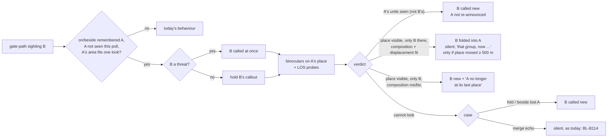

# Expected-area look — plan (`BL-B111`)

Architect pass 2026-11-10, on `feature/expected-area-look` at `796c4eb5`. Inputs:
`explore-notes.md` (user answers 2026-11-10, which govern), `alignment.md` (CONCERNS, E1–E12,
findings 1–5, all five questions answered *"as recommended"*), `BL-B111/B110/B113/B114/B109.md`,
and `plans/expected-area-check/plan.md` ("Stages 3–4 — moved to BL-B111", the seventh-pass Stage 2
redesign, the honest grid, Co-moving Fields, Decisions 13/14). That plan's Stages 3–4 are this
plan's starting point. Everything below re-reads them against what BL-B110 actually shipped:
Stages 0a/0/1, the per-sector scan, and the 12 s rolling start-gated glass budget. **Stage 2's
trigger was never built**, so nothing in this plan assumes it.

**No investigator pass was needed.** The one DCS call this plan adds is `land.isVisible` from
ownship to an arbitrary ground point, with `land.getHeight` for the ground. Both already run
per unit at 1 Hz in `petrobrain-line-of-sight-hook.lua` (`terrainClear`, `unitAGL`). Terrain-only
and not building-aware is confirmed in `aircraft-layer/research/2026-09-29-bridge-terrain-probe-
results.md` (Findings 12/16/19), and the per-sightline cost (~25 µs peak) is measured there. The
only thing that is new is a Hook-side point the engine has never been handed: a terrain point
rather than a unit. **The Windows card in Stage 1 confirms it live**, and that is a verification
step, not an open question.

### Goal

When a gate-path sighting B lands on, or beside, a group A that Petrovich remembers but cannot
see right now, he holds B. He puts the binoculars on A's expected place, and only then decides:
- **A seen there:** B is a second group and is called new.
- **A's place seen, with nothing there but B:** B *is* A. It is folded back into A silently, and
  *"that group, now …"* is said only if the place he would call has really changed.
- **He cannot look:** B is called new. In the merge-echo case, today's behaviour is kept
  instead (`[[BL-B114]]`).

### What the pilot will hear differently (measured, harness; method under "Acceptance")

| case (harness cells, honest draws) | today | with the look |
|---|---|---|
| Two groups on one bearing, B **never announced**, 6 s, any optics | 2–88% unannounced (eye→eye 63–75%, b→u 72–88% where it bites) | **0–1.5%** |
| Same, 700 s, stationary | 0–86% (b→u 74–86%, u→b 19–68%) | **0.5–8.5%** (worst b→u 4.5–5 km: 5.5–8.5%) |
| Same group re-seen after 700 s, **heard twice** (BL-B113's long-gap duplicate) | eye 10–12%, bino 6–7% | **0.3–2.7%** |
| Same group, 6 s (harness only, see note) | 0.3–1.3% | 0.3–3.7% (≤ +3 points) |
| Same group, *"that group, now …"* heard | — | 0% same-optic, bino→eye; 2–4% eye→eye at 4.5 km; **12–35% eye→bino at 3–4.5 km**, where the binocular fix really does move the place he would call by ≥ 500 m |
| Remembered SAM re-seen: a second threat line | — | none, unless the place moved ≥ 500 m (same row as above) |

The 6 s rows exist only in the harness. In flight, a same group re-seen within
`OBJECT_ID_MEMORY_S` (600 s) resolves through object continuity and never reaches the gate
(alignment finding 1). The 700 s column is the flight case.

**Without Decision 1, moving groups past ~2 minutes would regress badly**: armour re-seen after
700 s goes from 0% heard twice to **100%** (shown in the output, `probe_b111_output.txt`), because
A's area is 5–6 km wide and can never be looked at. The recommendation fixes that by not opening
a check at all for a group with no place left to look at.

### Affected Modules / Files

aircraft-layer (Stage 1; needs Windows):
- `dcs-export/petrobrain-line-of-sight-hook.lua`:
  - new inbound op `probe_points` on the existing 7797 listener, with its own fixed
    `%d`-only template (`SET_PROBES_TEMPLATE`);
  - the LOS chunk evaluates up to `MAX_PROBE_POINTS` terrain points per poll, **failing closed**;
  - the answer rides in the JSON envelope as a new optional key, never inside the pipe-delimited
    payload.
- `src/schema/line_of_sight.py`: `ProbeAnswer`/`ProbeAnswers` and an optional
  `LineOfSightSnapshot.probes`.
- `src/collector/line_of_sight_receiver.py` reads the optional key.
- `src/collector/command_sender.py`: `LookDirectionSender.send_probe_points` (same socket).
- `src/api/server.py`: `POST /command/probe_points`, validated.
- Tests: `test_line_of_sight_hook_lua.py` (template guard), schema, receiver, API.
- `WORKFLOW.md` (redeploy the Hook) and `CLAUDE.md` (structure line).

body-layer:
- `src/aircraft_client.py`: `post_probe_points`; `get_line_of_sight_latest` already carries the
  snapshot.
- **New `src/belief/expected_area.py`**, holding:
  - `ExpectedAreaCheck` (state);
  - the trigger predicate;
  - `area_visibility` (Stage 2);
  - the one "when" function `resolve_checks`;
  - the actions (`hold`, `release_as_new`, `merge_into_remembered`, `mark_absent`);
  - state params.
- `src/belief/contacts.py`:
  - `ingest`'s gate branch founds a *held* B instead of folding when the trigger fires;
  - `ContactStore` holds the open checks and the believed-distinct pairs;
  - the first contact removal (`merge_into_remembered`).
- `src/belief/callouts.py`:
  - hold check before the age check; age measured from release;
  - merge-echo skips a believed-distinct pair;
  - a merge-echo B with an open check is held, not consumed.
- `src/belief/events.py`, `src/belief/speech.py`: `CONTACT_RELOCATED` and `CONTACT_ABSENT`, both
  templated.
- `src/belief/optic_policy.py`:
  - `LookTarget.area_check: bool`;
  - `choose_glass_look` ranks `area_check` first;
  - an area look's own finish rule;
  - `OpticState.area_look_report` (Co-moving Fields).
- `src/body.py`:
  - `_look_targets` flags A's target;
  - pushes probe points;
  - reads probe answers;
  - ATGM/attack-run pause.
- `src/belief/groups.py` (`reconcile` skips held contacts) and `src/mission_memory/admission.py`
  (skips held contacts).
- `src/perception/forest.py`: the occlusion class takes its layer/class set as a parameter, so a
  settlement mask reuses it (one class, two instances). No second copy.
- `src/tuning.py` and the regenerated `config/defaults.toml`: two new keys (below).
- `tools/measure_expected_area_look.py`: the probe in this directory, promoted (Stage 0), with a
  production mode added in Stage 3.
- Tests: new `test_expected_area.py`, plus `test_contacts.py`, `test_callouts.py`,
  `test_optic_policy.py`, `test_body.py` and `test_relative_distance_scenarios.py`.
- Docs: `body-layer/docs/STRUCTURE.md` and `body-layer/CLAUDE.md` "Tuning".

Entries: `BL-B111.md` (value statement corrected, per alignment); `BL-B114.md` (narrowed to
cannot-look); `BL-B113.md` (long-gap half addressed); `BL-B109.md` (its wording explore now
also covers `CONTACT_RELOCATED`/`CONTACT_ABSENT`).

### Implementation Plan

**Stage 0 — Promote the measurement (body-layer `tools/`, no behaviour change).**
- `plans/expected-area-look/probe_b111.py` becomes `tools/measure_expected_area_look.py`, built on
  `measure_same_group_fold.py`'s draws (every draw resampled per trial). Its output is
  `probe_b111_output.txt`.
- It models the look: available when A's area half-width is ≤ 15°. "A observed" means continuity
  inside 600 s, otherwise "inside A's area" by the gate. Terrain, towns and the glass budget are
  **not** modelled; the harness is flat and holds one pair.
- Stage 3 adds a `--production` mode. That mode drives the real `ContactStore` and the real check,
  with a stub probe answer, and replaces the model. **The acceptance numbers are taken in that
  mode.**

**Stage 1 — Point line-of-sight query (aircraft-layer + `aircraft_client`). Ships alone and is
dormant until Stage 3 calls it. Windows verification.**
- *Inbound:* `{"op":"probe_points","seq":n,"points":[[x,z],…]}` on 7797.
  - Collector-side validation: at most `MAX_PROBE_POINTS` = 6 points (two open checks × three
    points); integer metres; |x|,|z| ≤ 2·10⁶; seq 0..2³¹.
  - The Hook clamps every value again with `_safeClampInt`, then splices with
    `SET_PROBES_TEMPLATE`.
  - That template is a module constant with **exactly 2 + 2·6 `%d` conversions and no other
    `%`**: `PB_PROBE_SEQ`, `PB_PROBE_N`, and the flat coordinate array. Unused slots are 0, and
    `PB_PROBE_N` bounds the read.
  - Same safety argument as `SET_LOOK_TEMPLATE`. `test_line_of_sight_hook_lua.py` gains the
    matching count guard.
  - At most one setter call per frame (coalesced, last wins). It is pushed on change. N = 0
    clears.
- *Evaluation, inside the existing LOS chunk, after the unit loop:*
  - For each `i ≤ PB_PROBE_N`: `g = land.getHeight({x=px, y=pz})`, then
    `pt = {x=px, y=g + PROBE_TARGET_HEIGHT_M, z=pz}`, then `land.isVisible(observerPoint, pt)`.
  - `PROBE_TARGET_HEIGHT_M` = 2.0, the same +2 m the unit sightlines use. That gives E11: terrain
    at the believed point plus a vehicle height, never ownship altitude, never A's true position.
  - **Fail closed, unlike `terrainClear`:** a failed `getHeight` or `isVisible` pcall emits an
    empty field ("unknown"), never `1`. (`terrainClear` returns `true` on error, which is right
    for a unit gate and wrong here.)
- *Outbound:* the envelope gains `"probes": "<seq>|<i>:<0|1|>;…"`.
  - It is parsed into `ProbeAnswers(seq, dcs_model_time_s, clear: tuple[bool | None, ...])`.
  - **Not** an eighth pipe field, so an old collector with a new Hook, and the reverse, both keep
    working. Tested both ways.
  - Building visibility is not computed for probes. A town is masked on the body side (Stage 2).
- *Client:* `AircraftClient.post_probe_points(seq, points)` and
  `LineOfSightSnapshot.probes` passthrough.
- *Windows card* (test-card skill, branch named):
  1. Air start near a ridge. Push probe points by hand (`curl`): one on the near slope, one
     behind the crest, one in open ground.
  2. Confirm `PetrobrainLineOfSight` lines in `dcs.log` and `/line_of_sight/latest.probes`: 1, 0,
     1, flipping as the aircraft climbs.
  3. Include a paused-state check.
  4. Confirm `bridge_call_ms` does not move.

**Stage 2 — "Was A's expected place visible?" (body-layer, pure, no behaviour change).**

`area_visibility(check, report, probe_answers, masks) -> "visible" | "cannot_look"`. All of the
following are required (the moved Stage 3, re-read):
- **A's area fits one look:** half-width = atan((`LOOK_SWEEP_SIGMA`·σ_cross, with A grown at
  `plausible_speed_mps` since last seen) / range) ≤ `EXPECTED_AREA_MAX_HALF_WIDTH_DEG`.
  - Tunable, 15° (lo 4.25, hi 30).
  - **This same test gates the trigger (Decision 1)**, so here it only re-checks growth during
    the hold.
- **A look ran in the binocular optic** to its natural end, steady, with A's expected place
  inside its sweep envelope (`area_look_report`).
- Inside the cockpit mask.
- **A's believed type is within binocular detection range at A's expected range**
  (`visibility.tier_ranges(profile_for(A.last_class_raw))`).
- **Not forest and not settlement**, at A's believed point (forest landcover; the settlement
  polygon via the same reused occlusion class). A town is "cannot look" (user, 2026-11-10).
- **Probe answers:** A's believed point and the two along-line ±2σ_down points (Decision 4) are
  all `True`. Each answer must be:
  - matched by `seq`;
  - with `dcs_model_time_s` inside [look start − 2 s, look end + 2 s].

  Anything missing, stale, `None` or `False` gives "cannot_look". **Fail closed.**

Tests are table-driven, one per clause, plus "probe answer one poll late but within the window →
visible".

**Stage 3 — The check (body-layer). Stages 2–3 merge together; Stage 3 is the first behaviour
change.**

*3a — trigger, hold, the look, "different" and "cannot look".*
- **Trigger** (one pure predicate, `expected_area.check_target_for(percept, store, now)`): a
  percept that did **not** resolve by continuity, and a remembered contact A that meets all of:
  - A was not seen this poll (`A.last_seen_sim < now`, and A not in this batch's `claimed`);
  - A's area fits one look (Decision 1);
  - and either:
    - the gate would fold the percept onto A (the single passing candidate, or the
      ambiguous-fold target); or
    - after founding, `contacts_plausibly_same(B, A)` holds with A founded earlier. That covers
      the merge-echo case (A not lost) and the beside-a-lost-A case.

  No new constant: existing gate, existing predicate. If several A qualify, the nearest by
  Mahalanobis is taken. One check per B.
- **Action:** found B as a new contact (never fold while a check could run), then open
  `ExpectedAreaCheck(b_id, a_id, kind ∈ {fold, echo, beside_lost}, opened_sim, sector_index,
  a_snapshot, released=False)`.
  - `a_snapshot` is A's believed position and covariance at opening. **A is not mutated during
    the hold.**
  - B threat (AD `op_class`, or B firing) → `released=True` at once (Q2), and the check
    continues.
- **The look.** A's own `LookTarget` (from `look_target_for`, using `_look_target_position`, so
  its elevation comes from terrain, not ownship) is flagged `area_check=True`.
  - `choose_glass_look` ranks `area_check` targets first (user Q5).
  - It spends the shared 12 s rolling budget. If the budget does not admit a look at the step,
    the result is "cannot look", which releases B at once (fold/beside cases; user Q5).
  - B and A's place usually share one binocular field (alignment finding 4), so one look covers
    both. Otherwise B's look comes first.
  - The area look ends when one of these happens:
    - A is observed;
    - its sweep has held each step for ≥ 1 poll;
    - `MAX_LOOK_S`.
  - While a check is open, `body.py` pushes A's three probe points every poll and clears them
    (N = 0) when none is open.
- **"A observed"** (the vignette rule): during the open check, A records a percept whose
  observation is **not attributed to B**, either through continuity of A's own objects or through
  the gate. B's own objects keep continuing to B and never count.
  - Harness: the naive rule ("anything seen in A's area") would call the same group "different"
    **91–99%** of the time. This rule gives 0% by construction in a one-cluster scene.
  - A test builds the vignette: SAM A, 700 s gap, B is A, so the verdict must be "same".
- **Verdicts in 3a:**

  | evidence | verdict | pilot hears |
  |---|---|---|
  | A observed | different: release B, record `(B, A)` believed-distinct | B new; A not re-announced (E1) |
  | cannot look (any clause), deadline, ATGM pause | fold/beside_lost → release B as new (Q3, Q5); echo → B stays as today's echo (Decision 2) | B new / silent |
  | visible, only B there | → 3b (until 3b, `merge_into_remembered` without any line) | today's fold outcome |

- **Hold bound:** as the moved plan, unchanged by the shipped scan. It is the end of the glass
  step of B's sector plus one poll: ≤ 4 + 12 + 1 ≈ **17 s worst**, ≈ 5–8 s typical.
- **Callouts:**
  - the hold check sits *before* `CALLOUT_MAX_AGE_S` and defers without consuming;
  - a released contact's events age from `max(t_sim, released_sim)`;
  - `_is_merge_echo_of_earlier_contact` returns False for a believed-distinct pair;
  - a B with an open echo-kind check is held, not consumed as an echo.

  E3 test: a held callout never silently becomes no callout.
- **While held,** B is excluded from `GroupStore.reconcile` and from mission-memory admission.
  It is still glassed for classification.

*3b — "same": fold back silently, the relocation line, absence.*
- **"Same"** needs all of:
  - visible (Stage 2);
  - A not observed;
  - composition compatible: count-interval midpoints ratio ≤ `COMPOSITION_MATCH_RATIO` (tunable,
    2.0, lo 1.2, hi 5.0), plus class compatibility;
  - displacement plausible: `contacts_plausibly_same(a_snapshot, B)`.

  Then `merge_into_remembered(A, from=B)`: **B's percepts are folded into A through the existing
  `Contact.record`, in order.** A's lifecycle events then fire exactly as today's fold would
  (`CONTACT_REACQUIRED` for a lost A, under today's gating). B is removed (Co-moving Fields).
- **`CONTACT_RELOCATED` ("that group, now …"):**
  - Spoken only if A had been announced, and only if both hold:
    - the clock hour or 0.5 km range bucket A would be called at, from current ownship,
      differs between `a_snapshot` and the merged A;
    - the merged position moved ≥ 500 m in range or ≥ 30° in bearing.

    500 m and 30° are one spoken bucket each, derived from `_format_range_km` and the clock
    hour, not a new tunable.
  - Bucket change alone fires on 6–65% of stationary same-group re-sightings (bucket-edge
    jitter). With the one-bucket move it is 0% same-optic and 12–35% eye→bino, which is a real
    range correction. That is Q3 as answered.
  - Suppressed when a `CONTACT_REACQUIRED` for A is spoken in the same tick, which already
    states the place.
  - Provisional wording *"That group, now two o'clock, three kilometres."* (user Decision 4),
    final in the `[[BL-B109]]` explore.
- **Threat (E12):** a threat B was already called at release. A later "same" is silent unless
  the relocation rule above fires. No second line for an unmoved site.
- **`CONTACT_ABSENT`:** visible, A not observed, but composition misfits (*"3 and 8 makes me more
  suspicious"*). Release B as new, and `mark_absent(A)`: A goes to `lost` now, and *"no longer
  at its last place"* is spoken only if A was announced before. Rare in the harness (one
  cluster); scenario-tested.
- **ATGM run or attack-run grant standing:** every open check resolves "cannot look" at once
  (moved plan's Q5 row). `hold_routine` still governs speech.

*3c — production acceptance* (`--production`, the grid below, fences in
`test_expected_area_look_sweep.py` at n = 300 for the cells marked "fence").

**Stage 4 — Docs, entries, test card.**
- `STRUCTURE.md`; regenerated `defaults.toml`, with the **rendered** first sentences read.
- Entries per "Affected"; BL-B111 marked `#needs-flight`.
- Test cards, naming `main`:
  1. **The user's ridge case:** far group glassed, crest, nearer group. Expect binoculars on the
     far group's place (visible in the eyesight view), then *"new contact"* for the nearer one.
  2. **Long-gap re-sighting of a parked group:** leave 10+ min, return. Expect no "new contact"
     and no "now …" unless the place moved.
  3. **A SAM site re-seen after ten minutes:** one threat line.
  4. **A group in a town:** expect "new contact" (the honest cost).
  5. **Busy scene:** count area looks against the budget in `sortie-log-triage`.

### Acceptance (Stage 3c, production mode; method as `probe_b111.py`)

Cells: optic pair {u_u, b_b, u_b, b_u} × far/near {4.5/3.0, 5.0/3.5, 3.0/1.5} × {B nearer, B
farther} × gap {6, 700 s} × {s-125, armour}, plus ground cells (100 m AGL, s-125, u_u/b_u).
Different groups at n = 200, same group at n = 300 (±2 points at 3%).

| measure | gate | modelled today → look |
|---|---|---|
| Different groups, B announced, every cell where A's area fits one look | **fence ≥ 85%** (n = 200, CI ±4 at 92%) | 34–100% → 91.5–100% (lowest: b→u 700 s 4.5–5 km, 91.5–94.5%) |
| Same group, duplicate heard, per cell | **fence ≤ today + 4 points** (6 s, harness-only case; max measured +3.0) and **≤ today + 1** (700 s) | 6 s: 0.3–1.3 → 0.3–3.7; 700 s: 0.7–12 → 0.3–2.7 |
| Armour, 700 s (area > one look) | **fence = today** (Decision 1) | 0% / 0% unchanged |
| Same group, `CONTACT_RELOCATED` heard | characterise, fence same-optic ≤ 5% | 0–3.7% same-optic; 12–35% u→b |
| SAM vignette: same group, 700 s, verdict "different" | **fence ≤ 2%** | 0% (naive rule 91–99%) |
| Hold never drops a callout | test | — |

Whatever the modelled column says, the production run replaces it. If a fence fails in
production, stop and report rather than retune.

### Co-moving Fields

Trigger fires: 3b's merge and 3a's release are written internally by `resolve_checks`, while
pilot commands (ATGM run, attack-run grant) and the optic phase (written by `decide`) move the
same check. Built from construction sites. **Grep at implementation**: `ExpectedAreaCheck(`,
`OpticState(` (two fresh constructions, `optic_policy.py` SEARCHING and GLASSING entries, plus
every `replace`), `Contact(`/`Contact.from_percept`, and every writer of
`_observation_id_to_contact_id`.

| Field | Written by | Transition | Must hold true after |
|---|---|---|---|
| `store._checks[b]`, `store.callout_held(b)` | internal (`ingest`) | trigger fires | check open; B held unless threat; A unmutated; `a_snapshot` set |
| `OpticState.area_look_report` | internal (`decide`) | area look ends (any reason) | report frozen with envelope, steady, natural-end, poll window; **both fresh `OpticState(...)` sites carry it forward or set it** (BL-B71 lesson) |
| `area_look_report` | external: `lower_binoculars`, OBSERV on, scan command | interrupt | report marked `natural_end=False` → that check "cannot look" |
| probe request (`seq`, points) | internal (`body.py`) | check opened / closed | points pushed while any check open; N = 0 when none; `seq` increments on change |
| `_checks[b]`, `held(b)`, believed-distinct | internal | verdict different | check closed; B released (`released_sim` = now); pair recorded |
| `_checks[b]`, `held(b)` | internal | verdict cannot look | closed; fold/beside_lost → released; echo → released **and** echo-suppressed as today |
| `_contacts` (B removed), `_observation_id_to_contact_id` (B's ids → A), A's estimate/classification/cardinality (via `record`), B's events consumed, check closed, `attack_run`/`atgm_run` target id B → A, believed-distinct pairs naming B dropped | internal | verdict same (`merge_into_remembered`) | all moved together in one call; **no** fresh `Contact(...)` for A; any stale `OpticState.attempted_*`/`CalloutScheduler` entries keyed by B are tested harmless |
| A's certainty, `_checks[b]` | internal | verdict absent | A `lost` now; B released; `CONTACT_ABSENT` emitted iff A was announced |
| every open check | external: ATGM run engaged / attack-run grant | pause | all resolve "cannot look" in the same tick |
| `_checks` | external: mission restart | reset | cleared with the store |

### Risks & Unknowns

- **How often the trigger fires in flight is unmeasured.** In the harness it fires on ~99% of
  same-group gate re-sightings, which is by design. In flight that is long-gap re-sightings plus
  new groups near remembered ones. Each firing costs one binocular look from the shared 12 s, so
  a busy scene could crowd out classification looks.
  - Bounded: when the budget is spent, B is called new.
  - Observable: Stage 3 logs check open/verdict/reason to the detection trace, and
    `sortie-log-triage` gains the count.
- **Hilly terrain makes "cannot look" commoner** for a same group, because the ±2σ points can sit
  behind a crest even when B is visible. That raises the duplicate rate (fold case → B new). The
  flat harness cannot measure it. Decision 4 trades honesty (E5) for this.
- **Towns:** a same group parked in a settlement is always "cannot look", so it is heard as new.
  Accepted by the user. Frequency unknown.
- **A same group seen as two clusters at the look** (*"spread wide"*): the second cluster would
  count as "A observed", giving "different". This is the counter-example in the BL-B110 explore.
  It is not in the harness, and is scenario-tested with two clusters.
- **Latency:** a same group's `CONTACT_REACQUIRED` now comes 5–17 s later (after the verdict).
  That is the user's *"callout when verdict is known"* (BL-B110 Q2).
- **A threat B on a remembered SAM** is spoken as B's detection line, not as A's reacquisition.
  One line (E12), but the wording may sound "new". Settle in the BL-B109 explore.
- **Hook probe semantics:** a ground-hugging point (+2 m) has not been probed live; the Stage 1
  card confirms it. If `land.getHeight` fails on some tile, the probe is "cannot look", never
  "empty".
- **Group-trace / mission-memory with held contacts:** grep for every other consumer of
  `store.contacts` (eyesight view, crew queries, tools) and decide per consumer. Default: show
  held B in the eyesight view, exclude it from spoken/queryable belief until released.

### Second-order effect

`[[BL-B114]]` shrinks to cannot-look cases, and `[[BL-B113]]`'s heard long-gap duplicate largely
goes, so both are candidates to close after a flight. `[[BL-B109]]` becomes actionable: two
groups on one bearing now exist reliably, and its explore must also settle the relocation and
absence lines. `[[BL-B112]]` (observed-stationary armour) would move armour into the zero-growth
regime, where the look **does** apply, which makes Decision 1's exclusion narrower over time.

### Decisions

**Decision 1 — ANSWERED 2026-11-11, as recommended (user: *"as recommended"*). A group with no place left to look at: no check (recommend), or "cannot look → B
new"?**
- Armour, 700 s: A's area is 5–6 km wide, so no look can cover it. Read literally, the settled
  answers make every such re-sighting a duplicate: **0% → 100%**, which breaks the "duplicates
  must not rise" acceptance.
- **Recommend:** open no check when A's area does not fit one look (half-width >
  `EXPECTED_AREA_MAX_HALF_WIDTH_DEG`). A has no expected *place*, so the question "is this the
  group I left there?" does not arise, and today's fold stands.
- Cost: different groups in that case stay folded, as today, 100% unannounced. Only a narrower
  belief fixes that (`[[BL-B112]]`).

**Decision 2 — ANSWERED 2026-11-11, as recommended (user: *"as recommended"*). Merge-echo case when he cannot look (including budget spent): stay silent as
today (recommend), or call B new?**
- The user's answers say both *"BL-B114 keeps only the cannot-look cases"* and *"budget spent → B
  called new"*. In the echo case these conflict.
- **Recommend:** silent. That is BL-B114's cannot-look remainder, and calling new there would
  voice BL-B113's 4–11% short-gap same-optic splits.
- "Budget spent → B new" then applies to the fold and beside-lost cases.

**Decision 3 — ANSWERED 2026-11-11, as recommended (user: *"as recommended"*). Relocation line: "spoken bucket changed" alone, or also "moved ≥ one bucket"
(recommend)?**
- Measured on a stationary same group: bucket change alone fires **6–65%**, which is jitter at
  the 0.5 km edge. With the ≥ 500 m / ≥ 30° condition it is **0% same-optic, 12–35% eye→bino**.
- The eye→bino share is a real correction of a naked-eye range, which is what the neutral
  *"now at"* wording was chosen for.
- **Recommend:** both conditions.

**Decision 4 — ANSWERED 2026-11-11, as recommended (user: *"as recommended"*). Probe points: centre + ±2σ along-line, all clear (recommend), or centre only?**
- Centre only gives fewer "cannot look" results in hilly terrain (fewer duplicates), but it calls
  a place "seen empty" while a group could sit masked behind the crest a few hundred metres on.
  That breaks E5 (absence counts only where he could have seen).
- **Recommend:** all three, and read the cannot-look reasons in the first sortie.

**Third concurrent check (plan check's question; main loop's call, local and reversible,
2026-11-11):** at most two checks are open at once (matching `MAX_PROBE_POINTS` = 6). A trigger
that would open a third is handled exactly like "budget spent": Decision 2's rule for the echo
case (silent), "B called new" for the fold and beside-lost cases. Stage 3a enforces the cap and
tests it.
