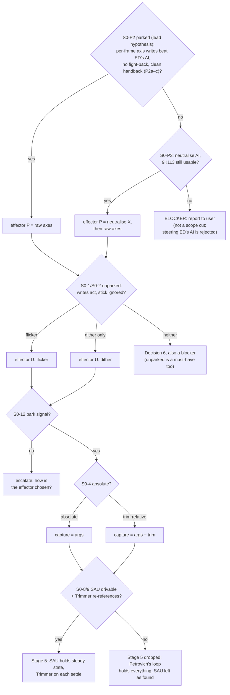

# BL-16 — Petrovich flies the helicopter: plan

2026-10-26, Architect pass, planning only. **Revised 2026-10-31** from the goal check
(`plans/flight-control/alignment.md`, CONCERNS) and the user's answers to it — see "Revised
2026-10-31" directly below for what changed and why. **`BL-16` stays `[>]` deferred** (user: finish
9K113 first); this plan exists so the work is ready when it is picked up, and so stage 0 can be
flown whenever convenient. Specification: `plans/flight-control/explore-notes.md` (whole file,
including both 2026-10-26 addenda and the 2026-10-31 "Goal-check answers", which are binding) and
`docs/concept/flight-control-{1,2,3}.jpeg`. Where this plan and those words disagree, the words win
and this plan is wrong.

Desk recon for stage 0: `aircraft-layer/research/2026-10-26-bl16-flight-control-desk-recon.md`
(investigator, this pass). Its findings narrow stage 0; they do not replace it. What it changed
here, all forum- or third-party-sourced and so working assumptions only:

- **Channel letters** (three agreeing forum snippets): **H = yaw, K = roll, T = pitch, B =
  altitude**. "Course mode" is H with `RouteOn`.
- **Altitude hold and speed hold are named modes** in Chuck's Guide (contents only), so "not
  implemented" is less likely than the user's recollection suggested — *how well* they hold is the
  open question. Forum: speed hold reportedly **will not engage below ~150 km/h IAS**; altitude hold
  reportedly needs K/H/T on first.
- **Trimmer vs. attitude hold: two contradictory forum claims** (hold-while-pressed then
  re-reference on release, vs. trim moves only the spring centre). Probe-only.
- **No prior art** for `LoSetCommand` flight-axis override; the one community helicopter-assist
  project **unbinds the physical axes and routes through vJoy** "to avoid double control" — a
  data point for Decision 6, not a recipe.
- **No documented getter returns helicopter control positions**; no cyclic or pedal draw-arg is
  known by number; the five never-called getters have no documented shape. All probe items.

> **Recommend an opus re-run of this role before Stage 2 is built.** The control law is the
> high-risk part of this plan, it is written here against an unmeasured plant, and stage 0's
> numbers will change it. That revision is the moment for the deeper pass, not now.

### Revised 2026-10-31 — what changed and why

Every change below traces to one numbered user answer in `explore-notes.md`, "Goal-check answers
(user, verbatim, 2026-10-31)" (A1–A8, plus the general tolerance rule, cited here as **A9**), or to
the BR-2 note in the dispatch. **No 2026-10-26 decision was deleted**; superseded ones carry a
`REVISED` pointer (`docs/PROCESS.md`, "Superseding a decision").

| # | User answer (short) | What changed in this plan | Where |
|---|---|---|---|
| A1 | *"level [off\|flight]", "stop turn", "[fly] straight"* | New action `level_out` and its tokens join the **first** vocabulary (Stage 4, moved forward to Stage 2's flight as well, since a takeover mid-turn needs it). Rolls out, holds the heading reached. | Decision 12; Stage 2, Stage 4; audio-adapter |
| A2 | *"heading. Let's say <5 deg bank gets level flight"* | At takeover, \|bank\| < 5° → hold heading; ≥ 5° → continue the turn. 5° is a body-layer tunable, sent in `take`, applied by Lua at the capture frame. | Decision 1 REVISED; Stage 2; constants |
| A3 | *"no confirm. No key at this stage"* | Both handover tokens bypass the confirm band entirely. "I have controls" acts on any match while he flies, whatever STT confidence. The old risk mitigation ("act band only, never confirm band") is **reversed**. | Decision 13; Risks; `voice_commands.py`, `crew_console.py` |
| A4 | *"no, just fly within parameters"* | No "unable" callout for a goal not reached. Spoken goals outside his limits are clamped, not refused; open point on what the readback says (Decision needing user, D-a). | Decision 14; Stage 4 |
| A5 | *"yes"* (naked-eye calls continue) | `flying` stops **optics only** (binoculars, 9K113). Naked-eye scan, contact and threat calls, and "what do you see?" continue. Resolves the old plan's "suppressed / naked-eye decision" ambiguity. | Decision 15; `optic_policy.py` row; Co-moving Fields |
| A6 | *"AGL, unless player commands barometric. DCS radar alt does to see trees, I believe."* | The implicit hold at takeover and every spoken height default to **AGL** (radar, else DCS AGL). Stage 0 S0-6 now measures radar vs. DCS AGL over forest and town. AGL reference is smoothed so a treeline is not a step. | Decisions 1, 9 REVISED; S0-6; Stage 3; Risks |
| A7 | *"switch to copilot seat and use the 9K113, this is a key reason"* | The key use case is now explicit: player in the operator seat on the 9K113 while Petrovich flies. Stage 0's front-seat row (S0-10) was **promoted to a gate**, then absorbed into the parked block S0-P once P1 named the mechanism; a key-case flight is added (Flight 4b). | Decision 16; S0-P, S0-12, S0-13; Stage 4 |
| A8 | *"not … which seat is controlling … but whether AI or human player is controlling"* | Handover state is AI-vs-human, not seat-bound. A seat swap never releases and never takes. Lua has no seat-swap release path. Seat detection is built only if stage 0 shows the write path differs by seat. | Decision 17; state diagram; Co-moving Fields; S0-12 |
| A9 | *"+-10% variation is allowed, but … goal is to still align with the desired value"* | Per-quantity tolerance bands (tunable). Gains are tuned for smooth convergence into the band; **no test asserts tight tracking**. Stage 2's toy-plant tests and every flight's pass criteria are rewritten around "converges smoothly into the band, stays there, does not ring". | Decision 18; Stage 2, Stage 6; constants |
| BR-2 | dispatch note | Flight vocabulary and handover stay on the deterministic phrase path. The five goal actions are the seam a later brain mapping would call; handover is never brain-callable. No dependency on BR-2. | Decision 19; Second-order effect |
| P1 | *"DCS requires the "park controls" active for player to be able to use the 9K113. That makes DCS AI Petrovich control the aircraft … Petrobrain to overpower the DCS AI flying."* | **The key case's problem is not the player's stick but ED's own AI pilot**, which flies the aircraft whenever controls are parked. Overriding or displacing it is **stage 0's first and gating question** (S0-P). This replaces the earlier reading of A7 ("front-seat stick must be ignored"), which was wrong about the mechanism. | Decision 16 (rewritten); Stage 0 (S0-P block first); Risks |
| P2 | *"So there's two states really. When controls are parked … and when they are not. In both cases Petrobrain must be able to control the aircraft. These may need different solutions."* | Two first-class control states, **parked** and **unparked**, both must-haves. One action interface and one goal message; a **per-state flight effector** behind it in Lua, selected by the park state. A parked-state failure is a **blocker to report**, not a scope cut. Park-state detection becomes required. | Decision 20; Stage 0; the control-loop picture; Stage 1; Co-moving Fields; D-e |

| P3 | *""Petrobrain could steer ED's AI instead of fighting it," -> no. DCS AI flies hoorribly."* | Steering ED's AI (giving it a heading or altitude to fly) is **not an option** in any state. ED-AI commands are probed only as off-switches. With no off-switch and no winning override, the parked state is a blocker. | per-state effector section; S0-P3; go/no-go |

| P4 | *"Probable solution is to somehow overpower the cyclic, rudder and collective control values that DCS AI sets. Very similar to overpowerring the 9K113 sight slewing."* | The lead parked-state hypothesis is the 9K113 override precedent: per-frame axis writes that win. S0-P2 probes it first, with three new rows: does ED's AI fight back or wind up (S0-P2a), is handback in the parked state clean (S0-P2b), is handback to the player clean (S0-P2c). | S0-P2, S0-P2a–c; Risks |

P1–P4 arrived while this revision was being written (`explore-notes.md`, "The key challenge:
parked controls" and "Two control states", both 2026-10-31) and are folded into the same pass; where
an A-row above and a P-row disagree (A7/A8's reading that the front-seat problem was the player's
stick), the P-row wins.

What did **not** change: Stage 0 still comes first; the per-frame Export.lua loop and the
lift-vector-corrections control law; forward flight only (Decision 3); release jump not handled
(Decision 4); ATGM-run refusal (Decision 5 — it concerns *Petrovich's* attack run, not the player
working the 9K113 from the front, see Decision 16); the actions / params / "when" shape; constants
through the tuning pattern.

### Amended 2026-10-31 (plan check)

`plans/flight-control/alignment.md`'s "Plan check — 2026-10-31" (CONCERNS, W1/item 2/item 3) and a
follow-up binding correction from the user changed three things:

- **W1 — wobble is unconditional, not a fallback.** The user, verbatim: *"Regardless of how writing
  control axis values are done, that (invisible) wobble is needed on the control axises, similar to
  9K113 axises."* **Decision 6 is superseded** (Decision 6 REVISED, below): every flight-axis write,
  cyclic pitch/roll, pedal and collective, in both control states, carries the 9K113's
  `SERVO_WOBBLE` mechanism from the first write, never as something tried only if a plain write
  fails. S0-2 and S0-P2 now measure the wobble's **invisibility bound** (the smallest amplitude/
  pattern that still holds the axis, checked against visible aircraft motion and the cockpit stick/
  collective/pedal animation, args 1100–1113) rather than whether wobble is needed at all, and the
  first probe writes from `LuaExportBeforeNextFrame` — ED's own documented injection point
  (`Export.lua:59-64`) — noting the 9K113 override won by changing value every frame, not by
  writing last (`aircraft-layer/research/2026-10-31-mi24p-park-controls-ai-pilot.md` §6). Wobble
  amplitude is a tunable (Export.lua constants block, the `SERVO_WOBBLE`/`DITHER_AZ_DEG` pattern —
  see "Behaviour constants" below, already the right home for it).
- **Item 2, revised by a later binding correction.** The dispatch's first draft asked S0-P2 to guard
  against the AI flying through the SAU; the user then corrected that directly, verbatim: *"ED's AI
  may fly through the SAU autopilot -> does not, SAU is not very capably, DCS AI does manouvres SAU
  cannot. Though, DCS AI probably does not use the cockpit controls either, but instead inputs the
  movemnt somewhere internally. But that needs checking."* (`explore-notes.md`, "Where ED's AI
  acts.") So the plan now carries: the SAU-as-AI-path hypothesis dropped; the working belief that
  the AI's input is injected internally, neither through the SAU nor the cockpit stick/collective/
  pedal positions, to be checked rather than assumed (new row S0-P1b); S0-P2/S0-P2a judged on the
  aircraft's actual attitude/rate/heading/height response, with the stick/collective/pedal args
  logged only as diagnostics; and the consequence that if the AI's input is summed in after the
  axis value, overpowering it is a **fight** (a steady counter-deflection), not a clean override —
  S0-P2a is the row that decides which. SAU off-switch rows (`AutopilotOffOP` 3047,
  `iCommandAutopilotEmergOFF`) stay only for what Stage 0 needs about the SAU in its own right
  (S0-P5, Stage 5), not as a way to neutralise the AI pilot (S0-P3). The recon's exact numbers
  (args 852/952 for the park-stow animation, 1100–1113 for the cockpit stick/collective/pedal
  positions — not the external-model args 500–503/510–513 — device-30 lever 3011–3013,
  `HeliControlEXT` 3014, and the `BASE_SENSOR_*_NORMED` param handles) are folded into Stage 0a/0b
  below, replacing the earlier generic guesses.
- **Item 3 (D-e) — left for the user, not resolved here.** D-e's auto-take-on-park recommendation
  conflicts with the 2026-10-25 settled point 2, *"Handover is spoken only"*; a line is added to D-e
  below flagging the conflict. The decision stays open.

### Goal

On the spoken handover Petrovich takes the controls from where the pilot left them, keeps doing
what the aircraft was doing (a turn in progress continues; under 5° of bank he holds heading), and
flies spoken turn / heading / level / altitude / speed goals with smooth, converging corrections —
within about ±10%, never ringing — by a per-frame feedback loop in Export.lua on the raw cyclic,
collective and pedal axes — **in both control states: unparked, where the player's stick is
ignored, and parked, where ED's own AI pilot is flying and Petrobrain must overpower or displace
it** — holding a current-AGL terrain floor, keeping his naked-eye lookout but not his optics, and
keeping the controls when the player moves to the operator seat — until the pilot says "I have
controls", which acts at once.

### Pilot-value check

The pilot gets his eyes and hands back. **Revised (A7):** the uses the user named are lookout, map,
radios, navigation — and the **key case: moving to the operator seat and working the 9K113 while
Petrovich flies**. That is what makes this milestone worth its cost. **And the user has since named
the mechanism (P1): working the 9K113 requires "park controls", and parked controls hand the
aircraft to ED's AI pilot** — the AI he wants replaced (*"DCS AI flies very badly and
unreliably"*). So the key feature is literally *"Petrobrain to overpower the DCS AI flying"*, and it
puts two requirements at the top: Petrobrain's loop must win against ED's AI in the parked state
(S0-P, the first gate), and the aircraft must be a steady, smooth platform for guidance (A9 —
smoothness over exactness). The unparked state (player in the pilot seat, looking out, on the map
or radios) is an equal must-have (P2), with its own problem: the player's stick. The old
framing, "the player becomes the spotter", was the weakest part of the case (goal check F7: for
spotting alone, handing over switches off the better optics); it is no longer the headline.

The first vocabulary is what a pilot says to a crew member he trusts with the aircraft for a
minute: turn, heading, level, height, speed. It is also the foundation of pilot-Petrovich and of
aligning for an ATGM launch (page 2, priority 5; `[[BL-B67]]`), both of which need exactly this
controller and neither of which is in scope. **What the pilot does not get from this milestone**:
manoeuvres (*"break left"*, `[[BL-B95]]`), look-ahead terrain avoidance (`[[BL-B101]]`), hover /
slow flight (see Decision 3), navigation to a point, proper seat-change handling beyond "he keeps
the controls" (A7: *"later"*). The value bar this plan has to clear is therefore modest and
concrete, now two sentences:

1. **"I hand over in a turn at 150 m, nothing jumps, he finishes the turn on 315 at 200 m and 220,
   and I never fight him."**
2. **"I hand over, move to the front seat, park the controls, and guide a missile while he — not
   ED's AI — holds the aircraft steady; and if I say 'left 10' from the front, he turns."**

Anything that does not serve those sentences is out.

### The picture — handover (body-layer owns it)

```mermaid
stateDiagram-v2
  [*] --> PILOT
  PILOT --> TAKING: "you have controls" (never "confirm?")\n[airborne, in envelope,\nno ATGM attack run]
  PILOT --> PILOT: "you have controls" refused\n→ "unable, <reason>"
  TAKING --> PETROVICH: Lua status: active,\ncapture done\n→ "I have controls"
  TAKING --> PILOT: ack timeout / Lua refused\n→ "unable, <reason>"
  PETROVICH --> PETROVICH: turn / heading / level / hold / speed\n→ readback, new goal (clamped to limits)
  PETROVICH --> PETROVICH: player swaps seat / parks / unparks\n→ phase unchanged (Petrobrain keeps the controls);\nLua switches flight effector, outputs continuous
  PETROVICH --> PILOT: "I have controls" (any confidence, never "confirm?")\n→ "you have controls", Lua release
  PETROVICH --> PILOT: Lua released by itself\n(envelope, crash, mission restart)\n→ urgent "you have controls!"
  note right of PETROVICH
    optics: none (binoculars, 9K113) — derived, not stored
    naked eye: scanning, contact + threat calls, "what do you see?" answered
    unparked: physical stick ignored
    parked: ED's AI pilot overpowered / displaced (S0-P decides how)
    attack run: cannot be running (takeover refused during one)
    goal not reached: no callout — he flies within limits
  end note
```

**A Petrobrain service quitting mid-flight is unspecified behaviour** (Decision 2, user): no
watchdog, no adopt-on-restart, no emergency release. Lua resets only on DCS's own events (mission
restart, `LuaExportStop`, ownship dead). **A seat swap is not one of them** (Decision 17).

### The picture — the control loop (Export.lua owns it, every frame)

```mermaid
flowchart LR
  subgraph BL["body-layer (1 Hz) — handover, vocabulary, limits, bands, floor value"]
    V["voice token\n+ slots"] --> A["action\nset_turn / set_heading / level_out /\nset_altitude / set_speed"]
    A --> GM["goal message\n(seq, goals, limits, bands, floor_agl)"]
  end
  GM -->|"POST /command/flight_control\n→ UDP → poll_command_socket"| G
  subgraph EX["Export.lua — run_flight_control(t), every frame"]
    G["goal\n(latest seq)"] --> SH["reference shapers\nheading/turn rate · VS · IAS\njerk-limited S-curve,\napproach curve, no ringing"]
    F["floor: AGL (radar, else DCS), smoothed,\n+ trend → raises the vertical goal"] --> SH
    SH --> AD["desired acceleration\n(lateral, vertical, along-track)\n+ feedback on ref − state, rate"]
    M["measured state & trend\nattitude, rates, accel,\nIAS, VS, AGL, slip"] --> AD
    AD --> LV["lift-vector CORRECTIONS\nΔ disc tilt (pitch/bank target)\nΔ collective\nfrom accel error, incremental"]
    LV --> IN["inner: cyclic closes on tilt\ntarget with rate damping;\npedal on slip / heading"]
    IN --> U["control demand\n(cyclic, collective, pedal)\nfrom captured position,\nrate-limited, saturated"]
    M --> IN
    PS["park state\n(S0-12 signal)"] --> SEL{"flight effector"}
    U --> SEL
    SEL -->|unparked| EU["effector U\nLoSetCommand 2001–2004\n+ per-frame value change\n(beats the player's stick)"]
    SEL -->|parked| EP["effector P\nwhatever S0-P proves\nbeats ED's AI pilot"]
  end
  OUT -->|"5 Hz status: mode, takeover_mode, goal,\nerrors, in_band, limits hit, release reason"| BL
```

**What the box labelled "lift-vector corrections" is, and is not** (user, 2026-10-26: *"we do not
need to know the exact values for lift vector, rather just, what needs to change compared to what is
current state and what is happening now"*). No thrust, mass or lift magnitude is ever computed. The
loop compares the **acceleration it wants** with the **acceleration it measures** and nudges the
two things a pilot moves: where the disc points (tilt target, via cyclic) and how hard it pulls
(collective). The coupling the user described falls out rather than being programmed: tilting
forward drops the vertical acceleration, so the vertical error raises collective; tilting back at
speed balloons the aircraft, so the same error lowers it. There is no "collective for altitude"
path — collective answers the acceleration error **along the lift axis**, whatever caused it. When
collective saturates, the residual vertical error moves into the tilt target (trade speed for
height), which is the user's *"the lift vector is the only control if collective is at limit"*.

**The per-state flight effector (P2, 2026-10-31).** *"These may need different solutions."* The
controller above is the same in both states: it turns goals and measured state into a **control
demand**. What differs is how that demand reaches the aircraft, so the seam sits there, in Lua:
`flight_effector_unparked` and `flight_effector_parked`, each with the same three functions —
`start(captured)`, `apply(demand, state, dt)`, `stop()` — selected per frame by the park state. It
removes a real duplication rather than adding a speculative layer: without it, the controller, the
handover, the status feed and every body-layer action would fork per state. Body-layer's actions,
params, goal message and vocabulary are identical in both states and never learn which effector is
live, beyond a status field for logs and the test card.

**Petrobrain's own loop flies in both states; ED's AI is never the control path** (user, 2026-10-31,
`explore-notes.md` "Steering ED's AI is rejected": *"no. DCS AI flies hoorribly. That is *the*
reason I want Petrobrain to replace it."*). So both effectors take the same control demand. The
parked effector may differ from the unparked one in *how it gets the demand to win* — a stronger
override, a different write site, or a one-time act that **disables or neutralises** ED's AI on
`start()` and restores it on `stop()` — but never by handing ED's AI a heading or altitude to fly.
ED-AI command interfaces enter this plan only as candidate off-switches.

**What A9 changes in this loop (2026-10-31).** The target is a band, not a point, but the loop
still aims at the value (*"goal is to still align with the desired value"*). So: **no hard
deadband** (that would park the aircraft at the band edge), but gains, rate limits and the
integrator are tuned for a slow, smooth final approach rather than a fast one — any error inside
the band is corrected gently, and nothing the loop does near the target may produce a visible
oscillation. The band is used by the loop in exactly one place: `in_band` in the status feed, and
the Stage 5 "settled" test (inside band, rates small) before a Trimmer press.

### Stage 0 — measure (desk pass, then Windows probe: parked state first)

One probe script, `aircraft-layer/dcs-export/Export.probe-flight-axes.lua`, built on
`Export.probe-9k113-flicker.lua`'s logging/loop scaffold (not a fresh one), each test a timed
segment started by a key the pilot binds, logging every frame to its own file. **Air start,
straight and level, ~150 km/h, ~200 m AGL, over flat ground, SAU in whatever state the test card
names.** The user flies; nothing here needs body-layer.

**Revised 2026-10-31 (A6–A8, P1, P2).** Stage 0 now has **two blocks, one per control state, and
the parked block runs first** because it is the user's key feature and the likeliest to fail.
S0-6 gains the forest/town comparison; S0-12 (park-state and seat signal) and S0-13 (state change
while writing) are new; the old S0-10 ("repeat from the operator seat") is absorbed into S0-P.

**Stage 0a — investigator desk pass, before the Windows run.** These are stage 0's own questions,
not assumptions the plan rests on, so they are specified here rather than resolved in this pass; the
plan's structure is the same whatever the answers, because every one of them is gated by a probe
row. **A read-only recon of the installed DCS files is already running (pending, 2026-10-31)** in a
Windows session: target `aircraft-layer/research/2026-10-31-mi24p-park-controls-ai-pilot.md` on
branch `investigation/mi24p-park-controls`, covering the `Command_StickPark_Ext` 3055 handler and
its state, ED's AI pilot command/target interface, whether parked mode gates `LoSetCommand` axis
commands, and whether the SAU can be engaged from code. **Stage 0a takes that note as its first
input**: each question below is answered from it where it can be, and the investigator's own pass
(scoped to the repo's existing research and the `DCS-files` listings, not the live install, so the
two do not duplicate) covers only what it leaves open. The coordinator folds the findings into this
plan at the plan-check stage; until then, each answer is a probe row, not an assumption. Any other
desk findings go to `aircraft-layer/research/<date>-bl16-parked-controls-desk-recon.md`. Everything
below is **names from `command_defs.lua` / the command surface, not verified behaviour**:

1. **What "park controls" is, mechanically.** Which command toggles it (`Command_StickPark_Ext`
   3055 in `i9K113_commands`? the helperai `EngageOperatorStickLever` 3011 /
   `DisengageOperatorStickButton(Cover)` 3012/3013? `HeliControlEXT` 3014?), and is the state
   readable (an arg, a param, a lamp)? Prior evidence is thin and only half relevant: run 8 of the
   9K113 obedience probe toggled 3055 forty-two times with zero effect **on the sight gate**
   (`aircraft-layer/research/2026-10-22-9k113-ai-axis-obedience-prior-art.md`, line 17) — it says
   nothing about whether 3055 parks the flight controls or whether a `LoSetCommand` of it is even
   honoured.
2. **What ED's AI pilot does while parked, and how it can be switched off.** Does it hold
   attitude, heading, altitude, or follow its own orders (`LineUp_EXT` 3017, `UTurn_EXT` 3018, the
   wheel)? Those orders matter **only** if one of them stops or freezes the AI — steering it is
   rejected by the user. Does it write the same
   `iCommand` axes the player's stick does (so a per-frame write might displace it), or act below
   the input layer (so nothing written from Export can)? Any `HelperAI.lua` parameter for the
   pilot's gains or authority? **Updated 2026-10-31 (binding correction):** the user's own flying
   experience rules out the SAU as the AI's path — *"ED's AI may fly through the SAU autopilot ->
   does not, SAU is not very capably, DCS AI does manouvres SAU cannot"* — so the SAU is not probed
   as an AI-neutralising path (S0-P3 drops it). The working belief, still to be checked (*"DCS AI
   probably does not use the cockpit controls either, but instead inputs the movemnt somewhere
   internally. But that needs checking."*): the AI's input is injected internally, neither through
   the SAU nor the cockpit stick/collective/pedal positions. New row S0-P1b checks this directly.
3. **Is there a parked state with no active AI pilot** that keeps the 9K113 usable — the Petrovich
   overlay closed vs. open, an AI-off or input-freeze command, an SAU mode the AI defers to? The 9K113 probes flew with "DCS AI Petrovich OFF (overlay closed)"; what that did to the
   *pilot* AI was never recorded.
4. **Hook / scripting level**: is any AI option or task reachable for the player's own aircraft
   (`Controller`, `net.dostring_in`)? Expected no; worth one look because it would be the cleanest
   displacement.
5. **Seat and park signal** for S0-12: any Export-readable value that changes with the player's
   seat or the park state (camera position, a cockpit param, which seat's args update — the 874
   precedent below). **Confirmed by the 2026-10-31 desk-recon**: the stick-park stow animation is
   **arg 852** (pilot's cyclic) and **arg 952** (pedals), a 0..1 lag element with a 0.2 s time
   constant (`HelperAI.lua:46`); 852 ≈ 1 after the toggle is the cheapest observable, to be
   confirmed live (direction, settle time) by one probe toggle rather than assumed.
6. **Radar altimeter and DCS AGL over trees and buildings** (A6).
7. **Community prior art**: any mod or script that flies a DCS module from Export while an AI crew
   member also flies (the vJoy helicopter-assist project in the 2026-10-26 recon unbinds axes; does
   anything address an AI pilot?).
8. **Param handles and SAU candidates, confirmed by the 2026-10-31 desk-recon.** ED's own
   `get_param_handle` example names `BASE_SENSOR_STICK_ROLL_NORMED`, `BASE_SENSOR_STICK_PITCH_NORMED`
   and `BASE_SENSOR_RUDDER_NORMED` (`Export.lua:1355-1357`) — generic base-sensor params, no
   documented collective equivalent, and whether the Mi-24P populates them at all is unchecked; a
   cheap probe alongside S0-P1b. `LoGetHelicopterFMData().master` ("flag that player is actually in
   control of flight model for multiplayer multicrew sessions") may flip with park state even
   single-player — log it in the same probe. `AutopilotOffOP` (10, 3047) and
   `iCommandAutopilotEmergOFF` are **not** AI-neutralising candidates (item 2 above); they are
   S0-P5's own SAU-off rows, relevant only to whether effector P can lean on the SAU (Stage 5).

The seat precedent behind (2) and (5): with the player in the copilot seat, the 9K113 AI-axis
writes stopped showing in arg 874 (`docs/acceptance/2026-10-22-9k113-ai-latency-probe.md`,
§"~t 170 on") — a seat or park change demonstrably changes which writes take effect for one channel,
so no flight-axis behaviour is assumed to carry across from the unparked state.

**Stage 0b — S0-P, the parked state (first Windows segment, gating).** Player in the operator seat,
park controls selected, ED's AI flying. Same probe script, its own segments and log file.

| # | Measures | Pass | Fail → | Decides |
|---|---|---|---|---|
| S0-P1 | Baseline: what ED's AI does when parked, hands off, 60 s — attitude, heading, altitude, IAS traces; cockpit stick/collective/pedal args (1100–1113) | its behaviour and its control activity recorded (does it hold, drift, follow an order?) | — | what Petrobrain is competing with |
| S0-P1b | **New (2026-10-31, "Where ED's AI acts").** Locate where the AI's input actually enters: during S0-P1's baseline, do args 1100–1113 visibly move as the AI flies, and does `LoGetHelicopterFMData()` (attitude, rates, accelerations, `master`) show control activity the args do not? | one of: args move (the AI acts on the control positions — S0-P2's override may simply win); args stay still while FM data shows activity not explained by them (the AI acts internally, per the user's working belief — S0-P2 is a fight, not a cancel); neither shows activity (re-check S0-P1's premise) | ambiguous → log longer, cross-check `master` toggling and the `BASE_SENSOR_*_NORMED` param handles (desk item 8) | which reading S0-P2/S0-P2a apply; confirms args are diagnostics only, never pass/fail |
| S0-P2 | **The user's lead hypothesis, probed first** (P4): overpower ED's AI on the axes, the 9K113 slew precedent. Per-frame `LoSetCommand(2001–2004)` — cyclic pitch/roll, pedal, collective — carrying the mandatory wobble (Decision 6 REVISED: dither/flicker, never a held constant), both write sites (S0-3), first write from `LuaExportBeforeNextFrame` | **the aircraft's actual response** (attitude, rates, heading, height) follows Petrobrain's commanded goal, not ED's AI's. Args 1100–1113 are logged as diagnostics only and are **never** the pass criterion (2026-10-31: the user's working belief is that the AI's input is injected internally, through neither the SAU nor those args — S0-P1b checks this) | the aircraft keeps following the AI's goal instead, or the response never settles → S0-P3, and S0-P2a decides whether what remains is a fight worth living with | **effector P = raw axes?** and which write site / mechanism |
| S0-P2a | **Does ED's AI fight back, and is this an override or a fight?** During a 60 s held override, judged on the aircraft's actual attitude/rate/heading/height response, never on the args (2026-10-31: if S0-P1b finds the AI's input is injected internally and summed in after the axis value, the per-frame write plus wobble **counters** the AI's effect rather than replacing it — a **fight**, not an override). Log whatever of the AI's own control activity is readable (args between Export writes) for diagnostics only | the aircraft's response stays bounded and smooth at the A9 bands, whether because the override replaces the AI's input or because the fight settles into a steady counter-deflection | the response **winds up** (growing oscillation or drift) or never converges → record size/rate; try flicker vs. dither vs. write site; still failing → S0-P3 | whether it is an override or a fight, and whether either is smooth enough to guide from (A9) |
| S0-P2b | **Handback while parked**: stop the override after 60 s held off the AI's own attitude | the AI resumes from where the aircraft is, smoothly | a **jump** (wound-up AI demand released at once) → measure it; candidate mitigations to try in the same segment: hold the override while ramping toward the AI's current demand before stopping, or a one-shot AI reset/off-on if desk item 2 finds one | parked `stop()` shape; D-e's question 2 |
| S0-P2c | **Handback to the player** (unpark, then stop the override) — the clean path the user actually wants after guidance | the player's stick takes over with no jump beyond Decision 4's accepted stick mismatch, and ED's AI does not get a frame in between | an AI frame or AI wind-up released during the unpark → order the hand-off (stop override only once the unpark has registered, per S0-12) | the release sequence in both states |
| S0-P3 | Neutralise the AI while staying parked: each candidate from desk item 3 (overlay closed/open, 3055, 3011–3014, an ED-AI command that switches it off or freezes its inputs), then repeat S0-P2. **SAU on/off is not a candidate here** (2026-10-31: the user's flying experience rules out the SAU as the AI's path — "Where ED's AI acts" — so SAU rows are probed only for the SAU's own sake, S0-P5/Stage 5, never as a way to neutralise the AI pilot). **Only as off-switches** — a command that makes ED's AI fly a heading or altitude is not a candidate (user, 2026-10-31) | some state exists where the 9K113 still works and the raw writes win | none → **blocker, report to the user** | **effector P = raw axes after neutralising X** |
| S0-P3b | **Fallback, only if S0-P2 and S0-P3 both fail** (user, 2026-10-31, "Fallback to investigate: numeric targets for ED's AI"). Can ED's AI's held heading, altitude and speed be **set as numbers** from code (a command value, param handle, or repeated nudges driven to a numeric goal by Petrobrain's loop), so the pilot's spoken goals replace ED's UI? Desk first: does `HelperAI.lua` / device 30 / `list_indication(10)` expose any numeric target; then probe nudge commands' step sizes and whether a loop of nudges converges on a number | the AI holds a spoken heading/alt/speed within the A9 bands, set without the pilot touching ED's menu | no numeric path and nudges too coarse to converge → parked state stays a blocker (go/no-go unchanged) | **a degraded parked mode**: fixes ED's UI, not ED's flying; reported to the user as such, never a silent scope cut |
| S0-P5 | SAU under parked control, for the SAU's own sake (Stage 5), not as an AI-neutralising path: do K/H/T/B and Trimmer act, does the AI fight them, and do `AutopilotOffOP` (3047) / `iCommandAutopilotEmergOFF` do anything to the SAU itself? | documented | — | whether effector P can lean on the SAU |
| S0-P6 | Capture at takeover in the parked state: can the control positions ED's AI is holding be read (the S0-6 args), so Petrobrain starts from them with no jump? | positions readable per frame | not readable → escalate (no-jump takeover impossible in this state) | Stage 1 capture, parked |

**Go/no-go after S0-P:** pass at P2 or P3 → continue. **All fail → the key
feature is blocked: stop and report to the user before anything is built.** It is not a scope cut —
the parked state is a must-have (P2). What would still have value without it is the unparked state
(lookout, map, radios, navigation, A7); whether to build that alone, wait, or look for a deeper
workaround is the user's decision, with the evidence in front of him.

**Stage 0c — the unparked state.** Player in the pilot seat (and, separately, in the operator seat
without park, if DCS allows that). The original rows, unchanged in substance:

| # | Measures | Pass | Fail → | Decides |
|---|---|---|---|---|
| S0-1 | Per-frame `LoSetCommand(2001/2002/2003/2004, v)` with a small sine on each axis in turn, hands off | aircraft responds, cockpit stick/collective/pedal args follow `v` | stop: no write path; re-explore | everything |
| S0-2 | Same, **with the physical stick held deflected, then stirred**. Wobble is mandatory on every write (Decision 6 REVISED — not "measure first, explore only if it fails"): this row measures the **invisibility bound**, the smallest flicker (±1e-4 and smaller) or dither amplitude that still holds the axis against the moving stick, checked against both visible aircraft motion and the cockpit stick/collective/pedal animation (args 1100–1103 pilot, 1110–1113 operator) | effective control (args) stays on the written value within ±0.01 while the stick moves; a wobble amplitude found that holds the axis with no visible twitch, in the aircraft or the cockpit animation | neither dither nor flicker holds at any amplitude below the visibility bound → escalate (Decision 6 REVISED has no fallback: wobble is the mechanism, not an option) | override mechanism; wobble amplitude (tunable, Export.lua constants block); Stage 1 |
| S0-3 | `LuaExportBeforeNextFrame` vs `AfterNextFrame` as the write site. ED's own documented injection point is `BeforeNextFrame` (`Export.lua:59-64`); the 9K113 sight override won from `AfterNextFrame` by changing value every frame, not by writing last (`aircraft-layer/research/2026-10-31-mi24p-park-controls-ai-pilot.md` §6) — so S0-1/S0-2/S0-P2's first probe writes from `BeforeNextFrame`, to see whether write order matters at all once the per-frame value change (wobble) is present | either works; pick the one with no one-frame physical-stick leak in S0-2 | — | where `run_flight_control` is called |
| S0-4 | Is `v` an **absolute** control position or **relative to trim**? Trim with the Trimmer, then write `v = 0` | documented either way | — | capture (Stage 1): absolute → capture = current args; trim-relative → capture = args − trim |
| S0-5 | **Release**: stop writing with Petrovich's output ≠ physical stick. Does the axis snap to the physical stick at once, or only when the stick next moves? | documented only | — | nothing — the release jump is not handled (Decision 4) |
| S0-6 | Read side at frame rate: `LoGetADIPitchBankYaw`, `LoGetAngularVelocity`, `LoGetAccelerationUnits`, `LoGetVectorVelocity`, `LoGetVerticalVelocity`, `LoGetIndicatedAirSpeed`, `LoGetRadarAltimeter` (value + valid, up to what height and bank — **does it read at all?**), `LoGetAltitudeAboveGroundLevel` (fallback — Decision 7), `LoGetAltitudeAboveSeaLevel`, `LoGetMagneticYaw` / `LoGetSelfData().Heading` **compared against the HSI heading card** (Decision 8), `LoGetSlipBallPosition`, stick/collective/pedal draw args — **1100–1103 pilot, 1110–1113 operator**
(cyclic pitch, cyclic roll, collective, pedals, confirmed by the 2026-10-31 desk-recon,
`CreateSimpleConnectedGauge`); the external 3D-model args 500–503/510–513 are a different, lower-
priority observable, not the cockpit positions the loop needs. **Added (A6):** a pass at ~50 m and ~150 m over open ground, then forest, then a town, logging radar and DCS AGL side by side, and the cockpit radar-altimeter needle | every quantity the loop closes on is present and changes every frame (not 5 Hz-stepped); each getter's table `debug_dump`ed once; a `get_argument_value` sweep while the pilot moves stick, collective and pedals finds the args that track each. **Over forest/town: the radar-vs-DCS-AGL difference is recorded** (the user believes radar reads the canopy; whether DCS AGL does is unknown) | a quantity stepped or absent → derive it and say so; no control-position arg → escalate; radar never valid → fallback is the only source (Decision 7, already accepted) | Stage 2 inputs; Stage 1 capture; Stage 3 floor and the AGL smoothing time constant; what a spoken "50 m" buys over trees |
| S0-7 | Response sign and rough size: a 0.05 step on each axis from trim, 2 s, back | sign, rough gain and lag per axis recorded (no plant model needed — user's addendum) | — | initial gains, rate limits |
| S0-8 | SAU from code: engage H/K/T/B via device 10 (`performClickableAction`, the `cockpit_switch` op), confirm the letter mapping against cockpit labels, observe hold; hold and release `Trimmer` while off the held attitude — re-reference on release, or fixed? Altitude (`HeightOn`/B, with K/H/T on first) and `SpeedOn` (above 150 km/h): hold or drift over 30 s? `HoverOn`, `RouteOn`: do anything? | each channel: engages yes/no, holds how well, Trimmer behaviour recorded | — | Stage 5 branch (below) |
| S0-9 | SAU vs raw writes: with K/H/T on, does a written cyclic change get fought (held back by the SAU's limited authority) or followed? | documented | — | whether SAU stays on during manoeuvres (Stage 5) |
| S0-10 | **Absorbed into S0-P (P1, P2), 2026-10-31.** Was: "repeat S0-1 from the operator seat". The operator seat with park controls is the parked state, probed in its own block above; the operator seat without park (if DCS allows it) is an unparked case, run as S0-1/S0-2/S0-7 again from the front | — | — | — |
| S0-11 | **Pilot-flown reference manoeuvres** (Decision 11): the user flies a set of known manoeuvres by hand; log the cockpit cyclic, collective and pedal positions (not raw joystick axes) per frame beside the S0-6 telemetry | each manoeuvre's input shape and the aircraft's response are on one time base. **Added (A9):** also record how far the user's own hand-flown speed/height/heading wander in "steady" flight — that is the empirical band | no readable input position → escalate (same as S0-6) | Stage 2 gains, rate limits and step shapes; Stage 2 and 6 reference traces; the default band values (Decision 18) |
| S0-12 | **New (A8, P2).** **Park-state signal** (required: it selects the flight effector) and seat signal (only if behaviour differs by seat within one state). Desk item 5's confirmed candidate: **arg 852** (stick stow, pilot's cyclic) and **arg 952** (pedals stow), a 0..1 lag element settling in ~0.2 s (`HelperAI.lua:46`) — 852 ≈ 1 is the cheapest observable, confirmed live by one probe toggle (direction, settle time); then sweep camera position, a cockpit param, which seat's args update (the 874 precedent), the 3055 state, as a cross-check | a reliable per-frame signal for parked / unparked; seat documented either way | **no park signal → escalate**: effector selection would have to be spoken or inferred, a user decision | how Lua selects the effector; whether body-layer needs seat state at all |
| S0-13 | **New (A8, P2).** State change **while writing**: with the S0-2 / S0-P winner holding a constant, swap pilot → operator, park, unpark, swap back | no jump at any change; the aircraft stays under the probe's control throughout | a jump or lapse → record size and duration; Lua re-captures on a park change (needs S0-12) | Co-moving Fields' park/seat rows; the effector hand-off; Flight 4b |

**Branches the plan carries until stage 0 lands**

### Affected Modules / Files

**aircraft-layer**
- `dcs-export/Export.probe-flight-axes.lua` (new, Stage 0) — the probe above, now including the
  operator-seat, seat-swap and forest/town segments.
- `dcs-export/Export.lua` — `handle_flight_control_command` (parse + bound-check, the
  `handle_sight_target_command` pattern: `extract_json_number_field`, whole-command reject on any
  non-finite or out-of-bound field); `run_flight_control(t)` per frame beside `run_sight_servo(t)`;
  `push_flight_control_state(t)` at the 5 Hz gate beside `push_sight_servo_state` (fields now
  include `takeover_mode` and per-goal `in_band`); a flag-gated per-frame `push_flight_trace` to its
  own file (the `push_slew_trace` pattern — built in from the start); `EXPORT_SCRIPT_VERSION` bump.
  **No seat-swap or park-change release path** (Decision 17). **The per-state flight effector
  (P2, Decision 20)**: `flight_effector_unparked` / `flight_effector_parked`, same
  `start` / `apply` / `stop`, selected per frame by the S0-12 park signal, with a continuous
  hand-off on a park change (S0-13). A per-seat path within one state only if stage 0 requires it.
- `src/collector/command_sender.py` — `send_flight_control`; `src/api/server.py` —
  `POST /command/flight_control`, `GET /flight_control/latest`; `src/schema/flight_control.py`
  (new), `src/collector/cache.py`, `src/collector/server.py` — the status feed, same shape and
  same "second feed, different rate class" reasoning as `/sight_servo/latest`.
- `tests/test_flight_control_api.py`, `tests/test_flight_control_lua.py` (pure Lua functions under
  `lua5.1`/`luajit`, skipped without one — `test_sight_servo_lua.py`'s precedent);
  `tests/test_export_lua_constants_parity.py` gains the wire bounds.
- `aircraft-layer/CLAUDE.md` — the write surface section: a third write path that is neither fixed
  vocabulary nor "any switch": bounded flight goals only, never raw axis values from the LAN.

**body-layer**
- `src/belief/flight_control.py` (new) — `FlightControlState` (frozen) and the handover state
  machine; the **actions** (`take_controls`, `release_controls`, `set_turn`, `set_heading`,
  `level_out`, `set_altitude`, `set_speed` — each does one thing, explicit params, never decides
  when; the five goal actions clamp to limits and return the value actually set); the **state
  params** (`has_controls`, `goal`, `takeover_mode`, `in_band`, `controls_parked` (P2; the "when"
  needs it only if D-e is answered with either recommendation), `flight_status` — read from Lua's
  status feed and ownship instruments only); the **"when"** (refusal preconditions,
  takeover/release ordering, the floor-over-goal priority, the handover-token reading by state) in
  one function, `decide_flight_control(...)`, apart from the actions, so it can move into a
  `[[BL-B95]]` script later without touching them. New module because this is new state with no
  home: `sight_effector` is the 9K113's cockpit writes, `effector_engine` runs switch checklists,
  `attack_run` is the ATGM run.
- `src/belief/voice_commands.py` — **new (A3):** `HANDOVER_TOKENS` frozenset beside
  `CANCEL_TOKENS`, and a branch in `classify_response` ahead of the floor comparison: a handover
  token never returns `"confirm"`. Detail in Decision 13. Not a tunable: it is a rule about which
  tokens may ask, the `CANCEL_TOKENS` precedent.
- `src/belief/crew_console.py` — dispatch for the new tokens; readbacks via `belief.speech`;
  the state-dependent handover reading (Decision 13); refusals as `"unable, <reason>"` for the
  handover only (A4 removes goal refusals).
- `src/belief/optic_policy.py` — `decide(...)` gains one **input** `flying: bool` (the `steady`
  precedent). **Revised (A5):** when `flying`, `decide` returns the naked-eye scan decision — the
  binocular and sight tiers are unavailable — before any phase logic; it does not suppress the
  naked eye. **Not an `OpticState` field**: derived from `FlightControlState` per poll, so there is
  nothing to carry across `OpticState(...)`'s construction sites (Co-moving Fields).
- `src/belief/attack_run.py` — read only: an engaged ATGM run refuses takeover (Decision 5).
- `src/body.py` — advance `FlightControlState` each poll; pass `flying` into `decide`; skip
  `write_sight_target` while flying (so Petrovich never fights the player's hands on the 9K113 in
  the key case — Decision 16).
- `src/aircraft_client.py` — `write_flight_control`, `get_flight_control_latest`.
- `src/belief/effector_sequences.py` — two triggers, `controls-taken` / `controls-released`, so
  any SAU switch work in Stage 5 is a `config/sequences/mi-24p/` table (BL-B90), not new code;
  `config/sequences/triggers.md` regenerated.
- `src/tuning.py` consumers / `config/defaults.toml` — the behaviour limits and bands (below).
  Regenerate and read the **rendered** first sentence of each.
- `body-layer/CLAUDE.md` — module list; Invariants: the physical stick is ignored while Petrovich
  has the controls; no LAN message carries raw axis values; handover tokens never ask "confirm?".

**audio-adapter**
- `src/vocabulary.py`, `src/command_matcher.py` — tokens `you_have_controls`, `i_have_controls`
  (plain phrases), **`level_out` (new, A1: "level", "level off", "level flight", "stop turn",
  "straight", "fly straight")**, and slotted `turn` (`left|right`, optional degrees), `turn_heading`
  (three digit words), `hold_altitude` (number, optional `metres`, optional `radar|barometric`),
  `speed` (three digit words; km/h) — slot parsers beside `parse_step_count`/`parse_clock`, same
  posture. **Check for collisions before adding**: "straight" and "level" are short words; the
  matcher's existing ambiguity guard must be run against the whole vocabulary with the new phrases
  in it (a test, not a reading).
- `/command-map` skill afterwards (vocabulary changed).

**Not touched**: world-model (no terrain lookup in BL-16 — that is `[[BL-B101]]`), brain-layer
(Decision 19).

### Behaviour constants — where each lives

| Constant | Where | Why there |
|---|---|---|
| terrain floor AGL, floor look-ahead time on the AGL trend | body-layer `tuning.py` (`belief.flight_control.*`), sent in every goal message | what Petrovich does |
| max bank for a spoken turn, max turn rate, max climb / descent VS, max along-track accel, minimum takeover IAS | body-layer `tuning.py`, sent in the goal message | what Petrovich does; the pilot will want to tune "how hard he turns" |
| **`TAKEOVER_LEVEL_BANK_DEG` = 5.0** (A2), `status="judgement"`, bounds ~1–15 | body-layer `tuning.py`, sent in `take` | the user's own number, explicitly a rough one (*"let's say"*) |
| **tolerance bands (A9)**: `SPEED_BAND_FRAC` 0.10, `ALT_BAND_FRAC` 0.10 with `ALT_BAND_MIN_M` (floor so 50 m AGL is not held to ±5 m), `TURN_RATE_BAND_FRAC` 0.10, `HEADING_BAND_DEG` (no natural "10%" — default 5°, judgement, see D-c) | body-layer `tuning.py`, sent in the goal message | what "good enough" means is a behaviour decision; Lua uses it only for `in_band` and Stage 5's settle test; acceptance and `sortie-log-triage` read the same values |
| handover ack timeout | body-layer `tuning.py` | how long he waits |
| shaper jerk limits, loop gains, output rate limits, saturation, flicker/dither amplitude, accel filter time constant, **AGL reference smoothing time constant (A6)** | Export.lua, **one commented block** | how the loop closes, not what he does. **Would want the X-T26 mechanism**; outside body-layer it does not exist, so noted, not improvised (the 9K113 servo's precedent) |

Sending the limits and bands in the goal message keeps one source of truth for behaviour
(body-layer) while the loop runs where it must (Lua). Lua bounds-checks them against hard ceilings
of its own.

### Implementation Plan

**Stage 0 — measure.** As above: 0a desk pass (taking the pending Windows recon as input), then 0b
S0-P parked (go/no-go), then 0c unparked. Output:
`aircraft-layer/research/<date>-flight-axes-probe-results.md` and a correction to
`mi24p-command-surface.md` §8 (which still says "unverified for a helicopter"). **Then amend this
plan** — every row marked "decides" above is a sub-decision to record here (`Decision N REVISED`
form) before Stage 1 starts. **S0-P failing (or the unparked S0-2 failing) stops the milestone for a
user conversation** — a blocker report, since both states are must-haves — not an
Architect workaround.

**Stage 1 — the seam and the handover, flying nothing.** Minimal working version.
- Lua: `flight_control` op with `take` / `release` / `goal`. `take` captures the current control
  positions (per S0-4 / S0-P6) and starts writing **exactly those values** every frame through
  **both flight effectors from the start** (Decision 20) — unparked with the S0-2 mechanism,
  parked with the S0-P winner — so Petrovich "holds the controls still" in either state, and the
  effector hand-off on a park change is in from the first build rather than retrofitted. `release`
  stops writing at once and calls the active effector's `stop()` (which restores anything S0-P3's
  off-switch changed) (Decision 4). Mission restart / `LuaExportStop` / ownship dead → release and
  reset. No watchdog (Decision 2). No release on a seat swap or park change (Decision 17).
- Body-layer: `FlightControlState`, the two tokens through the confirm bypass (Decision 13),
  refusals (not airborne, below min IAS, Export too old, ATGM attack run engaged), ack wait, "I have
  controls" only after Lua's status says `active` (the speech states a fact Lua confirmed, not an
  intention), optics off and naked eye on via `flying` (Decision 15).
- Tests: state machine transitions (every row of Co-moving Fields); `classify_response` never
  returns `"confirm"` for a handover token at any confidence, and the ambiguous-pair reading by
  state; Lua capture continuity (`u(t0) == captured`, bit-exact) and bounds rejection; API
  validation; `optic_policy.decide(flying=True)` yields naked-eye decisions only, never a
  binocular or sight tier.
- **Flight 1** (test card, named branch): level flight, SAU on, hand over, stir the stick, hand
  back — then hand over again, **swap to the operator seat, park the controls, wait 30 s, unpark,
  swap back, hand back** (S0-13's outcome tells the card what to expect at each change). Pass: no
  jump at takeover or at any park change, the stick is ignored unparked, **ED's AI never visibly
  takes the aircraft while parked**, release behaves as S0-5 predicted, optics stop and resume,
  naked-eye calls keep coming while he holds, "I have controls" never answered with "confirm?",
  speech in the right order.

**Stage 2 — hold the current state (priorities 2 and 3), plus the stop word.** The controller.
- Lua: shapers, desired-acceleration feedback, lift-vector corrections, inner tilt loop, pedal
  coordination, saturation priority (floor > altitude > speed), envelope monitor (Decision 3).
  On `take` (Decision 1 REVISED): if \|bank\| < `TAKEOVER_LEVEL_BANK_DEG` at the capture frame,
  goal = **hold the current heading** (roll out from the small bank, shaped); otherwise goal =
  **current turn rate**. IAS goal = current IAS; altitude goal = **current AGL** (level-off from a
  climb or descent, A6). Shaper state initialised to current value **and current rate**, so the
  reference starts where the aircraft is — this is what makes a turn in progress continue rather
  than roll out. Status reports `takeover_mode: heading | turn` so body-layer knows which goal it
  holds.
- `level_out` (A1) is built here, not in Stage 4: it is how a turn inherited at takeover ends
  (goal check F1), and Flight 2 needs it. Body-layer: the action plus its tokens. Lua: turn-rate
  goal to 0 through the shaper; the heading at which the roll-out settles becomes the held
  heading (not the heading at the moment the word was spoken — the aircraft carries some degrees
  through the roll-out, and snapping back to the spoken-moment heading would be an S-curve
  reversal).
- Offline: Lua tests against a deliberately crude toy plant (point mass, first-order attitude lag,
  sign/size from S0-7). **Rewritten for A9 — the assertions are about smoothness and convergence,
  never tight tracking:**
  - **enters the band** within a time bound derived from the limits (not a tight one);
  - **stays in the band** once entered (no exit for the rest of the run, disturbance-free plant);
  - **does not ring**: the error crosses zero at most once per step goal, and any overshoot stays
    inside the band;
  - **keeps converging**: the mean error over the last window is smaller than over the first
    window inside the band (the loop aims at the value, A9's second half) — no assertion on how
    close it gets;
  - **smooth outputs**: per-frame output change and its rate of change stay under the configured
    limits; output continuity at takeover (bit-exact on the first frame);
  - saturation behaviour; takeover at bank 4.9° → heading mode, 5.1° → turn mode.
  The toy plant proves the shaper and the wiring, not the tuning; the flights tune.
- **Flight 2**: take over straight (with a deliberate ~3° bank), then mid-turn, then climbing; say
  "level" during the inherited turn. Pass, judged on the per-frame trace against the bands
  (`sortie-log-triage` gains a flight-trace section that reports time-to-band, time-in-band and
  zero crossings — not RMS error): the ~3° case holds heading; the turn continues at its rate;
  "level" rolls out smoothly and holds; altitude and IAS stay in band; nothing visibly oscillates.

**Stage 3 — terrain floor from current AGL.** In Lua, every frame: if height above ground (radar
altitude when valid, else `LoGetAltitudeAboveGroundLevel` — Decision 7), **smoothed with the
Export.lua time constant set from S0-6** (so a forest edge is not a 20 m step in the reference),
plus its trend × look-ahead falls below the floor, the vertical goal is raised to the floor, over
any spoken altitude; for a barometric goal the floor is converted through the current
AGL-minus-baro difference. The floor itself acts on the **unsmoothed** minimum of the available
sources, because smoothing a floor delays it exactly when it matters. Body-layer sends the floor
value and says, once per event, that he is climbing for terrain (that call is settled, point 7 —
A4 removes only the "goal not reached" call). **Flight 3**: hold 60 m over rising ground, and over a
forest edge.

**Stage 4 — the rest of the first vocabulary.** Slots in audio-adapter; `set_turn` (relative
degrees, or continuous when no degrees), `set_heading` (shortest way unless a direction was
spoken; the heading the HSI shows — Decision 8), `set_altitude` (**AGL by default** — Decision 9
REVISED; barometric only when spoken), `set_speed` (km/h IAS); short readback on every accepted
command (Decision 10), no callout when the goal is reached and **none when it is not** (Decision
14). Goals outside his limits are **clamped, not refused** (Decision 14; readback wording is D-a).
A new goal never resets the shaper: the S-curve continues from the current reference value and
rate, so a heading changed mid-turn bends smoothly.
- **Flight 4**: sentence 1 of the pilot-value check.
- **Flight 4b — the key case (A7, P1)**: hand over in the pilot seat, move to the operator seat,
  **park the controls**, run the 9K113 through a guidance (or at least a long hand-slew) while
  Petrovich holds; from the front seat say "left 10", "level", "speed 1 8 0". Pass: no jump at the
  swap or the park, **ED's AI never flies the aircraft** (trace: control args follow Petrobrain's
  demand, not the AI's), heading/height/speed stay in band during the guidance, the sight is never
  written by Petrovich (`write_sight_target` skipped), commands from the front seat act. What
  "I have controls" does while parked is D-e; the card follows its answer. **Known limitation to
  state on the card**: his naked-eye mask is still modelled from the
  copilot station (`cockpit_mask.STATION_CO_PILOT`) even though he now sits in the pilot seat —
  proper seat handling is later (A7).

**Stage 5 — SAU for the steady state (branch, gated on S0-8/9).** If the SAU can be driven and
Trimmer re-references it: once every shaper has settled (**inside its band** and rates small — A9),
press Trimmer (the `cockpit_switch` op) so the SAU holds the attitude Petrovich arrived at, and let
his loop work only on what the SAU cannot hold (altitude, speed — per the user, poorly or not at
all). Channel engagement on takeover via a `controls-taken` sequence table. If not: this stage is
dropped, the controller already holds everything, and the plan says so.

**Stage 6 — tune and accept.** Flight-to-flight retunes of the Lua block. **Acceptance is the
bands, not tight tracking (A9):** for each goal type, time-to-band, stays-in-band and no visible
oscillation, across the corners of the envelope the user actually flies (50–800 m AGL, cruise
speeds, light and heavy) and in both seats. Bands written into `docs/acceptance/`, `BL-16`
acceptance against the explore notes' settled points 1–8 and the goal check's E1–E10.

Performance and Security run once per batch of stages built together (root `CLAUDE.md`); Security's
deep analysis should look first at the new write path (bounded goals only, loopback socket) and the
confirm bypass (a handover token is the one command class that can never be asked about).

### Co-moving Fields

Trigger fires: a mode machine with fields on both sides of a LAN seam, written externally (pilot
voice, and now the player's seat) and internally (Lua envelope, body-layer refusals).
`FlightControlState` and the Lua `fc` table are new, so there are no construction sites yet to
grep; **the Implementer greps `FlightControlState(` and every assignment to Lua `fc.` after Stage 1
and extends this table with any site not listed** (step 6a's own lesson). The existing type in
scope is `OpticState` (`optic_policy.py` constructs it fresh at ~2689 and ~2768) — this design
keeps `flying` out of it on purpose, so those sites cannot drop it. Rows marked **(2026-10-31)**
are new or changed.

| Field | Written by | Transition | Must hold true after |
|---|---|---|---|
| body `phase` | internal | "you have controls" accepted (no ATGM attack run engaged — Decision 5), **at any STT confidence that matched (2026-10-31)** | `TAKING`; `take_sent_sim` set; Lua `take` sent with current limits, bands, floor and `TAKEOVER_LEVEL_BANK_DEG` |
| body `phase` | internal | Lua status `active` with matching `take_seq` | `PETROVICH`; "I have controls" queued exactly once; `takeover_mode` copied from status |
| body `phase` | internal | ack timeout or Lua `refused` | `PILOT`; Lua told `release` anyway (idempotent); "unable, <reason>" |
| body `phase` | external (voice) | "I have controls" **(2026-10-31: any matched confidence, no confirm band, ambiguity with "you have controls" resolves to release while `PETROVICH`)** | `PILOT`; Lua `release` sent; "you have controls" spoken; any pending confirm question cleared |
| body `phase` | external (Lua) | status `released` with a reason while `PETROVICH` | `PILOT`; urgent "you have controls!" with the reason |
| body `phase`, Lua `fc.mode` | external (player) | **player swaps seat (2026-10-31, Decision 17)** | both **unchanged**; no `release`, no `take`; goal unchanged; outputs keep being written (S0-13 says whether a re-capture is needed) |
| Lua `fc.effector`, controller state, `fc.out_*` **(2026-10-31, P2)** | external (player, via S0-12 signal) | **park ↔ unpark while `active`** | `phase`, `fc.mode`, goal and shaper/integrator state **unchanged**; old effector `stop()`, new effector `start(current demand)` in the **same frame** (no frame without a write); first demand through the new effector == last demand through the old (bit-exact) unless S0-13 requires a re-capture; status `effector` field updated |
| Lua `fc.effector` **(2026-10-31, P2)** | external (`take`) | take while parked / while unparked | effector matches the park signal at the capture frame; capture read per S0-4 (unparked) or S0-P6 (parked) |
| Lua `fc.effector` **(2026-10-31, P2)** | external (`release`) or internal reset | release / reset while parked | parked effector `stop()` runs, restoring whatever its off-switch changed (S0-P3), so ED's own parked behaviour is back as the player found it |
| `flying` (derived) | — | any of the above | `== (phase in {TAKING, PETROVICH})`; **no binocular or sight-tier percept that poll; naked-eye percepts and calls continue (2026-10-31, Decision 15)**; `write_sight_target` not called |
| attack run | external (voice) | engage requested while `flying` | refused — the run needs the optics he has stopped using (Decision 5's mirror) |
| body `goal`, `goal_seq` | external (voice) | new goal (incl. `level_out`) | `goal_seq` +1; goal value clamped to limits (Decision 14); Lua applies only `seq > last_seq` |
| Lua `fc.mode` | external (`take`) | take | `active`; `fc.out_* == captured_*` bit-exact on the first written frame |
| Lua `fc.takeover_mode` **(2026-10-31)** | external (`take`) | take | `heading` iff \|bank\| < threshold at the capture frame, else `turn`; heading goal = current heading or turn-rate goal = current rate accordingly |
| Lua shaper states | external (`take`) | take | value = measured, rate = measured rate; integrators 0 |
| Lua shaper states | external (`goal`) | new goal | **unchanged** (no reset); only the shaper targets move |
| Lua heading goal **(2026-10-31)** | internal | `level_out` roll-out settles (turn rate inside band of 0) | heading goal = heading at settle, not heading when spoken |
| Lua `fc.mode` | external (`release`) | release | `off`; no write this frame or after; S0-5 behaviour |
| Lua `fc.mode` | internal | `LuaExportStop`, model time jumps back (restart), ownship dead | `off`; all `fc` state reset; status reason |
| Lua `fc.*` | internal | pause (`dt <= 0`) or `dt` > cap | outputs unchanged and still re-written (override must not lapse); integrators frozen |

### Risks & Unknowns

- **The override may not hold against a stick that is moving.** Everything rests on S0-2. If DCS
  applies the physical joystick after Export's write, or the per-frame value change shows as a felt
  twitch, the "stick is ignored" requirement cannot be met by this mechanism (Decision 6).
- **(2026-10-31, P1) The parked state may have no workaround — the highest risk in this plan.**
  ED's AI pilot flies whenever controls are parked. If it acts below the input layer, or re-writes
  the axes after Export each frame, and nothing reachable from Export or a Hook switches it off
  while keeping the 9K113 usable, Petrobrain cannot fly the key case. Steering ED's AI is rejected
  (P3), so there is no partial fallback inside this state. S0-P is first and gating for exactly
  this reason, with the user's own hypothesis (per-frame axis override, the 9K113 precedent, P4)
  probed first. **Even if the override wins, ED's AI may fight it**: a controller whose commands
  are ignored can wind up and then jump when released, or alternate with ours frame by frame — both
  would wreck the steady platform guidance needs. S0-P2a/b/c measure exactly that. The 9K113
  precedent is encouraging but not proof: that was one rate-commanded sight channel, this is four
  flight axes on a flying aircraft. A failure is **reported to the user as a blocker** with the evidence, and the user
  decides — not scoped down by the Architect. The unparked state would still have value (lookout,
  map, radios, navigation), but whether to build it alone is his call. **(2026-10-31, updated.) The
  SAU is ruled out as the AI's path** — the user's own flying experience: ED's AI performs
  manoeuvres the SAU cannot — **and the working belief is that its input is injected internally**,
  neither through the SAU nor the cockpit stick/collective/pedal args (1100–1113), to be checked
  (S0-P1b) rather than assumed. If true, "overpowering" the AI is a **fight** — a steady counter-
  deflection — not a clean override, and S0-P2/S0-P2a are judged on the aircraft's actual response,
  never on the args, which can read as a pass while the AI is still the one flying.
- **(2026-10-31) Two effectors, two failure surfaces.** A park change mid-flight is a hand-off
  between two different write mechanisms, one of which may involve switching ED's AI off. A lapse
  of one frame lets ED's AI (parked) or the stick (unparked) in. S0-13 measures it; the Co-moving
  Fields row makes "same frame, no gap" a test. An off-switch that is not restored on `stop()`
  would leave the aircraft parked with no AI and nobody flying — `stop()` restores it, and the
  `release`/reset rows test that.
- **Release is the inverse jump, accepted as is** (Decision 4): a known joystick limitation, no
  DCS-to-joystick channel exists. The pilot matches his controls, as in any DCS seat change.
- **Misrecognised handover — mitigation REVISED 2026-10-31 (A3).** The 2026-10-26 mitigation
  ("both tokens act only from the act band, never the confirm band without a 'yes'") is **withdrawn**
  by the user's answer: no confirm, ever. What remains: (a) the state-dependent reading — the token
  that would be a no-op in the current state is answered as a restatement, not acted on; (b) the
  two failure directions are made asymmetric on purpose, in the user's favour: while Petrovich
  flies, a misheard or ambiguous handover phrase **releases**; while the pilot flies, an ambiguous
  pair says "say again" rather than taking (Decision 13). Residual risk: a false "I have controls"
  hands back an aircraft whose stick is wherever the player left it — he hears "you have controls"
  and has the stick in hand; accepted by A3.
- **Controller tuned on one aircraft state.** Gains found at 150 km/h / mid weight may ring at
  250 km/h or heavy. Stage 6 must fly the corners of the envelope the user actually uses
  (50–800 m AGL, cruise speeds), not one point. A9's bands make this easier, not harder: gentle
  gains are more robust across the envelope.
- **Asymmetric yaw** (user): right-pedal margin is small at low speed and a collective increase
  eats it. The pedal output carries a direction-dependent limit, and a collective increase is
  rate-limited when right pedal is near it. Untested until Flight 2.
- **SAU behaviour is the user's recollection plus an older document** — Stage 5 may vanish.
- **(2026-10-31) AGL over trees and towns.** The user believes DCS radar altitude reads the canopy;
  whether `LoGetAltitudeAboveGroundLevel` does is unknown (goal check F6, agent's understanding
  only). If radar reads canopy and the fallback reads bare ground, a spoken "50 m" buys different
  clearance depending on which source is live, and a source switch over forest is a step of
  canopy height. S0-6 measures it; the status feed already carries which source is in use, and
  the AGL reference is smoothed. **Holding AGL over broken ground** means following every rise; at
  50 m with ±10% the loop would pitch constantly if it tried to track tightly — the smoothing time
  constant and A9's gentle gains are the answer, and Flight 3 checks it.
- **The DCS AGL fallback is terrain truth, not an instrument** (Decision 7). Accepted by the user
  as the workaround when radar altitude is missing; a deliberate, named exception to the
  no-omniscience line, confined to the floor and the AGL hold.
- **(2026-10-31) Naked-eye spotting from the wrong seat after a swap.** Petrovich in the pilot seat
  still sees through the copilot station's cockpit mask. Accepted for BL-16 (A7: seat handling
  later); stated on the Flight 4b card so a sortie finding about it is not read as a defect.
- **(2026-10-31) Short new words in the vocabulary.** "Level" and "straight" are short and common
  in ordinary crew speech ("target's straight ahead"). A false `level_out` while he flies is
  harmless-ish (he stops a turn), but a collision with an existing token is not. Stage 4's matcher
  test runs the full vocabulary, and the speech log will show false fires.
- **Model time while paused** keeps advancing per `aircraft-layer/CLAUDE.md`; the loop must use
  model-time `dt` and not integrate through a pause as if flying (Co-moving Fields' last row).
  Include a paused-state check in Flight 1, as that file requires.
- **Scope creep toward manoeuvres and seat handling.** "Break left" is one shaper limit away once
  Stage 4 exists; it stays out (`[[BL-B95]]`) by user direction. Proper seat-change behaviour
  (Petrovich taking over copilot tasks when the player is in the pilot seat, or vice versa) stays
  out by A7.

### Second-order effect

Unblocks pilot-Petrovich and the ATGM launch alignment (page 2, priority 5; `[[BL-B67]]`): both
become a new **goal source** for the same Lua loop, not a new controller — which is why the goal
message carries goals and limits rather than "turn" commands. **A7 brings pilot-Petrovich forward in
practice**: the key case is already "player on the 9K113, Petrovich flying", so the eventual
launch-alignment goal source has a user flying the exact configuration it will serve from the
first flight. It also makes `[[BL-B95]]`'s action catalogue concrete: the seven flight actions are
its first non-cockpit actions. **And it fixes the seam BR-2 would use** (Decision 19): a brain
mapping of "come left a bit" calls `set_turn`, never a new path. It complicates nothing in 9K113,
except that an engaged ATGM attack run refuses handover (Decision 5).

### Decisions (user, 2026-10-26)

All ten settled in the plan review. The user's words are quoted where they carry the reasoning;
the Architect's options and recommendations are in git history (`ca818317`).

1. **Climb or descent in progress at takeover: level off smoothly** at the altitude reached; the
   turn continues; current IAS held. (Agreed with the recommendation.)
   → **REVISED 2026-10-31** as Decision 1 REVISED below (bank threshold; altitude reached is AGL).
2. **A Petrobrain service quitting is unspecified behaviour.** *"If any of Petrobrain service quit,
   behaviour is unspecified. Don't plan for contingencies at this stage."* No watchdog, no
   adopt-on-restart, no emergency release button. Lua still resets on DCS's own events (mission
   restart, `LuaExportStop`, ownship dead) — those are not service contingencies.
3. **Forward flight only** for the first build: minimum takeover IAS (tunable, ~80 km/h), speed
   goals clamped to it. (Agreed.)
4. **Release jump: not handled.** *"This is a known problem with joysticks, there is no DCS to
   joystick channel."* Release stops writing at once; no trim transfer, no collective callout.
   S0-5 is recorded only.
5. **Takeover is refused during an ATGM attack run** — *"unable, <reason>"*. No missile-in-flight
   tracking needed. Mirror case (an attack run requested while he flies) is refused as well,
   because his optics are off; that follows from settled point 2, not a separate decision.
6. **Stick override: measure first** (S0-2), explore options only if it fails.
   → **REVISED 2026-10-31** as Decision 6 REVISED below (wobble is unconditional, not a fallback).
7. **Radar altitude preferred; DCS AGL (`LoGetAltitudeAboveGroundLevel`) is the fallback**
   whenever radar altitude is unavailable or invalid. *"That is acceptable workaround for radar
   alt."* Clarified the same day: *"fallback. We earlier noticed that we get no radar alt reading,
   so that fallback may become our only source, but radar alt reading would be preferred."* One
   height-above-ground source feeds both the terrain floor and the radar-referenced hold, with a
   status flag saying which is in use. S0-6 settles whether `LoGetRadarAltimeter` returns anything
   at all. The fallback is a named exception to the no-omniscience line, scoped to flight control.
8. **"Turn heading" uses whatever the HSI shows.** *"Whatever the HSI uses."* S0-6 compares the
   candidate getters against the HSI heading card and the matching one is used.
9. **Altitude reference defaults to radar** (radar altitude, DCS AGL as fallback — Decision 7). The readback says
   *"barometric"* only when barometric is in use; radar is unspoken.
   → **REVISED 2026-10-31** as Decision 9 REVISED below (same reference, now named AGL and
   extended to the implicit hold at takeover).
10. **Short readback for every command; no callout when the goal is reached.** The user's examples:

    | command | readback |
    |---|---|
    | turn left 20 degrees | *"20 left"* |
    | speed 2 2 0 | *"speed 2 2 0"* |
    | altitude 300 m | *"300 meters"* |
    | altitude 300 m barometric | *"300 meters barometric"* (Decision 9) |
    | turn heading 3 1 5 | *"heading 3 1 5"* |
    | turn left (no degrees, continuous) | *"left"* |

    The last two confirmed by the user the same day. Same shape for anything else: number first,
    no filler; the strings go in the test card for the user to hear.
11. **Record the pilot flying first: his control inputs and the aircraft's response.** User,
    2026-10-26, verbatim: *"A smart way to get data for what control inputs look like, is to read
    and log my joystick input value (=cyclic and collective and pedal axis values) in DCS and log
    them. Add aircraft telemetry data to that and we get controls input values, how they change,
    and how that affects the aircraft. I fly a set of known manouvres and we log how, with how much
    controller deflection and how the aircraft behaves in response."* Added to stage 0 as **S0-11**.
    **Channel settled the same day, verbatim:** *"this is better than my joystick values, the cyclic
    and collective values are what we really need, not my actual joystick axis values."* So S0-11
    logs the **cockpit control positions** (cyclic, collective, pedals; the args the S0-6 sweep
    finds), never the raw joystick axes: those are what Petrovich will write and what the aircraft
    answers to. Still to plan: the manoeuvre list, and how the recordings seed gains, rate limits
    and the Stage 2 tests.

### Decisions (user, 2026-10-31 — from the goal check)

Source: `explore-notes.md`, "Goal-check answers (user, verbatim, 2026-10-31)". Verbatim there;
quoted here only where the words carry the design.

- **Decision 1 REVISED** (supersedes 1; A2, A6). At takeover: *"heading. Let's say <5 deg bank gets
  level flight."* \|bank\| < `TAKEOVER_LEVEL_BANK_DEG` (5°, tunable) at the capture frame → hold
  the current heading; otherwise the turn continues at its rate. A climb or descent levels off
  smoothly at the height reached, **held as AGL** (*"AGL, unless player commands barometric"*).
  IAS held. The threshold lives in body-layer and is applied by Lua because only Lua sees the
  capture frame; Lua reports which mode it chose.
- **Decision 9 REVISED** (supersedes 9; A6). Every height Petrovich holds — spoken or implicit — is
  **AGL** by default (radar when valid, DCS AGL otherwise, Decision 7), barometric only when the
  player says so. The readback names "barometric" only when it is in use (unchanged). Whether AGL
  means above the canopy or above the ground beneath it is measured in S0-6, not assumed: the user
  *believes* radar reads trees.
- **12. Stop/level words** (A1): *"level [off|flight]", "stop turn", "[fly] straight"*. One action,
  `level_out`: roll out, hold the heading reached. In the first vocabulary, built in Stage 2.
  Readback proposed as *"level"* (the "left" pattern: the word, no filler) — the user hears it on
  the Flight 2 card. Whether "level off" should also stop a climb is open (D-b).
- **13. Handover never asks "confirm?"** (A3): *"no confirm. No key at this stage."* In
  `classify_response`, a token in `HANDOVER_TOKENS` never takes the `"confirm"` disposition:
  - **`i_have_controls`**: acts on any match, at any STT confidence — the emergency take-back
    the goal check (F3) was about. A "say again" would also be a delay, so the confidence floors do
    not apply to it at all. The matcher's own `MATCH_FLOOR` still decides whether it *was* this
    phrase.
  - **`you_have_controls`**: also never confirmed. Acts at `CONFIRM_FLOOR` and above; below that,
    "say again" (it is the direction where a false fire takes the aircraft and ignores the stick,
    and the recovery is one always-acting phrase).
  - **Ambiguity between the two phrases** (the matcher's `ambiguous` case, which today forces a
    confirm): resolved by state — while `PETROVICH` it **releases**; while `PILOT` it says "say
    again". The asymmetry is deliberate and follows the user's ranking: getting the aircraft back
    fast beats avoiding a false release.
  - **No bound key** now; *"will come back to that if needed"*.
  This is a local, reversible rule and was chosen rather than escalated; the one part worth the
  user's eye is the `you_have_controls` floor (D-d).
- **14. No "unable" for a goal not reached; fly within limits** (A4): *"no, just fly within
  parameters"*. No callout when a goal stalls (collective limit, pedal margin, floor). A spoken goal
  outside his limits (speed above max, height below the floor, IAS below the forward-flight
  minimum) is **clamped to the limit, not refused** — the 2026-10-26 Stage 4 refusal ("unable,
  below the floor / outside limits") is withdrawn. Handover refusals stay (they are E1/E7, settled).
  Open: what the readback says when the goal was clamped (D-a).
- **15. Naked eye stays on while he flies** (A5): *"yes"*. `flying` removes the binocular and sight
  tiers only. Naked-eye scanning, contact and threat calls, and answers to "what do you see?" carry
  on. A flying crewman's scan would realistically be narrower and more forward; that is a later
  tune, not scope here.
- **16. The key case is the player on the 9K113 in the operator seat, controls parked, while
  Petrobrain — not ED's AI — flies** (A7, P1, P3). The problem in that state is ED's AI pilot,
  which DCS puts in charge whenever controls are parked; the player's stick is already ignored by
  DCS there. Consequences: S0-P is stage 0's first block and a go/no-go; steering ED's AI is not a
  solution (P3); Flight 4b; `write_sight_target` is skipped while flying, so
  Petrovich never touches the sight the player is working; Decision 5's refusal is about
  *Petrovich's* attack run (`attack_run.py`), so the player guiding a missile from the front is not
  blocked by it. *"We'll build more proper handling of seat change later, I need the flight
  controlling to work first."*
- **17. Control authority is AI-vs-human, not seat-bound** (A8): *"Player hands off must remain
  player hands off and therefore Petrovich flying must remain Petrovich flying."* A seat swap never
  changes `phase`, never sends `release` or `take`, and Lua has no swap-triggered release. Refines
  memory `project_petrovich_operates_opposite_seat` (which seat he sits in still follows the
  player; the handover state carries across). **A park or unpark never changes `phase` either** —
  it changes only which flight effector is live (Decision 20). Seat detection is built **only** if
  stage 0 shows the write path differs by seat within one control state; park-state detection is
  required regardless (S0-12).
- **18. Tolerance: about ±10%, always converging, smoothness first** (A9): *"200 km/h desired speed
  can vary +-10 km/h with no problem … Smoothness is more important than maintaining an exact
  value. As general rule +-10% variation is allowed, but of course goal is to still align with the
  desired value."* Per-quantity bands in body-layer tuning; no hard deadband; gains tuned for a
  gentle approach; **no test, offline or in flight, asserts tight tracking** — they assert smooth
  convergence into the band, staying there, and no ringing. Note the user's own example (±10 on
  200) is 5%, inside the 10% rule; the default is the rule's 10%, and S0-11's record of his own
  hand-flown wander is the evidence to tune it.
- **19. Flight commands stay on the deterministic phrase path; the brain gets a seam, not a
  dependency** (BR-2's working lean, `feature/brain-tool-calls`, `plans/brain-tool-calls/
  alignment.md`). All BL-16 tokens are phrasebook tokens dispatched by `crew_console`. The five goal
  actions (`set_turn`, `set_heading`, `level_out`, `set_altitude`, `set_speed`) are plain functions
  with explicit params so a later brain mapping of *"come left a bit"* can call `set_turn` through
  `TOOL_SET` without a second path. **`take_controls`/`release_controls` are never exposed to the
  brain**: the controls change hands only on the explicit phrase. BL-16 adds no brain tool and does
  not wait for BR-2.
- **20. Two control states, both must-haves, one interface, a per-state effector** (P2, P3):
  *"In both cases Petrobrain must be able to control the aircraft. These may need different
  solutions."* Unparked: the problem is the player's stick (S0-1/S0-2). Parked: the problem is ED's
  AI pilot (S0-P). Petrobrain's own loop flies in both — *"DCS AI flies hoorribly. That is *the*
  reason I want Petrobrain to replace it."* — so ED-AI commands are probed only as off-switches.
  The controller, handover, actions, params, goal message and vocabulary are shared; only the
  Lua flight effector differs (`start` / `apply(demand, state, dt)` / `stop`), selected per frame
  by the park signal. Neither state is the fallback for the other: a failure in either is a
  blocker reported to the user.

### Decisions (user, 2026-10-31 — from the plan check)

Source: `plans/flight-control/alignment.md`, "Plan check — 2026-10-31" (W1), and a follow-up binding
correction from the user on item 2's hypothesis (`explore-notes.md`, "Where ED's AI acts"). Verbatim
quoted where the words carry the design.

- **Decision 6 REVISED** (supersedes 6; W1). *"Regardless of how writing control axis values are
  done, that (invisible) wobble is needed on the control axises, similar to 9K113 axises."* Wobble
  — the 9K113's `SERVO_WOBBLE` dither/flicker mechanism, reused rather than rebuilt — is **mandatory
  on every flight-axis write, cyclic pitch/roll, pedal and collective, in both control states, from
  the first write**, not a fallback tried only if a held constant fails. S0-2 and S0-P2 measure its
  **invisibility bound** (the smallest amplitude/pattern that still holds the axis, checked against
  visible aircraft motion and the cockpit stick/collective/pedal animation, args 1100–1113) rather
  than whether it is needed at all. The amplitude is a tunable, in the Export.lua constants block
  (the existing `SERVO_WOBBLE`/`DITHER_AZ_DEG` home — "Behaviour constants" table, unchanged by this
  revision). The first probe writes from `LuaExportBeforeNextFrame`, ED's own documented injection
  point, noting the 9K113 override won by changing value every frame, not by writing last.
- **ED's AI does not act through the SAU; the working belief is internal injection, to be checked.**
  The user, correcting a hypothesis the dispatch had floated: *"ED's AI may fly through the SAU
  autopilot -> does not, SAU is not very capably, DCS AI does manouvres SAU cannot. Though, DCS AI
  probably does not use the cockpit controls either, but instead inputs the movemnt somewhere
  internally. But that needs checking."* Consequences, all folded into Stage 0b above: S0-P3 drops
  SAU on/off as an AI-neutralising candidate (SAU rows stay only for S0-P5/Stage 5, the SAU's own
  behaviour); a new row S0-P1b locates where the AI's input actually enters (do args 1100–1113
  move, does `LoGetHelicopterFMData()` show activity the args do not); S0-P2/S0-P2a are judged on
  the aircraft's actual attitude/rate/heading/height response, never on the args, which are logged
  as diagnostics only; and if the AI's input is summed in after the axis value, "overpowering" it is
  a **fight** (a steady counter-deflection), not a clean override — S0-P2a is the row that decides
  which.

### Decisions Requiring User Input

None of these block Stage 0. D-e should be settled before Stage 1 (it shapes the handover rules);
D-a to D-c before Stage 4's test card is written.

- **D-e — Handover in the parked state.** The player cannot fly while parked, so the two handover
  phrases mean something different there. Two questions:
  1. **Parking while Petrovich does not have the controls** hands the aircraft to ED's AI — the
     thing the user wants replaced. Should parking count as *"you have controls"* (Petrobrain takes
     over automatically from ED's AI and says *"I have controls"*), or does the spoken phrase stay
     the only trigger? **Recommendation:** auto-take on park, once S0-12 gives a reliable park
     signal — otherwise the default state of the key case is ED's AI flying until the player
     remembers to speak, and A8's *"player hands off must remain player hands off"* reads naturally
     as "and Petrobrain flying".
  2. **"I have controls" while parked**: the player cannot take the aircraft from the front seat
     with the controls parked, so releasing would hand it to ED's AI. **Recommendation:** answer
     *"unable, controls parked"* and keep flying; release only once unparked. That is an
     understood-but-unavailable command, so "unable", not "say again"
     (`project_say_again_vs_unable`), and it still never asks "confirm?" (Decision 13).

  **Flagged at the 2026-10-31 plan check, left open:** question 1's recommendation (auto-take on
  park) conflicts with the 2026-10-25 settled point 2, *"Handover is spoken only"* — an auto-take is
  not a spoken handover, it is Petrovich taking the controls on a cockpit-switch event the player
  did not narrate. The recommendation is not withdrawn, but it should not be read as settled; the
  user decides, weighing it against the spoken-only rule rather than this plan's framing of A8.

- **D-a — Readback when a goal is clamped (Decision 14).** "Speed 3 5 0" with a 300 limit, or
  "hold 20" with a 30 m floor. **Recommendation:** read back the value he will actually fly
  (*"speed 3 0 0"*, *"30 meters"*), with no "unable" and no explanation — honest (code owns the
  fact), one word long, and the pilot hears the difference without having to monitor anything.
  Alternative: read back what was asked and fly the limit silently.
- **D-b — Does "level off" also stop a climb or descent?** In pilot usage "level off" usually means
  stop climbing. The answer (A1) grouped it with the turn-stopping words. **Recommendation:** all six
  phrases stop the turn only, exactly as answered; if the user wants "level off" to also hold the
  current height, it is one extra goal in the same action.
- **D-c — Heading band.** "±10%" has no meaning for a heading. **Recommendation:** ±5° default,
  tunable (the HSI card's resolution and a pilot's own straight-and-level wander are both about
  that); S0-11 gives the real figure.
- **D-d — Floor for "you have controls" (Decision 13).** Recommended: never "confirm?", acts from
  `CONFIRM_FLOOR` up, "say again" below. The alternative — acting at any confidence like
  "I have controls" — is simpler but makes a false takeover likelier. Only matters if the user
  reads A3 as covering both directions equally.
