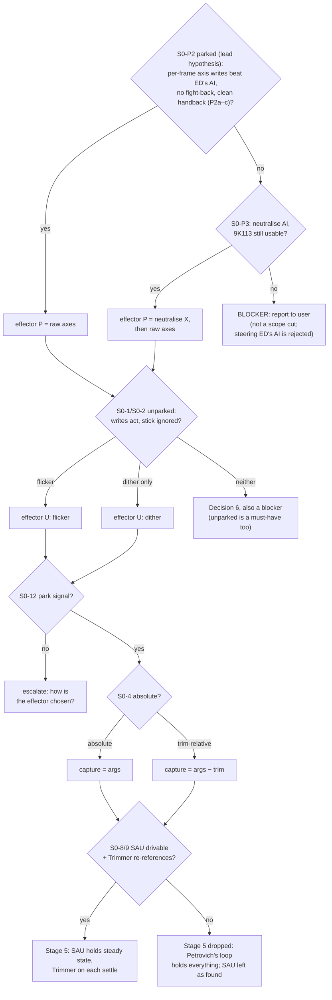
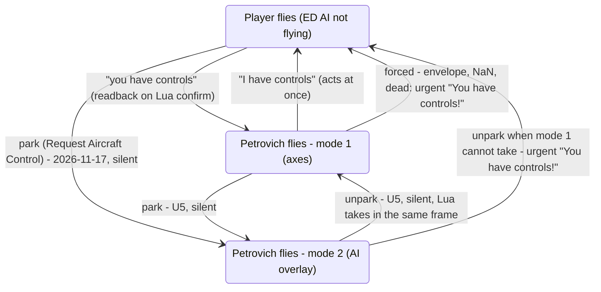

# BL-16 — Petrovich flies the helicopter: plan

2026-10-26, Architect pass, planning only. **Revised 2026-10-31** from the goal check
(`plans/flight-control/alignment.md`, CONCERNS) and the user's answers to it — see "Revised
2026-10-31" directly below for what changed and why. **`BL-16` stays `[>]` deferred** (user: finish
9K113 first); this plan exists so the work is ready when it is picked up, and so stage 0 can be
flown whenever convenient. Specification: `plans/flight-control/explore-notes.md` (whole file,
including both 2026-10-26 addenda and the 2026-10-31 "Goal-check answers", which are binding) and
`docs/concept/flight-control-{1,2,3}.jpeg`. Where this plan and those words disagree, the words win
and this plan is wrong.

## Revised 2026-11-15 — parked mode (mode 2) is the first build

**Re-cut by the Architect**, user direction 2026-11-15: *"take BL-16, remove deferred status.
Let's build it. Let's actually start with the AI helper, that's the Player uses 9K113 case and
it's important to get done. After that we can build our own controls-not-parked flight
controlling."* Everything below the next divider (`## Series — unparked mode (mode 1): later
build, preserved unchanged`) is the **original 2026-10-26/10-31 plan, untouched** — its stage
numbers (0–6), decisions, co-moving fields and risks all still describe **mode 1 only** and are
not re-derived here. This section is the **new, separate stage series for mode 2**, numbered
**P0–P6** so the two series never collide. `BL-16`'s own entry
(`body-layer/ROADMAP/BL-16.md`) already carries the two-mode split and the stage-0 finding that
forces it.

### Why two modes, and why parked first

Stage 0 (mode 1's own S0-P block, flown 2026-11-01, `main`'s
`aircraft-layer/research/2026-11-01-bl16-command-hold-probe-findings.md` — that commit is on
`main` but not yet merged into this feature branch; its content is quoted below because it is the
fact that forces this re-cut) found that **a per-frame `LoSetCommand(2001–2003)` write is
completely ignored while the controls are parked** — user, verbatim: *"both pilot and copilot
control works, but only when control is not parked. When I press to park controls, DCS AI takes
over flying and does it's own thing overriding ours."* The probe's own log: during a held
operator-seat override, park cross-fades the cockpit args to the AI's own values over ~1.3 s and
the aircraft follows the AI, "no fight visible — the aircraft follows the AI, not a blend." S0-P2
(the raw-axis override, mode 1's lead hypothesis for the parked state) is **closed negative**.
S0-P3 (neutralise the AI while parked) was never run — the user skipped it directly to the
fallback: *"2 - skip it. BL-16 has to go with two modes: normal ops - write control axises;
controls parked - manipulate DCS AI via the AI wheel commands."* So **S0-P3b, the plan's own
documented fallback, is promoted from fallback to the production design for the parked state**,
and S0-P1/S0-P1b/S0-P2/S0-P2a–c/S0-P3/S0-P5/S0-P6 (the raw-axis-override rows for the parked
state) are now dead rows, closed by this finding — they are **not** re-run or re-planned; they
stay in the mode-1 series below only as the historical record of why mode 2 exists.

**Why parked first, not unparked:** the parked case is the user's named key use — *"that's the
Player uses 9K113 case and it's important to get done"* — and it is also the harder, riskier half
(driving ED's own AI through a menu rather than writing axes Petrobrain fully owns). Building it
first means the project's hardest unknown is resolved before the easier unparked series is
designed in depth; the 2026-10-26/10-31 unparked plan below stays as reference and is picked up
unchanged once mode 2 passes DoD.

**Goal check:** `plans/flight-control/alignment.md`, "Goal check — parked mode (2026-11-15)".
Verdict **ALIGNED** after the user's answers. Player expectations E-P1, E-P3–E-P11 (E-P2
withdrawn — no spoken line on park or unpark) are the specification this series has to satisfy;
every stage below says which E-P row it closes.

### Goal (mode 2)

On the park signal — no spoken handover — Petrovich takes over driving ED's own AI pilot through
the HELPER_AI wheel (device 30), resets its held altitude to current (the fix for the AI's known
park-sink), and from then on turns the pilot's spoken heading/altitude/speed goals into wheel
presses that move the AI's own held values toward them, one parameter at a time, within loose
tolerances (A9's same ±10%/20 m posture carried over). "Align" and "align for launch" are pressed
only on the pilot's word, from the sight seat. After a launch, an abort, or crossing a safety
floor/ceiling, Petrovich takes the AI back to level flight on his own and restores the
pre-alignment parameters. Unparking returns the aircraft to the player at once, silently.
Naked-eye lookout continues throughout; this mode never touches the 9K113 sight itself (the
player is on it).

### Amended 2026-11-15 (vocabulary, ICS capture, cycle orders)

Three things the user settled in the same message that answered plan check **Q-P1**
(`plans/flight-control/alignment.md`, "Plan check Q-P1 answered by the user"), folded in below
rather than re-cut — **the stage structure (P0–P6) is unchanged**; only P1–P4's content, the
Co-moving Fields table, the Behaviour constants table and the Risks list are edited in place.
Source, verbatim: `plans/flight-control/explore-notes.md`, "U3 decided, mode-cycle orders, and
the player command vocabulary"; the cycle orders are also now carried in
`aircraft-layer/research/2026-11-14-mi24p-ai-pilot-wheel-layout.md` §5's state diagram.

**1. ICS capture from the operator seat is a new prerequisite stage, P-ICS, before P0** — see its
own write-up, inserted just above Stage P0 below. *"Audio capture must listen to both pilot and
copilot ICS (VOIP) triggers and treat them equally ... This is prerequirement for BL-16 player
commands to work"* (user, verbatim). Gates every parked-mode flight in this series, since the
pilot speaks from the CPG seat while parked.

**2. The short-left cycle has known orders**, so the mode-cycle loop (P1/P2) can bound its own
attempt count instead of an open-ended "escalate after N attempts": **`FLT > CBTM > FLT`** and
**`HVR > HVRT > CBTM > HVR`**. CBTM has two homes — which one a short-left returns to depends on
whether the aircraft was in forward flight or hover before the cycle into CBTM. The automatic
(DCS-driven) transitions are unchanged from the research note: FLT→HVR on speed 0 + slowing,
HVR→FLT on speed > 0 + accelerating, FLT/HVR→CBTM on CPG-view entry, CBTM→FLT/HVR on CPG-view
exit (user not certain which — the "read the mode every tick, never assume" posture this plan
already states covers that uncertainty without a design change). **U3 is answered**: a
player-driven mode press is reasserted over at once, not deferred — *"reassert at once — the
goal is to use the wheel command via Petrobrain, not player directly"* (user, verbatim). New
constant `MODE_CYCLE_MAX_ATTEMPTS = 3` (table below) replaces the open-ended attempt language in
P1/P2 — every mode in the cycle is at most 2 presses from any other, so 3 is a comfortable bound,
not a guess.

**3. The player vocabulary is now fully specified**, replacing the placeholder examples P2/P3
used ("turn heading 3 1 5", "hold 200 m radar", "speed 2 2 0"):

| Spoken | Token | Mode needed | Action / press | Notes |
|---|---|---|---|---|
| "level flight" | `level_flight` | FLT/HVR | `set_parked_heading`/`altitude`/`speed`, each to the **current** read value | stabilise, not a numeric target the pilot names |
| "Heading &lt;deg&gt;" | `turn_heading` | FLT/HVR | `set_parked_heading(deg)` | numeric; audio-adapter slot parser, built here first (P2), reused by mode 1's own Stage 4 later |
| "Heading &lt;N/NE/E/…&gt;" | `turn_heading` | FLT/HVR | same, after an 8/16-point compass→degrees translation | new audio-adapter slot parser |
| "Turn left/right &lt;deg&gt;" | `turn_heading_relative` | FLT/HVR | `set_parked_heading(current ± deg)`, computed once at command time | relative, not re-derived as the aircraft turns |
| "Break turn left/right" | `cbtm_break` | CBTM | Lua: long press left/right, no hold — 90° break | cycles to CBTM first if needed, same cycle-then-press shape as `cbtm_align` |
| "Break away" | `cbtm_break_away` | CBTM | Lua: long press left, wait `BREAK_AWAY_GAP_S`, long press left again | the two-`BREAK LEFT` 180 — "Mi-24 turns faster left" (user); `BREAK 180`'s own press is avoided, direction undetermined |
| "Align" / "Align [for] launch" | `cbtm_align` / `cbtm_align_for_launch` | CBTM | unchanged from Stage P3 | |
| "Straight" / "level off" | `level_off` | any | stop turn, hold current heading; **while `align_phase` is `"aligning"`/`"launch_aligned"`, this token is F-P1's spoken abort** (ties into Stage P4's recovery trigger list) | one token, two meanings gated by `align_phase` |
| "Speed &lt;value&gt;" | `set_speed` | FLT/HVR | nearest step; "max" is a legal value | |
| "Slow down" / "Speed up" | `speed_step` | FLT/HVR | one step down/up | |
| "Hover" | `set_speed` with value 0 | FLT/HVR | step 0 | causes the automatic FLT→HVR transition once DCS itself slows to hover |
| "alt[itude] &lt;value&gt; [radar/barometric]" | `set_altitude` | FLT/HVR | centre-toggle reference if it differs (`SHORT_PULSE_S` real pulse, menu open), then hold to value | ~~at risk, added 2026-11-16: P0-5 measured a centre press *with the menu open* not toggling the reference at all... treat "radar" as possibly unreachable by voice~~ **Resolved 2026-11-16** by the takeover rehearsal probe's T4 row: a real `SHORT_PULSE_S` (0.15 s) pulse with the menu open *does* toggle the reference (B→R measured directly); P0-5's failure was the probe's own zero-length press, not a DCS limitation. Reachable by voice. **New, from the 700 m radar cap (pilot, explore round 3):** a target whose AGL-equivalent is ≥ `AI_PILOT_QUICK_PATH_MAX_AGL_M` (700) cannot hold on radar at all — see "Stage P2 ready to build" below, "The 700 m radar cap" |
| "climb/descend &lt;m&gt;" | `altitude_step` | FLT/HVR | relative, current ± m | |
| "hold alt[itude]" | `hold_altitude` | FLT/HVR | freezes the goal at the current read altitude | |
| "left/right/forward/back" | `hvrt_translate` | **HVRT only** | Lua holds the press open until body-layer clears it — see Stage P2's HVRT sub-section | state-gated, not grammar-gated — see note below |
| "Hold" | `hvrt_hold` | HVRT only, while a translate is active | clears `held_translate_direction` | no existing token collision (grepped `crew_console.py`/`vocabulary.py`, none) |
| "up/down" | `hvrt_step` | HVRT only | Lua: short up/down, 2 m per tap, no hold semantics | |

**Vocabulary collision check, done rather than assumed**: `_RELATIVE_SCAN_TOKENS` already uses
bare "left"/"right" as *sectors* (`scan left`/`scan right`, `body-layer/src/belief/
crew_console.py` ~L321) and the step-through-contacts family uses them too (`step left`/`step
right`, ~L3774) — but **every existing use pairs the direction word with a verb** ("scan",
"step"); `audio-adapter/src/vocabulary.py`'s `PHRASES` table has no bare single-word phrase
today (confirmed by grep, not assumed). The new HVRT tokens are the first **bare** "left"/
"right"/"forward"/"back"/"up"/"down"/"hold" — `command_matcher.py`'s `VERB_ANCHOR_WORDS` is
derived from each phrase's own first word, so a bare phrase anchors on itself and would match
fine grammatically, but it would also fire outside HVRT with no mode check of its own. So this
needs **state-gated dispatch, not grammar alone**: `CrewConsole.handle_command` must route
`hvrt_translate`/`hvrt_step`/`hvrt_hold` to the AI-wheel handler only when `ai_mode == "HVRT"`,
and treat them as unmatched (fall through, same as any other out-of-context token) otherwise.

**`/command-map` must be redrawn once this vocabulary lands** — it spans Stage P2 (most of the
table above), Stage P3 (break/break-away), and Stage P4 (`level_off` as abort token). No separate
stage number is needed for the redraw itself: the merge skill's own stale-check
(`.claude/skills/command-map/SKILL.md`) fires automatically on whichever merge lands
`vocabulary.py` changes, per root `CLAUDE.md`'s existing merge sequence — flagged here so it is
not forgotten, not because this plan needs to own a new stage for it.

### Architecture decision: per-frame press timing lives in Export.lua, not body-layer

**The same split mode 1 already designed, reused rather than invented.** The wheel distinguishes
a short press (<0.5 s) from a long press/hold (>0.5 s, `HelperAI.lua:13`'s `long_press_time =
0.5`, confirmed live at a 0.80 s hold in
`aircraft-layer/research/2026-09-11-petrovich-detection-readout.md`, "CONFIRMED: far slots are
long presses") by timing a `performClickableAction(30, cmd, 1)` → `(cmd, 0)` pair on the frame
clock. Body-layer polls at roughly 1 Hz (`CrewConsole`'s poll loop); an HTTP-round-tripped press
sequence could not reliably land on the right side of a 0.5 s threshold, and a long **hold**
(altitude/heading, held "until the readback reaches target") needs to watch that readback every
frame to know when to release, not once a second. So:

- **Export.lua owns**: reading `list_indication(HELPERAI_DEVICE_ID)` (the same feed index, 6,
  that already carries Petrovich's own sensor target list — while the AI pilot flies, this page's
  content is the AI overlay instead, per
  `aircraft-layer/research/2026-11-14-mi24p-ai-pilot-wheel-layout.md` §3; **unverified whether it
  is populated with the wheel/overlay closed — Stage P0's first row**), parsing out
  `mode_text`/`course_text`/`alt_text`/`alt_add_text`/`speed_text`, deciding the next single press
  (a mode-cycle short-left, or the press the current goal needs), running the press/hold timing
  itself, and reporting a status line at the usual 5 Hz push rate (mirrors
  `run_sight_servo`/`push_sight_servo_state`).
- **Body-layer owns**: the handover/activation state (park signal → active, per E-P1), the
  **goal** (target heading/altitude/speed, one at a time per the interleaving rule below), the
  alignment/recovery state machine (E-P7–E-P9), and the vocabulary. It never decides *which wheel
  button* to press — only *what value Petrovich wants held*.

This keeps one Lua-side mechanism (`list_indication` parse → mode-aware nudge loop) that both the
heading/altitude/speed goal and the align/recovery exits use, instead of forking per command; it
is the same "controller vs effector" separation mode 1's plan already argues for its own loop.

### Actions, state params, "when" (root `CLAUDE.md`, "Behaviour as actions and params")

**Actions** (one thing, explicit params, report running/succeeded/failed, never decide *when*) —
new module `body-layer/src/belief/ai_pilot_wheel.py`:

- `set_parked_heading(deg: float)`, `set_parked_altitude(m: float, reference: "radar"|"baro")`,
  `set_parked_speed(step_kmh: float)` — each clamps to limits, returns the value actually set
  (A9's posture, carried over), bumps `goal_seq`.
- `cbtm_align()`, `cbtm_align_for_launch()` — player-only triggers (E-P7); reach CBTM by the wheel's left press, which is always available (U1, answered 2026-11-18: no
  not-reachable branch).
- `recover_to_level(reason: "launch"|"abort"|"agl_floor"|"ias_ceiling")` — internal-only entry
  point `decide_ai_pilot_wheel` calls; never reachable from voice.

**State params** (read-only queries over belief, typed, never DCS truth directly):
- `parked_active: bool`, `ai_mode: "FLT"|"CBTM"|"HVR"|"HVRT"|None` (mirrors Lua's parsed
  `mode_text`, `None` until first read), `held_heading/altitude/altitude_ref/speed: float | None`
  (the AI's own current values, read back from the status feed — never written directly), `goal:
  AiPilotWheelGoal | None`, `align_phase: "none"|"aligning"|"launch_aligned"|"recovering"`,
  `pre_align_snapshot: FlightSnapshot | None`.

**The "when"** — one function, `decide_ai_pilot_wheel(...)`, apart from the actions:
- activation on the park signal, altitude-first reset (issues 2026-11-15 write-up, "on park, set
  altitude to current, nudge if equal");
- interleaving: when more than one goal is outstanding, step one parameter's worth of progress per
  poll and rotate (the explore notes' own worked example: "speed +1 tap, heading −30°, alt +50 m,
  speed +1 tap, …" — body-layer decides the **order**, Lua executes **one press** per decide call
  and reports back before the next is issued, so the two loops stay in lockstep without body-layer
  needing frame-level timing);
- DCS-driven mode changes (CPG view → CBTM, hover transitions) are cycled back from toward
  whatever mode the current goal needs (Q4); a player-driven mode change is not expected and is
  not specially handled in this build (Q4) beyond the same cycle-back, which would otherwise
  silently undo a player's own wheel press — flagged as **U3**;
- alignment is entered only on `cbtm_align`/`cbtm_align_for_launch` (E-P7) and recovery fires on
  launch detection (payload count drop, reusing the feed `[[BL-B67]]` Stage 4 already built — see
  "Launch detection" below, never importing `belief.atgm_run` itself, per F-P3), a spoken abort, or
  crossing AGL < `AI_PILOT_RECOVER_AGL_FLOOR_M` / IAS > `AI_PILOT_RECOVER_IAS_CEILING_KMH` (Q5);
- recovery sequencing (Q7/Q8): snapshot heading+altitude at the recovery moment, mode-cycle to FLT
  (which, per Q7, adopts whatever heading is current rather than an old held one — no explicit
  heading press needed for the "hold current" half), say *"leveling off"*, then issue altitude and
  speed goals back toward `pre_align_snapshot` (altitude climbs smoothly via the same long-hold
  nudge loop; speed steps back **one step per decide cycle**, matching Q8's "one step at a time"
  and the interleaving rule above — no new mechanism).

### Launch detection, reusing BL-B67's feed only

F-P3 (`alignment.md`): the parked case is a **role swap** (player on the sight, Petrovich flying),
not a variant of `belief/atgm_run.py`'s own run. So `ai_pilot_wheel.py` reads
`AircraftLayerClient.get_payload_latest()` directly (the same feed `atgm_run.py`'s
`station_counts` already comes from) and watches for **any loaded station's count dropping
poll-to-poll** — the same signal shape as `atgm_run.py`'s `selected_step_count_last_seen`
bookkeeping, re-implemented locally rather than imported, because `atgm_run.py` is Petrovich's own
run and importing it here would wire the two together exactly as F-P3 says not to. No station
selection or knob logic is needed here — any count drop while `align_phase == "launch_aligned"`
is the player's shot.

### Co-moving Fields

Trigger fires: an align/recovery sub-state-machine with fields written externally (the player's
voice — `cbtm_align`/`cbtm_align_for_launch`/an abort word; DCS's own mode changes) and internally
(`decide_ai_pilot_wheel`'s recovery logic; Lua's own mode-cycle presses). `ParkedFlightState` and
the Lua `apw` table are new, so there are no construction sites yet to grep — **the Implementer
greps `ParkedFlightState(` and every assignment to Lua `apw.` after Stage P1 and extends this
table with any site not listed**, per step 6a's own worked lesson (`BL-B71`'s fourth
construction site, found only by grep, not by the transition narrative).

| Field | Written by | Transition | Must hold true after |
|---|---|---|---|
| `parked_active` | external (park signal, arg 852/952) | park → true | altitude goal set to current (nudge if equal); `align_phase = "none"`; no spoken line (E-P2 withdrawn) |
| `parked_active` | external (unpark) | unpark → false | Lua `apw.mode = off` same frame (held press released if any); any pending goal/align state dropped, not resumed on the next park (E-P10) |
| `align_phase` | external (voice) | `cbtm_align` | `"aligning"`; Lua cycles to CBTM, presses short-up |
| `align_phase` | external (voice) | `cbtm_align_for_launch` | `"launch_aligned"`; `pre_align_snapshot` captured from the **current** heading/altitude/speed goal (not the AI's raw readback, so a goal already in flight is what's restored); Lua cycles to CBTM, presses long-press-up |
| `align_phase` | internal (`decide_ai_pilot_wheel`) | launch detected / spoken abort / AGL floor / IAS ceiling, while `"launch_aligned"` | `"recovering"`; *"leveling off"* spoken once; Lua cycles to FLT |
| `align_phase` | internal | FLT reached and current heading/altitude snapshotted at that moment | `"recovering"` unchanged; `goal` set to `pre_align_snapshot`'s altitude and speed (heading is **not** re-issued — Q7, FLT already holds current) |
| `align_phase` | internal | `goal` settles within band on both altitude and speed | `"none"`; `pre_align_snapshot = None` |
| `goal` | external (voice) | new heading/altitude/speed command | `goal_seq` + 1; latest wins (E-P4); if `align_phase != "none"`, the goal is recorded but **not** issued to Lua until recovery reaches `"none"` (the alignment overrides it, per the open-assumption note in `alignment.md`) |
| Lua `apw.mode` | internal | mode read differs from what the current goal/align_phase needs | one short-left press issued, re-read next frame; no second press before the readback confirms the mode changed |
| Lua `apw.press` | internal | a press is open (long-hold in progress) and the mode changes underneath it | press released immediately (no held press survives a mode change — mirrors mode 1's own "a long hold in progress ends immediately on a mode change") |
| mode-cycle attempt count | internal (Lua) | `MODE_CYCLE_MAX_ATTEMPTS` (3) exhausted without reaching the needed mode | `goal_progress = "mode_blocked"`; the goal itself is **not** dropped — retried next poll (added 2026-11-15: the open-ended "escalate after N" language is now a named bound, per the Amended note above) |
| `held_translate_direction` | external (voice: left/right/forward/back, HVRT only) | HVRT translate command | set to that direction; Lua opens the matching outer-ring press that same frame it reads the change |
| `held_translate_direction` | external (voice: "Hold") | hold command | cleared to `None`; Lua releases the press the same frame it reads the clear |
| `held_translate_direction` | internal (Lua, `HVRT_TRANSLATE_MAX_HOLD_S` elapsed) | safety timeout | Lua releases the press and reports `"released_timeout"`; body-layer clears its own copy of the field on the next poll that observes the released status — no second source of truth held past that poll |
| `held_translate_direction` | internal | mode changes away from HVRT underneath an open translate | cleared and the press released immediately — same mode-change rule as the general `apw.press` row above |

(added 2026-11-15, the "Amended" note above — `ParkedFlightState`/`apw` still have no
construction sites to grep against as of this plan revision; the Implementer's grep still applies
once Stage P1 lands the type.)

**Implementer's grep, Stage P1 landed (2026-11-15):** `grep -rn "ParkedFlightState(" body-layer/src
body-layer/tests` finds exactly one production construction site
(`belief/ai_pilot_wheel.py`'s `advance_parked_flight_state`, which only ever `replace()`s via a
fresh `ParkedFlightState(...)` built from the latest feed, same single-construction-site shape
`GuidanceUnitState` already has) plus `body.py`'s own `field(default_factory=ParkedFlightState)` —
nothing else, and nothing in the Co-moving Fields table above is missing a row. **One naming
departure from this table's own wording, stated here because the table uses `apw.mode`/`apw.press`
as if they were literal Lua table fields and they are not**: Stage P1's `Export.lua` implementation
uses individual named module-level locals (`ai_pilot_parked_active`, `ai_pilot_mode_text`,
`ai_wheel_pending_cmd`, etc.), not a single Lua table named `apw` — there is no `apw.` assignment
anywhere in `Export.lua` to grep for. The wire-level JSON keys *are* `apw_`-prefixed
(`apw_parked_active`, `apw_mode_text`, …, matching this table's intent), and the table's own rows
read correctly if `apw.mode` is read as "the AI-pilot-wheel mode state" rather than a literal field
access. P2-P4 should keep using individual locals for the same reason P1 did: Lua has no hoisting,
and a single `apw` table assembled before every field exists would invite exactly the
declared-below-its-use bug this project's own `push_ptt_state` incident already demonstrated.

### Behaviour constants

| Constant | Default | Where | Why |
|---|---|---|---|
| `AI_PILOT_RECOVER_AGL_FLOOR_M` | 40 (Q5) | body-layer `tuning.py` | crash-avoidance floor, named in the goal check as `U1`-adjacent but the number itself is already the user's own default |
| `AI_PILOT_RECOVER_IAS_CEILING_KMH` | 280 (Q5) | body-layer `tuning.py` | over-speed avoidance ceiling, same source |
| `AI_PILOT_ALTITUDE_TOLERANCE_M` | 20 (user) | body-layer `tuning.py`, sent in the goal | "good enough" for the hold-up/down nudge loop |
| `AI_PILOT_HEADING_TOLERANCE_DEG` | 5 (same judgement call as mode 1's D-c; **not re-litigated, same default**) | body-layer `tuning.py` | no natural tolerance for a heading |
| `AI_PILOT_SPEED_STEPS_KMH` | `(0, 60, 120, 160, 200, 250)` + a MAX sentinel | body-layer `tuning.py` (sequence) | the wheel's own discrete steps (user, unverified at 160 — Stage P0) |
| `LONG_PRESS_HOLD_S` | 0.7 (margin above the confirmed 0.5 s threshold) | Export.lua constants block | the far-slot/long-press timing; **would want the X-T26 mechanism, noted not improvised, same as the 9K113 servo block** |
| `SHORT_PRESS_PULSE_S` | one or two frames (the existing `handle_petrovich_search_command` pattern) | Export.lua | short-tap timing |
| `MODE_READ_SETTLE_S` | ~1.0 (user's recon §7 estimate, "~1 s AI lag") | Export.lua | how long to wait after a mode-cycle press before trusting the new `mode_text` |
| `MODE_CYCLE_MAX_ATTEMPTS` | 3 (added 2026-11-15) | Export.lua constants block — the loop itself lives there, per the Architecture decision above | the known cycle orders (`FLT⇄CBTM`, `HVR→HVRT→CBTM→HVR`) bound every reachable mode within 2 presses; 3 gives one spare attempt rather than guessing at an open-ended N |
| `BREAK_AWAY_GAP_S` | 2.0 (user, verbatim — added 2026-11-15) | Export.lua constants block | the gap between the two `BREAK LEFT` presses `cbtm_break_away` issues |
| `HVRT_TRANSLATE_MAX_HOLD_S` | 15.0 (architect default, **not** user-specified — flag as a judgement call, revisit if a sortie shows it firing in ordinary use; added 2026-11-15) | Export.lua constants block | safety ceiling on a held HVRT translate press if the spoken "Hold" is lost |

### Implementer notes from the plan checks (2026-11-15)

- **Every new spoken token also goes into `audio-adapter/src/vocabulary.py`'s `TOKENS`/`PHRASES`**,
  the table that biases whisper's prompt — hand-synced, no automated cross-check
  (`audio-adapter/CLAUDE.md`; the 2026-10-23 "violence"/"same ahead" incident is what happens when
  it is missed). Applies to Stages P2, P3 and P4.
- **No shared `press(direction, duration)` entry point in Lua.** Each action hard-codes its own
  fixed press shape (which button, short / long / held). This is what makes E-P6 ("`HDG LOS`,
  short right, is never pressed") structural rather than conventional; with nine action paths a
  generic combinator is one typo from pressing it.
- **Q-P2 open, non-blocking:** `HVRT_TRANSLATE_MAX_HOLD_S` = 15 s is the architect's default, a
  tunable; the user has not confirmed the order of magnitude.

### Stage P-ICS — ICS capture from the operator seat (prerequisite)

Precedes P0; gates every parked-mode flight in this series, per the "Amended 2026-11-15" note
above — the pilot speaks from the CPG seat while parked, and today's capture path gates only on
the pilot's own trigger.

**Decision: one combined sample, not a per-seat pair.** `Export.lua`'s `push_ptt_state` (~L662)
currently reads only `ARG_PILOT_PTT = 738` (pilot). Extend it to also read **arg 856**
(`OP-STICK-PTT-PTR`, operator seat, `crew_member_access = {1}`, identical encoding — first-party,
DCS-SRS's own `Mi24P.lua` reads it for the copilot seat too) and send both raw values on the same
line: `{"t":..., "ptt":<pilot raw>, "ptt_op":<operator raw>}`. `schema.ptt.PttSample` gains a
second raw field (`raw_operator: float`); its `intercom`/`radio` properties become an **OR across
both raw values** — the trigger means "the crew channel is open", regardless of which seat
pressed it, which is exactly what the one consumer (`audio-adapter/src/ptt_source.py`'s
`DcsPTT.is_down`) wants and already reads (`payload.get("intercom")`/`"radio"`) with **no change
needed there**. `aircraft-layer/src/api/server.py`'s `_handle_ptt_state` (~L424, the SPU-8 gate)
also needs **no change**: `Spu8Sample.gate_open` (`schema/spu8.py`) already ANDs the pilot's
NET-1 switch (arg 377) with the co-pilot's ICS-power switch (arg 664) regardless of which seat is
talking, so the existing gate is already seat-symmetric.

**Why this over a `seat` field + OR-in-audio-adapter**: tagging each sample `"seat":
"pilot"|"operator"` and having `DcsPTT` fetch/OR two states is a bigger diff — a second cache
slot or a second poll, and a second place (`audio-adapter`) that has to know the OR rule — for no
behavioural gain, since nothing downstream needs to know *which* seat spoke. **The seat is still
useful diagnostics**: add an optional `last_seat: "pilot"|"operator"|"both"|None` field to
`PttSample`/`to_api_dict` (whichever raw value's own predicate fired; `"both"` if both did),
read only by `--debug` logging, never by `DcsPTT` or any gating logic. This keeps "the Lua layer
carries the raw value and decides nothing" true throughout: Lua ships two numbers, the Python
schema layer does the OR — the same layer that already decides `intercom`/`radio` from one
number — and `audio-adapter` is unchanged.

**Affected files**: `aircraft-layer/dcs-export/Export.lua` (`push_ptt_state`, the `ARG_PILOT_PTT`
block — add `ARG_OPERATOR_PTT = 856` beside it, extend the debounce-on-change check to fire on
either value moving); `aircraft-layer/src/schema/ptt.py` (`PttSample`, `from_dict`,
`to_api_dict`). `aircraft-layer/src/collector/server.py`'s `"ptt" in data` line-routing check
(~L403) is unaffected — same wire key, more fields. No change to `audio-adapter/src/
ptt_source.py` or `aircraft-layer/src/api/server.py`'s `_handle_ptt_state`.

**Tests**: `PttSample.from_dict` with only `ptt_op` moved (pilot untouched), both moved on the
same frame, and the `intercom`/`radio` OR truth table (neither / pilot-only / operator-only /
both); Export.lua's debounce-on-either-change, desk-checkable the same way `push_ptt_state`'s
existing logic already is (`aircraft-layer/CLAUDE.md`'s Export.lua testing note — no live DCS
needed for parse/encode, only the live check below).

**Flight P-ICS** (test card, named branch): from the **operator seat**, hold the ICS trigger to
its intercom stop (not the pilot's), confirm `GET /ptt/state`'s `"intercom"` goes true and
capture starts — the same observable behaviour the pilot's own trigger already produces. Release,
confirm it drops. Then repeat from the pilot seat, to confirm nothing regressed.

### Stage P0 — measure (desk pass already done; one short Windows probe)

No new Windows session needed beyond what the user already flew and screenshotted
(2026-11-01/11-14); this stage closes the handful of items the existing recon flags
`[inference]`/unverified, with a single short flight. Probe script:
`aircraft-layer/dcs-export/Export.probe-ai-pilot-wheel.lua`, same scaffold as
`Export.probe-9k113-flicker.lua`/the search-wheel handler, parked, operator seat, ED's AI flying.

| # | Measures | Pass | Decides |
|---|---|---|---|
| P0-1 | `list_indication(HELPERAI_DEVICE_ID)` content while parked, command (right) wheel **closed** vs **open** | populated either way, or only with the command wheel open | whether Export.lua must open the command wheel to read the texts. **Narrowed 2026-11-15 by the user:** the readback (left) overlay *"is always visible. There is no way to turn it off"* while the AI flies, so there is no cosmetic HUD cost either way; only the command wheel is normally off |
| P0-2 | One held press at 0.7 s on each ring position in FLT, confirmed against the overlay readback moving as a long action (not a repeated short tap) | 0.7 s reliably reads as long in this wheel too | `LONG_PRESS_HOLD_S` final value |
| P0-3 | Speed tap sequence from 0 to MAX, reading `speed_text` after each tap | the exact step list and MAX's displayed value | `AI_PILOT_SPEED_STEPS_KMH` |
| P0-4 | Press-to-readback latency: time from a press release to the overlay text changing | a number, used as `MODE_READ_SETTLE_S`'s floor | the read-compare-repeat loop's minimum wait before re-checking |
| P0-5 | Centre press (baro/radar toggle) from each reference, confirm readback flips and re-reading/re-setting altitude after is actually required (or the AI keeps the same numeric target across the toggle) | documented | whether the centre-press step in a reference change is needed at all |
| P0-6 | On park, confirm the sink and the fix: set altitude to current immediately on park, observe whether the AI still sinks first | no sink, or sink stops within a few seconds of the write | confirms E-P1/the user's own write-up as the production behaviour, not an assumption |
| P0-7 | FLT→HVR speed criterion: tap speed down to 0 in FLT, observe when `mode_text` itself flips without a mode-cycle press | a number or a settle time | whether `decide_ai_pilot_wheel` ever needs to *wait* for a DCS-driven mode change rather than press for one |

Go/no-go: nothing here can fail into a blocker — every row either confirms a number already
believed or narrows a mechanism detail (P0-1). If P0-1 fails (texts only filled while the
command wheel is open), Export.lua would have to open the right wheel to read — a visible menu
on the HUD, a **known limitation to state on the test card**, not a redesign. The left readback
overlay is on screen regardless (user, 2026-11-15), so a pass costs nothing cosmetically.

### Stage P1 — the seam and activation, no goals yet

**SUPERSEDED 2026-11-16** — see "Revised 2026-11-16 — takeover after the Batch A flights" below
for the production design. Batch A (built to the letter of this section, DoD-PASSED, merged
`c38740d0`) found two wrong assumptions once flown: the park/pedals-OR detection reads "parked"
whenever the AI is *not* flying (952 is arg 852's mirror, not a second park sensor), and ED's own
barometric target can come out hundreds of metres wrong, which the single "nudge if already equal"
shot never addresses. Kept below verbatim, per `docs/PROCESS.md`'s "Superseding a decision" — the
account of what was built and why it needed revision is itself worth keeping, not just the fix.

Minimal working version: the park signal takes over, holds altitude, does nothing else.

- **Lua**: `run_ai_pilot_wheel(t)` per frame beside `run_sight_servo(t)`. Parses
  `list_indication(HELPERAI_DEVICE_ID)` into `mode_text`/`course_text`/`alt_text`/
  `alt_add_text`/`speed_text`. On the park signal rising (arg 852/952 ≈ 1, the same observable
  mode 1's S0-12 already confirmed — reused, not re-probed), issues one altitude long-hold press
  up by `LONG_PRESS_HOLD_S` if the read current altitude equals the AI's held altitude (the nudge,
  per P0-6/the user's write-up), else holds nothing and leaves the AI's own value as the goal
  until body-layer sends one. `apw` status pushed at 5 Hz: `mode_text` fields, `parked_active`,
  last press issued. **No goal message yet** — this stage proves activation and the park-sink fix
  only, Decision-free otherwise.
- **Body-layer**: `ParkedFlightState`, advanced from the park-signal state param each poll (no
  voice token yet — activation is automatic, E-P1); no spoken line (E-P2 withdrawn).
- **Tests**: Lua parse function against the overlay's known text shapes (`R`/`B` suffix, mode
  names); park-rising detection; altitude-nudge-if-equal logic as a pure function.
- **Flight P1** (test card, named branch): park with the AI holding some altitude, confirm no
  sink and no speech. Unpark, confirm nothing untoward (no goal exists yet to drop).

### Stage P2 — heading, altitude, speed goals

**SUPERSEDED 2026-11-16** — see "Revised 2026-11-16 — Stage P2 ready to build" below (after the
takeover revision) for the production design: the concrete goal-channel wire shape, the
interleaving mechanism (this section's own text names the *rule* but not the mechanism), the
takeover-coexistence rule, the full readback table, and the audio-adapter work the plan-aligner's
2026-11-15 amendment review flagged as missing. Kept below verbatim, per `docs/PROCESS.md`'s
"Superseding a decision" — the vocabulary table above this section and the Co-moving Fields table
earlier in this document are **not** superseded, only this section's own Lua/body-layer/
audio-adapter bullets and the Flight P2 card text.

- **Lua**: the nudge loop — given a goal (one of heading/altitude/speed), read current mode, cycle
  to FLT/HVR if needed (short-left, re-read, repeat — bounded by `MODE_READ_SETTLE_S` per attempt
  and `MODE_CYCLE_MAX_ATTEMPTS` (3) attempts overall, now a known quantity rather than an open
  engineering default, per the "Amended 2026-11-15" note above: the cycle orders are known, and
  every mode is at most 2 presses from any other), then issue the single press the goal needs
  (short tap for speed, long hold for altitude/heading, released once the readback is within
  tolerance or the body-layer goal changes), report `goal_progress: "pressing"|"settled"|
  "mode_blocked"` — `"mode_blocked"` on exhausting the attempt bound leaves the goal outstanding
  for retry next poll, never silently dropped.
- **Body-layer**: `set_parked_heading`/`set_parked_altitude`/`set_parked_speed`; interleaving
  across more than one outstanding goal (one parameter's step per poll, rotating); readback on
  acceptance, mirroring mode 1's Decision 10 shape (*"heading 3 1 5"*, *"speed 2 0 0"* — rounded to
  the nearest step per the explore notes, and the readback **names the step actually set**, per
  E-P3); no "unable" for a goal not quite reached (same posture as mode 1's A4, not re-litigated).
- Audio-adapter: reuse the slot parsers mode 1's plan already designed for `turn_heading`,
  `hold_altitude`, `speed` (Affected Modules, mode-1 series below) — **built here, first**, so
  mode 1's own Stage 4 does not redo this work; cross-reference added to that stage when mode 1 is
  picked up. New slot parsers needed for the full vocabulary table above: compass-point→degrees
  (`turn_heading`'s second form), `turn_heading_relative`, `speed_step`, `altitude_step`.
- **HVRT (hover translate) vocabulary — held press and the safety timeout.** "left"/"right"/
  "forward"/"back" (bare direction, state-gated to `ai_mode == "HVRT"`, per the vocabulary note
  above) set `held_translate_direction` to that direction; "Hold" clears it. **Lua holds the
  actual press** — the Architecture decision above already gives Export.lua ownership of
  press/hold timing, unchanged here — reading `held_translate_direction` each frame and keeping
  the matching outer-ring press open for as long as it is non-`None`, releasing the instant
  body-layer clears it (on "Hold") **or** `HVRT_TRANSLATE_MAX_HOLD_S` elapses, whichever comes
  first. The timeout is a safety ceiling, not the normal stop path — the normal stop is always the
  player's own "Hold" — but it exists because that stop is spoken and can be lost (a network drop
  between audio-adapter and body-layer, a missed recognition), while an open wheel press cannot
  discover that on its own. Lua reports `goal_progress: "released_timeout"` when it fires, so the
  test card has something concrete to look for. "up/down" (`hvrt_step`) is a discrete short press,
  2 m per tap, no hold semantics at all — unaffected by the timeout.
- **Flight P2**: park, speak a heading, then a speed, then an altitude in quick succession
  (interleaving); confirm the overlay converges on all three without one blocking another, within
  the tolerances, and the mode cycles correctly between FLT (speed/altitude/heading) with no
  player-visible stall. Then, from hover, cycle into HVRT and say "left", hold a few seconds, say
  "Hold"; confirm the AI translates only while held and stops on the spoken word, and separately
  confirm the AI eventually stops on its own if "Hold" is never said (the timeout, not flown to
  full duration — confirm the mechanism exists via `goal_progress`, not by waiting out 15 s live).

### Stage P3 — alignment and break turns on the player's word (E-P7)

- **Body-layer**: `cbtm_align`/`cbtm_align_for_launch`, each refusing (no "unable" — see **U2**)
  outside the states where CBTM is reachable; snapshotting `pre_align_snapshot` on
  `cbtm_align_for_launch`. Same refusal posture for `cbtm_break`/`cbtm_break_away` — outside
  CBTM-reachable state, the mode-cycle-then-press sequence is expected to succeed, per U1/U2.
- **Lua**: mode-cycle to CBTM, short-up (`cbtm_align`) or long-press-up (`cbtm_align_for_launch`,
  held for `LONG_PRESS_HOLD_S` then released — a discrete action, not an open hold); long press
  left/right, no hold (`cbtm_break`); long press left, wait `BREAK_AWAY_GAP_S`, long press left
  again (`cbtm_break_away` — never the single `BREAK 180` press, direction undetermined per the
  wheel research).
- **Flight P3**: from the operator seat, say "align" then "align for launch"; confirm the AI
  boresights toward the target as the explore notes describe, and that no automatic recovery fires
  yet (that is P4). Then say "break turn left", "break turn right", and "break away"; confirm the
  90° and the two-press 180 against the compass, and that nothing happens if the aircraft was not
  already in or reachable from CBTM.

### Stage P4 — recovery (E-P8, E-P9, F-P1, F-P2)

- **Body-layer**: `decide_ai_pilot_wheel`'s recovery branch — launch detection (payload count
  drop, see "Launch detection" above), spoken abort (the `level_off` token — "straight"/"level
  off" — while `align_phase` is `"aligning"`/`"launch_aligned"`, per the vocabulary table above;
  the same token stops an ordinary turn and holds current heading when no alignment is in
  progress, so the dispatcher's own `align_phase` check is what decides which meaning fires), AGL
  floor, IAS ceiling; `recover_to_level`; *"leveling off"*; the post-recovery goal sequencing
  (Q7/Q8) from the Co-moving Fields table.
- **Lua**: mode-cycle CBTM → FLT on a recovery signal from body-layer (no new Lua mechanism — this
  is the same goal/mode-cycle machinery P2 built, just triggered by a different caller).
- **Flight P4**: align for launch at a safe height, let it run past 40 m AGL without firing —
  confirm the automatic pull-out and the spoken line (F-P1); then a launch at a safe height — confirm
  the post-launch level-off and the smooth altitude/speed restoration (F-P2, Q7, Q8), with the sight
  (worked by the player, untouched by Petrovich) tracking the target throughout.

### Stage P5 — terrain reference (Q6) and seat/scope boundaries

**Note added 2026-11-16**: the revised Stage P1 (below) already puts the AI onto baro at
takeover, as part of the park-sink/wrong-target fix — not a separate decision taken here. This
stage's own job narrows to *confirming* that choice on the test card against what the player
actually observes over rising terrain, not implementing the toggle; the bullet below is kept as
the record of why baro was chosen.

- Default `ALT REF` to **baro** for the smoother hold (Q6 — radar is jerky), terrain avoidance
  along the flight path explicitly deferred to the player's own judgement and to `[[BL-B101]]`
  later, stated on the test card as a known limitation, not a silent gap.
- Confirm `write_sight_target` is never called while `parked_active` (F-P3 — Petrovich never
  touches the sight the player is working); confirm naked-eye calls continue unmodified (E-P11).
- **Flight P5**: fly a sortie over rising terrain with baro hold active; confirm the card's stated
  limitation matches what the player actually observes (no silent terrain-avoidance claim).

### Stage P6 — tune and accept

Flight-to-flight retunes of `LONG_PRESS_HOLD_S`/`MODE_READ_SETTLE_S`/the tolerances. Acceptance
against E-P1, E-P3–E-P11 (E-P2 withdrawn) and Q1–Q8, written into `docs/acceptance/`.

### E-P traceability

| Expectation | Closed by |
|---|---|
| (prerequisite, not an E-P row) | Stage P-ICS — gates every parked-mode flight below; without it, the player's spoken goals from the CPG seat never reach Petrovich at all |
| E-P1 (park is the handover, holds current state) | Stage P1 |
| E-P3 (spoken goals, honest readback, interleaved) | Stage P2 |
| E-P4 (latest wins) | Stage P2 |
| E-P5 (never undoes the player) | **Narrowed by the user, 2026-11-15, ALIGNED** (`alignment.md`, Plan check Q-P1): the player is not expected to operate the wheel while parked mode runs; if he does, Petrovich's goal wins and reasserts at once (**U3**, answered) |
| E-P6 (`HDG LOS` never pressed) | Stage P1 — short-right is never in the press vocabulary at all, not merely unused |
| E-P7 (alignment only on the player's word) | Stage P3 |
| E-P8 (level off and guidable after launch) | Stage P4 |
| E-P9 (never flies into the ground because of a Petrovich-chosen mode) | Stage P4 |
| E-P10 (unpark gives it back at once, nothing resumes) | Stage P1 |
| E-P11 (naked-eye crew work continues) | Stage P5 (explicit check; nothing in this series touches `optic_policy`) |

### Risks & Unknowns (mode 2)

- **list_indication(6) is shared with Petrovich's own sensor overlay** (the feed this project
  already streams for the `middle_list_text` target list). Nothing in this plan changes what that
  feed means when Petrovich is *not* flying the AI pilot — the two contents never coexist, since
  the park signal and HELPER_AI's own role are the same underlying state — but the parser added in
  Stage P1 must not be read as a second meaning for an existing field; it is a **new** flattening
  on the same raw dump, gated on `parked_active`.
- **Press-and-release timing drift.** `LONG_PRESS_HOLD_S` at 0.7 s is a margin over a measured
  0.5 s threshold in a *different* wheel context (Petrovich's sensor wheel, not the AI pilot
  wheel). P0-2 exists because the threshold is a DLL constant shared across wheels per the recon,
  but has not been directly confirmed on this wheel.
- ~~Mode-cycle order is unknown beyond the pairs the user named~~ **Resolved 2026-11-15**: the
  full short-left cycle orders are now known (`FLT⇄CBTM`, `HVR→HVRT→CBTM→HVR`, Amended note
  above), so `MODE_CYCLE_MAX_ATTEMPTS = 3` is a bound derived from the known graph, not a guess.
  The CPG-view-exit transition (CBTM→FLT/HVR) stays unconfirmed by the user's own account
  ("probably though I'm not sure") — unchanged risk, covered without a design change by "read the
  mode every tick, never assume."
- **The player is assumed not to change wheel modes himself** (Q4). **U3 is answered, 2026-11-15**:
  if he does, Petrovich's cycle-back reasserts at once rather than deferring — the cycle-back
  could visibly fight a mode the player just picked, and the user has accepted that for the first
  build (*"the goal is to use the wheel command via Petrobrain, not player directly"*).
- **`HVRT_TRANSLATE_MAX_HOLD_S`'s default (15 s) is the architect's own judgement call, not a
  user-specified figure** — added 2026-11-15, flagged here rather than silently treated as settled.
- **The ICS-capture OR-of-two-raw-values design (Stage P-ICS) changes `/ptt/state`'s meaning for
  every existing consumer**, not just this plan's own: `"intercom"`/`"radio"` now mean "either
  seat", where before they meant "the pilot." No other current consumer is seat-specific (checked:
  `audio-adapter`'s `DcsPTT` is the only reader), so this is believed safe, but it is a semantic
  widening of an existing field, not an additive one.
- **Recovery while a goal is also in flight.** If the player sets a new heading moments before a
  launch, the Co-moving Fields table's rule (alignment overrides, goal resumes only after
  `"none"`) could feel like a dropped command. Acceptable per the goal check's own reading, but
  worth naming on the test card.

### Second-order effect (mode 2)

Confirms the goal/vocabulary shape (heading/altitude/speed, one at a time, clamped and
interleaved) a mission-day pilot already has to learn once; mode 1 inherits the same vocabulary
rather than teaching a second one, and `[[BL-B95]]`'s eventual action catalogue gains its first
two "flying" actions a release early. Also answers, in passing, whether `list_indication(6)`'s
overlay channel needs forcing open (P0-1) — a fact mode 1 never needed and now has for free.

### Decisions Requiring User Input (mode 2)

- **U1 — `cbtm_align`/`cbtm_align_for_launch` outside CBTM-reachable state: silent no-op, or a
  spoken refusal?** The alignment.md goal check left this open implicitly (E-P7 only says who may
  trigger it). **Recommend:** a spoken "unable, not ready" only if the mode-cycle to CBTM itself
  fails to resolve within the attempt bound (Stage P2's `mode_blocked`) — otherwise silent, since
  the cycle-to-CBTM-then-press sequence is expected to succeed in ordinary flight and a refusal
  for an ordinary in-progress cycle would be noise.
- **U2 — same question, restated for scope**: should a refusal ever interrupt an in-progress
  alignment attempt mid-cycle, or only report failure after the attempt bound is exhausted?
  **Recommend:** only after exhaustion — matches mode 1's A4 posture ("fly within parameters,"
  no mid-attempt narration).

  **U1 answered 2026-11-18 (user, verbatim):** *"CBTM should always be reachable via left press.
  Do not plan for not reachable."* So `cbtm_align`/`cbtm_align_for_launch` reach CBTM by the left
  press and have no "not reachable" branch — no refusal path, spoken or silent, is designed for it.
  **U2, 2026-11-18 (user):** *"ignore for now"* — moot under U1's answer; not planned.
- **U3 — the player changing the AI wheel's mode himself.** Q4's answer assumes this does not
  happen; if it does, should Petrovich's cycle-back defer to the player's choice for some window
  before reasserting the mode his goal needs (closer to E-P5's spirit), or always reassert at
  once (simpler, matches the literal Q4 answer but risks fighting the player)?

  **Answered 2026-11-15 (user, verbatim):** *"reassert at once — the goal is to use the wheel
  command via Petrobrain, not player directly."* Always-reassert stands as the production
  behaviour; E-P5 is narrowed accordingly (see the E-P traceability table's E-P5 row and
  `alignment.md`'s Plan check Q-P1). No longer open.

## Revised 2026-11-16 — takeover after the Batch A flights

Batch A (Stage P-ICS/P0/P1 above) was DoD-PASSED and merged (`c38740d0`) on the strength of
fixtures and code reads — the acceptance boundary in `dod-batch-a.md` said plainly that the live
behaviour was still unverified. Two flights the same day found it wrong in two independent ways.
Source for everything below: `docs/acceptance/2026-11-16-bl16-batch-a-feedback.md` (read in full);
quotes are the pilot's own. This revision replaces **Stage P1 only**; P-ICS is unaffected (passed
as built) and P0's own measurement rows are all now answered (see "Stage P0 — status" below).

### Why Stage P1 needed to change

1. **The detection never saw the handover.** The AI takes over on the operator-seat binding
   "Request Aircraft Control" (category "Petrovich AI Helper, Multicrew"); "Copilot Stick -
   PARK/UNPARK" — the control the original Stage P1 was named after and built to watch — does
   nothing at all (pilot, verbatim). Production's `852 OR 952 ≥ 0.9` compounds this: **952 is not
   a second park sensor, it is arg 852's exact mirror** (measured: 852 + 952 = 1.00 at every
   sample through the handover animation, settling at 852 = 1 / 952 = 0). So the OR term reads
   "parked" whenever the AI is simply *not* flying, which is the wrong state to call "parked" and
   is never the rising edge the nudge needs. **852 alone is the handover signal.**
2. **The fix the old design shipped (a one-shot nudge, armed only if the held and actual altitude
   already agreed) never had anywhere to apply itself**, because the trigger it waited on never
   fired. Separately, even where the trigger *does* fire, ED's AI carries two bugs the old design
   did not anticipate: the starting altitude is shown on the overlay but never reaches the AI's own
   logic (the sink), and the barometric target the pilot's own fix lands on can come out hundreds
   of metres wrong — measured **1658 m target against 921 m actual MSL**, so the AI climbed for
   17 s at up to 11 m/s after the sink had already been stopped. A fixed-duration "nudge" cannot
   correct an error of that size; it needs a closed loop that watches the readback and keeps
   correcting until it converges.
3. **The readback is only in `list_indication(6)` with the command (right) wheel open** — measured
   directly (P0-1): every overlay field reads `nil` closed, and is populated after one `ShowMenu`
   toggle. The always-visible compass overlay the pilot described (research note §3) is a
   different, HUD-only surface; the *text feed* Export.lua reads is gated on the command wheel.
   Stage P1 cannot read or correct anything without opening it, and the pilot has since accepted
   keeping it open permanently (next section) — this was not yet decided when Batch A's Stage P1
   was built.

### Settled, carried forward from the input documents (not re-litigated here)

- **The command menu stays open for as long as the AI flies.** Petrovich opens it on takeover and
  reopens it at once if the player closes it — accepted by the pilot as a cosmetic tradeoff. This
  makes `list_indication(6)` readable continuously from shortly after takeover onward.
- **Barometric is the reference**, chosen once and not re-derived here (Q6 already called it
  smoother; the pilot's own fix lands on it too). The blind assumption "the AI always starts on
  radar" is carried over from the pilot's own reasoning (*"Single press assumes the AI always
  starts on radar, as the pilot saw"* — already in the feedback doc's "What this settles," not a
  new claim introduced by this revision) — every measured sample so far agrees; flagged as a
  residual risk below, not re-opened as a question.
- **Correcting a wrong target is a closed loop**: hold up/down, read the overlay, release at
  target — the same shape Stage P2's own "release when readback reaches target" already planned,
  pulled forward into Stage P1 because the correction is needed on *every* takeover, not an
  optional extra.

### Revised Stage P1 — takeover and stabilisation

Minimal working version, replacing the old one: on the park signal, Petrovich gets the AI onto a
*correct* barometric altitude target before anything else happens, by watching the readback rather
than assuming a single press is enough.

**Sequence, in order — all of it time- or condition-driven from Export.lua alone, no body-layer
goal channel needed** (consistent with, not revising, the Architecture decision above: the
correction target is derived from `LoGetAltitudeAboveSeaLevel()` locally, nothing body-layer would
need to send):

1. **Detect takeover on arg 852 alone**, rising past `AI_PILOT_PARK_THRESHOLD` (0.9, unchanged).
   Arg 952 is no longer read for detection — kept only as a diagnostic value on the status push
   (see "Behaviour constants" below), so a future discrepancy is debuggable from the wire rather
   than inferred after the fact.
2. **Wait `AI_PILOT_REFERENCE_TOGGLE_DELAY_S` (0.5 s, the pilot's own figure — *"I'd put a half
   second delay there"*), then press centre once, menu closed.** This is the one reliable way to
   toggle radar → barometric (P0-6's re-fly measured it working closed; P0-5 measured the *same*
   press failing while the menu was open). Issued blind — Export.lua cannot read anything before
   the menu has been opened at least once (point 3), so there is nothing to check first, and the
   toggle+adopt-current-value behaviour is what stops the sink regardless of whether it reads back
   confirmed.
3. **Open the command menu** (one `WHEEL_MENU_BUTTON` press — Export.lua's own existing name for
   command id 3001, the probe's `WHEEL_SHOW_MENU`) and leave it open. From here on, every 5 Hz
   tick: if the overlay reads every field `nil` for longer than `MODE_READ_SETTLE_S` (1.0 s,
   reused — not a new constant), conclude the player closed it and press `WHEEL_MENU_BUTTON` again.
   The settle window exists because the toggle is a single press that *closes* an open menu just
   as readily as it opens a closed one — reacting to one stale-looking tick would flap it shut
   again.
4. **Snapshot the correction target once**: after the first post-open read, take the AI's held
   altitude (`alt_text`) and the aircraft's own current altitude in whichever reference the
   overlay now shows (`alt_add_text`, same `ai_pilot_actual_altitude_m`-shaped lookup as before).
   If they already agree within `AI_PILOT_ALT_TOLERANCE_M`, do nothing further. If not, open a
   held press — **down** if the held target is above the snapshot, **up** if below (the AI climbs
   toward a high target, so lowering the target is what stops the climb) — and keep it open,
   re-reading every 5 Hz tick, releasing the instant the readback crosses the snapshot within
   tolerance, or at `AI_PILOT_ALTITUDE_CORRECTION_MAX_HOLD_S` (a safety ceiling, not an expected
   outcome — see Risks). This **replaces** the old one-shot nudge (`ai_pilot_pending_nudge`/
   `ai_pilot_should_nudge_altitude`/`ai_pilot_press_altitude_up_long_hold`) outright, not beside
   it: the old equality check is exactly this loop's own "already within tolerance, do nothing"
   case, generalised to handle an arbitrarily large error in either direction.
5. **On unpark** (852 falls below threshold): release any open press immediately (unchanged from
   before), drop every takeover-sequence field, and **close the command menu** if Petrovich opened
   it — symmetric with opening it, so the player gets back the view they had before parking. This
   is a local, reversible choice (Escalation Rules), decided here rather than escalated: nothing in
   the input documents says the player minds either way, and leaving it open would be the more
   surprising default.

**The snapshot, not a continuously-re-read target, is what the loop corrects toward** — matching
E-P1's "holds what it was doing," and avoiding a moving-target loop if the aircraft is itself still
settling from whatever it was doing at the moment of takeover.

**No shared `press(direction, duration)` entry point** — unchanged posture from the Implementer
notes above. The correction loop is its own dedicated up/down pair, never a parameterised
combinator, for the same E-P6 reason.

#### Amended 2026-11-16 — after the takeover rehearsal probe (main loop, pilot's answers)

Source: `docs/acceptance/2026-11-16-bl16-batch-a-feedback.md`, sections "Takeover rehearsal probe"
and "Explore, round 3". **This amends points 2 and 4 above; where they disagree, this wins.**

- **The correction goal is the handover altitude** (pilot, Q1: *"handolver alt"*): actual MSL
  **at the moment arg 852 crosses the threshold** (point 1), not at the first post-open read.
  Snapshot it in the same frame as detection.
- **Point 4 becomes two phases, per the pilot's own workaround** (*"hold down until current
  altitude at that moment is reached. That sends the value to DCS AI and stops the climb. Then
  continue adjusting the altitude value to what it was at handover moment"*):
  1. **Stop the drift:** hold toward the aircraft's *current* MSL, re-read live every tick, and
     release within `AI_PILOT_ALT_TOLERANCE_M` of it. *Inferred from the probe and the pilot's
     words: the AI applies a held value only on release* — during the probe's single 14 s hold
     the aircraft kept climbing 920 → 1050 m toward the old target. One continuous hold straight to
     the handover altitude would let it keep climbing the whole time.
  2. **Return to handover:** then hold toward the handover snapshot, release within tolerance.
  Skip phase 1 when the target already reads within tolerance of current MSL, and skip both
  when it is within tolerance of the handover altitude.
- **Quick path, tried first when it can work** (pilot, Q2: *"If AGL is < 700m, yes do that to
  fix it"*): centre pulse (barometric → radar), read; if the reference now reads `R`, centre pulse
  again (radar → barometric) and read. In the probe a second barometric switch gave a correct
  target (1080 against 1084). **The radar reference is capped at 700 m AGL** (pilot): a target
  above that forces barometric, so the first pulse is refused. *The wild target measured +740 m
  above handover twice, which is above 700 m AGL at any height,* so the read decides, not a
  precondition: **if the reference still reads `B` after the first pulse, fall back to the
  two-phase hold.** Attempt the quick path only when the aircraft's own AGL is below 700 m.
- **Centre presses with the menu open use a real pulse, `SHORT_PULSE_S` 0.15 s,** not a same-frame
  press/release. Measured: the 0.15 s pulse toggled B → R with the menu open. **This corrects
  point 2's premise and P0-5's reading**: the open-menu failure was our zero-length press, not ED.
  Point 2's first press stays blind and menu-closed (it works, and nothing is readable yet).
- **Held-press profile, measured both ways:** nothing for the first 0.5 s, about 16 m/s until about
  2.5 s, then about 50 m/s; the value moves about one more step after release. A 742 m error closed
  in 14 s. `AI_PILOT_ALTITUDE_CORRECTION_MAX_HOLD_S` 60 s is comfortably above that, so it stays a
  safety ceiling and the "minutes if linear" risk below is retired.
- **Keep-open, measured:** a hand-closed menu reads closed for 3 frames and reads open again about
  17 ms after the toggle. Point 3's 1 s settle window is generous; keep it, it costs nothing visible.
- **Expected transient, accepted by the pilot 2026-11-16** (*"BL-16 the workaround as planned is
  acceptable. Go ahead with the plan."*), after plan-aligner's CONCERNS (`alignment.md`, "Plan
  check — 2026-11-16"): when the wild barometric target appears, the fallback hold lets the AI climb
  about 130 m before phase 1 stops it (probe: 920 → 1050 m), then phase 2 brings it back to the
  handover altitude. This is the normal cost of the workaround, not a regression, and the usual
  path, since the wild target is above the 700 m radar cap. Keep the start of phase 1 as early as
  the sequence allows; that is the only lever.
- **The status push says which correction path ran** (`quick` / `hold` / `none`), and the Flight P1
  card asks the pilot to note it, so a flight where the quick path happened to work is not read as
  the normal case.

**Flight P1 (revised), test card, named branch**: from the operator seat, hand over with "Request
Aircraft Control" (name the binding on the card — the original card's generic "park" wording is
what produced Batch A's own confusion). Confirm: no sink; the command menu opens on its own within
a second or two; closing it manually causes it to reopen within about a second; the held
altitude converges to the actual altitude at takeover (watch `apw_alt_text`/`apw_last_press` —
note how long convergence actually takes, since the rate is unmeasured, below); `apw_arg852`/
`apw_arg952` behave as measured (852 alone crosses 0.9, 952 is its mirror). Unpark: confirm the
menu closes, any open press releases immediately, and nothing resumes on the next park (E-P10,
unchanged).

### Co-moving Fields (Stage P1 revision)

Trigger fires: a takeover sub-sequence with more than one field tracking "where in the sequence
are we," written both externally (the park signal, the player closing the menu) and internally
(the sequence's own advance, the correction loop's convergence). These are Export.lua module-level
locals, not a table — same naming convention as the existing table above (`apw.foo` read as "the
AI-pilot-wheel's `foo` state," not a literal Lua field).

| Field | Written by | Transition | Must hold true after |
|---|---|---|---|
| `apw.parked_active` | external (arg 852 only, now) | rising edge | `apw.takeover_stage = "toggling_reference"`; `apw.takeover_t = t` (for the 0.5 s delay) |
| `apw.parked_active` | external | falling edge (unpark) | any open press released same frame; `apw.takeover_stage = nil`; correction target cleared; menu closed if `apw.menu_open` |
| `apw.takeover_stage` | internal | `AI_PILOT_REFERENCE_TOGGLE_DELAY_S` elapsed | centre pressed (menu closed); stage → `"opening_menu"` |
| `apw.takeover_stage` | internal | menu-open press issued | stage → `"correcting_altitude"`; `apw.menu_open = true` |
| `apw.takeover_stage` | internal | first post-open read lands | correction target snapshotted (or skipped if already within tolerance); stage → `"correcting_altitude"` (holding) or `nil` (nothing to correct) |
| `apw.takeover_stage` | internal | correction converges, or `AI_PILOT_ALTITUDE_CORRECTION_MAX_HOLD_S` elapses | open press released; stage → `nil` |
| `apw.menu_open` | internal | belief disagrees with a `nil`-everywhere read for > `MODE_READ_SETTLE_S` | `WHEEL_MENU_BUTTON` pressed again; belief flips to match what is about to be true, not re-read before trusting it |
| `apw.altitude_correction_{cmd,target_m,deadline_t}` | internal | opened (point 4 above) | held press open in the resolved direction; cleared on convergence, on `apw.parked_active` going false, or on deadline |
| `apw.correction_path` | internal | first post-open read lands, already within tolerance | `"none"`; `apw.takeover_stage = nil` |
| `apw.correction_path` | internal | first post-open read lands, correction needed, AGL below `AI_PILOT_QUICK_PATH_MAX_AGL_M` | `"quick"`; `apw.correction_substage = "quick_read1"`; `SHORT_PULSE_S` centre pulse issued |
| `apw.correction_path` | internal | first post-open read lands, correction needed, AGL at/above the cap (or AGL unreadable) | `"hold"`; two-phase hold begins |
| `apw.correction_substage` | internal | `quick_read1`: reference now reads `"R"` | `apw.correction_substage = "quick_read2"`; second `SHORT_PULSE_S` pulse issued |
| `apw.correction_substage` | internal | `quick_read1`: reference still reads `"B"` (switch refused) | `apw.correction_substage = nil`; `apw.correction_path = "hold"`; falls into the two-phase hold |
| `apw.correction_substage` | internal | `quick_read2` resolves, held altitude now within tolerance of the handover snapshot | `apw.correction_substage = nil`; `apw.takeover_stage = nil` (`apw.correction_path` stays `"quick"`) |
| `apw.correction_substage` | internal | `quick_read2` resolves, held altitude still outside tolerance (review fix, 2026-11-16 — the first toggle's own measured error is not known to be absent on the second) | `apw.correction_substage = nil`; `apw.correction_path = "hold"`; falls into the two-phase hold, same shape as `quick_read1`'s own refusal |
| `apw.correction_path`/`apw.correction_substage` | external | falling edge (unpark) | both cleared to `nil`, alongside `apw.takeover_stage` above |
| `apw.correction_path` | external | rising edge (takeover, arg 852) | cleared to `nil` alongside the handover snapshot and `apw.takeover_stage = "toggling_reference"` (`Export.lua`'s `if rising then` block; added after the re-review found this write site missing from the table, 2026-11-16) |

**Implementer's grep, once this stage lands:** `grep -n "takeover_stage\s*=" aircraft-layer/dcs-export/Export.lua` and the same for every other field above — confirm every write site matches a row here, and extend the table with any that does not (the existing table's own note on this: `BL-B71`'s fourth construction site, found only by grep).

**Re-run, 2026-11-16 (review fix round):** `grep -n "correction_substage\s*=\|correction_path\s*="
aircraft-layer/dcs-export/Export.lua` — ten write sites (two table-literal initialisers at
`Export.lua:2140-2141`, eight assignments), all now accounted for by the rows above, including the
new `quick_read2`-still-wrong site this round added. No field above this point is missing a row.

### Stage P0 — status (all seven rows answered)

Every row in the original table above now has a measured answer, from the fixed probe
(`fix/bl16-p0-probe-menu-open`, `aebcfd79`) flown 2026-11-16 — full log in the feedback doc. The
table's own "Measures"/"Decides" columns stay accurate as written; results:

- **P0-1**: readback only with the menu open, confirmed; toggling is repeatable. Decides
  `LONG_PRESS_HOLD_S`'s margin is adequate (unchanged) and that Export.lua must keep the menu open
  — now production behaviour, point 3 above.
- **P0-2**: 0.7 s reliably reads as long (altitude ±4 m, course ±2° per hold). **Open gap, not
  closed by this row**: that is the rate for one 0.7 s hold, not for the multi-second holds the
  correction loop (point 4) will actually issue against a 740 m error — see Risks.
- **P0-3**: speed steps 120→150→200→250→MAX measured (this flight started at 120, not 0 or 60 —
  the full low end of `AI_PILOT_SPEED_STEPS_KMH` is still unmeasured, a Stage P2 note, not this
  one).
- **P0-4**: release → readback change in ~0.007 s (next frame) — well inside `MODE_READ_SETTLE_S`.
- **P0-5**: centre press does **not** toggle the reference with the menu open (two presses, no
  flip); it does with the menu closed. This is why the sequence above toggles before opening, not
  after — see the P2 vocabulary table's own flagged row for the downstream consequence.
- **P0-6**: the pilot's fix (centre press, menu closed, 0.5 s after takeover) stops the sink, but
  the barometric target it lands on can be hundreds of metres wrong — the finding this whole
  revision is built around.
- **P0-7**: not a real limit — the AI was climbing to the wrong target and only slowed once it
  (eventually) got there; FLT → HVR at speed 0 works normally.

### The P1 telemetry mystery — resolved by construction, pending re-observation

Production's own `apw_parked_active` read `false` continuously while the AI was demonstrably
flying (`t: 12.397`, overlay visible, AI in control) — unexplained in the feedback doc, and the
probe's own abort check (reading 852 every frame) ruled out a momentary drop in 852 itself. The
one concrete, confirmed defect in the old detection — reading 952 as a second park sensor when it
is actually 852's inverted mirror — removes the only failure mode anyone has been able to name:
the OR term made "parked" read true whenever the AI was simply *not* flying (952 high, 852 low,
i.e. *before* any takeover) and produced a brief false-negative gap mid-handover-animation while
both args crossed 0.9 in opposite directions. Dropping 952 from detection removes both of those.
**This does not fully account for the one observed sample** — by the time of that `curl`, the
takeover animation had long finished and 852 should have read parked under the old logic too.
Decided here rather than escalated to Debugger now: **treat this as resolved by construction**,
re-observe on the next Flight P1 (which now also pushes raw 852/952 on the wire, point 1, so a
recurrence is directly diagnosable rather than inferred) — if `apw_parked_active` still disagrees
with an obviously-flying AI after this revision ships, that is the trigger for a Debugger pass,
not an assumption to carry forward unverified a second time.

### Behaviour constants (Stage P1 revision)

| Constant | Default | Where | Why |
|---|---|---|---|
| `AI_PILOT_REFERENCE_TOGGLE_DELAY_S` | 0.5 (pilot, verbatim) | Export.lua constants block | delay from takeover to the blind centre press |
| `AI_PILOT_ALT_TOLERANCE_M` | 20.0 (renamed from `AI_PILOT_NUDGE_EPSILON_M`, same value and still Lua-local-only) | Export.lua constants block | governs both "is the target already correct" and "has the correction converged." Still duplicated against body-layer's `AI_PILOT_ALTITUDE_TOLERANCE_M` — unchanged from `dod-batch-a.md`'s own note, still deferred to Stage P2, which is where a real goal channel first exists to carry one value instead of two |
| `AI_PILOT_ALTITUDE_CORRECTION_MAX_HOLD_S` | 60.0 (architect default, **not** measured — flagged as a judgement call, same posture as `HVRT_TRANSLATE_MAX_HOLD_S`) | Export.lua constants block | safety ceiling only; the expected stop is always convergence, and the loop has no network dependency to lose (unlike HVRT's spoken "Hold") so this exists purely as a defensive bound, not a normal path |
| `AI_PILOT_PARK_THRESHOLD` | 0.9 (unchanged) | Export.lua constants block | now applied to arg 852 only; 952 dropped from the OR |
| diagnostic: raw `apw_arg852`/`apw_arg952` | — | added to `push_ai_pilot_wheel_state`'s wire fields | so a recurrence of the telemetry mystery is directly visible on the wire, not re-inferred from a probe |

`MODE_READ_SETTLE_S` is reused as-is (already declared for Stage P2/the probe; this revision is
its first production use).

### Downstream effects — what P2–P6 inherit

- **P2**: the mode-cycle loop no longer needs to *open* the menu itself — Stage P1 guarantees it is
  already open by the time any goal is spoken. ~~But the "alt ... radar/barometric" vocabulary row
  (table above, flagged in place) inherits a real open question... Not resolved here — P2 is not
  being re-planned by this revision, only flagged for whoever plans it.~~ **Resolved 2026-11-16**:
  the takeover rehearsal probe's T4 row answers exactly this question (a real `SHORT_PULSE_S` pulse
  with the menu open does toggle the reference) — see "Stage P2 ready to build" below, which is
  this revision re-planning P2.
  Also: Stage P1's own correction loop (point 4), flown on a known 740 m error, is itself a live
  data point for dod-batch-a.md's existing MONITOR item (whether a 5 Hz tick is fast enough for
  "release on readback-within-tolerance") — Flight P1 answers this before P2 needs to ask it again.
- **P5**: baro-as-default is now implemented by Stage P1, not a separate decision taken at P5 —
  edited in place above. P5's job narrows to confirming the known terrain-avoidance limitation on
  the test card.
- **P6**: gains `AI_PILOT_REFERENCE_TOGGLE_DELAY_S` and `AI_PILOT_ALTITUDE_CORRECTION_MAX_HOLD_S`
  to the retune list, alongside the existing `LONG_PRESS_HOLD_S`/`MODE_READ_SETTLE_S`/tolerances.
- **P3, P4**: unaffected — neither depends on the takeover sequence's internals, only on
  `parked_active` and the mode-cycle loop both working, which this revision does not change in
  shape.

### Risks & Unknowns (Stage P1 revision)

- **The correction-loop rate for a multi-second hold is unmeasured.** P0-2 measured ±4 m over one
  0.7 s hold (≈5.7 m/s if linear); correcting a 740 m error at that rate would take over two
  minutes. The pilot's own account (*"press and hold will have it keep incrementing the
  change ... value keeps changing while hold lasts"*) suggests it may accelerate, but this is not
  measured. `AI_PILOT_ALTITUDE_CORRECTION_MAX_HOLD_S` (60 s) is a judgement call made without that
  measurement — if Flight P1 shows the loop timing out before convergence on an ordinary-sized
  error, that is the signal to raise it or to add the dedicated measurement row this revision
  chose not to build a separate probe for (proportionality — this is a revision of one stage).
- **The P1 telemetry mystery is resolved by construction only for its one named cause** (above) —
  flagged as a real possibility it recurs, not asserted fixed.
- **"The AI always starts on radar" stays an assumption**, not a universal fact — every sample so
  far agrees, but an unconditional blind centre press would wrongly flip a baro-starting AI back to
  radar if that case ever occurs. No case has been observed; not re-opened as a question.
- ~~The menu-open centre-press failure (P0-5) blocks a real piece of future vocabulary (P2's
  "radar/barometric" row) — carried forward above, not solved here.~~ **Resolved 2026-11-16** by
  the takeover rehearsal probe (T4: a real pulse toggles the reference with the menu open). The
  residual risk P2 actually carries is the 700 m radar cap, not this one — see "Stage P2 ready to
  build" below.
- **Closing the menu on unpark is this revision's own call, not the pilot's explicit word** — low
  stakes, reversible, decided per the Escalation Rules rather than escalated.

### Second-order effect (Stage P1 revision)

Confirms the "watch the readback, don't trust one press" shape generally, before Stage P2 commits
to it for heading/speed too — the 740 m correction is a harder test of the hold-and-poll mechanism
than anything P2's own goals (bounded, user-issued values) would have exercised first, so P2
inherits a mechanism that has already been proven against a worse case than its own.

### Decisions Requiring User Input — unchanged by this revision

No new U-numbers. U1/U2/U3 (above) are untouched: U1/U2 remain unanswered and deferred to Stage
P2/P3; U3 remains answered and governs Stage P2's mode-cycle-back, not built in Stage P1. The
choices this revision makes on its own (blind centre-press ordering, snapshot-vs-live correction
target, the 60 s safety ceiling, closing the menu on unpark) are each local and reversible per the
Escalation Rules and are decided above rather than escalated.

## Revised 2026-11-16 — Stage P2 ready to build

**Re-cut by the Architect**, user direction 2026-11-16: *"next most important is voice commands for
BL-16."* This replaces **Stage P2 only** (the old text is kept above, marked SUPERSEDED, per
`docs/PROCESS.md`'s "Superseding a decision"). The vocabulary table ("Amended 2026-11-15"), the
Co-moving Fields table, and the Architecture decision ("per-frame press timing lives in Export.lua,
not body-layer") are **not** re-cut — this section builds the concrete mechanism those already-
settled decisions only sketched. Scope stays the vocabulary the pilot specified 2026-11-15; nothing
below reopens it.

**Depends on `[[AC-B12]]`** (the `Export.lua` module split, `feature/ac-b12-export-modules`, still
`[~]` in-progress as of this writing). This plan's own fields and functions land in that plan's
`ai_pilot_wheel.lua` module. AC-B12's own "Affected Modules / Files" list already names every
field/function Stage P1 added to that module (confirmed by reading it); it does not and cannot name
this stage's own new fields (`ai_pilot_goal_*`, `ai_pilot_hvrt_direction`), which do not exist yet
— those are additions the Implementer makes to the already-split `ai_pilot_wheel.lua`, checked
against AC-B12's own stated target (**no module above ~60 top-level locals**, generous headroom
against the 200 ceiling) with a `grep -cE '^local ' aircraft-layer/dcs-export/Petrobrain/
ai_pilot_wheel.lua` before and after. **Do not start Stage P2 implementation before AC-B12
merges** — `Export.lua` landed the takeover revision at exactly the 200-local ceiling
(`.claude/agent-memory/implementer/project_export_lua_200_local_ceiling.md`), so there is no
headroom in the monolith for this stage's new state until the split lands.

### Stage P0-rad — the 700 m radar cap probe (prerequisite, before P2 can ship the reference row)

One fact used below (the radar cap forces barometric above 700 m AGL-equivalent target) comes from
the pilot's own observation (`2026-11-16-bl16-batch-a-feedback.md`, "Explore, round 3"), not a
dedicated measurement — and the takeover rehearsal probe's T4 toggle (`SHORT_PULSE_S`, menu open)
was run near the ground (AGL well under 700 m), never against a target *above* the cap while
already on radar. Before Stage P2 ships the "alt ... radar" row as a two-way toggle, one short
addition to the existing probe (or a manual check on the Flight P2 sortie, pilot's call) confirms:
starting on radar below 700 m, commanding an altitude above 700 m, does the centre-pulse-then-hold
sequence below actually refuse the radar leg and fall through to barometric as designed, or does it
need a defined AGL read before attempting the pulse at all (the pulse itself has no AGL
precondition in the design below — the **read**, not a precondition, decides, per the takeover
revision's own "the read decides, not a precondition" rule, carried over rather than re-derived).
Not a blocker to building the rest of Stage P2 — the heading/altitude(barometric only)/speed goal
channel does not depend on this row at all — but it is a blocker to the "radar" half of the
altitude vocabulary row shipping as more than an assumption.

### The goal channel — wire shape

No goal-message channel exists yet (confirmed: `grep -n "ai_pilot" body-layer/src/aircraft_client.py`
finds only the P1 readback client, `get_ai_pilot_wheel_latest`; `write_sight_target`/
`write_cockpit_switch` are the nearest precedent, both one-way `POST`s with no reply body). Stage
P2 adds one new command, following that exact precedent rather than inventing a new transport
shape:

- **`AircraftLayerClient.write_ai_pilot_goal(...)` → `POST /command/ai_pilot_goal`**, forwarded
  through the collector to `Export.lua`'s inbound command socket exactly as `sight_target`/
  `cockpit_switch`/`watch_args` already are (`aircraft-layer/src/collector/command_sender.py` gains
  one more `send_*` method; `commands.lua`'s dispatch table, built once AC-B12 lands, gains one more
  entry: `ai_pilot_goal = ai_pilot_wheel.handle_ai_pilot_goal_command`). Raises
  `AircraftLayerError` on failure, same posture as every existing write in that client.
- **Body fields** (only the fields matching `param` are meaningful; the others are omitted/`null`,
  and Lua ignores them — this is a **selector**, not three simultaneous targets, matching the
  Architecture decision's "Lua... never decides which wheel button to press — only what value
  Petrovich wants held" read literally: body-layer decides which *one* value is being held right
  now):

  ```
  {"goal_seq": int, "param": "heading"|"altitude"|"speed"|null,
   "heading_target_deg": float|null,
   "altitude_target_m": float|null, "altitude_target_ref": "radar"|"barometric"|null,
   "speed_target_kmh": float|null,
   "hvrt_direction": "left"|"right"|"forward"|"back"|null}
  ```

  `param: null` with every target `null` is the idle/all-settled message (used on unpark and once
  every outstanding goal has settled).

  **SUPERSEDED 2026-11-16 (the "mode-exclusive by construction" claim in the next paragraph)** —
  see `plans/flight-control/review-p2.md` (required fix 2) and `implementation.md`, "Review-fix
  round, 2026-11-16". `HVR` satisfies both channels' readiness, so a goal and a translate could
  both be outstanding and press the same button. Replaced by an explicit main-loop arbitration
  rule: latest command wins, nothing lost — a translate pauses goals (`param` goes `null` on the
  wire via `goal_param_for_wire`), "hold" resumes them, a new goal clears the translate.

  `hvrt_direction` travels in the same message rather than a
  separate op — it is written by voice exactly like the other three fields and belongs to the same
  `ParkedFlightState`, and HVR/FLT-only goals and HVRT translate are mode-exclusive by construction
  (a wheel cannot be in `HVRT` and `FLT`/`HVR` at once), so there is no collision to arbitrate
  between `param` and `hvrt_direction` being set at the same time — only one of the two modes is
  ever actually reachable, and Lua's own per-tick mode read decides which one it acts on.
- **Sent only when the message's content actually changes** (a new/replaced target, a different
  active `param`, or `hvrt_direction` changing) — mirroring `write_sight_target`'s existing
  "re-sent only when the goal direction changes" posture, not resent every poll. Lua's own
  per-frame loop (unchanged mechanism from Stage P1) runs continuously against whatever it last
  received until a new message arrives or the readback settles on its own.
- **Readback extension**: `GET /ai_pilot_wheel/latest` (`aircraft-layer/src/schema/
  ai_pilot_wheel.py`'s `AiPilotWheelState`) gains `goal_progress: "idle"|"pressing"|
  "cycling_mode"|"settled"|"mode_blocked"` and echoes `goal_seq`, following the exact field-naming
  and `to_api_dict`/`apw_`-prefix convention the P1 schema already uses (`apw_goal_progress`,
  `apw_goal_seq`). `ParkedFlightState` (body-layer) gains the mirror fields the same way
  `advance_parked_flight_state` already mirrors `takeover_stage`/`correction_path` — read-only,
  never written back by body-layer's own belief update.

### `AiPilotWheelGoal` — the new co-moving state, and the rotation rule

A new frozen dataclass, `belief/ai_pilot_wheel.py` (the module `ParkedFlightState.goal: Any | None`
was already declared to hold, per that module's own docstring: "`goal`/`align_phase`/
`pre_align_snapshot` are later stages' own fields... declared here now rather than being added
piecemeal"):

```
AiPilotWheelGoal:
    heading_target_deg: float | None
    altitude_target_m: float | None
    altitude_target_ref: Literal["radar", "barometric"] | None
    speed_target_kmh: float | None
    active_param: Literal["heading", "altitude", "speed"] | None
    active_since_sim: float | None
    pending_order: tuple[Literal["heading", "altitude", "speed"], ...]
    goal_seq: int
```

**Rotation rule** — this is the concrete mechanism the old (superseded) P2 text named only as "step
one parameter's worth of progress per poll and rotate," without saying how. Settled here as a local,
reversible choice (flagged as **U4** below for the user to confirm or override, not blocking):

- A newly-spoken goal for a parameter with **no** target yet queues at the back of `pending_order`
  (FIFO by speaking order, matching the explore notes' own worked example, which names speed first,
  heading second, altitude third — not any fixed alphabetic order).
- A newly-spoken goal for a parameter that **already** has a target (including the active one)
  replaces that target in place and does **not** change its queue position — "latest wins" (E-P4)
  applies to the *value*, not to re-queuing. If it is the active parameter, the new target is
  adopted immediately (Lua re-reads the error sign and corrects direction on its next tick, no
  rotation needed).
- `decide_ai_pilot_wheel` promotes the front of `pending_order` to `active_param` whenever
  `active_param` is `None` (idle, or just settled) — and, **while more than one parameter is
  outstanding**, also when `active_since_sim` exceeds `AI_PILOT_GOAL_SLICE_S` (new tunable, default
  3.0 s): the current active parameter is demoted to the back of `pending_order` (not dropped — its
  target is kept, it just waits its turn) and the next one is promoted. **When only one parameter is
  outstanding, no slice limit applies** — it runs to settlement uninterrupted, since there is
  nothing else waiting and no reason to pay the press-release/dead-time cost of rotating away from
  nothing.
- Promoting (or re-promoting, after a rotation) a parameter bumps `goal_seq` and sends a new
  `ai_pilot_goal` message; demoting one does **not** by itself send anything — Lua already releases
  any open press the instant it sees a different `param` in the next message it receives, per the
  Co-moving Fields table below, which is this stage's own generalisation of the existing "a long
  hold in progress ends immediately on a mode change" rule to "ends immediately on an active-param
  change."

**The repeated dead-time cost, named rather than hidden**: every time a parameter is demoted and
later re-promoted, Lua's hold has to clear the measured ~0.5 s dead zone again before it resumes
moving (`docs/acceptance/2026-11-16-bl16-batch-a-feedback.md`, "Takeover rehearsal probe," the
held-press profile table). With all three parameters
outstanding and a 3.0 s slice, each one pays that 0.5 s again roughly every 9 s of real time —
about 17% of its own active time lost to re-acceleration. Given the existing 20 m / 5° tolerances
are already loose "good enough" targets (not precision holds), this is accepted as the cost of
"every parameter starts moving early" rather than strictly sequencing goals to completion one at a
time. **U4** asks the user to confirm this trade is the one wanted.

### Heading and altitude reuse Stage P1's own hold-and-poll loop; speed is a tap loop

Not a new press mechanism for either of the two long-hold parameters: Stage P1's takeover
correction already validated "hold open, re-read every 5 Hz tick, release the instant the readback
crosses into tolerance" against a worse case (a 740 m error) than any P2 goal will ever present —
the plan's own "Second-order effect" note already anticipated this reuse. Concretely:

- **Altitude**: `set_parked_altitude(m, reference)` reuses the exact up/down hold-and-poll shape
  from the revised Stage P1, retargeted at the spoken value instead of the handover snapshot, and
  reusing the quick-path/two-phase-hold choice (AGL-eligibility, read-decides-not-precondition) when
  a reference change is also needed (see "The 700 m radar cap" below).
- **Heading**: the same hold-and-poll shape, left/right instead of up/down, closed on `course_text`
  instead of `alt_text`, released within `AI_PILOT_HEADING_TOLERANCE_DEG` (5°, carried over from
  mode 1's own D-c default, unchanged). No reference toggle involved.
- **Speed**: not a hold at all — one short tap (nearest direction) per tick while the active
  parameter is speed and `speed_text` has not yet reached the target step; `AI_PILOT_SPEED_STEPS_KMH`
  decides "nearest." P0-4's measured ~0.007 s readback latency means a tap's effect is visible next
  tick, so no slicing concern applies here — a speed goal that becomes active typically settles
  within one or two ticks regardless of how long its slice is.

### The 700 m radar cap — the defined answer for a request above it

The pilot's own finding (explore round 3): the AI's radar reference physically cannot hold a target
whose AGL-equivalent is ≥ `AI_PILOT_QUICK_PATH_MAX_AGL_M` (700 m) — a centre pulse toward radar is
refused by DCS itself when the current target is that high, which is also why the wild barometric
bug could never be worked around by a plain radar toggle (both measured instances were ~740 m
above handover, comfortably over the cap). Stage P2's "alt ... radar" row needs a defined behaviour
for this case, not a silent assumption:

- **The readback always names the reference actually achieved, never the one requested** — this is
  Decision 9's existing rule ("the readback says 'barometric' only when barometric is in use")
  applied here, not a new rule. If the player says "altitude 900 radar" and the pulse is refused
  (900 m is above the cap at any plausible AGL), Petrovich sets 900 m **barometric** and reads back
  *"900 meters barometric"* — not "unable," not silence, not the word the player said if it is not
  what actually happened. The attempt is made (read decides, not a precondition, per the takeover
  revision's own rule), and the achieved reference is what gets spoken.
- **An omitted reference on a target above the cap, while currently on radar**, is treated the same
  way: the toggle to barometric happens automatically (needed regardless of what the player asked
  for, since radar cannot hold that value), and the readback names barometric.
- **No new user decision needed here** — this is Decision 9 and E-P3 ("readback names what the AI
  will actually hold") applied to a case those decisions did not call out by name, not a new
  tradeoff.

### Coexisting with an in-progress takeover correction

The brief's own question: a goal spoken while Stage P1's takeover correction (`takeover_stage` not
yet `None`) is still running must not fight it. **Rule**: `decide_ai_pilot_wheel` never promotes a
parameter to `active_param` (and never sends an `ai_pilot_goal` message) while
`ParkedFlightState.takeover_stage is not None`. A spoken goal during this window still gets its
immediate readback (per the Readbacks section below — the words were heard) and still queues into
`pending_order` normally; it is simply not acted on until `takeover_stage` clears on its own. This
needs no new field — `takeover_stage`'s existing P1 semantics ("`None` once resolved or while
unparked") already say exactly when it is safe to start. The window is short in the ordinary case
(P0-4: sub-frame readback latency; the correction itself is what takes time) and the player is
very unlikely to speak a flight goal in the first second or two after parking, but the rule removes
the race regardless of how unlikely.

### Readbacks

Extending Decision 10's shape (number first, no filler) to every P2 token. Spoken immediately on
acceptance of the command (not on settlement — matches E-P3/E-P4: no narration of partial
progress), using the value actually about to be pursued (the snapped speed step, the achieved
altitude reference per the 700 m rule above):

| token | readback |
|---|---|
| `level_flight` | *"level flight"* |
| `turn_heading` (numeric) | *"heading 3 1 5"* |
| `turn_heading` (compass point) | *"heading 3 1 5"* (spoken as the resolved numeric heading, not the compass word — the readback is what the AI will hold, a number, per E-P3) |
| `turn_heading_relative` | *"20 left"* / *"20 right"* (Decision 10's own example, reused verbatim) |
| `set_speed` | *"speed 2 0 0"* / *"speed max"* |
| `speed_step` | *"speed 2 0 0"* (the resulting step, not "one up") |
| `set_altitude` | *"300 meters"* / *"300 meters barometric"* (Decision 9/the 700 m rule above) |
| `altitude_step` | the resulting target, same shape as `set_altitude` |
| `hold_altitude` | *"holding 300 meters"* (names the frozen value, not just "holding") |
| `hvrt_translate` | *"left"* / *"right"* / *"forward"* / *"back"* (one word, matching the spoken command — there is no numeric target to echo) |
| `hvrt_hold` | *"holding"* |
| `hvrt_step` | *"up"* / *"down"* (one word; no number — the step is fixed at 2 m and not spoken, matching `hvrt_translate`'s own posture) |

**`mode_blocked` has no spoken line — derived, not a new decision.** E-P3/A4's existing posture is
"no 'unable' for a goal not quite reached," and a parameter stuck mid mode-cycle (exhausted
`MODE_CYCLE_MAX_ATTEMPTS`) is exactly that case: Petrovich keeps retrying silently next tick (the
existing Co-moving Fields row: "the goal itself is **not** dropped — retried next poll"), with
nothing said unless the player asks or it never resolves (out of this stage's scope — no
"unable"-after-N-attempts mechanism is being built here, matching mode 1's A4 precedent of never
narrating that way).

### Co-moving Fields (Stage P2)

Trigger fires: `active_param` and three nullable per-parameter targets, written externally (voice,
each parameter independently) and internally (`decide_ai_pilot_wheel`'s rotation, Lua's own
settlement/mode-block reports). `AiPilotWheelGoal` is new, so there is no construction site to grep
yet — **the Implementer greps `AiPilotWheelGoal(` and every Lua write to the new
`ai_pilot_goal_*`/`ai_pilot_hvrt_direction` locals after this stage lands**, same standing
instruction as the existing tables in this document.

| Field | Written by | Transition | Must hold true after |
|---|---|---|---|
| `heading_target_deg`/`altitude_target_m`/`altitude_target_ref`/`speed_target_kmh` | external (voice, per parameter) | new spoken value for a parameter with no current target | queued at the back of `pending_order`; immediate readback; no `ai_pilot_goal` message sent unless it becomes active this same tick (nothing else outstanding) |
| same fields | external (voice) | new spoken value for a parameter that already has a target | value replaces in place; queue position unchanged; if it is `active_param`, a new `ai_pilot_goal` message is sent immediately (preempt, not waiting for the slice) |
| `active_param` | internal (`decide_ai_pilot_wheel`) | was `None`, `pending_order` non-empty | front of `pending_order` promoted; `active_since_sim = now_sim`; `goal_seq` + 1; message sent |
| `active_param` | internal | `AI_PILOT_GOAL_SLICE_S` elapsed **and** `pending_order` non-empty (another parameter waiting) | current active demoted to back of `pending_order` (target kept); next one promoted; `goal_seq` + 1; message sent |
| `active_param` | internal | `pending_order` empty (nothing else outstanding) while active | no slice limit; `active_param` unchanged |
| `active_param` | internal (Lua's reported `goal_progress`) | the active parameter's readback settles | `active_param = None`; target cleared for that parameter; next poll's `decide_ai_pilot_wheel` promotes the next queued one (if any) |
| Lua `ai_pilot_goal_param` (mirrors `AiPilotWheelGoal.active_param` on the wire) | external (body-layer message) | a different `param` arrives than the one Lua is currently pressing toward | any open press released immediately — same rule as the existing `apw.press`/mode-change row, generalised from "mode changes" to "active param changes" |
| Lua `ai_pilot_goal_progress` | internal | mode-cycle needed before the active param's own press can start | `"cycling_mode"`; reverts to `"pressing"` once the needed mode is read |
| Lua `ai_pilot_goal_progress` | internal | `MODE_CYCLE_MAX_ATTEMPTS` exhausted | `"mode_blocked"`; retried next tick (existing row, reused — the goal is never dropped) |
| Lua `ai_pilot_goal_progress` | internal | readback within tolerance for the active param | `"settled"` |
| `AiPilotWheelGoal.hvrt_direction` | external (voice: left/right/forward/back, `ai_mode == "HVRT"` only) | HVRT translate command | set; Lua opens the matching press the same frame it reads the change (existing row, reused verbatim from the "Amended 2026-11-15" table) |
| `AiPilotWheelGoal.hvrt_direction` | external (voice: "Hold") | hold command | cleared to `None`; Lua releases the press the same frame (existing row, reused) |
| `AiPilotWheelGoal.hvrt_direction` | internal (Lua, `HVRT_TRANSLATE_MAX_HOLD_S` elapsed) | safety timeout | Lua releases, reports `"released_timeout"`; body-layer clears its own copy next poll observing it (existing row, reused) |
| every field above | external (unpark, `parked_active` falling edge) | falling edge | `active_param = None`; `pending_order = ()`; every target `None`; `hvrt_direction = None`; one idle `ai_pilot_goal` message sent; Lua's own `ai_pilot_goal_*` locals cleared the same frame (E-P10, nothing resumes on next park) |
| `active_param`, `pending_order` | internal (`decide_ai_pilot_wheel`) | `ParkedFlightState.takeover_stage is not None` (a takeover correction still running) | no promotion happens even if `active_param is None` and `pending_order` is non-empty — see "Coexisting with an in-progress takeover correction" above |

### The `/command-map` redraw, and the audio-adapter work plan-aligner flagged as missing

`plans/flight-control/alignment.md`'s "Plan check — amendment (2026-11-15)" Finding 1 is still
unfixed in `plan.md` as of this revision — the old (superseded) Stage P2 text names only
`command_matcher.py`-level slot parsing, never `audio-adapter/src/vocabulary.py`'s `TOKENS`/
`PHRASES` tables, which is what actually biases whisper's recognition (`audio-adapter/CLAUDE.md`'s
rule, enforced by `test_vocabulary.py`'s prompt-coverage check). **Fixed here**: every new token in
the "Amended 2026-11-15" vocabulary table (`level_flight`, `turn_heading`, `turn_heading_relative`,
`set_speed`, `speed_step`, `set_altitude`, `altitude_step`, `hold_altitude`, `hvrt_translate`,
`hvrt_hold`, `hvrt_step`) goes into `TOKENS` and gets at least one `PHRASES` entry, hand-synced
against `crew_console.py`'s own dispatch (no automated cross-check exists, per that file's own
docstring) — not optional polish, the mechanism `test_vocabulary.py` already exists to enforce.

New slot parsers needed in `audio-adapter/src/vocabulary.py` (the old P2 text named these; restated
here with the concrete shape each needs, mirroring `parse_bearing`'s pattern of anchored-word +
digit/word-number scanning):

- A numeric heading parser (`parse_heading_deg` or similar) — like `parse_bearing` but anchored on
  "heading" with no 5°-multiple checksum (the AI wheel's own heading hold has no such constraint).
- A compass-point parser (8/16-point → degrees), feeding the same numeric path so the readback
  always speaks the resolved number (per the Readbacks table above).
- A relative-turn parser: direction word (`left`/`right`) + a degree amount, computed once at
  command time per the plan's existing "relative, not re-derived" note.
- A speed-value parser: a number or the literal "max".
- An altitude-value parser: a number + an optional trailing "radar"/"barometric" word.
- A step-amount parser for `altitude_step` ("climb/descend &lt;m&gt;").
- The bare HVRT direction words (`left`/`right`/`forward`/`back`/`hold`/`up`/`down`) — **no slot
  parser needed**, these are whole-phrase tokens per the existing vocabulary-collision-check note
  (state-gated at dispatch in `crew_console.py`, not grammar-gated), but they still need `TOKENS`/
  `PHRASES` entries for the whisper bias, which is the part the old text's "no slot parser" framing
  let fall through.

`/command-map` redraw: unchanged from the existing note — it fires automatically on whichever merge
lands these `vocabulary.py` changes, per the merge skill's own stale-check; no separate stage number
needed.

### Stages

Split into two sub-stages rather than one, since the goal channel (heading/altitude/speed) and HVRT
translate are mode-exclusive and independently testable — a HVRT regression must not block shipping
the FLT/HVR goals, and vice versa.

**P2a — heading, altitude, speed goals:**
1. `AiPilotWheelGoal`, the rotation mechanism (`decide_ai_pilot_wheel`'s promotion/demotion logic),
   `set_parked_heading`/`set_parked_altitude`/`set_parked_speed` actions.
2. `write_ai_pilot_goal` on `AircraftLayerClient`; `ai_pilot_wheel.lua`'s `handle_ai_pilot_goal_
   command` (AC-B12's module), the heading/altitude hold-and-poll loops (reusing P1's shape), the
   speed tap loop, `goal_progress` reporting.
3. `audio-adapter` vocabulary/slot-parser work above; `crew_console.py` dispatch for the six
   FLT/HVR tokens, with the readback table.
4. **Tests**: the rotation mechanism as a pure function (promote/demote/preempt sequences, the
   takeover-coexistence gate); the Lua hold-and-poll loop against known overlay text shapes (same
   pattern P1's own tests use); the new slot parsers; the 700 m-cap readback behaviour.
5. **Flight P2a** (test card, named branch): park, speak a heading, then a speed, then an altitude
   in quick succession; confirm all three start moving within the first slice window and converge
   without one blocking another; confirm the mode cycles correctly to FLT/HVR as needed with no
   player-visible stall; speak a goal immediately after parking (while the takeover correction may
   still be running) and confirm it is heard (readback) but does not fight the correction; speak an
   altitude above 700 m with "radar" and confirm the readback names barometric, not radar.

**P2b — HVRT translate:**
1. `hvrt_direction` field, Lua's held-press-until-cleared-or-timeout loop (`HVRT_TRANSLATE_MAX_
   HOLD_S`), `hvrt_hold`/`hvrt_step` actions.
2. `crew_console.py`'s state-gated dispatch (`ai_mode == "HVRT"` check) for the four bare-direction
   tokens plus "hold"/"up"/"down".
3. **Tests**: the state gate (dispatched only in HVRT, unmatched otherwise); the timeout path
   reporting `"released_timeout"`.
4. **Flight P2b**: from hover, cycle into HVRT, say "left", hold a few seconds, say "Hold"; confirm
   translation only while held and an immediate stop on the word; separately confirm the timeout
   mechanism exists via `goal_progress` without flying it to full duration (unchanged from the old
   text's own Flight P2 description).

### E-P traceability (unchanged)

P2 still closes E-P3, E-P4 exactly as the superseded text's own traceability table states — this
revision changes *how*, not *which* expectations P2 closes.

### Risks & Unknowns (Stage P2)

- **The goal-slice rotation (`AI_PILOT_GOAL_SLICE_S`) is this Architect pass's own mechanism, not
  previously specified by the user at this level of detail** — flagged as **U4** below rather than
  built silently; the old text's "step one parameter's worth of progress per poll and rotate" named
  the intent but not a mechanism, and more than one reasonable mechanism exists (strict FIFO-to-
  completion is the other obvious one, with no repeated dead-time cost but no early-start property).
- **The 700 m radar cap probe (Stage P0-rad) is not yet flown** — the altitude vocabulary row's
  "radar" half ships provisionally until it is.
- **`AI_PILOT_HEADING_TOLERANCE_DEG` (5°) and `AI_PILOT_SPEED_STEPS_KMH`'s low end (120 km/h is the
  lowest step actually observed so far, per Stage P0's status table — 0/60 are user-stated,
  unmeasured) carry the same "not yet independently verified" flag the original Behaviour Constants
  table already attached to them.** Unchanged by this revision.
- **The dead-time cost of rotation (named above) has not been measured against a live three-goal
  flight** — the ~17% figure is arithmetic from the measured press profile, not a flight
  observation. If Flight P2a shows visibly slow convergence with all three goals outstanding, that
  is the trigger to revisit `AI_PILOT_GOAL_SLICE_S` or the rotation mechanism itself, not an
  assumption to carry forward unverified a second time (mirroring the project's own "verify state,
  not the account of it" lesson).

### Second-order effect (Stage P2)

Confirms the goal-channel wire shape (a `POST` selecting one active parameter, read back via the
existing `GET /ai_pilot_wheel/latest` feed) that Stage P3's `cbtm_align`/`cbtm_align_for_launch` and
Stage P4's `recover_to_level` will extend rather than redesign — both are simpler than P2 (one-shot
triggers, not continuously-held targets), so they inherit a proven message shape rather than
inventing their own.

### Behaviour constants (Stage P2)

| Constant | Default | Where | Why |
|---|---|---|---|
| `AI_PILOT_GOAL_SLICE_S` | 3.0 | body-layer `tuning.py` (`belief.ai_pilot_wheel`) | new — the rotation fairness budget; see **U4** |
| `AI_PILOT_HEADING_TOLERANCE_DEG` | 5.0 | body-layer `tuning.py` (`belief.ai_pilot_wheel`) | carried over from the original Behaviour Constants table, now actually declared (it was listed there but not yet in `tuning.py`/`ai_pilot_wheel.py` as of this revision — confirmed by grep) |
| `AI_PILOT_SPEED_STEPS_KMH` | `(0, 60, 120, 150, 200, 250)` + MAX sentinel | body-layer `tuning.py` (sequence) | **corrected from the original table's `(0, 60, 120, 160, 200, 250)`** — Stage P0's re-fly measured `120 → 150 → 200 → 250 → MAX`, not 160; the low end (0/60) stays the user's own unmeasured figures, flagged in Risks above |

### Decisions Requiring User Input (Stage P2) — answered 2026-11-16

U4 plus plan-aligner's two questions (`alignment.md`, "Plan check — 2026-11-16 (Stage P2 ready to
build)", Q1/Q2), answered by the pilot, verbatim:

> *"- hover translate -> yes switch automatically. Note that hover is required to start with.*
> *- "unable, not ready" when mode not reachable -> yes, that is good*
> *- can rotate between goals. Petrobrain is to have full control of the control wheel and can and
> should change state according to what must be done to reach desired state. Note that only one of
> the parameters can be adjusted at a time, so if more than one action is needed they must be
> either queued or interleaved."*

- **HVRT (plan-aligner Q1) → a bare direction word cycles the wheel into HVRT automatically,** the
  same cycle-then-press shape as `cbtm_align`/`cbtm_break`. **Hover is the precondition:** HVRT is
  entered from hover. *Main-loop reading:* when not in hover, a translate word does not first bring
  the aircraft to a hover on its own; it is answered "unable, not ready" (the answer below), since
  slowing to a hover is the pilot's own "Hover" command. Confirm on the first flight.
- **`mode_blocked` (plan-aligner Q2) → "unable, not ready", for heading/altitude/speed as for
  align,** once the bounded mode-cycle is exhausted. Spoken once per exhausted attempt, not per poll.
  This supersedes the Readbacks section's "no spoken line" for `mode_blocked`.
- **U4 → rotation, as recommended.** Petrobrain owns the wheel and changes its state as needed to
  reach the goal. Only one parameter moves at a time, so several goals are interleaved (the goal
  slice); queuing is the fallback if interleaving turns out poorly in flight.

The question as it was put:

- **U4 — the goal-slice rotation mechanism.** When more than one of heading/altitude/speed is
  outstanding at once, this plan rotates the active parameter every `AI_PILOT_GOAL_SLICE_S` (3.0 s
  default) so each one "starts moving early," at the cost of repeatedly paying the ~0.5 s press
  dead-time on every re-promotion (≈17% of active time, by arithmetic, not yet flown). The
  alternative is strict FIFO-to-completion (finish the first-spoken goal, then the next), which has
  no dead-time cost but means a goal spoken second does not move at all until the first settles.
  **Recommend**: the slice/rotation design above — it matches the explore notes' own worked example
  (interleaved partial progress across goals), and the 20 m/5° tolerances are already loose enough
  that the dead-time cost is unlikely to be felt in the cockpit. Revisit only if Flight P2a shows
  otherwise.

## Series — unparked mode (mode 1): later build, preserved unchanged

> **Superseded for new work by "Revised 2026-11-18 — mode 1 (unparked, raw axes) re-cut" at the end
> of this file.** This series is kept as the record and is cited from there. Where the two disagree,
> the 2026-11-18 section wins. Superseded outright: the parked-state block (S0-P), effector P,
> Decision 16's mechanism, Decision 20, the D-a…D-e questions, Stage 4's audio-adapter vocabulary
> work, and the second-order claim about launch alignment. Each one is listed in the re-cut's
> "What the old series still governs".

Everything from here to the end of this file is the **original 2026-10-26/10-31 Architect pass**,
covering mode 1 (controls not parked, Petrovich writes the raw cyclic/collective/pedal axes).
**Not re-cut by the 2026-11-15 pass above** — its Stage 0–6 numbering, decisions, co-moving
fields, risks and open questions are untouched, and its own S0-P rows (the parked-state probe) are
now a closed, historical record: S0-P2/S0-P2a–c/S0-P3/S0-P5/S0-P6 (the raw-axis parked
hypotheses) are **closed negative** by the 2026-11-01 finding quoted above, and S0-P3b is
**superseded** by the whole of the P0–P6 series above, which is its promoted, fully designed
form. Pick this series up once mode 2 passes DoD, per the user's own ordering.

Desk recon for stage 0: `aircraft-layer/research/2026-10-26-bl16-flight-control-desk-recon.md`
(investigator, this pass). Its findings narrow stage 0; they do not replace it. What it changed
here, all forum- or third-party-sourced and so working assumptions only:

- **Channel letters** (three agreeing forum snippets): **H = yaw, K = roll, T = pitch, B =
  altitude**. "Course mode" is H with `RouteOn`.
- **Altitude hold and speed hold are named modes** in Chuck's Guide (contents only), so "not
  implemented" is less likely than the user's recollection suggested — *how well* they hold is the
  open question. Forum: speed hold reportedly **will not engage below ~150 km/h IAS**; altitude hold
  reportedly needs K/H/T on first.
- **Trimmer vs. attitude hold: two contradictory forum claims** (hold-while-pressed then
  re-reference on release, vs. trim moves only the spring centre). Probe-only.
- **No prior art** for `LoSetCommand` flight-axis override; the one community helicopter-assist
  project **unbinds the physical axes and routes through vJoy** "to avoid double control" — a
  data point for Decision 6, not a recipe.
- **No documented getter returns helicopter control positions**; no cyclic or pedal draw-arg is
  known by number; the five never-called getters have no documented shape. All probe items.

> **Recommend an opus re-run of this role before Stage 2 is built.** The control law is the
> high-risk part of this plan, it is written here against an unmeasured plant, and stage 0's
> numbers will change it. That revision is the moment for the deeper pass, not now.

### Revised 2026-10-31 — what changed and why

Every change below traces to one numbered user answer in `explore-notes.md`, "Goal-check answers
(user, verbatim, 2026-10-31)" (A1–A8, plus the general tolerance rule, cited here as **A9**), or to
the BR-2 note in the dispatch. **No 2026-10-26 decision was deleted**; superseded ones carry a
`REVISED` pointer (`docs/PROCESS.md`, "Superseding a decision").

| # | User answer (short) | What changed in this plan | Where |
|---|---|---|---|
| A1 | *"level [off\|flight]", "stop turn", "[fly] straight"* | New action `level_out` and its tokens join the **first** vocabulary (Stage 4, moved forward to Stage 2's flight as well, since a takeover mid-turn needs it). Rolls out, holds the heading reached. | Decision 12; Stage 2, Stage 4; audio-adapter |
| A2 | *"heading. Let's say <5 deg bank gets level flight"* | At takeover, \|bank\| < 5° → hold heading; ≥ 5° → continue the turn. 5° is a body-layer tunable, sent in `take`, applied by Lua at the capture frame. | Decision 1 REVISED; Stage 2; constants |
| A3 | *"no confirm. No key at this stage"* | Both handover tokens bypass the confirm band entirely. "I have controls" acts on any match while he flies, whatever STT confidence. The old risk mitigation ("act band only, never confirm band") is **reversed**. | Decision 13; Risks; `voice_commands.py`, `crew_console.py` |
| A4 | *"no, just fly within parameters"* | No "unable" callout for a goal not reached. Spoken goals outside his limits are clamped, not refused; open point on what the readback says (Decision needing user, D-a). | Decision 14; Stage 4 |
| A5 | *"yes"* (naked-eye calls continue) | `flying` stops **optics only** (binoculars, 9K113). Naked-eye scan, contact and threat calls, and "what do you see?" continue. Resolves the old plan's "suppressed / naked-eye decision" ambiguity. | Decision 15; `optic_policy.py` row; Co-moving Fields |
| A6 | *"AGL, unless player commands barometric. DCS radar alt does to see trees, I believe."* | The implicit hold at takeover and every spoken height default to **AGL** (radar, else DCS AGL). Stage 0 S0-6 now measures radar vs. DCS AGL over forest and town. AGL reference is smoothed so a treeline is not a step. | Decisions 1, 9 REVISED; S0-6; Stage 3; Risks |
| A7 | *"switch to copilot seat and use the 9K113, this is a key reason"* | The key use case is now explicit: player in the operator seat on the 9K113 while Petrovich flies. Stage 0's front-seat row (S0-10) was **promoted to a gate**, then absorbed into the parked block S0-P once P1 named the mechanism; a key-case flight is added (Flight 4b). | Decision 16; S0-P, S0-12, S0-13; Stage 4 |
| A8 | *"not … which seat is controlling … but whether AI or human player is controlling"* | Handover state is AI-vs-human, not seat-bound. A seat swap never releases and never takes. Lua has no seat-swap release path. Seat detection is built only if stage 0 shows the write path differs by seat. | Decision 17; state diagram; Co-moving Fields; S0-12 |
| A9 | *"+-10% variation is allowed, but … goal is to still align with the desired value"* | Per-quantity tolerance bands (tunable). Gains are tuned for smooth convergence into the band; **no test asserts tight tracking**. Stage 2's toy-plant tests and every flight's pass criteria are rewritten around "converges smoothly into the band, stays there, does not ring". | Decision 18; Stage 2, Stage 6; constants |
| BR-2 | dispatch note | Flight vocabulary and handover stay on the deterministic phrase path. The five goal actions are the seam a later brain mapping would call; handover is never brain-callable. No dependency on BR-2. | Decision 19; Second-order effect |
| P1 | *"DCS requires the "park controls" active for player to be able to use the 9K113. That makes DCS AI Petrovich control the aircraft … Petrobrain to overpower the DCS AI flying."* | **The key case's problem is not the player's stick but ED's own AI pilot**, which flies the aircraft whenever controls are parked. Overriding or displacing it is **stage 0's first and gating question** (S0-P). This replaces the earlier reading of A7 ("front-seat stick must be ignored"), which was wrong about the mechanism. | Decision 16 (rewritten); Stage 0 (S0-P block first); Risks |
| P2 | *"So there's two states really. When controls are parked … and when they are not. In both cases Petrobrain must be able to control the aircraft. These may need different solutions."* | Two first-class control states, **parked** and **unparked**, both must-haves. One action interface and one goal message; a **per-state flight effector** behind it in Lua, selected by the park state. A parked-state failure is a **blocker to report**, not a scope cut. Park-state detection becomes required. | Decision 20; Stage 0; the control-loop picture; Stage 1; Co-moving Fields; D-e |

| P3 | *""Petrobrain could steer ED's AI instead of fighting it," -> no. DCS AI flies hoorribly."* | Steering ED's AI (giving it a heading or altitude to fly) is **not an option** in any state. ED-AI commands are probed only as off-switches. With no off-switch and no winning override, the parked state is a blocker. | per-state effector section; S0-P3; go/no-go |

| P4 | *"Probable solution is to somehow overpower the cyclic, rudder and collective control values that DCS AI sets. Very similar to overpowerring the 9K113 sight slewing."* | The lead parked-state hypothesis is the 9K113 override precedent: per-frame axis writes that win. S0-P2 probes it first, with three new rows: does ED's AI fight back or wind up (S0-P2a), is handback in the parked state clean (S0-P2b), is handback to the player clean (S0-P2c). | S0-P2, S0-P2a–c; Risks |

P1–P4 arrived while this revision was being written (`explore-notes.md`, "The key challenge:
parked controls" and "Two control states", both 2026-10-31) and are folded into the same pass; where
an A-row above and a P-row disagree (A7/A8's reading that the front-seat problem was the player's
stick), the P-row wins.

What did **not** change: Stage 0 still comes first; the per-frame Export.lua loop and the
lift-vector-corrections control law; forward flight only (Decision 3); release jump not handled
(Decision 4); ATGM-run refusal (Decision 5 — it concerns *Petrovich's* attack run, not the player
working the 9K113 from the front, see Decision 16); the actions / params / "when" shape; constants
through the tuning pattern.

### Amended 2026-10-31 (plan check)

`plans/flight-control/alignment.md`'s "Plan check — 2026-10-31" (CONCERNS, W1/item 2/item 3) and a
follow-up binding correction from the user changed three things:

- **W1 — wobble is unconditional, not a fallback.** The user, verbatim: *"Regardless of how writing
  control axis values are done, that (invisible) wobble is needed on the control axises, similar to
  9K113 axises."* **Decision 6 is superseded** (Decision 6 REVISED, below): every flight-axis write,
  cyclic pitch/roll, pedal and collective, in both control states, carries the 9K113's
  `SERVO_WOBBLE` mechanism from the first write, never as something tried only if a plain write
  fails. S0-2 and S0-P2 now measure the wobble's **invisibility bound** (the smallest amplitude/
  pattern that still holds the axis, checked against visible aircraft motion and the cockpit stick/
  collective/pedal animation, args 1100–1113) rather than whether wobble is needed at all, and the
  first probe writes from `LuaExportBeforeNextFrame` — ED's own documented injection point
  (`Export.lua:59-64`) — noting the 9K113 override won by changing value every frame, not by
  writing last (`aircraft-layer/research/2026-10-31-mi24p-park-controls-ai-pilot.md` §6). Wobble
  amplitude is a tunable (Export.lua constants block, the `SERVO_WOBBLE`/`DITHER_AZ_DEG` pattern —
  see "Behaviour constants" below, already the right home for it).
- **Item 2, revised by a later binding correction.** The dispatch's first draft asked S0-P2 to guard
  against the AI flying through the SAU; the user then corrected that directly, verbatim: *"ED's AI
  may fly through the SAU autopilot -> does not, SAU is not very capably, DCS AI does manouvres SAU
  cannot. Though, DCS AI probably does not use the cockpit controls either, but instead inputs the
  movemnt somewhere internally. But that needs checking."* (`explore-notes.md`, "Where ED's AI
  acts.") So the plan now carries: the SAU-as-AI-path hypothesis dropped; the working belief that
  the AI's input is injected internally, neither through the SAU nor the cockpit stick/collective/
  pedal positions, to be checked rather than assumed (new row S0-P1b); S0-P2/S0-P2a judged on the
  aircraft's actual attitude/rate/heading/height response, with the stick/collective/pedal args
  logged only as diagnostics; and the consequence that if the AI's input is summed in after the
  axis value, overpowering it is a **fight** (a steady counter-deflection), not a clean override —
  S0-P2a is the row that decides which. SAU off-switch rows (`AutopilotOffOP` 3047,
  `iCommandAutopilotEmergOFF`) stay only for what Stage 0 needs about the SAU in its own right
  (S0-P5, Stage 5), not as a way to neutralise the AI pilot (S0-P3). The recon's exact numbers
  (args 852/952 for the park-stow animation, 1100–1113 for the cockpit stick/collective/pedal
  positions — not the external-model args 500–503/510–513 — device-30 lever 3011–3013,
  `HeliControlEXT` 3014, and the `BASE_SENSOR_*_NORMED` param handles) are folded into Stage 0a/0b
  below, replacing the earlier generic guesses.
- **Item 3 (D-e) — left for the user, not resolved here.** D-e's auto-take-on-park recommendation
  conflicts with the 2026-10-25 settled point 2, *"Handover is spoken only"*; a line is added to D-e
  below flagging the conflict. The decision stays open.

### Goal

On the spoken handover Petrovich takes the controls from where the pilot left them, keeps doing
what the aircraft was doing (a turn in progress continues; under 5° of bank he holds heading), and
flies spoken turn / heading / level / altitude / speed goals with smooth, converging corrections —
within about ±10%, never ringing — by a per-frame feedback loop in Export.lua on the raw cyclic,
collective and pedal axes — **in both control states: unparked, where the player's stick is
ignored, and parked, where ED's own AI pilot is flying and Petrobrain must overpower or displace
it** — holding a current-AGL terrain floor, keeping his naked-eye lookout but not his optics, and
keeping the controls when the player moves to the operator seat — until the pilot says "I have
controls", which acts at once.

### Pilot-value check

The pilot gets his eyes and hands back. **Revised (A7):** the uses the user named are lookout, map,
radios, navigation — and the **key case: moving to the operator seat and working the 9K113 while
Petrovich flies**. That is what makes this milestone worth its cost. **And the user has since named
the mechanism (P1): working the 9K113 requires "park controls", and parked controls hand the
aircraft to ED's AI pilot** — the AI he wants replaced (*"DCS AI flies very badly and
unreliably"*). So the key feature is literally *"Petrobrain to overpower the DCS AI flying"*, and it
puts two requirements at the top: Petrobrain's loop must win against ED's AI in the parked state
(S0-P, the first gate), and the aircraft must be a steady, smooth platform for guidance (A9 —
smoothness over exactness). The unparked state (player in the pilot seat, looking out, on the map
or radios) is an equal must-have (P2), with its own problem: the player's stick. The old
framing, "the player becomes the spotter", was the weakest part of the case (goal check F7: for
spotting alone, handing over switches off the better optics); it is no longer the headline.

The first vocabulary is what a pilot says to a crew member he trusts with the aircraft for a
minute: turn, heading, level, height, speed. It is also the foundation of pilot-Petrovich and of
aligning for an ATGM launch (page 2, priority 5; `[[BL-B67]]`), both of which need exactly this
controller and neither of which is in scope. **What the pilot does not get from this milestone**:
manoeuvres (*"break left"*, `[[BL-B95]]`), look-ahead terrain avoidance (`[[BL-B101]]`), hover /
slow flight (see Decision 3), navigation to a point, proper seat-change handling beyond "he keeps
the controls" (A7: *"later"*). The value bar this plan has to clear is therefore modest and
concrete, now two sentences:

1. **"I hand over in a turn at 150 m, nothing jumps, he finishes the turn on 315 at 200 m and 220,
   and I never fight him."**
2. **"I hand over, move to the front seat, park the controls, and guide a missile while he — not
   ED's AI — holds the aircraft steady; and if I say 'left 10' from the front, he turns."**

Anything that does not serve those sentences is out.

### The picture — handover (body-layer owns it)

```mermaid
stateDiagram-v2
  [*] --> PILOT
  PILOT --> TAKING: "you have controls" (never "confirm?")\n[airborne, in envelope,\nno ATGM attack run]
  PILOT --> PILOT: "you have controls" refused\n→ "unable, <reason>"
  TAKING --> PETROVICH: Lua status: active,\ncapture done\n→ "I have controls"
  TAKING --> PILOT: ack timeout / Lua refused\n→ "unable, <reason>"
  PETROVICH --> PETROVICH: turn / heading / level / hold / speed\n→ readback, new goal (clamped to limits)
  PETROVICH --> PETROVICH: player swaps seat / parks / unparks\n→ phase unchanged (Petrobrain keeps the controls);\nLua switches flight effector, outputs continuous
  PETROVICH --> PILOT: "I have controls" (any confidence, never "confirm?")\n→ "you have controls", Lua release
  PETROVICH --> PILOT: Lua released by itself\n(envelope, crash, mission restart)\n→ urgent "you have controls!"
  note right of PETROVICH
    optics: none (binoculars, 9K113) — derived, not stored
    naked eye: scanning, contact + threat calls, "what do you see?" answered
    unparked: physical stick ignored
    parked: ED's AI pilot overpowered / displaced (S0-P decides how)
    attack run: cannot be running (takeover refused during one)
    goal not reached: no callout — he flies within limits
  end note
```



**A Petrobrain service quitting mid-flight is unspecified behaviour** (Decision 2, user): no
watchdog, no adopt-on-restart, no emergency release. Lua resets only on DCS's own events (mission
restart, `LuaExportStop`, ownship dead). **A seat swap is not one of them** (Decision 17).

### The picture — the control loop (Export.lua owns it, every frame)

```mermaid
flowchart LR
  subgraph BL["body-layer (1 Hz) — handover, vocabulary, limits, bands, floor value"]
    V["voice token\n+ slots"] --> A["action\nset_turn / set_heading / level_out /\nset_altitude / set_speed"]
    A --> GM["goal message\n(seq, goals, limits, bands, floor_agl)"]
  end
  GM -->|"POST /command/flight_control\n→ UDP → poll_command_socket"| G
  subgraph EX["Export.lua — run_flight_control(t), every frame"]
    G["goal\n(latest seq)"] --> SH["reference shapers\nheading/turn rate · VS · IAS\njerk-limited S-curve,\napproach curve, no ringing"]
    F["floor: AGL (radar, else DCS), smoothed,\n+ trend → raises the vertical goal"] --> SH
    SH --> AD["desired acceleration\n(lateral, vertical, along-track)\n+ feedback on ref − state, rate"]
    M["measured state & trend\nattitude, rates, accel,\nIAS, VS, AGL, slip"] --> AD
    AD --> LV["lift-vector CORRECTIONS\nΔ disc tilt (pitch/bank target)\nΔ collective\nfrom accel error, incremental"]
    LV --> IN["inner: cyclic closes on tilt\ntarget with rate damping;\npedal on slip / heading"]
    IN --> U["control demand\n(cyclic, collective, pedal)\nfrom captured position,\nrate-limited, saturated"]
    M --> IN
    PS["park state\n(S0-12 signal)"] --> SEL{"flight effector"}
    U --> SEL
    SEL -->|unparked| EU["effector U\nLoSetCommand 2001–2004\n+ per-frame value change\n(beats the player's stick)"]
    SEL -->|parked| EP["effector P\nwhatever S0-P proves\nbeats ED's AI pilot"]
  end
  OUT -->|"5 Hz status: mode, takeover_mode, goal,\nerrors, in_band, limits hit, release reason"| BL
```



**What the box labelled "lift-vector corrections" is, and is not** (user, 2026-10-26: *"we do not
need to know the exact values for lift vector, rather just, what needs to change compared to what is
current state and what is happening now"*). No thrust, mass or lift magnitude is ever computed. The
loop compares the **acceleration it wants** with the **acceleration it measures** and nudges the
two things a pilot moves: where the disc points (tilt target, via cyclic) and how hard it pulls
(collective). The coupling the user described falls out rather than being programmed: tilting
forward drops the vertical acceleration, so the vertical error raises collective; tilting back at
speed balloons the aircraft, so the same error lowers it. There is no "collective for altitude"
path — collective answers the acceleration error **along the lift axis**, whatever caused it. When
collective saturates, the residual vertical error moves into the tilt target (trade speed for
height), which is the user's *"the lift vector is the only control if collective is at limit"*.

**The per-state flight effector (P2, 2026-10-31).** *"These may need different solutions."* The
controller above is the same in both states: it turns goals and measured state into a **control
demand**. What differs is how that demand reaches the aircraft, so the seam sits there, in Lua:
`flight_effector_unparked` and `flight_effector_parked`, each with the same three functions —
`start(captured)`, `apply(demand, state, dt)`, `stop()` — selected per frame by the park state. It
removes a real duplication rather than adding a speculative layer: without it, the controller, the
handover, the status feed and every body-layer action would fork per state. Body-layer's actions,
params, goal message and vocabulary are identical in both states and never learn which effector is
live, beyond a status field for logs and the test card.

**Petrobrain's own loop flies in both states; ED's AI is never the control path** (user, 2026-10-31,
`explore-notes.md` "Steering ED's AI is rejected": *"no. DCS AI flies hoorribly. That is *the*
reason I want Petrobrain to replace it."*). So both effectors take the same control demand. The
parked effector may differ from the unparked one in *how it gets the demand to win* — a stronger
override, a different write site, or a one-time act that **disables or neutralises** ED's AI on
`start()` and restores it on `stop()` — but never by handing ED's AI a heading or altitude to fly.
ED-AI command interfaces enter this plan only as candidate off-switches.

**What A9 changes in this loop (2026-10-31).** The target is a band, not a point, but the loop
still aims at the value (*"goal is to still align with the desired value"*). So: **no hard
deadband** (that would park the aircraft at the band edge), but gains, rate limits and the
integrator are tuned for a slow, smooth final approach rather than a fast one — any error inside
the band is corrected gently, and nothing the loop does near the target may produce a visible
oscillation. The band is used by the loop in exactly one place: `in_band` in the status feed, and
the Stage 5 "settled" test (inside band, rates small) before a Trimmer press.

### Stage 0 — measure (desk pass, then Windows probe: parked state first)

One probe script, `aircraft-layer/dcs-export/Export.probe-flight-axes.lua`, built on
`Export.probe-9k113-flicker.lua`'s logging/loop scaffold (not a fresh one), each test a timed
segment started by a key the pilot binds, logging every frame to its own file. **Air start,
straight and level, ~150 km/h, ~200 m AGL, over flat ground, SAU in whatever state the test card
names.** The user flies; nothing here needs body-layer.

**Revised 2026-10-31 (A6–A8, P1, P2).** Stage 0 now has **two blocks, one per control state, and
the parked block runs first** because it is the user's key feature and the likeliest to fail.
S0-6 gains the forest/town comparison; S0-12 (park-state and seat signal) and S0-13 (state change
while writing) are new; the old S0-10 ("repeat from the operator seat") is absorbed into S0-P.

**Stage 0a — investigator desk pass, before the Windows run.** These are stage 0's own questions,
not assumptions the plan rests on, so they are specified here rather than resolved in this pass; the
plan's structure is the same whatever the answers, because every one of them is gated by a probe
row. **A read-only recon of the installed DCS files is already running (pending, 2026-10-31)** in a
Windows session: target `aircraft-layer/research/2026-10-31-mi24p-park-controls-ai-pilot.md` on
branch `investigation/mi24p-park-controls`, covering the `Command_StickPark_Ext` 3055 handler and
its state, ED's AI pilot command/target interface, whether parked mode gates `LoSetCommand` axis
commands, and whether the SAU can be engaged from code. **Stage 0a takes that note as its first
input**: each question below is answered from it where it can be, and the investigator's own pass
(scoped to the repo's existing research and the `DCS-files` listings, not the live install, so the
two do not duplicate) covers only what it leaves open. The coordinator folds the findings into this
plan at the plan-check stage; until then, each answer is a probe row, not an assumption. Any other
desk findings go to `aircraft-layer/research/<date>-bl16-parked-controls-desk-recon.md`. Everything
below is **names from `command_defs.lua` / the command surface, not verified behaviour**:

1. **What "park controls" is, mechanically.** Which command toggles it (`Command_StickPark_Ext`
   3055 in `i9K113_commands`? the helperai `EngageOperatorStickLever` 3011 /
   `DisengageOperatorStickButton(Cover)` 3012/3013? `HeliControlEXT` 3014?), and is the state
   readable (an arg, a param, a lamp)? Prior evidence is thin and only half relevant: run 8 of the
   9K113 obedience probe toggled 3055 forty-two times with zero effect **on the sight gate**
   (`aircraft-layer/research/2026-10-22-9k113-ai-axis-obedience-prior-art.md`, line 17) — it says
   nothing about whether 3055 parks the flight controls or whether a `LoSetCommand` of it is even
   honoured.
2. **What ED's AI pilot does while parked, and how it can be switched off.** Does it hold
   attitude, heading, altitude, or follow its own orders (`LineUp_EXT` 3017, `UTurn_EXT` 3018, the
   wheel)? Those orders matter **only** if one of them stops or freezes the AI — steering it is
   rejected by the user. Does it write the same
   `iCommand` axes the player's stick does (so a per-frame write might displace it), or act below
   the input layer (so nothing written from Export can)? Any `HelperAI.lua` parameter for the
   pilot's gains or authority? **Updated 2026-10-31 (binding correction):** the user's own flying
   experience rules out the SAU as the AI's path — *"ED's AI may fly through the SAU autopilot ->
   does not, SAU is not very capably, DCS AI does manouvres SAU cannot"* — so the SAU is not probed
   as an AI-neutralising path (S0-P3 drops it). The working belief, still to be checked (*"DCS AI
   probably does not use the cockpit controls either, but instead inputs the movemnt somewhere
   internally. But that needs checking."*): the AI's input is injected internally, neither through
   the SAU nor the cockpit stick/collective/pedal positions. New row S0-P1b checks this directly.
3. **Is there a parked state with no active AI pilot** that keeps the 9K113 usable — the Petrovich
   overlay closed vs. open, an AI-off or input-freeze command, an SAU mode the AI defers to? The 9K113 probes flew with "DCS AI Petrovich OFF (overlay closed)"; what that did to the
   *pilot* AI was never recorded.
4. **Hook / scripting level**: is any AI option or task reachable for the player's own aircraft
   (`Controller`, `net.dostring_in`)? Expected no; worth one look because it would be the cleanest
   displacement.
5. **Seat and park signal** for S0-12: any Export-readable value that changes with the player's
   seat or the park state (camera position, a cockpit param, which seat's args update — the 874
   precedent below). **Confirmed by the 2026-10-31 desk-recon**: the stick-park stow animation is
   **arg 852** (pilot's cyclic) and **arg 952** (pedals), a 0..1 lag element with a 0.2 s time
   constant (`HelperAI.lua:46`); 852 ≈ 1 after the toggle is the cheapest observable, to be
   confirmed live (direction, settle time) by one probe toggle rather than assumed.
6. **Radar altimeter and DCS AGL over trees and buildings** (A6).
7. **Community prior art**: any mod or script that flies a DCS module from Export while an AI crew
   member also flies (the vJoy helicopter-assist project in the 2026-10-26 recon unbinds axes; does
   anything address an AI pilot?).
8. **Param handles and SAU candidates, confirmed by the 2026-10-31 desk-recon.** ED's own
   `get_param_handle` example names `BASE_SENSOR_STICK_ROLL_NORMED`, `BASE_SENSOR_STICK_PITCH_NORMED`
   and `BASE_SENSOR_RUDDER_NORMED` (`Export.lua:1355-1357`) — generic base-sensor params, no
   documented collective equivalent, and whether the Mi-24P populates them at all is unchecked; a
   cheap probe alongside S0-P1b. `LoGetHelicopterFMData().master` ("flag that player is actually in
   control of flight model for multiplayer multicrew sessions") may flip with park state even
   single-player — log it in the same probe. `AutopilotOffOP` (10, 3047) and
   `iCommandAutopilotEmergOFF` are **not** AI-neutralising candidates (item 2 above); they are
   S0-P5's own SAU-off rows, relevant only to whether effector P can lean on the SAU (Stage 5).

The seat precedent behind (2) and (5): with the player in the copilot seat, the 9K113 AI-axis
writes stopped showing in arg 874 (`docs/acceptance/2026-10-22-9k113-ai-latency-probe.md`,
§"~t 170 on") — a seat or park change demonstrably changes which writes take effect for one channel,
so no flight-axis behaviour is assumed to carry across from the unparked state.

**Stage 0b — S0-P, the parked state (first Windows segment, gating).** Player in the operator seat,
park controls selected, ED's AI flying. Same probe script, its own segments and log file.

| # | Measures | Pass | Fail → | Decides |
|---|---|---|---|---|
| S0-P1 | Baseline: what ED's AI does when parked, hands off, 60 s — attitude, heading, altitude, IAS traces; cockpit stick/collective/pedal args (1100–1113) | its behaviour and its control activity recorded (does it hold, drift, follow an order?) | — | what Petrobrain is competing with |
| S0-P1b | **New (2026-10-31, "Where ED's AI acts").** Locate where the AI's input actually enters: during S0-P1's baseline, do args 1100–1113 visibly move as the AI flies, and does `LoGetHelicopterFMData()` (attitude, rates, accelerations, `master`) show control activity the args do not? | one of: args move (the AI acts on the control positions — S0-P2's override may simply win); args stay still while FM data shows activity not explained by them (the AI acts internally, per the user's working belief — S0-P2 is a fight, not a cancel); neither shows activity (re-check S0-P1's premise) | ambiguous → log longer, cross-check `master` toggling and the `BASE_SENSOR_*_NORMED` param handles (desk item 8) | which reading S0-P2/S0-P2a apply; confirms args are diagnostics only, never pass/fail |
| S0-P2 | **The user's lead hypothesis, probed first** (P4): overpower ED's AI on the axes, the 9K113 slew precedent. Per-frame `LoSetCommand(2001–2004)` — cyclic pitch/roll, pedal, collective — carrying the mandatory wobble (Decision 6 REVISED: dither/flicker, never a held constant), both write sites (S0-3), first write from `LuaExportBeforeNextFrame` | **the aircraft's actual response** (attitude, rates, heading, height) follows Petrobrain's commanded goal, not ED's AI's. Args 1100–1113 are logged as diagnostics only and are **never** the pass criterion (2026-10-31: the user's working belief is that the AI's input is injected internally, through neither the SAU nor those args — S0-P1b checks this) | the aircraft keeps following the AI's goal instead, or the response never settles → S0-P3, and S0-P2a decides whether what remains is a fight worth living with | **effector P = raw axes?** and which write site / mechanism |
| S0-P2a | **Does ED's AI fight back, and is this an override or a fight?** During a 60 s held override, judged on the aircraft's actual attitude/rate/heading/height response, never on the args (2026-10-31: if S0-P1b finds the AI's input is injected internally and summed in after the axis value, the per-frame write plus wobble **counters** the AI's effect rather than replacing it — a **fight**, not an override). Log whatever of the AI's own control activity is readable (args between Export writes) for diagnostics only | the aircraft's response stays bounded and smooth at the A9 bands, whether because the override replaces the AI's input or because the fight settles into a steady counter-deflection | the response **winds up** (growing oscillation or drift) or never converges → record size/rate; try flicker vs. dither vs. write site; still failing → S0-P3 | whether it is an override or a fight, and whether either is smooth enough to guide from (A9) |
| S0-P2b | **Handback while parked**: stop the override after 60 s held off the AI's own attitude | the AI resumes from where the aircraft is, smoothly | a **jump** (wound-up AI demand released at once) → measure it; candidate mitigations to try in the same segment: hold the override while ramping toward the AI's current demand before stopping, or a one-shot AI reset/off-on if desk item 2 finds one | parked `stop()` shape; D-e's question 2 |
| S0-P2c | **Handback to the player** (unpark, then stop the override) — the clean path the user actually wants after guidance | the player's stick takes over with no jump beyond Decision 4's accepted stick mismatch, and ED's AI does not get a frame in between | an AI frame or AI wind-up released during the unpark → order the hand-off (stop override only once the unpark has registered, per S0-12) | the release sequence in both states |
| S0-P3 | Neutralise the AI while staying parked: each candidate from desk item 3 (overlay closed/open, 3055, 3011–3014, an ED-AI command that switches it off or freezes its inputs), then repeat S0-P2. **SAU on/off is not a candidate here** (2026-10-31: the user's flying experience rules out the SAU as the AI's path — "Where ED's AI acts" — so SAU rows are probed only for the SAU's own sake, S0-P5/Stage 5, never as a way to neutralise the AI pilot). **Only as off-switches** — a command that makes ED's AI fly a heading or altitude is not a candidate (user, 2026-10-31) | some state exists where the 9K113 still works and the raw writes win | none → **blocker, report to the user** | **effector P = raw axes after neutralising X** |
| S0-P3b | **Fallback, only if S0-P2 and S0-P3 both fail** (user, 2026-10-31, "Fallback to investigate: numeric targets for ED's AI"). Can ED's AI's held heading, altitude and speed be **set as numbers** from code (a command value, param handle, or repeated nudges driven to a numeric goal by Petrobrain's loop), so the pilot's spoken goals replace ED's UI? Desk result (recon §7, 2026-10-31): **no numeric set path** -- every device-30 command is press/release, no axis clickable, no param handles; `HelperAI.lua` nudge constants imply a press-and-hold ramp (tap < 0.5 s, low then high rate after 2 s, alt tap step 2, ~1 s AI lag), so only a slow, coarse nudge loop remains. The AI's held IAS/ALT/course/mode are likely **readable** as text via `list_indication(6)` (HelperAI overlay page, unverified whether filled when overlay hidden) -- which a nudge loop needs as feedback. Probe nudge commands' step sizes and whether a loop of nudges converges on a number | the AI holds a spoken heading/alt/speed within the A9 bands, set without the pilot touching ED's menu | no numeric path and nudges too coarse to converge → parked state stays a blocker (go/no-go unchanged) | **a degraded parked mode**: fixes ED's UI, not ED's flying; reported to the user as such, never a silent scope cut |
| S0-P5 | SAU under parked control, for the SAU's own sake (Stage 5), not as an AI-neutralising path: do K/H/T/B and Trimmer act, does the AI fight them, and do `AutopilotOffOP` (3047) / `iCommandAutopilotEmergOFF` do anything to the SAU itself? | documented | — | whether effector P can lean on the SAU |
| S0-P6 | Capture at takeover in the parked state: can the control positions ED's AI is holding be read (the S0-6 args), so Petrobrain starts from them with no jump? | positions readable per frame | not readable → escalate (no-jump takeover impossible in this state) | Stage 1 capture, parked |

**Go/no-go after S0-P:** pass at P2 or P3 → continue. **All fail → the key
feature is blocked: stop and report to the user before anything is built.** It is not a scope cut —
the parked state is a must-have (P2). What would still have value without it is the unparked state
(lookout, map, radios, navigation, A7); whether to build that alone, wait, or look for a deeper
workaround is the user's decision, with the evidence in front of him.

**Stage 0c — the unparked state.** Player in the pilot seat (and, separately, in the operator seat
without park, if DCS allows that). The original rows, unchanged in substance:

| # | Measures | Pass | Fail → | Decides |
|---|---|---|---|---|
| S0-1 | Per-frame `LoSetCommand(2001/2002/2003/2004, v)` with a small sine on each axis in turn, hands off | aircraft responds, cockpit stick/collective/pedal args follow `v` | stop: no write path; re-explore | everything |
| S0-2 | Same, **with the physical stick held deflected, then stirred**. Wobble is mandatory on every write (Decision 6 REVISED — not "measure first, explore only if it fails"): this row measures the **invisibility bound**, the smallest flicker (±1e-4 and smaller) or dither amplitude that still holds the axis against the moving stick, checked against both visible aircraft motion and the cockpit stick/collective/pedal animation (args 1100–1103 pilot, 1110–1113 operator) | effective control (args) stays on the written value within ±0.01 while the stick moves; a wobble amplitude found that holds the axis with no visible twitch, in the aircraft or the cockpit animation | neither dither nor flicker holds at any amplitude below the visibility bound → escalate (Decision 6 REVISED has no fallback: wobble is the mechanism, not an option) | override mechanism; wobble amplitude (tunable, Export.lua constants block); Stage 1 |
| S0-3 | `LuaExportBeforeNextFrame` vs `AfterNextFrame` as the write site. ED's own documented injection point is `BeforeNextFrame` (`Export.lua:59-64`); the 9K113 sight override won from `AfterNextFrame` by changing value every frame, not by writing last (`aircraft-layer/research/2026-10-31-mi24p-park-controls-ai-pilot.md` §6) — so S0-1/S0-2/S0-P2's first probe writes from `BeforeNextFrame`, to see whether write order matters at all once the per-frame value change (wobble) is present | either works; pick the one with no one-frame physical-stick leak in S0-2 | — | where `run_flight_control` is called |
| S0-4 | Is `v` an **absolute** control position or **relative to trim**? Trim with the Trimmer, then write `v = 0` | documented either way | — | capture (Stage 1): absolute → capture = current args; trim-relative → capture = args − trim |
| S0-5 | **Release**: stop writing with Petrovich's output ≠ physical stick. Does the axis snap to the physical stick at once, or only when the stick next moves? | documented only | — | nothing — the release jump is not handled (Decision 4) |
| S0-6 | Read side at frame rate: `LoGetADIPitchBankYaw`, `LoGetAngularVelocity`, `LoGetAccelerationUnits`, `LoGetVectorVelocity`, `LoGetVerticalVelocity`, `LoGetIndicatedAirSpeed`, `LoGetRadarAltimeter` (value + valid, up to what height and bank — **does it read at all?**), `LoGetAltitudeAboveGroundLevel` (fallback — Decision 7), `LoGetAltitudeAboveSeaLevel`, `LoGetMagneticYaw` / `LoGetSelfData().Heading` **compared against the HSI heading card** (Decision 8), `LoGetSlipBallPosition`, stick/collective/pedal draw args — **1100–1103 pilot, 1110–1113 operator**
(cyclic pitch, cyclic roll, collective, pedals, confirmed by the 2026-10-31 desk-recon,
`CreateSimpleConnectedGauge`); the external 3D-model args 500–503/510–513 are a different, lower-
priority observable, not the cockpit positions the loop needs. **Added (A6):** a pass at ~50 m and ~150 m over open ground, then forest, then a town, logging radar and DCS AGL side by side, and the cockpit radar-altimeter needle | every quantity the loop closes on is present and changes every frame (not 5 Hz-stepped); each getter's table `debug_dump`ed once; a `get_argument_value` sweep while the pilot moves stick, collective and pedals finds the args that track each. **Over forest/town: the radar-vs-DCS-AGL difference is recorded** (the user believes radar reads the canopy; whether DCS AGL does is unknown) | a quantity stepped or absent → derive it and say so; no control-position arg → escalate; radar never valid → fallback is the only source (Decision 7, already accepted) | Stage 2 inputs; Stage 1 capture; Stage 3 floor and the AGL smoothing time constant; what a spoken "50 m" buys over trees |
| S0-7 | Response sign and rough size: a 0.05 step on each axis from trim, 2 s, back | sign, rough gain and lag per axis recorded (no plant model needed — user's addendum) | — | initial gains, rate limits |
| S0-8 | SAU from code: engage H/K/T/B via device 10 (`performClickableAction`, the `cockpit_switch` op), confirm the letter mapping against cockpit labels, observe hold; hold and release `Trimmer` while off the held attitude — re-reference on release, or fixed? Altitude (`HeightOn`/B, with K/H/T on first) and `SpeedOn` (above 150 km/h): hold or drift over 30 s? `HoverOn`, `RouteOn`: do anything? | each channel: engages yes/no, holds how well, Trimmer behaviour recorded | — | Stage 5 branch (below) |
| S0-9 | SAU vs raw writes: with K/H/T on, does a written cyclic change get fought (held back by the SAU's limited authority) or followed? | documented | — | whether SAU stays on during manoeuvres (Stage 5) |
| S0-10 | **Absorbed into S0-P (P1, P2), 2026-10-31.** Was: "repeat S0-1 from the operator seat". The operator seat with park controls is the parked state, probed in its own block above; the operator seat without park (if DCS allows it) is an unparked case, run as S0-1/S0-2/S0-7 again from the front | — | — | — |
| S0-11 | **Pilot-flown reference manoeuvres** (Decision 11): the user flies a set of known manoeuvres by hand; log the cockpit cyclic, collective and pedal positions (not raw joystick axes) per frame beside the S0-6 telemetry | each manoeuvre's input shape and the aircraft's response are on one time base. **Added (A9):** also record how far the user's own hand-flown speed/height/heading wander in "steady" flight — that is the empirical band | no readable input position → escalate (same as S0-6) | Stage 2 gains, rate limits and step shapes; Stage 2 and 6 reference traces; the default band values (Decision 18) |
| S0-12 | **New (A8, P2).** **Park-state signal** (required: it selects the flight effector) and seat signal (only if behaviour differs by seat within one state). Desk item 5's confirmed candidate: **arg 852** (stick stow, pilot's cyclic) and **arg 952** (pedals stow), a 0..1 lag element settling in ~0.2 s (`HelperAI.lua:46`) — 852 ≈ 1 is the cheapest observable, confirmed live by one probe toggle (direction, settle time); then sweep camera position, a cockpit param, which seat's args update (the 874 precedent), the 3055 state, as a cross-check | a reliable per-frame signal for parked / unparked; seat documented either way | **no park signal → escalate**: effector selection would have to be spoken or inferred, a user decision | how Lua selects the effector; whether body-layer needs seat state at all |
| S0-13 | **New (A8, P2).** State change **while writing**: with the S0-2 / S0-P winner holding a constant, swap pilot → operator, park, unpark, swap back | no jump at any change; the aircraft stays under the probe's control throughout | a jump or lapse → record size and duration; Lua re-captures on a park change (needs S0-12) | Co-moving Fields' park/seat rows; the effector hand-off; Flight 4b |

**Branches the plan carries until stage 0 lands**



### Affected Modules / Files

**aircraft-layer**
- `dcs-export/Export.probe-flight-axes.lua` (new, Stage 0) — the probe above, now including the
  operator-seat, seat-swap and forest/town segments.
- `dcs-export/Export.lua` — `handle_flight_control_command` (parse + bound-check, the
  `handle_sight_target_command` pattern: `extract_json_number_field`, whole-command reject on any
  non-finite or out-of-bound field); `run_flight_control(t)` per frame beside `run_sight_servo(t)`;
  `push_flight_control_state(t)` at the 5 Hz gate beside `push_sight_servo_state` (fields now
  include `takeover_mode` and per-goal `in_band`); a flag-gated per-frame `push_flight_trace` to its
  own file (the `push_slew_trace` pattern — built in from the start); `EXPORT_SCRIPT_VERSION` bump.
  **No seat-swap or park-change release path** (Decision 17). **The per-state flight effector
  (P2, Decision 20)**: `flight_effector_unparked` / `flight_effector_parked`, same
  `start` / `apply` / `stop`, selected per frame by the S0-12 park signal, with a continuous
  hand-off on a park change (S0-13). A per-seat path within one state only if stage 0 requires it.
- `src/collector/command_sender.py` — `send_flight_control`; `src/api/server.py` —
  `POST /command/flight_control`, `GET /flight_control/latest`; `src/schema/flight_control.py`
  (new), `src/collector/cache.py`, `src/collector/server.py` — the status feed, same shape and
  same "second feed, different rate class" reasoning as `/sight_servo/latest`.
- `tests/test_flight_control_api.py`, `tests/test_flight_control_lua.py` (pure Lua functions under
  `lua5.1`/`luajit`, skipped without one — `test_sight_servo_lua.py`'s precedent);
  `tests/test_export_lua_constants_parity.py` gains the wire bounds.
- `aircraft-layer/CLAUDE.md` — the write surface section: a third write path that is neither fixed
  vocabulary nor "any switch": bounded flight goals only, never raw axis values from the LAN.

**body-layer**
- `src/belief/flight_control.py` (new) — `FlightControlState` (frozen) and the handover state
  machine; the **actions** (`take_controls`, `release_controls`, `set_turn`, `set_heading`,
  `level_out`, `set_altitude`, `set_speed` — each does one thing, explicit params, never decides
  when; the five goal actions clamp to limits and return the value actually set); the **state
  params** (`has_controls`, `goal`, `takeover_mode`, `in_band`, `controls_parked` (P2; the "when"
  needs it only if D-e is answered with either recommendation), `flight_status` — read from Lua's
  status feed and ownship instruments only); the **"when"** (refusal preconditions,
  takeover/release ordering, the floor-over-goal priority, the handover-token reading by state) in
  one function, `decide_flight_control(...)`, apart from the actions, so it can move into a
  `[[BL-B95]]` script later without touching them. New module because this is new state with no
  home: `sight_effector` is the 9K113's cockpit writes, `effector_engine` runs switch checklists,
  `attack_run` is the ATGM run.
- `src/belief/voice_commands.py` — **new (A3):** `HANDOVER_TOKENS` frozenset beside
  `CANCEL_TOKENS`, and a branch in `classify_response` ahead of the floor comparison: a handover
  token never returns `"confirm"`. Detail in Decision 13. Not a tunable: it is a rule about which
  tokens may ask, the `CANCEL_TOKENS` precedent.
- `src/belief/crew_console.py` — dispatch for the new tokens; readbacks via `belief.speech`;
  the state-dependent handover reading (Decision 13); refusals as `"unable, <reason>"` for the
  handover only (A4 removes goal refusals).
- `src/belief/optic_policy.py` — `decide(...)` gains one **input** `flying: bool` (the `steady`
  precedent). **Revised (A5):** when `flying`, `decide` returns the naked-eye scan decision — the
  binocular and sight tiers are unavailable — before any phase logic; it does not suppress the
  naked eye. **Not an `OpticState` field**: derived from `FlightControlState` per poll, so there is
  nothing to carry across `OpticState(...)`'s construction sites (Co-moving Fields).
- `src/belief/attack_run.py` — read only: an engaged ATGM run refuses takeover (Decision 5).
- `src/body.py` — advance `FlightControlState` each poll; pass `flying` into `decide`; skip
  `write_sight_target` while flying (so Petrovich never fights the player's hands on the 9K113 in
  the key case — Decision 16).
- `src/aircraft_client.py` — `write_flight_control`, `get_flight_control_latest`.
- `src/belief/effector_sequences.py` — two triggers, `controls-taken` / `controls-released`, so
  any SAU switch work in Stage 5 is a `config/sequences/mi-24p/` table (BL-B90), not new code;
  `config/sequences/triggers.md` regenerated.
- `src/tuning.py` consumers / `config/defaults.toml` — the behaviour limits and bands (below).
  Regenerate and read the **rendered** first sentence of each.
- `body-layer/CLAUDE.md` — module list; Invariants: the physical stick is ignored while Petrovich
  has the controls; no LAN message carries raw axis values; handover tokens never ask "confirm?".

**audio-adapter**
- `src/vocabulary.py`, `src/command_matcher.py` — tokens `you_have_controls`, `i_have_controls`
  (plain phrases), **`level_out` (new, A1: "level", "level off", "level flight", "stop turn",
  "straight", "fly straight")**, and slotted `turn` (`left|right`, optional degrees), `turn_heading`
  (three digit words), `hold_altitude` (number, optional `metres`, optional `radar|barometric`),
  `speed` (three digit words; km/h) — slot parsers beside `parse_step_count`/`parse_clock`, same
  posture. **Check for collisions before adding**: "straight" and "level" are short words; the
  matcher's existing ambiguity guard must be run against the whole vocabulary with the new phrases
  in it (a test, not a reading).
- `/command-map` skill afterwards (vocabulary changed).

**Not touched**: world-model (no terrain lookup in BL-16 — that is `[[BL-B101]]`), brain-layer
(Decision 19).

### Behaviour constants — where each lives

| Constant | Where | Why there |
|---|---|---|
| terrain floor AGL, floor look-ahead time on the AGL trend | body-layer `tuning.py` (`belief.flight_control.*`), sent in every goal message | what Petrovich does |
| max bank for a spoken turn, max turn rate, max climb / descent VS, max along-track accel, minimum takeover IAS | body-layer `tuning.py`, sent in the goal message | what Petrovich does; the pilot will want to tune "how hard he turns" |
| **`TAKEOVER_LEVEL_BANK_DEG` = 5.0** (A2), `status="judgement"`, bounds ~1–15 | body-layer `tuning.py`, sent in `take` | the user's own number, explicitly a rough one (*"let's say"*) |
| **tolerance bands (A9)**: `SPEED_BAND_FRAC` 0.10, `ALT_BAND_FRAC` 0.10 with `ALT_BAND_MIN_M` (floor so 50 m AGL is not held to ±5 m), `TURN_RATE_BAND_FRAC` 0.10, `HEADING_BAND_DEG` (no natural "10%" — default 5°, judgement, see D-c) | body-layer `tuning.py`, sent in the goal message | what "good enough" means is a behaviour decision; Lua uses it only for `in_band` and Stage 5's settle test; acceptance and `sortie-log-triage` read the same values |
| handover ack timeout | body-layer `tuning.py` | how long he waits |
| shaper jerk limits, loop gains, output rate limits, saturation, flicker/dither amplitude, accel filter time constant, **AGL reference smoothing time constant (A6)** | Export.lua, **one commented block** | how the loop closes, not what he does. **Would want the X-T26 mechanism**; outside body-layer it does not exist, so noted, not improvised (the 9K113 servo's precedent) |

Sending the limits and bands in the goal message keeps one source of truth for behaviour
(body-layer) while the loop runs where it must (Lua). Lua bounds-checks them against hard ceilings
of its own.

### Implementation Plan

**Stage 0 — measure.** As above: 0a desk pass (taking the pending Windows recon as input), then 0b
S0-P parked (go/no-go), then 0c unparked. Output:
`aircraft-layer/research/<date>-flight-axes-probe-results.md` and a correction to
`mi24p-command-surface.md` §8 (which still says "unverified for a helicopter"). **Then amend this
plan** — every row marked "decides" above is a sub-decision to record here (`Decision N REVISED`
form) before Stage 1 starts. **S0-P failing (or the unparked S0-2 failing) stops the milestone for a
user conversation** — a blocker report, since both states are must-haves — not an
Architect workaround.

**Stage 1 — the seam and the handover, flying nothing.** Minimal working version.
- Lua: `flight_control` op with `take` / `release` / `goal`. `take` captures the current control
  positions (per S0-4 / S0-P6) and starts writing **exactly those values** every frame through
  **both flight effectors from the start** (Decision 20) — unparked with the S0-2 mechanism,
  parked with the S0-P winner — so Petrovich "holds the controls still" in either state, and the
  effector hand-off on a park change is in from the first build rather than retrofitted. `release`
  stops writing at once and calls the active effector's `stop()` (which restores anything S0-P3's
  off-switch changed) (Decision 4). Mission restart / `LuaExportStop` / ownship dead → release and
  reset. No watchdog (Decision 2). No release on a seat swap or park change (Decision 17).
- Body-layer: `FlightControlState`, the two tokens through the confirm bypass (Decision 13),
  refusals (not airborne, below min IAS, Export too old, ATGM attack run engaged), ack wait, "I have
  controls" only after Lua's status says `active` (the speech states a fact Lua confirmed, not an
  intention), optics off and naked eye on via `flying` (Decision 15).
- Tests: state machine transitions (every row of Co-moving Fields); `classify_response` never
  returns `"confirm"` for a handover token at any confidence, and the ambiguous-pair reading by
  state; Lua capture continuity (`u(t0) == captured`, bit-exact) and bounds rejection; API
  validation; `optic_policy.decide(flying=True)` yields naked-eye decisions only, never a
  binocular or sight tier.
- **Flight 1** (test card, named branch): level flight, SAU on, hand over, stir the stick, hand
  back — then hand over again, **swap to the operator seat, park the controls, wait 30 s, unpark,
  swap back, hand back** (S0-13's outcome tells the card what to expect at each change). Pass: no
  jump at takeover or at any park change, the stick is ignored unparked, **ED's AI never visibly
  takes the aircraft while parked**, release behaves as S0-5 predicted, optics stop and resume,
  naked-eye calls keep coming while he holds, "I have controls" never answered with "confirm?",
  speech in the right order.

**Stage 2 — hold the current state (priorities 2 and 3), plus the stop word.** The controller.
- Lua: shapers, desired-acceleration feedback, lift-vector corrections, inner tilt loop, pedal
  coordination, saturation priority (floor > altitude > speed), envelope monitor (Decision 3).
  On `take` (Decision 1 REVISED): if \|bank\| < `TAKEOVER_LEVEL_BANK_DEG` at the capture frame,
  goal = **hold the current heading** (roll out from the small bank, shaped); otherwise goal =
  **current turn rate**. IAS goal = current IAS; altitude goal = **current AGL** (level-off from a
  climb or descent, A6). Shaper state initialised to current value **and current rate**, so the
  reference starts where the aircraft is — this is what makes a turn in progress continue rather
  than roll out. Status reports `takeover_mode: heading | turn` so body-layer knows which goal it
  holds.
- `level_out` (A1) is built here, not in Stage 4: it is how a turn inherited at takeover ends
  (goal check F1), and Flight 2 needs it. Body-layer: the action plus its tokens. Lua: turn-rate
  goal to 0 through the shaper; the heading at which the roll-out settles becomes the held
  heading (not the heading at the moment the word was spoken — the aircraft carries some degrees
  through the roll-out, and snapping back to the spoken-moment heading would be an S-curve
  reversal).
- Offline: Lua tests against a deliberately crude toy plant (point mass, first-order attitude lag,
  sign/size from S0-7). **Rewritten for A9 — the assertions are about smoothness and convergence,
  never tight tracking:**
  - **enters the band** within a time bound derived from the limits (not a tight one);
  - **stays in the band** once entered (no exit for the rest of the run, disturbance-free plant);
  - **does not ring**: the error crosses zero at most once per step goal, and any overshoot stays
    inside the band;
  - **keeps converging**: the mean error over the last window is smaller than over the first
    window inside the band (the loop aims at the value, A9's second half) — no assertion on how
    close it gets;
  - **smooth outputs**: per-frame output change and its rate of change stay under the configured
    limits; output continuity at takeover (bit-exact on the first frame);
  - saturation behaviour; takeover at bank 4.9° → heading mode, 5.1° → turn mode.
  The toy plant proves the shaper and the wiring, not the tuning; the flights tune.
- **Flight 2**: take over straight (with a deliberate ~3° bank), then mid-turn, then climbing; say
  "level" during the inherited turn. Pass, judged on the per-frame trace against the bands
  (`sortie-log-triage` gains a flight-trace section that reports time-to-band, time-in-band and
  zero crossings — not RMS error): the ~3° case holds heading; the turn continues at its rate;
  "level" rolls out smoothly and holds; altitude and IAS stay in band; nothing visibly oscillates.

**Stage 3 — terrain floor from current AGL.** In Lua, every frame: if height above ground (radar
altitude when valid, else `LoGetAltitudeAboveGroundLevel` — Decision 7), **smoothed with the
Export.lua time constant set from S0-6** (so a forest edge is not a 20 m step in the reference),
plus its trend × look-ahead falls below the floor, the vertical goal is raised to the floor, over
any spoken altitude; for a barometric goal the floor is converted through the current
AGL-minus-baro difference. The floor itself acts on the **unsmoothed** minimum of the available
sources, because smoothing a floor delays it exactly when it matters. Body-layer sends the floor
value and says, once per event, that he is climbing for terrain (that call is settled, point 7 —
A4 removes only the "goal not reached" call). **Flight 3**: hold 60 m over rising ground, and over a
forest edge.

**Stage 4 — the rest of the first vocabulary.** Slots in audio-adapter; `set_turn` (relative
degrees, or continuous when no degrees), `set_heading` (shortest way unless a direction was
spoken; the heading the HSI shows — Decision 8), `set_altitude` (**AGL by default** — Decision 9
REVISED; barometric only when spoken), `set_speed` (km/h IAS); short readback on every accepted
command (Decision 10), no callout when the goal is reached and **none when it is not** (Decision
14). Goals outside his limits are **clamped, not refused** (Decision 14; readback wording is D-a).
A new goal never resets the shaper: the S-curve continues from the current reference value and
rate, so a heading changed mid-turn bends smoothly.
- **Flight 4**: sentence 1 of the pilot-value check.
- **Flight 4b — the key case (A7, P1)**: hand over in the pilot seat, move to the operator seat,
  **park the controls**, run the 9K113 through a guidance (or at least a long hand-slew) while
  Petrovich holds; from the front seat say "left 10", "level", "speed 1 8 0". Pass: no jump at the
  swap or the park, **ED's AI never flies the aircraft** (trace: control args follow Petrobrain's
  demand, not the AI's), heading/height/speed stay in band during the guidance, the sight is never
  written by Petrovich (`write_sight_target` skipped), commands from the front seat act. What
  "I have controls" does while parked is D-e; the card follows its answer. **Known limitation to
  state on the card**: his naked-eye mask is still modelled from the
  copilot station (`cockpit_mask.STATION_CO_PILOT`) even though he now sits in the pilot seat —
  proper seat handling is later (A7).

**Stage 5 — SAU for the steady state (branch, gated on S0-8/9).** If the SAU can be driven and
Trimmer re-references it: once every shaper has settled (**inside its band** and rates small — A9),
press Trimmer (the `cockpit_switch` op) so the SAU holds the attitude Petrovich arrived at, and let
his loop work only on what the SAU cannot hold (altitude, speed — per the user, poorly or not at
all). Channel engagement on takeover via a `controls-taken` sequence table. If not: this stage is
dropped, the controller already holds everything, and the plan says so.

**Stage 6 — tune and accept.** Flight-to-flight retunes of the Lua block. **Acceptance is the
bands, not tight tracking (A9):** for each goal type, time-to-band, stays-in-band and no visible
oscillation, across the corners of the envelope the user actually flies (50–800 m AGL, cruise
speeds, light and heavy) and in both seats. Bands written into `docs/acceptance/`, `BL-16`
acceptance against the explore notes' settled points 1–8 and the goal check's E1–E10.

Performance and Security run once per batch of stages built together (root `CLAUDE.md`); Security's
deep analysis should look first at the new write path (bounded goals only, loopback socket) and the
confirm bypass (a handover token is the one command class that can never be asked about).

### Co-moving Fields

Trigger fires: a mode machine with fields on both sides of a LAN seam, written externally (pilot
voice, and now the player's seat) and internally (Lua envelope, body-layer refusals).
`FlightControlState` and the Lua `fc` table are new, so there are no construction sites yet to
grep; **the Implementer greps `FlightControlState(` and every assignment to Lua `fc.` after Stage 1
and extends this table with any site not listed** (step 6a's own lesson). The existing type in
scope is `OpticState` (`optic_policy.py` constructs it fresh at ~2689 and ~2768) — this design
keeps `flying` out of it on purpose, so those sites cannot drop it. Rows marked **(2026-10-31)**
are new or changed.

| Field | Written by | Transition | Must hold true after |
|---|---|---|---|
| body `phase` | internal | "you have controls" accepted (no ATGM attack run engaged — Decision 5), **at any STT confidence that matched (2026-10-31)** | `TAKING`; `take_sent_sim` set; Lua `take` sent with current limits, bands, floor and `TAKEOVER_LEVEL_BANK_DEG` |
| body `phase` | internal | Lua status `active` with matching `take_seq` | `PETROVICH`; "I have controls" queued exactly once; `takeover_mode` copied from status |
| body `phase` | internal | ack timeout or Lua `refused` | `PILOT`; Lua told `release` anyway (idempotent); "unable, <reason>" |
| body `phase` | external (voice) | "I have controls" **(2026-10-31: any matched confidence, no confirm band, ambiguity with "you have controls" resolves to release while `PETROVICH`)** | `PILOT`; Lua `release` sent; "you have controls" spoken; any pending confirm question cleared |
| body `phase` | external (Lua) | status `released` with a reason while `PETROVICH` | `PILOT`; urgent "you have controls!" with the reason |
| body `phase`, Lua `fc.mode` | external (player) | **player swaps seat (2026-10-31, Decision 17)** | both **unchanged**; no `release`, no `take`; goal unchanged; outputs keep being written (S0-13 says whether a re-capture is needed) |
| Lua `fc.effector`, controller state, `fc.out_*` **(2026-10-31, P2)** | external (player, via S0-12 signal) | **park ↔ unpark while `active`** | `phase`, `fc.mode`, goal and shaper/integrator state **unchanged**; old effector `stop()`, new effector `start(current demand)` in the **same frame** (no frame without a write); first demand through the new effector == last demand through the old (bit-exact) unless S0-13 requires a re-capture; status `effector` field updated |
| Lua `fc.effector` **(2026-10-31, P2)** | external (`take`) | take while parked / while unparked | effector matches the park signal at the capture frame; capture read per S0-4 (unparked) or S0-P6 (parked) |
| Lua `fc.effector` **(2026-10-31, P2)** | external (`release`) or internal reset | release / reset while parked | parked effector `stop()` runs, restoring whatever its off-switch changed (S0-P3), so ED's own parked behaviour is back as the player found it |
| `flying` (derived) | — | any of the above | `== (phase in {TAKING, PETROVICH})`; **no binocular or sight-tier percept that poll; naked-eye percepts and calls continue (2026-10-31, Decision 15)**; `write_sight_target` not called |
| attack run | external (voice) | engage requested while `flying` | refused — the run needs the optics he has stopped using (Decision 5's mirror) |
| body `goal`, `goal_seq` | external (voice) | new goal (incl. `level_out`) | `goal_seq` +1; goal value clamped to limits (Decision 14); Lua applies only `seq > last_seq` |
| Lua `fc.mode` | external (`take`) | take | `active`; `fc.out_* == captured_*` bit-exact on the first written frame |
| Lua `fc.takeover_mode` **(2026-10-31)** | external (`take`) | take | `heading` iff \|bank\| < threshold at the capture frame, else `turn`; heading goal = current heading or turn-rate goal = current rate accordingly |
| Lua shaper states | external (`take`) | take | value = measured, rate = measured rate; integrators 0 |
| Lua shaper states | external (`goal`) | new goal | **unchanged** (no reset); only the shaper targets move |
| Lua heading goal **(2026-10-31)** | internal | `level_out` roll-out settles (turn rate inside band of 0) | heading goal = heading at settle, not heading when spoken |
| Lua `fc.mode` | external (`release`) | release | `off`; no write this frame or after; S0-5 behaviour |
| Lua `fc.mode` | internal | `LuaExportStop`, model time jumps back (restart), ownship dead | `off`; all `fc` state reset; status reason |
| Lua `fc.*` | internal | pause (`dt <= 0`) or `dt` > cap | outputs unchanged and still re-written (override must not lapse); integrators frozen |

### Risks & Unknowns

- **The override may not hold against a stick that is moving.** Everything rests on S0-2. If DCS
  applies the physical joystick after Export's write, or the per-frame value change shows as a felt
  twitch, the "stick is ignored" requirement cannot be met by this mechanism (Decision 6).
- **(2026-10-31, P1) The parked state may have no workaround — the highest risk in this plan.**
  ED's AI pilot flies whenever controls are parked. If it acts below the input layer, or re-writes
  the axes after Export each frame, and nothing reachable from Export or a Hook switches it off
  while keeping the 9K113 usable, Petrobrain cannot fly the key case. Steering ED's AI is rejected
  (P3), so there is no partial fallback inside this state. S0-P is first and gating for exactly
  this reason, with the user's own hypothesis (per-frame axis override, the 9K113 precedent, P4)
  probed first. **Even if the override wins, ED's AI may fight it**: a controller whose commands
  are ignored can wind up and then jump when released, or alternate with ours frame by frame — both
  would wreck the steady platform guidance needs. S0-P2a/b/c measure exactly that. The 9K113
  precedent is encouraging but not proof: that was one rate-commanded sight channel, this is four
  flight axes on a flying aircraft. A failure is **reported to the user as a blocker** with the evidence, and the user
  decides — not scoped down by the Architect. The unparked state would still have value (lookout,
  map, radios, navigation), but whether to build it alone is his call. **(2026-10-31, updated.) The
  SAU is ruled out as the AI's path** — the user's own flying experience: ED's AI performs
  manoeuvres the SAU cannot — **and the working belief is that its input is injected internally**,
  neither through the SAU nor the cockpit stick/collective/pedal args (1100–1113), to be checked
  (S0-P1b) rather than assumed. If true, "overpowering" the AI is a **fight** — a steady counter-
  deflection — not a clean override, and S0-P2/S0-P2a are judged on the aircraft's actual response,
  never on the args, which can read as a pass while the AI is still the one flying.
- **(2026-10-31) Two effectors, two failure surfaces.** A park change mid-flight is a hand-off
  between two different write mechanisms, one of which may involve switching ED's AI off. A lapse
  of one frame lets ED's AI (parked) or the stick (unparked) in. S0-13 measures it; the Co-moving
  Fields row makes "same frame, no gap" a test. An off-switch that is not restored on `stop()`
  would leave the aircraft parked with no AI and nobody flying — `stop()` restores it, and the
  `release`/reset rows test that.
- **Release is the inverse jump, accepted as is** (Decision 4): a known joystick limitation, no
  DCS-to-joystick channel exists. The pilot matches his controls, as in any DCS seat change.
- **Misrecognised handover — mitigation REVISED 2026-10-31 (A3).** The 2026-10-26 mitigation
  ("both tokens act only from the act band, never the confirm band without a 'yes'") is **withdrawn**
  by the user's answer: no confirm, ever. What remains: (a) the state-dependent reading — the token
  that would be a no-op in the current state is answered as a restatement, not acted on; (b) the
  two failure directions are made asymmetric on purpose, in the user's favour: while Petrovich
  flies, a misheard or ambiguous handover phrase **releases**; while the pilot flies, an ambiguous
  pair says "say again" rather than taking (Decision 13). Residual risk: a false "I have controls"
  hands back an aircraft whose stick is wherever the player left it — he hears "you have controls"
  and has the stick in hand; accepted by A3.
- **Controller tuned on one aircraft state.** Gains found at 150 km/h / mid weight may ring at
  250 km/h or heavy. Stage 6 must fly the corners of the envelope the user actually uses
  (50–800 m AGL, cruise speeds), not one point. A9's bands make this easier, not harder: gentle
  gains are more robust across the envelope.
- **Asymmetric yaw** (user): right-pedal margin is small at low speed and a collective increase
  eats it. The pedal output carries a direction-dependent limit, and a collective increase is
  rate-limited when right pedal is near it. Untested until Flight 2.
- **SAU behaviour is the user's recollection plus an older document** — Stage 5 may vanish.
- **(2026-10-31) AGL over trees and towns.** The user believes DCS radar altitude reads the canopy;
  whether `LoGetAltitudeAboveGroundLevel` does is unknown (goal check F6, agent's understanding
  only). If radar reads canopy and the fallback reads bare ground, a spoken "50 m" buys different
  clearance depending on which source is live, and a source switch over forest is a step of
  canopy height. S0-6 measures it; the status feed already carries which source is in use, and
  the AGL reference is smoothed. **Holding AGL over broken ground** means following every rise; at
  50 m with ±10% the loop would pitch constantly if it tried to track tightly — the smoothing time
  constant and A9's gentle gains are the answer, and Flight 3 checks it.
- **The DCS AGL fallback is terrain truth, not an instrument** (Decision 7). Accepted by the user
  as the workaround when radar altitude is missing; a deliberate, named exception to the
  no-omniscience line, confined to the floor and the AGL hold.
- **(2026-10-31) Naked-eye spotting from the wrong seat after a swap.** Petrovich in the pilot seat
  still sees through the copilot station's cockpit mask. Accepted for BL-16 (A7: seat handling
  later); stated on the Flight 4b card so a sortie finding about it is not read as a defect.
- **(2026-10-31) Short new words in the vocabulary.** "Level" and "straight" are short and common
  in ordinary crew speech ("target's straight ahead"). A false `level_out` while he flies is
  harmless-ish (he stops a turn), but a collision with an existing token is not. Stage 4's matcher
  test runs the full vocabulary, and the speech log will show false fires.
- **Model time while paused** keeps advancing per `aircraft-layer/CLAUDE.md`; the loop must use
  model-time `dt` and not integrate through a pause as if flying (Co-moving Fields' last row).
  Include a paused-state check in Flight 1, as that file requires.
- **Scope creep toward manoeuvres and seat handling.** "Break left" is one shaper limit away once
  Stage 4 exists; it stays out (`[[BL-B95]]`) by user direction. Proper seat-change behaviour
  (Petrovich taking over copilot tasks when the player is in the pilot seat, or vice versa) stays
  out by A7.

### Second-order effect

Unblocks pilot-Petrovich and the ATGM launch alignment (page 2, priority 5; `[[BL-B67]]`): both
become a new **goal source** for the same Lua loop, not a new controller — which is why the goal
message carries goals and limits rather than "turn" commands. **A7 brings pilot-Petrovich forward in
practice**: the key case is already "player on the 9K113, Petrovich flying", so the eventual
launch-alignment goal source has a user flying the exact configuration it will serve from the
first flight. It also makes `[[BL-B95]]`'s action catalogue concrete: the seven flight actions are
its first non-cockpit actions. **And it fixes the seam BR-2 would use** (Decision 19): a brain
mapping of "come left a bit" calls `set_turn`, never a new path. It complicates nothing in 9K113,
except that an engaged ATGM attack run refuses handover (Decision 5).

### Decisions (user, 2026-10-26)

All ten settled in the plan review. The user's words are quoted where they carry the reasoning;
the Architect's options and recommendations are in git history (`ca818317`).

1. **Climb or descent in progress at takeover: level off smoothly** at the altitude reached; the
   turn continues; current IAS held. (Agreed with the recommendation.)
   → **REVISED 2026-10-31** as Decision 1 REVISED below (bank threshold; altitude reached is AGL).
2. **A Petrobrain service quitting is unspecified behaviour.** *"If any of Petrobrain service quit,
   behaviour is unspecified. Don't plan for contingencies at this stage."* No watchdog, no
   adopt-on-restart, no emergency release button. Lua still resets on DCS's own events (mission
   restart, `LuaExportStop`, ownship dead) — those are not service contingencies.
3. **Forward flight only** for the first build: minimum takeover IAS (tunable, ~80 km/h), speed
   goals clamped to it. (Agreed.)
4. **Release jump: not handled.** *"This is a known problem with joysticks, there is no DCS to
   joystick channel."* Release stops writing at once; no trim transfer, no collective callout.
   S0-5 is recorded only.
5. **Takeover is refused during an ATGM attack run** — *"unable, <reason>"*. No missile-in-flight
   tracking needed. Mirror case (an attack run requested while he flies) is refused as well,
   because his optics are off; that follows from settled point 2, not a separate decision.
6. **Stick override: measure first** (S0-2), explore options only if it fails.
   → **REVISED 2026-10-31** as Decision 6 REVISED below (wobble is unconditional, not a fallback).
7. **Radar altitude preferred; DCS AGL (`LoGetAltitudeAboveGroundLevel`) is the fallback**
   whenever radar altitude is unavailable or invalid. *"That is acceptable workaround for radar
   alt."* Clarified the same day: *"fallback. We earlier noticed that we get no radar alt reading,
   so that fallback may become our only source, but radar alt reading would be preferred."* One
   height-above-ground source feeds both the terrain floor and the radar-referenced hold, with a
   status flag saying which is in use. S0-6 settles whether `LoGetRadarAltimeter` returns anything
   at all. The fallback is a named exception to the no-omniscience line, scoped to flight control.
8. **"Turn heading" uses whatever the HSI shows.** *"Whatever the HSI uses."* S0-6 compares the
   candidate getters against the HSI heading card and the matching one is used.
9. **Altitude reference defaults to radar** (radar altitude, DCS AGL as fallback — Decision 7). The readback says
   *"barometric"* only when barometric is in use; radar is unspoken.
   → **REVISED 2026-10-31** as Decision 9 REVISED below (same reference, now named AGL and
   extended to the implicit hold at takeover).
10. **Short readback for every command; no callout when the goal is reached.** The user's examples:

    | command | readback |
    |---|---|
    | turn left 20 degrees | *"20 left"* |
    | speed 2 2 0 | *"speed 2 2 0"* |
    | altitude 300 m | *"300 meters"* |
    | altitude 300 m barometric | *"300 meters barometric"* (Decision 9) |
    | turn heading 3 1 5 | *"heading 3 1 5"* |
    | turn left (no degrees, continuous) | *"left"* |

    The last two confirmed by the user the same day. Same shape for anything else: number first,
    no filler; the strings go in the test card for the user to hear.
11. **Record the pilot flying first: his control inputs and the aircraft's response.** User,
    2026-10-26, verbatim: *"A smart way to get data for what control inputs look like, is to read
    and log my joystick input value (=cyclic and collective and pedal axis values) in DCS and log
    them. Add aircraft telemetry data to that and we get controls input values, how they change,
    and how that affects the aircraft. I fly a set of known manouvres and we log how, with how much
    controller deflection and how the aircraft behaves in response."* Added to stage 0 as **S0-11**.
    **Channel settled the same day, verbatim:** *"this is better than my joystick values, the cyclic
    and collective values are what we really need, not my actual joystick axis values."* So S0-11
    logs the **cockpit control positions** (cyclic, collective, pedals; the args the S0-6 sweep
    finds), never the raw joystick axes: those are what Petrovich will write and what the aircraft
    answers to. Still to plan: the manoeuvre list, and how the recordings seed gains, rate limits
    and the Stage 2 tests.

### Decisions (user, 2026-10-31 — from the goal check)

Source: `explore-notes.md`, "Goal-check answers (user, verbatim, 2026-10-31)". Verbatim there;
quoted here only where the words carry the design.

- **Decision 1 REVISED** (supersedes 1; A2, A6). At takeover: *"heading. Let's say <5 deg bank gets
  level flight."* \|bank\| < `TAKEOVER_LEVEL_BANK_DEG` (5°, tunable) at the capture frame → hold
  the current heading; otherwise the turn continues at its rate. A climb or descent levels off
  smoothly at the height reached, **held as AGL** (*"AGL, unless player commands barometric"*).
  IAS held. The threshold lives in body-layer and is applied by Lua because only Lua sees the
  capture frame; Lua reports which mode it chose.
- **Decision 9 REVISED** (supersedes 9; A6). Every height Petrovich holds — spoken or implicit — is
  **AGL** by default (radar when valid, DCS AGL otherwise, Decision 7), barometric only when the
  player says so. The readback names "barometric" only when it is in use (unchanged). Whether AGL
  means above the canopy or above the ground beneath it is measured in S0-6, not assumed: the user
  *believes* radar reads trees.
- **12. Stop/level words** (A1): *"level [off|flight]", "stop turn", "[fly] straight"*. One action,
  `level_out`: roll out, hold the heading reached. In the first vocabulary, built in Stage 2.
  Readback proposed as *"level"* (the "left" pattern: the word, no filler) — the user hears it on
  the Flight 2 card. Whether "level off" should also stop a climb is open (D-b).
- **13. Handover never asks "confirm?"** (A3): *"no confirm. No key at this stage."* In
  `classify_response`, a token in `HANDOVER_TOKENS` never takes the `"confirm"` disposition:
  - **`i_have_controls`**: acts on any match, at any STT confidence — the emergency take-back
    the goal check (F3) was about. A "say again" would also be a delay, so the confidence floors do
    not apply to it at all. The matcher's own `MATCH_FLOOR` still decides whether it *was* this
    phrase.
  - **`you_have_controls`**: also never confirmed. Acts at `CONFIRM_FLOOR` and above; below that,
    "say again" (it is the direction where a false fire takes the aircraft and ignores the stick,
    and the recovery is one always-acting phrase).
  - **Ambiguity between the two phrases** (the matcher's `ambiguous` case, which today forces a
    confirm): resolved by state — while `PETROVICH` it **releases**; while `PILOT` it says "say
    again". The asymmetry is deliberate and follows the user's ranking: getting the aircraft back
    fast beats avoiding a false release.
  - **No bound key** now; *"will come back to that if needed"*.
  This is a local, reversible rule and was chosen rather than escalated; the one part worth the
  user's eye is the `you_have_controls` floor (D-d).
- **14. No "unable" for a goal not reached; fly within limits** (A4): *"no, just fly within
  parameters"*. No callout when a goal stalls (collective limit, pedal margin, floor). A spoken goal
  outside his limits (speed above max, height below the floor, IAS below the forward-flight
  minimum) is **clamped to the limit, not refused** — the 2026-10-26 Stage 4 refusal ("unable,
  below the floor / outside limits") is withdrawn. Handover refusals stay (they are E1/E7, settled).
  Open: what the readback says when the goal was clamped (D-a).
- **15. Naked eye stays on while he flies** (A5): *"yes"*. `flying` removes the binocular and sight
  tiers only. Naked-eye scanning, contact and threat calls, and answers to "what do you see?" carry
  on. A flying crewman's scan would realistically be narrower and more forward; that is a later
  tune, not scope here.
- **16. The key case is the player on the 9K113 in the operator seat, controls parked, while
  Petrobrain — not ED's AI — flies** (A7, P1, P3). The problem in that state is ED's AI pilot,
  which DCS puts in charge whenever controls are parked; the player's stick is already ignored by
  DCS there. Consequences: S0-P is stage 0's first block and a go/no-go; steering ED's AI is not a
  solution (P3); Flight 4b; `write_sight_target` is skipped while flying, so
  Petrovich never touches the sight the player is working; Decision 5's refusal is about
  *Petrovich's* attack run (`attack_run.py`), so the player guiding a missile from the front is not
  blocked by it. *"We'll build more proper handling of seat change later, I need the flight
  controlling to work first."*
- **17. Control authority is AI-vs-human, not seat-bound** (A8): *"Player hands off must remain
  player hands off and therefore Petrovich flying must remain Petrovich flying."* A seat swap never
  changes `phase`, never sends `release` or `take`, and Lua has no swap-triggered release. Refines
  memory `project_petrovich_operates_opposite_seat` (which seat he sits in still follows the
  player; the handover state carries across). **A park or unpark never changes `phase` either** —
  it changes only which flight effector is live (Decision 20). Seat detection is built **only** if
  stage 0 shows the write path differs by seat within one control state; park-state detection is
  required regardless (S0-12).
- **18. Tolerance: about ±10%, always converging, smoothness first** (A9): *"200 km/h desired speed
  can vary +-10 km/h with no problem … Smoothness is more important than maintaining an exact
  value. As general rule +-10% variation is allowed, but of course goal is to still align with the
  desired value."* Per-quantity bands in body-layer tuning; no hard deadband; gains tuned for a
  gentle approach; **no test, offline or in flight, asserts tight tracking** — they assert smooth
  convergence into the band, staying there, and no ringing. Note the user's own example (±10 on
  200) is 5%, inside the 10% rule; the default is the rule's 10%, and S0-11's record of his own
  hand-flown wander is the evidence to tune it.
- **19. Flight commands stay on the deterministic phrase path; the brain gets a seam, not a
  dependency** (BR-2's working lean, `feature/brain-tool-calls`, `plans/brain-tool-calls/
  alignment.md`). All BL-16 tokens are phrasebook tokens dispatched by `crew_console`. The five goal
  actions (`set_turn`, `set_heading`, `level_out`, `set_altitude`, `set_speed`) are plain functions
  with explicit params so a later brain mapping of *"come left a bit"* can call `set_turn` through
  `TOOL_SET` without a second path. **`take_controls`/`release_controls` are never exposed to the
  brain**: the controls change hands only on the explicit phrase. BL-16 adds no brain tool and does
  not wait for BR-2.
- **20. Two control states, both must-haves, one interface, a per-state effector** (P2, P3):
  *"In both cases Petrobrain must be able to control the aircraft. These may need different
  solutions."* Unparked: the problem is the player's stick (S0-1/S0-2). Parked: the problem is ED's
  AI pilot (S0-P). Petrobrain's own loop flies in both — *"DCS AI flies hoorribly. That is *the*
  reason I want Petrobrain to replace it."* — so ED-AI commands are probed only as off-switches.
  The controller, handover, actions, params, goal message and vocabulary are shared; only the
  Lua flight effector differs (`start` / `apply(demand, state, dt)` / `stop`), selected per frame
  by the park signal. Neither state is the fallback for the other: a failure in either is a
  blocker reported to the user.

### Decisions (user, 2026-10-31 — from the plan check)

Source: `plans/flight-control/alignment.md`, "Plan check — 2026-10-31" (W1), and a follow-up binding
correction from the user on item 2's hypothesis (`explore-notes.md`, "Where ED's AI acts"). Verbatim
quoted where the words carry the design.

- **Decision 6 REVISED** (supersedes 6; W1). *"Regardless of how writing control axis values are
  done, that (invisible) wobble is needed on the control axises, similar to 9K113 axises."* Wobble
  — the 9K113's `SERVO_WOBBLE` dither/flicker mechanism, reused rather than rebuilt — is **mandatory
  on every flight-axis write, cyclic pitch/roll, pedal and collective, in both control states, from
  the first write**, not a fallback tried only if a held constant fails. S0-2 and S0-P2 measure its
  **invisibility bound** (the smallest amplitude/pattern that still holds the axis, checked against
  visible aircraft motion and the cockpit stick/collective/pedal animation, args 1100–1113) rather
  than whether it is needed at all. The amplitude is a tunable, in the Export.lua constants block
  (the existing `SERVO_WOBBLE`/`DITHER_AZ_DEG` home — "Behaviour constants" table, unchanged by this
  revision). The first probe writes from `LuaExportBeforeNextFrame`, ED's own documented injection
  point, noting the 9K113 override won by changing value every frame, not by writing last.
- **ED's AI does not act through the SAU; the working belief is internal injection, to be checked.**
  The user, correcting a hypothesis the dispatch had floated: *"ED's AI may fly through the SAU
  autopilot -> does not, SAU is not very capably, DCS AI does manouvres SAU cannot. Though, DCS AI
  probably does not use the cockpit controls either, but instead inputs the movemnt somewhere
  internally. But that needs checking."* Consequences, all folded into Stage 0b above: S0-P3 drops
  SAU on/off as an AI-neutralising candidate (SAU rows stay only for S0-P5/Stage 5, the SAU's own
  behaviour); a new row S0-P1b locates where the AI's input actually enters (do args 1100–1113
  move, does `LoGetHelicopterFMData()` show activity the args do not); S0-P2/S0-P2a are judged on
  the aircraft's actual attitude/rate/heading/height response, never on the args, which are logged
  as diagnostics only; and if the AI's input is summed in after the axis value, "overpowering" it is
  a **fight** (a steady counter-deflection), not a clean override — S0-P2a is the row that decides
  which.

### Decisions Requiring User Input

> **Closed or carried forward 2026-11-18.** D-a, D-b, D-c and D-e are closed, and D-d is carried as
> U8. Where each was answered: "Revised 2026-11-18 — mode 1 re-cut", "Decisions Requiring User
> Input (mode 1 re-cut)".

None of these block Stage 0. D-e should be settled before Stage 1 (it shapes the handover rules);
D-a to D-c before Stage 4's test card is written.

- **D-e — Handover in the parked state.** The player cannot fly while parked, so the two handover
  phrases mean something different there. Two questions:
  1. **Parking while Petrovich does not have the controls** hands the aircraft to ED's AI — the
     thing the user wants replaced. Should parking count as *"you have controls"* (Petrobrain takes
     over automatically from ED's AI and says *"I have controls"*), or does the spoken phrase stay
     the only trigger? **Recommendation:** auto-take on park, once S0-12 gives a reliable park
     signal — otherwise the default state of the key case is ED's AI flying until the player
     remembers to speak, and A8's *"player hands off must remain player hands off"* reads naturally
     as "and Petrobrain flying".
  2. **"I have controls" while parked**: the player cannot take the aircraft from the front seat
     with the controls parked, so releasing would hand it to ED's AI. **Recommendation:** answer
     *"unable, controls parked"* and keep flying; release only once unparked. That is an
     understood-but-unavailable command, so "unable", not "say again"
     (`project_say_again_vs_unable`), and it still never asks "confirm?" (Decision 13).

  **Flagged at the 2026-10-31 plan check, left open:** question 1's recommendation (auto-take on
  park) conflicts with the 2026-10-25 settled point 2, *"Handover is spoken only"* — an auto-take is
  not a spoken handover, it is Petrovich taking the controls on a cockpit-switch event the player
  did not narrate. The recommendation is not withdrawn, but it should not be read as settled; the
  user decides, weighing it against the spoken-only rule rather than this plan's framing of A8.

- **D-a — Readback when a goal is clamped (Decision 14).** "Speed 3 5 0" with a 300 limit, or
  "hold 20" with a 30 m floor. **Recommendation:** read back the value he will actually fly
  (*"speed 3 0 0"*, *"30 meters"*), with no "unable" and no explanation — honest (code owns the
  fact), one word long, and the pilot hears the difference without having to monitor anything.
  Alternative: read back what was asked and fly the limit silently.
- **D-b — Does "level off" also stop a climb or descent?** In pilot usage "level off" usually means
  stop climbing. The answer (A1) grouped it with the turn-stopping words. **Recommendation:** all six
  phrases stop the turn only, exactly as answered; if the user wants "level off" to also hold the
  current height, it is one extra goal in the same action.
- **D-c — Heading band.** "±10%" has no meaning for a heading. **Recommendation:** ±5° default,
  tunable (the HSI card's resolution and a pilot's own straight-and-level wander are both about
  that); S0-11 gives the real figure.
- **D-d — Floor for "you have controls" (Decision 13).** Recommended: never "confirm?", acts from
  `CONFIRM_FLOOR` up, "say again" below. The alternative — acting at any confidence like
  "I have controls" — is simpler but makes a false takeover likelier. Only matters if the user
  reads A3 as covering both directions equally.

## Revised 2026-11-18 — mode 1 (unparked, raw axes) re-cut

This section is the Architect's re-cut, made on user direction. On 2026-11-18 the user said *"Then do
BL-16, Petrovich flight control, non-AI-overlay part."* On 2026-11-17 they said *"then continue with
non-AI-overlay flight in BL-16. Use BL-17 config style in implementing the actions."*
(`todo/todo/X-T29.md`). The pass ran on opus, which the old series asked for (its "opus re-run before
Stage 2" note). **This series is M0–M5.** The old Stage 0–6 numbers are retired for new work. The
old series above is cited rather than restated, and where the two disagree this section wins.

Investigator was **not** dispatched. Every open DCS fact is a question about live behaviour that
only a Windows flight answers. The desk recon is exhausted: investigator memory
`project_bl16_sau_desk_recon` says *"Only a live probe settles this — don't spend more websearch
budget"*. So the open facts are probe rows in M0, not assumptions.

### What changed since the old pass, and what it does to the design

| # | Change | Consequence here |
|---|---|---|
| 1 | Two modes were settled on 2026-11-14 (`body-layer/ROADMAP/BL-16.md`). Parked means ED's AI flies through the wheel, which is mode 2 (P1 and P2 are built). Probe v2 showed `LoSetCommand` is ignored while parked (`aircraft-layer/research/2026-11-01-bl16-command-hold-probe-findings.md`, finding 2). | There is **one** raw-axis effector. Effector P, the S0-P block, Decision 16's mechanism and Decision 20's per-state effector are superseded. Mode 1 never writes while parked, and it stops when a park happens; under U5's answer it waits `armed` and takes again at the unpark (Decision 24). |
| 2 | The 2026-11-17 handover answers (`BL-17.md`, "Answers to the second goal check"): in AI-overlay mode *"you/I have controls" is no-op. Say nothing*, and *Treat "Request Aircraft Control" as alternative to "you have controls"*. | **D-e is closed.** The two handover rules act only when the overlay is not flying. |
| 3 | BL-17's rule surface: wording and readbacks live in `config/rules/flight.lua`, actions in `src/rules/actions.py`, and category gates in `src/rules/gates.py`. | Goals get no new wording. The 17 shipped flight rules keep their wording and readbacks, and their actions dispatch by mode (Decision 21). Stage 4's audio-adapter vocabulary work is superseded, because rules reach the adapter through `PUT /rules` and the whisper prompt is dynamic (speech-rules D10). |
| 4 | User rule, 2026-11-17: a broken rule or config fails loud. | Lua rejects a bad message whole and logs it. Body-layer logs it too. There is no fallback, retry or rollback path in this series. |
| 5 | Flight feedback, 2026-11-16 (`docs/acceptance/2026-11-16-ai-wheel-pilot-seat-feedback.md`): *"AI never flies when player is in pilot seat"*. The seat is read from the camera (`apw_seat`). | Mode 1 reuses `ai_pilot_wheel.lua`'s parked flag and seat through two read-only getters. It does not build a second detector. |
| 6 | `[[BL-B123]]` (priority 3) owns "no optic while Petrovich flies, in either mode". | The optics-off half of Decision 15 is now U6 (answered yes 2026-11-18: built in M1, both modes). |
| 7 | Heading/bearing terminology (user, 2026-11-18). | Every new name in this series says *heading*, meaning the direction flown or wanted. Nothing new is called a bearing. |

**Effort/value, said once.** The key case that justified the old pass was the player on the 9K113
while Petrovich flies (A7). That case is now mode 2. Mode 1 serves the hands-off case in **either
seat** whenever ED's AI is not flying (A7's other half: lookout, map, radios, navigation; widened
2026-11-18, Decision 25), and under U5 it is also what Petrovich flies on whenever the player
unparks while he has the controls. It is also the controller that `[[BL-B95]]`'s
manoeuvres and pilot-Petrovich would run on while unparked. The cost is not the code. It is the
tuning flights against an unmeasured plant. The work proceeds under the user's direction, with two
limits:

- The first build is held to the vocabulary that already exists: no manoeuvres and no hover.
- M0 can stop the whole mode cheaply if the stick override fails.

### Amended 2026-11-18 — the user's answers to U5–U8, and the seat rule

**Answered 2026-11-18 (user, verbatim):**

> *"This also applies when I'm in copilot seat and Petrovich in pilot seat, but copilot controls
> \*are not\* parked. In code controlling behaves the same way regardless of Petrovich seat, when ED
> AI is not flying. Just so that it does not get gated on which seat Petrovich is on."*
>
> *"U5 - silent transition to AI overlay mode, Petrovich still has controls but operates through the
> AI overlay. Also silent transition from AI overaly mode to mode 1 when controls are unparked,
> Petrovich still has control. Transition to Player control on player command only."*
> *"U6 - yes"*
> *"U7 - accepted"*
> *"U8 - as recommended"*

This subsection is the design those answers produce. Where it disagrees with anything below it in
this "Revised 2026-11-18" section, this wins; the places it changes carry a pointer back here.

#### Decision 24 — "Petrovich has the controls" is one state, and park/unpark only change the mode

U5 replaces the re-cut's recommendation (park ends mode 1, unpark leaves the player flying). It also
restores, in substance, the old Decision 17 sentence the re-cut had superseded: *"a park or unpark
never changes `phase`"* — A8's *"Petrovich flying must remain Petrovich flying"*.



**What counts as the player's command, per state.** No cockpit press is ever "the player takes
control" any more. Every press of Request Aircraft Control is a mode switch.

| state | "you have controls" | "I have controls" | Request Aircraft Control |
|---|---|---|---|
| player flies, unparked | mode-1 take (Decision 22) | silent no-op | park: Petrovich flies through the overlay (2026-11-17 answer), silent |
| Petrovich, mode 1 | silent no-op (already his) | **release, at once** (Decision 13) | park: overlay, he keeps the controls (U5), silent |
| Petrovich, overlay | silent no-op (Q7) | **"Unable, AI overlay." (U9, answered 2026-11-18); nothing remembered** | unpark: mode 1, he keeps the controls (U5), silent, unaffected by a prior "I have controls" |

So the tension the brief named dissolves: a park from "player flies" and a park while he flies in
mode 1 both end in the same state, Petrovich flying through the overlay. They differ only in
whether he already had the controls, and neither speaks. **"I have controls" said in the overlay is
now settled (U9, answered 2026-11-18): it answers "Unable, AI overlay." and changes nothing — the
next unpark still hands the controls to mode 1 per Decision 24, and the player handles getting them
back with "I have controls" at that point.**

**Forced handovers, which the user's "player command only" cannot avoid.** Two physical facts make
some transitions to the player involuntary:

- Mode 1 is forward flight only (Decision 3), and ED's AI stops flying the moment the controls
  unpark. An unpark in a hover, below `MIN_IAS_KMH`, on the ground, outside the envelope, or with
  mode 1's unpark take disabled (M0-J failed) leaves nobody else to fly. He says the existing urgent
  **"You have controls!"** once, the same line as a Lua self-release (row 7). It is not "Unable,
  …": nobody asked for anything.
- The Lua envelope release (row 7) is unchanged.

**Maintain current state across a mode switch; goals do not carry.** Each mode's own takeover
already defines "current state", and both are the user's rule (settled point 3):

- **Mode 1 → overlay:** mode 2's P1 takeover, unchanged. It snapshots the handover altitude in the
  frame 852 crosses, corrects ED's target to it, and the AI holds its own heading. Probe v2
  (finding 2) shows ED's AI rolls wings level on park, so a turn in progress ends; that is ED's
  takeover, the same as a park from the player today.
- **Overlay → mode 1:** mode 1's take rules (Decision 1 REVISED, row 13): under 5° of bank he holds
  the heading, otherwise the turn continues; a climb levels off at its stopping height; the IAS is
  held.
- **Goals in progress are dropped, in both directions.** Why: (1) "maintain current state" is the
  settled rule for every takeover; (2) the two modes' goals do not mean the same thing — mode 2's
  altitude keeps the current reference and is capped at 700 m on radar, mode 1's defaults to AGL
  (Decision 9 REVISED), and mode 2's speed moves in ~50 km/h wheel steps — so a carried goal would
  be a translation, not a carry; (3) the switch is the player's deliberate press, and the same words
  work at once in the new mode (Decision 21). **Mode 2's "unparking drops the goal; nothing resumes
  on the next park"** therefore stays exactly as built (`body._apply_ai_pilot_wheel_goal`'s
  unparked branch, Lua's unpark branch). What changes is only who flies after the unpark.
  **SUPERSEDED 2026-11-20 for mode 1 ↔ mode 2** (user: *"mode 1 must keep flying the set targets
  from mode 2"*): one desired state carries across a park/unpark; reason (2) becomes the explicit
  reference / exact value / mode-2 readback rules. Take rules for a change of *who* flies stand.
  See `plans/flight-desired-state/plan.md`, "Superseded in part".
- **E-P10 is superseded by U5** for the aircraft-handback half (*"Unparking gives the aircraft back
  at once"*): once mode 1's unpark take is merged and enabled, the unpark keeps Petrovich flying.
  Its other half (presses released, goal dropped, nothing resumes) stands. Until mode 1 merges, or
  if M0-J disables the unpark take, the unpark behaves exactly as today.
  **SUPERSEDED 2026-11-20** for "goal dropped, nothing resumes": the desired state now carries
  (`plans/flight-desired-state/plan.md`). Only "open presses released the same frame" stands.

**The unpark must be taken in Lua, in the same frame.** Body-layer polls at about 1 Hz. Probe v2
(finding 2) shows that at an unpark the arg sets cross-fade back to the player's over ~1.3 s and
"the held command takes effect again at once". If body-layer had to notice the unpark and send a
`take`, the player's physical stick would fly the aircraft for one to two seconds — a jump, against
settled point 3. So:

- **Lua gains a fourth mode, `armed`**: Petrovich holds the controls through the overlay. Nothing
  is written while parked (writes are ignored anyway, finding 2).
- **Entering `armed`:** a mode-1 `active`/`taking` Lua goes to `armed` by itself on the park edge
  (it already had the controls). From `off`, only a body-layer `arm` message arms it — body-layer
  sends `arm` on the poll that first sees the park while the player had the controls (the
  2026-11-17 handover).
- **On the unpark falling edge while `armed`**, Lua takes in that frame. The capture source is the
  arg set that is live at that moment — the pilot set 1100–1103, which carries the AI's control
  positions while parked (finding 3) — so the first written frame equals what the AI was holding.
  Whether that, or the sum of the two cross-fading sets, gives no jump is M0-J. Lua checks the take
  preconditions itself (IAS ≥ `MIN_IAS_KMH`, AGL above `ON_GROUND_AGL_THRESHOLD_M`, no NaN, the
  unpark-take enable flag), because body-layer is a second away. A refusal leaves Lua `off` with
  `fc_release_reason=refused` and `fc_refuse_cause`, and body-layer speaks the forced-handover line.
- **`release` disarms.** Mission restart, `LuaExportStop` and ownship death reset `armed` to `off`.
- **The arm needs a lease (U10, answered 2026-11-18: approved as recommended).**

#### Decision 25 — mode 1 is never gated on seat

The user's rule: mode 1 behaves the same whichever seat Petrovich is in, whenever ED's AI is not
flying. Checked against the plan and the code:

- **Activation and refusals:** `take_controls`' refusals are `ON_GROUND`, `TOO_SLOW`,
  `ATTACK_RUN_ENGAGED` (Decision 22). None reads a seat. `rules/gates.py`'s flight gate reads
  `has_controls` only. `CrewState.seat` is a fixed `"copilot"` stub pending `[[BL-B123]]` and no
  gate reads it.
- **`flight_mode()`** reads `parked_active` and the axes phase. `parked_active` is Lua's
  `ai_pilot_parked_active`, which is *852 stowed **and** the player in the operator seat*
  (`ai_pilot_wheel.lua`, "Seat gate"). That conjunction is DCS's own definition of "ED's AI is
  flying" — in the pilot seat 852 reads stowed with nobody but the player flying — so it is the
  user's "when ED AI is not flying", not a gate on Petrovich's seat. **`M.is_parked()` must return
  `ai_pilot_parked_active`, never 852 alone**: 852 alone would self-release mode 1 the moment it
  started with the player in the pilot seat. Named so the Implementer cannot pick the wrong one.
- **Export.lua write path:** `LoSetCommand` 2001–2004 is the player's input channel and drives the
  aircraft from either seat when unparked (probe v2, finding 1). Nothing in Decision 23 reads a seat
  before writing.
- **The one seat read that stays: the capture source.** The arg sets are per seat (1100–1103 pilot,
  1110–1113 operator), so capture must read the set that is live. **Corrected here:** the re-cut's
  "the live seat's control args, from `ai_pilot_wheel.player_seat()`" is right for a voice take
  while unparked (the player's seat is the live set, finding 5), wrong for an unpark take (the live
  set is the AI's pilot set, finding 3), and must not block when the seat is unknown. The rule: on a
  voice take, the player's seat set; on an unpark take, the pilot set; seat unknown → the non-zero
  set (finding 5). The seat chooses which args to *read*, never whether mode 1 runs.
  **Corrected again, M0-J flight 9 (2026-11-18):** a voice take reads whichever set is live
  (non-zero), not the camera seat's — J1 captured the camera seat's zeros and pitched ~7°; both
  live → the last steady snapshot. An unpark take reads the pilot set from the **last fully-stowed
  frame** (852 ≥ 0.99, tracked while `armed`), not the 0.9 park edge, which is mid cross-fade.
  `UNPARK_TAKE_ENABLED` is on. Source: `aircraft-layer/research/2026-11-18-bl16-m0-flight-axes-findings.md`
  (probe branch), `implementation.md`.
- **A seat swap while parked** (operator → pilot) drops `parked_active` through the seat gate, so it
  is an unpark (Decision 24) and mode 1 takes. M0-J3 measures it.
- **Confirmed by the user, 2026-11-18**, after the amendment:

  > *"there are two ways AI overlay gets toggled off — Player presses the key to request control ->
  > DCS stops AI flight mode and unparks the copilot controls. Player in copilot seat. — Player
  > presses key to go to pilot seat -> DCS stops AI flight mode, but copilot controls remain parked
  > because player is in pilot seat. Therefore: AI ovelray is ON when Player is in copilot seat AND
  > controls are parked."*

  That is `parked_active` exactly. A main-loop inference, that swapping back to the copilot seat
  with the controls still parked would turn the overlay on again, was **corrected by the user the
  same day**: *"not possible in DCS"*. So the only park edge is Request Aircraft Control from the
  copilot seat. The M0-J4 row briefly added for that case was removed. Row 8 needs no seat-swap
  park path.
- **Refined by the user later on 2026-11-18**, after flight 8 measured a false 3-frame
  `parked_active` on a pilot → operator swap with the copilot controls unparked. The camera arrives
  before arg 852 finishes its ~0.3 s stow animation:

  > *"The false park signal -> need a small delay then. The AI overlay is off since I've not
  > pressed the 'request control' key. There's two settings in the DCS Mi-24 for AI handover.
  > Eihter AI takes control immediately on jump to copilot seat or it only takes control when
  > player presses the 'request control' key. I have it on setting where I explicitly set AI
  > control, but it is possible that the setting is on automatic control. Therefore, allow that
  > inial small delay so that the control either unparks or remains parked, then read state and
  > that determines whether AI has controls and therefore if Petrovich has controls."*

  So:
  - **A seat-swap park edge exists under DCS's automatic AI-handover setting.** "Not possible"
    held for the user's own setting (explicit request).
  - **After a camera seat change, `parked_active` is not re-evaluated until a short settle delay
    has passed.** During it the previous value holds. Then 852 is read: still stowed with the
    player in the copilot seat means the AI took the controls (automatic setting), a park edge;
    unstowed means the player flies.
  - This lives in `ai_pilot_wheel.lua`, where `ai_pilot_parked_active` is computed, so mode 2 and
    mode 1 (which reads only `M.is_parked()`) both get it.
  - It is being fixed on `main` as its own bug branch, `fix/apw-seat-swap-settle`, because the
    false edge already reaches mode 2's takeover sequence today.

#### U6, U7, U8 as answered

- **U6 yes:** "no optics while Petrovich flies", both modes, is built in M1 (the `optic_policy`
  `flying` input and `write_sight_target` skipped while flying). This closes plan-aligner's 2026-11-18
  Finding 1 and E9.
- **U7 accepted:** M0 sortie 1 is flown first. M1 and M2 are written in parallel and **do not merge
  until M0-B, M0-C and M0-D are answered.** M0-J flies in the same sortie (below). If M0-J fails,
  mode 1 can still merge with the unpark take disabled by its Lua flag, and the unpark then behaves
  as today.
- **U8 as recommended:** "you have controls" never asks "confirm?". It acts from `CONFIRM_FLOOR` up
  and answers "say again" below it. Decision 13's `HANDOVER_TOKENS` branch carries both tokens.

### Goal (mode 1)

On "you have controls", while the AI overlay is not flying and from whichever seat (Decision 25),
Petrovich takes the cyclic, collective and pedals from where the player left them. He also takes
them, silently and in the same frame, when the player unparks while he flies through the overlay
(Decision 24). He keeps doing what the aircraft was doing:

- under 5° of bank he holds the heading, otherwise the turn continues;
- a climb or descent levels off at the height where it stops;
- the IAS is held.

He then flies the shipped BL-17 flight commands with smooth, converging, non-ringing corrections,
within about ±10%. Throughout, he ignores the player's physical controls and holds an AGL terrain
floor. Mode 1 ends on one of three events:

- "I have controls", which acts at once and is the only way the player gets the controls back;
- a park, which switches silently to mode 2 **with Petrovich keeping the controls** (U5,
  Decision 24);
- his own envelope release, announced by an urgent "You have controls!".

### Decision 21 — one wording, one action set, dispatched by mode

**The rule file keeps one rule per command, and each `flight.*` action dispatches by mode.** In
`src/rules/actions.py`, every `FLIGHT_ACTIONS` entry keeps its name and params. Its `invoke` becomes
`_by_mode(overlay=<today's function>, axes=<new function>)`. **`CrewConsole.flight_mode() ->
Literal["overlay", "axes"] | None` is the one place that decides which mode is live.** If both are
live, overlay wins; the park row (8, U5) keeps that overlap to a single poll. With U5 answered,
`flight_mode()` is `"overlay"` whenever `parked_active`, `"axes"` whenever the axes phase is
`TAKING` or `ACTIVE`, and `None` otherwise; it reads no seat (Decision 25).

- The overlay bodies (`CrewConsole.set_heading` and the rest) are **unchanged**.
- `_by_mode` replaces an if-branch that would otherwise be repeated in 17 actions. That duplication
  is the reason the combinator exists.

The two alternatives considered, and why they lose:

- **Separate mode-1 rules.** The wording would be duplicated, and D9's collision check would disable
  both copies.
- **Branching inside each `CrewConsole` method.** The mode decision would sit in 17 places.

**Mode-1 meaning of each shipped action.** The axes side writes only the new one-shot
`crew_console.flight_control_transition`. It **never** writes `ai_pilot_goal_transition`,
`ai_pilot_level_flight_transition` or `ai_pilot_hvrt_transition` (Co-moving row 11 explains why).

| action | axes (mode 1) | the readback field the rule already reads |
|---|---|---|
| `set_heading(deg)` | heading goal, shortest way | `heading_deg` = deg |
| `increment_heading(delta)` | heading goal = held heading + delta. The held heading is the current heading goal, or the measured heading in turn mode. It is computed once, the same as mode 2. | — |
| `level_off()` | turn-rate goal 0. Lua then holds the heading the roll-out stops at (Decision 12). | `heading_deg` = measured heading now. The settle heading differs by a few degrees, inside the band. |
| `level_flight()` | `level_off` + altitude goal = measured, in the current reference + IAS goal = measured | — |
| `set_speed(v)` | IAS goal clamped to [`MIN_IAS_KMH`, `MAX_IAS_KMH`] (Decisions 3 and 14) | `speed_kmh` = the clamped value; `is_max` = whether it hit `MAX_IAS_KMH` |
| `set_speed_max()` | IAS goal = `MAX_IAS_KMH` | — |
| `step_speed(sign)` | IAS goal ± `SPEED_STEP_KMH`, from the current IAS goal, clamped | as `set_speed` |
| `set_altitude(m, ref)` | ref 0 or 1 gives AGL, ref 2 gives barometric (Decision 9 REVISED: AGL unless "barometric" is spoken; **not** mode 2's "keep the current reference"). Clamped at the floor. | `altitude_m` = clamped; `barometric` |
| `step_altitude(delta)` | from the current altitude goal, in its reference, clamped | as above |
| `hold_altitude()` | altitude goal = measured, in the current goal's reference | `altitude_m` |
| `hvrt_*` | raises unable `NOT_READY`. Mode 1 is forward flight only (Decision 3), so the hover words have no meaning here. | — |

**Readbacks name the value he will actually fly.** This is already the convention in mode 2's
readback table ("Stage P2 ready to build", "Readbacks"), and it closes D-a.

**One rule changes its pattern:** `turn_heading_relative` becomes `turn <direction:left|right>
[<degrees:angle>]`. This is the settled vocabulary *"turn [x deg] left/right"* (settled point 6),
whose readback *"left"* the user confirmed (Decision 10).

- With no degrees, the handler calls the new `flight.turn_continuous(sign)` and says `"Left."` or
  `"Right."`. In axes mode the turn-rate goal is the rate at `TURN_BANK_DEG`.
- In overlay mode the action raises unable `AI_OVERLAY`, which renders as "Unable, AI overlay." (a
  new closed reason). The command was understood but is not available, so it is "unable", not "say
  again" (memory `project_say_again_vs_unable`).
- This is the one behaviour change in mode 2: "turn left" with no degrees used to fall through as an
  unmatched command.

### Decision 22 — handover as two actions, and the confirmed readback

**Action failure shape.** This follows the main loop's 2026-11-18 decision, built on
`refactor/rule-action-unable-throw`, which lands on main before any mode-1 code. An action that cannot
act **raises an unable error carrying the reason**:

- the rule engine catches it, logs it, and speaks `unable(reason)`;
- lines the handler already said are still spoken;
- rules have no `pcall` and cannot catch it;
- on success an action returns its result table.

So no rule in this series contains an `r.ok` check. Every mode-1 action below either raises or returns
its fields. A genuine Lua bug stays on the separate "Action file error" path.

Two new actions:

- **`flight.take_controls(says)`**
  - If the overlay is flying: returns `{acted=false}`, and nothing is said (the 2026-11-17 no-op; not
    an error).
  - If refused: raises unable. The reasons are `ON_GROUND` (existing; `crew_console.on_ground`),
    `TOO_SLOW` (new, "Unable, too slow."; IAS below `MIN_IAS_KMH`, Decision 3) and
    `ATTACK_RUN_ENGAGED` (existing; Decision 5).
  - Otherwise it records a take and returns `acted=true`.
  - **`says` is spoken only once Lua reports `active` for this `take_seq`.** This is the same
    "spoken when it actually lands" contract as `effector.write`'s `says` (speech-rules D20). It keeps
    the wording in the rule file and makes the line state a fact Lua confirmed (E1).
  - If the ack times out or Lua refuses, the drain speaks "Unable, not ready." (existing reason).
- **`flight.release_controls()`**
  - In `TAKING` or `ACTIVE`: sends `release` that poll and returns `acted=true`.
  - In `OVERLAY` (**U9, answered 2026-11-18**: *"respond 'unable' when in AI overlay mode. Don't
    remember, Player will handle."*): raises unable, reason `AI_OVERLAY` — the same closed reason
    `turn_continuous` uses in overlay mode (Decision 21), rendering "Unable, AI overlay." This
    reaches the player through the same path as every other refusal in this series: the action
    raises `RuleUnable`, `run_rule` catches it and speaks `unable(reason)` (Decision 22's failure
    shape, the shape merged on main 2026-11-18, `85272e9d`). Nothing is remembered — `unpark_take`
    and Lua's `armed` state are untouched — so the next unpark still takes per Decision 24, and the
    player gets the controls back by saying "I have controls" again once unparked. **This supersedes
    the 2026-11-17 Q7 "silent no-op" for "I have controls" in the overlay only.**
  - Otherwise: `acted=false`, silent; the player already has the controls.
- **`flight.take_controls` in `OVERLAY`** stays the silent no-op above (the 2026-11-17 Q7 answer,
  "'you have controls' is no-op, say nothing"). U9 does not touch it — there is no re-arming, no
  bool to flip, and this remains silent.

```lua
when.speech("you_have_controls", "you have controls", "flight_handover", function(s)
  -- refusals raise unable; "I have controls." is spoken only when Lua confirms the take
  flight.take_controls("I have controls.")
end)
when.speech("i_have_controls", "i have controls", "flight_handover", function(s)
  local r = flight.release_controls()
  if r.acted then say("You have controls.") end
end)
```

**There is a new category, `flight_handover`, rather than `always`.**

- Its gate always returns PASS. What a handover word means depends on state, so the action reads the
  state; it is not a precondition on the whole category.
- It exists for the two things `always` does not give:
  - **D19's urgent readback** applies to it. Today's bypass tests `startswith("flight_control")`, so
    the test widens to cover this category. The bypass must also be computed from the
    **pre-dispatch** state, because release sets `has_controls=False` before the line is spoken.
  - **D17's speech-to-text hint** puts it in the active set always, and first while he flies.

Lua-side self-release (envelope, NaN, ownship dead) speaks an urgent "You have controls!" from
`belief.speech`. This is a code-side exception to "wording lives in the rule file", because there are
no event rules yet (`[[BL-B95]]`'s `when.event`). It is named here so that the exception is not
mistaken for precedent.

**Decision 13 stands unchanged.** It is not built yet. It needs a `HANDOVER_TOKENS` branch in
`voice_commands.classify_response` ahead of the floor comparison:

- `i_have_controls` acts at any matched confidence;
- an ambiguous pair releases while Petrovich flies, and says "say again" otherwise;
- neither token ever answers "confirm?".

The floor for `you_have_controls` is U8, answered 2026-11-18 as recommended: act from
`CONFIRM_FLOOR` up, "say again" below, never "confirm?". **Decision 19 stands:** neither handover token, and no
mode-1 action, is added to `BRAIN_COMMANDS`.

**`CrewState` in mode 1.** It still has one construction site, `CrewConsole.current_crew_state()`.

- `has_controls` = `parked_active` **or** axes phase ∈ {`TAKING`, `ACTIVE`}. Under Decision 24 this
  stays true continuously through a park or unpark while he flies: the park edge moves the phase to
  `OVERLAY` in the poll that sees `parked_active`, and the unpark poll moves it to `TAKING`/`ACTIVE`
  from Lua's same-frame take. The phases are `PILOT`, `TAKING`, `ACTIVE`, `OVERLAY`, plus one bool,
  `unpark_take` (armed), in `FlightControlState`.
- In axes mode the `held_*` fields come from Lua's reported goal values. They are `None` until Lua's
  first `active` status, so the per-parameter gates HOLD through the takeover window. This is mode 2's
  "hold and fly when ready" (Q12) reused.
- `held_heading` in turn mode is the **measured** heading. Without that, "level off" or "turn left 30"
  during an inherited turn would HOLD until timeout. Those are exactly the commands an inherited turn
  needs (F1).
- With axes inactive, `CrewState` is unchanged from today. A differential test pins this.

### Decision 23 — the loop stays per frame in Export.lua, written from `LuaExportBeforeNextFrame`

**The existing decision is kept, and current evidence supports it.**

- Probe v2 drove the axes per frame from `LuaExportBeforeNextFrame` from either seat, and pitch and
  roll held exactly.
- Mode 2 kept per-frame press timing in Lua for the same reason: body-layer polls at about 1 Hz.

The work splits across the layers like this:

- **A new module, `Petrobrain/flight_control.lua`**, has its own 200-local budget
  (`project_export_lua_200_local_ceiling`). It owns:
  - command parse and bounds;
  - capture;
  - the controller;
  - the output stage;
  - the 5 Hz status push;
  - a flag-gated per-frame trace (`aircraft_layer_flight_debug.flag` →
    `aircraft_layer_flight_trace.log`), built in from the start (memory
    `feedback_dcs_debug_logging_preemptive`).
- **`Export.lua`** gains a `LuaExportBeforeNextFrame` callback that calls
  `flight_control.run_flight_control(t)`. Command parse stays in `AfterNextFrame`'s
  `poll_command_socket`, so a goal lands one frame later, which does not matter against 1 Hz goals.
- **Body-layer** owns:
  - the handover phases;
  - the goals;
  - the limits and bands, sent in every message;
  - the refusals;
  - the readbacks.

  It never sends an axis value. That is an invariant to add to `body-layer/CLAUDE.md`.
- **Mi-24P specifics sit in one table** at the top of `flight_control.lua`: the args 1100–1103 and
  1110–1113, the per-axis sign and scale, and which axes are enabled. `LoSetCommand` 2001–2004 are
  generic iCommands, so a per-module mapping (`[[BL-18]]`) replaces that one table.

### The control law, as a first implementation should follow it

> **Written against an unmeasured plant.** The structure follows the user's direction (lift vector,
> feedback not a model, S-curves, no ringing). The gains, limits and signs are placeholders until
> M0-E and M0-A give real numbers. Flight M-A and M5 will change the numbers, and may change the
> inner loop's form.

**Every frame in `BeforeNextFrame`**, with `dt` taken from model time:

- If `dt ≤ 0` or `dt > DT_CAP`, the last outputs are written again with wobble. Shapers and
  integrators are frozen.
- If the mode is `off`, nothing is written.

**Measured inputs.** These are the M0-A getters; which getter supplies each one is settled there.

| symbol | quantity |
|---|---|
| ψ | heading, from the getter that matches the HSI (Decision 8) |
| φ, θ | bank and pitch |
| p, q | roll and pitch rates |
| r | turn rate (dψ/dt, filtered) |
| V | IAS; V_t is TAS |
| w | vertical speed |
| h | AGL (radar when valid, else DCS AGL), or barometric altitude, depending on the goal's reference |
| β | slip ball |
| a_x, a_z | along-track and vertical acceleration (filtered dV/dt and dw/dt, or `LoGetAccelerationUnits` if M0-A shows it is per-frame) |
| u_* | the live arg set: on a voice take, the non-zero set (corrected M0-J flight 9; was the player's seat set); on an unpark take, the pilot set 1100–1103 from the last fully-stowed frame (852 ≥ 0.99; the AI's, finding 3). Read-only; never gates (Decision 25, amended 2026-11-18). |

1. **Shape the goals into S-curves.** Each channel gets a reference value and rate. A critically
   damped second-order filter drives them toward the goal:
   `a_ref = clamp(ω²(x_goal − x_ref) − 2ζω·v_ref, ±A)`. The change in `a_ref` per frame is limited by
   `J·dt` (jerk), `v_ref` is clamped to `±Vmax`, and `x_ref` integrates `v_ref`. With ζ ≥ 1 the
   reference does not overshoot the goal; that is page 3's "S-curve, no ringing".
   - **Heading mode.** The reference is ψ_ref and r_ref. The rate limit is the turn rate at
     `TURN_BANK_DEG`, which is `g·tan(φ_turn)/V_t`. The acceleration limit is the roll-in:
     `r_max / T_ROLL`. Heading targets wrap by the shortest arc, unless a direction was spoken.
   - **Turn mode.** `r_ref` ramps to `r_goal` under the same limits, and ψ_ref integrates it.
   - **Altitude.** The references are h_ref and w_ref, with `|w_ref| ≤ MAX_VS`.
   - **Speed.** The references are V_ref and dV_ref, with `|dV_ref| ≤ MAX_ACCEL`.
2. **Compute the desired accelerations: feedback on (reference − measured), plus the reference's own
   trend.**
   - `a_z,d = ẇ_ref + k_w(w_ref − w) + k_h(h_ref − h)`
   - `a_x,d = dV_ref + k_v(V_ref − V)`
   - `r_d = r_ref + k_ψ·wrap(ψ_ref − ψ)`
3. **Apply lift-vector corrections, incrementally, from where the controls are now.** No lift
   magnitude is ever computed (user, 2026-10-26: *"what needs to change compared to what is current
   state and what is happening now"*).
   - **Length (collective):** `u̇_c = K_c·(a_z,d − a_z)`, rate-limited and saturated. The collective
     moves only while a vertical-acceleration error persists.
   - **Fore/aft tilt (pitch target):** `θ̇_d = −K_x·(a_x,d − a_x)`, clamped to `[θ_min, θ_max]`.
   - **Collective saturated, same-sign error:** `θ̇_d += K_xz·(a_z,d − a_z)`. The disc pitches up to
     trade speed for height, which is the user's *"the lift vector is the only control if collective
     is at limit"*.
   - **Lateral tilt (bank target):** `φ_d = atan(V_t·r_d/g) + φ_i`, with `φ̇_i = K_r·(r_d − r)`. The
     first term is turn kinematics: it says where to point the vector, not a model of the aircraft.
     `φ_i` is the incremental correction for whatever that term misses. The result is clamped to
     `±MAX_BANK_DEG`.
   - **The coupling is not programmed.** Tilting forward drops `a_z`, and collective then rises.
     Tilting back at speed raises `a_z`, and collective then falls.
4. **Close the inner loop with the cyclic on the tilt targets.** The fuselage attitude stands in for
   the disc, which cannot be measured.
   - `u_p = T_p + k_θ(θ_d − θ) − k_q·q`, with `Ṫ_p = k_θi(θ_d − θ)`.
   - The roll axis has the same form, with φ and p.
   - At take, `θ_d = θ` and `φ_d = φ`. `T_p` and `T_r` are solved so that `u` equals the captured
     value **exactly** on the first frame.
5. **Pedal.** In forward flight it only keeps the turn coordinated:
   `u̇_y = K_β·β + K_cy·u̇_c`. The second term feeds collective torque forward: more collective needs
   more right pedal.
   - The **right**-pedal limit is direction-dependent, and smaller than the left one (user: *"not
     much right rudder left"*).
   - A collective increase is rate-limited while the right pedal is near its limit.
6. **Output stage, per enabled axis.**
   - Rate limit, then saturate.
   - Map sign and scale from the Mi-24P table.
   - Add the alternating ±`WOBBLE` (Decision 6 REVISED; ±0.001 held in probe v2).
   - Write with `LoSetCommand(2001…2004)`.
7. **Envelope release.** Lua stops writing at once and reports a reason when any of these hold:
   - IAS below `MIN_IAS_KMH − margin` for longer than `ENV_HOLD_S`;
   - |φ| > `MAX_BANK_DEG` + margin;
   - any NaN;
   - ownship dead.

   **A park is not an envelope release** (amended 2026-11-18, Decision 24): on
   `ai_pilot_wheel.is_parked()` (= `ai_pilot_parked_active`, never 852 alone) Lua stops writing in
   that frame and goes to `armed`, not `off`.

**At take** (a voice take and an unpark take alike, Decision 24):

- **Takeover mode.** Heading mode if |φ| < `TAKEOVER_LEVEL_BANK_DEG` (Decision 1 REVISED), with the
  goal ψ at the stopping heading. Otherwise turn mode, with `r_goal` = the measured r.
- **Altitude goal = the stopping height**, `h + w·|w|/(2·A_v)`, in AGL. So a climb levels off where
  it naturally stops, rather than reversing back to the height at capture. That reversal would break
  the S-curve.
- **IAS goal = measured.**
- Every reference starts at the measured value **and the measured rate**.

**`level_off` goes through turn mode at 0.** When `r_ref` reaches 0, Lua switches to heading mode
with `ψ_goal = ψ_ref`, the reference's own stopping point. This is Decision 12 without a reversal.

**What the bands are used for.** The bands (A9) feed only two things: the status field `in_band` per
channel, and M4's "settled" test. There is no deadband (Decision 18).

**Offline tests run under luajit against a deliberately crude toy plant**: a point mass with
first-order attitude lags, with signs taken from probe v2 until M0-E reports. Each test asserts one
of the following:

- the aircraft enters the band within a bound derived from the limits;
- it stays in the band;
- the error crosses zero at most once per step goal;
- any overshoot stays inside the band;
- the mean error over the last window is below that over the first window;
- per-frame output change and its rate of change stay under the limits;
- the output is continuous at take (bit-exact);
- the 4.9° and 5.1° takeovers pick heading mode and turn mode respectively;
- a takeover during a climb levels off with no reversal in `h_ref`;
- a paused frame rewrites the outputs and keeps the integrators frozen;
- the saturation priority is floor, then altitude, then speed.

The toy plant proves the shaper and the wiring. The flights tune.

### Wire

**`POST /command/flight_control`** → op `flight_control` →
`flight_control.handle_flight_control_command`. The message is
`{"seq", "cmd": "take"|"release"|"goal"|"arm", "limits": {...}, "goal": {...}}`.

- **`arm`** (amended 2026-11-18, Decision 24) tells Lua that Petrovich holds the controls through
  the overlay, so the next unpark is a same-frame take. `release` disarms. While `OVERLAY` and
  `unpark_take`, body-layer re-sends `arm` every poll, which is the lease (U10).
- **`limits` travels in every message.** It carries the bands, `TAKEOVER_LEVEL_BANK_DEG`,
  `FLOOR_AGL_M`, and (for the unpark take's own checks) `MIN_IAS_KMH` and
  `ON_GROUND_AGL_THRESHOLD_M`.
- **`goal` fields are `heading_deg | turn (-1|0|1) | level_off | alt_m + alt_ref ("agl"|"baro") |
  ias_kmh`.** A `null` field means "keep yours". This matters during `TAKING`, when body-layer does
  not yet know the values Lua captured.
- **Lua applies a message only when its `seq` is greater than the last one applied.**
- **The API side checks the closed vocabularies and `math.isfinite` bounds.** Lua checks every bound
  again and rejects the whole message, logged. This is the `[[AC-B14]]` lesson.

**`GET /flight_control/latest`** at 5 Hz carries:

- `fc_mode` (`off|taking|active|armed`), `fc_take_seq`, `fc_goal_seq`;
- `fc_take_origin` (`voice|unpark`); an unpark take reports the last `arm`'s seq as `fc_take_seq`;
- `fc_takeover_mode`;
- the goal values Lua is flying (`fc_goal_heading` is null in turn mode);
- the measured heading;
- `fc_in_band_*`;
- `fc_agl_source`;
- `fc_release_reason` (`envelope|nan|dead|stop|refused`; `parked` is gone, a park now
  reports `fc_mode=armed`), and `fc_refuse_cause` (`too_slow|on_ground|disabled|lease`) for a refused
  unpark take;
- `fc_limit_hit`;
- `fc_axes_enabled`.

### Stages

**M0 — probe (Windows, the user flies).** This is a testing aid, so it takes the light path: the main
loop builds it, with no plan or agents. It is not trivial (~400 lines), so this plan specifies it
rather than building it.

- **File:** `aircraft-layer/dcs-export/Export.probe-flight-axes.lua`.
- **Scaffold:** `Export.probe-control-command-hold.lua` (v2: an ICS half-press toggle on arg 738 or
  856, writes from `BeforeNextFrame`, ±0.001 dither). A fresh scaffold is not written.
- **Segments:** each ICS half-press advances to the next segment in a fixed order, so no new key
  bindings are needed.
- **Log:** `Logs\aircraft_layer_probe_flight_axes.log`.
- **Logging:** every frame during a segment and 10 Hz otherwise. Each row carries `dt`, every M0-A
  getter, args 1100–1103 and 1110–1113, 852/952, the camera seat, and the commands sent.
- **One-time dumps:** a `debug_dump` of each getter's table at start.
- **Summary:** distinct values per second for each getter (the per-frame check).
- **Flight conditions:** air start, straight and level, about 150 km/h and 200 m AGL, over flat
  ground.
- **Sorties:** sortie 1 is rows A–D **and J** and gates everything. Sortie 2 is rows E–I and may be
  flown separately.

**M0 changes, amended 2026-11-18 for U5 and the seat rule** (listed so a probe already being built
from the earlier spec can fold them in):

1. **M0-B, M0-C and M0-D are flown in both seats.** First from the pilot seat, then repeated from
   the operator seat **with the copilot controls unparked** (the seat rule's case: Petrovich in the
   pilot seat, the player's operator stick stirred). Probe v2 showed pitch and roll writes from the
   operator seat; pedal, collective and the moving-stick override there are unmeasured. Log
   1110–1113 as well as 1100–1103 in both.
2. **New row M0-J, park and unpark while writing** (sortie 1). It needs the probe to compute
   `parked_active` exactly as production does (852 ≥ 0.9 **and** camera seat = operator; copy
   `ai_pilot_seat_from_camera`, do not re-derive).
3. **M0-I adds one pass criterion:** with the copilot controls unparked, a pilot → operator swap
   while holding never shows `parked_active` true for any frame (no false park edge from 852's
   animation; per frame, 852 and the camera seat).
4. **Logging:** every frame from 1 s before to 3 s after any change in `parked_active` or the camera
   seat, whatever segment is running.

| row | what | pass | decides |
|---|---|---|---|
| **M0-A** read side | 60 s level, then the user flies the reference set: 20° bank turns both ways, a 5 m/s climb and descent of 100 m, 150→220 km/h and back. HSI heading is noted at three headings. Optionally one pass over forest and one over a town, logging radar and DCS AGL side by side. | every quantity the loop closes on changes every frame and has a known unit; one heading getter matches the HSI; radar validity range is known | M2's inputs; Decision 8; M3's AGL source and smoothing τ; the S0-11 reference traces for the first gains and bands |
| **M0-B** pedal | B1: the user sweeps the pedals slowly from full left to full right (read side, 1103/1113). B2: with feet off, the probe sends 2003 = captured, ±0.05, ±0.10 for 3 s each, logging the arg and yaw rate (write side). | the arg tracks the pedals; a written 2003 holds and yaws the aircraft the expected way | pedal sign and scale, and whether the pedal axis is enabled. **Fail → escalate:** without a pedal write the physical pedals stay live, which breaks E3. |
| **M0-C** collective | C1: the user sweeps the collective low→high (range of 1102/1112). C2: hold captured through 2004 with sign −1 (ED's comment), then ±0.02 steps of 2 s each. **Auto-abort** (stop writing) if \|VS\| > 8 m/s, or if the arg moves against the command on the first step; the log then names the wrong sign. | captured holds with no jump; a step moves the vertical speed the expected way | collective sign and scale, and whether the collective axis is enabled. **Fail → blocker for altitude and speed.** |
| **M0-D** moving controls (**go/no-go**) | Hold every axis M0-B and M0-C enabled (pitch and roll at least) at captured for 30 s while the user stirs the stick, then the pedals, then the collective, about 10 s each. Repeat with wobble ±1e-4. | attitude and VS stay with the hold, and the user's seat args show the held values; the smallest wobble that holds produces no visible twitch | **whether mode 1 can meet "physical stick ignored" at all**, and the wobble amplitude. **Fail → stop and report to the user (blocker).** |
| M0-E | step response: a 0.05 step on each enabled axis from captured, 2 s, then back | sign, rough gain and lag recorded | M2's initial gains and the toy plant's signs |
| M0-F | release with the stick held deliberately off-centre: does control snap to the stick, or wait for the next move? | recorded only | nothing (Decision 4) |
| M0-G | the user trims with the Trimmer off-centre, then the probe captures and holds | jump size and sign recorded | whether the capture is absolute (probe v2 saw no trim offset) or the arg minus trim |
| M0-H | SAU: with K/H/T on, hold and then make a 0.05 pitch step: is it fought or followed? Press Trimmer while held off-attitude: does it re-reference? Then engage one channel from code (`performClickableAction`, device 10). | each one documented | M4's branch |
| M0-I | seat swap while holding (pilot ↔ operator); then Request Aircraft Control from the operator seat | no jump at the swap; writes ignored once parked; 852 and the camera seat flip as `apw_seat` already reads them; **no false `parked_active` frame on a pilot → operator swap with the copilot controls unparked** (change 3) | Co-moving rows 8 and 10 |
| **M0-J** park/unpark while writing (**new**, sortie 1) | Operator seat, copilot controls unparked, probe holding captured + wobble. **J1:** the user presses Request Aircraft Control; the probe stops writing on the `parked_active` rising edge and logs per frame. After ~20 s of ED's AI flying, the user presses it again; on the falling edge the probe captures **the pilot set 1100–1103** in that frame and holds it. **J2:** the same, capturing **the sum of both sets** at the edge. **J3:** park, then swap operator → pilot while parked; on the seat-gate falling edge the probe captures as J1 and holds. | per frame through each edge: 852, camera seat, both arg sets, attitude, p/q/r, VS. Pass: on the unpark, the first written frame lands (args show it) and attitude and VS show no step beyond what ED's AI was already doing; frames between the Request press and `parked_active` rising are recorded with what our writes did in them | **Decision 24's same-frame unpark take and its capture source** (J1 vs J2); whether J3's swap behaves as an unpark. **Fail → the unpark take is disabled by its Lua flag** and the unpark behaves as today; mode 1 is not blocked |

**M1 — seam and handover (Mac-buildable now).** M1 holds the captured controls only, with output =
captured + wobble. M2's law plugs into the same output stage. **It is reviewed and flown together
with M2 as one batch** (Performance and Security run once, after M2). The reason is that M0-D
already flies "hold still against a stirred stick", so a hold-only flight of M1 would repeat it.

- **aircraft-layer:**
  - `Petrobrain/flight_control.lua` (new): handler, `run_flight_control`, `push_flight_control_state`,
    `on_stop`, trace, the Mi-24P table, and a per-axis enable flag that defaults **off** for pedal and
    collective until M0-B and M0-C. **Amended 2026-11-18:** the `armed` mode, the `arm` command, the
    same-frame unpark take with its own precondition checks and capture source, the arm lease (U10),
    and an `UNPARK_TAKE_ENABLED` flag (off until M0-J passes). If `ai_pilot_wheel` failed to load,
    `is_parked()` is unknown and mode 1 refuses to take.
  - `ai_pilot_wheel.lua`: `M.is_parked()` (returns `ai_pilot_parked_active`, never 852 alone,
    Decision 25) and `M.player_seat()`, read-only.
  - `commands.lua`: registers the handler.
  - `Export.lua`: loads the module, adds `LuaExportBeforeNextFrame`, adds `on_stop` and the 5 Hz push,
    and bumps `EXPORT_SCRIPT_VERSION`.
  - Python side: `src/schema/flight_control.py`, the cache, collector routing, both endpoints and
    `command_sender`.
  - Tests: `test_flight_control_api.py` (the sibling-feed tier, memory
    `feedback_new_perframe_feed_missing_sibling_api_test_tier`), `test_flight_control_lua.py` (luajit),
    and `test_export_lua_constants_parity.py`.
  - `aircraft-layer/CLAUDE.md`: a third write path, carrying bounded goals only and never axis values.
- **body-layer:**
  - `src/belief/flight_control.py` (new). `FlightControlState` is frozen, with a single construction
    site, `advance_flight_control_state` (mode 2's shape). It also holds the actions as pure functions
    and `decide_flight_control`, which is the one "when": refusals, ack timeout, Lua-release handling,
    and (amended 2026-11-18) the `OVERLAY` phase, `unpark_take`, sending `arm` on a park, and the
    forced-handover line on a refused unpark take.
  - `crew_console.py`:
    - `flight_mode()`;
    - a `flight_control_state` mirror;
    - the `flight_control_transition` one-shot;
    - the mode-1 action methods;
    - `current_crew_state()` widened;
    - the pending take `says` drain.
  - `rules/actions.py`: `_by_mode`, plus `take_controls`, `release_controls` and `turn_continuous`.
  - `rules/gates.py`: `flight_handover`.
  - `voice_commands.py`: `HANDOVER_TOKENS` (Decision 13).
  - `speech.py`: the `TOO_SLOW` and `AI_OVERLAY` reasons, and the urgent self-release line.
  - `aircraft_client.py`: `write_flight_control` and `get_flight_control_latest`.
  - `body.py`: `_apply_flight_control`, called right after `_apply_ai_pilot_wheel_goal` (the same
    send-on-seq-change shape, memory `project_bl16_goal_channel_pattern`), plus the `arm` re-send
    each poll while armed. **Also the row-11 fix:** `_apply_ai_pilot_wheel_goal`'s unparked
    early-return branch clears `ai_pilot_goal_transition`, `ai_pilot_level_flight_transition` and
    `ai_pilot_hvrt_transition` (a small change to mode-2 code, made here because U5 makes it
    reachable), and `_apply_flight_control` clears `flight_control_transition` while parked.
  - `optic_policy.py` (U6, answered yes): a `flying` input derived from `CrewState.has_controls`,
    not an `OpticState` field (memory `project_lua_loop_body_limits_split`). `write_sight_target` is
    skipped while flying. Covers both modes.
  - `config/rules/flight.lua` and its README: the handover rules, the `turn` pattern, the new actions
    and the new category.
  - `tools/check_rules.py`: an "axes flying" sample state.
  - The tuning constants, with `defaults.toml` regenerated. Read the **rendered** first sentence.
  - `body-layer/CLAUDE.md`: the module map, and these invariants:
    - no LAN message carries an axis value;
    - handover tokens never ask "confirm?";
    - axes actions never write the `ai_pilot_*` one-shots;
    - park and unpark change the mode, never who has the controls (U5); only "I have controls" (and
      the forced handovers) give them back. The mode-2 paragraph's "Unparking drops the goal;
      nothing resumes on the next park" stays, with "Petrovich keeps flying in mode 1" added.
  - `/command-map` is redrawn, because the vocabulary changed.
- **Tests:**
  - every Co-moving row;
  - the differential test (axes inactive gives today's `CrewState` and today's flight-rule results,
    using the real `flight.lua`);
  - Decision 13 at every confidence;
  - `says` spoken exactly once, and only for the matching `take_seq`;
  - row 11's leak test, both directions (a mode-2 one-shot written just before an unpark, and an axes
    one-shot just before a park, are both `None` afterwards);
  - Decision 25: the differential `flight_mode()`/`take_controls` results are identical with
    `player_seat` = pilot, operator and `None`;
  - the optics `flying` input in both modes (U6);
  - Lua: capture is bit-exact, a bad bound rejects the whole message, release stops writes in the same
    frame, **a park moves `active` to `armed` with no write that frame, an unpark while `armed` takes
    in the same frame from the pilot set, an unpark while `armed` with a stale lease or below
    `MIN_IAS_KMH` refuses with its cause, an unpark while `off` writes nothing**, and the pause row
    holds.

**M2 — the controller (Mac-buildable now; its flight is blocked on M0-A, M0-E and M1).**

- **Lua:** the law above, as pure functions over a state table so luajit can test them, with the
  toy-plant suite.
- **Body-layer:** the full mode-1 action bodies, their clamps and readback values, and the `held_*`
  projection.

**Flight M-A** (card names `main`, after M0 has passed and M1+M2 have merged):

1. Hand over straight and level and hold for 60 s, stirring the stick.
2. Hand back with "I have controls".
3. Hand over in a 20° turn, which should continue, then say "level off".
4. Hand over in a climb, which should level off where it stops.
5. Say "heading 3 1 5", "turn left 30", "alt 200", "speed 2 0 0", then "turn right" (continuous) and
   "level off".
6. Swap seats while he flies.
7. **From the operator seat, copilot controls unparked, hand over and repeat 1, 2 and 5** (the seat
   rule, Decision 25).
8. **While he flies in mode 1, press Request Aircraft Control** (silent switch to the overlay, he
   keeps the controls, U5); wait 30 s; **press it again** (silent switch back to mode 1, no jump,
   stick still ignored); then "I have controls".
9. Park from "player flies", unpark: he keeps flying in mode 1; then "I have controls".
10. Park, then unpark below 80 km/h (hover): urgent "You have controls!".
11. U9's case: in the overlay say "I have controls" — "Unable, AI overlay."; then unpark — he keeps
    flying in mode 1 (Decision 24, unaffected); then "I have controls" takes it back.
12. Pause.

**Pass** is judged on the trace: smooth, into the band, no ringing, the stick ignored, and every line
in order. `sortie-log-triage` gains a flight-trace section reporting time-to-band, time-in-band and
zero crossings, not RMS error.

**M3 REVISED 2026-11-28** — superseded by `plans/flight-lift-vector/plan.md`, "M3 amendment
(2026-11-28)": one 50 m floor (lowered only by a commanded AGL height), a terrain grid ahead instead
of the AGL trend × `FLOOR_LOOKAHEAD_S`, no 5 m/s climb cap, and no "Climbing for terrain." callout.
The text below is kept as history.

**M3 — terrain floor (logic is Mac-buildable; τ comes from M0-A).** This is the old Stage 3, kept, in
Lua:

- The floor acts on the **unsmoothed** minimum of the available AGL sources, plus the trend times
  `FLOOR_LOOKAHEAD_S`.
- The hold reference uses the smoothed AGL.
- A barometric goal is converted through the current (AGL − baro) difference.

Body-layer says "Climbing for terrain." once per event (settled, E7). That line is code-side too, for
the same reason as the self-release line. **Flight M-B:** hold 60 m over rising ground and over a
forest edge.

**M4 — SAU (blocked on M0-H).** There are three branches:

- **The SAU attitude hold fights the writes.** A `controls-taken` effector-sequence trigger turns
  K/H/T off on take, and `controls-released` restores them as they were found. This uses the existing
  `[[BL-B90]]` trigger mechanism, in `.md` sequence files the user edits; those migrate to rules with
  speech-rules D20.
- **Trimmer re-references the hold.** Once every channel is in band with small rates, he presses
  Trimmer (the old Stage 5).
- **Neither.** The stage is dropped, and the plan says so.

**M5 — tune and accept.** Retune between flights, across the envelope the user actually flies: 50–800
m AGL, cruise speeds, both seats. Acceptance is the bands, not tight tracking (Decision 18).

**Dependency summary.**

- **M0-D is go/no-go for the whole mode.**
- M0-B and M0-C enable the pedal and collective axes.
- M0-A and M0-E feed M2's gains and inputs, and M3's τ.
- M0-H decides M4.
- M0-I confirms rows 8 and 10.
- M0-J decides whether the same-frame unpark take is enabled (rows 8b, 9, 9a); a failure disables
  it and does not block mode 1.
- M1 and M2 are written now and **do not merge until M0-B, M0-C and M0-D are answered** (U7,
  accepted). **Met 2026-11-18**, from the probe flights in
  `aircraft-layer/research/2026-11-18-bl16-m0-flight-axes-findings.md`:
  - M0-B pedals 2003, sign −1;
  - M0-C collective **2087**, not 2004, sign −1;
  - M0-D held for cyclic and collective under stirring, at a dither of 1e-4.
  - The pedal half of M0-D is accepted by user direction: *"Assume pedals hold as well, if the arg
    is correct, it'll behave as the other axis."*
- M1 also starts only after `refactor/rule-action-unable-throw` is on main (Decision 22's failure
  shape).

### Co-moving Fields (mode 1 re-cut)

The trigger fires: there is a phase machine with fields on both sides of the LAN. Some are written
externally (voice, park, seat) and some internally (Lua envelope, body-layer refusals and timeouts).

**Construction sites, found by grep:**

- `CrewState(`: one site, `crew_console.py` `current_crew_state`.
- `ParkedFlightState(`: one, `advance_parked_flight_state`.
- `FlightControlState`: new, with a single site by design. **The Implementer greps
  `FlightControlState(` and every `fc_` local in `flight_control.lua` after M1, and extends this table
  with any site not listed.**
- Lua uses individual locals rather than a table, following mode 2's convention (the note at the end
  of "Co-moving Fields", mode 2).

| # | Field(s) | Written by | Transition | Must hold true after |
|---|---|---|---|---|
| 1 | `fc.phase`, `take_seq`, `pending_take_says`, goal | external (voice) | "you have controls" accepted: overlay not flying, airborne, IAS ≥ min, no attack run | `TAKING`; `take_seq`+1; `take` sent **that poll** with limits; `pending_take_says` set; goal cleared; nothing spoken yet |
| 2 | — | external (voice) | the same, while the overlay is flying | nothing changes, nothing is spoken, nothing is sent |
| 3 | `fc.phase` | internal (refusal) | the same, refused | `PILOT`; "Unable, \<reason\>"; nothing sent |
| 4 | `fc.phase`, `pending_take_says`, `held_*` | external (Lua status) | `fc_mode=active` and `fc_take_seq == take_seq` | `ACTIVE`; `says` spoken once, then cleared; `held_*` from Lua's goal values |
| 5 | `fc.phase`, `pending_take_says` | internal (timeout) / Lua `refused` | ack timeout, or refused for this `take_seq` | `PILOT`; `release` sent (idempotent); "Unable, not ready."; pending cleared |
| 6 | `fc.phase`, `pending_take_says`, `flight_control_transition` | external (voice) | "I have controls" in `TAKING` or `ACTIVE` | `PILOT`; `release` sent **that poll**; "You have controls." spoken as urgent; pending cleared, so a late `active` for the old `take_seq` speaks nothing; transition cleared |
| 7 | `fc.phase` | external (Lua) | `fc_mode=off`, reason ∈ {envelope, nan, dead} while `ACTIVE` | `PILOT`; urgent "You have controls!" once |
| 8 | Lua `fc_mode`; `fc.phase`, `unpark_take`, `pending_take_says`, goal; `flight_control_transition` | external (park: `parked_active`, i.e. 852 stowed **and** operator seat) | park while `TAKING` or `ACTIVE` (**REVISED 2026-11-18, U5**; was: Lua `off`, body `PILOT`) | Lua: `armed`, no write that frame or after. Body: `OVERLAY`, `unpark_take` true, **`has_controls` true throughout**, nothing spoken; mode-1 goal dropped and `pending_take_says` cleared (mode 2's P1 takeover holds the current state, Decision 24); transition cleared; the `ai_pilot_*` one-shots `None` (row 11) |
| 8b | `fc.phase`, `unpark_take`; Lua `fc_mode` | external (park) | park while `PILOT` (the 2026-11-17 handover; **new**) | Body: `OVERLAY`, `unpark_take` true, `arm` sent that poll; nothing spoken. Lua: `off` → `armed` on the `arm` |
| 9 | Lua `fc_mode`, capture, shapers; `fc.phase`; mode-2 goal | external (unpark: `parked_active` falls, including a seat swap operator → pilot) | unpark while Lua `armed`, lease fresh, preconditions met (**REVISED 2026-11-18, U5**; was: still `PILOT`) | Lua: takes **in that frame**, capture from the pilot set (M0-J), row 13's rules; `fc_mode=active`, `fc_take_origin=unpark`. Body: `OVERLAY` → `TAKING` → `ACTIVE` from the status, `has_controls` true throughout; nothing spoken; mode-2 goal dropped (E-P10's mechanism, unchanged) |
| 9a | Lua `fc_mode`; `fc.phase` | external (unpark) / internal (Lua checks) | unpark while `armed` but IAS < min, on ground, NaN, `UNPARK_TAKE_ENABLED` off, or lease stale | Lua: `off`, `refused` with `fc_refuse_cause`, nothing written. Body: `PILOT`; urgent "You have controls!" once (a forced handover, Decision 24) — except cause `lease`, where body-layer is the thing that is gone |
| 9b | `fc.phase` | external (unpark) | unpark while not armed (Lua never got an `arm` — a race in row 8b; **U9's branch no longer reaches this row**, see 9c) | Lua: `off`, nothing written. Body: `PILOT`; nothing spoken (today's E-P10 unpark) |
| 9c | — | external (voice) | "I have controls" in `OVERLAY` (**U9, answered 2026-11-18**: *"unable", don't remember*) | unchanged: raises unable `AI_OVERLAY` ("Unable, AI overlay."), caught by `run_rule` (Decision 22's shape, `85272e9d`); `unpark_take` and Lua `fc_mode` untouched; the next unpark still takes, exactly as row 9 |
| 10 | `fc.phase`, Lua `fc_mode`, goals, shapers | external (player) | seat swap while unparked and `ACTIVE` | all **unchanged**; writes continue (Decision 17; `LoSetCommand` is global; M0-I checks there is no jump) |
| 11 | `ai_pilot_goal_transition`, `ai_pilot_level_flight_transition`, `ai_pilot_hvrt_transition`; `flight_control_transition` | internal (actions) / external (park, unpark) | any `flight.*` action while `flight_mode() == "axes"`; **and (REVISED 2026-11-18) any park or unpark** | the three `ai_pilot_*` remain `None` in axes mode. **Today they persist while unparked:** `body._apply_ai_pilot_wheel_goal` returns before clearing them. Under U5 an overlay command spoken just before an unpark is now a realistic way to strand one, to fire on the next park. **Fix, in M1:** the unparked branch clears all three; `_apply_flight_control` clears `flight_control_transition` while parked. Tests: both directions (M1 tests). |
| 12 | goal, `goal_seq`; Lua targets | external (voice) | a new goal | `goal_seq`+1; sent that poll; Lua applies it only if seq > last; **shaper states unchanged**, only the targets move |
| 13 | Lua `fc_out_*`, shaper refs, trims `T_*`, integrators, `fc_takeover_mode`, altitude goal | external (`take`) | take | first written frame `fc_out == captured`, bit-exact; refs = measured value and rate; `T_*` solved for continuity; integrators 0; mode is heading iff \|φ\| < threshold; altitude goal = stopping height (AGL) |
| 14 | Lua heading goal; body `held_heading` | internal | `level_off` roll-out reaches `r_ref = 0` | heading mode with `ψ_goal = ψ_ref` (the stop point, never the heading at the moment it was spoken); the body mirror follows the next status |
| 15 | every Lua `fc_*`; `fc.phase`, `unpark_take` | internal | mission restart, `LuaExportStop`, ownship dead | Lua reset to `off` (also from `armed`); body `PILOT`, `unpark_take` false, via `reset_for_new_mission`; nothing spoken on a restart |
| 16 | Lua outputs, shapers, integrators | internal | pause (`dt ≤ 0`) or `dt > DT_CAP` | outputs rewritten unchanged with wobble (the override must not lapse); everything else frozen |
| 17 | `flying` (U6, answered yes) | derived | any row above | `== CrewState.has_controls`, recomputed each poll; never stored on `OpticState`; stays true through rows 8, 8b and 9 |
| 18 | Lua arm timestamp | external (`arm` each poll) | no `arm` for `ARM_LEASE_S` while `armed` (**U10, new**) | still `armed` (nothing to release while parked), but the next unpark refuses with cause `lease` (row 9a) and the player flies, as today |

### Behaviour constants

**Existing constants checked (step 4a, widened rule).** I grepped `body-layer/config/defaults.toml`
and `src/` for heading, altitude, IAS, bank, VS and timeout constants.

- **`AI_PILOT_HEADING_TOLERANCE_DEG` (5) and `AI_PILOT_ALTITUDE_TOLERANCE_M` (20) are not reused.**
  They are mode 2's *press-release* tolerances, which have different semantics and different tuning
  pressure. The new bands take the same 5° default, so D-c is not re-asked.
- **`RULE_GATE_HOLD_TIMEOUT_S` (5) is reused** for the takeover-window hold, unchanged.
- **`ON_GROUND_AGL_THRESHOLD_M` is reused**, through `crew_console.on_ground`, for the refusal.
- **Mode 2's Q5 floor (40 m) and IAS ceiling (280 km/h) are the user's own numbers but are not
  declared yet**, because P4 is unbuilt. Mode 1 declares its own constants with those defaults.
- **No existing constant governs** bank, VS, along-track acceleration, minimum IAS or ack timeout.

The body-layer constants go in `tuning.py` under `[belief.flight_control]` and are sent in every
message. Lua bounds-checks them against hard ceilings of its own.

| constant | default | status |
|---|---|---|
| `TAKEOVER_LEVEL_BANK_DEG` | 5.0 | user (A2) |
| `MIN_IAS_KMH` | 80 | user (Decision 3, *"~80"*) |
| `MAX_IAS_KMH` | 280 | the user's Q5 ceiling, reused as a judgement |
| `TURN_BANK_DEG` / `MAX_BANK_DEG` | 20 / 30 | judgement |
| `MAX_VS_MPS` | 5.0 | judgement |
| `MAX_ACCEL_MPS2` | 1.0 | judgement |
| `FLOOR_AGL_M` | 40 | the user's Q5 number, reused |
| `FLOOR_LOOKAHEAD_S` | 5.0 | judgement |
| `SPEED_BAND_FRAC` / `ALT_BAND_FRAC` / `ALT_BAND_MIN_M` / `HEADING_BAND_DEG` | 0.10 / 0.10 / 10 / 5 | user (A9); 5° per D-c |
| `SPEED_STEP_KMH` | 20 | judgement; mode 2's wheel step is ~50, so this is the one to revisit after Flight M-A |
| `HANDOVER_ACK_TIMEOUT_S` | 2.0 | judgement |
| `ARM_LEASE_S` | 3.0 | judgement (U10); about three missed polls; sent in `limits` |

**Lua constants block** in `flight_control.lua`, commented, *"would want the X-T26 mechanism"*:

- shaper ω and ζ (ζ ≥ 1), the jerk limit and `T_ROLL`;
- every `k_*`/`K_*` gain;
- per-axis output rate limits and saturation, including the right-pedal limit;
- `WOBBLE` (0.001 to start, from probe v2) and `DT_CAP`;
- the AGL smoothing τ (from M0-A);
- the envelope margins and `ENV_HOLD_S`;
- the Mi-24P arg, sign and scale table and the per-axis enable flags (from M0-B and M0-C).

### E traceability (goal check 2026-10-31, `alignment.md`)

| Expectation | Closed by |
|---|---|
| E1 handover confirmed, "unable, \<reason\>" on refusal | M1 (`says` on Lua confirm; rows 1–5) |
| E2 nothing jumps, keeps doing what it was doing | M1 (bit-exact capture), M2 (takeover modes, stopping height) |
| E3 stick, collective and pedals do nothing | **M0-D (go/no-go)**, M0-B and M0-C (all four axes written), M1 |
| E4 short readback, smooth, no overshoot | the shipped rule readbacks (Decision 21), M2 shapers (ζ ≥ 1) |
| E5 stop a turn by voice | M2 `level_off` / continuous turn (Decision 21) |
| E6 "I have controls" at once, never "confirm?" | M1 (Decision 13, urgent readback, row 6) |
| E7 he says when he can't or won't | M1 (refusals, row 7), M3 (terrain call); a goal that is not reached gets no call (Decision 14) |
| E8 never into the ground from current height | M3 |
| E9 no optics while flying | M1 (U6 answered yes 2026-11-18; both modes, row 17) |
| E2/E3 across park and unpark (U5) | Decision 24; M1 (`armed`, same-frame unpark take); M0-J |
| E10 no model latency | M1 (rule path; nothing brain-callable, Decision 19) |

### What the old series still governs

- **Stands:** Decisions 1 REVISED, 3, 4, 5, 6 REVISED, 7, 8, 9 REVISED, 10, 11, 12, 13, 14, 18 and 19.
- **Stands for seat swaps:** Decision 17. Its sentence "a park or unpark never changes `phase`" was
  superseded by the re-cut's U5 recommendation, and is **restored in substance by U5's answer**
  (Decision 24): a park or unpark changes the mode, never who has the controls.
- **Superseded:**
  - Decision 16's mechanism: parked is mode 2.
  - Decision 20: there is one effector.
  - The S0-P rows.
  - Stage 4's audio-adapter vocabulary work.
  - The old Co-moving rows on effectors and parking.
  - The old second-order claim that launch alignment runs on this controller. The player on the
    9K113 is parked, which is mode 2.
- **Superseded by U6:** Decision 15's optic mechanics.
- **Mode 2's E-P10, handback half:** superseded by U5 once the unpark take is merged and enabled
  (Decision 24). Its "release presses, drop the goal, nothing resumes" half stands.
- **Closed:**
  - **D-a**: readback names the value flown (Decision 21).
  - **D-b**: answered by the 2026-11-15 vocabulary, where "level off" means heading only and "level
    flight" means all three.
  - **D-c**: 5°, as mode 2 already adopted.
  - **D-e**: answered by the 2026-11-17 answers.

### Risks & Unknowns (mode 1 re-cut)

- **The moving-stick override is unknown.** It is the whole of E3. If DCS applies a moving joystick
  after the write, or the wobble shows as a felt twitch, mode 1 cannot meet the requirement with this
  mechanism. M0-D is first for that reason, and a failure is a blocker report, not an Architect
  workaround.
- **The pedal and collective are unmapped.** Probe v2's pedal drift had no consistent sign or ratio,
  and 2004 was never sent. The enable flags mean an unmapped axis is left with the player, which is
  safe but breaks E3, so the flags are not a way to ship around a failure.
- **The first M2 flight is against an unmeasured plant.** The mitigations:
  - Flight M-A opens with a hold-only segment.
  - "I have controls" always acts at once.
  - The Lua envelope releases on excursion.
  - The gains are gentle (A9 favours robustness).

  A ringing loop is expected to need one or two retune flights. That is the cost the effort/value
  note names.
- **The SAU is in series with the writes.** If the player flies with K/H/T on, the SAU's attitude
  hold may fight a commanded change; the integrators absorb it slowly. M0-H decides whether M4 turns
  the channels off on take.
- **Asymmetric yaw and the small right-pedal margin.** These are handled by the direction-dependent
  limit and the collective-rate interlock. They are untested until Flight M-A.
- **Transition-field leak (row 11).** This is latent in today's code. U5 makes it reachable two
  ways (has_controls true while unparked, and an overlay command just before an unpark), so M1
  fixes it rather than only testing it.
- **(U5) The unpark no longer gives the stick back.** A player who parks for a 9K113 shot and
  unparks to fly will find Petrovich still flying until "I have controls". That is what U5 says,
  and it changes shipped mode-2 behaviour (E-P10). The test card says it in those words, and until
  mode 1 merges with the unpark take enabled nothing changes.
- **(U5) The unpark take is unmeasured.** Probe v2 shows the stale-command jump it must avoid, not
  that a same-frame capture of the AI's set avoids it. M0-J measures it; a failure disables the
  take, it does not block mode 1.
- **(U5) Forced handovers.** An unpark in a hover or below 80 km/h hands the player the controls
  with an urgent call, because nobody else can fly. This is the only place "player command only"
  is not met, and it is physical, not a choice.
- **(U5 with Decision 2) A dead Petrobrain must not hold the stick.** Decision 2 has no watchdog,
  and before U5 the player's escape from a mode 1 whose body-layer had died was a park then an
  unpark. With a same-frame unpark take, that escape would re-take with nobody to hear "I have
  controls". U10's lease keeps the escape open. ACTIVE itself still has no watchdog (Decision 2).
- **(Seat) A false park edge on a seat swap.** If 852's stow animation outlasts the camera's seat
  change on a pilot → operator swap with the copilot controls unparked, `parked_active` would read
  true for a few frames. Under U5 that is a spurious overlay switch (Lua `armed`, mode 2's P1
  takeover presses the wheel menu) and an immediate re-take. M0-I change 3 measures it; a debounce
  would be its fix and is not designed until it is seen.
- **Widening `CrewState`** could change mode-2 gate behaviour by accident. The differential test pins
  today's results with axes inactive.
- **New callback and frame cost.** `LuaExportBeforeNextFrame` is a new callback in production, and
  each frame adds about 10 `Lo*` reads plus arithmetic. Performance confirms the cost. M0's
  distinct-values-per-second summary shows whether any getter is 5 Hz-stepped, which would force a
  derived value.
- **The DCS AGL fallback is terrain truth** (Decision 7). It is a named exception, confined to the
  floor and the hold.
- **"Level off" reads back the heading at the moment it is spoken**, while he settles a few degrees
  on. The difference is inside the 5° band. It is stated so that it is not reported as a defect.
- **Changed wording and a new category.** `turn <dir> [<deg>]` and the new category must pass
  `tools/check_rules.py`, the D9 collision check and the D17 hint. The bare "left"/"right" HVRT
  shortcut is exact and pre-rule, so the risk is low, but it is checked rather than reasoned.
- **Two lines are spoken from code, not from the rule file**: the self-release line and "Climbing for
  terrain." Both move to `when.event` once `[[BL-B95]]` exists.

### Second-order effect (mode 1 re-cut)

- **`[[BL-B123]]`** gets `has_controls` covering both modes for free, and (U6 answered yes) a
  working "no optic while flying" input to generalise into the hands resource.
- **(U5) Mode 2's unpark now depends on mode 1.** P3 (align/launch) and any later mode-2 work
  should assume the unpark leaves Petrovich flying in mode 1, not the player.
- **`[[BL-B95]]`.** The axes-mode actions are its first flight catalogue. "Break left" needs only a
  shaper limit, not a new controller.
- **`[[BL-18]]`.** The one Mi-24P table in `flight_control.lua` is the mapping seam.
- **The speech-rules plan's D16 definition of `has_controls`** (`= parked_active`) widens. Amend it in
  place when M1 merges (Architect step 10).
- **Launch alignment (`[[BL-B67]]`)** no longer runs on this controller.

**Does this re-cut change anything for mode 2 or the BL-17 rules already on main?** It adds and does
not alter, with one exception. Mode 2's actions, wheel loop and readbacks are untouched. The changes
are:

- `ai_pilot_wheel.lua` gains two read-only getters;
- `CrewState` and the gates widen only when axes are active;
- the two handover rules move to `flight_handover` and get real handlers that stay silent in overlay
  mode;
- `turn left` with no degrees now answers "Unable, AI overlay." in mode 2 instead of falling through.
- (amended 2026-11-18) **an unpark leaves Petrovich flying, in mode 1** (U5), once the unpark take
  is enabled;
- (amended 2026-11-18) `_apply_ai_pilot_wheel_goal`'s unparked branch clears its three one-shots
  (row 11);
- (amended 2026-11-18) optics stop while he flies through the overlay too (U6).

### Decisions Requiring User Input (mode 1 re-cut)

These are numbered from U5, because U1–U4 are mode 2's (above).

**Answered 2026-11-18 (user, verbatim):** *"U5 - silent transition to AI overlay mode, Petrovich
still has controls but operates through the AI overlay. Also silent transition from AI overaly mode
to mode 1 when controls are unparked, Petrovich still has control. Transition to Player control on
player command only."* *"U6 - yes"* *"U7 - accepted"* *"U8 - as recommended"* — and the seat rule:
*"This also applies when I'm in copilot seat and Petrovich in pilot seat, but copilot controls \*are
not\* parked. In code controlling behaves the same way regardless of Petrovich seat, when ED AI is
not flying. Just so that it does not get gated on which seat Petrovich is on."*

- **U5 → Decision 24** (the recommendation below was **not** taken). **U6 → built in M1**, both
  modes. **U7 → accepted as recommended**, plus M0-J in sortie 1. **U8 → accepted as recommended.**
  **Seat rule → Decision 25.** All seven are owed in M1/M2's `implementation.md`.

- **U9 (new, from U5): "I have controls" said while he flies through the overlay.** **ANSWERED
  2026-11-18, against both options below:** *"respond 'unable' when in AI overlay mode. Don't
  remember, Player will handle."* — see the `flight.release_controls()` `OVERLAY` branch above and
  Co-moving row 9c. It supersedes the 2026-11-17 Q7 "silent no-op" for "I have controls" in the
  overlay only; "you have controls" in the overlay stays silent under Q7, untouched.
  - **The conflict:** Q7 (2026-11-17) made it a silent no-op because the overlay toggle gave the
    stick back. U5 took that away: an unpark now leaves him flying in mode 1. So under Q7 as it
    stands, a player who says "I have controls" in the overlay hears nothing, unparks, and finds the
    stick dead until they say it again.
  - **Recommendation: B.** It stays silent when said (Q7's "say nothing"), but it is remembered: he
    keeps flying through the overlay, which is all he can do, and at the unpark he does not take,
    so the player flies. "You have controls" in the overlay reverses it, also silently.
  - **Why (not taken):** "Transition to player control on player command only" — this is the
    player's command, and B is the only way it is not lost. It costs one bool and one Co-moving row
    (9c). The user's answer instead has the player handle the unpark explicitly, with an audible
    "unable" rather than a silently remembered state.
  - **The alternative, A:** keep Q7 literally. The way back from the overlay is always unpark, then
    "I have controls".
- **U10 (new, from U5 with Decision 2): a lease on the unpark take.** **ANSWERED 2026-11-18:
  approved.** The recommendation stands as designed — `ARM_LEASE_S` = 3 s (the Behaviour constants
  table), body-layer re-sends `arm` every poll while armed, and there is no watchdog on an active
  mode 1 (Decision 2 stands).
  - **Recommendation:** yes. Lua takes at an unpark only if body-layer has re-sent `arm` within
    `ARM_LEASE_S` (3 s); otherwise the unpark gives the player the stick, as today.
  - **Why:** Decision 2 (no watchdog) relied, without saying so, on park-then-unpark as the escape
    from a mode 1 whose Petrobrain had died. A same-frame unpark take would close that escape. The
    lease keeps it open and adds no release of a mode 1 that is flying (Decision 2 stands for that).
  - **The alternative:** no lease. Then a Petrobrain crash while he flies leaves no way to get the
    stick back short of a mission restart.

- **U5: What happens when you park while Petrovich flies in mode 1 (Request Aircraft Control from the
  operator seat), and again when you unpark?** **ANSWERED 2026-11-18, against the recommendation:
  he keeps the controls across both — see Decision 24.**
  - **Recommendation:** the park ends mode 1 silently and mode 2 takes over by its own existing
    mechanism. His mode-1 goals are not carried into the wheel. Unparking leaves you flying, the same
    as mode 2's E-P10, and mode 1 does not resume.
  - **Why:** your 2026-11-17 answer makes Request Aircraft Control the overlay's own "you have
    controls", so pressing it is a handover, and pressing it again hands back. Carrying goals across
    is extra work for a transition you make deliberately.
  - **The alternative** is to carry the heading, altitude and speed goals into mode 2 as wheel goals.
    That is buildable later on the existing goal channel.
- **U6: Build "no optics while Petrovich flies" now, for both modes, as part of M1?** **ANSWERED
  2026-11-18: yes.**
  - **Recommendation:** yes. One derived input to `optic_policy.decide` from
    `CrewState.has_controls`, and `write_sight_target` skipped while flying.
  - **Why:** Decision 15 is settled for mode 1, mode 2 currently lets him glass while flying, which
    contradicts your 2026-11-17 rule, and it is about one input. `[[BL-B123]]` then generalises it
    into the hands resource rather than building it.
  - **The alternative** is to leave it wholly to `[[BL-B123]]` (priority 3). Mode 1 would then ship
    with optics live while he flies.
- **U7: Build order relative to the probe.** **ANSWERED 2026-11-18: accepted.**
  - **Recommendation:** fly M0 sortie 1 (rows A–D) first. Write M1+M2 in parallel on the Mac, but do
    not merge them until M0-D (moving stick), M0-B and M0-C are answered.
  - **Why:** M0-D failing blocks mode 1 entirely. A merged mode 1 would then be code reachable by
    voice that cannot do its job. DoD-pass auto-merge would otherwise land it the same day.
- **U8 (the old D-d): The confidence floor for "you have controls".** **ANSWERED 2026-11-18: as
  recommended.**
  - **Recommendation:** never ask "confirm?". Act from `CONFIRM_FLOOR` up, and "say again" below
    that.
  - **Why:** a false takeover makes him ignore your stick, and the recovery is one phrase that always
    acts.
  - **The alternative** is to act at any confidence, like "I have controls". Only choose that if you
    meant A3 to cover both directions equally.

## Revised 2026-11-18 — Stages P3+P4 ready to build

Architect pass on `feature/bl16-p3p4-cbtm` (tip `9b70f2e1`), built from the goal check
(`plans/flight-control/alignment.md`, "Goal check — 2026-11-18 (mode 2, Stages P3 + P4)",
CONCERNS — both settled below) and the user's own answers across three rounds of
`explore-notes.md` ("Stage P3 explore", "Follow-up", "Answers to the goal check's concerns and
Q-P3-0..6", and the mid-task amendment on recovery order). **This section supersedes the
original Stage P3/P4 text above (`## Revised 2026-11-15`, "Stage P3"/"Stage P4") wherever they
disagree** — that text is marked superseded in place below, not deleted, per `docs/PROCESS.md`'s
"Superseding a decision." It also adds one thing the user asked for in the same batch that is
**not** CBTM: "break turn left/right" in mode 1 (raw axes), a tight 90° turn — unrelated to
align/recovery mechanically, bundled here because the user asked for both together.

### Why this batch is one build, not two

Restated from the goal check: a missile run from the operator seat should take only the player's
voice and the sight. "Align for launch" without the recovery that follows it is not a usable
feature — ED's own `ALIGN FOR LAUNCH` dives into the ground once engaged, with or without a
missile fired, so shipping P3 without P4 would let a player kill himself with a voice command that
reads back as safe ("Aligning for launch."). The user agreed P3+P4 must land together (Stage P3
explore, answer 1).

### What changed since the goal check, and why

**F-P6 — a command spoken during an alignment must never be read back and then silently
withheld.** The original plan's Co-moving row for `goal` held a voice goal unissued whenever
`align_phase != "none"`, with no exit transition for plain `"aligning"` at all. The user's answer
4 (Stage P3 explore) settles the exit: a plain "align" is held until the player "commands
something else" — any heading/altitude/speed command ends it. Combined with answer F-P6 (2026-11-18,
Q&A round) — "yes, any new flight command ends align" — and Q6 (2026-11-18) — "altitude 200" during
`launch_aligned` aborts and the **spoken value replaces that parameter's own restore target**, not
the pre-align snapshot's. So: **every voice heading/altitude/speed command always ends whichever
`align_phase` is running and is always flown**, never queued behind it. This closes F-P6 for both
`"aligning"` and `"launch_aligned"`.

**F-P7 — a break must never be cut short or undone by a goal that was already running.** The
original plan had no break rows in the Co-moving table at all. The user's answer (2026-11-18,
F-P7: "yes, as proposed") confirms: a break supersedes any outstanding heading goal and any
alignment, the same way a fresh heading goal already supersedes an older one (E-P4, "latest
wins"). Concretely: `cbtm_break`/`cbtm_break_away` **clear** `pending_order`/`active_param` for
the `heading` parameter (dropping an outstanding heading goal outright, not queuing it for after
the break — there is nothing to resume to) and end `align_phase` outright (Q1: "hold what break
leaves... no restore after a break").

**F-P8 — the abort word moved.** The original vocabulary table (line ~112, superseded below)
named a `level_off` token with the words "straight"/"level off" as the spoken abort gated on
`align_phase`. On the tip, `level_off`'s own rule pattern is "stop turn" and "straight" was
dropped from the vocabulary entirely (`body-layer/config/rules/flight.lua`, `level_off`/
`level_flight` rules as they now exist). The user's 2026-11-18 answer (Stage P3 explore, answer
2) moves the abort onto **`level_flight`'s own rule gaining a second spoken form, "level off"** —
not a second meaning on `level_off`. So: `level_off` ("stop turn") is never an abort, in any
`align_phase`; `level_flight`'s two forms ("level flight" / "level off") are the abort whenever
`align_phase != "none"`, and today's freeze/stabilise behaviour otherwise (confirmed, Follow-up:
"it is a command to fly straight and level, regardless of when it was called" for "level off"
with no alignment running).

**F-P9 / Q-P3-2 — the AGL floor, answered.** "Do align, but make the floor a drop below the
starting height" (user). So `AI_PILOT_RECOVER_AGL_FLOOR_M` is **not** an absolute AGL gate during
`launch_aligned` — it is relative to the AGL recorded in `pre_align_snapshot` at the moment
`cbtm_align_for_launch` was spoken. A shot started at 30 m AGL is legal; recovery fires when the
aircraft has dropped `AI_PILOT_RECOVER_AGL_DROP_M` below *that* starting height, not when it
crosses the global 40 m figure. The IAS ceiling stays absolute (280 km/h, Q5) — there is no
"starting IAS" to measure a drop against, and an overspeed is an overspeed regardless of where the
dive started.

### Mid-task amendment — recovery order is command (press) order, not settle order

**Decision 26 (user, 2026-11-18, verbatim):** *"do not wait for the aircraft to reach set params
before setting the next one. This order is about what is commanded first via overlay, so that
altitude recovery starts first, but heading change can happen while climbing."* Speed still steps
back one step at a time (2026-11-15).

This corrects a reading risk in the original Stage P4 text (and in Q7/Q8 as first summarised):
"wait for `settled_param` before promoting the next parameter" could be misread as "wait for the
*aircraft* to physically reach the target" — it never meant that. `settled_param` (Lua's
`goal_progress == "settled"`) already fires once the **overlay's displayed target value** reaches
what was commanded (the long-press is released), not once the real-world altitude/speed is
achieved — the explore notes' own description of the altitude press ("keep pressed until desired
value reached... alt value does not need to be exact") is about the *displayed* value. Once a
press is released, DCS's own AI pursues that target on its own, so a later parameter's press can
be issued immediately after without waiting for the earlier one's real-world progress — the two
converge concurrently in the real world, by construction, because only the *press*, not the
*flight*, is serialised.

**What this changes concretely**: recovery's queue is **priority order, not FIFO or fair
rotation**. `decide_ai_pilot_wheel`'s existing `AI_PILOT_GOAL_SLICE_S` fairness rotation (built for
arbitrating between unrelated spoken goals, where body-layer has no reason to prefer one) does
**not** govern recovery — recovery seeds `pending_order` explicitly as `("altitude", "speed")`
(heading excluded, per Q7, unless a fresh voice heading goal is already outstanding — see below)
and promotes strictly on `settled_param`, never on the slice timer. A fresh voice heading/altitude/
speed command arriving mid-recovery (F-P6) is **not** queued behind the recovery's own altitude/
speed goals either — it ends the alignment/recovery per F-P6 and is flown as the single active
param from then on, dropping whatever recovery was still restoring (the spoken value *is* the new
restore target for that parameter, per Q6; the other parameter, if still mid-recovery, keeps
going — recovery is per-parameter, not an atomic unit).

### `AlignPhase` and `FlightSnapshot` — the typed replacements for the stub fields

`ParkedFlightState.align_phase: str` and `.pre_align_snapshot: Any | None` (both stubs, declared
in Stage P1, never written) become:

```python
AlignPhase = Literal["none", "aligning", "launch_aligned", "recovering"]

@dataclass(frozen=True, slots=True)
class FlightSnapshot:
    heading_deg: float
    altitude_m: float
    altitude_ref: AiPilotAltitudeRef
    speed_kmh: float
    agl_m: float  # for the Q-P3-2 relative floor; AGL at the moment of capture, not a goal field
```

`pre_align_snapshot: FlightSnapshot | None`. Captured from the **current goal if one is
outstanding, else the current held values** — "a goal already in flight is what's restored"
(original plan text, kept). `agl_m` comes from the ownship sample at the same poll (`runner.
last_agl_m` or equivalent — whatever `advance_parked_flight_state`'s caller already has for the
radar-cap-vs-AGL reasoning elsewhere in this module), not from the AI wheel's own readback, since
the wheel has no AGL field.

### Launch detection — implemented, reusing only the payload feed

Confirms the original plan's reasoning (F-P3: a role swap, not a variant of `belief/atgm_run.py`,
never imported) and makes it concrete against the actual client method. `AircraftLayerClient.
get_payload_latest()` returns `{"stations": {<step>: <count>}, ...}`
(`aircraft-layer/src/schema/payload.py`). A new field on `ParkedFlightState`,
`payload_station_counts_last_seen: Mapping[int, int] | None` (mirrored each poll like every other
read-only field here), feeds a pure helper:

```python
def payload_count_dropped(previous: Mapping[int, int] | None, current: Mapping[int, int]) -> bool:
    """Any station's count lower than it was last poll. `previous is None` (first
    read) is never a drop."""
```

Called once per poll, only consulted by `decide_ai_pilot_wheel` while `align_phase ==
"launch_aligned"`. Q-P3-5 (whether anything other than a 9K113 launch can drop a station count
while parked — AAA damage, the user says, "let's ignore that case for now") stays a named risk,
not a gate: E-P16 already makes the count drop one of three independent recovery triggers (drop,
AGL-relative floor, IAS ceiling), so a false-positive drop from damage just starts a recovery the
floor/ceiling would likely have started moments later anyway, never a false *negative*.

### The CBTM one-shot wire channel

`cbtm_align`/`cbtm_align_for_launch`/`cbtm_break`/`cbtm_break_away` are discrete, run-to-completion
Lua actions (cycle to CBTM if needed, then one fixed press shape), the same "Lua owns per-frame
press timing, body-layer owns what Petrovich wants" split the Architecture decision above already
set for the goal channel — reused, not re-argued. They do **not** fit the existing `AiPilotWheelGoal`
shape (no target value, no rotation, no "settled" concept — a break either has run or has not).
**New sibling one-shot fields on the existing `POST /command/ai_pilot_goal` message**, alongside
`hvrt_direction`/`hvrt_step` (same wire endpoint, not a new one — this is the same "a pending
one-shot trigger travels with the ordinary goal message" shape `hvrt_step` already uses):

- `cbtm_action: "align" | "align_for_launch" | "break_left" | "break_right" | "break_away" | None`
- `cbtm_seq: int` — bumped on every new trigger, same "act once per distinct seq" contract
  `hvrt_step`'s own `goal_seq` bump already has.

`Export.lua`'s `ai_pilot_wheel.lua` gains one more per-frame tick function, `ai_pilot_cbtm_tick`,
run alongside `ai_pilot_goal_tick`/`ai_pilot_goal_tick_hvrt` (never concurrently with either — a
CBTM action and a goal/HVRT press both ultimately drive `AI_WHEEL_*` presses, so `cbtm_action`
non-`None` pauses the goal/HVRT ticks the same way an outstanding HVRT direction already pauses
the goal tick, mirroring the existing mutual-exclusion guard rather than inventing a second one).
It mode-cycles to CBTM (bounded by `MODE_CYCLE_MAX_ATTEMPTS`, same cooldown/retry shape as the
goal channel's own cycle), then:

- `"align"` — short-up, release.
- `"align_for_launch"` — long-press-up, held `LONG_PRESS_HOLD_S`, release (a discrete action, not
  an open hold — matches the original P3 text).
- `"break_left"`/`"break_right"` — long-press left/right, no hold.
- `"break_away"` — long-press left, release, wait `BREAK_AWAY_GAP_S`, long-press left again,
  release.

Reports back `apw_cbtm_status: "idle" | "running" | "done"` and `apw_cbtm_seq` on the 5 Hz status
line, mirrored into `ParkedFlightState.lua_cbtm_status`/`lua_cbtm_seq` the same way `lua_goal_
progress`/`lua_goal_seq` already mirror the goal channel's own report. Body-layer's `_apply_ai_
pilot_wheel_goal` (extended, not forked — one function still owns "what gets sent this poll") sends
a fresh `cbtm_action`/`cbtm_seq` whenever `crew_console`'s new one-shot field
(`ai_pilot_cbtm_transition`, same shape as `ai_pilot_hvrt_transition`) is set, exactly like the
`hvrt_step` branch already does.

### `decide_ai_pilot_wheel` — the align/break/recovery "when," added to the existing function

Still the one "when" apart from the actions (root `CLAUDE.md`). New inputs: `payload_count_
dropped: bool`, `agl_m: float | None`, `ias_kmh: float | None`, `lua_cbtm_status: str | None`,
plus the existing `settled_param`/`hvrt_released_timeout`. New logic, run **before** the existing
goal-rotation logic (a break or a recovery trip pre-empts whatever the rotation would otherwise
do, consistent with F-P7's "break wins over anything already running"):

1. **A break request, reported `"running"` or freshly sent (`lua_cbtm_status` not yet `"idle"`
   for this `cbtm_seq`)**: drop the `heading` target/queue entry from `goal` outright (F-P7);
   if `align_phase != "none"`, set it to `"none"` and clear `pre_align_snapshot` (Q1 — no
   restore after a break). Nothing is re-promoted into `active_param` for `heading` until a
   fresh voice command asks for one.
2. **While `align_phase == "launch_aligned"`**: check, in order, (a) `payload_count_dropped`,
   (b) `agl_m is not None and pre_align_snapshot is not None and pre_align_snapshot.agl_m - agl_m
   >= AI_PILOT_RECOVER_AGL_DROP_M` (the Q-P3-2 relative floor), (c) `ias_kmh is not None and
   ias_kmh >= AI_PILOT_RECOVER_IAS_CEILING_KMH`. Any one true: `align_phase = "recovering"`,
   speak *"leveling off"* once (a new one-shot speech field, same pattern as every other spoken
   line this module drains), mode-cycle to FLT, and seed `goal.pending_order = ("altitude",
   "speed")` with their targets set to `pre_align_snapshot`'s own values (Decision 26's priority
   order, not the general rotation).
3. **A spoken abort (`level_flight`'s action, called while `align_phase != "none"`)**: same as
   step 2's recovery entry, triggered by the action itself rather than a condition checked here —
   see "Mode-2 action bodies" below.
4. **Recovery promotion**: once `"recovering"`, promote `altitude` → `speed` strictly on `settled_
   param` (never the `AI_PILOT_GOAL_SLICE_S` timer — Decision 26). When both have cleared (no
   target, not active, nothing pending), `align_phase = "none"`, `pre_align_snapshot = None`.
5. **Everything else is unchanged** — the general rotation (slice-timer fairness) still governs
   ordinary voice goals when no break/recovery is in play, and a goal spoken during plain
   `"aligning"`/`"launch_aligned"` still ends that `align_phase` the moment it is spoken (F-P6,
   action-side — see below), not here.

### Mode-2 action bodies (new, `belief/ai_pilot_wheel.py`)

- `cbtm_align()` / `cbtm_align_for_launch()` — no refusal branch (U1: CBTM is always reachable by
  left press). `cbtm_align_for_launch` captures `pre_align_snapshot` from the current goal/held
  values plus the current AGL reading; `cbtm_align` does not (nothing to restore from a plain
  align, per Q1/the "hold what break leaves" reading extended to plain align too — there is no
  recovery path for `"aligning"` at all, only an exit to FLT when a goal command ends it).
- `cbtm_break()` / `cbtm_break_away()` — same no-refusal posture.
- **Every voice heading/altitude/speed action (`set_parked_heading`/`set_parked_altitude`/
  `set_parked_speed`, already existing) gains one new line at its top**: if `align_phase !=
  "none"`, set `align_phase = "none"` and `pre_align_snapshot = None` first (F-P6) — for
  `launch_aligned` specifically, this *is* the abort (step 3 above), with the spoken value
  becoming that one parameter's new target rather than the snapshot's (Q6); the other two
  parameters, if the snapshot had queued a recovery for them already, keep recovering under step
  4's own logic independently. This is a small, shared precondition, not a duplicated branch —
  factor it into `request_goal` itself (the one function all three voice actions already route
  through) rather than each of the three callers.
- `recover_to_level(reason)` stays internal-only, called from `decide_ai_pilot_wheel` steps 2/3,
  never reachable from voice (unchanged from the original plan).

### Mode 1 — "break turn left/right" is a tight 90°, on raw axes, unrelated machinery

**Q-P3-3, answered**: *"break in mode 1 is a tight 90 degree turn"* — a real mode-1 behaviour, not
"unable" (unlike align/align-for-launch, which stay "unable, AI overlay" in mode 1 per E-P20/
answer 5 — 9K113 is gated behind CPG view, which is gated behind mode 2). This has **no**
relationship to CBTM, `ParkedFlightState`, or the wire channel above — it is a new `flight.*`
action pair on the existing mode-1/mode-2 `_by_mode` surface (`rules/actions.py`), reusing mode
1's own heading-goal/turn-shaper mechanism, the same way `turn_heading_relative` already does.

- **New action `break_turn(sign)`**, `_by_mode`-wrapped:
  - **overlay (mode 2) body**: `_cbtm_break` → `ctx.console.cbtm_break(direction)` (the new
    action above).
  - **axes (mode 1) body**: `_axes_break_turn` → `ctx.console.axes_break_turn(sign)`:
    `FlightControlGoalRequest(turn_heading=current ± 90, turn_bank_override_deg=BREAK_TURN_
    BANK_DEG)`, where `current` is `_axes_current_heading()` (held-or-measured, computed once —
    same posture `increment_heading` already has). The heading channel's own convergence/roll-out
    logic (unchanged) flies it and levels out at the target, exactly like any other heading goal —
    no new state machine, because a break is just a heading goal flown at a steeper bank.
  - **One rule, `cbtm_break`** (not two — "break turn left" and "break turn right" share a pattern
    the same way `turn_heading_relative` does): `"break turn <direction:left|right>"`, saying
    "Breaking left."/"Breaking right.".
  - **`BREAK_AWAY_GAP_S`-shaped "break away" stays mode-2-only** (Q-P3-3 only answered for the
    single break; a mode-1 180° is not asked for here, and ED's own asymmetric-yaw-authority
    reasoning behind "turn left twice" does not obviously carry over to a controller that already
    tracks both directions evenly — flagged as **U11** below rather than assumed either way).
- **New constant `BREAK_TURN_BANK_DEG`**, default equal to `MAX_BANK_DEG` (30°, the hard envelope
  limit) — steeper than `MAX_TURN_BANK_DEG` (20°, the ordinary "turn left 30" bank), which is what
  makes it read as "tight" against an ordinary turn. `turn_bank_override_deg` is a new optional
  field on `FlightControlGoalRequest`/the wire's `goal` object (not a raw axis value — it is a
  limit parameter, same category as `max_bank_deg`/`max_turn_bank_deg` already in `limits`); when
  present, `Export.lua`'s heading shaper (`law_turn_rate_at_bank`) uses it instead of `MAX_TURN_
  BANK_DEG` for that one goal's convergence, falling back to the ordinary constant once the goal
  settles (so a later plain "turn left 20" is not left flying at the break's bank).
- **Readback**: "Breaking left."/"Breaking right." — same wording mode 2's own break uses
  (E-P21), so the player hears one phrase regardless of which mode he is in.

### Co-moving Fields (extends the Stage P1/P2 table above with align/break/recovery rows)

| Field | Written by | Transition | Must hold true after |
|---|---|---|---|
| `align_phase` | external (voice, `cbtm_align`) | "align" | `"aligning"`; Lua issues `cbtm_action="align"`; `pre_align_snapshot` stays `None` |
| `align_phase` | external (voice, `cbtm_align_for_launch`) | "align for launch" | `"launch_aligned"`; `pre_align_snapshot` captured (current goal/held values + AGL); Lua issues `cbtm_action="align_for_launch"` |
| `align_phase` | external (voice, any heading/altitude/speed command) | F-P6 — a new flight goal arrives while `!= "none"` | `"none"` immediately, in the **same** call that applies the new goal (`request_goal`'s own top, not a separate step) — never a tick later, and the new goal is always flown, never queued behind the old alignment |
| `align_phase` | external (voice, `level_flight`'s two forms) while `!= "none"` | the spoken abort (F-P1/F-P8) | `"recovering"` (if it was `"launch_aligned"`) or `"none"` (if it was `"aligning"` — nothing to recover from); *"leveling off"* spoken only in the recovering case |
| `align_phase` | external (voice, `cbtm_break`/`cbtm_break_away`) while `!= "none"` | F-P7 — a break always wins | `"none"`; `pre_align_snapshot = None`; no recovery issued (Q1 — hold what the break leaves) |
| `align_phase` | internal (`decide_ai_pilot_wheel`) | launch detected / AGL-relative floor / IAS ceiling, while `"launch_aligned"` | `"recovering"`; *"leveling off"* spoken once; `goal.pending_order` seeded `("altitude", "speed")` in that order (Decision 26), targets from `pre_align_snapshot` |
| `align_phase` | internal | both recovery parameters cleared (`settled_param` promotion reaches the end of the queue, never the slice timer) | `"none"`; `pre_align_snapshot = None` |
| `goal` (`heading` only) | internal (`decide_ai_pilot_wheel`, break branch) | a break fires while a heading target/queue entry exists | the `heading` entry is dropped from `pending_order`/`active_param` outright — not demoted, not queued for resume (F-P7; distinct from the original table's "latest wins" row, which is about a *new* goal replacing an old one, not a goal being discarded with nothing to replace it) |
| `goal` (`altitude`/`speed`) | internal, during `"recovering"` | a fresh voice command for the *same* parameter arrives (F-P6/Q6) | that parameter's target becomes the spoken value, not `pre_align_snapshot`'s; the *other* recovering parameter is unaffected and keeps promoting under step 4 |
| `lua_cbtm_status`/`lua_cbtm_seq` | external (Lua, per-frame) | a CBTM action starts/finishes | mirrors `Export.lua`'s own `apw_cbtm_status`/`apw_cbtm_seq`, same read-only-mirror posture as `lua_goal_progress`/`lua_goal_seq` |
| mode-cycle attempt count (Lua, CBTM tick) | internal (Lua) | `MODE_CYCLE_MAX_ATTEMPTS` exhausted while cycling for a CBTM action | same "not dropped, retried, `mode_blocked` reported" shape the goal channel's own row already has — no second bound invented |

### Superseded in place

- **"Amended 2026-11-15" vocabulary table, row `level_off`**: the `"Straight" / "level off"` row
  and its note ("one token, two meanings gated by `align_phase`") are **superseded** by this
  section's "F-P8" finding — the abort moved to `level_flight`, and "straight" is not in the
  vocabulary on the tip at all. The table's other rows (heading/speed/altitude/HVRT) stand
  unchanged.
- **"Stage P3"/"Stage P4" bullet lists** (`## Revised 2026-11-15`, immediately above the E-P
  traceability table): **superseded** by this section's "Mode-2 action bodies," "`decide_ai_pilot_
  wheel`," and "The CBTM one-shot wire channel" subsections above — the mode-cycle-then-press
  shape for align/break they describe stands, but the refusal posture ("each refusing... outside
  the states where CBTM is reachable") is wrong per U1 (already flagged superseded in the original
  text itself) and the recovery trigger list/sequencing is now fully specified rather than
  sketched.
- **E-P traceability table, E-P7/E-P8/E-P9 rows**: stand unchanged (still closed by the stages
  named), now with this section's own concrete mechanism behind each.

### Behaviour constants (new, this batch)

| Constant | Default | Where | Why |
|---|---|---|---|
| `AI_PILOT_RECOVER_AGL_DROP_M` | 40.0 (reused from the user's own original 40 m figure, now read as a *drop*, not an absolute floor — Q-P3-2) | body-layer `tuning.py` | the relative floor: recovery fires once the aircraft has sunk this far below the AGL recorded at `cbtm_align_for_launch` |
| `AI_PILOT_RECOVER_IAS_CEILING_KMH` | 280.0 (unchanged, absolute, Q5) | body-layer `tuning.py` | over-speed avoidance, same source as the original plan |
| `LONG_PRESS_HOLD_S` | 0.7 (unchanged, carried from the original plan's table) | Export.lua constants block | `align_for_launch`'s long press |
| `BREAK_AWAY_GAP_S` | 2.0 (unchanged, user, verbatim) | Export.lua constants block | the gap between `break_away`'s two left presses |
| `BREAK_TURN_BANK_DEG` | 30.0, equal to `MAX_BANK_DEG` | body-layer `tuning.py` (mode 1) | the tight-turn bank mode 1's "break turn" flies at — architect's own default (not user-specified beyond "tight"); flag for retune after the first flight |

### Test strategy

- **Pure-function tests** (`belief/ai_pilot_wheel.py`, no DCS): `payload_count_dropped` (no
  previous → false; a drop on any one station; a rise on one station while another drops → true);
  the F-P6 "any voice goal clears `align_phase`" precondition in `request_goal`, across all three
  of `"aligning"`/`"launch_aligned"`/`"none"`; `decide_ai_pilot_wheel`'s three recovery triggers
  independently and in combination (e.g. AGL-relative floor crossed one poll after a count drop —
  the recovery fires once, not twice); the F-P7 break-clears-heading-goal branch, including the
  case where `heading` was `active_param` versus only queued; recovery's own `pending_order` seed
  order (`("altitude", "speed")`, never slice-rotated); a fresh voice command for one recovering
  parameter leaving the other's recovery untouched (Q6/the table's own row).
- **Rule-level tests** (`config/rules/flight.lua` against the Lua sandbox, `tests/
  test_rules_flight_actions.py`'s existing shape): `cbtm_align`/`cbtm_align_for_launch`/`cbtm_break`/
  `cbtm_break_away` readbacks; `level_flight`'s two spoken forms both reaching the same action;
  `level_off` ("stop turn") never touching `align_phase`; the new mode-1 `break_turn` rule and its
  `_by_mode` dispatch (overlay → `cbtm_break`, axes → the new axes body), mirroring `turn_
  continuous`'s own differential-test shape.
- **Wire/schema tests** (`aircraft-layer`): `cbtm_action`/`cbtm_seq` round-trip through
  `write_ai_pilot_goal`'s extended signature and `handle_ai_pilot_goal_command`; `apw_cbtm_status`/
  `apw_cbtm_seq` parsed by `advance_parked_flight_state`; `turn_bank_override_deg` validated and
  rejected the same way every other `limits`/`goal` field already is (`[[AC-B14]]`'s own lesson —
  shape-check here, hard-ceiling re-check in `Export.lua`).
- **No automated test for the Lua press sequencing itself** (mode-cycle timing, the long-press
  duration, the break-away gap) — same posture every other `Export.lua` mechanism in this project
  has; validated live, per the flight steps below.

### Flight test steps

1. **Align/align-for-launch, no recovery trigger**: from the operator seat, parked, say "align" —
   confirm the nose swings to the 9K113's azimuth and holds it with no further words; say a
   heading command — confirm it is flown at once and "Aligning." is not repeated. Say "align for
   launch" at a safe height — confirm the dive, and that no recovery fires while well above the
   floor and below the ceiling.
2. **Each recovery trigger independently**: align for launch and let it cross the AGL-relative
   drop without firing a missile — confirm "Leveling off.", the altitude-then-speed restoration
   order (watch the overlay's own ALT/SPD boxes tick in that order), and that heading is left
   alone (holds whatever FLT adopted at the recovery moment, per Q7). Repeat for the IAS ceiling.
   Repeat with an actual launch — confirm the missile stays guidable through the pull-out (sight
   worked by the player, untouched by Petrovich, per F-P3).
3. **The two overrides**: say "level flight"/"level off" mid-dive — confirm it behaves exactly like
   a recovery (F-P1/F-P8). Say "altitude 200" mid-dive — confirm the abort and that the climb
   target is 200 m, not the pre-align altitude (Q6).
4. **Breaks**: say "break turn left"/"break turn right"/"break away" from level flight with a
   heading goal outstanding — confirm the turn starts immediately, is not cut short, and the old
   heading goal does not reassert afterward (F-P7). Repeat from inside "align"/"align for launch" —
   confirm the break cancels the alignment with no recovery sequence following it (Q1).
5. **Mode 1 break**: unparked, flying on raw axes, say "break turn left"/"break turn right" —
   confirm a visibly steeper roll-in and a faster turn to the new heading than an ordinary "turn
   left 90", and that it levels out and holds, same as any heading goal.
6. **CPG-view exit while aligned**: enter the sight view while aligned, then leave it — confirm
   `Export.lua`'s CBTM tick re-reads the live mode and re-presses left to get back to CBTM if DCS
   dropped it to FLT/HVR on exit (see "Q-P3-4, answered" below) — this is a mechanism check, not
   a question the flight needs to settle.

### Q-P3-4, answered — read the live mode every time, never trust a cached "we are in CBTM"

**User, 2026-11-18, verbatim**: *"I think it does, but then it does not matter. Petrobrain must
always read the current wheel mode and change it if necessary to give commands. We must never
assume it is in the mode we would like it to be. Changing mode is one left press, so just do it
when needed."*

This closes Q-P3-4 outright — whether DCS drops CBTM on CPG-view exit no longer matters, because
nothing in this design ever assumes a mode persists. It also **generalises past align/break** to
every CBTM-reaching and FLT/HVR-reaching action in this batch and in the existing Stage P1/P2
mechanism: the mode-cycle-then-press shape already in the plan (`ai_pilot_goal_tick`'s own
`ai_pilot_goal_mode_ready` check, "read the mode every tick, never assume" — cited as covering the
CPG-view-exit uncertainty as far back as the "Amended 2026-11-15" note) is confirmed as the
standing rule for every press this batch adds, not a defensive fallback for one uncertain
transition:

- `ai_pilot_cbtm_tick` (new, this section) re-reads `ai_pilot_mode_text` **every frame it has a
  pending `cbtm_action`**, including while the action is already `"running"` — if the mode is not
  CBTM (whatever the last status report said, however many frames ago), it left-presses toward it
  before issuing the actual align/break press, exactly like `ai_pilot_goal_tick`'s own mode-cycle
  branch already does for the FLT/HVR goal channel. No field anywhere in `ParkedFlightState` or
  the Lua-side `ai_pilot_cbtm`/`ai_pilot_goal` tables is read as "the mode we are in" without a
  fresh readback backing it, in this poll or the current frame.
  `MODE_CYCLE_MAX_ATTEMPTS`/`MODE_BLOCKED_RETRY_S` bound and retry this exactly as they already
  do for the goal channel — no new bound invented.
  - **Consequence for `cbtm_break`/`cbtm_break_away` specifically**: because the mode is re-checked
    on every frame of a running break, a mode drop mid-turn (the CPG-view-exit case, or any other
    DCS-driven change) causes a left-press to CBTM before the break's own next press, which could
    insert a frame of mode-cycling between the two halves of a `break_away`'s double press. This
    is accepted as a rare, self-correcting delay (the gap timer, `BREAK_AWAY_GAP_S`, already
    tolerates some slack) rather than a reason to cache the mode — caching is exactly what this
    decision rules out.
- The same rule already governed `ai_pilot_goal_tick`'s FLT/HVR presses and `ai_pilot_goal_tick_
  hvrt`'s HVRT presses before this batch; this section states it once, explicitly, as the standing
  design rule for the whole module rather than leaving it implicit in one tick function's own
  comment.

### Decisions Requiring User Input (this batch)

- **U11 — does mode 1's "break turn" ever need a 180° ("break away") form?** Q-P3-3 only answered
  the single 90° turn for mode 1. **Recommend: not in this batch.** Mode 1 flies on a continuous
  heading-goal controller that tracks both turn directions evenly, unlike ED's AI wheel (whose own
  asymmetric left/right turn speed is *why* mode 2's break-away is two lefts, not one 180); a
  mode-1 "break away" could just as well be `break_turn` composed with itself by the player saying
  it twice, or a dedicated `turn <180>` — low cost either way, so deferring avoids guessing at a
  form nobody asked for yet.

### Amendment 2026-11-18 (main loop, after the plan check) — scope split, two fixes

*Written by the main loop, not Architect; the user's words are quoted from `explore-notes.md`.*

**Scope — this batch is mode 2 only.** User, verbatim: *"Yes, split it. Write the notes, then
continue now with Mode 2. Finish that first. When Mode 2 is done, continue with Mode 1."* The
section "Mode 1 — 'break turn left/right' is a tight 90°, on raw axes" above is **superseded and
moved to the next batch** (mode-1 break turn + break away + the mode-1 rotor envelope), whose
inputs are the 2026-11-18 explore notes ("Recovery heading, and the mode-1 break / rotor
envelope"; "Mode 1 carries mode 2's command set"). Its `BREAK_TURN_BANK_DEG` / 30° /
`turn_bank_override_deg` design is withdrawn — the user wants 60–80° bank, pedal into the turn,
collective managed against rotor RPM, speed held near the entry speed, ≤ ~100 m height loss and
never below 40 m AGL. **U11 is answered**: mode 1 gets break away too (standing direction: every
mode-2 flight command except the 9K113 aligns exists in mode 1).

**What this batch builds for mode 1:** only the `_by_mode` axes bodies for the new actions,
raising unable — `cbtm_align`/`cbtm_align_for_launch`: *"Unable, AI overlay."*-shaped refusal
meaning "only in the AI overlay" (permanent, E-P20); `cbtm_break`/`cbtm_break_away`: unable for
now (temporary, until the mode-1 batch). Wording of both reasons is the Implementer's to propose,
in the same style as the existing `turn_continuous` refusal.

**Fix 1 (plan check) — a second "align for launch" keeps the first snapshot.** In
`cbtm_align_for_launch`, when `align_phase` is `"launch_aligned"` or `"recovering"` and
`pre_align_snapshot` is not `None`, keep it — do not re-capture from a half-restored recovery or
a dive in progress. The AGL-relative floor's reference height is likewise the first snapshot's.
Capture fresh only from `"none"`/`"aligning"`. User: mid-recovery "align for launch" = *"command
align for launch"* — so it re-enters `"launch_aligned"` and re-issues the CBTM long-up.

**Fix 2 — recovery heading confirmed.** User, verbatim: *"keep aligned heading"*. Recovery's
`pending_order` stays `("altitude", "speed")`; heading is not restored. Decision 26's "altitude,
heading, speed" is read as press order for whatever recovery commands, and a voice heading
command during the climb is flown at once (F-P6).

## Revised 2026-11-19 — mode-1 batch: break turn, break away, the rotor envelope, rates as goals

**Scope**, per the 2026-11-18 scope split and `alignment.md`'s 2026-11-19 goal check (CONCERNS,
settled below): mode 1's `break turn left/right` and `break away` (replacing the `NOT_READY` stub
left by the P3+P4 amendment), the rotor-RPM/retreating-blade-stall/vortex-ring-state envelope that
applies in *every* mode-1 state, and turn-rate-as-a-goal-a-command-sets as the mechanism break uses
(climb-rate/acceleration get the same wire shape, no new caller this batch). Branch
`feature/bl16-mode1-break`, on top of `a6e869f6`.

**Inputs read in full**: `explore-notes.md` "Recovery heading, and the mode-1 break / rotor
envelope" (2026-11-18) and "Mode 1: rates as settable flight parameters" (2026-11-18) through
"Mode-1 goal check answers" (2026-11-19, verbatim — this is what settles every open question
below); `alignment.md`'s mode-1 goal check (E11–E18, F-M1–F-M3, Q-M1-1..3); this file's "mode 1
(unparked, raw axes) re-cut" (Decision 21–25, the control law, the Co-moving Fields table) and the
withdrawn-and-superseded "Mode 1 — break turn… tight 90°" section plus its Amendment above.

### F-M1 (bank limit) and F-M2 (rates) — both close exactly as the user answered

- **F-M1, answered**: *"remove the 30 degree limit. Set no limit for now."* `check_envelope`'s
  bank branch (`flight_control.lua`, `bank_deg > fc_limits.max_bank_deg + ENV_BANK_MARGIN_DEG`) is
  **deleted**, not widened — F-M1's own "obvious fillings" (raise the request but keep the 40°
  release; raise `max_bank_deg` to 80° and quietly remove ordinary-flight's bank safety) are both
  rejected in favour of the third option the Finding names: no standing bank limit at all, the
  rotor envelope is the real protection (E15). `law_update`'s `phi_d` clamp against
  `limits.max_bank_deg` is deleted the same way — a kinematic bank request (`atan(V_t·r_d/g)`) is
  self-limiting (it saturates toward ±90° only as `r_d`/`V_t` grow large; the output stage's own
  `law_clamp(u_roll, -1, 1)` in `law_outputs` is the real physical ceiling, unaffected by this
  removal). `max_bank_deg`/`MAX_BANK_DEG` are removed from the wire, `fc_limits`, `FC_LIMIT_BOUNDS`
  and body-layer's `belief/flight_control.py`/`defaults.toml` — a dead, unenforced constant left
  on the wire is its own hazard (a reviewer or a later rule assuming it still means something).
- **F-M2, answered**: *"solution accepted, but it must work with the rule lua files"* — a rate
  belongs to the command that set it, **and** the number itself lives in `config/rules/flight.lua`,
  not inside a Python action (Decision 27 below is the concrete mechanism).
- **Q-M1-1 (RPM source)**: answered — engine RPM proxy or a fixed dummy 90%, main loop to design
  the seam (Decision 28). **Narrowed by recon landed on `main` since the goal check**
  (`aircraft-layer/research/2026-11-19-mi24p-readable-args-recon.md`, `fe6494e8`): rotor RPM itself
  is a readable cockpit draw arg — 42 (pilot)/845 (operator), DCS-BIOS-sourced, raw 0..1, **not yet
  confirmed live and calibration unknown** — not an engine-RPM stand-in at all. `BASE_SENSOR_*` (the
  only surface Finding 3 of the 2026-09-09 probe established as reachable from `Export.lua`) has no
  rotor RPM field; engine RPM sits at args 40/41, separately. The user's decision stands unchanged
  (engine-proxy-or-dummy for *this* batch) — Decision 28 below designs the seam so arg 42 is a
  **candidate drop-in**, not a dependency of this batch.
- **Q-M1-2 (low/slow priority)**: answered — *"rotor rpm [wins]… if low and slow and rpm drops,
  accelerate… forward speed (>50 km/h) creates lift and the rpm can recover."* This is the same
  shape the law already has for "collective saturated → trade lift for speed via tilt" (step 3);
  Decision 30 widens that one flag rather than adding a second priority mechanism.
- **Q-M1-3 (spoken rate words)**: answered — *"for now, only inside commands."* No new vocabulary;
  `break turn`/`break away` are the only two callers of the rate-override mechanism this batch.
- **New (VRS)**: *"below 50 km/h, limit descent rate to 4 m/s (configurable)"* — Decision 31, every
  mode-1 state.

### Existing constants checked (step 4a, widened rule)

Grepped `body-layer/config/defaults.toml` and `belief/flight_control.py` for every heading/
altitude/IAS/bank/VS/collective/rotor constant before declaring anything new:

- `MAX_BANK_DEG` exists and is **removed** (F-M1 above), not reused.
- `FLOOR_AGL_M` (40, existing mode-1 constant) is **reused verbatim** as the break's absolute
  never-below floor — the user's own 40 m number already lives here from mode 2's Q5; no second
  40 m constant.
- `MAX_TURN_BANK_DEG` (20°, ordinary "turn left 30" ceiling) is **untouched** — it governs ordinary
  turns; the break's rate override bypasses it only for the break's own heading goal (Decision 27),
  never changes what an ordinary turn flies at.
- No existing constant governs rotor RPM, retreating blade stall, vortex ring state, or a
  height-loss budget. All four are new, below.

### Decision 27 — turn rate is a goal the command sets, and the number lives in `flight.lua`

**Wire**: `FlightControlGoalRequest` (`belief/flight_control.py`) gains
`turn_rate_deg_s: float | None = None` — signed (direction + magnitude), carried on the same
message as `heading_deg` (never alone: a rate override with no heading target is meaningless).
`None` means "use the ordinary `max_turn_bank_deg`-derived rate," exactly like every other
"omit = keep the default" field on this message.

**Lua** (`law_apply_goal`): when `goal.heading_deg ~= nil`, it now also sets
`next_state.rate_override_deg_s = goal.turn_rate_deg_s` (so an ordinary heading command — which
never carries the field — **clears** any override still standing from an earlier break, "a rate
belongs to the command that set it," F-M2) and, only when an override is present, snapshots
`next_state.break_entry_h_m = state.h_ref` (Decision 29's own input). The `goal.turn ~= nil`
branch (continuous "turn left/right") clears both the same way, for the same reason — a continuous
turn is also "a new command," never a break continuation.

**`law_update`'s heading-mode branch** (the `else` of step 1, today fixed at
`r_max`/`HEADING_ACCEL_CAP_DEG_S2`) reads the override when present:

```lua
local rate_limit = r_max > 0.0 and r_max or 30.0
local accel_limit = HEADING_ACCEL_CAP_DEG_S2
if state.rate_override_deg_s ~= nil then
    rate_limit = math.abs(state.rate_override_deg_s)
    accel_limit = rate_limit / T_ROLL  -- same roll-in formula turn_mode already uses
end
```

This is the whole mechanism: a break is a heading goal (current ± 90°, or ± 180° for break away)
flown with a faster rate ceiling and a proportionally faster roll-in, through the *same* shaper
every other heading command uses — "no new state machine, a break is a heading goal flown at a
steeper bank" (the withdrawn design's own framing, which this keeps; only the bank-override field
is gone, replaced by the rate). Steep bank (60–80°) is the kinematic **consequence** of a fast rate
at cruise speed, not a separately-set number: `atan(V_t·r/g)` at 150–220 km/h and ~40°/s already
lands in that band (e.g. 150 km/h, 40°/s → ~71°; 220 km/h, 40°/s → ~76°), which is why
`BREAK_TURN_RATE_DEG_S` below is set there rather than guessed from "60–80°" directly.

**Settling clears it.** Once `next_state.in_band_heading` goes true while `rate_override_deg_s` is
still set, both it and `break_entry_h_m` are cleared that same frame. Without this, a break that
finished rolling out ten minutes ago would still be clamping a *later, unrelated* "descend 200" to
the stale break-floor (Decision 29) — the clearing is not cosmetic, it closes a real cross-command
leak the "a rate belongs to its own command" rule would otherwise miss once the command's own
heading goal is reached rather than superseded.

**`flight.lua`, the rule file (F-M2's actual requirement):**

```lua
-- Mode-1 break rate -- F-M2: "it must work with the rule lua files." The
-- number lives here, not inside a Python action, so it is visible and
-- editable without touching rules/actions.py. Architect default, flag
-- for retune after Flight M-A (lands ~60-80 deg bank at cruise IAS --
-- see plan.md Decision 27).
local BREAK_TURN_RATE_DEG_S = 40

when.speech("cbtm_break",
    "break turn <direction:left|right>",
    "flight_control",
  function(s)
    local sign = -1
    if s.direction == "right" then sign = 1 end
    flight.cbtm_break(sign, BREAK_TURN_RATE_DEG_S)
    if s.direction == "left" then say("Breaking left.") else say("Breaking right.") end
  end)

when.speech("cbtm_break_away",
    "break away",
    "flight_control",
  function(s)
    flight.cbtm_break_away(BREAK_TURN_RATE_DEG_S)
    say("Breaking away.")
  end)
```

No wording changes (F-M3 stands unchanged from the P3+P4 amendment): same two rules, same
readbacks, only the stub body behind them changes.

**`rules/actions.py`**: `cbtm_break`'s `Action.params` gains a trailing
`ActionParam(name="rate_deg_s", lo=1, hi=90)` (an **int** — deg/s at this grain needs no float, and
`ActionParam` has no `kind="float"` today; extending it is unnecessary scope for one value);
`cbtm_break_away` gains the same single param (it currently takes none). Both are **required**, not
`optional=True` — the rule always supplies the constant, so there is no "omitted" case to support,
and `Action.__post_init__`'s optional-must-trail rule is moot. Mode 2's own `_cbtm_break`/
`_cbtm_break_away` bodies simply do not read the new arg (same as any unused-by-one-side action
param already in this file). Two new axes bodies replace the two `axes=_axes_cbtm_break_unready`
occurrences:

```python
def _axes_break_turn(ctx: ActionContext, args: dict[str, object]) -> dict[str, object]:
    sign = cast(Literal[-1, 1], _int_arg(args, "sign"))
    rate = _int_arg(args, "rate_deg_s")
    return ctx.console.axes_break_turn(sign, float(rate))


def _axes_break_away(ctx: ActionContext, args: dict[str, object]) -> dict[str, object]:
    rate = _int_arg(args, "rate_deg_s")
    return ctx.console.axes_break_away(float(rate))
```

**`crew_console.py`**, new methods, same shape as `axes_increment_heading`:

```python
def axes_break_turn(self, sign: Literal[-1, 1], rate_deg_s: float) -> dict[str, object]:
    current = self._axes_current_heading()
    assert current is not None
    target = (current + sign * 90.0) % 360.0
    self.flight_control_goal_transition = FlightControlGoalRequest(
        heading_deg=target, turn_rate_deg_s=sign * rate_deg_s
    )
    return {"ok": True, "reason": None}


def axes_break_away(self, rate_deg_s: float) -> dict[str, object]:
    current = self._axes_current_heading()
    assert current is not None
    target = (current - 180.0) % 360.0
    self.flight_control_goal_transition = FlightControlGoalRequest(
        heading_deg=target, turn_rate_deg_s=-rate_deg_s
    )
    return {"ok": True, "reason": None}
```

Break away is always left (E13, same reasoning as mode 2's: *"Mi-24 turn faster left"* — a property
of the aircraft, reused, not re-derived), and is `-180` from the held-or-measured heading in one
continuous heading goal, never mode 2's two-presses-2-s-apart mechanism (E13: "nothing the pilot
sees should be a pause halfway" — this mechanism has no pause to remove).

**Climb-rate/acceleration-as-goals**: the task names these as the same idea; this batch does not
add a second caller. `FlightControlGoalRequest` is *not* widened with `climb_rate_mps`/
`accel_mps2` fields yet — Q-M1-3 ("only inside commands," no new vocabulary) means there is no
command this batch that would set one, and an unused wire field is exactly the "dead constant"
hazard F-M1's own cleanup just removed one of. Noted here as the next natural extension of
Decision 27's shape (same `goal.<x>_override` → `state.<x>_override_<unit>` → consumed in the
matching shaper branch pattern), not built.

### Decision 28 — the rotor RPM seam: engine-proxy-or-dummy now, arg 42 a one-place swap later

**Confirmed against `aircraft-layer/research/2026-11-19-mi24p-readable-args-recon.md`** (landed on
`main` after the goal check, `fe6494e8`): rotor RPM is cockpit draw arg 42 (pilot)/845 (operator),
DCS-BIOS-sourced, raw 0..1, **not live-confirmed and calibration unknown**. This is new information
against the goal check's Q-M1-1, but does not change the user's own answer — only narrows what
"the real rotor RPM reading" will turn out to be when a flight confirms it. The user's decision
(*"we'll check the rotor RPM gauge later… for now just use the engine RPM reading… or even a fixed
dummy reading at 90%"*) stands: this batch does not read arg 42 live, and does not block on it.

**One seam, `read_rotor_rpm_pct()`, in `flight_control.lua`** — the module's own read-side
convention (`read_measured()`'s fail-soft style) extended by one function:

```lua
-- Rotor RPM proxy (explore-notes 2026-11-18/19, Q-M1-1). "dummy": a fixed
-- stand-in value, the user's own fallback. "arg_proxy": reads the live
-- cockpit draw arg recon found (aircraft-layer/research/2026-11-19-
-- mi24p-readable-args-recon.md) via the same GetDevice(0):get_argument_
-- value already used for other draw-arg reads in this codebase (ai_
-- pilot_wheel.lua's stick-park read) -- not a new, unverified Lua call
-- pattern, only a new arg id with unconfirmed calibration. One flag
-- flips the source; nothing else in the law changes.
local ROTOR_RPM_SOURCE = "dummy"  -- "dummy" | "arg_proxy"
local ROTOR_RPM_ARG_PILOT = 42
local ROTOR_RPM_DUMMY_PCT = 90.0
-- Raw-arg-to-%RPM scale (main-loop amendment 2026-11-19): user, "very
-- likely that is value * 100 = rotor rpm per cent. Unless the dial goes
-- to over 100%, that has to be checked in cokpit." Correct this one
-- constant once the cockpit dial's top mark is confirmed.
local ROTOR_RPM_ARG_SCALE_MAX_PCT = 100.0

local function read_rotor_rpm_pct()
    if ROTOR_RPM_SOURCE == "dummy" then
        return ROTOR_RPM_DUMMY_PCT, true
    end
    local raw = safe_call(function() return GetDevice(0):get_argument_value(ROTOR_RPM_ARG_PILOT) end)
    if type(raw) ~= "number" or raw ~= raw then
        return ROTOR_RPM_DUMMY_PCT, false
    end
    return raw * ROTOR_RPM_ARG_SCALE_MAX_PCT, true  -- calibration unconfirmed -- owed by the next flight
end
```

Called once per frame in `read_measured()`, adding `rotor_rpm_pct`/`rotor_rpm_valid` to `measured`.
**This batch ships with `ROTOR_RPM_SOURCE = "dummy"`** — the swap to `"arg_proxy"` is a one-line
flip once a flight confirms arg 42 tracks rotor RPM and resolves its calibration, exactly the
posture `FC_AXES_ENABLED.collective = false` already has for a measured-but-unconfirmed axis.
`rotor_rpm_valid = false` (a failed `arg_proxy` read) does not release the envelope — it fails soft
to the dummy value, logged, same posture as every other `read_measured()` field.

### Decision 29 — the break's own height budget (≤100 m loss, never below 40 m AGL)

M3 (the general climb-for-terrain floor) is **not pulled forward** — it is a separate, deferred
stage with its own lookahead/hysteresis design still to plan. What this batch needs is narrower:
while a break's rate override is active, the altitude *shaper's* effective target is floored, the
stored goal is not:

```lua
local alt_goal_agl = state.alt_goal_m  -- (baro-converted as today, unchanged)
if state.rate_override_deg_s ~= nil and state.break_entry_h_m ~= nil then
    local break_floor = math.max(limits.floor_agl_m, state.break_entry_h_m - limits.break_max_height_loss_m)
    alt_goal_agl = math.max(alt_goal_agl, break_floor)
end
local err_h = alt_goal_agl - state.h_ref
```

`state.alt_goal_m` itself is never written by a break — "a break replaces only the heading goal;
altitude/speed goals remain" (this batch's own brief, and E12/the alignment vignette). The floor
only ever **raises** what the shaper chases this frame; it cannot force a climb above the standing
goal, and it stops applying the instant the break settles (Decision 27's clearing). `floor_agl_m`
is the existing mode-1 constant (40 m, Q5, reused); `break_max_height_loss_m` (100 m) is new,
body-layer `tuning.py`, wire-carried in `limits` the same way `floor_agl_m` already is.

**Priority against the rotor envelope (Q-M1-2)**: this floor asks the altitude channel for more
climb authority (`a_z,d`) exactly like any altitude error would; Decision 30's collective ceiling
sits *inside* that same step and caps what collective can deliver regardless of how large the
altitude error gets. So "rotor RPM wins" falls out of the existing step order (collective ceiling
computed before the tilt-trade, tilt-trade computed before the law ever asks "did I get the lift I
wanted") without a second priority mechanism — the aircraft may still, worst case, lose more than
100 m or dip under 40 m if the rotor floor is genuinely binding at that moment; E15's "the aircraft
just does less of it… silent" is the user's own account of exactly this case, not a defect to
engineer away.

### Decision 30 — rotor-RPM-floor and retreating-blade-stall both widen the existing "collective is limited" flag, reactively

**No RPM-vs-collective or stall-vs-collective model is built.** The law's own stated philosophy
(step 3, user 2026-10-26: *"what needs to change compared to what is current state and what is
happening now"*) is feedback, not a model — so both guards are reactive rate-caps on `c_dot`,
the same shape the existing pedal-near-limit cap (`PEDAL_NEAR_LIMIT_MARGIN`/
`COLLECTIVE_RATE_CAP_NEAR_PEDAL_LIMIT`) already uses, not a new collective-vs-speed/RPM ceiling
curve the user never specified numerically:

```lua
-- Rotor RPM floor and retreating blade stall (explore-notes 2026-11-18/
-- 19) -- "the rotor rpm drop below minimum and retreating blade stall
-- are things to avoid in any Mode 1 state, whatever we are doing...
-- high collective leads to RPM drop... high blade angle and high speed
-- lead to retreating blade stall." Both margins are judgement (how much
-- slack before the cap engages), same class as ENV_IAS_MARGIN_KMH/ENV_
-- BANK_MARGIN_DEG above -- the thresholds themselves (the RPM floor,
-- the stall IAS) are the user's own numbers, wire-carried, in `limits`.
local ROTOR_RPM_NEAR_FLOOR_MARGIN_PCT = 5.0
local COLLECTIVE_RATE_CAP_NEAR_RPM_FLOOR = 0.0
local RETREATING_BLADE_STALL_MARGIN_KMH = 20.0
local COLLECTIVE_RATE_CAP_NEAR_BLADE_STALL = 0.0
```

In `law_update`, moved ahead of the existing `collective_saturated` physical check (step 3):

```lua
local rotor_rpm_limited = measured.rotor_rpm_pct <= (limits.rotor_rpm_floor_pct + ROTOR_RPM_NEAR_FLOOR_MARGIN_PCT)
local blade_stall_limited = (measured.ias_mps * 3.6) >= (limits.retreating_blade_stall_ias_kmh - RETREATING_BLADE_STALL_MARGIN_KMH)
local collective_saturated = state.u_c >= 0.999 or state.u_c <= -0.999
local collective_limited = collective_saturated or rotor_rpm_limited or blade_stall_limited
```

`collective_limited` replaces `collective_saturated` as the condition that gates the step-3
fore/aft-tilt "trade lift for speed" term (`K_TILT_FROM_AZ_SATURATED`) — this is **Q-M1-2's answer
for free**: once the RPM floor or the stall margin caps collective, the disc pitches forward, speed
rises, and (once a real rotor-RPM read exists, Decision 28) RPM recovers — the same mechanism the
law already had for "collective pinned at the physical limit," now also triggered by the rotor and
stall limits, not a second mechanism. Then, where `c_dot` is computed:

```lua
if c_dot > 0.0 then
    if rotor_rpm_limited then c_dot = math.min(c_dot, COLLECTIVE_RATE_CAP_NEAR_RPM_FLOOR) end
    if blade_stall_limited then c_dot = math.min(c_dot, COLLECTIVE_RATE_CAP_NEAR_BLADE_STALL) end
end
```

Only a further *increase* is ever capped — neither guard ever forces collective down; a pilot
transiting through 250 km/h in level flight with collective already low is untouched. New
`limits` fields: `rotor_rpm_floor_pct` (85, user, Q-M1-1's own number) and
`retreating_blade_stall_ias_kmh` (250, user, *"near or over 250 km/h"*) — both body-layer
`tuning.py`, wire-carried, `FC_LIMIT_BOUNDS` entries added the same way every other `limits` field
has one.

**Pedal into the turn** (the one break behaviour not already covered by an existing mechanism):
while `state.rate_override_deg_s ~= nil`, the pedal law (step 5) adds a signed bias toward the
break's own direction, on top of the unchanged collective-coupling feedforward:

```lua
local K_BREAK_PEDAL_BIAS = 0.2  -- judgement, owed by Flight M-A
local d_t_y = K_PEDAL_FROM_COLLECTIVE_RATE * c_dot
if state.rate_override_deg_s ~= nil then
    local break_sign = state.rate_override_deg_s > 0.0 and 1.0 or -1.0
    d_t_y = d_t_y + K_BREAK_PEDAL_BIAS * break_sign
end
next_state.t_y = law_clamp(state.t_y + d_t_y * dt, PEDAL_LIMIT_NEGATIVE, PEDAL_LIMIT_POSITIVE)
```

The existing asymmetric clamp (`PEDAL_LIMIT_POSITIVE = 0.5`, `PEDAL_LIMIT_NEGATIVE = -1.0`) already
gives a right break less pedal authority than a left one — exactly the "may be weaker" the user
already expects (2026-10-26) — with no new asymmetry logic.

### Decision 31 — vortex ring state, every mode-1 state

New, from the goal check's answers, not scoped to the break. In `law_update`'s altitude shaper
(step 1), right after the existing `w_ref` rate-limit clamp:

```lua
next_state.w_ref = law_clamp(state.w_ref + a_ref_h * dt, -limits.max_climb_vs_mps, limits.max_climb_vs_mps)
if (measured.ias_mps * 3.6) < limits.vrs_ias_threshold_kmh then
    next_state.w_ref = math.max(next_state.w_ref, -limits.vrs_max_descent_mps)
end
```

New `limits` fields, both the user's own numbers and both called out as configurable in the
explore note, so both go in `tuning.py` rather than one as a judgement default:
`vrs_ias_threshold_kmh` (50) and `vrs_max_descent_mps` (4.0). Applies regardless of break/level
flight/climb/descend — any mode-1 descent below 50 km/h is capped, matching the explore note's
"applies in every mode-1 state, like the rotor envelope."

### Co-moving Fields (extends the mode-1 re-cut table, this batch's own rows)

Construction sites found by grep, as the standing rule requires: `law_init_at_take` (one site,
Lua's own law-state constructor — gains `rate_override_deg_s = nil`, `break_entry_h_m = nil`);
`law_apply_goal` (the one place the two fields are ever *set*); `law_update` (the one place they
are ever *cleared by settling*, and the one place `collective_limited`/`rotor_rpm_limited`/
`blade_stall_limited` are computed, fresh every frame — no state of their own to construct).

| # | Field(s) | Written by | Transition | Must hold true after |
|---|---|---|---|---|
| B1 | `rate_override_deg_s`, `break_entry_h_m` | external (voice, `cbtm_break`/`cbtm_break_away`) | break fires | heading mode; `heading_goal_deg` = current ± 90°/−180°; `rate_override_deg_s` = signed rate; `break_entry_h_m` = `h_ref` at that instant; `alt_goal_m`/`speed_goal_mps` **untouched** |
| B2 | `rate_override_deg_s`, `break_entry_h_m` | external (voice, any ordinary heading/turn command: `set_heading`/`increment_heading`/`turn_continuous`/`level_off`) while set | a new, non-break heading/turn goal arrives | both cleared in the **same** `law_apply_goal` call that applies the new goal — never left flying at the break's rate (F-M2) |
| B3 | `rate_override_deg_s`, `break_entry_h_m` | internal (`law_update`) | `in_band_heading` goes true while the override is still set | both cleared that frame — prevents a settled break's floor from leaking into a later, unrelated altitude command (Decision 27's own "settling clears it") |
| B4 | `rate_override_deg_s`, `break_entry_h_m` | external (`axes_set_altitude`/`axes_step_altitude`/`axes_hold_altitude`/`axes_set_speed`/…) while a break is in progress | an altitude/speed-only command arrives mid-break | **unaffected** — only `heading_deg`/`turn` branches of `law_apply_goal` touch these fields; altitude/speed goals move independently (this batch's own brief: "a break replaces only the heading goal") |
| B5 | `rate_override_deg_s`, `break_entry_h_m` | internal (`law_init_at_take`) | a voice take or an unpark take (fresh law state) | both `nil` — a new mode-1 activation never inherits a stale break from a previous session |
| B6 | `collective_limited`/`rotor_rpm_limited`/`blade_stall_limited` | internal, recomputed every frame from `measured` | any frame | never stored; `collective_limited` is what gates the step-3 tilt-trade term that frame only, so a one-frame bad RPM read self-corrects next frame rather than latching |

### Behaviour constants (this batch)

| constant | default | status | where |
|---|---|---|---|
| `ROTOR_RPM_FLOOR_PCT` | 85 | user (Q-M1-1's own number) | body-layer `tuning.py`, wire-carried |
| `RETREATING_BLADE_STALL_IAS_KMH` | 250 | user (*"near or over 250 km/h"*) | body-layer `tuning.py`, wire-carried |
| `BREAK_MAX_HEIGHT_LOSS_M` | 100 | user (*"~100 m"*) | body-layer `tuning.py`, wire-carried |
| `VRS_IAS_THRESHOLD_KMH` | 50 | user | body-layer `tuning.py`, wire-carried |
| `VRS_MAX_DESCENT_MPS` | 4.0 | user, explicitly "configurable" | body-layer `tuning.py`, wire-carried |
| `BREAK_TURN_RATE_DEG_S` | 40 | architect default (lands 60–80° bank at cruise IAS); flag for retune after Flight M-A | **`config/rules/flight.lua`**, per F-M2 — not Python, not `tuning.py` |
| `ROTOR_RPM_NEAR_FLOOR_MARGIN_PCT`, `RETREATING_BLADE_STALL_MARGIN_KMH`, `COLLECTIVE_RATE_CAP_NEAR_RPM_FLOOR`, `COLLECTIVE_RATE_CAP_NEAR_BLADE_STALL`, `K_BREAK_PEDAL_BIAS` | 5.0 / 20.0 / 0.0 / 0.0 / 0.2 | judgement — smoothing/gain details, same class as `ENV_*_MARGIN`/`K_*` already in the "M2 control law constants" block | `flight_control.lua` constants block, owed by M0-E/Flight M-A |
| `ROTOR_RPM_SOURCE`, `ROTOR_RPM_ARG_PILOT`, `ROTOR_RPM_DUMMY_PCT`, `ROTOR_RPM_ARG_SCALE_MAX_PCT` | `"dummy"` / 42 / 90.0 / 100.0 | Decision 28's seam — not user-tunable behaviour, a source-selection flag | `flight_control.lua` |
| `MAX_BANK_DEG` | — | **removed** (F-M1) | was body-layer `tuning.py` |

### F-M1's removal ripples through the test/doc surface

- `tests/test_flight_control_lua.py`: the two existing "self-releases at 41° of bank"/"clamps
  `phi_d` to `max_bank_deg`" tests are deleted, not inverted — there is no bank value left that
  should release or clamp. A new test asserts the *opposite*: a sustained high-rate heading goal
  at cruise IAS reaches and holds a bank well past the old 30° ceiling with `check_envelope` still
  `true` (IAS alone governs release now).
- `tests/test_export_lua_constants_parity.py`: drops its `max_bank_deg` parity assertion.
- `body-layer/CLAUDE.md`'s module-map entry for `belief/flight_control.py` and
  `aircraft-layer/CLAUDE.md`'s `flight_control` bullet are both updated to say mode 1 has no
  standing bank limit, by design, pending retune.

### Test strategy

- **Offline/luajit** (extends the mode-1 re-cut's own toy-plant suite): a break request at 150,
  220 km/h reaches a bank in [60°, 80°] and settles within a bound derived from
  `BREAK_TURN_RATE_DEG_S`/`T_ROLL`; the IAS release still fires with no bank term; `rate_override_
  deg_s`/`break_entry_h_m` set on `goal.heading_deg` with `turn_rate_deg_s`, cleared on an ordinary
  heading goal and on settling (B2/B3); a break-floor test drives the toy plant through a
  commanded sink and asserts `h_ref` never chases below `max(floor_agl_m, entry_h - break_max_
  height_loss_m)` while the override is set, and chases the real `alt_goal_m` again afterward; a
  low-RPM frame caps `c_dot`'s increase to the configured rate and leaves a decrease untouched; the
  same for a high-IAS frame against the stall margin; a sub-50-km/h descent never exceeds
  `vrs_max_descent_mps` regardless of the altitude error driving it; `read_rotor_rpm_pct` returns
  the dummy value with `ROTOR_RPM_SOURCE = "dummy"` and falls back to it on a bad `arg_proxy` read.
- **Pure-function (`rules/actions.py`/`crew_console.py`, no DCS)**: `axes_break_turn`/
  `axes_break_away` compute the right target heading from a held vs. measured current heading
  (same posture `_axes_current_heading` already has); the two actions' Lua-supplied `rate_deg_s`
  bound is enforced by `ActionParam`; mode 2's `_cbtm_break`/`_cbtm_break_away` are unaffected
  (differential test, axes untouched by the new param).
- **Flight M-C** (new card, after Flight M-A): break left/right at 150 and 250 km/h, break away,
  one break near the 40 m floor, one break at an RPM floor forced by a deliberately low
  `ROTOR_RPM_DUMMY_PCT` test override — pass is the trace (bank reached, height loss, speed
  fluctuation, no bank-triggered hand-back anywhere in the flight).

### Risks & Unknowns

- **Every new gain/threshold is unmeasured** (`BREAK_TURN_RATE_DEG_S`, both pedal-bias and
  collective-rate-cap constants) — same posture as the rest of M2, owed to Flight M-A/M5, not a
  gap specific to this batch.
- **Integrator windup in `phi_i` once the roll axis saturates, now unguarded by any bank clamp.**
  Deliberately not fixed this batch: F-M1 asks for no limit, and anti-windup (freezing `phi_i`
  once `u_roll` is saturated) needs `law_outputs`' result fed back into `law_update`, a bigger
  restructure than this batch's own scope. Flagged for Flight M-A/M5 rather than silently
  engineered around the user's own "no limit for now."
- **`ROTOR_RPM_SOURCE = "dummy"` means the RPM floor and the stall-trade mechanism cannot be
  flight-validated against a real signal this batch** — Flight M-C's pass criteria above rely on a
  deliberately-lowered dummy value to exercise the code path, not a genuine low-RPM event. Decision
  28's seam is what makes the eventual swap (and the retest it needs) a one-line change, not a
  reason to delay this batch.
- **The break-floor mechanism (Decision 29) is scoped narrower than M3.** If M3 lands later with a
  genuinely different terrain-floor design (lookahead, hysteresis, a standing climb-for-terrain
  behaviour), Decision 29's break-local floor may need reconciling with it — flagged here so that
  pass does not miss this one.

### Second-order effect

Decision 27's shape (`goal.<x>_override` → `state.<x>_override` → a shaper branch that reads it,
cleared on settle or on a non-override command for the same axis) is the template `[[BL-B95]]`'s
later manoeuvre/behaviour-scripting work would reuse for climb rate and acceleration — this batch
exercises exactly one instance (turn rate) end to end, including the wire field, the rule-owned
constant, and the settle-clear, rather than building the generalised mechanism speculatively.

### Decisions Requiring User Input

None — the 2026-11-19 goal check's F-M1/F-M2 and Q-M1-1..3 cover every open question this batch
raised, verbatim, in `explore-notes.md`'s "Mode-1 goal check answers" section. Decisions 27–31
above are this plan's own implementation choices within those answers (rate-as-goal mechanism,
the RPM seam's exact shape, the break-floor's scope, which existing flag the rotor/stall guards
widen) — local and reversible, so none is escalated as a `U<n>`.

### Main-loop amendment 2026-11-19 (after the plan check) — not the Architect's text

1. **Decision 32 — a take during a mode-2 break finishes the break.** Plan check Finding 1 / Q1
   (`alignment.md`). Not a new question: the goal check's recorded assumption — *"a takeover
   during a mode 2 break continues to that break's ±90 target"* — was put to the user on
   2026-11-18 as "how it would behave, unless you object" and drew no objection; the user's own
   description of ED's break is *"it set's heading +- 90 degrees and flies that"*. So: when a
   mode-1 take happens while a mode-2 break (or break away) is the active CBTM command, the
   take's heading goal is that break's target heading — the held heading at the break press
   ±90° (break away: the target ED was given, per the P3+P4 build) — not the inherited
   continuous turn. Body-layer already records the break and its direction (P3+P4); the take
   path seeds `heading_goal` from it. Altitude and speed goals take over as an ordinary take
   does. Test: a take with a break active seeds the break target; a take with no break active is
   unchanged. Flight M-C card gets one row for it. **Confirmed by the user 2026-11-19:**
   *"solution for gap accepted"*.
2. **Rotor RPM scale is a named constant** — `ROTOR_RPM_ARG_SCALE_MAX_PCT = 100.0` in Decision
   28's block and the constants table, per the user's 2026-11-19 mapping note
   (`aircraft-layer/research/2026-11-19-mi24p-readable-args-recon.md`, Finding 2).
