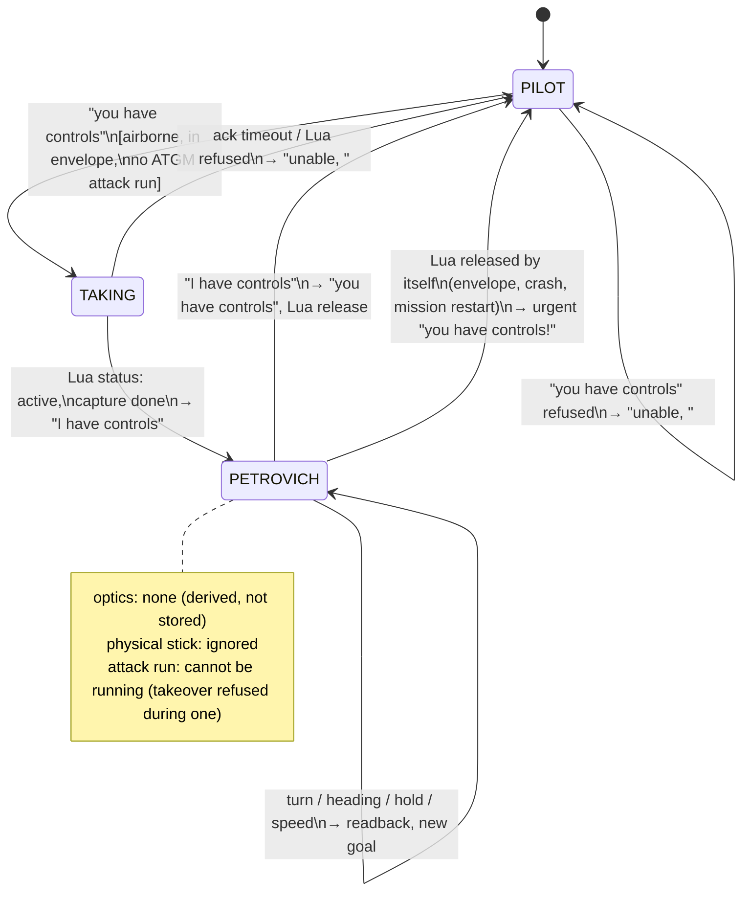
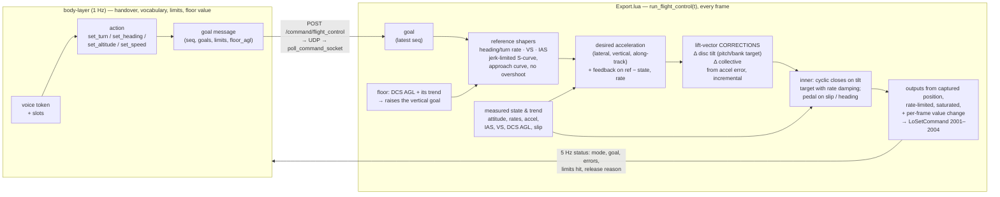
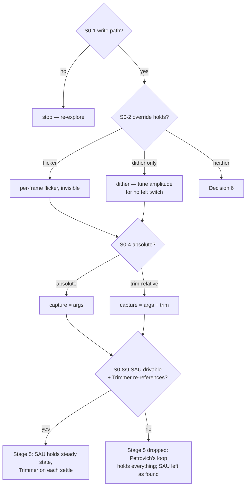

# BL-16 — Petrovich flies the helicopter: plan

2026-10-26, Architect pass, planning only. **`BL-16` stays `[>]` deferred** (user: finish 9K113
first); this plan exists so the work is ready when it is picked up, and so stage 0 can be flown
whenever convenient. Specification: `plans/flight-control/explore-notes.md` (whole file, including
both 2026-10-26 addenda) and `docs/concept/flight-control-{1,2,3}.jpeg`. Where this plan and those
words disagree, the words win and this plan is wrong.

Desk recon for stage 0: `aircraft-layer/research/2026-10-26-bl16-flight-control-desk-recon.md`
(investigator, this pass). Its findings narrow stage 0; they do not replace it. What it changed
here, all forum- or third-party-sourced and so working assumptions only:

- **Channel letters** (three agreeing forum snippets): **H = yaw, K = roll, T = pitch, B =
  altitude**. "Course mode" is H with `RouteOn`.
- **Altitude hold and speed hold are named modes** in Chuck's Guide (contents only), so "not
  implemented" is less likely than the user's recollection suggested — *how well* they hold is the
  open question. Forum: speed hold reportedly **will not engage below ~150 km/h IAS**; altitude hold
  reportedly needs K/H/T on first.
- **Trimmer vs. attitude hold: two contradictory forum claims** (hold-while-pressed then
  re-reference on release, vs. trim moves only the spring centre). Probe-only.
- **No prior art** for `LoSetCommand` flight-axis override; the one community helicopter-assist
  project **unbinds the physical axes and routes through vJoy** "to avoid double control" — a
  data point for Decision 6, not a recipe.
- **No documented getter returns helicopter control positions**; no cyclic or pedal draw-arg is
  known by number; the five never-called getters have no documented shape. All probe items.

> **Recommend an opus re-run of this role before Stage 2 is built.** The control law is the
> high-risk part of this plan, it is written here against an unmeasured plant, and stage 0's
> numbers will change it. That revision is the moment for the deeper pass, not now.

### Goal

On the spoken handover Petrovich takes the controls from where the pilot left them, keeps doing
what the aircraft was doing (a turn in progress included), and flies spoken turn / heading /
altitude / speed goals with smooth, non-overshooting corrections by a per-frame feedback loop in
Export.lua on the raw cyclic, collective and pedal axes — ignoring the physical stick, holding a
current-AGL terrain floor, with his optics off — until the pilot says "I have controls".

### Pilot-value check

The pilot gets his eyes and hands back. With Petrovich flying, **the player becomes the spotter**
(*"the one not controlling"*) and can look out, glass, or work the map without the aircraft
wandering — which ED's own AI flying, *"very badly and unreliably"*, does not give him. The first
vocabulary is what a pilot says to a crew member he trusts with the aircraft for a minute:
turn, heading, height, speed. It is also the foundation of pilot-Petrovich and of aligning for an
ATGM launch (page 2, priority 5; `[[BL-B67]]`), both of which need exactly this controller and
neither of which is in scope. **What the pilot does not get from this milestone**: manoeuvres
(*"break left"*, `[[BL-B95]]`), look-ahead terrain avoidance (`[[BL-B101]]`), hover / slow flight
(see Decision 3), navigation to a point. The value bar this plan has to clear is therefore modest
and concrete: **"I hand over in a turn at 150 m, nothing jumps, he finishes the turn on 315 at
200 m and 220, and I never fight him."** Anything that does not serve that sentence is out.

### The picture — handover (body-layer owns it)

**A Petrobrain service quitting mid-flight is unspecified behaviour** (Decision 2, user): no
watchdog, no adopt-on-restart, no emergency release. Lua resets only on DCS's own events (mission
restart, `LuaExportStop`, ownship dead).

### The picture — the control loop (Export.lua owns it, every frame)

**What the box labelled "lift-vector corrections" is, and is not** (user, 2026-10-26: *"we do not
need to know the exact values for lift vector, rather just, what needs to change compared to what is
current state and what is happening now"*). No thrust, mass or lift magnitude is ever computed. The
loop compares the **acceleration it wants** with the **acceleration it measures** and nudges the
two things a pilot moves: where the disc points (tilt target, via cyclic) and how hard it pulls
(collective). The coupling the user described falls out rather than being programmed: tilting
forward drops the vertical acceleration, so the vertical error raises collective; tilting back at
speed balloons the aircraft, so the same error lowers it. There is no "collective for altitude"
path — collective answers the acceleration error **along the lift axis**, whatever caused it. When
collective saturates, the residual vertical error moves into the tilt target (trade speed for
height), which is the user's *"the lift vector is the only control if collective is at limit"*.

### Stage 0 — measure (Windows probe; investigator desk recon done)

One probe script, `aircraft-layer/dcs-export/Export.probe-flight-axes.lua`, built on
`Export.probe-9k113-flicker.lua`'s logging/loop scaffold (not a fresh one), each test a timed
segment started by a key the pilot binds, logging every frame to its own file. **Air start,
straight and level, ~150 km/h, ~200 m AGL, over flat ground, SAU in whatever state the test card
names.** The user flies; nothing here needs body-layer.

| # | Measures | Pass | Fail → | Decides |
|---|---|---|---|---|
| S0-1 | Per-frame `LoSetCommand(2001/2002/2003/2004, v)` with a small sine on each axis in turn, hands off | aircraft responds, cockpit stick/collective/pedal args follow `v` | stop: no write path; re-explore | everything |
| S0-2 | Same, **with the physical stick held deflected, then stirred**; constant value vs. flicker (±1e-4) vs. dither, as the 9K113 found | effective control (args) stays on the written value within ±0.01 while the stick moves; no visible aircraft twitch | flicker fails but dither holds → dither; both fail → Decision 6 | override mechanism; Stage 1 |
| S0-3 | `LuaExportBeforeNextFrame` vs `AfterNextFrame` as the write site | either works; pick the one with no one-frame physical-stick leak in S0-2 | — | where `run_flight_control` is called |
| S0-4 | Is `v` an **absolute** control position or **relative to trim**? Trim with the Trimmer, then write `v = 0` | documented either way | — | capture (Stage 1): absolute → capture = current args; trim-relative → capture = args − trim |
| S0-5 | **Release**: stop writing with Petrovich's output ≠ physical stick. Does the axis snap to the physical stick at once, or only when the stick next moves? | documented only | — | nothing — the release jump is not handled (Decision 4) |
| S0-6 | Read side at frame rate: `LoGetADIPitchBankYaw`, `LoGetAngularVelocity`, `LoGetAccelerationUnits`, `LoGetVectorVelocity`, `LoGetVerticalVelocity`, `LoGetIndicatedAirSpeed`, `LoGetAltitudeAboveGroundLevel` (stands in for radar altitude — Decision 7), `LoGetAltitudeAboveSeaLevel`, `LoGetMagneticYaw` / `LoGetSelfData().Heading` **compared against the HSI heading card** (Decision 8: the getter that matches the HSI wins), `LoGetSlipBallPosition`, stick/collective/pedal draw args | every quantity the loop closes on is present and changes every frame (not 5 Hz-stepped); each getter's table `debug_dump`ed once (shapes are undocumented); a `get_argument_value` sweep while the pilot moves stick, collective and pedals finds the args that track each (none known by number for cyclic or pedals) | a quantity stepped or absent → derive it (differentiate velocity) and say so; no control-position arg → capture must use the last value written by the input channel, which Export cannot read (escalate) | Stage 2 inputs; Stage 1 capture |
| S0-7 | Response sign and rough size: a 0.05 step on each axis from trim, 2 s, back | sign, rough gain and lag per axis recorded (no plant model needed — user's addendum) | — | initial gains, rate limits |
| S0-8 | SAU from code: engage H/K/T/B via device 10 (`performClickableAction`, the `cockpit_switch` op), confirm the letter mapping against cockpit labels, observe hold; hold and release `Trimmer` while off the held attitude — re-reference on release, or fixed? Altitude (`HeightOn`/B, with K/H/T on first) and `SpeedOn` (above 150 km/h): hold or drift over 30 s? `HoverOn`, `RouteOn`: do anything? | each channel: engages yes/no, holds how well, Trimmer behaviour recorded | — | Stage 5 branch (below) |
| S0-9 | SAU vs raw writes: with K/H/T on, does a written cyclic change get fought (held back by the SAU's limited authority) or followed? | documented | — | whether SAU stays on during manoeuvres (Stage 5) |
| S0-10 | Seat: repeat S0-1 from the operator seat (player in front, Petrovich nominally "pilot") — is ED's AI pilot a second writer? | documented only | — | nothing in BL-16; recorded for pilot-Petrovich |

S0-10 is cheap while the probe is loaded and is the only seat-agnostic evidence the milestone
gathers; it does not gate anything here.

**Branches the plan carries until stage 0 lands**

### Affected Modules / Files

**aircraft-layer**
- `dcs-export/Export.probe-flight-axes.lua` (new, Stage 0) — the probe above.
- `dcs-export/Export.lua` — `handle_flight_control_command` (parse + bound-check, the
  `handle_sight_target_command` pattern: `extract_json_number_field`, whole-command reject on any
  non-finite or out-of-bound field); `run_flight_control(t)` per frame beside `run_sight_servo(t)`;
  `push_flight_control_state(t)` at the 5 Hz gate beside `push_sight_servo_state`; a flag-gated
  per-frame `push_flight_trace` to its own file (the `push_slew_trace` pattern — built in from the
  start, not bolted on after the first failure); `EXPORT_SCRIPT_VERSION` bump.
- `src/collector/command_sender.py` — `send_flight_control`; `src/api/server.py` —
  `POST /command/flight_control`, `GET /flight_control/latest`; `src/schema/flight_control.py`
  (new), `src/collector/cache.py`, `src/collector/server.py` — the status feed, same shape and
  same "second feed, different rate class" reasoning as `/sight_servo/latest`.
- `tests/test_flight_control_api.py`, `tests/test_flight_control_lua.py` (pure Lua functions under
  `lua5.1`/`luajit`, skipped without one — `test_sight_servo_lua.py`'s precedent);
  `tests/test_export_lua_constants_parity.py` gains the wire bounds.
- `aircraft-layer/CLAUDE.md` — the write surface section: a third write path that is neither fixed
  vocabulary nor "any switch": bounded flight goals only, never raw axis values from the LAN.

**body-layer**
- `src/belief/flight_control.py` (new) — `FlightControlState` (frozen) and the handover state
  machine; the **actions** (`take_controls`, `release_controls`, `set_turn`, `set_heading`,
  `set_altitude`, `set_speed` — each does one thing, explicit params, never decides when); the
  **state params** (`has_controls`, `goal`, `flight_status` — read from Lua's status feed and
  ownship instruments only); the **"when"** (refusal preconditions, takeover/release ordering, the
  floor-over-goal priority) in one function, `decide_flight_control(...)`, apart from the actions,
  so it can move into a `[[BL-B95]]` script later without touching them. New module because this
  is new state with no home: `sight_effector` is the 9K113's cockpit writes, `effector_engine` runs
  switch checklists, `attack_run` is the ATGM run.
- `src/belief/crew_console.py` — dispatch for the new tokens; readbacks and refusals via
  `belief.speech` (`"unable, <reason>"`, never "say again", for an understood-but-unavailable
  command).
- `src/belief/optic_policy.py` — `decide(...)` gains one **input** `flying: bool` (the `steady`
  precedent), which returns the suppressed / naked-eye decision before any phase logic. **Not an
  `OpticState` field**: derived from `FlightControlState` per poll, so there is nothing to carry
  across `OpticState(...)`'s construction sites (Co-moving Fields).
- `src/belief/attack_run.py` — read only: an engaged ATGM run refuses takeover (Decision 5).
- `src/body.py` — advance `FlightControlState` each poll; pass `flying` into `decide`; skip
  `write_sight_target` while flying.
- `src/aircraft_client.py` — `write_flight_control`, `get_flight_control_latest`.
- `src/belief/effector_sequences.py` — two triggers, `controls-taken` / `controls-released`, so
  any SAU switch work in Stage 5 is a `config/sequences/mi-24p/` table (BL-B90), not new code;
  `config/sequences/triggers.md` regenerated.
- `src/tuning.py` consumers / `config/defaults.toml` — the behaviour limits (below). Regenerate
  and read the **rendered** first sentence of each.
- `body-layer/CLAUDE.md` — module list; Invariants: the physical stick is ignored while Petrovich
  has the controls, and no LAN message carries raw axis values.

**audio-adapter**
- `src/vocabulary.py`, `src/command_matcher.py` — tokens `you_have_controls`, `i_have_controls`
  (plain phrases), and slotted `turn` (`left|right`, optional degrees), `turn_heading` (three digit
  words), `hold_altitude` (number, optional `metres`, optional `radar|barometric`), `speed` (three
  digit words; km/h) — slot parsers beside `parse_step_count`/`parse_clock`, same posture.
- `/command-map` skill afterwards (vocabulary changed).

**Not touched**: world-model (no terrain lookup in BL-16 — that is `[[BL-B101]]`), brain-layer.

### Behaviour constants — where each lives

| Constant | Where | Why there |
|---|---|---|
| terrain floor AGL, floor look-ahead time on the AGL trend | body-layer `tuning.py` (`belief.flight_control.*`), sent in every goal message | what Petrovich does |
| max bank for a spoken turn, max turn rate, max climb / descent VS, max along-track accel, minimum takeover IAS | body-layer `tuning.py`, sent in the goal message | what Petrovich does; the pilot will want to tune "how hard he turns" |
| handover ack timeout | body-layer `tuning.py` | how long he waits |
| shaper jerk limits, loop gains, output rate limits, saturation, flicker/dither amplitude, accel filter time constant | Export.lua, **one commented block** | how the loop closes, not what he does. **Would want the X-T26 mechanism**; outside body-layer it does not exist, so noted, not improvised (the 9K113 servo's precedent) |

Sending the limits in the goal message keeps one source of truth for behaviour (body-layer) while
the loop runs where it must (Lua). Lua bounds-checks them against hard ceilings of its own.

### Implementation Plan

**Stage 0 — measure.** As above. Output: `aircraft-layer/research/<date>-flight-axes-probe-results.md`
and a correction to `mi24p-command-surface.md` §8 (which still says "unverified for a helicopter").
**Then amend this plan** — every row marked "decides" above is a sub-decision to record here
(`Decision N REVISED` form) before Stage 1 starts.

**Stage 1 — the seam and the handover, flying nothing.** Minimal working version.
- Lua: `flight_control` op with `take` / `release` / `goal`. `take` captures the current control
  positions (per S0-4) and starts writing **exactly those values** every frame with the S0-2
  mechanism — Petrovich "holds the controls still". `release` stops writing at once (Decision 4).
  Mission restart / `LuaExportStop` / ownship dead → release and reset. No watchdog (Decision 2).
- Body-layer: `FlightControlState`, the two tokens, refusals (not airborne, below min IAS, Export
  too old, ATGM attack run engaged), ack wait, "I have controls" only after Lua's status says
  `active` (the speech states a fact Lua confirmed, not an intention), optics off via `flying`.
- Tests: state machine transitions (every row of Co-moving Fields); Lua capture continuity
  (`u(t0) == captured`, bit-exact) and bounds rejection; API validation.
- **Flight 1** (test card, named branch): level flight, SAU on, hand over, stir the stick, hand
  back. Pass: no jump at takeover, the stick is ignored, release behaves as S0-5 predicted, optics
  stop and resume, speech in the right order.

**Stage 2 — hold the current state (priorities 2 and 3).** The controller.
- Lua: shapers, desired-acceleration feedback, lift-vector corrections, inner tilt loop, pedal
  coordination, saturation priority (floor > altitude > speed), envelope monitor (Decision 3).
  On `take`, goals = current turn rate, current IAS, current altitude (Decision 1); shaper state
  initialised to current value **and current rate** so the reference starts where the aircraft is —
  this is what makes a turn in progress continue rather than roll out.
- Offline: Lua tests against a deliberately crude toy plant (point mass, first-order attitude lag,
  sign/size from S0-7) asserting **no overshoot beyond ε** on step goals, monotone approach, output
  continuity at takeover, saturation behaviour. The toy plant proves the shaper and the wiring, not
  the tuning; the flights tune.
- **Flight 2**: take over straight, then mid-turn, then climbing. Pass: turn continues at its rate,
  altitude and IAS held within bands the user sets after S0-7, no oscillation visible on the
  per-frame trace (the `sortie-log-triage` skill gains a flight-trace section).

**Stage 3 — terrain floor from current AGL.** In Lua, every frame: if DCS AGL
(`LoGetAltitudeAboveGroundLevel`, standing in for radar altitude — Decision 7) plus its trend ×
look-ahead falls below the floor, the vertical goal is raised to the floor, over any spoken
altitude; for a barometric goal the floor is converted through the current AGL-minus-baro
difference. Body-layer sends the floor value and says, once per event, that he is climbing for
terrain. **Flight 3**: hold 60 m over rising ground.

**Stage 4 — the first vocabulary.** Slots in audio-adapter; `set_turn` (relative degrees, or
continuous when no degrees), `set_heading` (shortest way unless a direction was spoken; the
heading the HSI shows — Decision 8), `set_altitude` (radar, i.e. DCS AGL, by default — Decision 9),
`set_speed` (km/h IAS); short readback on every accepted command (Decision 10), no callout when
the goal is reached, "unable, <reason>" on refusal (below the floor, outside limits). A new goal never resets the shaper: the S-curve continues from the current
reference value and rate, so a heading changed mid-turn bends smoothly. **Flight 4**: the
sentence in the pilot-value check.

**Stage 5 — SAU for the steady state (branch, gated on S0-8/9).** If the SAU can be driven and
Trimmer re-references it: once every shaper has settled, press Trimmer (the `cockpit_switch` op) so
the SAU holds the attitude Petrovich arrived at, and let his loop work only on what the SAU cannot
hold (altitude, speed — per the user, poorly or not at all). Channel engagement on takeover via a
`controls-taken` sequence table. If not: this stage is dropped, the controller already holds
everything, and the plan says so.

**Stage 6 — tune and accept.** Flight-to-flight retunes of the Lua block, bands written into
`docs/acceptance/`, `BL-16` acceptance against the explore notes' settled points 1–8.

Performance and Security run once per batch of stages built together (root `CLAUDE.md`); Security's
plan review should look first at the new write path (bounded goals only, loopback socket) before
Stage 1.

### Co-moving Fields

Trigger fires: a mode machine with fields on both sides of a LAN seam, written externally (pilot
voice) and internally (Lua envelope, body-layer refusals). `FlightControlState` and the
Lua `fc` table are new, so there are no construction sites yet to grep; **the Implementer greps
`FlightControlState(` and every assignment to Lua `fc.` after Stage 1 and extends this table with
any site not listed** (step 6a's own lesson). The existing type in scope is `OpticState`
(`optic_policy.py` constructs it fresh at ~2689 and ~2768) — this design keeps `flying` out of it
on purpose, so those sites cannot drop it.

| Field | Written by | Transition | Must hold true after |
|---|---|---|---|
| body `phase` | internal | "you have controls" accepted (no ATGM attack run engaged — Decision 5) | `TAKING`; `take_sent_sim` set; Lua `take` sent with current limits and floor |
| body `phase` | internal | Lua status `active` with matching `take_seq` | `PETROVICH`; "I have controls" queued exactly once |
| body `phase` | internal | ack timeout or Lua `refused` | `PILOT`; Lua told `release` anyway (idempotent); "unable, <reason>" |
| body `phase` | external (voice) | "I have controls" | `PILOT`; Lua `release` sent; "you have controls" spoken |
| body `phase` | external (Lua) | status `released` with a reason while `PETROVICH` | `PILOT`; urgent "you have controls!" with the reason |
| `flying` (derived) | — | any of the above | `== (phase in {TAKING, PETROVICH})`; no sight-tier or binocular percept that poll; `write_sight_target` not called |
| attack run | external (voice) | engage requested while `flying` | refused — the run needs the optics he has stopped using (Decision 5's mirror) |
| body `goal`, `goal_seq` | external (voice) | new goal | `goal_seq` +1; Lua applies only `seq > last_seq` |
| Lua `fc.mode` | external (`take`) | take | `active`; `fc.out_* == captured_*` bit-exact on the first written frame |
| Lua shaper states | external (`take`) | take | value = measured, rate = measured rate; integrators 0 |
| Lua shaper states | external (`goal`) | new goal | **unchanged** (no reset); only the shaper targets move |
| Lua `fc.mode` | external (`release`) | release | `off`; no write this frame or after; S0-5 behaviour |
| Lua `fc.mode` | internal | `LuaExportStop`, model time jumps back (restart), ownship dead | `off`; all `fc` state reset; status reason |
| Lua `fc.*` | internal | pause (`dt <= 0`) or `dt` > cap | outputs unchanged and still re-written (override must not lapse); integrators frozen |

### Risks & Unknowns

- **The override may not hold against a stick that is moving.** Everything rests on S0-2. If DCS
  applies the physical joystick after Export's write, or the per-frame value change shows as a felt
  twitch, the "stick is ignored" requirement cannot be met by this mechanism (Decision 6).
- **Release is the inverse jump, accepted as is** (Decision 4): a known joystick limitation, no
  DCS-to-joystick channel exists. The pilot matches his controls, as in any DCS seat change.
- **Misrecognised handover.** "You have controls" and "I have controls" differ in one word, and
  misreading one as the other while Petrovich flies hands an unflown aircraft back. Mitigation in
  the plan: both tokens act only from the act band, never the confirm band without a "yes"; the
  state-dependent reading (the token that would be a no-op in the current state is answered as a
  restatement, not acted on) turns most misreads into a harmless readback.
- **Controller tuned on one aircraft state.** Gains found at 150 km/h / mid weight may ring at
  250 km/h or heavy. Stage 6 must fly the corners of the envelope the user actually uses
  (50–800 m AGL, cruise speeds), not one point.
- **Asymmetric yaw** (user): right-pedal margin is small at low speed and a collective increase
  eats it. The pedal output carries a direction-dependent limit, and a collective increase is
  rate-limited when right pedal is near it. Untested until Flight 2.
- **SAU behaviour is the user's recollection plus an older document** — Stage 5 may vanish.
- **DCS AGL is terrain truth, not an instrument** (Decision 7). Accepted by the user as the
  workaround for radar altitude; it is a deliberate, named exception to the no-omniscience line,
  confined to the floor and the radar-referenced hold.
- **Model time while paused** keeps advancing per `aircraft-layer/CLAUDE.md`; the loop must use
  model-time `dt` and not integrate through a pause as if flying (Co-moving Fields' last row).
  Include a paused-state check in Flight 1, as that file requires.
- **Scope creep toward manoeuvres.** "Break left" is one shaper limit away once Stage 4 exists;
  it stays out (`[[BL-B95]]`) by user direction.

### Second-order effect

Unblocks pilot-Petrovich and the ATGM launch alignment (page 2, priority 5; `[[BL-B67]]`): both
become a new **goal source** for the same Lua loop, not a new controller — which is why the goal
message carries goals and limits rather than "turn" commands. It also makes `[[BL-B95]]`'s action
catalogue concrete: the six flight actions are its first non-cockpit actions. It complicates
nothing in 9K113, except that an engaged ATGM attack run now refuses handover (Decision 5).

### Decisions (user, 2026-10-26)

All ten settled in the plan review. The user's words are quoted where they carry the reasoning;
the Architect's options and recommendations are in git history (`ca818317`).

1. **Climb or descent in progress at takeover: level off smoothly** at the altitude reached; the
   turn continues; current IAS held. (Agreed with the recommendation.)
2. **A Petrobrain service quitting is unspecified behaviour.** *"If any of Petrobrain service quit,
   behaviour is unspecified. Don't plan for contingencies at this stage."* No watchdog, no
   adopt-on-restart, no emergency release button. Lua still resets on DCS's own events (mission
   restart, `LuaExportStop`, ownship dead) — those are not service contingencies.
3. **Forward flight only** for the first build: minimum takeover IAS (tunable, ~80 km/h), speed
   goals clamped to it. (Agreed.)
4. **Release jump: not handled.** *"This is a known problem with joysticks, there is no DCS to
   joystick channel."* Release stops writing at once; no trim transfer, no collective callout.
   S0-5 is recorded only.
5. **Takeover is refused during an ATGM attack run** — *"unable, <reason>"*. No missile-in-flight
   tracking needed. Mirror case (an attack run requested while he flies) is refused as well,
   because his optics are off; that follows from settled point 2, not a separate decision.
6. **Stick override: measure first** (S0-2), explore options only if it fails.
7. **Use DCS AGL** (`LoGetAltitudeAboveGroundLevel`). *"That is acceptable workaround for radar
   alt."* It stands in for the radar altimeter wherever this plan needs one: the terrain floor and
   the radar-referenced altitude hold. A named exception to the no-omniscience line, scoped to
   flight control.
8. **"Turn heading" uses whatever the HSI shows.** *"Whatever the HSI uses."* S0-6 compares the
   candidate getters against the HSI heading card and the matching one is used.
9. **Altitude reference defaults to radar** (i.e. DCS AGL, Decision 7). The readback says
   *"barometric"* only when barometric is in use; radar is unspoken.
10. **Short readback for every command; no callout when the goal is reached.** The user's examples:

    | command | readback |
    |---|---|
    | turn left 20 degrees | *"20 left"* |
    | speed 2 2 0 | *"speed 2 2 0"* |
    | altitude 300 m | *"300 meters"* |
    | altitude 300 m barometric | *"300 meters barometric"* (Decision 9) |

    Turn heading and a turn with no degrees are not in the examples; the Implementer follows the
    same shape (number first, no filler) and the readback strings go in the test card for the user
    to hear.

