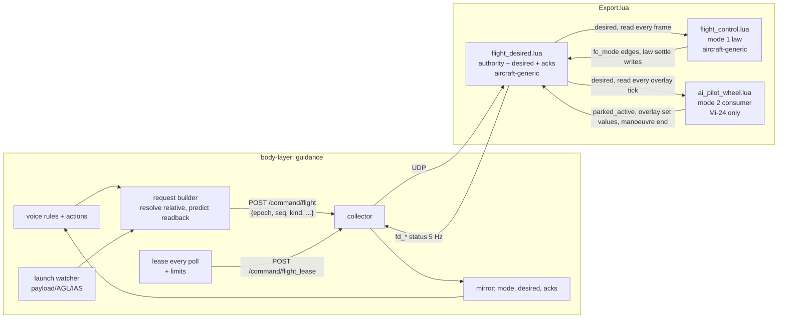

# BL-16 — one desired flight state, one mode authority: plan

Architect pass, 2026-11-20. Branch `feature/bl16-desired-state`, base `e4792254`.

Inputs read in full: `explore-notes.md` and `alignment.md` (this directory), `docs/acceptance/
2026-11-20-sortie-feedback.md`, `body-layer/ROADMAP/BL-16.md` (open items), `plans/flight-control/
plan.md` (Decisions 13, 21–27, 32), `plans/flight-control/debug.md` (2026-11-20 reports),
`plans/flight-control/implementation.md` (the reset and fail-loud sections), and the code named in
the brief. The coordinator's mid-task note (mode 2 is Mi-24 specific, see "The mode-2 seam") is
part of the brief.

### Goal

Export.lua becomes the only place that holds **what Petrovich is trying to fly** (one desired
heading/turn, altitude with its reference, and speed) and **who is flying and how** (off / mode 1 /
mode 2). Mode 1's control law and mode 2's wheel presses both fly that one desired state.
Body-layer becomes guidance only: it turns spoken commands and its manoeuvre logic into numbered
requests on one channel, and reads the mode, the desired state and each request's
accept/refuse from the polled status.

### Verdict on the architecture call

**It stands.** Nothing found breaks it. Four refinements, each needed to make it work:

1. **Relative commands are resolved in body-layer; the wire carries absolute values only.**
   "Turn left 30", "climb 50" and "speed up" become an absolute heading, altitude or speed before
   they are sent. The readback then names exactly the value Lua will hold (E2). Lua stays a store
   plus two controllers, with no command grammar. Body-layer resolves against the desired-state
   mirror with its own unacknowledged requests applied on top (`predict_desired`, Stage 3). That
   prediction feeds speech only and holds no authority. It is a few hundred ms stale at worst, and
   the band covers that.
2. **Mode 2's one-parameter-at-a-time rotation moves from body-layer into Lua.** The rotation
   needs to know every outstanding desired value at once, and those values now live in Lua.
   Keeping it in body-layer would mean keeping a second copy of the goals, which is the defect
   being removed.
3. **The `arm` message goes away.** Lua arms itself on every park edge while body-layer's lease is
   fresh, and the lease becomes an unnumbered heartbeat. Body-layer never states the mode, which
   is the user's rule. Q6 (after a restart while parked, an unpark gives the player the stick)
   follows from this: a reset clears the arm, and only a park *edge* sets it again.
4. **Align-for-launch's pre-align snapshot disappears.** The dive writes nothing to the desired
   state, so the desired altitude and speed *are* the pre-align values. Recovery becomes "stop the
   dive and fly the desired state again, altitude first". This deletes `FlightSnapshot`,
   `seed_recovery_goal` and most of `align_phase`.

One finding that changes the plan: **the heading reference is not settled.** Mode 1 flies true
heading (`LoGetSelfData().Heading`). Mode 2's overlay course, and the HSI the player reads, are
probably magnetic. On the Caucasus that is a 7.3° difference
(`aircraft-layer/research/2026-11-18-bl16-m0-flight-axes-findings.md`, "The HSI check is still
owed"). Today's unpark seed already copies the overlay course into mode 1's true-heading law, so
an unpark may carry a 7° error *now*. One desired heading needs one reference. See U3 and Stage 1.

### The picture



```mermaid
stateDiagram-v2
  OFF: off - player flies
  TK: taking (voice take, capture pending)
  M1: m1 - Petrovich, raw axes
  M2: m2 - Petrovich, AI overlay
  OFF --> TK: take request accepted
  TK --> M1: capture done - RESEED desired from law init
  OFF --> M2: park edge - RESEED desired from overlay once takeover settles; arm if lease fresh
  M1 --> M2: park edge - CARRY desired; self-arm
  M2 --> M1: unpark, armed, preconditions ok - CARRY desired (Q4 break finishes)
  M2 --> OFF: unpark not armed / refused - urgent "You have controls!"
  M1 --> OFF: release request / envelope / NaN / dead
  TK --> OFF: release / capture failed
  M2 --> M2: reset - desired reseeded from overlay, arm cleared (Q6)
  M1 --> OFF: reset - lets go
```

**The rule underneath (C1):** a change of *who* flies (off→anything) reseeds the desired state from
the aircraft. A change of *how* Petrovich flies (m1↔m2) carries it. A transition to off clears it.
Mode 2's own sub-modes (FLT/HVR/HVRT/CBTM) sit below the authority and never count as a mode change.

### 1. The desired state

**Lua, `flight_desired.lua`, one table `desired`** (a table, not locals, to protect the 200-local
budget):

| field | units / values | written by | meaning |
|---|---|---|---|
| `hdg_mode` | `"heading"` / `"turn"` / `nil` | requests, seed, law settle | `nil` = not yet known (gates HOLD) |
| `heading_deg` | 0–360, **HSI reference** (U3) | `set`, seed, roll-out settle, align end | the target heading (`hdg_mode="heading"`) |
| `turn_dir` | -1 / +1 / `nil` | `set` | direction of the change; `nil` = shortest way. Needed for break away's 180° |
| `turn_rate_deg_s` | deg/s, signed | `set` (break), seed (inherited turn), `turn` | with `heading`: the rate override (Decision 27), `nil` = normal rate. With `turn`: the continuous rate |
| `turn_style` | `"normal"` / `"break"` / `"break_away"` | `set` | mode 2's choice of presses. Mode 1 ignores it (the rate carries the meaning) |
| `alt_m` | metres | `set`, seed, hover step | target altitude, **exact** as commanded (E2) |
| `alt_ref` | `"agl"` / `"baro"` | `set`, seed | always explicit. Q3: body-layer sends `"agl"` unless "barometric" was spoken |
| `ias_kmh` | km/h, ≥ 0 | `set`, seed, hover hold | exact as commanded; mode 2's step snapping never written back (Q1a) |
| `stamp.hdg` / `.alt` / `.spd` | request seq | every write | which request last wrote each part: mode 2's priority, and "written after the take" protection |
| `manoeuvre` | `none`/`break`/`break_away`/`align`/`align_for_launch`/`launch_aligned`/`recovering`/`translate` | Lua only | what is running now. Reported, never written by body-layer |
| `manoeuvre_seq` | int | Lua | the request that started it |

**Aircraft limits shape the desired value; mode limits shape only how it is flown** (alignment,
"Which mode limits apply"). Body-layer clamps a mode-1 speed into [`MIN_IAS_KMH`, `MAX_IAS_KMH`]
and an altitude to the AGL floor **only when it writes the request in mode 1**, as today
(Decision 14). Mode 2's speed steps and 700 m radar cap are never written into the desired state.
A value carried across a mode change that the new mode cannot fly exactly (mode 2's "speed 0"
reaching mode 1) is clamped by the flying mode at the moment it flies it. The desired value is not
rewritten. What the pilot hears about that is U2.

**Wire, `fd_*` status line (5 Hz, new route key `fd_mode`).** It carries every field above, plus
the authority fields from section 2 and `fd_epoch`, `fd_last_seq` and `fd_acks` from section 5. It
also carries the measured heading (HSI reference), AGL, MSL and IAS, which body-layer needs to
resolve "current" and relative values, and `fd_has_m2` (see "The mode-2 seam"). Integers are
encoded as integers. `fmt_num_or_null` blanket-formatting killed the fc line for a day
(`.claude/agent-memory/dod/project_recurring_unguarded_nonfinite_float_before_conversion.md`), so
the schema test asserts the exact encoding of each field.

**Who reads it:** `flight_control.lua` every frame, and `ai_pilot_wheel.lua` every 5 Hz overlay
tick, both through `flight_desired.get()`, read-only. Body-layer reads it from the mirror. The
existing `fc_goal_*` echo and `held_targets()` are deleted (Stages 3 and 4).

### 2. Mode authority

**Lua derives the mode every frame; nothing sets it directly.** `flight_desired.tick(t)` runs from
`LuaExportBeforeNextFrame`, right after `run_flight_control`. It reads `fc_mode` (already
off/taking/active/armed) and `ai_pilot_wheel.is_parked()`, and derives:

`fd_mode = "m2" if parked_active` else `"m1"` if fc_mode = active, `"taking"` if fc_mode = taking,
otherwise `"off"`.

It detects edges itself and records `fd_mode_n` (incremented on every change) and `fd_mode_cause`
(`take`/`release`/`park`/`unpark`/`unpark_refused`/`unpark_unarmed`/`envelope`/`nan`/`dead`/
`reset`/`stop`). Deriving the mode, rather than adding a setter at each of `flight_control.lua`'s
twelve `fc_mode =` sites (lines 1554–1956) and `ai_pilot_wheel.lua:1388`, means no construction
site can forget to notify. The edge handler is also where seeding and clearing run (section 4).

**Arming moves into Lua (refinement 3).** On a park rising edge, `fc_mode` goes to `armed` if
Petrovich was in m1, as it does today, **or if he was off and the lease is fresh**. The second
clause replaces body-layer's `arm` message: the 2026-11-17 answer means every park gives him the
overlay, and U5 means every unpark from it goes to mode 1. After `reset(epoch)` while parked,
`armed` is cleared and nothing re-arms it until the next park edge. That is Q6.

**Lease:** `{"op":"flight_lease","epoch":E,"limits":{...}}`, unnumbered and sent every poll
(today's `arm` resend cadence, U10). It refreshes `fc_arm_last_t` and carries the `limits` block
that today rides every `flight_control` message. Lua ignores a lease whose epoch is not its own.

**Body-layer: what is deleted, kept and changed**

| item | fate |
|---|---|
| `FlightControlPhase`, `FlightControlState.phase/take_seq/took_at_sim/unpark_take/wire_seq/lua_last_cmd_seq` | **deleted** (Stage 2 phase, Stage 3 seqs) |
| `decide_flight_control`'s six branches | **replaced** by `decide_flight_speech(prev_mirror, mirror, pending)`: speaks on `fd_mode_n` changes (urgent "You have controls!" for any change into off whose cause is not `release`/`stop`/`reset`, per E8) and on request outcomes (section 3) |
| `take_controls`/`release_controls` pure fns | **become request builders**. The body-side refusals stay as guidance: `ON_GROUND`, `TOO_SLOW`, `ATTACK_RUN_ENGAGED`, and the overlay no-op. Lua re-checks IAS/AGL on a voice take too (today it trusts the voice take), reusing `check_unpark_preconditions` |
| `CrewConsole.flight_mode()` | **kept, reduced to a map of the mirror**: m2→`"overlay"`, m1/taking→`"axes"`, off→`None` |
| `CrewState.has_controls` | **mirror**: `fd_mode ≠ off`, **or a take request is pending and unacknowledged**. The second clause keeps "you have controls, heading 090" working in one breath, as `TAKING` does today. It describes a request in flight, not a mode. Lua orders the two requests by seq |
| `CrewState.held_*` | the **desired** mirror, falling back to measured when `hdg_mode` is nil |
| `ParkedFlightState` | **kept** as the overlay mirror (held_* overlay text, ai_mode, seat, takeover diagnostics, payload counts). Its goal/align/cbtm/order fields are **deleted** (Stage 4) |
| `FlightControlState` | **kept** as the mode-1 diagnostics mirror (in_band, slip ball, measured, takeover_mode) |
| `_resolve_command_reset` | **kept, widened**: re-sends the reset whenever `fd_epoch` ≠ own epoch, not only until the first confirmation. This also covers a DCS-side reload of Export.lua (see Risks) |

**Handover, restated over one state**

| event | mode | desired state after |
|---|---|---|
| "you have controls" (off) | off→taking→m1 | reseeded from `law_init_at_take` (Decision 1 REVISED: under 5° of bank hold the heading, else a `turn` at the measured rate; stopping height; measured IAS), **except parts stamped after the take's seq** |
| "I have controls" (m1/taking) | →off | cleared |
| "I have controls" (m2) | m2, unchanged | unchanged. Lua refuses `wrong_mode`; "Unable, AI overlay." (U9) |
| park from off | off→m2 | reseeded from the overlay's set values once the P1 takeover settles: course, the corrected altitude and reference, the speed step. HOLD until then (Q12) |
| park from m1 | m1→m2 | **carried**. A `turn` is converted to `heading` = the overlay course after takeover (ED rolls level, probe v2; mode 2 cannot hold a continuous turn, so the turn must not come back at the next unpark: Q2's logic) |
| unpark, armed | m2→m1 | **carried**: the law is initialised with desired as the seed (Decision 32 and Q4 fall out: a break's heading, rate and style are in desired) |
| unpark, refused/unarmed | m2→off | cleared, urgent line |
| seat swap to pilot while parked | m2→m1 (Q5: always unparks) | as unpark |
| seat swap to copilot, auto-AI setting | m1→m2 or off→m2 | as park (after `AI_PILOT_SEAT_CHANGE_SETTLE_S`) |
| envelope/NaN/dead | m1→off | cleared, urgent line |
| body-layer reset | m1→off; m2 stays, disarmed | m1: cleared. m2: reseeded from the overlay (E10) |
| mission restart (`on_stop`) | →off | cleared |

### 3. Mode 2 as a consumer

`ai_pilot_wheel.lua`'s goal tick stops reading wire-fed targets. Every overlay tick it computes
**what mode 2 will fly** from the desired state, using one pure function, `m2_flown(desired, agl)`:

- **heading:** desired heading. `hdg_mode="turn"` cannot occur in m2, because the park converts it.
- **speed:** the nearest wheel step to `ias_kmh` (steps `0,60,120,150,200,250`, MAX above the
  top). The steps travel in `limits`, from body-layer's existing tunable `AI_PILOT_SPEED_STEPS_KMH`.
- **altitude:** `alt_m` in `alt_ref`, except that agl ≥ 700 m (`AI_PILOT_QUICK_PATH_MAX_AGL_M`)
  flies the same number barometric. This is today's 700 m rule.

It then presses toward the first part whose overlay set value differs from `m2_flown`. Heading,
and altitude to the nearest metre, use the exact-set tolerances from tonight (0.5); speed must
match the step exactly. **Priority:** the highest `stamp` first, so the latest command wins (E3).
Ties go altitude, then speed, then heading, which gives recovery's altitude-before-speed order for
free. `AI_PILOT_GOAL_SLICE_S` (sent in `limits`) still rotates between parts while more than one
differs, except while `manoeuvre="recovering"`. These are the rules `decide_ai_pilot_wheel` holds
today, moved, not new ones. Mode cycling (FLT/HVR), the bounded retry and `mode_blocked` are
unchanged.

**What it cannot fly (Q1a):** body-layer predicts `m2_flown` with the same function (body-side
twin, same constants, parity-tested) and **reads back what mode 2 will fly**: "speed 2 2 0" is
read back as "Speed 2 0 0.", and "altitude 900 radar" as "900 meters barometric.". The exact value
stays desired. Lua does not refuse approximations.

**What it cannot do at all (Q2):** continuous "turn left/right", and the mode-1-only manoeuvres.
Body-layer refuses from the mirror before sending ("Unable, AI overlay."). If the mirror was stale
and the request reaches Lua in m2, **Lua refuses the whole request** (`refused:wrong_mode`) and
changes nothing. Body-layer then speaks the refusal. An "unable" never writes the desired state.

**How a refusal and a readback reach the player.** Every numbered request is acknowledged in
`fd_acks` (section 5). Readback policy, **U1**: body-layer speaks the predicted readback at
once, as today. When the ack comes back `refused`, it speaks "Unable, <reason>." If no ack
arrives within `HANDOVER_ACK_TIMEOUT_S` (existing, 2 s, reused for every request), it speaks
"Unable, not ready." and drops the request, which is lost if it never arrived. The voice take
keeps Decision 22's contract: "I have controls." is spoken only when `fd_mode` reaches m1 for that
seq. **`[[BL-B122]]` (a failed `ai_pilot_goal` write marked sent) is closed by construction** and
should be marked so when Stage 4 merges.

### 4. Manoeuvres

| manoeuvre | how it is expressed | mode 1 flies | mode 2 flies | desired state after |
|---|---|---|---|---|
| heading / compass / "turn x left/right" | `set` heading (absolute, resolved body-side), style normal | law | goal tick | heading = target |
| "turn left/right" (no degrees) | `set` `turn=±1` | law (rate at `max_turn_bank_deg`) | **refused**, unable | `hdg_mode=turn` |
| "stop turn" | `set` `turn=0` | law rolls out, then **Lua writes** heading = where the roll-out settled (Decision 12) | heading = overlay course now (body-side) | heading |
| altitude / step / hold altitude | `set` alt (+ref), absolute | law | goal tick | alt |
| speed / step / max | `set` ias, absolute (MAX = `MAX_IAS_KMH` in m1, the sentinel in m2) | law | goal tick (snapped) | ias exact |
| "level flight" | `set` all three = current measured | law | goal tick | all three |
| **break left/right** (C3) | `set` heading = measured ± 90, `turn_dir`, `turn_rate_deg_s = ±BREAK_TURN_RATE_DEG_S` (flight.lua), style `break` | law, rate override (Decision 27). The **settle clears the override**, and Lua writes `turn_rate=nil`, style normal | CBTM long press (today's `ai_pilot_cbtm`), started because the newest heading write has style break. When the press releases: cycle to FLT and trim the course to the desired heading (the sortie's "should have changed to FLT") | heading = break heading. It replaces every older heading (F-P7 automatically) |
| **break away** | as break, ±180 **left**, style `break_away` | same | two presses + gap, as today | heading = entry − 180 |
| **align** (m2 only) | action `align` | refused, unable (E-P20) | CBTM align tap. Lua sets `manoeuvre=align`. **When it ends, Lua writes heading = overlay course** (alignment Q7) | heading = aligned heading |
| **align for launch** (m2 only) | action `align_for_launch` | refused | CBTM up press. `manoeuvre=align_for_launch`, then `launch_aligned`. Writes nothing | alt/speed unchanged = pre-align values (refinement 4) |
| **recovery** | body-layer's launch watcher (payload drop, `AI_PILOT_RECOVER_AGL_DROP_M` below the AGL recorded at the align-for-launch request, `AI_PILOT_RECOVER_IAS_CEILING_KMH`) sends action `recover` while the mirror shows `launch_aligned` | n/a | ends the CBTM episode. Lua writes heading = overlay course (keep the aligned heading), **re-stamps alt and speed with the recover seq** so they press next, altitude first (Decision 26, by tie order). `manoeuvre=recovering` until both match | pre-align alt/speed, aligned heading |
| HVRT translate / hold / step | actions `translate{dir}`, `hover_hold`, `hover_step{up\|down}` (m2 only; m1 refuses, as today `NOT_READY`) | refused | as today. `translate` pauses the goal tick. **Any `set` ends a translate** (latest wins, today's arbitration) | translate writes nothing. `hover_hold`: Lua writes ias = 0, heading/alt = overlay set values. `hover_step`: Lua writes alt ± 2 m |
| take / release / park / unpark | `take`/`release` requests, cockpit edges | — | — | section 2 |

**Latest wins, in one sentence:** any request newer than the running manoeuvre's `manoeuvre_seq`
ends that manoeuvre's remaining presses. This is tonight's Lua rework generalised, and body-layer's
`command_order_seq`/`cbtm_action_order`/F-P7 code is deleted.

**Unpark during a manoeuvre:**
- **break:** mode 1 finishes it (Q4).
- **align:** treated as ended. Lua writes heading = measured.
- **align for launch / recovering:** the abort. Mode 1 flies desired alt and speed (the pre-align
  values) with heading = measured. This is the alignment's recommendation, and mode 1 never holds
  the bottom of the dive.

All of these run in the m2→m1 edge handler before `law_init_at_take` reads desired.

### 5. One running number

**`{"op":"flight","epoch":E,"seq":N,"kind":K,...}`** replaces `flight_control`
(goal/take/release/arm), `ai_pilot_goal` (goal fields, `hvrt_*`, `cbtm_*`) and their three seq
spaces. Kinds: `set`, `take`, `release`, `align`, `align_for_launch`, `recover`, `translate`,
`hover_hold`, `hover_step`.

- **One body-layer counter, `ConsolePerceptionRunner.command_seq`, for the whole process.**
  It is preserved across mission restarts and never reused. "Mission-wide" is satisfied strictly.
  Nothing reconciles against Lua's floor any more: the `wire_seq = max(...)` fix-up and
  `lua_last_cmd_seq` are deleted.
- **Lua applies a request only if `epoch == fd_epoch` and `seq > fd_last_seq`.** It acknowledges
  every request it receives in a ring of the last 8: `fd_acks = "N:a;N+1:r:wrong_mode;..."`.
  Reasons are a closed set: `wrong_mode`, `not_flying`, `bounds`, `epoch`, `stale`, `precondition`.
  A refusal applies nothing (whole request, the `[[AC-B14]]` posture); the API checks closed
  vocabularies and `math.isfinite` first, and Lua checks again.
- **The reset epoch:** `reset(epoch)` sets `fd_epoch`, sets `fd_last_seq = 0` and runs both
  modules' `on_stop` as today. Body-layer's counter keeps counting from where it is, which is fine
  because every value is above 0. Body-layer re-handshakes whenever the echo differs, which covers
  a body-layer restart (new epoch), and an Export.lua reload on mission or DCS restart (echo
  becomes null). The `sight_target`/`cockpit_switch`/... channels carry no seq and stay as they
  are.
- The unnumbered `reset` and `flight_lease` ops are idempotent by design, as `reset` is today.

### 6. The mode-2 seam (Mi-24 only)

The desired state, the authority, the channel and mode 1 are aircraft-generic. Mode 2 is one
optional consumer behind one seam per layer:

- **Lua:** `ai_pilot_wheel.lua` is the only file that knows the wheel exists. `flight_desired.lua`
  reads it only through `ai_pilot_wheel ~= nil and safe_call(ai_pilot_wheel.is_parked)` (today's
  "unknown is never a licence to assume" posture) plus three callbacks it exports:
  `overlay_seed()`, `on_desired_written(parts)` and `manoeuvre_kind_supported(kind)`. If
  `ai_pilot_wheel` is nil, `fd_has_m2=false`, `fd_mode` is never m2, park edges never happen, and
  every m2-only kind is refused `wrong_mode`. Deciding *when* to load it (an aircraft-type check in
  `Export.lua`'s loader) is the future-aircraft milestone, not this one. The seam is the nil check.
- **Wire:** `fd_has_m2` on the fd line. The `apw_*` line simply never appears for another aircraft.
  Every `fd_*` field is meaningful without mode 2.
- **Body-layer:** `flight_mode()` never returns `"overlay"` unless the mirror says m2.
  `_by_mode`'s overlay bodies, `m2_flown`, the launch watcher, `ParkedFlightState` and the
  CBTM/HVRT rules are all reached only through `"overlay"`. Rules and gates need no aircraft check:
  a mode-2-only command on an aircraft without mode 2 lands in the axes body, which already answers
  unable. The mode-2 Python moves into `belief/ai_pilot_wheel.py` only (no new module), so
  isolating it later is a file boundary that already exists.

### Affected modules / files

**aircraft-layer**
- `dcs-export/Petrobrain/flight_desired.lua` — **new**, aircraft-generic: desired table, authority
  tick, edge handler (seed/carry/clear), `flight` and `flight_lease` handlers, acks, `reset`,
  `on_stop`, `fd_*` push, `get()`. Justified as a new module: it removes the duplication of two
  goal stores, two command channels and three seq spaces, and it keeps the authority aircraft-
  generic and outside the Mi-24 file.
- `dcs-export/Export.lua` — load `flight_desired` before `ai_pilot_wheel`/`flight_control`.
  Call `flight_desired.tick` after `run_flight_control`, `push_state` at 5 Hz, and include it in
  `on_stop`.
- `dcs-export/Petrobrain/flight_control.lua` — reads desired, applying changed parts by stamp
  (replaces `apply_goal_fields`). `law_init_at_take`'s seed comes from desired (rate override and
  style too). Self-arm from off. Voice-take precondition check. Settle writes back to desired.
  Delete the `goal`/`arm` handlers, `fc_goal_*` and the `held_targets` call.
- `dcs-export/Petrobrain/ai_pilot_wheel.lua` — goal tick reads `m2_flown(desired)`, with priority
  and rotation. CBTM is started by break style or an action kind. Manoeuvre-end writes. Delete
  `handle_ai_pilot_goal_command`'s goal/cbtm fields and `held_targets`. Export the seam callbacks.
- `dcs-export/Petrobrain/commands.lua` — `flight`, `flight_lease`. Retire `flight_control`
  (Stage 3) and `ai_pilot_goal` (Stage 4). `reset` also calls `flight_desired.reset`.
- `src/schema/flight_desired.py` (new), `src/collector/{cache,server,command_sender}.py`,
  `src/api/server.py` — `GET /flight_desired/latest`, `POST /command/flight`,
  `POST /command/flight_lease`, validation, and retiring the two old POSTs in their stages.
- `aircraft-layer/CLAUDE.md` — the write-path bullets.

**body-layer**
- `src/belief/flight_authority.py` — **new**: `FlightAuthorityState` mirror (single construction
  site `advance_flight_authority`), `DesiredMirror`, `PendingRequest`, `predict_desired`,
  `match_acks`, `decide_flight_speech`, request builders.
- `src/belief/flight_control.py` — shrinks to the limits/constants, clamps, the mode-1 diagnostics
  mirror and the readback helpers.
- `src/belief/ai_pilot_wheel.py` — shrinks to the overlay mirror, `m2_flown` (the twin), and the
  launch watcher.
- `src/belief/crew_console.py` — the overlay and axes action bodies become one desired-state
  writer per command, with the mode only selecting readback and refusal. `_by_mode` stays for the
  mode-only actions. `flight_mode()`, `current_crew_state()`, and the drains replaced by one
  `drain_flight_speech`.
- `src/rules/actions.py` — the `_by_mode` pairs collapse where both bodies now do the same write.
- `src/rules/gates.py` — unchanged in shape. It reads the new `CrewState`.
- `src/body.py` — `_apply_flight_control` and `_apply_ai_pilot_wheel_goal` are replaced by
  `_apply_flight_requests` (send queued requests and the lease). `_resolve_command_reset` widened.
- `src/aircraft_client.py` — `write_flight`, `write_flight_lease`, `read flight_desired`. The old
  writes are removed in their stages.
- `config/rules/flight.lua` — wording unchanged. The break calls lose `cbtm_` only if the actions
  are renamed (not required).
- `config/defaults.toml` — regenerated, since the docstrings of moved constants change.
  `AI_PILOT_ALTITUDE_TOLERANCE_M` and `AI_PILOT_HEADING_TOLERANCE_DEG` (no consumer, debug.md) are
  deleted in Stage 4.
- `body-layer/CLAUDE.md` — the invariants "park and unpark change the mode, never who" (still
  true, re-worded over fd_mode), "`axes_*` never writes `ai_pilot_*` one-shots" (dissolves: there
  is one request queue), and the `flight_control.py`/`ai_pilot_wheel.py` module-map entries.

**plans**
- `plans/flight-control/plan.md` — pointer lines at Decision 24's carry clause and at E-P10, added
  in this commit ("Superseded in part" below).

### Existing constants checked (step 4a)

Grepped `body-layer/src` and `config/defaults.toml` plus the three Lua modules. **No new
behaviour constant is needed.**

- **Reused:** `ARM_LEASE_S` (lease), `HANDOVER_ACK_TIMEOUT_S` (every request's ack, widened from
  take-only), `AI_PILOT_GOAL_SLICE_S` and `AI_PILOT_SPEED_STEPS_KMH` (now sent to Lua in
  `limits`), `AI_PILOT_ALTITUDE_RADAR_CAP_AGL_M` / Lua `AI_PILOT_QUICK_PATH_MAX_AGL_M` (the 700 m
  twin, parity-tested), `TAKEOVER_LEVEL_BANK_DEG`, `MIN_IAS_KMH`/`MAX_IAS_KMH`/`FLOOR_AGL_M`/
  `SPEED_STEP_KMH`, `COMMAND_RESET_RESEND_INTERVAL_S`/`COMMAND_RESET_CONFIRM_TIMEOUT_S`,
  `AI_PILOT_RECOVER_*`, Lua's `AI_PILOT_GOAL_ALT_EXACT_TOLERANCE_M`/`AI_PILOT_HEADING_TOLERANCE_DEG`
  (0.5), `MODE_READ_SETTLE_S` (wait for a readable overlay before the off→m2 seed),
  `AI_PILOT_SEAT_CHANGE_SETTLE_S`.
- **The ack ring size (8)** is a protocol constant, not behaviour. It stays a literal.

### Implementation plan

Each stage ships on its own and is flown before the next. Behaviour that works tonight keeps
working at every stage. That is mainly the unpark take, the break in both modes, latest-wins, the
exact set values and the reset.

**Stage 1 — shadow: authority and desired state reported, nothing reads them.**
- Lua `flight_desired.lua`: authority tick, edge detection, desired table. Seeded and written by
  **today's** handlers (mode 1 `apply_goal_fields`, mode 2 `handle_ai_pilot_goal_command`, at
  receipt, exact values), cleared and seeded per section 2. Pushes `fd_*`.
- Collector schema, cache and `GET /flight_desired/latest`. Body-layer mirror
  (`FlightAuthorityState`) logged on the flight-control status line, read by nothing.
- **Card:** every row of the section 2 handover table, with `fd_mode`/`fd_mode_cause` read off
  against the cockpit. **Plus the owed HSI check (U3):** steady on three headings, HSI against
  `fd` measured true and magnetic, and the overlay course after a park.
- Deletes nothing. Risk to tonight's behaviour: none, since there are no readers.

**Stage 2 — the mode authority is live.**
- Lua: self-arm from off on the park edge while the lease is fresh. `flight_lease` op (lease and
  limits). `arm` removed. A voice take re-checks IAS/AGL.
- Body-layer: `flight_mode()`, `has_controls` and `held_*` read the fd mirror.
  `decide_flight_speech` replaces `decide_flight_control`'s phase machine. Mode-change speech comes
  from `fd_mode_cause`. `_resolve_command_reset` re-handshakes on epoch mismatch.
- **Deletes:** `FlightControlPhase`, `phase`, `unpark_take`, `took_at_sim`, the `arm` send and
  resend, and `decide_flight_control`'s park/unpark/self-release branches. The goal channels are
  untouched.
- **Card:** handover in both directions, park/unpark from off and from m1, seat swaps, an envelope
  release, a body-layer restart while parked and then an unpark (Q6), and the second-handover
  "unable, not ready while holding" case from the sortie (it must not recur: there is no phase
  left to disagree).

**Stage 3 — one channel; mode 1 flies the desired state; mode 2 commands are recorded into it.**
- Lua: `flight` op with epoch, seq and acks. Kinds `set`/`take`/`release` (the mode-2 kinds return
  `refused:wrong_mode` until Stage 4). Mode 1 applies desired by stamp. Seed and carry rules.
  Unpark seed = desired (and `held_targets` deleted), so **a mid-ramp unpark flies what the player
  said** (E4, tonight's crash case). The roll-out settle and the break settle write back.
- Body-layer: `command_seq`, the request queue, `predict_desired`, relative resolution, ack
  matching and refusal speech. Every `axes_*` action writes a `set`. **Every mode-2 voice goal also
  writes a `set`** (exact value) alongside the still-live `ai_pilot_goal` message. Mode-2 breaks
  write their break heading. Lua writes the align-end heading in-process.
- **Deletes:** the `flight_control` op and `POST /command/flight_control`, `FlightControlGoal
  Request`, `wire_seq`/`lua_last_cmd_seq` and the reconcile, `fc_goal_*`, `held_targets()`, the
  `flight_control_transition`/`flight_control_goal_transition` one-shots.
- **Card:** mode 1 heading/alt/speed/turn/stop turn/break/break away, each read back and flown.
  Exact set values. "Speed 200" in m2, unpark mid-ramp (must go to 200). Unpark mid-break
  (finishes the break). Two commands in one breath ("climb 50, climb 50" → +100).

**Stage 4 — mode 2 is a consumer of the desired state.**
- Lua: the goal tick reads `m2_flown` with priority and rotation. Breaks are started by style.
  `align`/`align_for_launch`/`recover`/`translate`/`hover_hold`/`hover_step` kinds. Manoeuvre-end
  writes. Park m1→m2 carries, with the turn converted. Latest-wins by `manoeuvre_seq`. Q3 radar
  default in mode 2.
- Body-layer: the overlay action bodies write `set` and speak `m2_flown` readbacks. The launch
  watcher sends `recover`.
- **Deletes:** the `ai_pilot_goal` op and POST, `AiPilotWheelGoal`, `request_goal`, `set_parked_*`,
  `goal_param_for_wire`, `decide_ai_pilot_wheel`'s rotation and F-P7, `FlightSnapshot`,
  `seed_recovery_goal`, `align_phase`, `pre_align_snapshot`, `cbtm_action_sent`/`_order`,
  `command_order_seq`, `cbtm_break_entry_heading_deg`, the four `ai_pilot_*_transition` one-shots,
  the two body-side tolerance tunables with no consumer, and `[[BL-B122]]` (closed).
  **After this stage there is exactly one seq-carrying channel.**
- **Card:** mode 2 heading/alt/speed (exact set, snapped readback), "altitude 900 radar"
  (barometric readback, then unpark flies 900 AGL), "turn left" (unable), break then heading
  (latest wins, overlay returns to FLT), align, align for launch then recovery, HVRT
  translate/hold/step, park from m1 mid-turn (wings level, no turn after a later unpark).

Stage 2 depends on Stage 1's mirror. Stage 4 depends on Stage 3's channel. There is no parallel
path.

### Co-moving Fields

Built from the construction sites, not only the narrative. In Lua: the twelve `fc_mode =` sites
in `flight_control.lua`, `ai_pilot_wheel.lua:1388` (`ai_pilot_parked_active`), both modules'
`on_stop`/`reset`, and the new `desired` writes. In body-layer: `advance_parked_flight_state`
(`ai_pilot_wheel.py:514`), `FlightControlState` replace sites, and the new
`advance_flight_authority`. **The Implementer re-greps `desired%.` / `desired = ` and
`FlightAuthorityState(` before each stage's tests**, and every new site gets a row or a test.

| Field | Written by | Transition | Must hold true after |
|---|---|---|---|
| `fd_mode` | Lua derivation only | any `fc_mode`/`parked_active` change | equals the derivation the same frame. `fd_mode_n` incremented once per change, never twice for one edge |
| `desired.*` | requests, edge handler, law settle, m2 manoeuvre end | off→taking→m1 | parts with `stamp < take_seq` reseeded from the law init. Parts with a later stamp kept, and applied on the first active frame |
| `desired.*` | edge handler | off→m2 | nil until the P1 takeover settles and the overlay is readable, then the overlay set values. Requests in between are kept |
| `desired.hdg_mode` | edge handler | m1→m2 | `turn` → `heading` = overlay course. `heading` carried with its rate and style |
| `desired.*` | edge handler | m2→m1 | carried. A running `align`/`align_for_launch`/`recovering` is ended first (heading = measured) |
| `desired.*`, `manoeuvre` | edge handler, `on_stop`, `reset` | →off (any cause), mission stop | cleared, `manoeuvre=none` |
| `desired.*` | `reset` | reset while m2 | reseeded from the overlay. `fc_mode` ≠ armed |
| `fc_mode` (armed) | park edge (Lua) | park from off, lease fresh | `armed` |
| `fc_mode` (armed) | `reset` | reset while parked | not `armed` until the next park edge (Q6) |
| `fc_law` | `flight_control` | m2→m1 | initialised with desired as the seed, including the rate override (Q4) |
| `fc_law.rate_override` / `desired.turn_rate_deg_s` / `turn_style` | law settle | break reaches band | all three cleared **the same frame** (one write) |
| `manoeuvre` / CBTM press | `ai_pilot_wheel` | any request with seq > `manoeuvre_seq` | press released, `manoeuvre=none`, unless the request itself starts one |
| `ai_pilot_goal` tick part | `ai_pilot_wheel` | desired written | re-picked by stamp priority on the next tick. An open hold whose part is no longer the pick is released |
| `CrewState.has_controls` | body mirror + pending take | take sent, not yet acked | true. On a refused/timed-out take, false and "Unable, not ready." |
| body `pending` requests | body | ack received / timeout / epoch change | removed. On an epoch change all are dropped unspoken (Lua lost them, and the reset already let go) |

### Tests

Real-Lua harness (`aircraft-layer/tests/test_*_lua.py`, function extraction). Add every new local
to the extraction tuples: the silent-default trap from tonight's exact-value fix.

- **S1:** derivation table, one test per section 2 row (`fd_mode`, `fd_mode_cause`, `fd_mode_n`
  once). Desired cleared/seeded per row. `fd_*` encoding exact (ints as ints). Schema round-trip
  and collector route.
- **S2:** self-arm from off only with a fresh lease. Reset while parked → unpark gives
  `unpark_unarmed`. Body: `has_controls`/`flight_mode` pure mirror (the differential test that
  today pins `CrewState` with axes inactive is kept). Speech per cause. Epoch re-handshake.
- **S3:** seq/epoch/stale/refusal ack ring (wrap at 8). A set during `taking` survives the seed.
  Unpark mid-ramp flies desired 200, not the overlay value (toy plant, as in
  `TestUnparkTakeSeedFromMode2SetTargets`). Unpark mid-break keeps the override until settle, then
  all three are cleared together. Roll-out writes the settle heading. Body:
  `predict_desired` with two unacked relatives. Refusal speech. Timeout speech. The m1 readback
  equals the sent value. Every deleted path has a test proving it is gone (the old POST returns
  404).
- **S4:** `m2_flown` twins parity (Lua and Python over a table of cases, including 220→200, ≥250 →
  MAX, 900 agl → 900 baro). Priority (latest stamp, then tie order). Recovery presses altitude
  before speed. A break by style, then a newer heading ends the press and trims in FLT (tonight's
  `test_a_goal_arriving_mid_break_*` re-pointed). Align end writes the course. Park m1→m2 converts
  a turn. A `set` ends a translate. "Turn left" in m2 is refused with nothing written. A request
  with no mode 2 (`ai_pilot_wheel = nil`) → `wrong_mode`, and `fd_has_m2=false` (**the seam
  test**).
- body-layer per stage: the fast set while working, the full suite at DoD (root `CLAUDE.md`).
  `luac5.1 -p` and the GETGLOBAL sweep on every touched Lua file.

### Superseded in part

- **Decision 24, "Goals in progress are dropped, in both directions"**
  (`plans/flight-control/plan.md`) is **superseded for m1↔m2** by the user's 2026-11-20
  direction (*"mode 1 must keep flying the set targets from mode 2"*, *"mode change simply keeps
  flying to it"*). The desired state carries. Its reason (2) is not dropped. It becomes the rules
  above: an explicit reference (Q3), the exact value kept, and mode 2's approximation read back
  (Q1a). Its take rules for a change of *who* flies stand (C1).
- **E-P10, "nothing resumes on the next park"**, is **superseded in full** for the carry. What
  remains: an unpark releases every open press the same frame.
- Pointer lines are added at both places in `plans/flight-control/plan.md` in this commit. The
  original text stays.

### Expectation trace (alignment.md)

E1 → section 3 (ack, refusal speech, timeout). E2 → section 1 (exact desired, readback = what is
flown). E3 → stamp priority and `manoeuvre_seq` latest-wins. E4 → carry on m1↔m2 (Stage 3 fixes
the crash case). E5 → reseed on who-flies (C1). E6 → a break is a heading write, the settle
clears only the rate, and m1→m2 converts a turn. E7 → mode from Lua only, plus Lua's `wrong_mode`.
E8 → speech by `fd_mode_cause`. E9 → `m2_flown` readback, plus U2. E10 → reset rows.

### Risks & unknowns

- **Heading reference (U3).** Unresolved since M0. If the HSI is magnetic, mode 1 has flown
  spoken headings 7° off all along. Stage 1's card settles it before Stage 3 makes one desired
  heading load-bearing. Mode 1 converts with `LoGetMagneticYaw − Heading` each frame.
- **Readback prediction can disagree with Lua** in a mode-change instant. It is corrected by a
  spoken refusal (U1). The cost is one wrong-then-corrected line, rare.
- **Export.lua reload on mission restart:** module state may or may not persist (the comments
  say `fc_last_cmd_seq` survives a mission restart). The design does not depend on it, because
  the epoch echo triggers a re-handshake either way. It is no longer a question to investigate.
- **Mode 2 trimming the course to an exact break heading after the CBTM press:** if ED's break
  overshoots, a few degrees of correction follow. The user's *"it sets heading ±90 and flies
  that"* says the target is the same, so the risk is small. Watch it on the Stage 4 card.
- **Lua budget:** `flight_desired.lua` is a new chunk with its own 200 locals.
  `ai_pilot_wheel.lua` gains the rotation (≈ +80 lines) but loses the wire parse. Keep new state
  in tables. Check the 60-upvalue ceiling on `run_ai_pilot_wheel`
  (`reference_lua51_60_upvalue_ceiling.md`).
- **A stale deployment** (old `Petrobrain/*.lua` with a new body-layer) is caught by the existing
  fail-loud ("System error, aircraft scripts out of date."), because there is no `fd_epoch` echo.
  No backward-compatible shims are added.
- **Scope:** the slip-ball/`K_beta` work, mode 1 hover and the pitch-loop tuning are untouched and
  stay open on `BL-16`.

### Second-order effect

A future aircraft gets mode 1, the channel and the authority with no change (only the loader's
choice of modules), which was the coordinator's constraint. Desired-state writes are exactly the
"actions with explicit params" `[[BL-B95]]`'s event scripting will want. Mode 1 hover (deferred)
already has its representation (`ias_kmh = 0`, `hover_hold`).

### Decisions requiring user input

- **U1: When does he read back a flight command?** Recommend: **at once, as today, with "Unable,
  <reason>." following if the aircraft layer refuses it.** Why: waiting for the aircraft layer's
  answer adds up to a poll of silence to every command, and a refusal after a readback can only
  happen in the instant a mode changes.
- **U2: A value carried into a mode that cannot fly it exactly**, for example "speed 0" in the
  overlay followed by an unpark at 90 km/h. Mode 1 holds 80. Should he say once, unprompted,
  "Speed 8 0."? Recommend: **yes, once, not urgent.** Why: E9, he must never see a value he was
  not told about, and the mode change itself stays silent.
- **U3: Which heading is "heading 060"?** Recommend: **what the HSI shows** (likely magnetic,
  checked on the Stage 1 card), stored that way, with mode 1 converting. Why: it is the number he
  reads and says. If the card shows the HSI is true, nothing changes except the conversion.
- **U4: Fly Stage 1 on its own, or go straight to Stage 2?** Recommend: **fly Stage 1** (one short
  sortie, mostly the handover table plus the HSI check). Why: it proves Lua's view of the mode
  against the cockpit before anything depends on it, and it settles U3.
