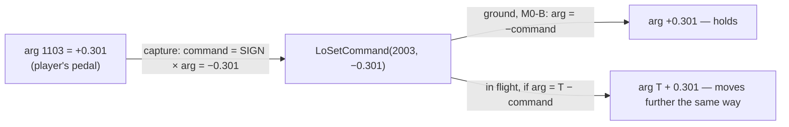

# BL-16 LV-1, debug pass 2 — 2026-11-24 (pedal at the take)

Branch `fix/lv1-pedal-take` from `c135d032` (tip of `feature/bl16-lift-vector-law`). Inputs:
`docs/acceptance/2026-11-24-sortie-feedback.md` (both flights), `debug-2026-11-24.md` and
`review-debug-1124.md` (the first pass), the four logs in
`DCS-petrobrain-epochfix/docs/acceptance/logs-2026-11-24/` (gitignored), the M0 findings
(`aircraft-layer/research/2026-11-18-bl16-m0-flight-axes-findings.md`), the probe v2 findings
(`aircraft-layer/research/2026-11-01-bl16-command-hold-probe-findings.md`), the slip-ball note, and
the 2026-11-20 sortie feedback. Mid-task the user added two statements, recorded verbatim:

> When Petrovich takes controls (with current branch code and before the axis sign flip) There is
> an immediate pedal movement to left. It does not hold, what player was holding, but moves
> immediately. That causes the initial yaw. I suspect that either the pedal read is old, or it is
> wrong.

> Take over from when player is in copilot seat is a bit smoother. Could be that pedals are read
> from copilot. -> controls must be read and written from which ever seat player is in

### Debug Report

### Observed Issue

Two flights, one symptom at the start of each: at the take the nose swings left, then bank and
sideslip escalate. The first pass flipped the pedal-loop sign; the re-fly was worse, with the
command at −0.83 and the user seeing heavy **left** pedal.

The logs hold **four** takes, not two — the refly trace's middle session (old code, original
signs, takes at t=45.39 and t=77.33) was never mentioned. All four show the same kick:

| take | code | yaw rate before → 0.8 s after |
|---|---|---|
| flight 1, t=112.19 | original signs | −0.05 → −5.8 °/s |
| session 2, t=45.39 | original signs | −0.03 → −6.1 °/s |
| session 2, t=77.33 | original signs | −0.50 → −10.8 °/s |
| re-fly, t=24.97 | flipped signs | −0.45 → −9.3 °/s |

On the re-fly, which carries the law's internals, the written pedal command at the take is
−0.301 and moves by less than 0.03 in the next second (−0.301, −0.295, −0.293, −0.284). Pitch and
roll show no kick at any take (pitch 1.05° → 0.98° over the same 0.4 s, `out_pitch` 0.232 flat).

### Hypotheses and findings, per question

#### Q1 — the take is not bumpless on the actual pedal

**Not the cause** (ruled out from code and logs):

- **Stale `fc_last_steady_values` snapshot / wrong seat / snapshot chosen over a live read.** The
  snapshot is used only when both seats read live or both idle. With the player in the pilot seat
  the operator args read 0 (M0 flight 1), so the old rule took a fresh read of the pilot set. A
  stale snapshot would also carry stale pitch, roll and collective, and all three were bumpless at
  all four takes. Exposure to this path exists for all four axes, but only during a seat
  cross-fade or with an unknown seat.
- **25 Hz arg update.** A read is at most 40 ms old. A 0.3 pedal step cannot build in 40 ms.
- **SIGN mismatch in code.** `SIGN.pedals` is applied once, at capture (`axis_command`), and the
  write sends that command unchanged (`write_outputs`). No second sign anywhere. The take frame
  writes exactly `−arg0` (`law_init_at_take` sets `t_y = command.pedals`; `turn_coord_pedal = 0`;
  no rate limit with `fc_last_command = nil`).

**Leading hypothesis — the pedal write is relative to the trim, not absolute.** In flight the pedal
behaves as if `arg 1103 = T − command`, where T is the pedal trim datum: zero on the ground
(where M0-B measured exactly `−command`), and about the trimmed pedal position in flight. Then
capturing `command = −arg0` and writing it gives `arg = T + arg0` — the pedal moves further the
way it already was, by T. It fits three independent datasets with no free parameter beyond T:

1. **Probe v2 (2026-11-01)**, four pedal holds that were logged as "no consistent sign or
   ratio": `T = sent + reached` is 0.162, 0.162, 0.162, 0.183 — one constant, in both seats. Pitch
   and roll held exactly in the same frames, so this is specific to the pedals.
2. **M0-J flight 9, J3**: pedal arg 0.062 → 0.123 over 1 s after a capture — exactly 2 × arg0,
   "not explained yet" in the findings. Doubling is what `T = arg0` predicts.
3. **All four takes on 2026-11-24**, both sign conventions: a step the same way, every time, with
   the shape of a first-order pedal step (τ ≈ 0.25 s), before the law moves.

It also matches the 2026-11-20 sortie ("Petrovich increased left pedal quite a lot" at a take,
diagnosed then as a slow feed-forward ramp), and the user's copilot-seat take being smoother if
the trim offset differs there. **Unproven**: no log has ever carried arg 1103 next to the written
command in flight. The trace now does (Q4). It is the one observation that settles it: if the arg
goes from arg0 to about 2 × arg0 when the player had trimmed with feet off, the hypothesis holds;
if it holds at arg0, look elsewhere.

**Not fixed here.** The fix depends on which part of arg0 is trim and which is the player's foot,
and that is unmeasured. If T is the whole position (trimmed, feet off), the bumpless command is
0, not `−arg0`. If the player holds the pedals untrimmed, `−arg0` is right. A capture that is
right in both cases needs either a readable trim datum or a closed loop on arg 1103 during the
first second after the take — a design choice, not a debug fix.

**The seat rule.** The user's rule: *"controls must be read and written from which ever seat
player is in."* **Today's code did not follow it**: since M0-J the voice-take capture ignored the
player's seat entirely and took whichever set read live, or a snapshot when both did. **Fixed**:
`resolve_capture_values` now reads `ai_pilot_wheel.player_seat()` (the camera-derived seat, the
existing source) first and captures that seat's set fresh whenever it reads live. The old rule is
kept only as the fallback for an unknown seat, or a player's seat whose set reads idle — M0-J's
explicit-handover state, where the player sits in the copilot seat without having requested
control, that set reads all zeros and capturing it wrote zeros (J1: pitch −1.2° → −8.2° in 1.4 s).
That fallback is a departure from the rule's letter, kept on purpose; the user may want it
otherwise. The unpark take is unchanged: it captures the pilot set from the last fully-stowed
frame, because that is where the AI's control positions show while parked (probe v2 finding 3).

**This rule is very likely not the cause of the left pedal.** With the player in the pilot seat
the old rule already read the pilot set (the operator set reads 0 there).

**Written side:** `LoSetCommand` 2001/2002/2003/2087 carry no seat. M0 flight 8 measured the same
sign (−1), scale and lag from the copilot seat, and the result shows in the player's own seat's
args (1113 with the player in the copilot seat, 1103 in the pilot seat). No seat-dependence was
found in the code. Untested: whether T, the pedal trim, is per seat.

#### Q2 — positive pedal command = right; the first pass's flip reverted

Under the trim hypothesis and under a straight mirror alike, the re-fly shows the command going
−0.30 → −0.83 while the user saw heavier left. **A falling command is left pedal; positive command
is right**, the original convention. Reverted in `flight_profile.lua` and both test mirrors:
`k_ball_pedal` +0.3, `rotor_dir` +1, `k_turn_coord_pedal` +0.02, `pedal_limit_positive` 0.5,
`pedal_limit_negative` −1.0. The side-derived collective-near-pedal-limit guard is kept and now
protects the positive (right) side by itself. The toy-plant ball test now models "positive command
= right pedal → ball left" (`K_PHYS = −0.4`) and fails with the flipped gain (checked by
mutation). Dated corrections, nothing deleted: slip-ball note, BL-16 roadmap bullet, the reviewer's
memory.

**Flight 1's left pedal, with the original gains**: the take step put the pedal left, the nose
swung left, the aircraft sideslipped and the ball went right. On the original sign the ball loop
then added *right* pedal at `0.3 × ball error` per second — about 0.15/s at a 0.5 ball, against a
step of T (about 0.2–0.3). The loop was working the right way but was slow, and the lateral loops
were already oscillating on the sideslip. The first pass read the take step as the loop driving
left.

#### Q3 — the collective: a lockout, not only a slow integrator

The initial fall is the altitude shaper arresting a +0.7 m/s climb: `a_u_d` = −0.7 m/s² at the
take (`2ζω·w` = 2 × 1 × 0.5 × 0.71), the aircraft does not respond within a second, and the
collective integrator (`k_collective` 0.08) runs at about −0.05/s, from 0.104 to −0.010 by t=27.6.

Then **the collective stopped at −0.010 for the rest of the flight** (`u_c_rate` exactly 0) while
`a_u_d` rose to +3.1 m/s² and the aircraft sank to −6.4 m/s. Cause: the rotor-RPM guard.
`ROTOR_RPM_SOURCE = "dummy"` returns 90 %, and the guard tripped at `rpm <= floor + margin` =
85 + 5 = 90 — **every frame since this guard shipped (`5fe44225`)**, capping any rising collective
at `collective_rate_cap_near_rpm_floor` = 0. Mode 1 could lower the collective but never raise it.
No test caught it: every test sets `rotor_rpm_pct = 100` or `88`, never the shipped dummy.

**Fixed**: the guard is now strict, `rpm < floor + margin`. The user's 90 % dummy stays as they
set it, and Flight M-C's method (lower the dummy to exercise the guard) still works. New test:
`test_the_shipped_dummy_rpm_reading_lets_collective_rise` reads the dummy from the real module
and fails if the lockout comes back (checked by mutation). **Still fragile**: raising
`ROTOR_RPM_FLOOR_PCT` to 85 or above in body-layer's tuning re-trips it against the dummy. The
real fix is the live RPM reading (arg 42), already owed.

#### Q4 — instrumentation (testing aid, same flag)

- **Flight trace**: every traced line now ends with both seats' actual axis args,
  `a1100 a1101 a1102 a1103 a1110 a1111 a1112 a1113`, next to `out_*`.
- **Debug log, once per take**: `flight take t=… origin=… player_seat=… source=… captured p r c y
  command p r c y args …` — the seat, which capture branch ran (`player_seat_pilot`,
  `live_operator`, `last_steady`, `stowed_pilot`, …), the captured raw values, the first command,
  and both seats' args on that frame.

Kept, not removed: these are the testing aid the task asked for, behind the existing flight-trace
flag. Nothing else was added.

### Fix Applied

- `aircraft-layer/dcs-export/Petrobrain/flight_profile.lua` — pedal gains and limits back to
  positive = right, with the reason.
- `aircraft-layer/dcs-export/Petrobrain/flight_control.lua` — RPM guard `<=` → `<`;
  `resolve_capture_values` reads the player's seat first and returns its branch; `fc_capture_source`,
  `trace_axis_args`, the take debug line, args on the trace line; module header and Section F
  comment.
- `aircraft-layer/dcs-export/Petrobrain/ai_pilot_wheel.lua` — `player_seat` comment (read again).
- Tests: sign reverted in both mirrors; the M0-J cross-fade test **replaced** (the user's rule
  reverses what it asserted — snapshot over live read) by a both-seats-live test that requires the
  player's own seat, pedal included; new copilot-seat capture test; new take-line test; new
  dummy-RPM test; `_run` gains `patches`.
- Research: M0 findings J3 gets the trim reading as a hypothesis; slip-ball note gets the second
  correction; `body-layer/ROADMAP/BL-16.md` gets "superseded again".

### Verification

- `.claude/scripts/fast-tests.sh aircraft-layer`: 1003 passed. `ruff format --check`, `ruff check`
  clean; `cd aircraft-layer && .venv/bin/mypy src` clean; `luac5.1 -p` clean on every
  `dcs-export` Lua file; the `GETGLOBAL` list for `flight_control.lua` holds only stdlib, DCS APIs
  and the existing cross-module names.
- Mutations: `k_ball_pedal = −0.3` fails both ball-centring tests; `<=` in the RPM guard fails the
  dummy-RPM test.
- Not flown. The take step is not fixed; expect the same left swing at the next take.

### What remains unproven, and the one observation that settles each

| claim | settled by |
|---|---|
| The pedal write is relative to the trim (`arg = T − command`) | Next flight's trace: arg 1103 at the take goes from arg0 to ≈ 2 × arg0 (trimmed, feet off) |
| T is per seat | The same take from the copilot seat with the pedals trimmed there |
| Positive command = right pedal | Already seen (−0.83 → heavy left); the trace's a1103 against `out_pedals` confirms it in numbers |
| `rotor_dir = +1` (more collective needs more right pedal) | User's own statement, 2026-11-20; not isolated in a flight |

### Proposed, not built: a 30-second ground check of the write in this configuration

Mode 1 refuses a take below `ON_GROUND_AGL_THRESHOLD_M` (10 m), so the check needs that lowered
for one run (`config/tuning.toml`: `ON_GROUND_AGL_THRESHOLD_M = 0.5`, the bottom of its range;
it also changes perception's on-ground test for that run). Rotor turning, collective fully down,
wheel brakes on, trace flag on, pilot seat:

1. **No trim.** Reset the trimmer, feet off the pedals, centred. Say "you have controls". Expect:
   the pedals do not move. Say "I have controls".
2. **Trimmed.** Hold about a third of left pedal, press and release the trimmer, feet off (the
   pedals stay left). Say "you have controls". Watch the pedals: **stay** = the write is absolute
   and Q1 is elsewhere; **move further left, to about two thirds** = the trim hypothesis.
3. **Held, not trimmed.** Reset the trim, hold a third of left pedal with your feet, take. Stay or
   move tells whether the foot input is replaced or added.

Each step names the pedal direction the player chose, so the trace's a1103 at the take also fixes
which arg sign is left, and `out_pedals` against a1103 fixes the write sign. If the aircraft
starts to lift, say "I have controls" — the collective now rises.

Decision 24's "bit-exact at take" has never been true for the pedal axis in flight, and no
pedal-hold flight (M0-D) was ever flown — the user accepted it without one. That is where this
started.
