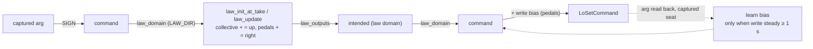

# BL-16 LV-1, debug pass 3 — 2026-11-24 (pedal write offset, collective runaway)

Branch `fix/lv1-pedal-offset` from `de2e6d4c` (tip of `feature/bl16-lift-vector-law`). Inputs:
`docs/acceptance/2026-11-24-sortie-feedback.md` (all of it, esp. "Data flight with actual args"
and the user's control settings), `debug-2026-11-24b.md`, `review-debug-1124b.md`, and the data
flight logs in `DCS-petrobrain-epochfix/docs/acceptance/logs-2026-11-24/` (`data_flight_trace.log`,
12 sessions; the takes are in sessions 8–11, the first sessions to carry the actual axis args;
`data_debug.log` `flight take` lines).

### Debug Report

### Observed Issue

Six takes on the data flight, both seats, pedals centred or pre-offset right:

1. **The pedal kicks left at every take** and stays there: in steady state the actual pedal arg
   `a1103 ≈ 0.32 − out_pedals`, both seats, every take.
2. **The collective runs to full up (arg 1102 → 1.0) within ~3 s of every take** and stays there
   (`out_collective = −1.0`).

### Finding 1 — pedal write offset

**Measured, not hypothesised.** Settled samples only (written command within 0.02 of its last
settling point for ≥ 1 s, longer than the pedal lag): `B = out_pedals + a1103`.

| take | player seat | pedal arg before | n | B mean | B range |
|---|---|---|---|---|---|
| s8 t=61.4 | pilot | +0.152 | 28 | 0.325 | 0.322–0.329 |
| s9 t=23.9 | pilot | +0.013 | 45 | 0.322 | 0.313–0.338 |
| s9 t=74.1 | pilot | +0.000 | 53 | 0.324 | 0.320–0.329 |
| s10 t=22.1 | pilot | −0.329 | 0 (command never steady 1 s) | — | — |
| s11 t=24.0 | operator | −0.000 | 49 | 0.324 | 0.320–0.330 |
| s11 t=42.0 | operator | −0.375 | 10 | 0.331 | 0.330–0.333 |

All 185 settled samples: mean **0.324**, range 0.313–0.338. Before the first write `a1103` equals
the capture; with the pedals pre-offset right the arg still went to `0.32 − command`, so the write
replaces the hardware pedal rather than adding to it. With the player in the operator seat, 1110–
1113 read 0 throughout and the pilot set carried capture and write. Pitch/roll/collective args
follow their commands with no offset. The same settle gate that the fix's learner uses, applied to
the real log, lands on 0.324 with a ±0.01 spread, which is the evidence that the learner's gate is
tight enough.

**Sign in the command domain**: `p_meas = SIGN.pedals · a1103 = −a1103`. Out −0.007 gave a1103
+0.33, so `p_meas = −0.33`, and `b = c_written − p_meas = −0.007 + 0.33 = +0.32`. To put the pedal
at the law's intended `c_law`, write `c_law + 0.32`.

**Cause inside DCS: unknown**, and not needed. On the ground (M0-B) B was 0; probe v2 fits ~0.16.
B is therefore not a universal constant, which is why the fix learns it.

### Finding 2 — collective to full up: a sign error in the law domain, independent of the kick

**Root cause.** The law's collective (`u_c`) reasons as **positive = more lift**: the vertical-
acceleration integrator raises `u_c` to climb (`c_dot = k_collective · (a_u_d − a_u)`), the RPM,
blade-stall and pedal-limit guards cap a *rising* `u_c`, and the torque feed-forward adds right
pedal for a rising `u_c`. But `u_c` was initialised to — and written as — the **command**, and
command 2087 runs the other way: `SIGN.collective = −1` (M0-C, flight 6) with arg 1102 positive =
collective up (M0 A3, +0.89 against VS). So a falling `u_c` (the law asking for less lift) was a
rising lever. Positive feedback on vertical speed.

`SIGN.collective` became −1 on 2026-11-18 (`a4d4a940`); the law's collective terms were written
assuming the command was up-positive and were never re-signed. No test could see it: the toy-plant
suite tests the law in its own domain, and no module-level test checked which way a climbing
aircraft moves the written collective.

**Evidence, first law frame of every take, before any sideslip:**

| take | v_u at take | a_u_d | u_c_rate | a1102 0 → 3 s | aoss at first law frame |
|---|---|---|---|---|---|
| s11 t=24.0 | +3.0 | −1.01 | −0.090 | 0.380 → 0.93 | 0.96° (same as before the take) |
| s9 t=74.1 | +2.4 | −1.03 | −0.073 | 0.256 → 0.77 | −0.06° |
| s9 t=23.9 | +6.0 | −1.31 | −0.103 | 0.338 → 0.97 | 0.16° |

Every take was in a climb, so the altitude shaper asked to arrest it (`a_u_d < 0`); `u_c` fell, the
lever rose, the climb grew (s11: v_u 3.0 → 4.4; s9: 6.0 → 7.5), `a_u_d` grew more negative, and the
lever ran to the stop. **Not a consequence of the pedal kick**: the collective is already moving the
wrong way on the first law frame, at the pre-take sideslip and yaw rate, ~0.3 s before the kick
builds; the smallest-kick take (s9 t=74.1, peak yaw rate −5.9 °/s) runs away the same way. The
sideslip that follows does cost lift later, but that only feeds an already-diverging loop.

The 2026-11-24 re-fly's "collective drove down then froze" is the same bug seen through the RPM
lockout: the law's falling `u_c` was physically the lever rising (arg −0.106 → +0.01); when it later
asked to rise (`a_u_d` +3 while sinking, which would have been the lever going down — again the
wrong way), the lockout capped it. The lockout was masking the runaway in that direction.

### Hypothesis (both, confirmed)

1. The pedal write lands a near-constant 0.32 left of the command in flight; compensating it in the
   output stage, seeded at 0.32 and learnt online, makes the take bumpless and keeps the pedal where
   the law means it.
2. The law's collective is up-positive but was run in the down-positive command domain; mapping
   between the two at the law's boundary fixes the runaway and, with it, the torque feed-forward
   and the rising-collective guards, which had the same inverted sign.

### Fix Applied

`aircraft-layer/dcs-export/Petrobrain/flight_control.lua`:
- **`LAW_DIR`** `{pitch=1, roll=1, pedals=1, collective=−1}` and **`law_domain`**: the take seeds
  the law with `law_domain(command)`; every write sends `law_domain(law_outputs(...))`. The two
  flips cancel, so the take stays bit-exact; inside the law, every collective term now points the
  physically right way. Pitch/roll unchanged (+1), not re-derived.
- **Write bias, output stage** (`command_for`, `learn_write_bias`, `fc_write_bias`,
  `fc_write_bias_anchor`): `written = intended + b` for every axis listed in
  `flight_profile.write_bias_seed` (pedals only). `b` is seeded on first use, so the take frame
  writes `capture + b` and the actual pedal stays put. Learnt at `dt/τ` (τ = 3 s) from
  `c_written − p_meas` only when the written value has stayed within 0.02 for ≥ 1 s and neither the
  write nor the arg is saturated; bounded ±0.5. Kept across takes; cleared by `on_stop` (mission
  stop/restart — and `reset(epoch)`, which reuses it, so a body-layer restart also returns to the
  seed). The law's pedal limits bound the intended position, not the biased write.
- **Captured seat** (`fc_capture_seat`, `fc_last_steady_seat`; `resolve_capture_values` now returns
  `values, source, seat`): the learner reads back the seat the capture came from — on the data
  flight that was the pilot set even with the player in the operator seat.
- Trace: `bias_pedals=` appended to every flight-trace line (testing aid, same flag).
- Comments on `law_init_at_take`/`law_outputs` corrected: they now take/return the law domain.

`aircraft-layer/dcs-export/Petrobrain/flight_profile.lua`: `write_bias_seed = { pedals = 0.32 }`,
`write_bias_bound` 0.5, `write_bias_tau_s` 3.0, `write_bias_settle_s` 1.0,
`write_bias_settle_band` 0.02, with the measurement. Behaviour-affecting; this subproject has no
tuning loader (root `CLAUDE.md`), same posture as every other field there.

Tests (`aircraft-layer/tests/test_flight_control_lua.py`): profile mirror gains the five fields;
three take-capture assertions now expect `−arg + 0.32` on the pedal (the intended command is still
`−arg`; they encoded "write = intended", which is no longer the contract). New:
- `TestPedalWriteBias` — a toy pedal plant (`arg → 0.32 − command`, first order τ 0.25 s):
  seeded take is bumpless (worst deviation < 0.01 over 3 s); seed 0 kicks > 0.25 and then
  converges back to the held pedal within 0.02 by 25 s with the written value ≈ intended + 0.32;
  the learnt bias carries into a re-take (< 0.03) and `on_stop` clears it (kick returns).
- `TestCollectiveLawDirection` — climbing at 5 m/s at the take, the written 2087 command rises
  (lever down) within 3 s.

Research: `aircraft-layer/research/2026-11-18-bl16-m0-flight-axes-findings.md` gets a dated
"in-flight pedal write offset, measured" section with the per-take table; it records that this
falsifies the additive hypothesis and the trim-datum reading of J3 (kept, not deleted).

### Verification

- `.claude/scripts/fast-tests.sh aircraft-layer`: 1007 passed. `ruff format --check`, `ruff check`
  clean; `cd aircraft-layer && .venv/bin/mypy src` clean; `luac5.1 -p` clean on every
  `dcs-export` Lua file; the `GETGLOBAL` list for `flight_control.lua` holds only stdlib, DCS APIs
  and the existing cross-module names.
- Mutations (each reverted): `LAW_DIR.collective = +1` fails the collective test; disabling learning
  fails both learning tests; ignoring the seed fails four tests; `on_stop` keeping the bias fails the
  carry/clear test. **Not covered by a mutation:** removing the settle gate passes every test (the
  toy plant's command is constant, so lag never biases the learner). Its justification is the real
  log instead: the same gate on the data flight yields 0.313–0.338, against 0.30–0.36 ungated.
- Not flown.

### What remains unproven, and what settles it

| claim | settled by |
|---|---|
| The take is now bumpless on the pedal | Next flight's trace: `a1103` holds its pre-take value (±0.02) through the first second; `bias_pedals` ≈ 0.32 |
| 0.32 holds across the envelope (hover, high speed, other collective) | `bias_pedals` in the trace over a longer flight; the learner corrects it either way, but a large drift would mean the seed kicks |
| The collective now arrests a climb instead of running away | Trace: after a take in a climb, `a1102` falls and `v_u` decays toward 0 |
| The lateral divergence (bank to 44°, heading hold chasing the kick) was a consequence of the yaw kick | Same flight: with no kick, does bank stay near `phi_d` and `phi_d` stay small? If it still escalates, the lateral loops are next |
| Pitch/roll `LAW_DIR = +1` are right | **Superseded 2026-11-24, see "Pitch direction, main-loop finding" below — pitch was wrong, fixed to −1; roll is still unexamined.** Originally: not examined here; pitch/roll were bumpless and followed their commands, but their law-domain direction was not derived |
| A first-law-frame collective step | Minor, seen once (s8: `u_c_rate` −1.05 on the first frame, ~0.035 of lever): `u_c_i` is set from the *measured* lift length at take, the first update uses the *desired* one. Not fixed; watch whether it matters once the sign is right |

**Risk to state plainly:** with the seed at 0.32, a take in a condition where the true offset is
near 0 (as on the ground, M0-B) would kick 0.32 the *other* way (right) until learnt. Takes are
refused on the ground, so the only known 0 case is unreachable; probe v2's ~0.16 is the unexplained
one.

### Pitch direction, main-loop finding (2026-11-24, after review-debug-1124c)

Same log session (index 9), t=24–42, splitting `t=0.000 ` lines 0-based. `out_pitch` rising
0.05→0.37 (t=28–30) ran with pitch 3.2°→−3.7°; `out_pitch` falling 0.35→0.05 (t=31.6–33.1) ran
with pitch 0.9°→9.1°. Positive `out_pitch` is a written-command rise, and command 2001 positive is
stick forward/nose down (the same arg-1100 reading `aircraft-layer/research/2026-11-18-bl16-m0-
flight-axes-findings.md` already has: "positive is stick forward (nose down)") — so the trace
itself shows a rising command driving pitch down, not up.

`law_outputs`'s `u_pitch = t_p + k_theta*(theta_d − pitch) − k_q*theta_rate`, and `law_update`'s
`d_t_p = k_theta_i*(theta_d − pitch)`, both reason with positive = nose up (`t_p` rising means "ask
for more nose-up"). At t=29.6–31.1 pitch sat 5–6° below `theta_d` (nose too low, wants nose-up) and
`t_p` rose 0.14→0.27 — asking for more nose-up while the law domain still mapped 1:1 onto the
written command (`LAW_DIR.pitch = +1` at the time) drove `out_pitch` up, i.e. *more nose-down*. At
t=32.6–33.7, pitch sat above `theta_d` and `t_p` fell, same fight the other way. Positive feedback —
the same law-domain-vs-command-domain class `a1eec022` fixed for the collective, from the same data
flight.

**Fix:** `LAW_DIR.pitch = -1.0` (was `+1.0`; roll stays `+1.0`, unexamined and out of scope here).
Checked that no other site re-converts pitch: `law_init_at_take`'s own `command.pitch` (used to
seed `t_p`) is already passed through `law_domain()`, the same single conversion `law_outputs`'
output goes through at `command_for` — the two cancel at take, so bit-exactness is unaffected
(confirmed by `test_take_stays_bit_exact_on_pitch`); `flight_desired.lua` has no pitch handling
(mode-2 kinds are still refused `wrong_mode`, nothing there to touch); the Python-side schema
(`schema/flight_control.py`) only reads `out_pitch` for diagnostics, no sign logic. `theta_i`/
`theta_d`/`measured.pitch_deg` are raw attitude readings, not law/command values, and are
unaffected by `LAW_DIR`.

Test added (`aircraft-layer/tests/test_flight_control_lua.py::TestPitchLawDirection`): a toy-plant
fact independent of the law's own convention — command 2001 positive drives pitch down (the same
arg-1100 reading above) — used to assert that with pitch driven below the held `theta_d` (an
external disturbance, not itself part of the law), the written 2001 command falls, never rises.
Verified as a counterfactual: reverting `LAW_DIR.pitch` to `+1.0` alone (checksum-verified revert
afterwards) fails that test for the stated reason (`0.37025` ≮ `-0.001 - 0.001`, i.e. the command
ran the wrong way); a second test confirms the take itself stays bit-exact on pitch at the new
sign (`0.23` captured, `0.229`–`0.231` written, the existing ±0.0011 wobble tolerance).

**Still unexamined:** roll's own `LAW_DIR = +1` — the collective/pitch fixes were each found from a
distinct symptom in a flown log; roll has shown no comparable symptom yet, but that is "not yet
seen", not "derived".
