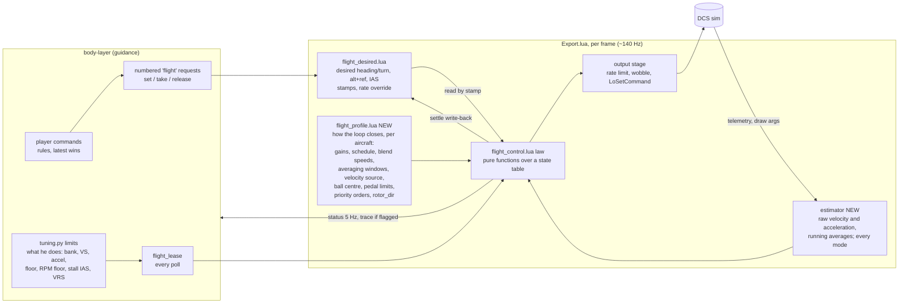
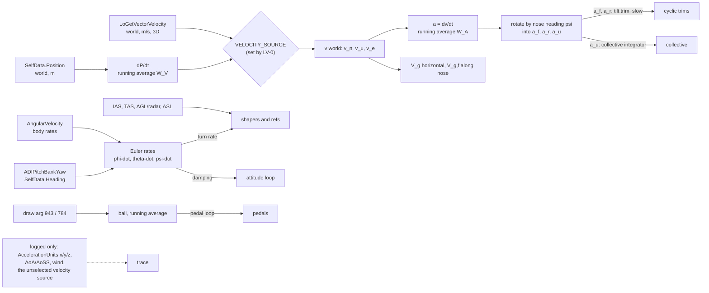
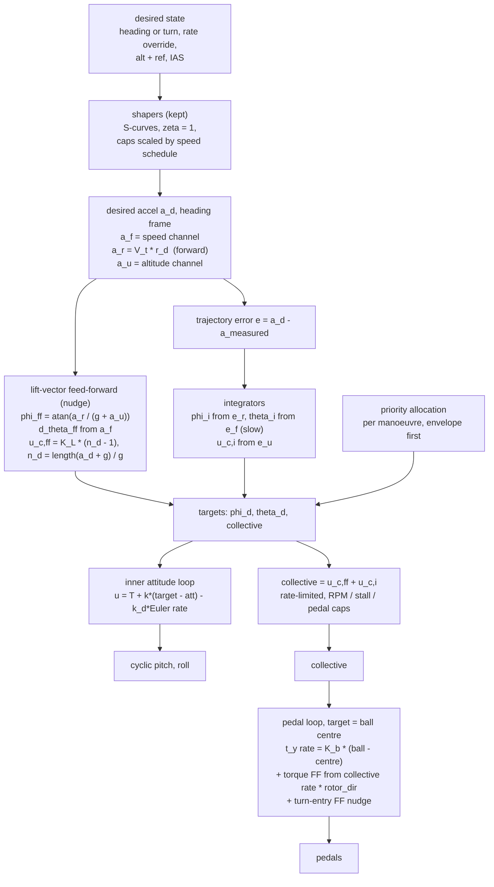
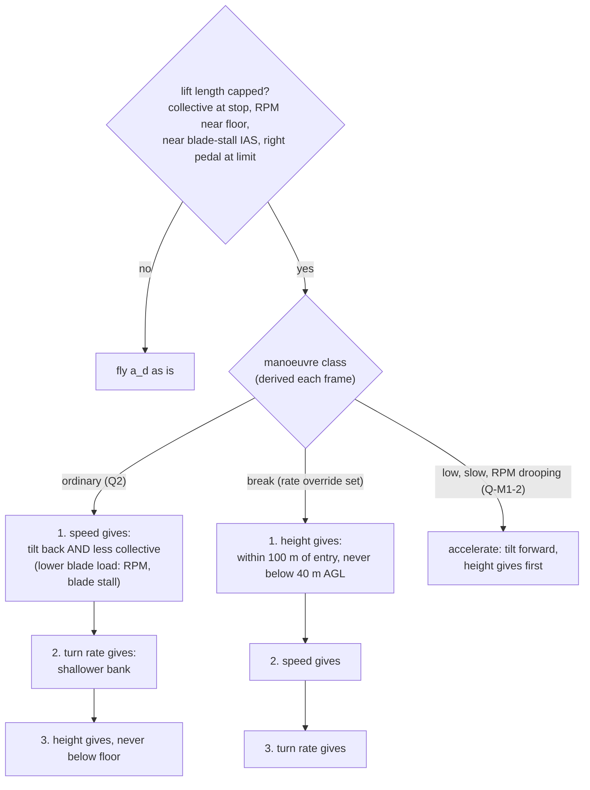
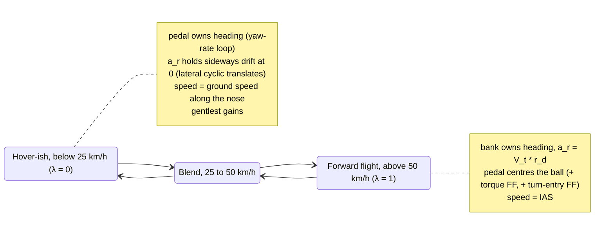
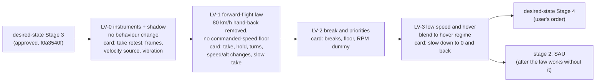

# BL-16 mode 1 lift-vector control law, stage 1 (no SAU): plan

Architect pass, 2026-11-20; **amended the same day** with the user's answers to U1–U7
(`explore-notes.md`, "Answers to the plan's U1–U7"). Branch `feature/bl16-lift-vector-law` (tip
`2c42e2f9`); the law is built **on top of desired-state Stage 3** (`feature/bl16-desired-state-s34`,
tip `f0a3540f`, approved), and this plan reads that code as it will be: `flight_control.lua`,
`flight_desired.lua`, `core.lua` and `plans/flight-desired-state/` at `f0a3540f`.

### Amended (2026-11-20, user's answers)

- **Consistency pass (2026-11-20, architect, arch3/lift-vector).** U8's final answer ("no floor")
  was carried through every remaining place the plan still described a 50 km/h commanded-speed
  floor or deferred its removal to LV-3 (`alignment.md` Finding 1): the summary above, Affected
  Modules, diagrams 5 and 6, the "Removed and kept" table, the LV-1 build, the LV-3 build, and the
  Tests section. The Risks entry is rewritten to say plainly that nothing protects LV-1 below
  50 km/h except the gain schedule and the envelope guards, by the user's own informed choice (Q1).
  The LV-1 card gains a deliberate slow-flight row (speed 40, then speed 20) so the gap is observed
  on a card rather than discovered in a flight. The 25/50 km/h λ-blend breakpoints, the
  pitot-gauge instrument context (U2) and the RPM-guard regime below 50 km/h are unchanged — those
  are not the commanded-speed floor. Plan check Finding 2 (SAU-on-at-handover rule had no stage or
  ID to carry it) is resolved: built and reviewed on `feature/bl16-sau-handover`, already merged
  into this branch (`review-sau-handover.md`).
- **No felt load.** *"Consider just using raw velocity and acceleration. No need to model how pilot
  would feel it… Deltas probably need to be a running average to filter out vibration."* The
  felt-load collective cascade (old section E, `n_target`, `n_i`, `LIFT_LENGTH_SOURCE`) is gone.
  Collective is now a feed-forward from the desired lift length plus an integrator on **vertical
  acceleration error**, measured from raw velocity (E). Every derivative is a running average
  (A). `LoGetAccelerationUnits` is logged in the trace only, for diagnosis; no loop reads it.
  Goal-check finding 1 still holds, more strongly: nothing the law reads rises with load in a bank.
- **U1 → LV-1.** The 80 km/h hand-back (Lua release and take refusal, body-layer `TOO_SLOW`) goes in
  **LV-1**. What protects low speed in LV-1 is a gentler law alone, not a floor and not a
  hand-back (LV-1; U8 settled with no floor).
- **U2, U3, U6, U7: yes.** Recorded as answered; the instrument context is noted, but the law uses
  raw telemetry. U7 is now a profile switch, `VELOCITY_SOURCE`, set by LV-0's comparison.
- **U4:** SAU off on every LV card; the SAU stage follows once the law works without it.
- **U5 reverted.** No deliberate extra pedal: **the pedals always fly the slip ball**, target =
  centre. The ball-offset target, its severity ramp and its tests are removed (this also supersedes
  the goal check's Q6 answer).
- Diagrams 2, 3, 5, 6 updated; base shas moved to `2c42e2f9` / `f0a3540f`.

Inputs read in full: `explore-notes.md` and `alignment.md` (this directory);
`aircraft-layer/research/2026-11-20-motion-telemetry-frames.md`, `2026-11-20-slip-ball-recon.md`
(including its calibration flight), `2026-11-18-bl16-m0-flight-axes-findings.md`;
`docs/acceptance/2026-11-20-sortie-feedback.md`; `plans/flight-control/plan.md` (the control law
under Decision 23, Decisions 27–32); `plans/flight-control/explore-notes.md` (2026-10-26 lift
vector and feedback direction, 2026-11-18 break, 2026-11-19 mode-1 hover); `body-layer/ROADMAP/BL-16.md`
(lift-vector item); `plans/flight-desired-state/{plan,explore-notes}.md` at `f0a3540f`.

**Stage 2 (with the SAU) is out of scope.** What stage 1 leaves open for it is under "Stage 2 seam".

### Goal

Replace mode 1's per-axis law with one that flies the way the user flies: from the desired state it
derives a **desired 3D acceleration**. The **cyclic tilts the lift vector** toward it, the
**collective sets the vector's length**, and the **pedals fly the slip ball**. Each is corrected by
what the aircraft is observed to do, measured from raw velocity and acceleration, never by a trusted
model of the lift vector. It flies at any speed, hover included, gentler the slower it goes, and it
neither uses nor depends on the SAU.

### Value against effort (step 1a)

Worth it: mode 1 is the only mode any future helicopter will have (`alignment.md`, Why), and today's
law produces exactly the faults the user flew (standing bank against standing pedal, turns without
pedal, a break that pulls late and then too hard). **One part is expensive for what it buys now:
hover.** "Any speed" (Q1) is designed in from the start, so that nothing hands back, but it gets its
own last stage (LV-3). Hover *commands* (fixed-spot hold, translate, move up/down) stay in BL-16's
"Later — mode 1 hover"; LV-3 only makes the law fly sensibly at and near zero speed.

### What reading the code turned up (step 3a)

Two latent errors in today's inner loop are a better explanation of the break report (*"too slowly
pulls cyclic back… then pulls too much"*) than the gains are. Both rest on one unconfirmed fact:
that `LoGetAngularVelocity` returns **body-axis** rates. M0-A could not tell, because it was flown
level, where body rates and Euler rates are the same.

1. **Pitch damping fights every steady turn.** `law_outputs` writes
   `u_pitch = … − K_Q·q`, with `q` the body pitch rate. In a coordinated level turn the nose must
   pitch around the horizon at `q = ψ̇·sin φ`: about 13°/s in a 60° bank at 15°/s. That is about 0.13
   of forward stick fighting the turn. The slow `T_p` integrator then winds up to cancel it (late),
   and on the roll-out `q` drops to zero while `T_p` is still wound up, so the nose comes up and
   speed bleeds (too much).
2. **The heading rate reads low in a bank.** `read_measured` takes `r = −ang.y`. If that is the body
   yaw rate, it is `ψ̇·cos φ`: half the true turn rate at 60°. `phi_i` integrates `r_d − r`, so it
   keeps adding bank in every steep turn.

The LV-0 card settles the frame: in a steady 60° turn, body rates give `q ≈ ψ̇·sin φ`, Euler rates
give `q ≈ 0`. LV-1 damps on Euler rates (`φ̇, θ̇, ψ̇`, from body rates by the standard transform);
if LV-0 shows the getter already returns Euler rates, the transform is the identity and nothing
else changes.

**Constants checked (widened 4a rule).** Grepped `flight_control.lua` and `defaults.toml` at
`f0a3540f` for every time constant, speed, bank, rate and gain. Reused: the shaper ω/ζ/caps,
`K_HEADING_TRACK`, `K_VS_ERROR`/`K_ALT_ERROR`/`K_SPEED_ERROR`, the inner-loop `K_THETA*`/`K_PHI*`
(re-damped, see above), `PEDAL_LIMIT_*`, the RPM and blade-stall margins, `FLOOR_AGL_M`,
`BREAK_MAX_HEIGHT_LOSS_M`, `VRS_*`, `MAX_TURN_BANK_DEG`, `MAX_CLIMB_VS_MPS`, `MAX_ACCEL_MPS2`,
`OUTPUT_RATE_LIMIT_PER_S`, `DT_CAP`, `TURN_SETTLE_DEG_S`. **Replaced:** `TAU_ACCEL_FILTER_S` (IAS/VS
derivative), `K_COLLECTIVE`, `K_TILT_FROM_AX`, `K_TILT_FROM_AZ_SATURATED`, `K_BANK_INCREMENT`,
`K_TURN_COORD_PEDAL`, `K_BREAK_PEDAL_BIAS` (see "Removed and kept"). **Removed in LV-1:**
`ENV_IAS_MARGIN_KMH`, `ENV_HOLD_S` and `fc_env_low_ias_since_t` (only the IAS release uses them);
`MIN_IAS_KMH` is removed outright in LV-1, along with its hand-back meaning (U8, no floor).
**No existing constant governs** the hover/forward blend speeds, the running-average windows, the
velocity source switch, the lift-length feed-forward gain or the gain schedule; all are new and live
in the profile. The user's hover threshold (25 km/h, "configurable") exists only in the explore
notes, not in code.

**Investigator not invoked (step 3), deliberately.** The plan depends on three unverified facts:
the body-rate frame above, `LoGetSelfData().Position` axes (x north, z east: this project's
established convention, `world-model/src/coordinates/projections.py`, but not checked for this
call), and `LoGetVectorVelocity` being the world-frame velocity that matches `dP/dt` (the user's
own test, 2026-11-20: it is 3D, sideways movement shows; axes and sign still to compare). Desk
research could give at best a forum claim for each; the LV-0 card measures all three in one flight
that is already needed for the take retest (alignment finding 4). So LV-1 is gated on that card,
not on a recon note.

### Affected Modules / Files

- `aircraft-layer/dcs-export/Petrobrain/flight_profile.lua` — **new**, a `dofile`d chunk holding the
  one per-aircraft profile table (`PROFILES["Mi-24P"]`): every loop gain and time constant, the gain
  schedule, the regime blend speeds, the running-average windows, `VELOCITY_SOURCE`, the pedal
  limits, the ball centre and usable range, the per-manoeuvre priority orders, and `rotor_dir`
  (which flips the torque feed-forward). A separate chunk because it is data the user will edit,
  and it keeps `flight_control.lua`'s 200-local budget. **Selection:** `ACTIVE = PROFILES["Mi-24P"]`;
  select by `LoGetSelfData().Name` is a one-line change once a second profile exists (not built now).
- `aircraft-layer/dcs-export/Petrobrain/flight_control.lua` — the law. New `est_*` estimator
  (velocity → acceleration by running averages, Euler rates, ball), run **every frame in every
  mode** so it is warm at a take; `law_update` restructured into the loops below; `law_outputs`
  damps on Euler rates; `law_init_at_take` initialises the new state bit-exact. Every `law_*`
  function takes `profile` as an explicit parameter beside `limits`, so the toy plant can pass a
  test profile. **LV-1:** `check_envelope` loses the IAS release, `check_unpark_preconditions` loses
  `too_slow` (an unreadable IAS is no longer a refusal cause; NaN handling stays in
  `check_envelope`'s `"nan"`). `build_take_seed`'s unpark clamp (added at `f0a3540f`) loses its
  speed floor (U8; keeps its ceiling and the AGL floor). Status push gains the estimator fields; a
  flag-gated per-frame trace (`aircraft_layer_flight_debug.flag` →
  `aircraft_layer_flight_trace.log`, owed since Decision 23) lands in LV-0.
- `aircraft-layer/dcs-export/Export.lua` — load `flight_profile` before `flight_control`.
- `aircraft-layer/dcs-export/Petrobrain/flight_desired.lua` — **unchanged.** The law reads desired
  by stamp as Stage 3 built it; break vs ordinary is derived from `turn_rate_deg_s` being set.
- **body-layer, LV-1** — `belief/flight_control.py`: `take_controls` loses `too_slow` and the
  `TOO_SLOW` reason; `MIN_IAS_KMH` and every commanded-speed floor go entirely (U8, no floor):
  `clamp_speed`'s lower bound becomes 0, `min_ias_kmh` leaves the lease `limits` and
  `FC_LIMIT_BOUNDS`; `belief/crew_console.py` and `body.py` lose the `too_slow` plumbing;
  `belief/speech.py` loses the `TOO_SLOW` line; `config/rules/README.md`'s `take_controls` row loses
  `"TOO_SLOW"`; `config/defaults.toml` regenerated. `belief/flight_authority.py` (carried-value
  announcement) follows `clamp_speed` and needs no edit. **LV-3:** nothing left to remove here —
  `MIN_IAS_KMH` and the floor are already gone, removed in LV-1. Wherever `fc_*` status fields are
  parsed (`collector/*`): new estimator fields, passed through for the cards.
- `aircraft-layer/tests/test_flight_control_law.py` — toy plant rebuilt as a 3D point mass (below);
  `test_flight_control_lua.py`, `test_export_lua_constants_parity.py`,
  `test_dcs_export_lua_local_order.py` — extraction tuples and parity for the new module and fields.
  body-layer's `TOO_SLOW` tests are deleted with the behaviour (rewritten, not extended: the
  refusal no longer exists).
- `aircraft-layer/CLAUDE.md` (`flight_control` bullet), `body-layer/CLAUDE.md` (flight_control
  entry), `body-layer/ROADMAP/BL-16.md` (lift-vector item status).
- `docs/acceptance/<date>-bl16-lv<n>-card.md` — one card per stage.

### Design Overview (diagrams)

**1. Who owns what.** Unchanged seams in grey; new pieces are the profile and the estimator.

**2. What is measured, and which loop each signal closes.** Raw telemetry only; every derivative is
a running average. Signals whose sign is unmeasured are logged, never used.

**3. The loops.** Fast inside, slow outside; the feed-forwards carry the quick response, the
integrators remove what the feed-forwards get wrong.

**4. Under limits, who gives first: the order travels with the manoeuvre.** The envelope (RPM floor,
blade stall, VRS, 40 m floor, physical stops) is never crossed; when it caps the lift length, the
shortfall goes down the manoeuvre's own chain. (Orders confirmed by the user, U3.)

**5. Speed regimes: one law, blended.** `λ` goes from 0 (hover) to 1 (forward flight) on measured
horizontal ground speed. Nothing switches; every term is weighted. LV-1 and LV-2 fly with `λ = 1`
throughout and no commanded-speed floor (U8, no floor); LV-3 adds the blend below 50 km/h.

**6. Delivery.** Each stage flies its own card from the feature branch before the next is built.
SAU off on every card (U4).

### The law, in words

Symbols: `ψ` true heading (the nose), `φ` bank, `θ` pitch, `H` the heading frame (forward along the
nose, right, up; horizontal), `V` IAS, `V_t` TAS, `V_g` horizontal ground velocity.

**Instrument context (U2, user, for reference only).** The pitot IAS gauge reads down to 50 km/h;
the pilot's Doppler shows ground speed up to 45 km/h forward and 25 km/h back, left and right, and a
Doppler vertical speed of ±10 m/s; the copilot has only pitot IAS and the VSI. **The law uses none
of these gauges' limits**: it reads raw telemetry (*"Petrobrain is to use raw telemetry data to
calculate speeds and accelerations and control inputs from that"*). The ranges explain why "speed"
near hover is ground speed (U2), and are what the player sees when judging a card.

**A. Estimator (every frame, every mode).** No model of what the pilot feels: velocity and
acceleration from raw telemetry, every derivative a running average (user: *"Deltas probably need to
be a running average to filter out vibration"*).
- **Velocity.** World-frame velocity `v = (v_n, v_u, v_e)` from the source `VELOCITY_SOURCE`
  selects (profile):
  - `"position"`: `LoGetSelfData().Position` (x north, y up, z east) in a model-time-stamped ring
    buffer; `v` is the least-squares slope over the last `W_V` seconds (first cut 0.1 s, by
    timestamp, never by frame count), which is a running average of the per-frame deltas.
  - `"vector"`: `LoGetVectorVelocity` (U7, answered yes), averaged over the same `W_V`. The user's
    test shows it is 3D (sideways movement shows). LV-0 compares it against `dP/dt` for axes and
    sign; if they match, the profile selects `"vector"` (one less differentiation) and the other
    source stays in the trace as the cross-check, **computed only while the per-frame trace flag is
    on**, never every frame for nothing (`perf-plan-review.md` item 1).
- **Data structure** (`perf-plan-review.md` item 2): every window is a fixed-size ring buffer
  preallocated once at module load, with the least-squares sums (Σt, Σt², Σx, Σtx) updated
  incrementally as samples enter and leave, so each frame is O(1) work and allocates nothing.
  The trace flag is checked before any trace string or extra `LoGet*` read is built (item 4).
  The estimator runs in every mode by design; LV-0's card watches for a frame-time symptom (item 3).
- **Update rate, not every frame** (user, 2026-11-20, verbatim): *"many of the flight control
  calculations (including estimator) don't really need to run *every* frame. Nothing ever changes
  that fast. I'd say 30Hz would be plenty, even 10 Hz might do. Maybe interleave calculations so
  that not everything is calculated in single frame, but spread accross a couple of frames."* So:
  the estimator and the law run at a profile rate (`LAW_HZ`, first cut 30 Hz), on model time, not
  frame count; the work is interleaved across frames (e.g. sample and estimator on one frame, the
  law's outer loops on the next, inner loops and output target on the third), so no single frame
  carries all of it. The **output stage still writes every frame**, repeating the latest target
  (with the existing rate limit and wobble), because the axis override is per-frame
  (`LuaExportBeforeNextFrame`). Confirmed by the user (2026-11-20, verbatim): *"the axis write itself
  may have to stay every frame -> this is true."* So the write stays every frame; no LV-0 check
  needed. Every `dt` in the law becomes the time since that
  calculation last ran, never a frame `dt`.
- **Acceleration**, including **vertical acceleration**: `a = dv/dt` as the least-squares slope of
  `v` over `W_A` (first cut 0.2 s), then one more running mean over `W_A2` (first cut 0.1 s). The
  vertical component `a_u` is simply the slope of `v_u`, the world-up velocity: no gravity in it, no
  body frame, so in a level 60° turn it reads zero, exactly as the altimeter says. Horizontal
  `a_n, a_e` are rotated into `H` by the measured `ψ` to give `a_f, a_r`. Window lengths are profile
  values, chosen as multiples of the blade-pass period so that vibration falls in a running
  average's null; LV-0's trace measures the real spectrum and the noise before LV-1 relies on it.
  Total lag about 0.15–0.2 s (half of each window).
- **Ground speed**: `V_g` (horizontal magnitude) and `V_g,f`, `V_g,r` (along and across the nose)
  from `v`, for the speed channel near hover (LV-3) and the trace.
- **Euler rates** from body rates and `φ, θ` (the standard kinematic transform). `ψ̇` replaces
  `−ang.y` as the turn rate the shapers and the yaw loop read.
- **Ball** from arg 943/784 (whichever seat is live, as today), running average `W_B`. Centred is
  +0.03, usable ±0.5, ball right = positive (calibration flight, 2026-11-20).
- **Logged only** (trace, diagnosis): `LoGetAccelerationUnits` x/y/z, AoA/AoSS, wind, the
  unselected velocity source. None of them closes a loop.
- **Reset/priming.** On `dt > DT_CAP` (pause, stall), mission stop, `reset(epoch)` and first frame,
  the ring buffers and averages re-prime from the current sample instead of differencing across the
  gap. A stall must never produce an acceleration spike.

**B. Shapers (kept).** Heading/turn, altitude and speed references exactly as today, ζ = 1, with
their accel and rate caps multiplied by the **speed schedule** `G(V)` (E7: about 0.3 at hover, 1.0
from 150 km/h; profile breakpoints, first cut). Heading wraps by the shortest arc unless a direction
was given. The break's height floor (Decision 29) and the VRS cap (Decision 31) stay where they are.

**C. Desired acceleration** in `H`:
- `a_u,d = ẇ_ref + k_w(w_ref − w) + k_h(h_ref − h)` (unchanged formula; `w = v_u` from the estimator).
- `a_f,d = dV_ref + k_v·[λ(V_ref − V) + (1 − λ)(V_ref − V_g,f)]`: IAS in forward flight, ground
  speed along the nose near hover (U2, answered yes). `λ = 1` until LV-3.
- `a_r,d = λ·V_t·r_d + (1 − λ)·k_vg·(0 − V_g,r)`: centripetal in forward flight, "stop drifting
  sideways" near hover. `r_d = r_ref + K_ψ·wrap(ψ_ref − ψ)` as today.

**D. Lift-vector direction (cyclic).** The targets the inner loop flies are a **feed-forward nudge
plus a trim learnt from observation**:
- `φ_d = φ_ff + φ_i`, `φ_ff = atan(a_r,d / (g + a_u,d))`, `φ̇_i = K_φ·e_r` with `e_r = a_r,d − a_r`.
- `θ_d = θ_i + Δθ_ff`, `Δθ_ff = −c_θ·atan(a_f,d / (g + a_u,d))` with `c_θ ≤ 1` (profile; the disc
  tilt the fuselage needs to balance drag is unknown, so it is left to `θ_i`), `θ̇_i = −K_θ·e_f`.
- `K_φ`, `K_θ` give the trim loops time constants of several seconds, at least three times slower
  than the estimator lag plus the attitude response; that separation is the stability argument,
  and the toy plant checks it with the plant's gains deliberately wrong.
- The inner attitude loop is today's form, `u = T + k(target − attitude) − k_d·(Euler rate)`, with
  `T` integrating and solved at take for a bit-exact first frame.

**E. Lift-vector length (collective): feed-forward plus vertical-acceleration integrator.** The
measurement is the aircraft's **vertical acceleration** from raw velocity (A), never a load reading:
- `u_c = u_c,ff + u_c,i`.
- `u_c,ff = K_L(V)·(n_d − 1)`, with `n_d = |a_d + g·up| / g`, the lift length the desired
  acceleration needs (1 in level flight, 2 in a level 60° turn). This is a **nudge, not a model**:
  `K_L` starts deliberately below the collective a 1 g increase needs, so the integrator supplies
  the rest and a wrong `K_L` is a slower settle, never a balloon. It is what makes collective rise
  **with** the bank, the same frame, rather than after an altitude error builds (E4, E5).
  *Main-loop note from the flight-dynamics research
  (`aircraft-layer/research/2026-11-20-helicopter-flight-dynamics.md`, finding 9), not the
  architect's text:* induced power grows roughly with n², not n (60° bank, n = 2: about 4× induced
  power). The linear nudge stays right for LV-1; if LV-2's break card shows the collective lag
  growing with bank instead of staying roughly constant, taper `K_L` with bank or `n_d` in the
  profile. Same "nudge, not model" framing.
- `u̇_c,i = K_c(V)·e_u`, `e_u = a_u,d − a_u` (world up). `a_u,d` already carries the altitude and
  vertical-speed errors (C), so this one integrator holds height through turns, climbs and speed
  changes.
- Rate-limited, saturated, and capped by the existing RPM, blade-stall and pedal-margin guards
  (Decision 30's flags, kept).
- **Goal-check finding 1, satisfied by construction:** in a level 60° turn `a_u` is zero and `n_d`
  rises, so collective goes **up**. No signal the law reads grows with load in a bank, so no channel
  can cut collective because load rises. A toy-plant test asserts both.
- Comparison row: `K_L = 0` in the profile flies the integrator alone (the old shape, with better
  measurement), to show what the feed-forward buys.

**F. Pedals: fly the slip ball, always.** One integrator, one target, the ball's centre; never a
heading loop in forward flight (finding 2), and no deliberate extra pedal in hard turns or breaks
(U5 reverted, user: *"revert my idea about extra pedal. Just fly the slip ball."*).
- Forward flight: `ṫ_y = λ·K_β(V)·(ball − centre)`. Sign from the calibration: ball right of centre
  → more right pedal, and `t_y` is in the command domain (`SIGN·arg`), where positive is right
  (`2026-11-20-slip-ball-recon.md`, "Centring direction"). A toy-plant sign test and a card row both
  check it. `K_β` is scheduled by speed: the calibration showed slip per pedal depends on airspeed.
- Feed-forward nudges (starting values, profile), whose only job is to keep the ball centred while
  the loop catches up: torque `K_cy·u̇_c·rotor_dir` (more collective, more right pedal on the
  Mi-24P), and a small turn term on `r_d` at turn entry.
- Near hover (LV-3): `+(1 − λ)·K_r(V)·(r_d − ψ̇)`. The pedal yaws the nose; bank does not (*"Bank in
  hover is not the way to change heading"*). Bank's share of the heading job is `λ`, pedal's is
  `1 − λ`.
- The asymmetric pedal limits stay (right is the small side for `rotor_dir = +1`), and a collective
  increase is still rate-capped near the right limit.

**G. Priority under limits (diagram 4).** The manoeuvre class is **derived every frame**:
`break` if a rate override is set, `low_slow_rpm` if the RPM guard is active below 50 km/h, else
`ordinary`. While the lift length is capped and `e_u` stays positive (not enough lift), the shortfall
is handed down that class's chain, each absorber until its own limit:
- **speed gives**: `θ_i` is allowed to integrate nose-up on `e_u` (today's `K_TILT_FROM_AZ_SATURATED`
  idea, now one entry in a chain) **and collective is reduced at the same time**, until IAS falls
  below the speed band's floor. User, 2026-11-20, verbatim: *"Also needs less collective so that
  load on rotor blades decreaes. Rotor blade load is what causes both RPM drop and reatreating
  blade stall. Slowing down is always pitch back and also less collective."* So any deceleration,
  in this chain or from an ordinary speed reduction, is pitch back plus less collective, never pitch
  back alone; a rule for the speed channel generally, not only under limits;
- **turn gives**: `φ_ff` is scaled down (shallower bank, less lift needed) until a minimum share;
- **height gives**: `a_u,d` is allowed below zero, bounded by the break floor or the 40 m floor.
- `low_slow_rpm`: `θ_i` integrates nose-**down** (accelerate) and height gives.
The orders are profile data (ordinary: speed, turn rate, height; break: height, speed, turn rate;
U3, answered yes); the chain code is one place. The when (class) is separate from the actions
(absorbers), per the actions-and-params rule. A break entered slow turns more gently because its
rate is capped by the speed schedule (U6, answered yes).

**H. Anti-windup.** `φ_i`, `θ_i`, `u_c,i`, `T_p`, `T_r`, `t_y` stop integrating in the direction
that pushes their own output further into saturation. `φ_i`/`θ_i` also hold while the attitude error
exceeds a profile bound (the inner loop is not following, so the trajectory error says nothing about
trim). This closes Decision 30's unguarded `phi_i` windup risk.

**I. Take (E1).** `law_init_at_take` keeps Decision 24's guarantee: the first written frame equals
the captured command exactly. The references start at measured value and measured rate (today); the
integrators start where the measured state puts them (`φ_i = φ − φ_ff(measured a)`, `θ_i = θ`,
`u_c,i = captured collective − u_c,ff(n_d of measured a)`), so every target equals the measured
attitude and the collective equals the captured one on the first frame. The estimator is already
warm (it runs in every mode). From there the shapers carry the aircraft to the desired state as
S-curves; a take 50 km/h below the desired speed is a gentle transition, not a lurch. A take is
accepted at any airspeed from LV-1 on (only on-ground still refuses). **The law must not break E1;
it is not assumed to repair the erratic voice take** (alignment finding 4): LV-0's card retests the
take on Stage 3 alone.

**J. Recovery.** When a break settles (Decision 27's clearing, kept), the class becomes ordinary and
the altitude shaper chases the standing goal from where the break left it (its reference is never
snapped). When an absorber gave (speed, height, bank), its reference is **re-seated** to measured
when the limit releases, so the aircraft returns through the shaper's S-curve rather than snapping
back. Low, slow and RPM drooping accelerates first.

**K. Desired-state handover.** Unchanged: the law applies `desired` by stamp
(`apply_desired_changes_to_law`), the unpark seed carries it (Decision 32/Q4) clamped to what mode 1
flies (`f0a3540f`, U2 of the desired-state plan), and the roll-out and break settles write the
settled heading back. No new wire field: the break is the rate override; `turn_style` stays ignored
by mode 1. Desired-state Stage 4 (mode 2 manoeuvres) is not touched.

### Removed and kept

| today (`flight_control.lua` at `f0a3540f`) | in this law |
|---|---|
| `a_x`, `a_z` from IAS/VS derivatives (`TAU_ACCEL_FILTER_S`) | **removed**: acceleration from raw world velocity, running averages (A) |
| collective integrates on `a_z` error (`K_COLLECTIVE`) | **replaced**: lift-length feed-forward + vertical-acceleration integrator (E) |
| pitch target from `a_x` error (`K_TILT_FROM_AX`) | **replaced**: `θ_i` on `e_f` + nudge (D) |
| `K_TILT_FROM_AZ_SATURATED`, one fixed trade | **replaced**: per-manoeuvre chain (G) |
| bank `= atan(V_t·r_d/g) + phi_i`, `phi_i` on yaw-rate error | **replaced**: `φ_ff` from `a_d` + `φ_i` on lateral acceleration error |
| damping on body `q`, `p`; turn rate `= −ang.y` | **replaced**: Euler rates (gated on LV-0) |
| `K_TURN_COORD_PEDAL` overlay, `K_BREAK_PEDAL_BIAS` + `break_pedal_bias_accum` unwind | **replaced**: ball loop, target always centre (F) |
| low-IAS release (`ENV_IAS_MARGIN_KMH`, `ENV_HOLD_S`), unpark `too_slow`, body-layer `TOO_SLOW` | **removed in LV-1** (U1) |
| `MIN_IAS_KMH` as commanded-speed floor | **removed entirely in LV-1** (U8, no floor) |
| shapers, `K_HEADING_TRACK`, altitude/speed feedback gains, baro conversion | kept |
| break floor (D29), VRS cap (D31), RPM seam (D28), collective-limited flags (D30) | kept; the flags feed the chain |
| inner loop form, bit-exact take, capture, `armed`/unpark take, envelope dead/NaN | kept |
| output stage (rate limit, wobble, `LoSetCommand`), `SEAT_ARGS`/`CMD`/`SIGN` | kept (`[[BL-18]]` owns the per-module arg/cmd map) |
| pure functions over a state table, toy-plant testable | kept; `profile` added as a parameter |

### Implementation Plan

Each stage flies a card from **the feature branch** (`feature/bl16-lift-vector-law`, checked out in
the repo root by the user), with no deploy steps and the readout through `$DCS_COLLECTOR_IP`
(`source run-scripts/petrobrain.env`). **All LV cards: SAU H, K and T off before every take** (U4;
stage 1 is without the SAU, and the SAU stage follows once the law works without it). The separate
"SAU on at hand-back to the player" rule (`explore-notes.md`, SAU section) is now built and
reviewed on `feature/bl16-sau-handover`, already merged into this branch
(`review-sau-handover.md`): it fires on hand-back, not on take, so every LV card still switches
SAU H, K and T off itself before each new take.

1. **LV-0 — instruments and shadow (no behaviour change).**
   - Estimator (A) running every frame; status fields `fc_est_*` (`a_f/a_r/a_u`, `V_g`, `V_g,f`,
     Euler rates, averaged ball, `λ`) and the flag-gated per-frame trace, which also logs both
     velocity sources and the unsigned channels (`LoGetAccelerationUnits` x/y/z,
     `LoGetAngleOfAttack/SideSlip` raw).
   - `flight_profile.lua` created and the **existing** law constants moved into it, values
     unchanged; a test asserts the law's outputs are bit-identical before and after the move.
   - Card: (a) the take retest on Stage 3 alone (voice take off→m1, unpark m2→m1): smooth or not,
     with the trace on (finding 4); (b) level 60 s northbound and eastbound: track from `V_g` matches
     heading within a few degrees (position axes); (c) steady 30° and 60° turns, both directions:
     `q` against `ψ̇·sin φ` (body vs Euler), `a_u` near zero while level (the vertical channel is
     load-free); (d) level accel and decel: `a_f` sign; (e) `LoGetVectorVelocity` against `dP/dt`
     on all three axes, including a sideslip row (U7, sets `VELOCITY_SOURCE`); (f) 10 s straight and
     level for the vibration spectrum and the noise of each running average. Pass: (b)–(e) give
     signs and axes; the noise of `a` in steady flight is small against 0.5 m/s².
2. **LV-1 — forward-flight law, no hand-back (gated on LV-0's frame answers).** B–F, H, I, the
   ordinary chain in G, the gain schedule `G(V)` **defined down to 0** with its gentlest value at the
   low end. The removed pieces in the table go, **including the 80 km/h hand-back** (U1): Lua's IAS
   release and `too_slow` take refusal, body-layer `TOO_SLOW` with its speech line and rules-README
   entry, and **every commanded-speed floor** (U8, no floor): `MIN_IAS_KMH` is removed outright,
   `clamp_speed`'s lower bound becomes 0, and the desired-state unpark clamp loses its speed floor
   too (keeps its ceiling and the AGL floor). **What protects low speed in LV-1, with no hover
   regime yet:** (i) the speed schedule makes everything gentler as speed falls (bank, turn-rate and
   acceleration caps, gains), so a slow command or a sag is flown gently, never a hand-back; (ii) the
   RPM, blade-stall and VRS guards stay as they are. Nothing else: a commanded speed below 50 km/h
   is flown by the forward law as it is, with no ground-speed reference and no pedal yaw loop — the
   user's own informed choice (Q1, verbatim: *"remove the limit. Any speed. What does not work, I
   will bring back and we fix"*). Card: take into a held heading (E1, E2: wings within a few
   degrees, ball near +0.03), turns of 30° and 90° both ways at 120 and 220 km/h (E3, E4: ball
   centred, pedal with the turn, collective in with the bank, no sag or balloon), speed 150→220→150
   (E6), climb and descent 100 m (E6), heading hold in a crosswind (Q5: nose on the heading, drift
   accepted), one row with `K_L = 0` to compare, one voice take at about 70 km/h (accepted, no "too
   slow", gentle acceleration to the desired speed). **Deliberate slow-flight row, so the gap is
   observed rather than untested:** at safe height (at least 300 m AGL) in steady wings-level
   flight, a "speed 40" command; then, only if that settles cleanly, a "speed 20" command. Watch for
   drift off heading, a sag in altitude the collective loop cannot arrest, or hunting in bank or
   pedal as the forward law runs with no ground-speed reference and no pedal yaw loop. Take the
   stick back (or call a return to the 70 km/h row) the moment any of those appears, rather than
   letting it develop — this row is expected to find the edge of LV-1's scope, not to pass cleanly.
3. **LV-2 — break and priorities.** The break and low-slow-RPM chains (G), recovery (J), and
   vignette 5: a break entered slow is gentler because its rate is capped by the speed schedule
   (U6), never released. Pedals fly the ball throughout (no extra pedal). Card: break left and right
   at 120, 180 and 250 km/h (E5: 60–80° bank quickly, collective in with the bank, ball centred,
   speed near entry, height loss ≤ 100 m, roll-out on the break heading), break away, one break
   started at about 120 m AGL (the 40 m floor holds), one break with a lowered
   `ROTOR_RPM_DUMMY_PCT` (the aircraft does less, silently, E8), one break entered at about 100 km/h
   (gentler, no hand-back).
4. **LV-3 — low speed and hover regime.** `λ` blend (C, F), ground-speed reference (U2), gentlest
   schedule, the pedal yaw loop, the drift hold. (`MIN_IAS_KMH` and the commanded-speed floor are
   already gone — removed in LV-1, U8 — so there is nothing left to remove here.) Hover hold and
   translate commands stay in BL-16 "Later". Card: speed 150→60→0 (no jerk, settles over the
   ground), heading change of 90° at speed 0 (pedal, bank stays within a few degrees), speed 0→150
   (smooth through 25–50 km/h), a voice take at 20 km/h (accepted), low-slow with the lowered RPM
   dummy (accelerates).

Each stage runs the subproject checks (`fast-tests.sh aircraft-layer`; body-layer too in LV-1 and
LV-3). LV-1 and LV-2 may be built back to back as one perf/security batch if LV-1's card is flown
between them; LV-3 is its own batch.

### Tests (real-Lua toy-plant harness)

The toy plant in `test_flight_control_law.py` becomes a **3D point mass**: lift vector of length
`n·g` along body-up rotated by `φ, θ`; `n` first-order on collective; attitude first-order on cyclic;
yaw on pedal with a torque term from collective; ball from lateral specific force in body axes;
position and velocity integrated from the forces with drag along the air velocity and an optional
constant wind. It feeds the estimator **positions and velocities** (both sources), so the
running-average chain is tested, not bypassed.

- **The never-known lift vector, as a test**: every convergence scenario is run with the plant's
  gains at ×0.5 and ×2 of nominal, and with an unknown fuselage pitch trim; the law must converge
  without retuning (the user's principle that the vector is steered, not computed).
- Take: bit-exact first frame; a take 50 km/h off the desired speed reaches it monotonically; a take
  at 40 km/h is accepted and flown toward the desired speed without a jerk, with no floor (LV-1).
- Heading hold: bank settles within 2° of level with the ball centred; no standing crossed controls
  (a constant pedal disturbance is absorbed by the pedal integrator, not by bank).
- Coordinated turn: ball within band through entry, steady state and roll-out; altitude in band;
  steady 60° turn: no pitch-stick fight (Euler damping), the turn rate the shaper sees equals `ψ̇`.
- Lift length: in a level 60° turn, collective rises with the bank in the same second (feed-forward),
  not after an altitude error; collective never falls on roll-in while altitude is held (finding 1);
  the law's inputs do not include `LoGetAccelerationUnits` (asserted on the call log); with `K_L` at
  ×0.5 and ×2 the turn still holds height within band.
- Vibration: 20 Hz ripple injected into position and velocity (amplitude from LV-0's trace, first cut
  ±0.3 m/s²-equivalent) keeps the collective and cyclic outputs' high-frequency content under a
  bound.
- Estimator: position quantised to 1 cm and `dt` jittered 5–12 ms with one 116 ms stall gives no
  acceleration spike and no visible output hunting; a pause re-primes; both `VELOCITY_SOURCE` values
  give the same `a` within noise on the same plant run.
- Speed and altitude changes: accelerating raises collective, decelerating lowers it (E6).
- Priorities: with the lift length capped, ordinary loses speed first, break loses height first and
  stays above `max(40, entry − 100)`, low-slow-RPM accelerates; the envelope is never crossed.
- Break: 60–80° bank at 150 and 220 km/h; ball held centred through entry, steady turn and settle;
  nothing left wound up afterwards.
- Pedal sign: a ball right of centre drives the pedal command positive.
- No hand-back (LV-1): IAS held at 40 km/h for 10 s produces no release; `check_unpark_preconditions`
  accepts any IAS; body-layer `take_controls` has no `TOO_SLOW` path; `clamp_speed(30)` returns 30
  (no floor, U8).
- Regimes (LV-3): `λ` crosses 25 and 50 km/h with no output step; speed 0 holds ground speed near 0
  in wind; a 90° heading change at hover moves the pedal, bank stays under a few degrees;
  `clamp_speed(0)` returns 0.
- Kept tests stay green: pause freeze, VRS cap, RPM/stall caps, stopping height, settle write-back.
- Harness hygiene: every new local and module added to the extraction tuples (the silent-default
  trap from the desired-state plan).

### Co-moving Fields

The law state is built in one place (`law_init_at_take`) and copied whole by `law_apply_goal` and
`law_update` (`for k, v in pairs(state)`), so a new field carries only if `law_init_at_take` creates
it. Grep of construction and teardown sites at `f0a3540f`: `law_init_at_take` (create);
`law_apply_goal`, `law_update` (copy); `request_release`, `check_envelope` failure, park → `armed`,
`on_stop`, `reset` (set `fc_law = nil`). The estimator lives **outside** `fc_law` (it runs in every
mode), so its own reset sites are listed separately. `fc_env_low_ias_since_t` and its three reset
sites go in LV-1 with the IAS release.

| Field | Written by | Transition | Must hold true after |
|---|---|---|---|
| `φ_i, θ_i, u_c,i, T_p, T_r, t_y` | internal (take) | voice take, unpark take | outputs equal the captured command bit-exact; targets equal measured attitude; collective equals captured |
| `rate_override_deg_s`, `break_entry_h_m` | external (desired, by stamp) | break set | class = break the same frame; alt/speed goals untouched (B1, kept) |
| same | external | ordinary heading/turn set mid-break | both cleared in that `law_apply_goal`; class ordinary (B2, kept) |
| same + desired `turn_rate_deg_s` | internal (settle) | break reaches band | all cleared the same frame and written back once (kept); integrators not reset |
| absorber references (`v_ref`, `h_ref`, `φ_ff` scale) | internal (chain) | limit releases | reference re-seated to measured; no snap-back |
| `λ`, class, schedule `G` | derived each frame | any | never stored: nothing to carry or forget |
| estimator ring buffers and running averages | internal | `dt > DT_CAP`, mission stop, `reset(epoch)`, first frame | re-primed from the current sample; next `a` is finite and near zero |
| `fc_law` | internal | release, envelope, park, stop, reset | `nil`; next take rebuilds every field above |

### Stage 2 seam (SAU), not built

The SAU acts on attitude and rates, so the only place it meets this law is the inner attitude loop.
Stage 1 leaves: the inner loop behind one function with its gains in a profile sub-table
(`inner.sau_off`), so an `inner.sau_on` set, a read of the SAU switch state and the trim-hold
pattern the user described (trim held through an attitude or heading change, released once stable;
effectors `SAU-H/K/T/B-*` in `body-layer/config/sequences/mi-24p/switch-reference.md`) can be added
without touching the outer loops; the trace logs whatever SAU state is readable for free. M0-H (does
the SAU fight commanded changes) is still unflown and is stage 2's first question. The "SAU on at
hand-back to the player" rule, independent of this law, is now built and reviewed on
`feature/bl16-sau-handover`, already merged into this branch (`review-sau-handover.md`).

### Risks & Unknowns

- **The body-rate frame decides LV-1's inner loop.** If LV-0 shows Euler rates, the two latent
  errors above are not the break's cause and its cause is still open; LV-1's design is unaffected
  either way, only the explanation.
- **Vertical acceleration from velocity lags about 0.15–0.2 s and carries rotor vibration.** That is
  why the collective's fast response comes from the `n_d` feed-forward and the integrator only
  corrects. If LV-0 shows the averages noisier than expected, the windows grow and the integrator
  slows, which is acceptable; the feed-forward is unaffected because it reads only the desired state.
- **`K_L` is a guess.** Too small: a brief sag at roll-in until the integrator catches up (the old
  fault, smaller). Too large: a balloon. It starts small on purpose; the `K_L = 0` card row and the
  ×0.5/×2 tests bracket it.
- **`LoGetVectorVelocity`'s axes are unconfirmed** (3D is confirmed). `"position"` is the default
  until LV-0's row (e) says otherwise.
- **LV-1 below 50 km/h** is flown by the forward law with gentle gains only — no floor, no
  ground-speed reference, no pedal yaw loop. This is the user's own informed choice (Q1, verbatim:
  *"remove the limit. Any speed. What does not work, I will bring back and we fix"*); nothing in
  LV-1 protects this range beyond the gain schedule and the RPM/blade-stall/VRS guards. The LV-1
  card's deliberate slow-flight row (speed 40, then speed 20) is where this is first observed, on a
  card rather than discovered in a flight; whatever fails there is brought back to the architect per
  the user's own rule rather than being treated as a defect in this plan.
- **Hover with no position hold drifts.** LV-3 holds ground velocity near zero, not a spot; the user
  gets slow drift until BL-16's hover item adds the fixed spot.
- **Strong wind at low speed.** `λ` runs on ground speed while the aerodynamics follow airspeed; at
  hover in a 10 m/s wind the law is in hover regime while the rotor sees 36 km/h. Bounded by the
  gentle schedule; watched on LV-3's card.
- **Every gain is a first cut**, as today. The schedule and chain shapes are designed; their numbers
  come from the cards.
- **The ball arg's update rate is unknown** (the control args update at about 25 Hz). The pedal loop
  is slow by design; LV-0's trace measures it.
- **Lua budget:** `flight_control.lua` gains the estimator; keep its state in tables, and check the
  60-upvalue ceiling on `run_flight_control`/`law_update`.
- **Tuning without the X-T26 mechanism.** Profile values are edited in Lua, not `tuning.py`, as for
  every loop constant today; that is the existing split (behaviour limits on the wire, loop values in
  Lua).

### Second-order effect

The profile plus an aircraft-generic law is everything a second helicopter needs on the mode-1 side
(one table and `rotor_dir`), and the `λ` regime is the slot BL-16's deferred hover commands plug into
(fixed-spot hold is a position term on `a_r`/`a_f` near `λ = 0`). Removing the hand-back in LV-1
changes the body-layer vocabulary (`TOO_SLOW` disappears), so any open plan that assumes mode 1
refuses or releases at low speed needs a look when LV-1 merges. When this plan merges, Decision 3
(forward flight only) and the control-law steps 2–5 under Decision 23 in `plans/flight-control/plan.md`
get `REVISED` pointers to this plan (step 10), and desired-state Stage 4's card should fly on this law.

### Decisions Requiring User Input

**Answered 2026-11-20 (user, verbatim):** *"'filtered felt load' -> consider just using raw velocity
and acceleration. No need to model how pilot would feel it. For flight control, code is allowed to
know and act on raw telemetry data. Deltas probably need to be a running average to filter out
vibration. Q1 - LV-1 / Q2 - yes. [instrument ranges, see 'The law, in words'] Regardless, Petrobarin
is to use raw telemetry data to calculate speeds and accelerations and control inputs from that. /
Q3 - yes / Q4 - yes, SAU after all this works without SAU / Q5 - revert my idea about extra pedal.
Just fly the slip ball. / Q6 - yes / Q7 - yes. I just tested DCS velocity is 3D, so sideways
movement is reported as velocity. In all likelihood it is the 3D vector's length."* (full text:
`explore-notes.md`, "Answers to the plan's U1–U7").

- **U1: When does the 80 km/h hand-back go?** — **answered: LV-1.** Built as LV-1 above.
- **U2: What "speed" means near hover.** — **answered: yes** (IAS from 50 km/h, ground speed along
  the nose below 25, blended). Built in LV-3 (C).
- **U3: The rest of each priority order.** — **answered: yes** (ordinary: speed, turn rate, height;
  break: height, speed, turn rate). G and diagram 4.
- **U4: SAU on the LV cards.** — **answered: off on every LV card; the SAU stage after the law works
  without it.** Implementation Plan preamble.
- **U5: Deliberate extra pedal.** — **answered: reverted; the pedals fly the slip ball, always.** F;
  the ball-offset target is removed everywhere.
- **U6: A break entered slow.** — **answered: yes, it turns more gently.** G, LV-2.
- **U7: Velocity source.** — **answered: yes**, `LoGetVectorVelocity` if LV-0 confirms it matches
  the position deltas. A, LV-0 row (e).

Open:

- **U8: The commanded-speed floor in LV-1.** The brief was to remove `MIN_IAS_KMH` in LV-1. The plan
  removes everything that **hands back or refuses** in LV-1, but keeps `MIN_IAS_KMH` as the floor on
  a *commanded* speed, lowered from 80 to 50 km/h, until LV-3 removes it. — recommend: keep the
  50 km/h commanded floor through LV-1 and LV-2; why: without a hover regime, a "speed 20" command
  would be flown by the forward law with no ground-speed reference and no pedal yaw loop, and a
  clamp is honest to the player (read back as clamped by the existing path) where a silent
  Lua-only floor would make Petrovich say one speed and fly another. The alternative, floor 0 in
  LV-1, lets the player command slow flight the law is not built for until LV-3.

  **Answered 2026-11-20** (user, verbatim): *"no floor"*. `MIN_IAS_KMH` and every commanded-speed
  floor go entirely in LV-1: no hand-back, no refusal, no clamp. A slow command is flown by the LV-1
  law as it is (gentler at low speed per the speed schedule); what doesn't work, the user brings
  back (his own Q1 answer). The implementer applies this wherever the plan above still says
  "floored at 50 km/h" or "until LV-3" (Affected Modules, the LV-1 build, the Co-moving table, the
  LV-1 card's low-speed rows), and the U2 unpark clamp from desired-state Stage 3 loses its speed
  floor too (its ceiling and the AGL floor stay).
