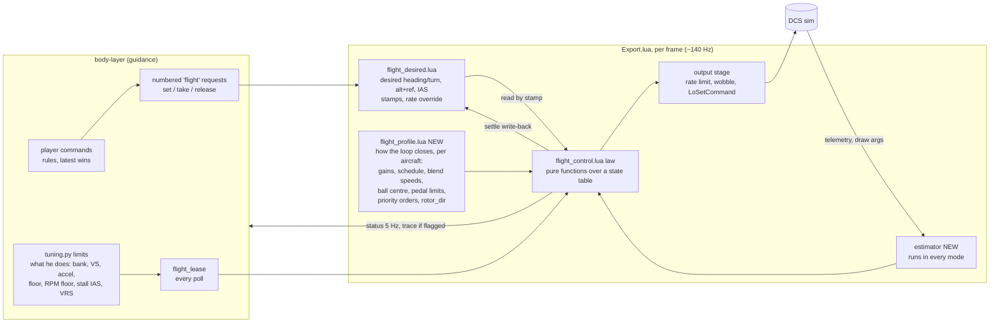
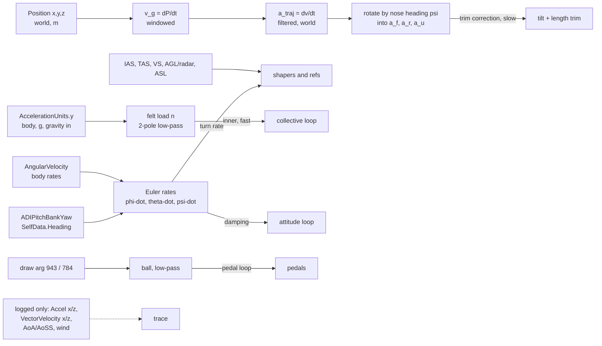
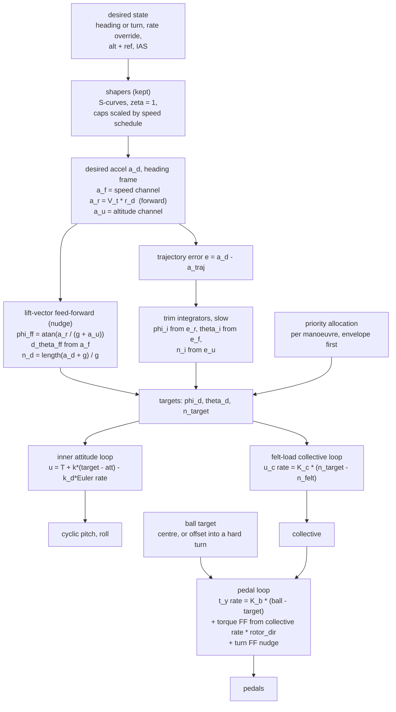
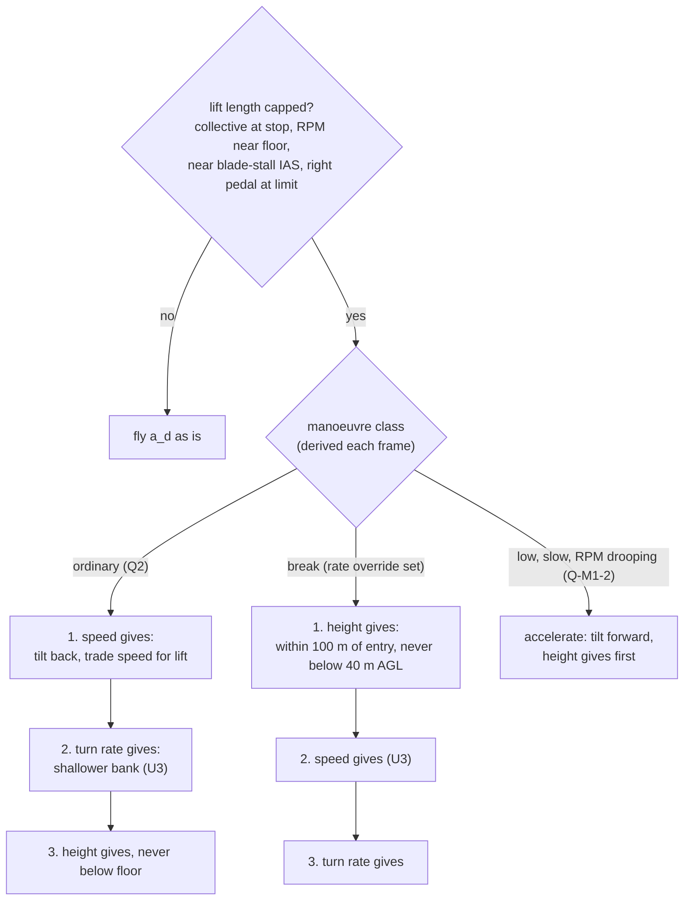
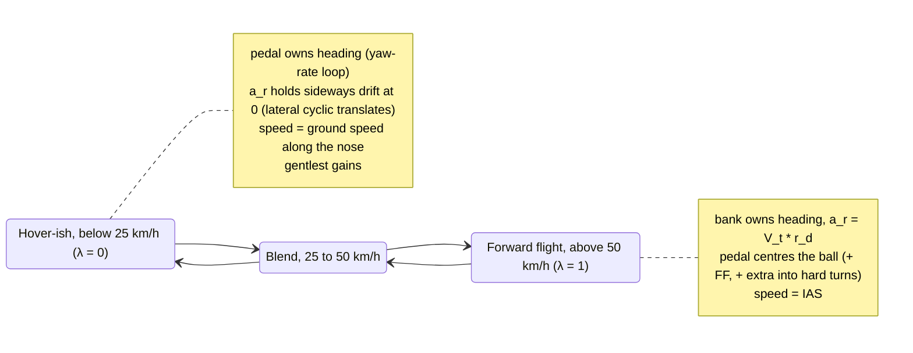
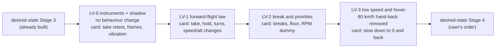

# BL-16 mode 1 lift-vector control law, stage 1 (no SAU): plan

Architect pass, 2026-11-20. Branch `feature/bl16-lift-vector-law` (tip `51179f0a`); the law is built
**on top of desired-state Stage 3** (`feature/bl16-desired-state-s34`, tip `e7ac1163`), and this plan
reads that code as it will be: `flight_control.lua`, `flight_desired.lua`, `core.lua` and
`plans/flight-desired-state/` at `e7ac1163`.

Inputs read in full: `explore-notes.md` and `alignment.md` (this directory);
`aircraft-layer/research/2026-11-20-motion-telemetry-frames.md`, `2026-11-20-slip-ball-recon.md`
(including its calibration flight), `2026-11-18-bl16-m0-flight-axes-findings.md`;
`docs/acceptance/2026-11-20-sortie-feedback.md`; `plans/flight-control/plan.md` (the control law
under Decision 23, Decisions 27–32); `plans/flight-control/explore-notes.md` (2026-10-26 lift
vector and feedback direction, 2026-11-18 break, 2026-11-19 mode-1 hover); `body-layer/ROADMAP/BL-16.md`
at `e7ac1163` (lift-vector item); `plans/flight-desired-state/{plan,explore-notes}.md` at `e7ac1163`.

**Stage 2 (with the SAU) is out of scope.** What stage 1 leaves open for it is under "Stage 2 seam".

### Goal

Replace mode 1's per-axis law with one that flies the way the user flies: from the desired state it
derives a **desired 3D acceleration**. The **cyclic tilts the lift vector** toward it, the
**collective sets the vector's length**, and the **pedals set the tail-rotor force**. Each is
corrected by what the aircraft is observed to do, never by a trusted model of the lift vector.
It flies at any speed, hover included, gentler the slower it goes, and it neither uses nor depends
on the SAU.

### Value against effort (step 1a)

Worth it: mode 1 is the only mode any future helicopter will have (`alignment.md`, Why), and today's
law produces exactly the faults the user flew (standing bank against standing pedal, turns without
pedal, a break that pulls late and then too hard). **One part is expensive for what it buys now:
hover.** "Any speed" (Q1) is designed in from the start, so that nothing hands back, but it gets its
own last stage (LV-3). Hover *commands* (fixed-spot hold, translate, move up/down) stay in BL-16's
"Later — mode 1 hover"; LV-3 only makes the law fly sensibly at and near zero speed.

### What reading the code turned up (step 3a)

Two latent errors in today's inner loop are a better explanation of the break report (*"too slowly
pulls cyclic back… then pulls too much"*) than the gains are. Both rest on one unconfirmed fact:
that `LoGetAngularVelocity` returns **body-axis** rates. M0-A could not tell, because it was flown
level, where body rates and Euler rates are the same.

1. **Pitch damping fights every steady turn.** `law_outputs` writes
   `u_pitch = … − K_Q·q`, with `q` the body pitch rate. In a coordinated level turn the nose must
   pitch around the horizon at `q = ψ̇·sin φ`: about 13°/s in a 60° bank at 15°/s. That is about 0.13
   of forward stick fighting the turn. The slow `T_p` integrator then winds up to cancel it (late),
   and on the roll-out `q` drops to zero while `T_p` is still wound up, so the nose comes up and
   speed bleeds (too much).
2. **The heading rate reads low in a bank.** `read_measured` takes `r = −ang.y`. If that is the body
   yaw rate, it is `ψ̇·cos φ`: half the true turn rate at 60°. `phi_i` integrates `r_d − r`, so it
   keeps adding bank in every steep turn.

The LV-0 card settles the frame: in a steady 60° turn, body rates give `q ≈ ψ̇·sin φ`, Euler rates
give `q ≈ 0`. LV-1 damps on Euler rates (`φ̇, θ̇, ψ̇`, from body rates by the standard transform);
if LV-0 shows the getter already returns Euler rates, the transform is the identity and nothing
else changes.

**Constants checked (widened 4a rule).** Grepped `flight_control.lua` and `defaults.toml` at
`e7ac1163` for every time constant, speed, bank, rate and gain. Reused: the shaper ω/ζ/caps,
`K_HEADING_TRACK`, `K_VS_ERROR`/`K_ALT_ERROR`/`K_SPEED_ERROR`, the inner-loop `K_THETA*`/`K_PHI*`
(re-damped, see above), `PEDAL_LIMIT_*`, the RPM and blade-stall margins, `FLOOR_AGL_M`,
`BREAK_MAX_HEIGHT_LOSS_M`, `VRS_*`, `MAX_TURN_BANK_DEG`, `MAX_CLIMB_VS_MPS`, `MAX_ACCEL_MPS2`,
`OUTPUT_RATE_LIMIT_PER_S`, `DT_CAP`, `TURN_SETTLE_DEG_S`. **Replaced:** `TAU_ACCEL_FILTER_S` (IAS/VS
derivative), `K_COLLECTIVE`, `K_TILT_FROM_AX`, `K_TILT_FROM_AZ_SATURATED`, `K_BANK_INCREMENT`,
`K_TURN_COORD_PEDAL`, `K_BREAK_PEDAL_BIAS` (see "Removed and kept"). **No existing constant
governs** the hover/forward blend speeds, the felt-load filter, the position-derivative windows, the
ball target or the gain schedule; all are new and live in the profile. The user's hover threshold
(25 km/h, "configurable") exists only in the explore notes, not in code.

**Investigator not invoked (step 3), deliberately.** The plan depends on three unverified facts:
the body-rate frame above, `LoGetSelfData().Position` axes (x north, z east: this project's
established convention, `world-model/src/coordinates/projections.py`, but not checked for this
call), and the felt-load y axis lying along the lift vector. Desk research could give at best a
forum claim for each; the LV-0 card measures all three in one flight that is already needed for the
take retest (alignment finding 4). So LV-1 is gated on that card, not on a recon note.

### Affected Modules / Files

- `aircraft-layer/dcs-export/Petrobrain/flight_profile.lua` — **new**, a `dofile`d chunk holding the
  one per-aircraft profile table (`PROFILES["Mi-24P"]`): every loop gain and time constant, the gain
  schedule, the regime blend speeds, the pedal limits, the ball centre and usable range, the
  deliberate-extra-pedal amounts, the per-manoeuvre priority orders, and `rotor_dir` (which flips the
  torque feed-forward). A separate chunk because it is data the user will edit, and it keeps
  `flight_control.lua`'s 200-local budget. **Selection:** `ACTIVE = PROFILES["Mi-24P"]`; select by
  `LoGetSelfData().Name` is a one-line change once a second profile exists (not built now).
- `aircraft-layer/dcs-export/Petrobrain/flight_control.lua` — the law. New `est_*` estimator
  (position → velocity → acceleration, felt-load filter, Euler rates, ball), run **every frame in
  every mode** so it is warm at a take; `law_update` restructured into the loops below; `law_outputs`
  damps on Euler rates; `law_init_at_take` initialises the new state bit-exact. Every `law_*` function
  takes `profile` as an explicit parameter beside `limits`, so the toy plant can pass a test profile.
  `check_envelope`/`check_unpark_preconditions` lose the IAS floor (LV-3). Status push gains the
  estimator fields; a flag-gated per-frame trace (`aircraft_layer_flight_debug.flag` →
  `aircraft_layer_flight_trace.log`, owed since Decision 23) lands in LV-0.
- `aircraft-layer/dcs-export/Export.lua` — load `flight_profile` before `flight_control`.
- `aircraft-layer/dcs-export/Petrobrain/flight_desired.lua` — **unchanged.** The law reads desired
  by stamp as Stage 3 built it; break vs ordinary is derived from `turn_rate_deg_s` being set.
- `body-layer/src/belief/flight_control.py` (+ `crew_console.py`, `speech.py`, `defaults.toml`),
  **LV-3 only** — `MIN_IAS_KMH` removed: `take_controls` loses `TOO_SLOW`, `clamp_speed`'s lower
  bound becomes 0, `min_ias_kmh` leaves the lease `limits` and `FC_LIMIT_BOUNDS`.
  `body-layer/src/collector/*` or wherever `fc_*` status fields are parsed — new estimator fields,
  passed through for the cards.
- `aircraft-layer/tests/test_flight_control_law.py` — toy plant rebuilt as a 3D point mass (below);
  `test_flight_control_lua.py`, `test_export_lua_constants_parity.py`,
  `test_dcs_export_lua_local_order.py` — extraction tuples and parity for the new module and fields.
- `aircraft-layer/CLAUDE.md` (`flight_control` bullet), `body-layer/CLAUDE.md` (flight_control
  entry, LV-3), `body-layer/ROADMAP/BL-16.md` (lift-vector item status).
- `docs/acceptance/<date>-bl16-lv<n>-card.md` — one card per stage.

### Design Overview (diagrams)

**1. Who owns what.** Unchanged seams in grey; new pieces are the profile and the estimator.

**2. What is measured, and which loop each signal closes.** Only signals with a measured sign close
a loop; the rest are logged.

**3. The loops.** Fast inside, slow outside; the feed-forwards carry the quick response, the trim
integrators remove what the feed-forwards get wrong.

**4. Under limits, who gives first: the order travels with the manoeuvre.** The envelope (RPM floor,
blade stall, VRS, 40 m floor, physical stops) is never crossed; when it caps the lift length, the
shortfall goes down the manoeuvre's own chain.

**5. Speed regimes: one law, blended.** `λ` goes from 0 (hover) to 1 (forward flight) on measured
horizontal ground speed. Nothing switches; every term is weighted.

**6. Delivery.** Each stage flies its own card from the feature branch before the next is built.

### The law, in words

Symbols: `ψ` true heading (the nose), `φ` bank, `θ` pitch, `H` the heading frame (forward along the
nose, right, up; horizontal), `V` IAS, `V_t` TAS, `V_g` horizontal ground velocity.

**A. Estimator (every frame, every mode).**
- **Trajectory.** Position from `LoGetSelfData().Position` (x north, y up, z east) with model-time
  stamps in a short ring buffer. Velocity is the slope over a window `W_V` (profile, first cut 0.1 s,
  by timestamp not by frame count); acceleration is the slope of velocity over `W_A` (0.2 s), then a
  first-order low-pass `τ_A` (0.2 s). Rotated into `H` by the measured `ψ`. Total lag about 0.3 s.
  **Q4's answer, as the user approved it.** If LV-0 shows `LoGetVectorVelocity` x/z equal `dP/dt`
  (axis and sign), velocity may come from it instead, which removes one differentiation and about
  0.1 s of lag (U7).
- **Felt load.** `n = LoGetAccelerationUnits().y`, two cascaded first-order low-passes `τ_N` (profile,
  first cut 0.12 s each). That attenuates blade-pass vibration (around 20 Hz for a five-blade rotor
  at about 4 Hz shaft speed) by more than 100× and costs about 40° of phase at 0.5 Hz. LV-0's trace
  measures the real spectrum before LV-1 relies on it. x/z are logged, never used (unsigned).
- **Euler rates** from body rates and `φ, θ` (the standard kinematic transform). `ψ̇` replaces
  `−ang.y` as the turn rate the shapers and the yaw loop read.
- **Ball** from arg 943/784 (whichever seat is live, as today), low-pass `τ_B`. Centred is +0.03,
  usable ±0.5, ball right = positive (calibration flight, 2026-11-20).
- **Reset/priming.** On `dt > DT_CAP` (pause, stall), mission stop, `reset(epoch)` and first frame,
  the ring buffer and filters re-prime from the current sample instead of differencing across the
  gap. A stall must never produce an acceleration spike.

**B. Shapers (kept).** Heading/turn, altitude and speed references exactly as today, ζ = 1, with
their accel and rate caps multiplied by the **speed schedule** `G(V)` (E7: about 0.3 at hover, 1.0
from 150 km/h; profile breakpoints, first cut). Heading wraps by the shortest arc unless a direction
was given. The break's height floor (Decision 29) and the VRS cap (Decision 31) stay where they are.

**C. Desired acceleration** in `H`:
- `a_u,d = ẇ_ref + k_w(w_ref − w) + k_h(h_ref − h)` (unchanged formula).
- `a_f,d = dV_ref + k_v·[λ(V_ref − V) + (1 − λ)(V_ref − V_g,f)]`: IAS in forward flight, ground
  speed along the nose near hover (U2).
- `a_r,d = λ·V_t·r_d + (1 − λ)·k_vg·(0 − V_g,r)`: centripetal in forward flight, "stop drifting
  sideways" near hover. `r_d = r_ref + K_ψ·wrap(ψ_ref − ψ)` as today.

**D. Lift-vector direction (cyclic).** The targets the inner loop flies are a **feed-forward nudge
plus a trim learnt from observation**:
- `φ_d = φ_ff + φ_i`, `φ_ff = atan(a_r,d / (g + a_u,d))`, `φ̇_i = K_φ·e_r` with `e_r = a_r,d − a_r`.
- `θ_d = θ_i + Δθ_ff`, `Δθ_ff = −c_θ·atan(a_f,d / (g + a_u,d))` with `c_θ ≤ 1` (profile; the disc
  tilt the fuselage needs to balance drag is unknown, so it is left to `θ_i`), `θ̇_i = −K_θ·e_f`.
- `K_φ`, `K_θ` give the trim loops time constants of several seconds, at least three times slower
  than the 0.3 s estimator lag plus the attitude response; that separation is the stability argument,
  and the toy plant checks it with the plant's gains deliberately wrong.
- The inner attitude loop is today's form, `u = T + k(target − attitude) − k_d·(Euler rate)`, with
  `T` integrating and solved at take for a bit-exact first frame.

**E. Lift-vector length (collective), a cascade.** The felt load is the measurement the collective
acts on (finding 1); the trajectory corrects it slowly:
- `n_target = n_d + n_i`, `n_d = |a_d + g·up| / g` (desired specific force; in a level 60° turn,
  2 g), `ṅ_i = K_n·e_u` with `e_u = a_u,d − a_u` (slow; absorbs the felt-load axis not lying exactly
  along the lift vector, accelerometer bias, anything `n_d` gets wrong).
- `u̇_c = K_c(V)·(n_target − n_felt)`, rate-limited, saturated, and capped by the existing RPM,
  blade-stall and pedal-margin guards (Decision 30's flags, kept).
- This is what makes collective rise **with** the bank rather than after an altitude error builds
  (E4, E5): the bank changes `n_d` the same frame. It is not a model of the aircraft, only of what a
  level turn must feel like; the loop then steers until it does.
- A one-line source flag (`LIFT_LENGTH_SOURCE = "felt" | "kinematic"`, profile) lets a card fly the
  kinematic-only fallback (`u̇_c = K_c'·e_u`) if the felt-load loop misbehaves, the same posture as
  `ROTOR_RPM_SOURCE`.

**F. Pedals (tail-rotor force).** One integrator, one target, never a heading loop in forward flight
(finding 2):
- Forward flight: `ṫ_y = λ·K_β(V)·(ball − ball_target)`. Sign from the calibration: ball right of
  centre → more right pedal, and `t_y` is in the command domain (`SIGN·arg`), where positive is right
  (`2026-11-20-slip-ball-recon.md`, "Centring direction"). A toy-plant sign test and a card row both
  check it. `K_β` is scheduled by speed: the calibration showed slip per pedal depends on airspeed.
- `ball_target = centre − sign(r_d)·B_extra(severity)`: zero severity in ordinary flight (ball
  centred), full in a break, ramping between two hard-turn banks in an ordinary turn (Q6, U5).
  Holding the ball **off** centre into a hard turn is the deliberate extra pedal, expressed as a target
  the same loop already tracks, so nothing has to be unwound when the turn ends.
- Feed-forward nudges (starting values, profile): torque `K_cy·u̇_c·rotor_dir` (more collective,
  more right pedal on the Mi-24P), and a small turn term on `r_d` at turn entry while the ball loop
  catches up.
- Near hover: `+(1 − λ)·K_r(V)·(r_d − ψ̇)`. The pedal yaws the nose; bank does not (*"Bank in hover
  is not the way to change heading"*). Only one of the two owns heading at any blend weight in the
  sense that matters: bank's share of the heading job is `λ`, pedal's is `1 − λ`.
- The asymmetric pedal limits stay (right is the small side for `rotor_dir = +1`), and a collective
  increase is still rate-capped near the right limit.

**G. Priority under limits (diagram 4).** The manoeuvre class is **derived every frame**:
`break` if a rate override is set, `low_slow_rpm` if the RPM guard is active below 50 km/h, else
`ordinary`. While the lift length is capped and `e_u` stays positive (not enough lift), the shortfall
is handed down that class's chain, each absorber until its own limit:
- **speed gives**: `θ_i` is allowed to integrate nose-up on `e_u` (today's `K_TILT_FROM_AZ_SATURATED`
  idea, now one entry in a chain), until IAS falls below the speed band's floor;
- **turn gives**: `φ_ff` is scaled down (shallower bank, less lift needed) until a minimum share;
- **height gives**: `a_u,d` is allowed below zero, bounded by the break floor or the 40 m floor.
- `low_slow_rpm`: `θ_i` integrates nose-**down** (accelerate) and height gives.
The orders are profile data; the chain code is one place. The when (class) is separate from the
actions (absorbers), per the actions-and-params rule.

**H. Anti-windup.** `φ_i`, `θ_i`, `n_i`, `T_p`, `T_r`, `u_c`, `t_y` stop integrating in the direction
that pushes their own output further into saturation. `φ_i`/`θ_i` also hold while the attitude error
exceeds a profile bound (the inner loop is not following, so the trajectory error says nothing about
trim). This closes Decision 30's unguarded `phi_i` windup risk.

**I. Take (E1).** `law_init_at_take` keeps Decision 24's guarantee: the first written frame equals
the captured command exactly. The references start at measured value and measured rate (today); the
trim integrators start where the measured state puts them (`φ_i = φ − φ_ff(measured a)`,
`θ_i = θ`, `n_i = n_felt − n_d(measured a)`), so every target equals the measured attitude and felt
load on the first frame. The estimator is already warm (it runs in every mode). From there the
shapers carry the aircraft to the desired state as S-curves; a take 50 km/h below the desired speed
is a gentle transition, not a lurch. **The law must not break E1; it is not assumed to repair the
erratic voice take** (alignment finding 4): LV-0's card retests the take on Stage 3 alone.

**J. Recovery.** When a break settles (Decision 27's clearing, kept), the ball target returns to
centre through `τ_B` and the class becomes ordinary; the altitude shaper chases the standing goal from
where the break left it (its reference is never snapped). When an absorber gave (speed, height, bank),
its reference is **re-seated** to measured when the limit releases, so the aircraft returns through
the shaper's S-curve rather than snapping back. Low, slow and RPM drooping accelerates first.

**K. Desired-state handover.** Unchanged: the law applies `desired` by stamp
(`apply_desired_changes_to_law`), the unpark seed carries it verbatim (Decision 32/Q4), and the
roll-out and break settles write the settled heading back. No new wire field: the break is the rate
override; `turn_style` stays ignored by mode 1. Desired-state Stage 4 (mode 2 manoeuvres) is not
touched.

### Removed and kept

| today (`flight_control.lua` at `e7ac1163`) | in this law |
|---|---|
| `a_x`, `a_z` from IAS/VS derivatives (`TAU_ACCEL_FILTER_S`) | **removed**: trajectory acceleration from position deltas, world frame (Q4) |
| collective integrates on `a_z` error (`K_COLLECTIVE`) | **replaced**: felt-load cascade (E) |
| pitch target from `a_x` error (`K_TILT_FROM_AX`) | **replaced**: `θ_i` on `e_f` + nudge (D) |
| `K_TILT_FROM_AZ_SATURATED`, one fixed trade | **replaced**: per-manoeuvre chain (G) |
| bank `= atan(V_t·r_d/g) + phi_i`, `phi_i` on yaw-rate error | **replaced**: `φ_ff` from `a_d` + `φ_i` on lateral acceleration error |
| damping on body `q`, `p`; turn rate `= −ang.y` | **replaced**: Euler rates (gated on LV-0) |
| `K_TURN_COORD_PEDAL` overlay, `K_BREAK_PEDAL_BIAS` + `break_pedal_bias_accum` unwind | **replaced**: ball loop with a target (F) |
| low-IAS release and take precondition, body-layer `MIN_IAS_KMH`, `TOO_SLOW` | **removed in LV-3** (Q1) |
| shapers, `K_HEADING_TRACK`, altitude/speed feedback gains, baro conversion | kept |
| break floor (D29), VRS cap (D31), RPM seam (D28), collective-limited flags (D30) | kept; the flags feed the chain |
| inner loop form, bit-exact take, capture, `armed`/unpark take, envelope dead/NaN | kept |
| output stage (rate limit, wobble, `LoSetCommand`), `SEAT_ARGS`/`CMD`/`SIGN` | kept (`[[BL-18]]` owns the per-module arg/cmd map) |
| pure functions over a state table, toy-plant testable | kept; `profile` added as a parameter |

### Implementation Plan

Each stage flies a card from **the feature branch** (`feature/bl16-lift-vector-law`, checked out in
the repo root by the user), with no deploy steps and the readout through `$DCS_COLLECTOR_IP`
(`source run-scripts/petrobrain.env`). **All LV cards: SAU K/H/T off at handover** (stage 1 is
without the SAU; U4).

1. **LV-0 — instruments and shadow (no behaviour change).**
   - Estimator (A) running every frame; status fields `fc_est_*` (trajectory `a_f/a_r/a_u`, `V_g`,
     felt load, Euler rates, filtered ball, `λ`) and the flag-gated per-frame trace, which also logs
     the unsigned channels (accel x/z, `LoGetVectorVelocity`, `LoGetAngleOfAttack/SideSlip` raw).
   - `flight_profile.lua` created and the **existing** law constants moved into it, values
     unchanged; a test asserts the law's outputs are bit-identical before and after the move.
   - Card: (a) the take retest on Stage 3 alone (voice take off→m1, unpark m2→m1): smooth or not,
     with the trace on (finding 4); (b) level 60 s northbound and eastbound: track from `V_g` matches
     heading within a few degrees (position axes); (c) steady 30° and 60° turns, both directions:
     `q` against `ψ̇·sin φ` (body vs Euler), felt load against `1/cos φ` (lift-length axis); (d) level
     accel and decel: `a_f` sign; (e) `LoGetVectorVelocity` x/z against `dP/dt`; (f) 10 s straight
     and level for the vibration spectrum and estimator noise. Pass: (b)–(e) give signs; the noise of
     `a_traj` in steady flight is small against 0.5 m/s² and the felt load's against 0.05 g.
2. **LV-1 — forward-flight law (gated on LV-0's frame answers).** B–F, H, I, the ordinary chain in
   G, the gain schedule over the forward range. The removed pieces in the table go. The 80 km/h
   release stays as a safety net until LV-3 (U1). Card: take into a held heading (E1, E2: wings
   within a few degrees, ball near +0.03), turns of 30° and 90° both ways at 120 and 220 km/h (E3,
   E4: ball centred, pedal with the turn, no sag or balloon), speed 150→220→150 (E6), climb and
   descent 100 m (E6), heading hold in a crosswind (Q5: nose on the heading, drift accepted), one
   row with `LIFT_LENGTH_SOURCE = "kinematic"` to compare.
3. **LV-2 — break and priorities.** The break and low-slow-RPM chains (G), the deliberate extra
   pedal (F, Q6), recovery (J), and vignette 5: a break entered slow is gentler because its rate is
   capped by the speed schedule, never released. Card: break left and right at 120, 180 and 250 km/h
   (E5: 60–80° bank quickly, collective in with the bank, speed near entry, height loss ≤ 100 m,
   roll-out on the break heading), break away, one break started at about 120 m AGL (the 40 m floor
   holds), one break with a lowered `ROTOR_RPM_DUMMY_PCT` (the aircraft does less, silently, E8).
4. **LV-3 — low speed and hover regime.** `λ` blend (C, F), ground-speed reference (U2), gentlest
   schedule, the pedal yaw loop. Remove the low-IAS release and take precondition in Lua; body-layer
   `MIN_IAS_KMH`, `TOO_SLOW` and the lower clamp go. Hover hold and translate commands stay in
   BL-16 "Later". Card: speed 150→60→0 (no hand-back, no jerk, settles over the ground), heading
   change of 90° at speed 0 (pedal, bank stays within a few degrees), speed 0→150 (smooth through
   25–50 km/h), a voice take at 40 km/h (accepted, no "too slow"), low-slow with the lowered RPM
   dummy (accelerates).

Each stage runs the subproject checks (`fast-tests.sh aircraft-layer`, and body-layer in LV-3).
LV-1 and LV-2 may be built back to back as one perf/security batch if LV-1's card is flown between
them; LV-3 is its own batch.

### Tests (real-Lua toy-plant harness)

The toy plant in `test_flight_control_law.py` becomes a **3D point mass**: lift vector of length
`n·g` along body-up rotated by `φ, θ`; `n` first-order on collective; attitude first-order on cyclic;
yaw on pedal with a torque term from collective; ball from lateral specific force in body axes;
position integrated from the forces with drag along the air velocity and an optional constant wind.
It feeds the estimator **positions**, so the derivative chain is tested, not bypassed.

- **The never-known lift vector, as a test**: every convergence scenario is run with the plant's
  gains at ×0.5 and ×2 of nominal, and with an unknown fuselage pitch trim; the law must converge
  without retuning (the user's principle that the vector is steered, not computed).
- Take: bit-exact first frame; a take 50 km/h off the desired speed reaches it monotonically.
- Heading hold: bank settles within 2° of level with the ball centred; no standing crossed controls
  (a constant pedal disturbance is absorbed by the pedal integrator, not by bank).
- Coordinated turn: ball within band through entry, steady state and roll-out; altitude in band;
  steady 60° turn: no pitch-stick fight (Euler damping), the turn rate the shaper sees equals `ψ̇`.
- Felt load: in a level 60° turn, collective rises with the bank in the same second, not after an
  altitude error; with 20 Hz ±0.3 g vibration injected into the felt load, the collective output's
  high-frequency content stays under a bound.
- Estimator: position quantised to 1 cm and `dt` jittered 5–12 ms with one 116 ms stall gives no
  acceleration spike and no visible output hunting; a pause re-primes.
- Speed and altitude changes: accelerating raises collective, decelerating lowers it (E6).
- Priorities: with the lift length capped, ordinary loses speed first, break loses height first and
  stays above `max(40, entry − 100)`, low-slow-RPM accelerates; the envelope is never crossed.
- Break: 60–80° bank at 150 and 220 km/h; ball held at its offset target, centre restored after the
  settle; nothing left wound up afterwards.
- Pedal sign: a ball right of centre drives the pedal command positive.
- Regimes (LV-3): `λ` crosses 25 and 50 km/h with no output step; speed 0 holds ground speed near 0
  in wind; a 90° heading change at hover moves the pedal, bank stays under a few degrees.
- Kept tests stay green: pause freeze, VRS cap, RPM/stall caps, stopping height, settle write-back.
- Harness hygiene: every new local and module added to the extraction tuples (the silent-default
  trap from the desired-state plan).

### Co-moving Fields

The law state is built in one place (`law_init_at_take`) and copied whole by `law_apply_goal` and
`law_update` (`for k, v in pairs(state)`), so a new field carries only if `law_init_at_take` creates
it. Grep of construction and teardown sites at `e7ac1163`: `law_init_at_take` (create);
`law_apply_goal`, `law_update` (copy); `request_release`, `check_envelope` failure, park → `armed`,
`on_stop`, `reset` (set `fc_law = nil`). The estimator lives **outside** `fc_law` (it runs in every
mode), so its own reset sites are listed separately.

| Field | Written by | Transition | Must hold true after |
|---|---|---|---|
| `φ_i, θ_i, n_i, T_p, T_r, u_c, t_y` | internal (take) | voice take, unpark take | outputs equal the captured command bit-exact; targets equal measured attitude and felt load |
| `rate_override_deg_s`, `break_entry_h_m` | external (desired, by stamp) | break set | class = break the same frame; ball target offset into the turn; alt/speed goals untouched (B1, kept) |
| same | external | ordinary heading/turn set mid-break | both cleared in that `law_apply_goal`; class ordinary; ball target back to centre (B2, kept) |
| same + desired `turn_rate_deg_s` | internal (settle) | break reaches band | all cleared the same frame and written back once (kept); trim integrators not reset |
| absorber references (`v_ref`, `h_ref`, `φ_ff` scale) | internal (chain) | limit releases | reference re-seated to measured; no snap-back |
| `λ`, class, `ball_target`, schedule `G` | derived each frame | any | never stored: nothing to carry or forget |
| estimator ring buffer and filters | internal | `dt > DT_CAP`, mission stop, `reset(epoch)`, first frame | re-primed from the current sample; next `a_traj` is finite and near zero |
| `fc_law` | internal | release, envelope, park, stop, reset | `nil`; next take rebuilds every field above |

### Stage 2 seam (SAU), not built

The SAU acts on attitude and rates, so the only place it meets this law is the inner attitude loop.
Stage 1 leaves: the inner loop behind one function with its gains in a profile sub-table
(`inner.sau_off`), so an `inner.sau_on` set and a read of the SAU switch state can be added without
touching the outer loops; the trace logs whatever SAU state is readable for free. M0-H (does the
SAU fight commanded changes) is still unflown and is stage 2's first question.

### Risks & Unknowns

- **The body-rate frame decides LV-1's inner loop.** If LV-0 shows Euler rates, the two latent
  errors above are not the break's cause and its cause is still open; LV-1's design is unaffected
  either way, only the explanation.
- **Position-derived acceleration lags about 0.3 s.** That is why the trajectory error only trims;
  if LV-0 shows it noisier than expected, the windows grow and the trims slow, which is acceptable.
  It would not be acceptable as a fast loop, which it is not.
- **The felt-load axis may not lie along the lift vector** (disc tilt relative to the fuselage, a few
  degrees). `n_i` absorbs a steady offset; a large one shows on LV-0's turn rows. The kinematic
  fallback flag exists for this.
- **Hover with no position hold drifts.** LV-3 holds ground velocity near zero, not a spot; the user
  gets slow drift until BL-16's hover item adds the fixed spot.
- **Strong wind at low speed.** `λ` runs on ground speed while the aerodynamics follow airspeed; at
  hover in a 10 m/s wind the law is in hover regime while the rotor sees 36 km/h. Bounded by the
  gentle schedule; watched on LV-3's card.
- **Every gain is a first cut**, as today. The schedule and chain shapes are designed; their numbers
  come from the cards.
- **The ball arg's update rate is unknown** (the control args update at about 25 Hz). The pedal loop
  is slow by design; LV-0's trace measures it.
- **Lua budget:** `flight_control.lua` gains the estimator; keep its state in tables, and check the
  60-upvalue ceiling on `run_flight_control`/`law_update`.
- **Tuning without the X-T26 mechanism.** Profile values are edited in Lua, not `tuning.py`, as for
  every loop constant today; that is the existing split (behaviour limits on the wire, loop values in
  Lua).

### Second-order effect

The profile plus an aircraft-generic law is everything a second helicopter needs on the mode-1 side
(one table and `rotor_dir`), and the `λ` regime is the slot BL-16's deferred hover commands plug into
(fixed-spot hold is a position term on `a_r`/`a_f` near `λ = 0`). When this plan merges, Decision 3
(forward flight only) and the control-law steps 2–5 under Decision 23 in `plans/flight-control/plan.md`
get `REVISED` pointers to this plan (step 10), and desired-state Stage 4's card should fly on this law.

### Decisions Requiring User Input

- **U1: When does the 80 km/h hand-back go?** — recommend: in LV-3, together with the low-speed
  design, not in LV-1; why: before LV-3 the law has no low-speed regime, so "any speed" would fly an
  unplanned regime and a bad flight would have two causes. Your answer (*"remove the limit"*) stands;
  this only asks which stage.
- **U2: What "speed" means near hover.** — recommend: at 50 km/h and above it is IAS (as now); below
  25 km/h it is ground speed along the nose, so "speed 0" hovers over the ground rather than drifting
  with the wind; blended between; why: your hover answer said ground speed, and IAS at hover is just
  the wind.
- **U3: The rest of each priority order.** You said speed gives first in an ordinary turn, and height
  (within 100 m) in a break. Recommend: ordinary — speed, then turn rate (shallower), then height;
  break — height, then speed, then turn rate; why: keeps each manoeuvre's point (an ordinary turn
  holds height, a break keeps turning) as long as possible.
- **U4: SAU on the LV cards.** — recommend: K/H/T off at handover for every LV card; why: stage 1 is
  without the SAU, and you said it is usually on, so the cards must set it. Optionally one row with
  it on, only to see how big stage 2's gap is.
- **U5: How much deliberate extra pedal, and when a turn counts as hard.** — recommend: in a break,
  hold the ball about 0.1 raw (a fifth of its usable travel) off centre to the outside of the turn
  (extra pedal into the turn); in an ordinary turn, nothing below 45° bank, rising to the same at
  60°; why: a starting value small enough to see on the ball and safe to tune by feel.
- **U6: A break entered slow (about 100 km/h).** — recommend: it turns more gently (its rate capped
  by the low-speed schedule) rather than demanding 60–80°; why: E7 and the envelope; with the
  hand-back gone it can no longer hand back mid-break, but it can still bleed speed it does not have.
- **U7: Velocity source.** — recommend: if LV-0 shows `LoGetVectorVelocity` x/z equal the position
  deltas, take velocity from it and keep position as the cross-check; why: one less derivative,
  about 0.1 s less lag; your approval was for position deltas, so this needs your yes.
