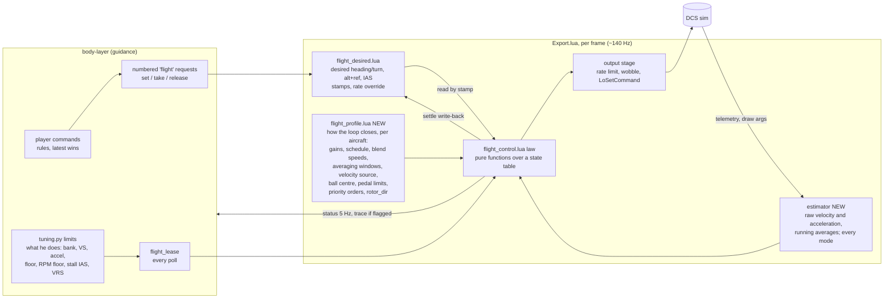
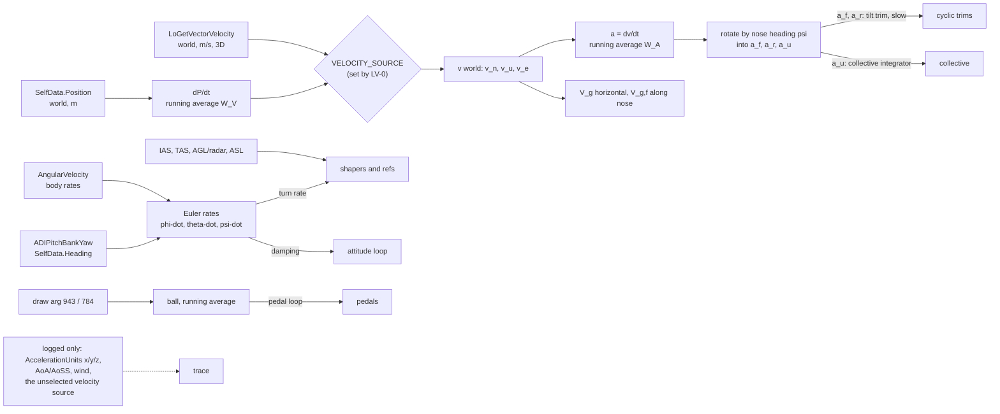
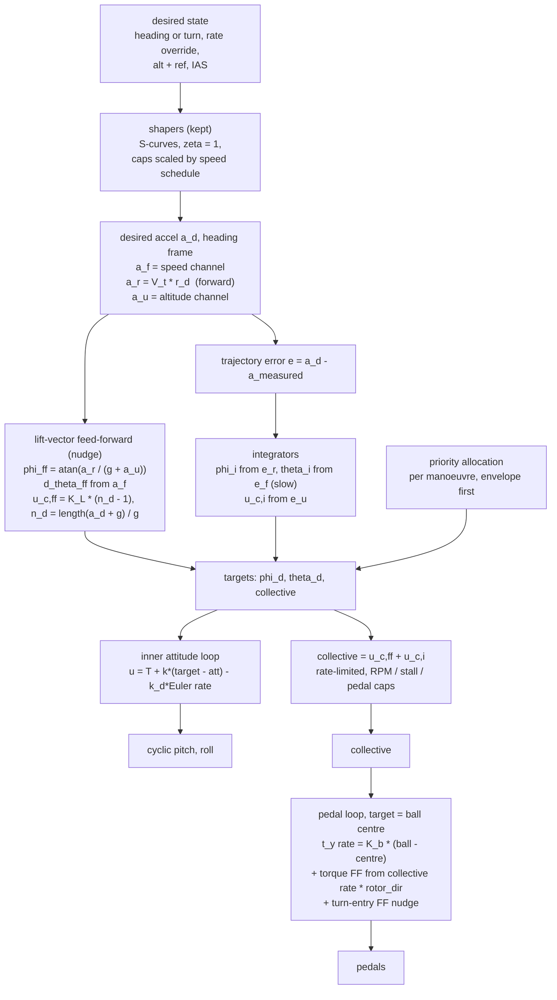
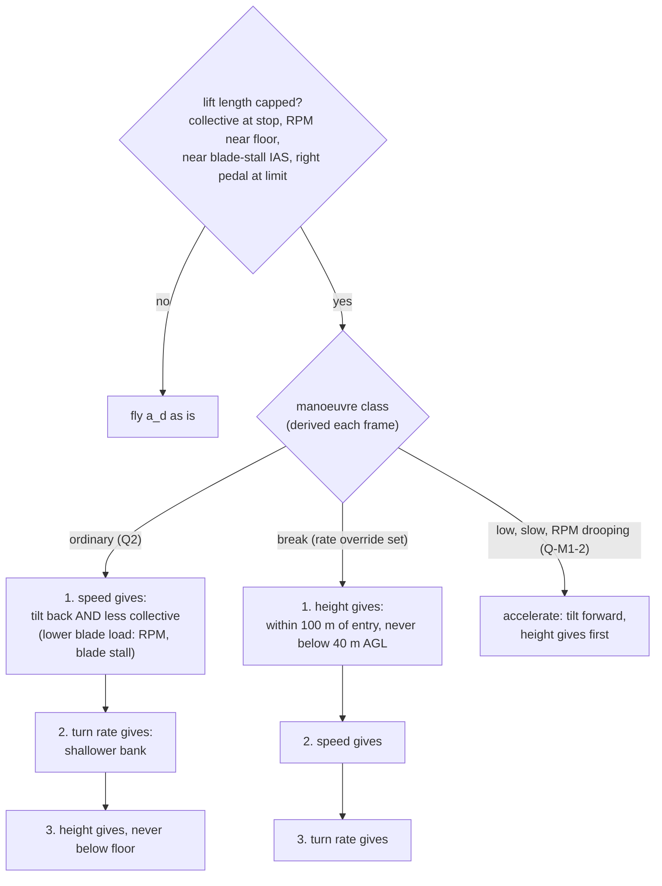
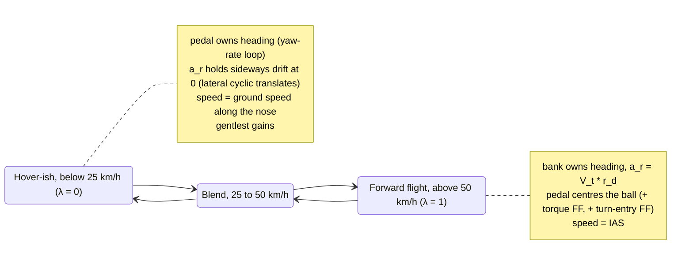
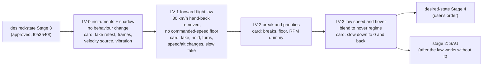
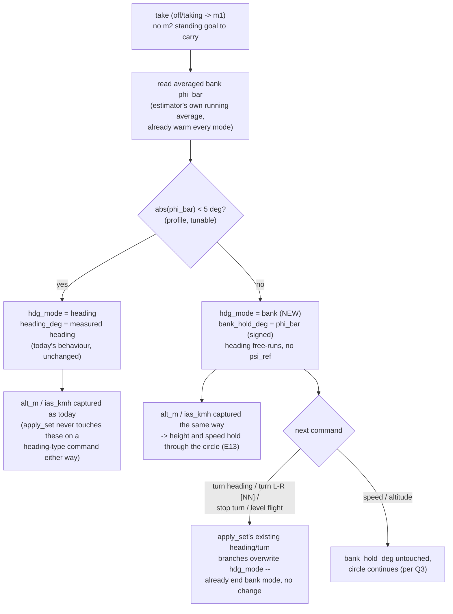
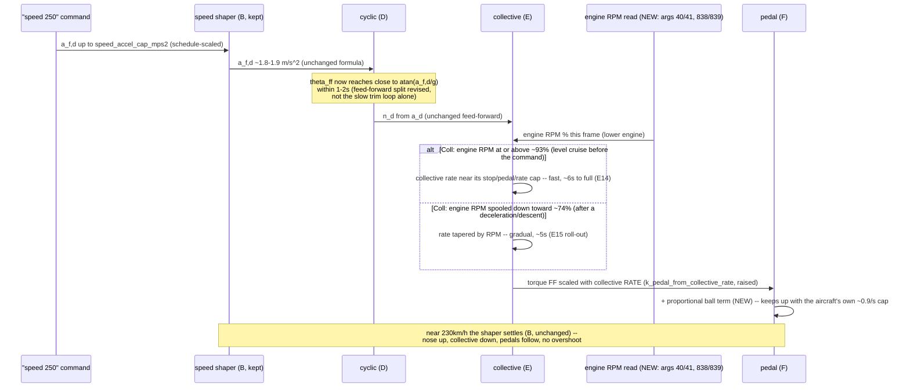
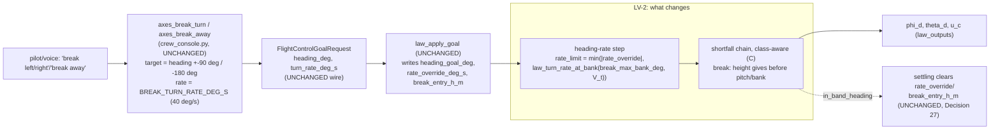
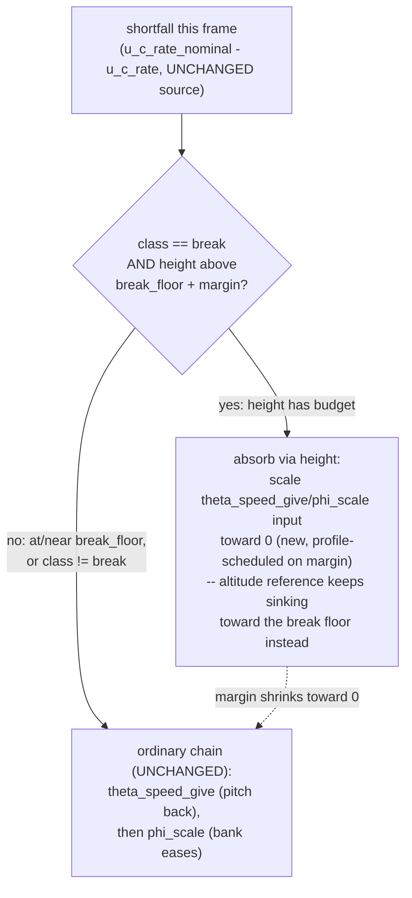

# BL-16 mode 1 lift-vector control law, stage 1 (no SAU): plan

Architect pass, 2026-11-20; **amended the same day** with the user's answers to U1–U7
(`explore-notes.md`, "Answers to the plan's U1–U7"). Branch `feature/bl16-lift-vector-law` (tip
`2c42e2f9`); the law is built **on top of desired-state Stage 3** (`feature/bl16-desired-state-s34`,
tip `f0a3540f`, approved), and this plan reads that code as it will be: `flight_control.lua`,
`flight_desired.lua`, `core.lua` and `plans/flight-desired-state/` at `f0a3540f`.

### Amended (2026-11-20, user's answers)

- **Consistency pass (2026-11-20, architect, arch3/lift-vector).** U8's final answer ("no floor")
  was carried through every remaining place the plan still described a 50 km/h commanded-speed
  floor or deferred its removal to LV-3 (`alignment.md` Finding 1): the summary above, Affected
  Modules, diagrams 5 and 6, the "Removed and kept" table, the LV-1 build, the LV-3 build, and the
  Tests section. The Risks entry is rewritten to say plainly that nothing protects LV-1 below
  50 km/h except the gain schedule and the envelope guards, by the user's own informed choice (Q1).
  The LV-1 card gains a deliberate slow-flight row (speed 40, then speed 20) so the gap is observed
  on a card rather than discovered in a flight. The 25/50 km/h λ-blend breakpoints, the
  pitot-gauge instrument context (U2) and the RPM-guard regime below 50 km/h are unchanged — those
  are not the commanded-speed floor. Plan check Finding 2 (SAU-on-at-handover rule had no stage or
  ID to carry it) is resolved: built and reviewed on `feature/bl16-sau-handover`, already merged
  into this branch (`review-sau-handover.md`).
- **No felt load.** *"Consider just using raw velocity and acceleration. No need to model how pilot
  would feel it… Deltas probably need to be a running average to filter out vibration."* The
  felt-load collective cascade (old section E, `n_target`, `n_i`, `LIFT_LENGTH_SOURCE`) is gone.
  Collective is now a feed-forward from the desired lift length plus an integrator on **vertical
  acceleration error**, measured from raw velocity (E). Every derivative is a running average
  (A). `LoGetAccelerationUnits` is logged in the trace only, for diagnosis; no loop reads it.
  Goal-check finding 1 still holds, more strongly: nothing the law reads rises with load in a bank.
- **U1 → LV-1.** The 80 km/h hand-back (Lua release and take refusal, body-layer `TOO_SLOW`) goes in
  **LV-1**. What protects low speed in LV-1 is a gentler law alone, not a floor and not a
  hand-back (LV-1; U8 settled with no floor).
- **U2, U3, U6, U7: yes.** Recorded as answered; the instrument context is noted, but the law uses
  raw telemetry. U7 is now a profile switch, `VELOCITY_SOURCE`, set by LV-0's comparison.
- **U4:** SAU off on every LV card; the SAU stage follows once the law works without it.
- **U5 reverted.** No deliberate extra pedal: **the pedals always fly the slip ball**, target =
  centre. The ball-offset target, its severity ramp and its tests are removed (this also supersedes
  the goal check's Q6 answer).
- Diagrams 2, 3, 5, 6 updated; base shas moved to `2c42e2f9` / `f0a3540f`.

Inputs read in full: `explore-notes.md` and `alignment.md` (this directory);
`aircraft-layer/research/2026-11-20-motion-telemetry-frames.md`, `2026-11-20-slip-ball-recon.md`
(including its calibration flight), `2026-11-18-bl16-m0-flight-axes-findings.md`;
`docs/acceptance/2026-11-20-sortie-feedback.md`; `plans/flight-control/plan.md` (the control law
under Decision 23, Decisions 27–32); `plans/flight-control/explore-notes.md` (2026-10-26 lift
vector and feedback direction, 2026-11-18 break, 2026-11-19 mode-1 hover); `body-layer/ROADMAP/BL-16.md`
(lift-vector item); `plans/flight-desired-state/{plan,explore-notes}.md` at `f0a3540f`.

**Stage 2 (with the SAU) is out of scope.** What stage 1 leaves open for it is under "Stage 2 seam".

### Goal

Replace mode 1's per-axis law with one that flies the way the user flies: from the desired state it
derives a **desired 3D acceleration**. The **cyclic tilts the lift vector** toward it, the
**collective sets the vector's length**, and the **pedals fly the slip ball**. Each is corrected by
what the aircraft is observed to do, measured from raw velocity and acceleration, never by a trusted
model of the lift vector. It flies at any speed, hover included, gentler the slower it goes, and it
neither uses nor depends on the SAU.

### Value against effort (step 1a)

Worth it: mode 1 is the only mode any future helicopter will have (`alignment.md`, Why), and today's
law produces exactly the faults the user flew (standing bank against standing pedal, turns without
pedal, a break that pulls late and then too hard). **One part is expensive for what it buys now:
hover.** "Any speed" (Q1) is designed in from the start, so that nothing hands back, but it gets its
own last stage (LV-3). Hover *commands* (fixed-spot hold, translate, move up/down) stay in BL-16's
"Later — mode 1 hover"; LV-3 only makes the law fly sensibly at and near zero speed.

### What reading the code turned up (step 3a)

Two latent errors in today's inner loop are a better explanation of the break report (*"too slowly
pulls cyclic back… then pulls too much"*) than the gains are. Both rest on one unconfirmed fact:
that `LoGetAngularVelocity` returns **body-axis** rates. M0-A could not tell, because it was flown
level, where body rates and Euler rates are the same.

1. **Pitch damping fights every steady turn.** `law_outputs` writes
   `u_pitch = … − K_Q·q`, with `q` the body pitch rate. In a coordinated level turn the nose must
   pitch around the horizon at `q = ψ̇·sin φ`: about 13°/s in a 60° bank at 15°/s. That is about 0.13
   of forward stick fighting the turn. The slow `T_p` integrator then winds up to cancel it (late),
   and on the roll-out `q` drops to zero while `T_p` is still wound up, so the nose comes up and
   speed bleeds (too much).
2. **The heading rate reads low in a bank.** `read_measured` takes `r = −ang.y`. If that is the body
   yaw rate, it is `ψ̇·cos φ`: half the true turn rate at 60°. `phi_i` integrates `r_d − r`, so it
   keeps adding bank in every steep turn.

The LV-0 card settles the frame: in a steady 60° turn, body rates give `q ≈ ψ̇·sin φ`, Euler rates
give `q ≈ 0`. LV-1 damps on Euler rates (`φ̇, θ̇, ψ̇`, from body rates by the standard transform);
if LV-0 shows the getter already returns Euler rates, the transform is the identity and nothing
else changes.

**Constants checked (widened 4a rule).** Grepped `flight_control.lua` and `defaults.toml` at
`f0a3540f` for every time constant, speed, bank, rate and gain. Reused: the shaper ω/ζ/caps,
`K_HEADING_TRACK`, `K_VS_ERROR`/`K_ALT_ERROR`/`K_SPEED_ERROR`, the inner-loop `K_THETA*`/`K_PHI*`
(re-damped, see above), `PEDAL_LIMIT_*`, the RPM and blade-stall margins, `FLOOR_AGL_M`,
`BREAK_MAX_HEIGHT_LOSS_M`, `VRS_*`, `MAX_TURN_BANK_DEG`, `MAX_CLIMB_VS_MPS`, `MAX_ACCEL_MPS2`,
`OUTPUT_RATE_LIMIT_PER_S`, `DT_CAP`, `TURN_SETTLE_DEG_S`. **Replaced:** `TAU_ACCEL_FILTER_S` (IAS/VS
derivative), `K_COLLECTIVE`, `K_TILT_FROM_AX`, `K_TILT_FROM_AZ_SATURATED`, `K_BANK_INCREMENT`,
`K_TURN_COORD_PEDAL`, `K_BREAK_PEDAL_BIAS` (see "Removed and kept"). **Removed in LV-1:**
`ENV_IAS_MARGIN_KMH`, `ENV_HOLD_S` and `fc_env_low_ias_since_t` (only the IAS release uses them);
`MIN_IAS_KMH` is removed outright in LV-1, along with its hand-back meaning (U8, no floor).
**No existing constant governs** the hover/forward blend speeds, the running-average windows, the
velocity source switch, the lift-length feed-forward gain or the gain schedule; all are new and live
in the profile. The user's hover threshold (25 km/h, "configurable") exists only in the explore
notes, not in code.

**Investigator not invoked (step 3), deliberately.** The plan depends on three unverified facts:
the body-rate frame above, `LoGetSelfData().Position` axes (x north, z east: this project's
established convention, `world-model/src/coordinates/projections.py`, but not checked for this
call), and `LoGetVectorVelocity` being the world-frame velocity that matches `dP/dt` (the user's
own test, 2026-11-20: it is 3D, sideways movement shows; axes and sign still to compare). Desk
research could give at best a forum claim for each; the LV-0 card measures all three in one flight
that is already needed for the take retest (alignment finding 4). So LV-1 is gated on that card,
not on a recon note.

### Affected Modules / Files

- `aircraft-layer/dcs-export/Petrobrain/flight_profile.lua` — **new**, a `dofile`d chunk holding the
  one per-aircraft profile table (`PROFILES["Mi-24P"]`): every loop gain and time constant, the gain
  schedule, the regime blend speeds, the running-average windows, `VELOCITY_SOURCE`, the pedal
  limits, the ball centre and usable range, the per-manoeuvre priority orders, and `rotor_dir`
  (which flips the torque feed-forward). A separate chunk because it is data the user will edit,
  and it keeps `flight_control.lua`'s 200-local budget. **Selection:** `ACTIVE = PROFILES["Mi-24P"]`;
  select by `LoGetSelfData().Name` is a one-line change once a second profile exists (not built now).
- `aircraft-layer/dcs-export/Petrobrain/flight_control.lua` — the law. New `est_*` estimator
  (velocity → acceleration by running averages, Euler rates, ball), run **every frame in every
  mode** so it is warm at a take; `law_update` restructured into the loops below; `law_outputs`
  damps on Euler rates; `law_init_at_take` initialises the new state bit-exact. Every `law_*`
  function takes `profile` as an explicit parameter beside `limits`, so the toy plant can pass a
  test profile. **LV-1:** `check_envelope` loses the IAS release, `check_unpark_preconditions` loses
  `too_slow` (an unreadable IAS is no longer a refusal cause; NaN handling stays in
  `check_envelope`'s `"nan"`). `build_take_seed`'s unpark clamp (added at `f0a3540f`) loses its
  speed floor (U8; keeps its ceiling and the AGL floor). Status push gains the estimator fields; a
  flag-gated per-frame trace (`aircraft_layer_flight_debug.flag` →
  `aircraft_layer_flight_trace.log`, owed since Decision 23) lands in LV-0.
- `aircraft-layer/dcs-export/Export.lua` — load `flight_profile` before `flight_control`.
- `aircraft-layer/dcs-export/Petrobrain/flight_desired.lua` — **unchanged.** The law reads desired
  by stamp as Stage 3 built it; break vs ordinary is derived from `turn_rate_deg_s` being set.
- **body-layer, LV-1** — `belief/flight_control.py`: `take_controls` loses `too_slow` and the
  `TOO_SLOW` reason; `MIN_IAS_KMH` and every commanded-speed floor go entirely (U8, no floor):
  `clamp_speed`'s lower bound becomes 0, `min_ias_kmh` leaves the lease `limits` and
  `FC_LIMIT_BOUNDS`; `belief/crew_console.py` and `body.py` lose the `too_slow` plumbing;
  `belief/speech.py` loses the `TOO_SLOW` line; `config/rules/README.md`'s `take_controls` row loses
  `"TOO_SLOW"`; `config/defaults.toml` regenerated. `belief/flight_authority.py` (carried-value
  announcement) follows `clamp_speed` and needs no edit. **LV-3:** nothing left to remove here —
  `MIN_IAS_KMH` and the floor are already gone, removed in LV-1. Wherever `fc_*` status fields are
  parsed (`collector/*`): new estimator fields, passed through for the cards.
- `aircraft-layer/tests/test_flight_control_law.py` — toy plant rebuilt as a 3D point mass (below);
  `test_flight_control_lua.py`, `test_export_lua_constants_parity.py`,
  `test_dcs_export_lua_local_order.py` — extraction tuples and parity for the new module and fields.
  body-layer's `TOO_SLOW` tests are deleted with the behaviour (rewritten, not extended: the
  refusal no longer exists).
- `aircraft-layer/CLAUDE.md` (`flight_control` bullet), `body-layer/CLAUDE.md` (flight_control
  entry), `body-layer/ROADMAP/BL-16.md` (lift-vector item status).
- `docs/acceptance/<date>-bl16-lv<n>-card.md` — one card per stage.

### Design Overview (diagrams)

**1. Who owns what.** Unchanged seams in grey; new pieces are the profile and the estimator.

**2. What is measured, and which loop each signal closes.** Raw telemetry only; every derivative is
a running average. Signals whose sign is unmeasured are logged, never used.

**3. The loops.** Fast inside, slow outside; the feed-forwards carry the quick response, the
integrators remove what the feed-forwards get wrong.

**4. Under limits, who gives first: the order travels with the manoeuvre.** The envelope (RPM floor,
blade stall, VRS, 40 m floor, physical stops) is never crossed; when it caps the lift length, the
shortfall goes down the manoeuvre's own chain. (Orders confirmed by the user, U3.)

**5. Speed regimes: one law, blended.** `λ` goes from 0 (hover) to 1 (forward flight) on measured
horizontal ground speed. Nothing switches; every term is weighted. LV-1 and LV-2 fly with `λ = 1`
throughout and no commanded-speed floor (U8, no floor); LV-3 adds the blend below 50 km/h.

**6. Delivery.** Each stage flies its own card from the feature branch before the next is built.
SAU off on every card (U4).

### The law, in words

Symbols: `ψ` true heading (the nose), `φ` bank, `θ` pitch, `H` the heading frame (forward along the
nose, right, up; horizontal), `V` IAS, `V_t` TAS, `V_g` horizontal ground velocity.

**Instrument context (U2, user, for reference only).** The pitot IAS gauge reads down to 50 km/h;
the pilot's Doppler shows ground speed up to 45 km/h forward and 25 km/h back, left and right, and a
Doppler vertical speed of ±10 m/s; the copilot has only pitot IAS and the VSI. **The law uses none
of these gauges' limits**: it reads raw telemetry (*"Petrobrain is to use raw telemetry data to
calculate speeds and accelerations and control inputs from that"*). The ranges explain why "speed"
near hover is ground speed (U2), and are what the player sees when judging a card.

**A. Estimator (every frame, every mode).** No model of what the pilot feels: velocity and
acceleration from raw telemetry, every derivative a running average (user: *"Deltas probably need to
be a running average to filter out vibration"*).
- **Velocity.** World-frame velocity `v = (v_n, v_u, v_e)` from the source `VELOCITY_SOURCE`
  selects (profile):
  - `"position"`: `LoGetSelfData().Position` (x north, y up, z east) in a model-time-stamped ring
    buffer; `v` is the least-squares slope over the last `W_V` seconds (first cut 0.1 s, by
    timestamp, never by frame count), which is a running average of the per-frame deltas.
  - `"vector"`: `LoGetVectorVelocity` (U7, answered yes), averaged over the same `W_V`. The user's
    test shows it is 3D (sideways movement shows). LV-0 compares it against `dP/dt` for axes and
    sign; if they match, the profile selects `"vector"` (one less differentiation) and the other
    source stays in the trace as the cross-check, **computed only while the per-frame trace flag is
    on**, never every frame for nothing (`perf-plan-review.md` item 1).
- **Data structure** (`perf-plan-review.md` item 2): every window is a fixed-size ring buffer
  preallocated once at module load, with the least-squares sums (Σt, Σt², Σx, Σtx) updated
  incrementally as samples enter and leave, so each frame is O(1) work and allocates nothing.
  The trace flag is checked before any trace string or extra `LoGet*` read is built (item 4).
  The estimator runs in every mode by design; LV-0's card watches for a frame-time symptom (item 3).
- **Update rate, not every frame** (user, 2026-11-20, verbatim): *"many of the flight control
  calculations (including estimator) don't really need to run *every* frame. Nothing ever changes
  that fast. I'd say 30Hz would be plenty, even 10 Hz might do. Maybe interleave calculations so
  that not everything is calculated in single frame, but spread accross a couple of frames."* So:
  the estimator and the law run at a profile rate (`LAW_HZ`, first cut 30 Hz), on model time, not
  frame count; the work is interleaved across frames (e.g. sample and estimator on one frame, the
  law's outer loops on the next, inner loops and output target on the third), so no single frame
  carries all of it. The **output stage still writes every frame**, repeating the latest target
  (with the existing rate limit and wobble), because the axis override is per-frame
  (`LuaExportBeforeNextFrame`). Confirmed by the user (2026-11-20, verbatim): *"the axis write itself
  may have to stay every frame -> this is true."* So the write stays every frame; no LV-0 check
  needed. Every `dt` in the law becomes the time since that
  calculation last ran, never a frame `dt`. **All timing is DCS mission (model) time
  (`LoGetModelTime`), never wall-clock** (user, 2026-11-20, verbatim: *"Timing must use mission
  time, not wall clock time. Reason: DCS may be paused by user."*): the law-rate scheduler, the
  ring-buffer timestamps and windows, and every `dt`. While paused, model time stops, `dt` is 0,
  no new samples or law steps happen, and the existing pause row (rewrite the last outputs, freeze
  shapers and integrators) still applies on the every-frame write.
- **Acceleration**, including **vertical acceleration**: `a = dv/dt` as the least-squares slope of
  `v` over `W_A` (first cut 0.2 s), then one more running mean over `W_A2` (first cut 0.1 s). The
  vertical component `a_u` is simply the slope of `v_u`, the world-up velocity: no gravity in it, no
  body frame, so in a level 60° turn it reads zero, exactly as the altimeter says. Horizontal
  `a_n, a_e` are rotated into `H` by the measured `ψ` to give `a_f, a_r`. Window lengths are profile
  values, chosen as multiples of the blade-pass period so that vibration falls in a running
  average's null; LV-0's trace measures the real spectrum and the noise before LV-1 relies on it.
  Total lag about 0.15–0.2 s (half of each window).
- **Ground speed**: `V_g` (horizontal magnitude) and `V_g,f`, `V_g,r` (along and across the nose)
  from `v`, for the speed channel near hover (LV-3) and the trace.
- **Euler rates** from body rates and `φ, θ` (the standard kinematic transform). `ψ̇` replaces
  `−ang.y` as the turn rate the shapers and the yaw loop read.
- **Ball** from arg 943/784 (whichever seat is live, as today), running average `W_B`. Centred is
  +0.03, usable ±0.5, ball right = positive (calibration flight, 2026-11-20).
- **Logged only** (trace, diagnosis): `LoGetAccelerationUnits` x/y/z, AoA/AoSS, wind, the
  unselected velocity source. None of them closes a loop.
- **Reset/priming.** On `dt > DT_CAP` (pause, stall), mission stop, `reset(epoch)` and first frame,
  the ring buffers and averages re-prime from the current sample instead of differencing across the
  gap. A stall must never produce an acceleration spike.

**B. Shapers (kept).** Heading/turn, altitude and speed references exactly as today, ζ = 1, with
their accel and rate caps multiplied by the **speed schedule** `G(V)` (E7: about 0.3 at hover, 1.0
from 150 km/h; profile breakpoints, first cut). Heading wraps by the shortest arc unless a direction
was given. The break's height floor (Decision 29) and the VRS cap (Decision 31) stay where they are.

**C. Desired acceleration** in `H`:
- `a_u,d = ẇ_ref + k_w(w_ref − w) + k_h(h_ref − h)` (unchanged formula; `w = v_u` from the estimator).
- `a_f,d = dV_ref + k_v·[λ(V_ref − V) + (1 − λ)(V_ref − V_g,f)]`: IAS in forward flight, ground
  speed along the nose near hover (U2, answered yes). `λ = 1` until LV-3.
- `a_r,d = λ·V_t·r_d + (1 − λ)·k_vg·(0 − V_g,r)`: centripetal in forward flight, "stop drifting
  sideways" near hover. `r_d = r_ref + K_ψ·wrap(ψ_ref − ψ)` as today.

**D. Lift-vector direction (cyclic).** The targets the inner loop flies are a **feed-forward nudge
plus a trim learnt from observation**:
- `φ_d = φ_ff + φ_i`, `φ_ff = atan(a_r,d / (g + a_u,d))`, `φ̇_i = K_φ·e_r` with `e_r = a_r,d − a_r`.
- `θ_d = θ_i + Δθ_ff`, `Δθ_ff = −c_θ·atan(a_f,d / (g + a_u,d))` with `c_θ ≤ 1` (profile; the disc
  tilt the fuselage needs to balance drag is unknown, so it is left to `θ_i`), `θ̇_i = −K_θ·e_f`.
- `K_φ`, `K_θ` give the trim loops time constants of several seconds, at least three times slower
  than the estimator lag plus the attitude response; that separation is the stability argument,
  and the toy plant checks it with the plant's gains deliberately wrong.
  **Superseded in part, 2026-11-24** (see "LV-1 amendment" below): this slow-trim premise is what
  produced the 60 s, −8° acceleration the fourth re-fly measured against a 20 s, −15° target. The
  trim loop's *time constant* is unchanged (it still exists to learn the fuselage trim the
  feed-forward cannot know); what changes is that the **onset** of a commanded speed change no
  longer waits on it — see the amendment's "Speed changes" for the feed-forward split that makes
  this consistent with decision 5 ("S-curves, no oscillation") rather than abandoning it.
- The inner attitude loop is today's form, `u = T + k(target − attitude) − k_d·(Euler rate)`, with
  `T` integrating and solved at take for a bit-exact first frame.

**E. Lift-vector length (collective): feed-forward plus vertical-acceleration integrator.** The
measurement is the aircraft's **vertical acceleration** from raw velocity (A), never a load reading:
- `u_c = u_c,ff + u_c,i`.
- `u_c,ff = K_L(V)·(n_d − 1)`, with `n_d = |a_d + g·up| / g`, the lift length the desired
  acceleration needs (1 in level flight, 2 in a level 60° turn). This is a **nudge, not a model**:
  `K_L` starts deliberately below the collective a 1 g increase needs, so the integrator supplies
  the rest and a wrong `K_L` is a slower settle, never a balloon. It is what makes collective rise
  **with** the bank, the same frame, rather than after an altitude error builds (E4, E5).
  *Main-loop note from the flight-dynamics research
  (`aircraft-layer/research/2026-11-20-helicopter-flight-dynamics.md`, finding 9), not the
  architect's text:* induced power grows roughly with n², not n (60° bank, n = 2: about 4× induced
  power). The linear nudge stays right for LV-1; if LV-2's break card shows the collective lag
  growing with bank instead of staying roughly constant, taper `K_L` with bank or `n_d` in the
  profile. Same "nudge, not model" framing.
- `u̇_c,i = K_c(V)·e_u`, `e_u = a_u,d − a_u` (world up). `a_u,d` already carries the altitude and
  vertical-speed errors (C), so this one integrator holds height through turns, climbs and speed
  changes.
- Rate-limited, saturated, and capped by the existing RPM, blade-stall and pedal-margin guards
  (Decision 30's flags, kept).
- **Goal-check finding 1, satisfied by construction:** in a level 60° turn `a_u` is zero and `n_d`
  rises, so collective goes **up**. No signal the law reads grows with load in a bank, so no channel
  can cut collective because load rises. A toy-plant test asserts both.
- Comparison row: `K_L = 0` in the profile flies the integrator alone (the old shape, with better
  measurement), to show what the feed-forward buys.

**F. Pedals: fly the slip ball, always.** One integrator, one target, the ball's centre; never a
heading loop in forward flight (finding 2), and no deliberate extra pedal in hard turns or breaks
(U5 reverted, user: *"revert my idea about extra pedal. Just fly the slip ball."*).
- Forward flight: `ṫ_y = λ·K_β(V)·(ball − centre)`. Sign from the calibration: ball right of centre
  → more right pedal, and `t_y` is in the command domain (`SIGN·arg`), where positive is right
  (`2026-11-20-slip-ball-recon.md`, "Centring direction"). A toy-plant sign test and a card row both
  check it. `K_β` is scheduled by speed: the calibration showed slip per pedal depends on airspeed.
- Feed-forward nudges (starting values, profile), whose only job is to keep the ball centred while
  the loop catches up: torque `K_cy·u̇_c·rotor_dir` (more collective, more right pedal on the
  Mi-24P), and a small turn term on `r_d` at turn entry.
- Near hover (LV-3): `+(1 − λ)·K_r(V)·(r_d − ψ̇)`. The pedal yaws the nose; bank does not (*"Bank in
  hover is not the way to change heading"*). Bank's share of the heading job is `λ`, pedal's is
  `1 − λ`.
- The asymmetric pedal limits stay (right is the small side for `rotor_dir = +1`), and a collective
  increase is still rate-capped near the right limit.

**G. Priority under limits (diagram 4).** The manoeuvre class is **derived every frame**:
`break` if a rate override is set, `low_slow_rpm` if the RPM guard is active below 50 km/h, else
`ordinary`. While the lift length is capped and `e_u` stays positive (not enough lift), the shortfall
is handed down that class's chain, each absorber until its own limit:
- **speed gives**: `θ_i` is allowed to integrate nose-up on `e_u` (today's `K_TILT_FROM_AZ_SATURATED`
  idea, now one entry in a chain) **and collective is reduced at the same time**, until IAS falls
  below the speed band's floor. User, 2026-11-20, verbatim: *"Also needs less collective so that
  load on rotor blades decreaes. Rotor blade load is what causes both RPM drop and reatreating
  blade stall. Slowing down is always pitch back and also less collective."* So any deceleration,
  in this chain or from an ordinary speed reduction, is pitch back plus less collective, never pitch
  back alone; a rule for the speed channel generally, not only under limits;
- **turn gives**: `φ_ff` is scaled down (shallower bank, less lift needed) until a minimum share;
- **height gives**: `a_u,d` is allowed below zero, bounded by the break floor or the 40 m floor.
- `low_slow_rpm`: `θ_i` integrates nose-**down** (accelerate) and height gives.
The orders are profile data (ordinary: speed, turn rate, height; break: height, speed, turn rate;
U3, answered yes); the chain code is one place. The when (class) is separate from the actions
(absorbers), per the actions-and-params rule. A break entered slow turns more gently because its
rate is capped by the speed schedule (U6, answered yes).

**H. Anti-windup.** `φ_i`, `θ_i`, `u_c,i`, `T_p`, `T_r`, `t_y` stop integrating in the direction
that pushes their own output further into saturation. `φ_i`/`θ_i` also hold while the attitude error
exceeds a profile bound (the inner loop is not following, so the trajectory error says nothing about
trim). This closes Decision 30's unguarded `phi_i` windup risk.

**I. Take (E1).** `law_init_at_take` keeps Decision 24's guarantee: the first written frame equals
the captured command exactly. The references start at measured value and measured rate (today); the
integrators start where the measured state puts them (`φ_i = φ − φ_ff(measured a)`, `θ_i = θ`,
`u_c,i = captured collective − u_c,ff(n_d of measured a)`), so every target equals the measured
attitude and the collective equals the captured one on the first frame. The estimator is already
warm (it runs in every mode). From there the shapers carry the aircraft to the desired state as
S-curves; a take 50 km/h below the desired speed is a gentle transition, not a lurch. A take is
accepted at any airspeed from LV-1 on (only on-ground still refuses). **The law must not break E1;
it is not assumed to repair the erratic voice take** (alignment finding 4): LV-0's card retests the
take on Stage 3 alone.

**Superseded in part, 2026-11-24** (see "LV-1 amendment" below): "a take 50 km/h below the desired
speed is a gentle transition, not a lurch" no longer holds for the *speed* channel specifically —
a take with a speed gap now flies the brisk speed change at once (Q2 answer, "brisk"), restating
rather than quietly overriding this sentence. The bank/heading side of a take is **also** revised
(the "maintains current state" rule now holds a captured *bank*, not a heading, when |bank| ≥ 5°)
— see the amendment's take-mode design.

**J. Recovery.** When a break settles (Decision 27's clearing, kept), the class becomes ordinary and
the altitude shaper chases the standing goal from where the break left it (its reference is never
snapped). When an absorber gave (speed, height, bank), its reference is **re-seated** to measured
when the limit releases, so the aircraft returns through the shaper's S-curve rather than snapping
back. Low, slow and RPM drooping accelerates first.

**K. Desired-state handover.** Unchanged: the law applies `desired` by stamp
(`apply_desired_changes_to_law`), the unpark seed carries it (Decision 32/Q4) clamped to what mode 1
flies (`f0a3540f`, U2 of the desired-state plan), and the roll-out and break settles write the
settled heading back. No new wire field: the break is the rate override; `turn_style` stays ignored
by mode 1. Desired-state Stage 4 (mode 2 manoeuvres) is not touched.

### Removed and kept

| today (`flight_control.lua` at `f0a3540f`) | in this law |
|---|---|
| `a_x`, `a_z` from IAS/VS derivatives (`TAU_ACCEL_FILTER_S`) | **removed**: acceleration from raw world velocity, running averages (A) |
| collective integrates on `a_z` error (`K_COLLECTIVE`) | **replaced**: lift-length feed-forward + vertical-acceleration integrator (E) |
| pitch target from `a_x` error (`K_TILT_FROM_AX`) | **replaced**: `θ_i` on `e_f` + nudge (D) |
| `K_TILT_FROM_AZ_SATURATED`, one fixed trade | **replaced**: per-manoeuvre chain (G) |
| bank `= atan(V_t·r_d/g) + phi_i`, `phi_i` on yaw-rate error | **replaced**: `φ_ff` from `a_d` + `φ_i` on lateral acceleration error |
| damping on body `q`, `p`; turn rate `= −ang.y` | **replaced**: Euler rates (gated on LV-0) |
| `K_TURN_COORD_PEDAL` overlay, `K_BREAK_PEDAL_BIAS` + `break_pedal_bias_accum` unwind | **replaced**: ball loop, target always centre (F) |
| low-IAS release (`ENV_IAS_MARGIN_KMH`, `ENV_HOLD_S`), unpark `too_slow`, body-layer `TOO_SLOW` | **removed in LV-1** (U1) |
| `MIN_IAS_KMH` as commanded-speed floor | **removed entirely in LV-1** (U8, no floor) |
| shapers, `K_HEADING_TRACK`, altitude/speed feedback gains, baro conversion | kept |
| break floor (D29), VRS cap (D31), RPM seam (D28), collective-limited flags (D30) | kept; the flags feed the chain |
| inner loop form, bit-exact take, capture, `armed`/unpark take, envelope dead/NaN | kept |
| output stage (rate limit, wobble, `LoSetCommand`), `SEAT_ARGS`/`CMD`/`SIGN` | kept (`[[BL-18]]` owns the per-module arg/cmd map) |
| pure functions over a state table, toy-plant testable | kept; `profile` added as a parameter |

### Implementation Plan

Each stage flies a card from **the feature branch** (`feature/bl16-lift-vector-law`, checked out in
the repo root by the user), with no deploy steps and the readout through `$DCS_COLLECTOR_IP`
(`source run-scripts/petrobrain.env`). **All LV cards: SAU H, K and T off before every take** (U4;
stage 1 is without the SAU, and the SAU stage follows once the law works without it). The separate
"SAU on at hand-back to the player" rule (`explore-notes.md`, SAU section) is now built and
reviewed on `feature/bl16-sau-handover`, already merged into this branch
(`review-sau-handover.md`): it fires on hand-back, not on take, so every LV card still switches
SAU H, K and T off itself before each new take.

1. **LV-0 — instruments and shadow (no behaviour change).**
   - Estimator (A) running every frame; status fields `fc_est_*` (`a_f/a_r/a_u`, `V_g`, `V_g,f`,
     Euler rates, averaged ball, `λ`) and the flag-gated per-frame trace, which also logs both
     velocity sources and the unsigned channels (`LoGetAccelerationUnits` x/y/z,
     `LoGetAngleOfAttack/SideSlip` raw).
   - `flight_profile.lua` created and the **existing** law constants moved into it, values
     unchanged; a test asserts the law's outputs are bit-identical before and after the move.
   - Card: (a) the take retest on Stage 3 alone (voice take off→m1, unpark m2→m1): smooth or not,
     with the trace on (finding 4); (b) level 60 s northbound and eastbound: track from `V_g` matches
     heading within a few degrees (position axes); (c) steady 30° and 60° turns, both directions:
     `q` against `ψ̇·sin φ` (body vs Euler), `a_u` near zero while level (the vertical channel is
     load-free); (d) level accel and decel: `a_f` sign; (e) `LoGetVectorVelocity` against `dP/dt`
     on all three axes, including a sideslip row (U7, sets `VELOCITY_SOURCE`); (f) 10 s straight and
     level for the vibration spectrum and the noise of each running average. Pass: (b)–(e) give
     signs and axes; the noise of `a` in steady flight is small against 0.5 m/s².
2. **LV-1 — forward-flight law, no hand-back (gated on LV-0's frame answers).** B–F, H, I, the
   ordinary chain in G, the gain schedule `G(V)` **defined down to 0** with its gentlest value at the
   low end. **Amended 2026-11-24** (fourth re-fly, "LV-1 amendment" below): this build also carries
   the new take-mode bank hold (A), the rebalanced speed feed-forward (B), the **engine**-RPM-gated
   collective schedule (C; corrected 2026-11-24 from rotor RPM), and the raised pedal gains (D) — not a new stage, the same LV-1 card
   reflown. The removed pieces in the table go, **including the 80 km/h hand-back** (U1): Lua's IAS
   release and `too_slow` take refusal, body-layer `TOO_SLOW` with its speech line and rules-README
   entry, and **every commanded-speed floor** (U8, no floor): `MIN_IAS_KMH` is removed outright,
   `clamp_speed`'s lower bound becomes 0, and the desired-state unpark clamp loses its speed floor
   too (keeps its ceiling and the AGL floor). **What protects low speed in LV-1, with no hover
   regime yet:** (i) the speed schedule makes everything gentler as speed falls (bank, turn-rate and
   acceleration caps, gains), so a slow command or a sag is flown gently, never a hand-back; (ii) the
   RPM, blade-stall and VRS guards stay as they are. Nothing else: a commanded speed below 50 km/h
   is flown by the forward law as it is, with no ground-speed reference and no pedal yaw loop — the
   user's own informed choice (Q1, verbatim: *"remove the limit. Any speed. What does not work, I
   will bring back and we fix"*). Card: take into a held heading (E1, E2: wings within a few
   degrees, ball near +0.03), turns of 30° and 90° both ways at 120 and 220 km/h (E3, E4: ball
   centred, pedal with the turn, collective in with the bank, no sag or balloon), speed 150→220→150
   (E6), climb and descent 100 m (E6), heading hold in a crosswind (Q5: nose on the heading, drift
   accepted), one row with `K_L = 0` to compare, one voice take at about 70 km/h (accepted, no "too
   slow", gentle acceleration to the desired speed). **Deliberate slow-flight row, so the gap is
   observed rather than untested:** at safe height (at least 300 m AGL) in steady wings-level
   flight, a "speed 40" command; then, only if that settles cleanly, a "speed 20" command. Watch for
   drift off heading, a sag in altitude the collective loop cannot arrest, or hunting in bank or
   pedal as the forward law runs with no ground-speed reference and no pedal yaw loop. Take the
   stick back (or call a return to the 70 km/h row) the moment any of those appears, rather than
   letting it develop — this row is expected to find the edge of LV-1's scope, not to pass cleanly.
3. **LV-2 — break and priorities.** The break and low-slow-RPM chains (G), recovery (J), and
   vignette 5: a break entered slow is gentler because its rate is capped by the speed schedule
   (U6), never released. Pedals fly the ball throughout (no extra pedal). Card: break left and right
   at 120, 180 and 250 km/h (E5: 60–80° bank quickly, collective in with the bank, ball centred,
   speed near entry, height loss ≤ 100 m, roll-out on the break heading), break away, one break
   started at about 120 m AGL (the 40 m floor holds), one break with a lowered
   `ROTOR_RPM_DUMMY_PCT` (the aircraft does less, silently, E8), one break entered at about 100 km/h
   (gentler, no hand-back). **Routed here from round 3's blade-stall-threshold debug**
   (`plans/flight-lift-vector/debug-2026-11-27.md`, "Round 3",
   `aircraft-layer/research/2026-11-27-mi24p-rotor-engine-limits.md`): a G-load cap above
   200 km/h (1.8 G light load, 1.5–1.6 G combat load, tighter still above 2 000 m or in turbulence)
   and keeping rotor RPM ≥ 92% at high speed (low RPM lowers the retreating-blade-stall onset) are
   both unbuilt — noted only, not designed, same "recorded only" posture section F already gives
   the break chain. A natural fit for this stage's own break/turn card, not built as part of round 3.
4. **LV-3 — low speed and hover regime.** `λ` blend (C, F), ground-speed reference (U2), gentlest
   schedule, the pedal yaw loop, the drift hold. (`MIN_IAS_KMH` and the commanded-speed floor are
   already gone — removed in LV-1, U8 — so there is nothing left to remove here.) Hover hold and
   translate commands stay in BL-16 "Later". Card: speed 150→60→0 (no jerk, settles over the
   ground), heading change of 90° at speed 0 (pedal, bank stays within a few degrees), speed 0→150
   (smooth through 25–50 km/h), a voice take at 20 km/h (accepted), low-slow with the lowered RPM
   dummy (accelerates). **Routed here from the sixth re-fly** (`docs/acceptance/2026-11-27-sortie-
   feedback.md`, LV-1 debug-2026-11-27.md): user, verbatim, *"on command to speed 60, nearing the
   60 speed, right pedal was added too late and too slowly which caused left yaw to run away. This
   is more slow speed behaviour, so can go to that stage."* Watch the pedal loop's own response
   near 60 km/h on this stage's card, not only the blend/jerk behaviour already listed.

Each stage runs the subproject checks (`fast-tests.sh aircraft-layer`; body-layer too in LV-1 and
LV-3). LV-1 and LV-2 may be built back to back as one perf/security batch if LV-1's card is flown
between them; LV-3 is its own batch.

### Tests (real-Lua toy-plant harness)

The toy plant in `test_flight_control_law.py` becomes a **3D point mass**: lift vector of length
`n·g` along body-up rotated by `φ, θ`; `n` first-order on collective; attitude first-order on cyclic;
yaw on pedal with a torque term from collective; ball from lateral specific force in body axes;
position and velocity integrated from the forces with drag along the air velocity and an optional
constant wind. It feeds the estimator **positions and velocities** (both sources), so the
running-average chain is tested, not bypassed.

- **The never-known lift vector, as a test**: every convergence scenario is run with the plant's
  gains at ×0.5 and ×2 of nominal, and with an unknown fuselage pitch trim; the law must converge
  without retuning (the user's principle that the vector is steered, not computed).
- Take: bit-exact first frame; a take 50 km/h off the desired speed reaches it monotonically; a take
  at 40 km/h is accepted and flown toward the desired speed without a jerk, with no floor (LV-1).
- Heading hold: bank settles within 2° of level with the ball centred; no standing crossed controls
  (a constant pedal disturbance is absorbed by the pedal integrator, not by bank).
- Coordinated turn: ball within band through entry, steady state and roll-out; altitude in band;
  steady 60° turn: no pitch-stick fight (Euler damping), the turn rate the shaper sees equals `ψ̇`.
- Lift length: in a level 60° turn, collective rises with the bank in the same second (feed-forward),
  not after an altitude error; collective never falls on roll-in while altitude is held (finding 1);
  the law's inputs do not include `LoGetAccelerationUnits` (asserted on the call log); with `K_L` at
  ×0.5 and ×2 the turn still holds height within band.
- Vibration: 20 Hz ripple injected into position and velocity (amplitude from LV-0's trace, first cut
  ±0.3 m/s²-equivalent) keeps the collective and cyclic outputs' high-frequency content under a
  bound.
- Estimator: position quantised to 1 cm and `dt` jittered 5–12 ms with one 116 ms stall gives no
  acceleration spike and no visible output hunting; a pause re-primes; both `VELOCITY_SOURCE` values
  give the same `a` within noise on the same plant run.
- Speed and altitude changes: accelerating raises collective, decelerating lowers it (E6).
- Priorities: with the lift length capped, ordinary loses speed first, break loses height first and
  stays above `max(40, entry − 100)`, low-slow-RPM accelerates; the envelope is never crossed.
- Break: 60–80° bank at 150 and 220 km/h; ball held centred through entry, steady turn and settle;
  nothing left wound up afterwards.
- Pedal sign: a ball right of centre drives the pedal command positive.
- No hand-back (LV-1): IAS held at 40 km/h for 10 s produces no release; `check_unpark_preconditions`
  accepts any IAS; body-layer `take_controls` has no `TOO_SLOW` path; `clamp_speed(30)` returns 30
  (no floor, U8).
- Regimes (LV-3): `λ` crosses 25 and 50 km/h with no output step; speed 0 holds ground speed near 0
  in wind; a 90° heading change at hover moves the pedal, bank stays under a few degrees;
  `clamp_speed(0)` returns 0.
- Kept tests stay green: pause freeze, VRS cap, RPM/stall caps, stopping height, settle write-back.
- Harness hygiene: every new local and module added to the extraction tuples (the silent-default
  trap from the desired-state plan).

### Co-moving Fields

The law state is built in one place (`law_init_at_take`) and copied whole by `law_apply_goal` and
`law_update` (`for k, v in pairs(state)`), so a new field carries only if `law_init_at_take` creates
it. Grep of construction and teardown sites at `f0a3540f`: `law_init_at_take` (create);
`law_apply_goal`, `law_update` (copy); `request_release`, `check_envelope` failure, park → `armed`,
`on_stop`, `reset` (set `fc_law = nil`). The estimator lives **outside** `fc_law` (it runs in every
mode), so its own reset sites are listed separately. `fc_env_low_ias_since_t` and its three reset
sites go in LV-1 with the IAS release.

| Field | Written by | Transition | Must hold true after |
|---|---|---|---|
| `φ_i, θ_i, u_c,i, T_p, T_r, t_y` | internal (take) | voice take, unpark take | outputs equal the captured command bit-exact; targets equal measured attitude; collective equals captured |
| `rate_override_deg_s`, `break_entry_h_m` | external (desired, by stamp) | break set | class = break the same frame; alt/speed goals untouched (B1, kept) |
| same | external | ordinary heading/turn set mid-break | both cleared in that `law_apply_goal`; class ordinary (B2, kept) |
| same + desired `turn_rate_deg_s` | internal (settle) | break reaches band | all cleared the same frame and written back once (kept); integrators not reset |
| absorber references (`v_ref`, `h_ref`, `φ_ff` scale) | internal (chain) | limit releases | reference re-seated to measured; no snap-back |
| `λ`, class, schedule `G` | derived each frame | any | never stored: nothing to carry or forget |
| estimator ring buffers and running averages | internal | `dt > DT_CAP`, mission stop, `reset(epoch)`, first frame | re-primed from the current sample; next `a` is finite and near zero |
| `fc_law` | internal | release, envelope, park, stop, reset | `nil`; next take rebuilds every field above |

### Stage 2 seam (SAU), not built

The SAU acts on attitude and rates, so the only place it meets this law is the inner attitude loop.
Stage 1 leaves: the inner loop behind one function with its gains in a profile sub-table
(`inner.sau_off`), so an `inner.sau_on` set, a read of the SAU switch state and the trim-hold
pattern the user described (trim held through an attitude or heading change, released once stable;
effectors `SAU-H/K/T/B-*` in `body-layer/config/sequences/mi-24p/switch-reference.md`) can be added
without touching the outer loops; the trace logs whatever SAU state is readable for free. M0-H (does
the SAU fight commanded changes) is still unflown and is stage 2's first question. The "SAU on at
hand-back to the player" rule, independent of this law, is now built and reviewed on
`feature/bl16-sau-handover`, already merged into this branch (`review-sau-handover.md`).

### Risks & Unknowns

- **The body-rate frame decides LV-1's inner loop.** If LV-0 shows Euler rates, the two latent
  errors above are not the break's cause and its cause is still open; LV-1's design is unaffected
  either way, only the explanation.
- **Vertical acceleration from velocity lags about 0.15–0.2 s and carries rotor vibration.** That is
  why the collective's fast response comes from the `n_d` feed-forward and the integrator only
  corrects. If LV-0 shows the averages noisier than expected, the windows grow and the integrator
  slows, which is acceptable; the feed-forward is unaffected because it reads only the desired state.
- **`K_L` is a guess.** Too small: a brief sag at roll-in until the integrator catches up (the old
  fault, smaller). Too large: a balloon. It starts small on purpose; the `K_L = 0` card row and the
  ×0.5/×2 tests bracket it.
- **`LoGetVectorVelocity`'s axes are unconfirmed** (3D is confirmed). `"position"` is the default
  until LV-0's row (e) says otherwise.
- **LV-1 below 50 km/h** is flown by the forward law with gentle gains only — no floor, no
  ground-speed reference, no pedal yaw loop. This is the user's own informed choice (Q1, verbatim:
  *"remove the limit. Any speed. What does not work, I will bring back and we fix"*); nothing in
  LV-1 protects this range beyond the gain schedule and the RPM/blade-stall/VRS guards. The LV-1
  card's deliberate slow-flight row (speed 40, then speed 20) is where this is first observed, on a
  card rather than discovered in a flight; whatever fails there is brought back to the architect per
  the user's own rule rather than being treated as a defect in this plan.
- **Hover with no position hold drifts.** LV-3 holds ground velocity near zero, not a spot; the user
  gets slow drift until BL-16's hover item adds the fixed spot.
- **Strong wind at low speed.** `λ` runs on ground speed while the aerodynamics follow airspeed; at
  hover in a 10 m/s wind the law is in hover regime while the rotor sees 36 km/h. Bounded by the
  gentle schedule; watched on LV-3's card.
- **Every gain is a first cut**, as today. The schedule and chain shapes are designed; their numbers
  come from the cards.
- **The ball arg's update rate is unknown** (the control args update at about 25 Hz). The pedal loop
  is slow by design; LV-0's trace measures it.
- **Lua budget:** `flight_control.lua` gains the estimator; keep its state in tables, and check the
  60-upvalue ceiling on `run_flight_control`/`law_update`.
- **Tuning without the X-T26 mechanism.** Profile values are edited in Lua, not `tuning.py`, as for
  every loop constant today; that is the existing split (behaviour limits on the wire, loop values in
  Lua).

### Second-order effect

The profile plus an aircraft-generic law is everything a second helicopter needs on the mode-1 side
(one table and `rotor_dir`), and the `λ` regime is the slot BL-16's deferred hover commands plug into
(fixed-spot hold is a position term on `a_r`/`a_f` near `λ = 0`). Removing the hand-back in LV-1
changes the body-layer vocabulary (`TOO_SLOW` disappears), so any open plan that assumes mode 1
refuses or releases at low speed needs a look when LV-1 merges. When this plan merges, Decision 3
(forward flight only) and the control-law steps 2–5 under Decision 23 in `plans/flight-control/plan.md`
get `REVISED` pointers to this plan (step 10), and desired-state Stage 4's card should fly on this law.

### Decisions Requiring User Input

**Answered 2026-11-20 (user, verbatim):** *"'filtered felt load' -> consider just using raw velocity
and acceleration. No need to model how pilot would feel it. For flight control, code is allowed to
know and act on raw telemetry data. Deltas probably need to be a running average to filter out
vibration. Q1 - LV-1 / Q2 - yes. [instrument ranges, see 'The law, in words'] Regardless, Petrobarin
is to use raw telemetry data to calculate speeds and accelerations and control inputs from that. /
Q3 - yes / Q4 - yes, SAU after all this works without SAU / Q5 - revert my idea about extra pedal.
Just fly the slip ball. / Q6 - yes / Q7 - yes. I just tested DCS velocity is 3D, so sideways
movement is reported as velocity. In all likelihood it is the 3D vector's length."* (full text:
`explore-notes.md`, "Answers to the plan's U1–U7").

- **U1: When does the 80 km/h hand-back go?** — **answered: LV-1.** Built as LV-1 above.
- **U2: What "speed" means near hover.** — **answered: yes** (IAS from 50 km/h, ground speed along
  the nose below 25, blended). Built in LV-3 (C).
- **U3: The rest of each priority order.** — **answered: yes** (ordinary: speed, turn rate, height;
  break: height, speed, turn rate). G and diagram 4.
- **U4: SAU on the LV cards.** — **answered: off on every LV card; the SAU stage after the law works
  without it.** Implementation Plan preamble.
- **U5: Deliberate extra pedal.** — **answered: reverted; the pedals fly the slip ball, always.** F;
  the ball-offset target is removed everywhere.
- **U6: A break entered slow.** — **answered: yes, it turns more gently.** G, LV-2.
- **U7: Velocity source.** — **answered: yes**, `LoGetVectorVelocity` if LV-0 confirms it matches
  the position deltas. A, LV-0 row (e).

Open:

- **U8: The commanded-speed floor in LV-1.** The brief was to remove `MIN_IAS_KMH` in LV-1. The plan
  removes everything that **hands back or refuses** in LV-1, but keeps `MIN_IAS_KMH` as the floor on
  a *commanded* speed, lowered from 80 to 50 km/h, until LV-3 removes it. — recommend: keep the
  50 km/h commanded floor through LV-1 and LV-2; why: without a hover regime, a "speed 20" command
  would be flown by the forward law with no ground-speed reference and no pedal yaw loop, and a
  clamp is honest to the player (read back as clamped by the existing path) where a silent
  Lua-only floor would make Petrovich say one speed and fly another. The alternative, floor 0 in
  LV-1, lets the player command slow flight the law is not built for until LV-3.

  **Answered 2026-11-20** (user, verbatim): *"no floor"*. `MIN_IAS_KMH` and every commanded-speed
  floor go entirely in LV-1: no hand-back, no refusal, no clamp. A slow command is flown by the LV-1
  law as it is (gentler at low speed per the speed schedule); what doesn't work, the user brings
  back (his own Q1 answer). The implementer applies this wherever the plan above still says
  "floored at 50 km/h" or "until LV-3" (Affected Modules, the LV-1 build, the Co-moving table, the
  LV-1 card's low-speed rows), and the U2 unpark clamp from desired-state Stage 3 loses its speed
  floor too (its ceiling and the AGL floor stay).

## LV-1 amendment (2026-11-24, fourth re-fly)

Architect pass. Branch `feature/bl16-lift-vector-law`, detached at tip `46d6a5f2` (the user's
answers to this report's questions; no new code since LV-0/LV-1 were first built). Inputs read in
full: `docs/acceptance/2026-11-24-sortie-feedback.md` "Fourth re-fly" to the end; `alignment.md`'s
"Goal check — 2026-11-24" (E11–E17, findings 1–5, questions 1–5, now all answered); this plan's
sections B, D, E, F, G, I (amended above); `explore-notes.md` U3 "Slowing down"; `body-layer/
ROADMAP/BL-16.md` decisions 3 and 5. Code read: `flight_control.lua` (`law_init_at_take`,
`law_update`'s D/E/F/G sections, `check_envelope`, `read_rotor_rpm_pct`/`ROTOR_RPM_SOURCE`),
`flight_profile.lua` (every gain named below), `flight_desired.lua` (`desired`, `reseed_from_
measured`, `reseed_from_overlay`, `convert_turn_to_heading_for_m2`, `apply_set`, `derive_mode`/
`tick`'s mode-edge dispatch), `body-layer/src/belief/flight_control.py` (`MAX_TURN_BANK_DEG`,
`clamp_speed`, `MAX_ACCEL_MPS2`), `body-layer/src/rules/actions.py`/`crew_console.py` (`axes_*`
bodies — confirmed every `flight.*` action writes only the field(s) it changes; `axes_set_speed`/
`axes_set_altitude` never touch `hdg_mode`, already satisfying Q3 by construction, see "What
reading the code turned up" below).

**What reading the code turned up (step 3a), before designing anything new.** Two things this
amendment needs already exist and are not reinvented:

1. **Speed/altitude commands already never touch `hdg_mode`.** `flight_desired.lua`'s `apply_set`
   branches on `heading_deg ~= nil` / `turn ~= nil` to write `hdg_mode`; the `alt_m`/`ias_kmh`
   branches write only those fields. So Q3's answer ("only heading-type commands end a held
   turn; height and speed hold through it") is **already true of the wire protocol** — no change
   needed there, only in what a "held turn" *is* (below). The alignment's own worry ("a speed
   command that re-applies the whole desired state would level the aircraft") does not apply to
   this codebase's `apply_set` shape; it would apply to a different, whole-state-write design this
   project does not have.
2. **A rotor-RPM read already exists, flagged for exactly this use, and is not yet turned on.**
   `read_rotor_rpm_pct()`/`ROTOR_RPM_SOURCE` (`flight_control.lua`) reads cockpit draw arg 42
   (`aircraft-layer/research/2026-11-19-mi24p-readable-args-recon.md`) behind a `"dummy"`/
   `"arg_proxy"` switch, shipped as `"dummy"` (fixed 90%) "until a flight confirms arg 42 tracks
   rotor RPM and resolves its calibration." Q1's engine-state rule (fast collective when the
   engines are already at normal output, gradual when they are spooled down) is exactly a function
   of this one reading — no new telemetry, no engine/torque proxy needs inventing; this is the
   calibration flight that reading was always waiting for.
   **Superseded 2026-11-24 (same day, user's cockpit readings, see C's correction):** Q1's rule is
   a function of **engine** RPM, not rotor RPM — the two move oppositely (descent: engine 74%,
   rotor 100%). A **new read is needed**: engine RPM args 40/41 (pilot) and 838/839 (operator),
   lower of the two, calibration unconfirmed. Arg 42/845 (`read_rotor_rpm_pct`) keeps only the
   85% generator-trip floor guard. Both get logged in the trace and calibrated from one flight (U9).

### Why this amendment is judged (restated from `alignment.md`)

Every complaint in the fourth re-fly is a lag — the take levels before resuming, speed takes 60 s
instead of 20, pedal trails collective — and the user's own diagnosis is that **the oscillation
comes from being slow, not from being fast.** So this amendment is judged by promptness and
smoothness together: a fix that buys smoothness by slowing anything down further is moving away
from the goal, not toward it.

### Design Overview (diagrams)

**1. Take-mode decision.** What a "you have controls" or unpark with no standing goal does, now
that a bank is held directly rather than mapped onto the fixed-rate continuous turn.

**2. Speed change, 150 -> 250 (E14), what makes it 20 s instead of 60.** The shaper's own S-curve
(kept, decision 5) is unchanged; what changes is how promptly `theta_i`/collective reach the shaper's
own demand, and whether the engines can take the collective fast.

### Decisions answered (continuing U1–U8 above)

**Answered 2026-11-24 (user, verbatim), Q1 — collective-increase rate:** *"at higher speed,
collective can be increased faster. At level flight the engines are already at high/normal
output, so increasing collective is no problem. When descending or decelerating or both, the
engines spool down as torque is not needed. Then adding lot's of collective in that state quickly
slows down the rotor... That is why collective increase need to be gradual, when engine RPM is
low initially. When engine RPM is high initially, the collective increase can be fast as well."*
Built as an **engine-RPM-gated collective-rate schedule** (new, see "Collective rate" below),
reading a **new** engine-RPM read (args 40/41, operator 838/839, lower of the two) once its
calibration is confirmed (U9). *(Corrected 2026-11-24: first written as rotor-RPM-gated via
`read_rotor_rpm_pct()`; the user's readings showed that inverts the rule — see C.)*

**Answered 2026-11-24, Q2 — speed-change character:** *"brisk."* Built: the speed channel's own
feed-forward reaches its target promptly (1-2 s), superseding section I's "gentle transition" for
the speed channel specifically, on a take with a speed gap as well as an ordinary command.

**Answered 2026-11-24, Q3 — what ends a held bank:** *"as recommended"* — only a heading-type
command ("turn heading", "turn N left/right", "stop turn"/"level flight") ends it; height and
speed hold through it. Already true of `apply_set`'s shape (finding 1 above); the only new work is
giving the held state (`hdg_mode = "bank"`) the same immunity the existing "heading"/"turn" modes
already have, which it gets for free from the same per-field write discipline.

**Answered 2026-11-24, Q4 — handover mid-roll-out:** *"as recommended"* — keep the 5° rule as
stated; "stop turn" is one phrase. A take at 12° mid-roll-out holds 12° until the player says so
(vignette 5, accepted as a known, named consequence of the rule rather than a defect).

**Answered 2026-11-24, Q5 — pedal rate:** *"The Mi-24 limits pedal movement speed. We have
measurements... From there you can get the actual pedal delta speed."* Measured: the aircraft
itself caps pedal-arg travel at ~0.90-0.91/s (p99 0.72, max 1.29/s across the fourth re-fly's
hand-flown rows) on top of M0's τ ≈ 0.25 s lag; Petrovich's own pedal moved at p99 **0.16/s** —
about 5× below what the aircraft allows. Read as: the law's own commanded pedal rate should be
free to approach the aircraft's ~0.9/s cap; nothing here asks for a *slower* pedal, and finding 1
of the goal check (treating "pedals move more slowly in Mi-24 anyhow" as a request to slow them
further) is explicitly wrong and closed by this answer.

### A. Take rule — E11/E12 (new `hdg_mode = "bank"`)

**Where this lives: entirely in `flight_desired.lua`/`flight_control.lua` (Lua), not a round trip
through body-layer.** The take event (off/taking → m1, no m2 goal to carry) is detected and
measured in Lua already (`reseed_from_measured`, called from `tick`'s mode-edge dispatch); adding
a network hop to ask body-layer "what was the bank" would add latency to exactly the moment
decision 24 requires to be bit-exact, for a value only Lua has first. This also keeps the rule out
of the wire protocol's closed vocabularies — body-layer never states a bank angle, matching
`[[BL-16]]`'s "no LAN message carries a raw flight-axis value" invariant in spirit (this is an
attitude goal, not an axis write, but the same reasoning against a network round trip applies).

- **New `desired` field:** `bank_hold_deg` (signed, degrees), alongside the existing `heading_deg`/
  `turn_dir`/`turn_rate_deg_s`/`turn_style`. New `hdg_mode` value: `"bank"` (today's are `"heading"`
  and `"turn"`).
- **`reseed_from_measured()` (off/taking → m1, no m2 carry) reads the estimator's own averaged
  bank** `φ̄` (the running average already kept warm every mode, LV-0's "A. Estimator" — reused, not
  a new signal) rather than the raw single-frame bank, so a wobbly take cannot flip a 5-6° bank
  across the line (open assumption, "the 5° rule's input," now settled this way).
  - `|φ̄| < 5°` (profile `bank_hold_threshold_deg`, tunable, first cut 5.0 per the user's own
    figure): unchanged — `hdg_mode = "heading"`, `heading_deg` = measured heading.
  - `|φ̄| ≥ 5°`: `hdg_mode = "bank"`, `bank_hold_deg = φ̄`. `heading_deg`/`turn_dir`/
    `turn_rate_deg_s` are cleared (nil) — heading free-runs, there is no reference to chase.
  - `alt_m`/`ias_kmh` are captured exactly as today, in both branches — height and speed hold
    through the held bank for free, no change needed (E13).
- **The law (section D) gets a third `a_r,d` source, not a third mechanism.** Section C's
  `a_r,d = λ·V_t·r_d + …` (turn-rate-driven, what the existing continuous turn and break use) is
  **not** reused for a held bank — finding 2's own point: that mechanism flies the turn rate
  `MAX_TURN_BANK_DEG` produces at the current speed, so a 45° take rolls out to 20°, visibly, at
  the take. Instead, when `hdg_mode == "bank"`: `a_r,d = g·tan(bank_hold_deg)` directly — the
  geometric relation a steady bank implies, bypassing the turn-rate path entirely. Section D's
  existing formula `φ_ff = atan(a_r,d/(g+a_u,d))` then recovers `φ_ff ≈ bank_hold_deg` unchanged
  (in level flight; `a_u,d` near zero), so **no new formula in section D**, only a new source for
  one of its inputs in section C. Turn rate is whatever the held bank and the *current, changing*
  speed produce (`ψ̇ = g·tan(bank_hold_deg)/V_t`) — the turn tightens as speed falls inside the
  held bank, same as a real pilot holding a bank would fly it (the open assumption's own answer:
  "bank, as the user said").
- **Ending the held bank needs no new code.** `apply_set`'s existing `heading_deg ~= nil` and
  `turn ~= nil` branches unconditionally overwrite `hdg_mode`, regardless of its current value —
  they already end `"bank"` the same way they already end `"turn"` today. The **one thing that
  must be added**, so nothing leaks: both branches must also clear `bank_hold_deg = nil` (the
  Co-moving table below is where this is checked explicitly, because exactly this kind of leak —
  a new field a pre-existing branch doesn't know about — is this project's own recorded failure
  mode, `[[BL-B71]]`).
- **E12, mode 2 → mode 1 mid-turn (the "first goes level, then resumes" bug).** This is **not**
  the take-rule case above — the `desired` table is correctly left untouched on the m2→m1 edge
  (`tick`'s own comment: *"`desired` is left exactly as it stood; `law_init_at_take` reads it as
  the unpark seed"*) — `hdg_mode` is already whatever mode 2's standing heading goal was. The bug
  is in `law_init_at_take`'s unpark branch failing decision 24's own bit-exact guarantee for the
  *rate* state, not the attitude: the first frame must seed `φ_i` (or whatever state feeds `φ_ff`)
  from the **measured** bank/turn-rate exactly, so the heading shaper's S-curve starts already
  turning at the measured rate and closes the gap to the standing heading goal by adjusting rate
  smoothly — never by snapping the rate reference to 0 first and re-accelerating into the turn.
  This is a fix inside a function LV-1 already owns and is already touching (for the new `"bank"`
  branch above); it does not need its own stage. **Flagged, not fully traced** — the exact field
  responsible for the "first goes level" transient wants one more read of `law_init_at_take`'s
  unpark branch against the fourth re-fly's own trace (t=366.5/409.5, alignment finding, "Take
  from a bank, heading-hold case") before the implementer writes the fix; the goal-state in the
  table above is what the fix must achieve, not a line number.

### B. Speed changes — E14/E15

**The feed-forward/trim split (section D) is rebalanced for onset, not reverted.** Decision 5
("S-curves, no oscillation") and the "feedback, not a model" principle both survive: what changes
is how much of `θ_d` the feed-forward itself supplies on the first second of a commanded change,
versus how much is left for the several-seconds-slow trim loop to learn.

- **`c_theta` is raised** from 0.5 toward a value close to the full kinematic tilt (the user's own
  figure: "about `atan(a/g)`, slightly more" — about 12° of nose-down for 1.9 m/s², against
  `atan(1.9/9.81) ≈ 10.9°`). First cut: `c_theta = 0.85` (profile), leaving `θ_i` a smaller but
  still real residual to learn — the fuselage-trim unknown section D's own comment names, not
  reintroducing a model of it.
- **The slow trim loop's own time constant (`k_theta_trim`) is unchanged** — it still exists for
  exactly the reason section D gives it, to learn what the feed-forward cannot know. What moves is
  the feed-forward's own share, so the *onset* no longer waits three-trim-time-constants to reach
  the target.
- **Deceleration roll-out (E15) stays `θ_i`-driven, by the same mechanism, not a new one**: as
  speed approaches the target from above, the shaper's own S-curve (B, kept) reduces `a_f,d`
  itself, which both `Δθ_ff` and `θ_i` already track — no separate "roll-out mode" needed; the
  gentleness the user asked for at the very end of a deceleration (collective up over ~5 s) comes
  from the collective side (C below), not from slowing the pitch channel back down.
- **Section I's "gentle transition" on a take with a speed gap is restated for the speed channel
  only** (dated note added to section I above): a take 50 km/h below the desired speed now flies
  the same brisk `c_theta`-led pitch change as an ordinary command (Q2, "brisk"). The *bank* side
  of a take is unaffected by this — section A above is what governs it, and it stays bit-exact and
  gentle by construction (the shaper's own S-curve, never skipped).

### C. Collective rate — E14/E15/Q1, the engine-RPM-gated schedule (corrected from rotor RPM)

> **Corrected 2026-11-24, same day (main loop, from the user's cockpit readings):** gate on
> **engine** RPM, not rotor RPM. User, verbatim: *"In level flight, 170 km/h — engine RPM steady
> at ~93%, rotor RPM steady at ~96%. Fast acceleration — engine RPM ~98-100%, rotor RPM ~88%. Fast
> descent at collective full down — engine RPM ~74%, rotor RPM ~100%. When rotor RPM drops below
> ~85%, the generator trips off -> loss of electrical power. Therefore 85% is the rotor RPM low
> limit."* (`docs/acceptance/2026-11-24-sortie-feedback.md`). The two move in opposite directions:
> spooled-down engines (74%) coincide with the **highest** rotor RPM (100%), so a rotor-RPM gate
> would allow a fast increase exactly when the engines are behind. Therefore:
> - **The schedule below reads engine RPM**: pilot args **40/41** (left/right engine), operator
>   **838/839** (`aircraft-layer/research/2026-11-19-mi24p-readable-args-recon.md`, DCS-BIOS
>   cross-reference, calibration unconfirmed); use the lower of the two. At or above normal cruise
>   output (~93%) → fast; tapering toward ~74% (fully spooled down) → gentle, ~5 s. First-cut
>   thresholds from the user's readings, tunable.
> - **Rotor RPM (arg 42/845) keeps only its existing role**, the reactive floor guard, and the floor
>   is **85% because the generator trips below it** (electrical loss), not a soft preference. A
>   fast acceleration already runs ~88%, so the 5% guard margin above 85% will engage during the
>   brisk accelerations E14 asks for; that interaction is the implementer's to test on the toy
>   plant and the card's to check.
> - **Calibration (U9, reworded):** log args 40, 41, 42 (and 838/839/845) in the flight trace and
>   calibrate against the user's three reference states; until confirmed, the schedule stays off
>   (always "fast", today's behaviour) and the RPM guard stays on its dummy.
>
> Wherever the text below says "RPM" for the schedule, read **engine RPM**; diagram 2's "rotor RPM
> read" participant likewise means engine RPM.

**New, profile-level: `collective_rate_cap_from_rpm(rpm_pct)`.** Replaces nothing — the existing
reactive guards (`collective_rate_cap_near_rpm_floor`, `rotor_rpm_near_floor_margin_pct`) stay
exactly as they are, as the backstop they were always meant to be (alignment finding 3: "the RPM
guard is not the 'gently' the user asked for... the spool-up time is something to anticipate, not
detect"). This is the anticipatory layer above it:

- At/above a `spooled_rpm_pct` threshold (profile, first cut 97%): the collective-increase rate is
  capped only by the existing physical/pedal-margin caps — fast, matching the user's own 1-2 s full
  collective at level cruise (E14).
- Below it, down to the existing reactive margin: the increase rate is linearly tapered toward a
  gentle minimum (profile, first cut consistent with the user's own "~5 seconds" figure for a full
  collective swing starting from a spooled-down state).
- **Decreases are never gated by this** — spooling down is not the hazard; only a sharp *increase*
  while the engines are behind is.
- **One reading drives both E14 and E15 without a manoeuvre-class special case.** A level-cruise
  acceleration finds RPM already near 100% (fast); a deceleration's own roll-out collective-up
  finds RPM drooped from several seconds of low demand (gentle) — the same formula, read at the
  moment the increase is asked for, produces both outcomes the user described without the law
  having to know which manoeuvre it is in.

### D. Pedals — E16/Q5

- **`k_ball_pedal` gains a proportional term.** Today's pedal loop is integral-only on the ball
  (`ṭ_y = λ·K_β·(ball − centre)`); the measured row-4 climb needed a pedal response the pure
  integrator cannot give fast enough (ball grew to 0.12 over ~15 s before the integrator caught
  up). Add `t_y += K_β,p·(ball − centre)` (new profile field `k_ball_pedal_p`, first cut same order
  of magnitude as the existing integral gain) alongside the unchanged integral term — a standard
  PI, not a new loop shape, and finding 2 (never a heading/yaw-rate loop in forward flight) is
  untouched: this is still purely a ball-centring term.
- **`k_pedal_from_collective_rate` (the torque feed-forward) is raised** from 0.25 toward the
  measured ~0.6 the row-4 climb needed per unit collective rate.
- **No yaw-rate damping term is added in forward flight.** This resolves the conflict the
  alignment flagged between Q5 and plan F's "finding 2" (never a heading/yaw-rate loop in forward
  flight): Q5's own words are about the aircraft's *physical* pedal-travel limit, not about adding
  a new sensed term — the measured gap (0.16/s commanded against a ~0.9/s aircraft cap) is fully
  explained by the two gain increases above, with no rate-limit anywhere in the pedal path
  currently tighter than the aircraft's own (`OUTPUT_RATE_LIMIT_PER_S = 4.0` is already well above
  it). **Recommendation, not yet a decision needed:** keep finding 2 as stated through LV-1; if the
  raised ball/torque gains do not close the row-10 slow-flight yaw gap (LV-3 scope, not retested by
  this amendment), that is the point at which a yaw-rate term gets its own look, in LV-3, against
  the hover regime's pedal-yaw-loop section (F) rather than bolted onto forward flight.

### E. Input shape — E16

**Satisfied by construction, no new mechanism.** "Fast, frequent, small corrections, never one big
delta at a fast rate" is what a rate-limited, feed-forward-led loop running at `law_hz` (30 Hz)
already produces once B–D above let it reach its target promptly: each 1/30 s step moves by a
rate-capped delta, so the output is inherently a sequence of small steps at a fast cadence, not one
jump — the *size* of each correction already shrinks as the remaining error shrinks (the
shaper/integrator combination), which is exactly "gentleness in the size, not the rate" (E16's own
amendment to E7). No profile constant is added for this section; it is the sum of A–D.

### F. Breaks — LV-2, recorded only

The user's own words, for the LV-2 section when it is built: *"Break turn starts fine, but then
nose rises too much and bank smooths soon. Could fly breaks more agressively, it is an escape
manouvre."* No design here — LV-2 is not in scope for this amendment, and designing against one
flight's worth of break feedback before LV-1's own fixes are flown risks tuning around a symptom
B-E above may already change (break entry currently shares the same pitch/collective channels).

### Co-moving Fields

Trigger (6a): `hdg_mode` is written both internally (take, roll-out settle, m2→m1 carry) and
externally (`apply_set`, a wire command), with several fields that must move with it
(`heading_deg`, `turn_dir`, `turn_rate_deg_s`, `turn_style`, and the new `bank_hold_deg`). Grepped
every construction/write site of `desired.hdg_mode` in `flight_desired.lua` at the detached tip:
`clear_desired`, `reseed_from_measured`, `reseed_from_overlay`, `convert_turn_to_heading_for_m2`,
the m2→m1 carry (a deliberate no-op), `apply_set`'s `heading_deg`/`turn` branches, and
`law_init_at_take`/`law_apply_goal` on the `flight_control.lua` side (the one place that *reads*
`hdg_mode` to decide what the law flies).

| Field | Written by | Transition | Must hold true after |
|---|---|---|---|
| `hdg_mode`, `heading_deg`, `turn_dir`, `turn_rate_deg_s`, `turn_style`, `bank_hold_deg` (NEW) | internal | `clear_desired` (mode → off) | all nil/default; next take rebuilds from scratch |
| same | internal (NEW branch) | `reseed_from_measured`, `|φ̄| < 5°` | `hdg_mode = "heading"`, `bank_hold_deg = nil`, `heading_deg` = measured heading |
| same | internal (NEW branch) | `reseed_from_measured`, `|φ̄| ≥ 5°` | `hdg_mode = "bank"`, `bank_hold_deg = φ̄`, `heading_deg`/`turn_dir`/`turn_rate_deg_s` = nil |
| same | internal | `reseed_from_overlay` (off → m2) | `hdg_mode = "heading"` from the overlay's held heading; `bank_hold_deg` must be set nil here too (new field, not yet written by this existing function) |
| same | internal | `convert_turn_to_heading_for_m2` (m1/off → m2, standing turn) | `hdg_mode = "heading"`; `bank_hold_deg` must be set nil here too (same reason — a standing `"bank"` take could reach this edge directly) |
| same | internal (deliberate no-op) | m2 → m1 carry | `desired` untouched; `law_init_at_take`'s unpark branch (E12 above) is what must seed the law's own state bit-exact from whatever `hdg_mode` already is, `"bank"` included |
| same | external (`apply_set`, `heading_deg` branch) | "turn heading", a break's heading target | `hdg_mode = "heading"`, `turn_dir = nil`; **`bank_hold_deg` must be set nil here too** (not written today — the one new write this branch needs) |
| same | external (`apply_set`, `turn` branch) | "turn left/right [no degrees]", "stop turn" (`turn = 0`) | `hdg_mode = "turn"`; **`bank_hold_deg` must be set nil here too** (same, new write) |
| `alt_m`, `alt_ref`, `ias_kmh` | external (`apply_set`, separate branches) | any altitude/speed command, any `hdg_mode` | unchanged by this amendment — already never touch `hdg_mode`/`bank_hold_deg` (finding 1) |

### Tuning constants

All new constants are declared in `flight_profile.lua` (Lua-edited data, this subproject's own
loop-constant convention — no `tuning.py`-equivalent exists outside body-layer, root `CLAUDE.md`):
`bank_hold_threshold_deg` (5.0), the bank-averaging window (reuse `w_v_s`/a similarly-sized new
window rather than inventing a second one — first cut: reuse the existing velocity window's time
constant, since both exist to reject the same vibration), `c_theta` (raised 0.5 → 0.85),
`spooled_rpm_pct` and the gentle-minimum collective rate it tapers to (new), `k_ball_pedal_p`
(new), `k_pedal_from_collective_rate` (raised 0.25 → ~0.6, pending the arg-42 calibration row, U9).
None of these governs anything a `tuning.py` constant already covers — grepped `flight_profile.lua`
in full (reproduced above) and `body-layer/config/defaults.toml`'s flight-control keys
(`MAX_TURN_BANK_DEG`, `MAX_ACCEL_MPS2`) before naming any of them; no existing key overlaps.

### Risks & Unknowns (amendment-specific)

- **`ROTOR_RPM_ARG_PILOT` (42)'s calibration is still unconfirmed** ("value × 100 = %RPM, unless
  the dial goes over 100%" — unverified). The collective-rate schedule in C is only as good as
  this reading; see U9.
- **E12's exact defect is named by its symptom, not its line.** The implementer may find the fix
  is smaller (or in a different function) than `law_init_at_take`'s unpark branch once the trace is
  read against the code directly.
- **`c_theta = 0.85` is a first cut**, like every gain in this plan; LV-1's card (speed
  150→220→150, now reflown) is where it is measured, same posture as the rest of section D.
- **The pedal gain increases (D) are not retested against the slow-flight row (row 10)** in this
  amendment — that row is LV-3 scope per the task's own framing, and per the alignment's "not
  expectations of this amendment" list.

### Decisions Requiring User Input (amendment)

- **Answered 2026-11-24 (user, on the diagram review):** *"accepted, as recommended"* — diagrams
  approved; U9 as reworded (log and calibrate engine/rotor RPM from one flight, schedule and guard
  off until then); U10 inside LV-1's own build, retested on rows 8–9.
- **U9 (reworded 2026-11-24 after the user's RPM readings — the schedule is on engine RPM, args
  40/41/838/839; rotor RPM 42/845 stays the 85% generator-trip floor; see C's correction):**
  calibrate both from one logged flight against the user's three reference states, schedule and
  guard off until then. Original wording kept below for the record.
- **U9 (original): Confirm the rotor-RPM arg-42 calibration before the collective-rate schedule (C) goes
  live, or ship it provisionally?** — recommend: add one calibration row to the (already-being-
  reflown) LV-1 card — hold a steady low-power descent/deceleration until RPM visibly droops on the
  cockpit gauge, compare the `arg_proxy` reading logged in the trace against the gauge by eye, then
  confirm or correct `ROTOR_RPM_ARG_SCALE_MAX_PCT`. Keep `ROTOR_RPM_SOURCE = "dummy"` (today's
  fixed 90%, meaning the new schedule never gentles — same absence of protection LV-1 already
  has today) until that row confirms the scale; never flip `arg_proxy` on blind, since a wrong
  calibration could gentle too little (RPM droop, the original fault) or too much (a brisk
  acceleration the user explicitly asked for becomes sluggish again).
- **U10: Should E12's fix (the "first goes level" unpark bug) get its own focused debugging pass
  before LV-1 ships, or ride inside LV-1's own build and card?** — recommend: inside LV-1 — it is a
  defect in a function (`law_init_at_take`'s unpark branch) LV-1 is already touching for the new
  `"bank"` take-mode seeding, and LV-1's card already has a bank-handover row to retest it against
  (rows 8-9). A separate debugging pass would retest the same code path twice.

## LV-2 amendment (2026-11-27)

Architect pass. Branch `fix/bl16-flight-epoch-bound`, tip `866fb63b` (*"BL-16 LV-2: capture break
explore answers (2 G, less pull, height to 50 m AGL, heading goal)"*), reached here via `lv2-plan`
at the same sha in this worktree's own object store (`feature/bl16-lift-vector-law`'s own tip,
`6a28a6a6`, is not an ancestor of `866fb63b` — the two diverged after LV-1's card pass; harvesting
this amendment back onto `feature/bl16-lift-vector-law` is the main loop's job, not this pass's).
LV-1 is flown and passed (user, verbatim: *"speed change: pass. proceed to next stage"*). Inputs
read in full: `explore-notes.md`'s "LV-2 explore — breaks (2026-11-27)"; this plan's sections B–G,
I, J (as amended 2026-11-24) and diagram 4; `alignment.md` E5/E17 and "Open assumptions"; `aircraft-
layer/research/2026-11-27-mi24p-rotor-engine-limits.md`; `docs/acceptance/2026-11-24-sortie-
feedback.md`'s fourth re-fly break note and `2026-11-27-sortie-feedback.md`. Code read in full for
every break-touching path: `flight_control.lua`'s `law_apply_goal` (break's `desired`→`state` write),
`law_update`'s heading/turn-rate step (the `else` branch, `rate_override_deg_s`), the altitude
shaper's break-floor clamp, and the shortfall chain (`n_d`/`e_u`/`u_c_rate`/`shortfall`/
`theta_speed_give`/`phi_scale`/`theta_i`/`phi_i`); `body-layer/src/belief/crew_console.py`'s
`axes_break_turn`/`axes_break_away`; `body-layer/config/rules/flight.lua`'s `BREAK_TURN_RATE_DEG_S`.

**Correction, same day (coordinator, from the user's own further words):** the user's answer 3
is *both* budgets, not one replacing the other — *"In a break turn, we should not lose more than
100 m of altitude. The 50 m AGL is the safety floor below which we must not descend in a break."*
So: height loss ≤ 100 m from the break's own entry height, **and** never below 50 m AGL (50
replaces the plan's old 40 m break floor; see "D. The floor" below for whether this also moves the
*ordinary*-flight floor). This is settled, not an open decision.

### What reading the code turned up (step 3a), before designing anything new

Three things this amendment needs already exist, and one gap explains the fourth/sixth re-fly's
break complaint better than a gain tune would:

1. **"A break is an ordinary heading goal" is already built, exactly as the user described it.**
   `axes_break_turn`/`axes_break_away` (`crew_console.py`) already compute `target = current ±
   90°`/`current − 180°` and send one `FlightControlGoalRequest(heading_deg=target,
   turn_rate_deg_s=±rate)`; `law_apply_goal`'s `goal.heading_deg` branch is the **one** place a
   break's `desired` reaches `state` — it writes `heading_goal_deg`, the signed
   `rate_override_deg_s`, and snapshots `break_entry_h_m`. There is no separate break state
   machine anywhere in Lua. **Ending needs no new code either**: `law_update`'s own "settling
   clears it" block (Decision 27) clears `rate_override_deg_s`/`break_entry_h_m` the instant
   `in_band_heading` goes true — a break ends by *reaching its heading goal*, nothing else, which
   is already answer 4 (*"just set desired heading as usual and fly to it"*) in full. This
   amendment changes none of this; it is cited so the implementer does not re-build it.
2. **The break's commanded rate has no bank/G cap today.** In `law_update`'s heading step, the
   `else` branch's `rate_limit` is `math.abs(state.rate_override_deg_s)` when a break is active —
   the fixed 40°/s `BREAK_TURN_RATE_DEG_S`, unconditionally, with **no comparison against any
   bank or load limit**. Contrast the ordinary/continuous-turn branch two cases above it, which
   derives its rate *from* a bank cap (`law_turn_rate_at_bank(limits.max_turn_bank_deg, v_t)`) —
   the break is the one heading-rate path in this file that commands a rate with nothing capping
   the resulting bank. At typical break-entry speeds (120–250 km/h) a steady 40°/s turn needs a
   bank well past 80° (`atan(ω·V/g)`), so this path is already relying on something *else* to keep
   the bank sane — and the thing that actually does is the item below, which reduces bank as a
   side-effect of pitching the nose up, not by capping the bank itself. This is the real "G cap"
   gap item 3 of the brief asks after; it is not a separate load-sensing mechanism to invent, it is
   a missing ceiling on an existing rate commanded with none.
3. **The envelope-shortfall chain is class-blind — it is the "too much pull back" bug.** Section G's
   prose gives the break a different absorber order (height, speed, turn rate) from ordinary flight
   (speed, turn rate, height), but the code implementing it (`law_update`, the `shortfall`/
   `theta_speed_give`/`phi_scale` block, right after the collective-rate guards) reads no manoeuvre
   class at all — the same `shortfall = max(0, u_c_rate_nominal − u_c_rate)` feeds
   `theta_speed_give` (pitch back) and `phi_scale` (bank eases) whether or not a break is active.
   Worse for a break specifically: `shortfall` is driven by `u_c_rate_nominal − u_c_rate`, and
   `u_c_rate` is already capped by the RPM-warning ease, the blade-stall margin, the pedal-limit
   margin and (LV-1 amendment C) the engine-RPM-gated schedule — all **rate** caps on how fast
   collective can rise. A break's fast roll-in (bank going 0→60–80° quickly, E5) asks `n_d` to
   jump from 1 toward ~2 in a second or two; if collective's *rate* cannot keep up with that jump
   even momentarily, `shortfall` appears and is converted **immediately** into aggressive pitch-
   back and bank easing — exactly *"roll-in is good, pull back is too much… bank smooths soon"*.
   This is not a gain-tuning symptom; it is the ordinary chain firing during a transient the break
   chain was never given a different answer for. Fixed in C below.

### Design Overview (diagrams)

**1. Break as a heading goal — confirming the existing mechanism, nothing new.** What changes this
amendment is only inside the shaded box.

**2. Priority chain for a break, as it will actually run.** Height is consulted *before* the
shortfall reaches pitch or bank, not after (today it never is consulted at all — §3 above).

### B. Shape and G — the bank/rate cap (item 2 and 3 of the brief)

**New profile constants**, break-specific, so ordinary flight's own `max_turn_bank_deg` (20°) is
untouched:

- `break_max_bank_deg` — first cut **65°**. Chosen to land inside E5's own target window (60–80°)
  and close to the ~2 G the user accepts momentarily (`n = 1/cos(φ)`; 60° → 2.0 G exactly, 65° →
  2.37 G — deliberately a touch above 2.0 G rather than below it, since the user's own figure was
  "about 2 G", and the rate-cap below, not this angle alone, is what actually bounds the load a
  break reaches in practice: see the note on `n_d` below).
- **The heading-rate step's `else` branch gains one line**: when `state.rate_override_deg_s ~=
  nil` (a break), `rate_limit = math.min(math.abs(state.rate_override_deg_s),
  law_turn_rate_at_bank(profile.break_max_bank_deg, measured.v_t_mps))` — reusing
  `law_turn_rate_at_bank`, the same function the ordinary continuous-turn branch already calls
  with a different bank argument, not a new formula. `accel_limit` (the roll-in rate) is derived
  from this same capped `rate_limit` exactly as today (`rate_limit / profile.t_roll`).
- **Effect, by speed**: at 250 km/h, 40°/s would need ~75° bank (close to the cap, so the break
  flies near 40°/s, close to today); **main-loop correction:** `atan(ω·V/g)` gives 67° at 120,
  74° at 180, 79° at 250 km/h, so the 65° cap binds at all three card speeds — steady rate at 65°
  is ~36 / 24 / 17°/s (90° in ~2.5 / 3.7 / 5.2 s). The cap only binds where the commanded rate would otherwise ask for more
  bank than `break_max_bank_deg` allows — exactly "steep bank angle … to get a fast turn rate" (the
  turn rate is a *consequence* of flying to the bank/G cap, the same relationship ordinary turns
  already have with `max_turn_bank_deg`, not a second mechanism).
- **This does not, by itself, fix "too much pull back."** The resulting `n_d` from a capped bank
  alone is already ≈ 2 G by construction (`a_r_d = g·tan(break_max_bank_deg)`, feeding `law_phi_ff_
  deg`/`law_lift_length_g` exactly as section D/E already do) — the pitch-back/bank-easing the user
  reports comes from the **collective's own rate lagging the roll-in**, not from the target bank
  being too large. That is section C.

### C. Height gives first in a break (item 3's real fix, from §3 above)

**New, class-aware shortfall routing** — the one place `law_update`'s shortfall block changes:

- **Manoeuvre class, derived, never stored** (G's own stated design, now actually read):
  `class = "break"` if `state.rate_override_deg_s ~= nil`, else unchanged. (`low_slow_rpm`'s own
  class is out of this amendment's scope — LV-3.)
- **`break_floor_agl_m` (new, 50.0, see "D. The floor" below)** replaces `limits.floor_agl_m` only
  in the break-floor clamp the altitude shaper already computes (`break_floor = max(limits.
  break_floor_agl_m, state.break_entry_h_m − limits.break_max_height_loss_m)`, same formula,
  one constant swapped).
- **`height_margin_m = measured.h_m − break_floor`**, read at the same point in `law_update` the
  shaper already computed `break_floor` (hoisted one step earlier if needed so the shortfall block
  can read it; no second computation of the formula).
- **A new profile band, `break_height_give_band_m` (first cut 30.0)**: `height_available_frac =
  clamp(height_margin_m / break_height_give_band_m, 0, 1)` — 1 with plenty of height above the
  floor, ramping to 0 as the aircraft nears it.
- **The shortfall feeding `theta_speed_give`/`phi_scale` is scaled by this fraction only in break
  class**: `effective_shortfall = (class == "break") and (shortfall * (1 − height_available_frac))
  or shortfall`. With height to spare, `effective_shortfall ≈ 0` — no pitch-back, no bank easing —
  and the vertical loop's own `e_u` integrator (`u_c_i`, unchanged) is left to under-track `a_u,d`,
  which is exactly "height gives": the altitude reference itself sinks toward the break floor
  rather than the aircraft fighting to hold it with pitch or a shallower bank. As height runs out,
  `effective_shortfall` rises back toward the full `shortfall` and the ordinary absorbers (speed,
  then turn rate) take over near the floor — the order the user answered (U3, break: height,
  speed, turn rate), finally implemented rather than only described.
- **Nothing about the ordinary (non-break) chain changes** — `class != "break"` keeps
  `effective_shortfall = shortfall` exactly as today, so LV-1's own cards are not retested by this.

### D. The floor — both budgets, and whether the 50 m is break-only

The user's words apply to a break specifically (*"below which we must not descend **in a break**"*).
`limits.floor_agl_m` (40.0) is shared today by the break-floor clamp **and** the ordinary chain's
own passive height-giving and the unpark seed clamp (`flight_control.lua:2612-2613`) — raising it
globally to 50 would also raise the floor for ordinary flight and the unpark seed, which the user
did not ask for here (though it would match this project's own recorded 50–800 m AGL operating
envelope). **Kept separate, deliberately, to not expand scope silently**: a new
`break_floor_agl_m = 50.0` is added beside the unchanged `floor_agl_m = 40.0`; only the break-floor
clamp (section C above) reads the new one. `break_max_height_loss_m` (100.0) is unchanged — both
budgets apply together, exactly as the correction states (`break_floor =
max(break_floor_agl_m, break_entry_h_m − break_max_height_loss_m)`, the same `max()` shape as
today, so whichever is more restrictive at a given entry height still wins).

### E. U6 (a break entered slow turns more gently) — already satisfied, no new mechanism

Unchanged from the original plan's own claim: the roll-in's `accel_limit` is `heading_accel_cap *
schedule_g` (section B, kept), and `schedule_g` falls toward `profile.schedule_gain_min` at low
speed regardless of manoeuvre class. A break entered at ~100 km/h therefore ramps into its turn
rate more slowly than one entered at 250 km/h, with no break-specific code — confirmed by reading
the code (not re-derived), so no new constant is added for this item.

### F. The RPM/G-load items routed here from debug round 3 — status

Per the task brief: **both remain deferred, unbuilt, recorded only** — not retroactively built by
this amendment, since neither was asked for in items 1–4 and building either now risks tuning
against one flight's worth of symptom before this amendment's own fix is flown:

- **A general ordinary-flight G-load cap above 200 km/h** (1.8 G light / 1.5–1.6 G combat,
  tighter above 2 000 m or in turbulence, `aircraft-layer/research/2026-11-27-mi24p-rotor-engine-
  limits.md`) — this is a cap on *ordinary* flight's own accel demand, separate from the break-
  specific `break_max_bank_deg`/~2 G allowance just built; nothing here reads or enforces it.
- **Keeping rotor RPM ≥ 92 % at high speed** (a *proactive* floor, stricter than the existing
  *reactive* backstops this amendment relies on and leaves untouched: `rotor_rpm_warning_pct =
  88.0`'s ease guard, `rotor_rpm_floor_pct = 85.0`'s generator-trip floor, and the engine-RPM-gated
  collective schedule from the LV-1 amendment). Those three already exist and already bound a
  break's collective-rate excursions; a 92 % anticipatory floor is a different, additional
  mechanism and stays recorded-only.

### Tuning constants

All new, in `flight_profile.lua` (this subproject's loop-constant convention, no `tuning.py`
equivalent outside body-layer): `break_max_bank_deg` (65.0), `break_floor_agl_m` (50.0),
`break_height_give_band_m` (30.0). `break_max_height_loss_m` (100.0, `flight_control.lua` limits
table) is unchanged — confirmed by reading `flight_profile.lua` and `flight_control.lua`'s limits
table in full (widened 4a rule) before naming any of these; none overlaps an existing key.

**Non-finite check (standing rule).** `break_max_bank_deg`, `break_floor_agl_m` and
`break_height_give_band_m` are boundary floats read from profile/limits data the same way every
other constant in these tables is — the implementer checks each with `math.isfinite`-style
guarding (or the project's established pattern for these tables) the same way the other limits in
`flight_control.lua`'s bounds tables already are, per the architect/implementer/reviewer standing
rule on boundary floats (merged to `main` as `c0d8af86`).

### Co-moving Fields

Trigger (6a) checked: a break is a phase the law tracks via `rate_override_deg_s`/
`break_entry_h_m`, written both externally (`axes_break_turn`/`axes_break_away` → `goal.heading_deg`
+ `goal.turn_rate_deg_s`) and internally (settling clears both). **This amendment adds no new
persisted field** — `class` is derived fresh every frame from the existing `rate_override_deg_s`
(never stored), and `break_floor_agl_m`/`break_height_give_band_m` are profile constants, not
state. The full construction/write/clear table for `rate_override_deg_s`/`break_entry_h_m` is
already in the original plan's own Co-moving Fields section above (`law_apply_goal`'s `turn`/
`heading_deg` branches, the settling clear in `law_update`) and is unchanged by this amendment — no
new row is owed because no new field exists to leak.

### Tests

- Bank/rate cap: at 250 km/h a break commands bank approaching `break_max_bank_deg` (within the
  toy plant's settle tolerance), not the kinematic bank a bare 40°/s would imply; a speed low enough
  that 40°/s needs less than 65° (below ~105 km/h) shows the cap not binding.
- Height-gives-first: with the plant's collective rate artificially capped low (simulating a
  roll-in collective lag), a break entered with height to spare shows altitude sinking and
  `theta_i`/`phi_scale` essentially untouched; the same scenario entered near `break_floor_agl_m`
  shows `theta_speed_give`/`phi_scale` engaging at close to today's (pre-amendment) strength.
- Floor: `break_floor_agl_m` (50) binds instead of `floor_agl_m` (40) for the break-floor clamp;
  the ordinary chain's own floor and the unpark seed clamp are unaffected (still 40).
- Settle: unchanged from the original plan's own break tests (in-band heading clears
  `rate_override_deg_s`/`break_entry_h_m` the same frame, nothing left wound up).
- Regression: every LV-1 card scenario (`class != "break"`) produces bit-identical
  `effective_shortfall == shortfall`, i.e. no behaviour change outside break class.

### LV-2 card (rewritten against the answers)

SAU off before every take (U4, unchanged project-wide rule). Break left and right at 120, 180 and
250 km/h (watch: steep bank reached promptly, **little to no nose-up**, ball centred, speed near
entry, height loss ≤ 100 m and never below 50 m AGL, roll-out on the break heading); break away;
one break started at about 70 m AGL (both budgets should bind: the 100 m loss and the 50 m floor —
watch which one actually limits the sink at that entry height); one break entered at about 100
km/h (gentler roll-in, U6, no hand-back); one break entered already near the rotor-RPM warning
threshold (88 %) — e.g. right after a hard pull or a high-power climb, not a dummy toggle (the RPM
read is now live, `arg_proxy`, not `"dummy"` — the original card's "lowered `ROTOR_RPM_DUMMY_PCT`"
row no longer applies and is replaced by this one). Each row: note whether the fix reads as *"roll-
in good, pull-back gone"* against the fourth re-fly's own words, or whether the shortfall is still
reaching pitch/bank sooner than the margin band predicts — that comparison is this card's real
pass/fail, more than any single number.

### Risks & Unknowns (amendment-specific)

- **`break_max_bank_deg = 65°` and `break_height_give_band_m = 30 m` are first cuts**, like every
  gain in this plan — the card above is where they are measured, not derived analytically; 65°
  sits inside E5's 60–80° window but the resulting G depends on how close to the cap a given entry
  speed actually drives the bank.
- **The height-gives mechanism trades a known problem (pitch-back) for a new one (sink rate)** —
  if `break_height_give_band_m` is too wide, a break could sink more briskly than the fourth re-
  fly's own complaint anticipated; the card's 70 m AGL row is where this is checked against the
  50 m floor rather than discovered in a flight.
- **Interaction with the LV-1 amendment's engine-RPM-gated collective schedule (section C there)
  is untested until this card flies** — a break's roll-in is exactly the brisk-acceleration case
  that schedule already anticipates (collective fast when engine RPM is near 100 %), so the two
  mechanisms may already cooperate; if the card shows collective still lagging the bank, the
  schedule's own thresholds (not this amendment's height-gives logic) are the first place to look.
- **The deferred G-load cap and the 92 % RPM floor (F) stay unbuilt** — if the card's high-speed
  break rows show RPM or load excursions the existing reactive backstops do not catch cleanly,
  that is the point at which either gets its own look, not retrofitted blind into this amendment.

### Decisions Requiring User Input (amendment)

- **U11: Does the new 50 m break floor also move the ordinary-flight floor (`floor_agl_m`, still
  40 m) and the unpark seed clamp?** — recommend: no, keep them separate (`break_floor_agl_m`,
  new, 50 m, break-only; `floor_agl_m`, unchanged, 40 m, everything else) — the user's own words
  named the break specifically, and widening to ordinary flight is a separate, if plausible
  (matches the project's own 50–800 m AGL operating-envelope note), change this amendment was not
  asked to make. Flagging rather than deciding silently, per "do not expand scope silently."

**Answered (user, 2026-11-27, verbatim):** *"U11, only breaks"* — `break_floor_agl_m` (50 m) is
break-only; ordinary flight and the unpark seed keep `floor_agl_m` (40 m). Diagrams (throwaway
artifact): *"diagrams approved"*.
