# BL-16 mode 1 lift-vector control law, stage 1 (no SAU): plan

Architect pass, 2026-11-20; **amended the same day** with the user's answers to U1–U7
(`explore-notes.md`, "Answers to the plan's U1–U7"). Branch `feature/bl16-lift-vector-law` (tip
`2c42e2f9`); the law is built **on top of desired-state Stage 3** (`feature/bl16-desired-state-s34`,
tip `f0a3540f`, approved), and this plan reads that code as it will be: `flight_control.lua`,
`flight_desired.lua`, `core.lua` and `plans/flight-desired-state/` at `f0a3540f`.

### Amended (2026-11-20, user's answers)

- **Consistency pass (2026-11-20, architect, arch3/lift-vector).** U8's final answer ("no floor")
  was carried through every remaining place the plan still described a 50 km/h commanded-speed
  floor or deferred its removal to LV-3 (`alignment.md` Finding 1): the summary above, Affected
  Modules, diagrams 5 and 6, the "Removed and kept" table, the LV-1 build, the LV-3 build, and the
  Tests section. The Risks entry is rewritten to say plainly that nothing protects LV-1 below
  50 km/h except the gain schedule and the envelope guards, by the user's own informed choice (Q1).
  The LV-1 card gains a deliberate slow-flight row (speed 40, then speed 20) so the gap is observed
  on a card rather than discovered in a flight. The 25/50 km/h λ-blend breakpoints, the
  pitot-gauge instrument context (U2) and the RPM-guard regime below 50 km/h are unchanged — those
  are not the commanded-speed floor. Plan check Finding 2 (SAU-on-at-handover rule had no stage or
  ID to carry it) is resolved: built and reviewed on `feature/bl16-sau-handover`, already merged
  into this branch (`review-sau-handover.md`).
- **No felt load.** *"Consider just using raw velocity and acceleration. No need to model how pilot
  would feel it… Deltas probably need to be a running average to filter out vibration."* The
  felt-load collective cascade (old section E, `n_target`, `n_i`, `LIFT_LENGTH_SOURCE`) is gone.
  Collective is now a feed-forward from the desired lift length plus an integrator on **vertical
  acceleration error**, measured from raw velocity (E). Every derivative is a running average
  (A). `LoGetAccelerationUnits` is logged in the trace only, for diagnosis; no loop reads it.
  Goal-check finding 1 still holds, more strongly: nothing the law reads rises with load in a bank.
- **U1 → LV-1.** The 80 km/h hand-back (Lua release and take refusal, body-layer `TOO_SLOW`) goes in
  **LV-1**. What protects low speed in LV-1 is a gentler law alone, not a floor and not a
  hand-back (LV-1; U8 settled with no floor).
- **U2, U3, U6, U7: yes.** Recorded as answered; the instrument context is noted, but the law uses
  raw telemetry. U7 is now a profile switch, `VELOCITY_SOURCE`, set by LV-0's comparison.
- **U4:** SAU off on every LV card; the SAU stage follows once the law works without it.
- **U5 reverted.** No deliberate extra pedal: **the pedals always fly the slip ball**, target =
  centre. The ball-offset target, its severity ramp and its tests are removed (this also supersedes
  the goal check's Q6 answer).
- Diagrams 2, 3, 5, 6 updated; base shas moved to `2c42e2f9` / `f0a3540f`.

Inputs read in full: `explore-notes.md` and `alignment.md` (this directory);
`aircraft-layer/research/2026-11-20-motion-telemetry-frames.md`, `2026-11-20-slip-ball-recon.md`
(including its calibration flight), `2026-11-18-bl16-m0-flight-axes-findings.md`;
`docs/acceptance/2026-11-20-sortie-feedback.md`; `plans/flight-control/plan.md` (the control law
under Decision 23, Decisions 27–32); `plans/flight-control/explore-notes.md` (2026-10-26 lift
vector and feedback direction, 2026-11-18 break, 2026-11-19 mode-1 hover); `body-layer/ROADMAP/BL-16.md`
(lift-vector item); `plans/flight-desired-state/{plan,explore-notes}.md` at `f0a3540f`.

**Stage 2 (with the SAU) is out of scope.** What stage 1 leaves open for it is under "Stage 2 seam".

### Goal

Replace mode 1's per-axis law with one that flies the way the user flies: from the desired state it
derives a **desired 3D acceleration**. The **cyclic tilts the lift vector** toward it, the
**collective sets the vector's length**, and the **pedals fly the slip ball**. Each is corrected by
what the aircraft is observed to do, measured from raw velocity and acceleration, never by a trusted
model of the lift vector. It flies at any speed, hover included, gentler the slower it goes, and it
neither uses nor depends on the SAU.

### Value against effort (step 1a)

Worth it: mode 1 is the only mode any future helicopter will have (`alignment.md`, Why), and today's
law produces exactly the faults the user flew (standing bank against standing pedal, turns without
pedal, a break that pulls late and then too hard). **One part is expensive for what it buys now:
hover.** "Any speed" (Q1) is designed in from the start, so that nothing hands back, but it gets its
own last stage (LV-3). Hover *commands* (fixed-spot hold, translate, move up/down) stay in BL-16's
"Later — mode 1 hover"; LV-3 only makes the law fly sensibly at and near zero speed.

### What reading the code turned up (step 3a)

Two latent errors in today's inner loop are a better explanation of the break report (*"too slowly
pulls cyclic back… then pulls too much"*) than the gains are. Both rest on one unconfirmed fact:
that `LoGetAngularVelocity` returns **body-axis** rates. M0-A could not tell, because it was flown
level, where body rates and Euler rates are the same.

1. **Pitch damping fights every steady turn.** `law_outputs` writes
   `u_pitch = … − K_Q·q`, with `q` the body pitch rate. In a coordinated level turn the nose must
   pitch around the horizon at `q = ψ̇·sin φ`: about 13°/s in a 60° bank at 15°/s. That is about 0.13
   of forward stick fighting the turn. The slow `T_p` integrator then winds up to cancel it (late),
   and on the roll-out `q` drops to zero while `T_p` is still wound up, so the nose comes up and
   speed bleeds (too much).
2. **The heading rate reads low in a bank.** `read_measured` takes `r = −ang.y`. If that is the body
   yaw rate, it is `ψ̇·cos φ`: half the true turn rate at 60°. `phi_i` integrates `r_d − r`, so it
   keeps adding bank in every steep turn.

The LV-0 card settles the frame: in a steady 60° turn, body rates give `q ≈ ψ̇·sin φ`, Euler rates
give `q ≈ 0`. LV-1 damps on Euler rates (`φ̇, θ̇, ψ̇`, from body rates by the standard transform);
if LV-0 shows the getter already returns Euler rates, the transform is the identity and nothing
else changes.

**Constants checked (widened 4a rule).** Grepped `flight_control.lua` and `defaults.toml` at
`f0a3540f` for every time constant, speed, bank, rate and gain. Reused: the shaper ω/ζ/caps,
`K_HEADING_TRACK`, `K_VS_ERROR`/`K_ALT_ERROR`/`K_SPEED_ERROR`, the inner-loop `K_THETA*`/`K_PHI*`
(re-damped, see above), `PEDAL_LIMIT_*`, the RPM and blade-stall margins, `FLOOR_AGL_M`,
`BREAK_MAX_HEIGHT_LOSS_M`, `VRS_*`, `MAX_TURN_BANK_DEG`, `MAX_CLIMB_VS_MPS`, `MAX_ACCEL_MPS2`,
`OUTPUT_RATE_LIMIT_PER_S`, `DT_CAP`, `TURN_SETTLE_DEG_S`. **Replaced:** `TAU_ACCEL_FILTER_S` (IAS/VS
derivative), `K_COLLECTIVE`, `K_TILT_FROM_AX`, `K_TILT_FROM_AZ_SATURATED`, `K_BANK_INCREMENT`,
`K_TURN_COORD_PEDAL`, `K_BREAK_PEDAL_BIAS` (see "Removed and kept"). **Removed in LV-1:**
`ENV_IAS_MARGIN_KMH`, `ENV_HOLD_S` and `fc_env_low_ias_since_t` (only the IAS release uses them);
`MIN_IAS_KMH` is removed outright in LV-1, along with its hand-back meaning (U8, no floor).
**No existing constant governs** the hover/forward blend speeds, the running-average windows, the
velocity source switch, the lift-length feed-forward gain or the gain schedule; all are new and live
in the profile. The user's hover threshold (25 km/h, "configurable") exists only in the explore
notes, not in code.

**Investigator not invoked (step 3), deliberately.** The plan depends on three unverified facts:
the body-rate frame above, `LoGetSelfData().Position` axes (x north, z east: this project's
established convention, `world-model/src/coordinates/projections.py`, but not checked for this
call), and `LoGetVectorVelocity` being the world-frame velocity that matches `dP/dt` (the user's
own test, 2026-11-20: it is 3D, sideways movement shows; axes and sign still to compare). Desk
research could give at best a forum claim for each; the LV-0 card measures all three in one flight
that is already needed for the take retest (alignment finding 4). So LV-1 is gated on that card,
not on a recon note.

### Affected Modules / Files

- `aircraft-layer/dcs-export/Petrobrain/flight_profile.lua` — **new**, a `dofile`d chunk holding the
  one per-aircraft profile table (`PROFILES["Mi-24P"]`): every loop gain and time constant, the gain
  schedule, the regime blend speeds, the running-average windows, `VELOCITY_SOURCE`, the pedal
  limits, the ball centre and usable range, the per-manoeuvre priority orders, and `rotor_dir`
  (which flips the torque feed-forward). A separate chunk because it is data the user will edit,
  and it keeps `flight_control.lua`'s 200-local budget. **Selection:** `ACTIVE = PROFILES["Mi-24P"]`;
  select by `LoGetSelfData().Name` is a one-line change once a second profile exists (not built now).
- `aircraft-layer/dcs-export/Petrobrain/flight_control.lua` — the law. New `est_*` estimator
  (velocity → acceleration by running averages, Euler rates, ball), run **every frame in every
  mode** so it is warm at a take; `law_update` restructured into the loops below; `law_outputs`
  damps on Euler rates; `law_init_at_take` initialises the new state bit-exact. Every `law_*`
  function takes `profile` as an explicit parameter beside `limits`, so the toy plant can pass a
  test profile. **LV-1:** `check_envelope` loses the IAS release, `check_unpark_preconditions` loses
  `too_slow` (an unreadable IAS is no longer a refusal cause; NaN handling stays in
  `check_envelope`'s `"nan"`). `build_take_seed`'s unpark clamp (added at `f0a3540f`) loses its
  speed floor (U8; keeps its ceiling and the AGL floor). Status push gains the estimator fields; a
  flag-gated per-frame trace (`aircraft_layer_flight_debug.flag` →
  `aircraft_layer_flight_trace.log`, owed since Decision 23) lands in LV-0.
- `aircraft-layer/dcs-export/Export.lua` — load `flight_profile` before `flight_control`.
- `aircraft-layer/dcs-export/Petrobrain/flight_desired.lua` — **unchanged.** The law reads desired
  by stamp as Stage 3 built it; break vs ordinary is derived from `turn_rate_deg_s` being set.
- **body-layer, LV-1** — `belief/flight_control.py`: `take_controls` loses `too_slow` and the
  `TOO_SLOW` reason; `MIN_IAS_KMH` and every commanded-speed floor go entirely (U8, no floor):
  `clamp_speed`'s lower bound becomes 0, `min_ias_kmh` leaves the lease `limits` and
  `FC_LIMIT_BOUNDS`; `belief/crew_console.py` and `body.py` lose the `too_slow` plumbing;
  `belief/speech.py` loses the `TOO_SLOW` line; `config/rules/README.md`'s `take_controls` row loses
  `"TOO_SLOW"`; `config/defaults.toml` regenerated. `belief/flight_authority.py` (carried-value
  announcement) follows `clamp_speed` and needs no edit. **LV-3:** nothing left to remove here —
  `MIN_IAS_KMH` and the floor are already gone, removed in LV-1. Wherever `fc_*` status fields are
  parsed (`collector/*`): new estimator fields, passed through for the cards.
- `aircraft-layer/tests/test_flight_control_law.py` — toy plant rebuilt as a 3D point mass (below);
  `test_flight_control_lua.py`, `test_export_lua_constants_parity.py`,
  `test_dcs_export_lua_local_order.py` — extraction tuples and parity for the new module and fields.
  body-layer's `TOO_SLOW` tests are deleted with the behaviour (rewritten, not extended: the
  refusal no longer exists).
- `aircraft-layer/CLAUDE.md` (`flight_control` bullet), `body-layer/CLAUDE.md` (flight_control
  entry), `body-layer/ROADMAP/BL-16.md` (lift-vector item status).
- `docs/acceptance/<date>-bl16-lv<n>-card.md` — one card per stage.

### Design Overview (diagrams)

**1. Who owns what.** Unchanged seams in grey; new pieces are the profile and the estimator.

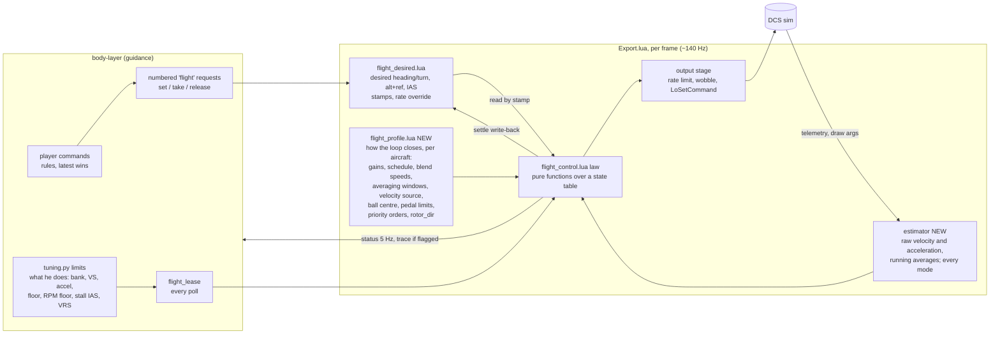

**2. What is measured, and which loop each signal closes.** Raw telemetry only; every derivative is
a running average. Signals whose sign is unmeasured are logged, never used.

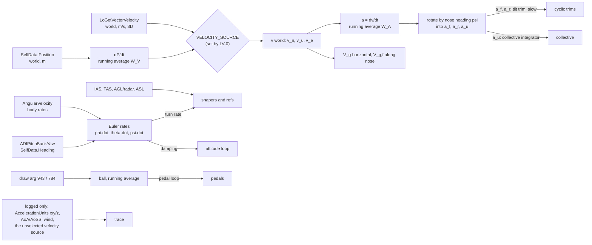

**3. The loops.** Fast inside, slow outside; the feed-forwards carry the quick response, the
integrators remove what the feed-forwards get wrong.

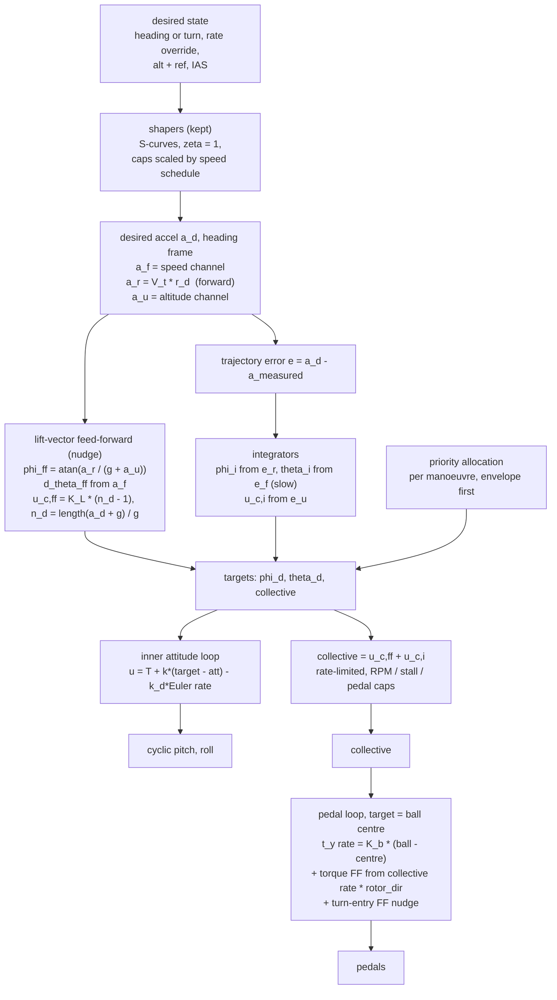

**4. Under limits, who gives first: the order travels with the manoeuvre.** The envelope (RPM floor,
blade stall, VRS, 40 m floor, physical stops) is never crossed; when it caps the lift length, the
shortfall goes down the manoeuvre's own chain. (Orders confirmed by the user, U3.)
**Superseded in part, 2026-11-28** ("M3 amendment" below): the 40 m floor is one 50 m floor,
`min(50, AGL goal)`; speed giving now yields the speed reference (J built for speed, D there).

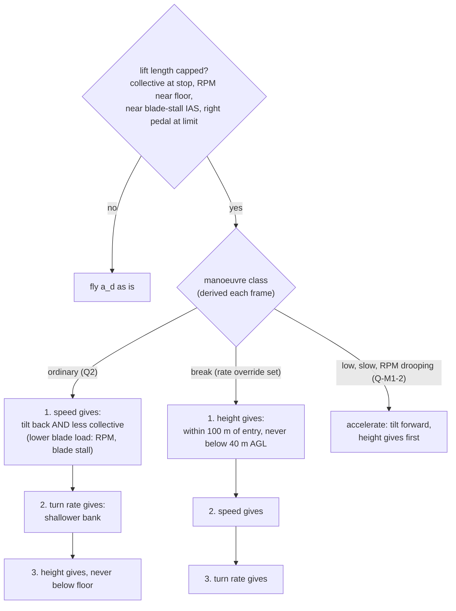

**5. Speed regimes: one law, blended.** `λ` goes from 0 (hover) to 1 (forward flight) on measured
horizontal ground speed. Nothing switches; every term is weighted. LV-1 and LV-2 fly with `λ = 1`
throughout and no commanded-speed floor (U8, no floor); LV-3 adds the blend below 50 km/h.
**Superseded in part, 2026-11-27** ("LV-3 amendment" below): the blend runs **80 → 25 km/h**, not
50 → 25, and the pedal's yaw term is no longer hover-only — a yaw-rate damper acts at all speeds.

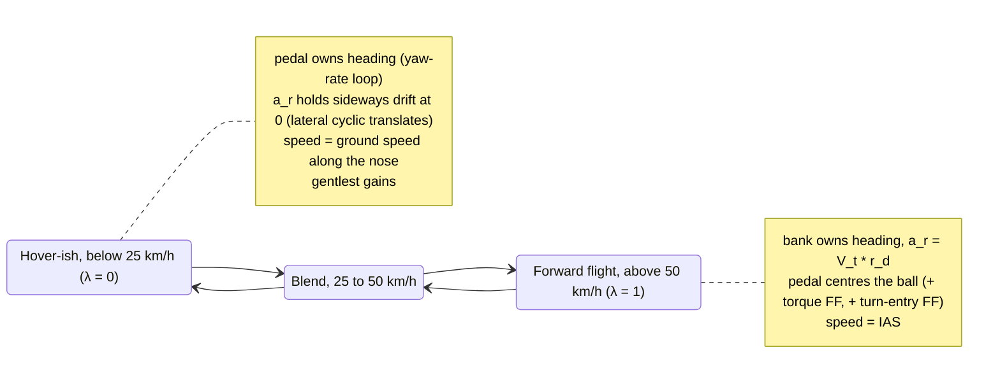

**6. Delivery.** Each stage flies its own card from the feature branch before the next is built.
SAU off on every card (U4).

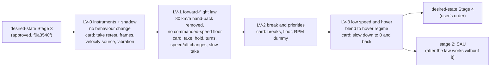

### The law, in words

Symbols: `ψ` true heading (the nose), `φ` bank, `θ` pitch, `H` the heading frame (forward along the
nose, right, up; horizontal), `V` IAS, `V_t` TAS, `V_g` horizontal ground velocity.

**Instrument context (U2, user, for reference only).** The pitot IAS gauge reads down to 50 km/h;
the pilot's Doppler shows ground speed up to 45 km/h forward and 25 km/h back, left and right, and a
Doppler vertical speed of ±10 m/s; the copilot has only pitot IAS and the VSI. **The law uses none
of these gauges' limits**: it reads raw telemetry (*"Petrobrain is to use raw telemetry data to
calculate speeds and accelerations and control inputs from that"*). The ranges explain why "speed"
near hover is ground speed (U2), and are what the player sees when judging a card.

**A. Estimator (every frame, every mode).** No model of what the pilot feels: velocity and
acceleration from raw telemetry, every derivative a running average (user: *"Deltas probably need to
be a running average to filter out vibration"*).
- **Velocity.** World-frame velocity `v = (v_n, v_u, v_e)` from the source `VELOCITY_SOURCE`
  selects (profile):
  - `"position"`: `LoGetSelfData().Position` (x north, y up, z east) in a model-time-stamped ring
    buffer; `v` is the least-squares slope over the last `W_V` seconds (first cut 0.1 s, by
    timestamp, never by frame count), which is a running average of the per-frame deltas.
  - `"vector"`: `LoGetVectorVelocity` (U7, answered yes), averaged over the same `W_V`. The user's
    test shows it is 3D (sideways movement shows). LV-0 compares it against `dP/dt` for axes and
    sign; if they match, the profile selects `"vector"` (one less differentiation) and the other
    source stays in the trace as the cross-check, **computed only while the per-frame trace flag is
    on**, never every frame for nothing (`perf-plan-review.md` item 1).
- **Data structure** (`perf-plan-review.md` item 2): every window is a fixed-size ring buffer
  preallocated once at module load, with the least-squares sums (Σt, Σt², Σx, Σtx) updated
  incrementally as samples enter and leave, so each frame is O(1) work and allocates nothing.
  The trace flag is checked before any trace string or extra `LoGet*` read is built (item 4).
  The estimator runs in every mode by design; LV-0's card watches for a frame-time symptom (item 3).
- **Update rate, not every frame** (user, 2026-11-20, verbatim): *"many of the flight control
  calculations (including estimator) don't really need to run *every* frame. Nothing ever changes
  that fast. I'd say 30Hz would be plenty, even 10 Hz might do. Maybe interleave calculations so
  that not everything is calculated in single frame, but spread accross a couple of frames."* So:
  the estimator and the law run at a profile rate (`LAW_HZ`, first cut 30 Hz), on model time, not
  frame count; the work is interleaved across frames (e.g. sample and estimator on one frame, the
  law's outer loops on the next, inner loops and output target on the third), so no single frame
  carries all of it. The **output stage still writes every frame**, repeating the latest target
  (with the existing rate limit and wobble), because the axis override is per-frame
  (`LuaExportBeforeNextFrame`). Confirmed by the user (2026-11-20, verbatim): *"the axis write itself
  may have to stay every frame -> this is true."* So the write stays every frame; no LV-0 check
  needed. Every `dt` in the law becomes the time since that
  calculation last ran, never a frame `dt`. **All timing is DCS mission (model) time
  (`LoGetModelTime`), never wall-clock** (user, 2026-11-20, verbatim: *"Timing must use mission
  time, not wall clock time. Reason: DCS may be paused by user."*): the law-rate scheduler, the
  ring-buffer timestamps and windows, and every `dt`. While paused, model time stops, `dt` is 0,
  no new samples or law steps happen, and the existing pause row (rewrite the last outputs, freeze
  shapers and integrators) still applies on the every-frame write.
- **Acceleration**, including **vertical acceleration**: `a = dv/dt` as the least-squares slope of
  `v` over `W_A` (first cut 0.2 s), then one more running mean over `W_A2` (first cut 0.1 s). The
  vertical component `a_u` is simply the slope of `v_u`, the world-up velocity: no gravity in it, no
  body frame, so in a level 60° turn it reads zero, exactly as the altimeter says. Horizontal
  `a_n, a_e` are rotated into `H` by the measured `ψ` to give `a_f, a_r`. Window lengths are profile
  values, chosen as multiples of the blade-pass period so that vibration falls in a running
  average's null; LV-0's trace measures the real spectrum and the noise before LV-1 relies on it.
  Total lag about 0.15–0.2 s (half of each window).
- **Ground speed**: `V_g` (horizontal magnitude) and `V_g,f`, `V_g,r` (along and across the nose)
  from `v`, for the speed channel near hover (LV-3) and the trace.
- **Euler rates** from body rates and `φ, θ` (the standard kinematic transform). `ψ̇` replaces
  `−ang.y` as the turn rate the shapers and the yaw loop read.
- **Ball** from arg 943/784 (whichever seat is live, as today), running average `W_B`. Centred is
  +0.03, usable ±0.5, ball right = positive (calibration flight, 2026-11-20).
- **Logged only** (trace, diagnosis): `LoGetAccelerationUnits` x/y/z, AoA/AoSS, wind, the
  unselected velocity source. None of them closes a loop.
- **Reset/priming.** On `dt > DT_CAP` (pause, stall), mission stop, `reset(epoch)` and first frame,
  the ring buffers and averages re-prime from the current sample instead of differencing across the
  gap. A stall must never produce an acceleration spike.

**B. Shapers (kept).** Heading/turn, altitude and speed references exactly as today, ζ = 1, with
their accel and rate caps multiplied by the **speed schedule** `G(V)` (E7: about 0.3 at hover, 1.0
from 150 km/h; profile breakpoints, first cut). Heading wraps by the shortest arc unless a direction
was given. The break's height floor (Decision 29) and the VRS cap (Decision 31) stay where they are.

**C. Desired acceleration** in `H`:
- `a_u,d = ẇ_ref + k_w(w_ref − w) + k_h(h_ref − h)` (unchanged formula; `w = v_u` from the estimator).
- `a_f,d = dV_ref + k_v·[λ(V_ref − V) + (1 − λ)(V_ref − V_g,f)]`: IAS in forward flight, ground
  speed along the nose near hover (U2, answered yes). `λ = 1` until LV-3.
- `a_r,d = λ·V_t·r_d + (1 − λ)·k_vg·(0 − V_g,r)`: centripetal in forward flight, "stop drifting
  sideways" near hover. `r_d = r_ref + K_ψ·wrap(ψ_ref − ψ)` as today.
- **Superseded in part, 2026-11-27** ("LV-3 amendment", C): `λ` blends from 80 down to 25 km/h; the
  speed term is written over one blended measured speed `V_m`; the near-hover heading rate is flown
  by the pedal under its own hover bandwidth and rate cap.

**D. Lift-vector direction (cyclic).** The targets the inner loop flies are a **feed-forward nudge
plus a trim learnt from observation**:
- `φ_d = φ_ff + φ_i`, `φ_ff = atan(a_r,d / (g + a_u,d))`, `φ̇_i = K_φ·e_r` with `e_r = a_r,d − a_r`.
- `θ_d = θ_i + Δθ_ff`, `Δθ_ff = −c_θ·atan(a_f,d / (g + a_u,d))` with `c_θ ≤ 1` (profile; the disc
  tilt the fuselage needs to balance drag is unknown, so it is left to `θ_i`), `θ̇_i = −K_θ·e_f`.
- `K_φ`, `K_θ` give the trim loops time constants of several seconds, at least three times slower
  than the estimator lag plus the attitude response; that separation is the stability argument,
  and the toy plant checks it with the plant's gains deliberately wrong.
  **Superseded in part, 2026-11-24** (see "LV-1 amendment" below): this slow-trim premise is what
  produced the 60 s, −8° acceleration the fourth re-fly measured against a 20 s, −15° target. The
  trim loop's *time constant* is unchanged (it still exists to learn the fuselage trim the
  feed-forward cannot know); what changes is that the **onset** of a commanded speed change no
  longer waits on it — see the amendment's "Speed changes" for the feed-forward split that makes
  this consistent with decision 5 ("S-curves, no oscillation") rather than abandoning it.
- The inner attitude loop is today's form, `u = T + k(target − attitude) − k_d·(Euler rate)`, with
  `T` integrating and solved at take for a bit-exact first frame.

**E. Lift-vector length (collective): feed-forward plus vertical-acceleration integrator.** The
measurement is the aircraft's **vertical acceleration** from raw velocity (A), never a load reading:
- `u_c = u_c,ff + u_c,i`.
- `u_c,ff = K_L(V)·(n_d − 1)`, with `n_d = |a_d + g·up| / g`, the lift length the desired
  acceleration needs (1 in level flight, 2 in a level 60° turn). This is a **nudge, not a model**:
  `K_L` starts deliberately below the collective a 1 g increase needs, so the integrator supplies
  the rest and a wrong `K_L` is a slower settle, never a balloon. It is what makes collective rise
  **with** the bank, the same frame, rather than after an altitude error builds (E4, E5).
  *Main-loop note from the flight-dynamics research
  (`aircraft-layer/research/2026-11-20-helicopter-flight-dynamics.md`, finding 9), not the
  architect's text:* induced power grows roughly with n², not n (60° bank, n = 2: about 4× induced
  power). The linear nudge stays right for LV-1; if LV-2's break card shows the collective lag
  growing with bank instead of staying roughly constant, taper `K_L` with bank or `n_d` in the
  profile. Same "nudge, not model" framing.
- `u̇_c,i = K_c(V)·e_u`, `e_u = a_u,d − a_u` (world up). `a_u,d` already carries the altitude and
  vertical-speed errors (C), so this one integrator holds height through turns, climbs and speed
  changes.
- Rate-limited, saturated, and capped by the existing RPM, blade-stall and pedal-margin guards
  (Decision 30's flags, kept).
- **Goal-check finding 1, satisfied by construction:** in a level 60° turn `a_u` is zero and `n_d`
  rises, so collective goes **up**. No signal the law reads grows with load in a bank, so no channel
  can cut collective because load rises. A toy-plant test asserts both.
- Comparison row: `K_L = 0` in the profile flies the integrator alone (the old shape, with better
  measurement), to show what the feed-forward buys.

**F. Pedals: fly the slip ball, always.** One integrator, one target, the ball's centre; never a
heading loop in forward flight (finding 2), and no deliberate extra pedal in hard turns or breaks
(U5 reverted, user: *"revert my idea about extra pedal. Just fly the slip ball."*).
- Forward flight: `ṫ_y = λ·K_β(V)·(ball − centre)`. Sign from the calibration: ball right of centre
  → more right pedal, and `t_y` is in the command domain (`SIGN·arg`), where positive is right
  (`2026-11-20-slip-ball-recon.md`, "Centring direction"). A toy-plant sign test and a card row both
  check it. `K_β` is scheduled by speed: the calibration showed slip per pedal depends on airspeed.
- Feed-forward nudges (starting values, profile), whose only job is to keep the ball centred while
  the loop catches up: torque `K_cy·u̇_c·rotor_dir` (more collective, more right pedal on the
  Mi-24P), and a small turn term on `r_d` at turn entry.
- Near hover (LV-3): `+(1 − λ)·K_r(V)·(r_d − ψ̇)`. The pedal yaws the nose; bank does not (*"Bank in
  hover is not the way to change heading"*). Bank's share of the heading job is `λ`, pedal's is
  `1 − λ`.
- The asymmetric pedal limits stay (right is the small side for `rotor_dir = +1`), and a collective
  increase is still rate-capped near the right limit.
- **Superseded in part, 2026-11-27** ("LV-3 amendment", D): "never a heading loop in forward
  flight" stands, but the pedal now also carries a **yaw-rate damper at every speed**, on the yaw
  the bank does not explain (user: *"Would be a good idea to have some of that yaw based pedal in
  all flight"*). It holds no heading and no rate of its own choosing — its forward-flight reference
  is the rate the measured bank implies — so finding 2's reason survives; the "only the ball" part
  does not. The ball's share is `λ`-weighted; near hover the pedal also carries a bounded yaw-rate
  integrator and a ±0.3 band around the learnt hover pedal.

**G. Priority under limits (diagram 4).** The manoeuvre class is **derived every frame**:
`break` if a rate override is set, `low_slow_rpm` if the RPM guard is active below 50 km/h, else
`ordinary`. While the lift length is capped and `e_u` stays positive (not enough lift), the shortfall
is handed down that class's chain, each absorber until its own limit:
- **speed gives**: `θ_i` is allowed to integrate nose-up on `e_u` (today's `K_TILT_FROM_AZ_SATURATED`
  idea, now one entry in a chain) **and collective is reduced at the same time**, until IAS falls
  below the speed band's floor. User, 2026-11-20, verbatim: *"Also needs less collective so that
  load on rotor blades decreaes. Rotor blade load is what causes both RPM drop and reatreating
  blade stall. Slowing down is always pitch back and also less collective."* So any deceleration,
  in this chain or from an ordinary speed reduction, is pitch back plus less collective, never pitch
  back alone; a rule for the speed channel generally, not only under limits;
- **turn gives**: `φ_ff` is scaled down (shallower bank, less lift needed) until a minimum share;
- **height gives**: `a_u,d` is allowed below zero, bounded by the break floor or the 40 m floor.
  **Superseded 2026-11-28** ("M3 amendment", A): the 40 m floor was never read by this chain; M3
  adds one floor, `F_eff`, to the altitude target itself.
- `low_slow_rpm`: `θ_i` integrates nose-**down** (accelerate) and height gives.
The orders are profile data (ordinary: speed, turn rate, height; break: height, speed, turn rate;
U3, answered yes); the chain code is one place. The when (class) is separate from the actions
(absorbers), per the actions-and-params rule. A break entered slow turns more gently because its
rate is capped by the speed schedule (U6, answered yes).

**H. Anti-windup.** `φ_i`, `θ_i`, `u_c,i`, `T_p`, `T_r`, `t_y` stop integrating in the direction
that pushes their own output further into saturation. `φ_i`/`θ_i` also hold while the attitude error
exceeds a profile bound (the inner loop is not following, so the trajectory error says nothing about
trim). This closes Decision 30's unguarded `phi_i` windup risk.

**I. Take (E1).** `law_init_at_take` keeps Decision 24's guarantee: the first written frame equals
the captured command exactly. The references start at measured value and measured rate (today); the
integrators start where the measured state puts them (`φ_i = φ − φ_ff(measured a)`, `θ_i = θ`,
`u_c,i = captured collective − u_c,ff(n_d of measured a)`), so every target equals the measured
attitude and the collective equals the captured one on the first frame. The estimator is already
warm (it runs in every mode). From there the shapers carry the aircraft to the desired state as
S-curves; a take 50 km/h below the desired speed is a gentle transition, not a lurch. A take is
accepted at any airspeed from LV-1 on (only on-ground still refuses). **The law must not break E1;
it is not assumed to repair the erratic voice take** (alignment finding 4): LV-0's card retests the
take on Stage 3 alone.

**Superseded in part, 2026-11-24** (see "LV-1 amendment" below): "a take 50 km/h below the desired
speed is a gentle transition, not a lurch" no longer holds for the *speed* channel specifically —
a take with a speed gap now flies the brisk speed change at once (Q2 answer, "brisk"), restating
rather than quietly overriding this sentence. The bank/heading side of a take is **also** revised
(the "maintains current state" rule now holds a captured *bank*, not a heading, when |bank| ≥ 5°)
— see the amendment's take-mode design.

**J. Recovery.** When a break settles (Decision 27's clearing, kept), the class becomes ordinary and
the altitude shaper chases the standing goal from where the break left it (its reference is never
snapped). When an absorber gave (speed, height, bank), its reference is **re-seated** to measured
when the limit releases, so the aircraft returns through the shaper's S-curve rather than snapping
back. Low, slow and RPM drooping accelerates first.

**K. Desired-state handover.** Unchanged: the law applies `desired` by stamp
(`apply_desired_changes_to_law`), the unpark seed carries it (Decision 32/Q4) clamped to what mode 1
flies (`f0a3540f`, U2 of the desired-state plan), and the roll-out and break settles write the
settled heading back. No new wire field: the break is the rate override; `turn_style` stays ignored
by mode 1. Desired-state Stage 4 (mode 2 manoeuvres) is not touched.

### Removed and kept

| today (`flight_control.lua` at `f0a3540f`) | in this law |
|---|---|
| `a_x`, `a_z` from IAS/VS derivatives (`TAU_ACCEL_FILTER_S`) | **removed**: acceleration from raw world velocity, running averages (A) |
| collective integrates on `a_z` error (`K_COLLECTIVE`) | **replaced**: lift-length feed-forward + vertical-acceleration integrator (E) |
| pitch target from `a_x` error (`K_TILT_FROM_AX`) | **replaced**: `θ_i` on `e_f` + nudge (D) |
| `K_TILT_FROM_AZ_SATURATED`, one fixed trade | **replaced**: per-manoeuvre chain (G) |
| bank `= atan(V_t·r_d/g) + phi_i`, `phi_i` on yaw-rate error | **replaced**: `φ_ff` from `a_d` + `φ_i` on lateral acceleration error |
| damping on body `q`, `p`; turn rate `= −ang.y` | **replaced**: Euler rates (gated on LV-0) |
| `K_TURN_COORD_PEDAL` overlay, `K_BREAK_PEDAL_BIAS` + `break_pedal_bias_accum` unwind | **replaced**: ball loop, target always centre (F) |
| low-IAS release (`ENV_IAS_MARGIN_KMH`, `ENV_HOLD_S`), unpark `too_slow`, body-layer `TOO_SLOW` | **removed in LV-1** (U1) |
| `MIN_IAS_KMH` as commanded-speed floor | **removed entirely in LV-1** (U8, no floor) |
| shapers, `K_HEADING_TRACK`, altitude/speed feedback gains, baro conversion | kept |
| break floor (D29), VRS cap (D31), RPM seam (D28), collective-limited flags (D30) | kept; the flags feed the chain |
| inner loop form, bit-exact take, capture, `armed`/unpark take, envelope dead/NaN | kept |
| output stage (rate limit, wobble, `LoSetCommand`), `SEAT_ARGS`/`CMD`/`SIGN` | kept (`[[BL-18]]` owns the per-module arg/cmd map) |
| pure functions over a state table, toy-plant testable | kept; `profile` added as a parameter |

### Implementation Plan

Each stage flies a card from **the feature branch** (`feature/bl16-lift-vector-law`, checked out in
the repo root by the user), with no deploy steps and the readout through `$DCS_COLLECTOR_IP`
(`source run-scripts/petrobrain.env`). **All LV cards: SAU H, K and T off before every take** (U4;
stage 1 is without the SAU, and the SAU stage follows once the law works without it). The separate
"SAU on at hand-back to the player" rule (`explore-notes.md`, SAU section) is now built and
reviewed on `feature/bl16-sau-handover`, already merged into this branch
(`review-sau-handover.md`): it fires on hand-back, not on take, so every LV card still switches
SAU H, K and T off itself before each new take.

1. **LV-0 — instruments and shadow (no behaviour change).**
   - Estimator (A) running every frame; status fields `fc_est_*` (`a_f/a_r/a_u`, `V_g`, `V_g,f`,
     Euler rates, averaged ball, `λ`) and the flag-gated per-frame trace, which also logs both
     velocity sources and the unsigned channels (`LoGetAccelerationUnits` x/y/z,
     `LoGetAngleOfAttack/SideSlip` raw).
   - `flight_profile.lua` created and the **existing** law constants moved into it, values
     unchanged; a test asserts the law's outputs are bit-identical before and after the move.
   - Card: (a) the take retest on Stage 3 alone (voice take off→m1, unpark m2→m1): smooth or not,
     with the trace on (finding 4); (b) level 60 s northbound and eastbound: track from `V_g` matches
     heading within a few degrees (position axes); (c) steady 30° and 60° turns, both directions:
     `q` against `ψ̇·sin φ` (body vs Euler), `a_u` near zero while level (the vertical channel is
     load-free); (d) level accel and decel: `a_f` sign; (e) `LoGetVectorVelocity` against `dP/dt`
     on all three axes, including a sideslip row (U7, sets `VELOCITY_SOURCE`); (f) 10 s straight and
     level for the vibration spectrum and the noise of each running average. Pass: (b)–(e) give
     signs and axes; the noise of `a` in steady flight is small against 0.5 m/s².
2. **LV-1 — forward-flight law, no hand-back (gated on LV-0's frame answers).** B–F, H, I, the
   ordinary chain in G, the gain schedule `G(V)` **defined down to 0** with its gentlest value at the
   low end. **Amended 2026-11-24** (fourth re-fly, "LV-1 amendment" below): this build also carries
   the new take-mode bank hold (A), the rebalanced speed feed-forward (B), the **engine**-RPM-gated
   collective schedule (C; corrected 2026-11-24 from rotor RPM), and the raised pedal gains (D) — not a new stage, the same LV-1 card
   reflown. The removed pieces in the table go, **including the 80 km/h hand-back** (U1): Lua's IAS
   release and `too_slow` take refusal, body-layer `TOO_SLOW` with its speech line and rules-README
   entry, and **every commanded-speed floor** (U8, no floor): `MIN_IAS_KMH` is removed outright,
   `clamp_speed`'s lower bound becomes 0, and the desired-state unpark clamp loses its speed floor
   too (keeps its ceiling and the AGL floor). **What protects low speed in LV-1, with no hover
   regime yet:** (i) the speed schedule makes everything gentler as speed falls (bank, turn-rate and
   acceleration caps, gains), so a slow command or a sag is flown gently, never a hand-back; (ii) the
   RPM, blade-stall and VRS guards stay as they are. Nothing else: a commanded speed below 50 km/h
   is flown by the forward law as it is, with no ground-speed reference and no pedal yaw loop — the
   user's own informed choice (Q1, verbatim: *"remove the limit. Any speed. What does not work, I
   will bring back and we fix"*). Card: take into a held heading (E1, E2: wings within a few
   degrees, ball near +0.03), turns of 30° and 90° both ways at 120 and 220 km/h (E3, E4: ball
   centred, pedal with the turn, collective in with the bank, no sag or balloon), speed 150→220→150
   (E6), climb and descent 100 m (E6), heading hold in a crosswind (Q5: nose on the heading, drift
   accepted), one row with `K_L = 0` to compare, one voice take at about 70 km/h (accepted, no "too
   slow", gentle acceleration to the desired speed). **Deliberate slow-flight row, so the gap is
   observed rather than untested:** at safe height (at least 300 m AGL) in steady wings-level
   flight, a "speed 40" command; then, only if that settles cleanly, a "speed 20" command. Watch for
   drift off heading, a sag in altitude the collective loop cannot arrest, or hunting in bank or
   pedal as the forward law runs with no ground-speed reference and no pedal yaw loop. Take the
   stick back (or call a return to the 70 km/h row) the moment any of those appears, rather than
   letting it develop — this row is expected to find the edge of LV-1's scope, not to pass cleanly.
3. **LV-2 — break and priorities.** The break and low-slow-RPM chains (G), recovery (J), and
   vignette 5: a break entered slow is gentler because its rate is capped by the speed schedule
   (U6), never released. Pedals fly the ball throughout (no extra pedal). Card: break left and right
   at 120, 180 and 250 km/h (E5: 60–80° bank quickly, collective in with the bank, ball centred,
   speed near entry, height loss ≤ 100 m, roll-out on the break heading), break away, one break
   started at about 120 m AGL (the 40 m floor holds), one break with a lowered
   `ROTOR_RPM_DUMMY_PCT` (the aircraft does less, silently, E8), one break entered at about 100 km/h
   (gentler, no hand-back). **Routed here from round 3's blade-stall-threshold debug**
   (`plans/flight-lift-vector/debug-2026-11-27.md`, "Round 3",
   `aircraft-layer/research/2026-11-27-mi24p-rotor-engine-limits.md`): a G-load cap above
   200 km/h (1.8 G light load, 1.5–1.6 G combat load, tighter still above 2 000 m or in turbulence)
   and keeping rotor RPM ≥ 92% at high speed (low RPM lowers the retreating-blade-stall onset) are
   both unbuilt — noted only, not designed, same "recorded only" posture section F already gives
   the break chain. A natural fit for this stage's own break/turn card, not built as part of round 3.
4. **LV-3 — low speed and hover regime.** `λ` blend (C, F), ground-speed reference (U2), gentlest
   schedule, the pedal yaw loop, the drift hold. (`MIN_IAS_KMH` and the commanded-speed floor are
   already gone — removed in LV-1, U8 — so there is nothing left to remove here.) Hover hold and
   translate commands stay in BL-16 "Later". Card: speed 150→60→0 (no jerk, settles over the
   ground), heading change of 90° at speed 0 (pedal, bank stays within a few degrees), speed 0→150
   (smooth through 25–50 km/h), a voice take at 20 km/h (accepted), low-slow with the lowered RPM
   dummy (accelerates). **Routed here from the sixth re-fly** (`docs/acceptance/2026-11-27-sortie-
   feedback.md`, LV-1 debug-2026-11-27.md): user, verbatim, *"on command to speed 60, nearing the
   60 speed, right pedal was added too late and too slowly which caused left yaw to run away. This
   is more slow speed behaviour, so can go to that stage."* Watch the pedal loop's own response
   near 60 km/h on this stage's card, not only the blend/jerk behaviour already listed.
   **Superseded, 2026-11-27**: LV-3's design, stages and card are now "LV-3 amendment
   (2026-11-27)" below (blend 80 → 25 km/h, all-speed yaw damper, hover pedal band, low-speed goal
   slew). The low-slow-RPM row is proposed for deferral there (U17).

Each stage runs the subproject checks (`fast-tests.sh aircraft-layer`; body-layer too in LV-1 and
LV-3). LV-1 and LV-2 may be built back to back as one perf/security batch if LV-1's card is flown
between them; LV-3 is its own batch.

### Tests (real-Lua toy-plant harness)

The toy plant in `test_flight_control_law.py` becomes a **3D point mass**: lift vector of length
`n·g` along body-up rotated by `φ, θ`; `n` first-order on collective; attitude first-order on cyclic;
yaw on pedal with a torque term from collective; ball from lateral specific force in body axes;
position and velocity integrated from the forces with drag along the air velocity and an optional
constant wind. It feeds the estimator **positions and velocities** (both sources), so the
running-average chain is tested, not bypassed.

- **The never-known lift vector, as a test**: every convergence scenario is run with the plant's
  gains at ×0.5 and ×2 of nominal, and with an unknown fuselage pitch trim; the law must converge
  without retuning (the user's principle that the vector is steered, not computed).
- Take: bit-exact first frame; a take 50 km/h off the desired speed reaches it monotonically; a take
  at 40 km/h is accepted and flown toward the desired speed without a jerk, with no floor (LV-1).
- Heading hold: bank settles within 2° of level with the ball centred; no standing crossed controls
  (a constant pedal disturbance is absorbed by the pedal integrator, not by bank).
- Coordinated turn: ball within band through entry, steady state and roll-out; altitude in band;
  steady 60° turn: no pitch-stick fight (Euler damping), the turn rate the shaper sees equals `ψ̇`.
- Lift length: in a level 60° turn, collective rises with the bank in the same second (feed-forward),
  not after an altitude error; collective never falls on roll-in while altitude is held (finding 1);
  the law's inputs do not include `LoGetAccelerationUnits` (asserted on the call log); with `K_L` at
  ×0.5 and ×2 the turn still holds height within band.
- Vibration: 20 Hz ripple injected into position and velocity (amplitude from LV-0's trace, first cut
  ±0.3 m/s²-equivalent) keeps the collective and cyclic outputs' high-frequency content under a
  bound.
- Estimator: position quantised to 1 cm and `dt` jittered 5–12 ms with one 116 ms stall gives no
  acceleration spike and no visible output hunting; a pause re-primes; both `VELOCITY_SOURCE` values
  give the same `a` within noise on the same plant run.
- Speed and altitude changes: accelerating raises collective, decelerating lowers it (E6).
- Priorities: with the lift length capped, ordinary loses speed first, break loses height first and
  stays above `max(40, entry − 100)`, low-slow-RPM accelerates; the envelope is never crossed.
- Break: 60–80° bank at 150 and 220 km/h; ball held centred through entry, steady turn and settle;
  nothing left wound up afterwards.
- Pedal sign: a ball right of centre drives the pedal command positive.
- No hand-back (LV-1): IAS held at 40 km/h for 10 s produces no release; `check_unpark_preconditions`
  accepts any IAS; body-layer `take_controls` has no `TOO_SLOW` path; `clamp_speed(30)` returns 30
  (no floor, U8).
- Regimes (LV-3): `λ` crosses 25 and 50 km/h with no output step; speed 0 holds ground speed near 0
  in wind; a 90° heading change at hover moves the pedal, bank stays under a few degrees;
  `clamp_speed(0)` returns 0. **Superseded, 2026-11-27**: the LV-3 test list is in "LV-3
  amendment" below (breakpoints 25 and 80 km/h; runaway reproduction; hover band).
- Kept tests stay green: pause freeze, VRS cap, RPM/stall caps, stopping height, settle write-back.
- Harness hygiene: every new local and module added to the extraction tuples (the silent-default
  trap from the desired-state plan).

### Co-moving Fields

The law state is built in one place (`law_init_at_take`) and copied whole by `law_apply_goal` and
`law_update` (`for k, v in pairs(state)`), so a new field carries only if `law_init_at_take` creates
it. Grep of construction and teardown sites at `f0a3540f`: `law_init_at_take` (create);
`law_apply_goal`, `law_update` (copy); `request_release`, `check_envelope` failure, park → `armed`,
`on_stop`, `reset` (set `fc_law = nil`). The estimator lives **outside** `fc_law` (it runs in every
mode), so its own reset sites are listed separately. `fc_env_low_ias_since_t` and its three reset
sites go in LV-1 with the IAS release.

| Field | Written by | Transition | Must hold true after |
|---|---|---|---|
| `φ_i, θ_i, u_c,i, T_p, T_r, t_y` | internal (take) | voice take, unpark take | outputs equal the captured command bit-exact; targets equal measured attitude; collective equals captured |
| `rate_override_deg_s`, `break_entry_h_m` | external (desired, by stamp) | break set | class = break the same frame; alt/speed goals untouched (B1, kept) |
| same | external | ordinary heading/turn set mid-break | both cleared in that `law_apply_goal`; class ordinary (B2, kept) |
| same + desired `turn_rate_deg_s` | internal (settle) | break reaches band | all cleared the same frame and written back once (kept); integrators not reset |
| absorber references (`v_ref`, `h_ref`, `φ_ff` scale) | internal (chain) | limit releases | reference re-seated to measured; no snap-back |
| `λ`, class, schedule `G` | derived each frame | any | never stored: nothing to carry or forget |
| estimator ring buffers and running averages | internal | `dt > DT_CAP`, mission stop, `reset(epoch)`, first frame | re-primed from the current sample; next `a` is finite and near zero |
| `fc_law` | internal | release, envelope, park, stop, reset | `nil`; next take rebuilds every field above |

### Stage 2 seam (SAU), not built

The SAU acts on attitude and rates, so the only place it meets this law is the inner attitude loop.
Stage 1 leaves: the inner loop behind one function with its gains in a profile sub-table
(`inner.sau_off`), so an `inner.sau_on` set, a read of the SAU switch state and the trim-hold
pattern the user described (trim held through an attitude or heading change, released once stable;
effectors `SAU-H/K/T/B-*` in `body-layer/config/sequences/mi-24p/switch-reference.md`) can be added
without touching the outer loops; the trace logs whatever SAU state is readable for free. M0-H (does
the SAU fight commanded changes) is still unflown and is stage 2's first question. The "SAU on at
hand-back to the player" rule, independent of this law, is now built and reviewed on
`feature/bl16-sau-handover`, already merged into this branch (`review-sau-handover.md`).

### Risks & Unknowns

- **The body-rate frame decides LV-1's inner loop.** If LV-0 shows Euler rates, the two latent
  errors above are not the break's cause and its cause is still open; LV-1's design is unaffected
  either way, only the explanation.
- **Vertical acceleration from velocity lags about 0.15–0.2 s and carries rotor vibration.** That is
  why the collective's fast response comes from the `n_d` feed-forward and the integrator only
  corrects. If LV-0 shows the averages noisier than expected, the windows grow and the integrator
  slows, which is acceptable; the feed-forward is unaffected because it reads only the desired state.
- **`K_L` is a guess.** Too small: a brief sag at roll-in until the integrator catches up (the old
  fault, smaller). Too large: a balloon. It starts small on purpose; the `K_L = 0` card row and the
  ×0.5/×2 tests bracket it.
- **`LoGetVectorVelocity`'s axes are unconfirmed** (3D is confirmed). `"position"` is the default
  until LV-0's row (e) says otherwise.
- **LV-1 below 50 km/h** is flown by the forward law with gentle gains only — no floor, no
  ground-speed reference, no pedal yaw loop. This is the user's own informed choice (Q1, verbatim:
  *"remove the limit. Any speed. What does not work, I will bring back and we fix"*); nothing in
  LV-1 protects this range beyond the gain schedule and the RPM/blade-stall/VRS guards. The LV-1
  card's deliberate slow-flight row (speed 40, then speed 20) is where this is first observed, on a
  card rather than discovered in a flight; whatever fails there is brought back to the architect per
  the user's own rule rather than being treated as a defect in this plan.
- **Hover with no position hold drifts.** LV-3 holds ground velocity near zero, not a spot; the user
  gets slow drift until BL-16's hover item adds the fixed spot.
- **Strong wind at low speed.** `λ` runs on ground speed while the aerodynamics follow airspeed; at
  hover in a 10 m/s wind the law is in hover regime while the rotor sees 36 km/h. Bounded by the
  gentle schedule; watched on LV-3's card. **Revisited 2026-11-27** ("LV-3 amendment", U12): the
  60 km/h runaway was flown in no wind, so the source did not decide it; ground speed kept.
- **Every gain is a first cut**, as today. The schedule and chain shapes are designed; their numbers
  come from the cards.
- **The ball arg's update rate is unknown** (the control args update at about 25 Hz). The pedal loop
  is slow by design; LV-0's trace measures it.
- **Lua budget:** `flight_control.lua` gains the estimator; keep its state in tables, and check the
  60-upvalue ceiling on `run_flight_control`/`law_update`.
- **Tuning without the X-T26 mechanism.** Profile values are edited in Lua, not `tuning.py`, as for
  every loop constant today; that is the existing split (behaviour limits on the wire, loop values in
  Lua).

### Second-order effect

The profile plus an aircraft-generic law is everything a second helicopter needs on the mode-1 side
(one table and `rotor_dir`), and the `λ` regime is the slot BL-16's deferred hover commands plug into
(fixed-spot hold is a position term on `a_r`/`a_f` near `λ = 0`). Removing the hand-back in LV-1
changes the body-layer vocabulary (`TOO_SLOW` disappears), so any open plan that assumes mode 1
refuses or releases at low speed needs a look when LV-1 merges. When this plan merges, Decision 3
(forward flight only) and the control-law steps 2–5 under Decision 23 in `plans/flight-control/plan.md`
get `REVISED` pointers to this plan (step 10), and desired-state Stage 4's card should fly on this law.

### Decisions Requiring User Input

**Answered 2026-11-20 (user, verbatim):** *"'filtered felt load' -> consider just using raw velocity
and acceleration. No need to model how pilot would feel it. For flight control, code is allowed to
know and act on raw telemetry data. Deltas probably need to be a running average to filter out
vibration. Q1 - LV-1 / Q2 - yes. [instrument ranges, see 'The law, in words'] Regardless, Petrobarin
is to use raw telemetry data to calculate speeds and accelerations and control inputs from that. /
Q3 - yes / Q4 - yes, SAU after all this works without SAU / Q5 - revert my idea about extra pedal.
Just fly the slip ball. / Q6 - yes / Q7 - yes. I just tested DCS velocity is 3D, so sideways
movement is reported as velocity. In all likelihood it is the 3D vector's length."* (full text:
`explore-notes.md`, "Answers to the plan's U1–U7").

- **U1: When does the 80 km/h hand-back go?** — **answered: LV-1.** Built as LV-1 above.
- **U2: What "speed" means near hover.** — **answered: yes** (IAS from 50 km/h, ground speed along
  the nose below 25, blended). Built in LV-3 (C).
- **U3: The rest of each priority order.** — **answered: yes** (ordinary: speed, turn rate, height;
  break: height, speed, turn rate). G and diagram 4.
- **U4: SAU on the LV cards.** — **answered: off on every LV card; the SAU stage after the law works
  without it.** Implementation Plan preamble.
- **U5: Deliberate extra pedal.** — **answered: reverted; the pedals fly the slip ball, always.** F;
  the ball-offset target is removed everywhere.
- **U6: A break entered slow.** — **answered: yes, it turns more gently.** G, LV-2.
- **U7: Velocity source.** — **answered: yes**, `LoGetVectorVelocity` if LV-0 confirms it matches
  the position deltas. A, LV-0 row (e).

Open:

- **U8: The commanded-speed floor in LV-1.** The brief was to remove `MIN_IAS_KMH` in LV-1. The plan
  removes everything that **hands back or refuses** in LV-1, but keeps `MIN_IAS_KMH` as the floor on
  a *commanded* speed, lowered from 80 to 50 km/h, until LV-3 removes it. — recommend: keep the
  50 km/h commanded floor through LV-1 and LV-2; why: without a hover regime, a "speed 20" command
  would be flown by the forward law with no ground-speed reference and no pedal yaw loop, and a
  clamp is honest to the player (read back as clamped by the existing path) where a silent
  Lua-only floor would make Petrovich say one speed and fly another. The alternative, floor 0 in
  LV-1, lets the player command slow flight the law is not built for until LV-3.

  **Answered 2026-11-20** (user, verbatim): *"no floor"*. `MIN_IAS_KMH` and every commanded-speed
  floor go entirely in LV-1: no hand-back, no refusal, no clamp. A slow command is flown by the LV-1
  law as it is (gentler at low speed per the speed schedule); what doesn't work, the user brings
  back (his own Q1 answer). The implementer applies this wherever the plan above still says
  "floored at 50 km/h" or "until LV-3" (Affected Modules, the LV-1 build, the Co-moving table, the
  LV-1 card's low-speed rows), and the U2 unpark clamp from desired-state Stage 3 loses its speed
  floor too (its ceiling and the AGL floor stay).

## LV-1 amendment (2026-11-24, fourth re-fly)

Architect pass. Branch `feature/bl16-lift-vector-law`, detached at tip `46d6a5f2` (the user's
answers to this report's questions; no new code since LV-0/LV-1 were first built). Inputs read in
full: `docs/acceptance/2026-11-24-sortie-feedback.md` "Fourth re-fly" to the end; `alignment.md`'s
"Goal check — 2026-11-24" (E11–E17, findings 1–5, questions 1–5, now all answered); this plan's
sections B, D, E, F, G, I (amended above); `explore-notes.md` U3 "Slowing down"; `body-layer/
ROADMAP/BL-16.md` decisions 3 and 5. Code read: `flight_control.lua` (`law_init_at_take`,
`law_update`'s D/E/F/G sections, `check_envelope`, `read_rotor_rpm_pct`/`ROTOR_RPM_SOURCE`),
`flight_profile.lua` (every gain named below), `flight_desired.lua` (`desired`, `reseed_from_
measured`, `reseed_from_overlay`, `convert_turn_to_heading_for_m2`, `apply_set`, `derive_mode`/
`tick`'s mode-edge dispatch), `body-layer/src/belief/flight_control.py` (`MAX_TURN_BANK_DEG`,
`clamp_speed`, `MAX_ACCEL_MPS2`), `body-layer/src/rules/actions.py`/`crew_console.py` (`axes_*`
bodies — confirmed every `flight.*` action writes only the field(s) it changes; `axes_set_speed`/
`axes_set_altitude` never touch `hdg_mode`, already satisfying Q3 by construction, see "What
reading the code turned up" below).

**What reading the code turned up (step 3a), before designing anything new.** Two things this
amendment needs already exist and are not reinvented:

1. **Speed/altitude commands already never touch `hdg_mode`.** `flight_desired.lua`'s `apply_set`
   branches on `heading_deg ~= nil` / `turn ~= nil` to write `hdg_mode`; the `alt_m`/`ias_kmh`
   branches write only those fields. So Q3's answer ("only heading-type commands end a held
   turn; height and speed hold through it") is **already true of the wire protocol** — no change
   needed there, only in what a "held turn" *is* (below). The alignment's own worry ("a speed
   command that re-applies the whole desired state would level the aircraft") does not apply to
   this codebase's `apply_set` shape; it would apply to a different, whole-state-write design this
   project does not have.
2. **A rotor-RPM read already exists, flagged for exactly this use, and is not yet turned on.**
   `read_rotor_rpm_pct()`/`ROTOR_RPM_SOURCE` (`flight_control.lua`) reads cockpit draw arg 42
   (`aircraft-layer/research/2026-11-19-mi24p-readable-args-recon.md`) behind a `"dummy"`/
   `"arg_proxy"` switch, shipped as `"dummy"` (fixed 90%) "until a flight confirms arg 42 tracks
   rotor RPM and resolves its calibration." Q1's engine-state rule (fast collective when the
   engines are already at normal output, gradual when they are spooled down) is exactly a function
   of this one reading — no new telemetry, no engine/torque proxy needs inventing; this is the
   calibration flight that reading was always waiting for.
   **Superseded 2026-11-24 (same day, user's cockpit readings, see C's correction):** Q1's rule is
   a function of **engine** RPM, not rotor RPM — the two move oppositely (descent: engine 74%,
   rotor 100%). A **new read is needed**: engine RPM args 40/41 (pilot) and 838/839 (operator),
   lower of the two, calibration unconfirmed. Arg 42/845 (`read_rotor_rpm_pct`) keeps only the
   85% generator-trip floor guard. Both get logged in the trace and calibrated from one flight (U9).

### Why this amendment is judged (restated from `alignment.md`)

Every complaint in the fourth re-fly is a lag — the take levels before resuming, speed takes 60 s
instead of 20, pedal trails collective — and the user's own diagnosis is that **the oscillation
comes from being slow, not from being fast.** So this amendment is judged by promptness and
smoothness together: a fix that buys smoothness by slowing anything down further is moving away
from the goal, not toward it.

### Design Overview (diagrams)

**1. Take-mode decision.** What a "you have controls" or unpark with no standing goal does, now
that a bank is held directly rather than mapped onto the fixed-rate continuous turn.

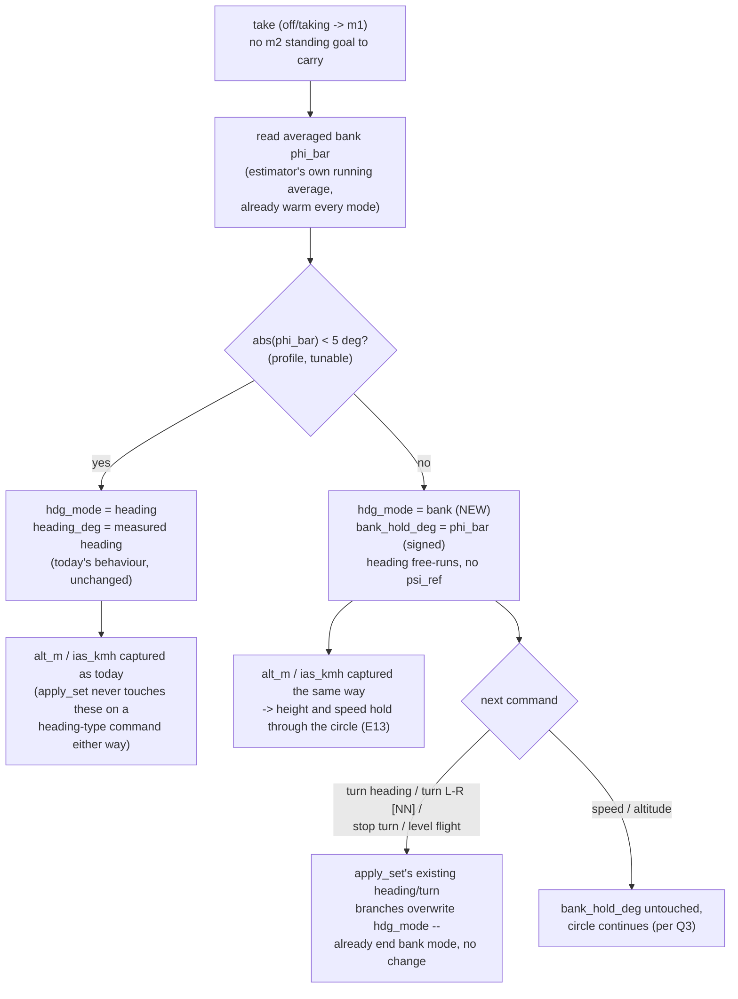

**2. Speed change, 150 -> 250 (E14), what makes it 20 s instead of 60.** The shaper's own S-curve
(kept, decision 5) is unchanged; what changes is how promptly `theta_i`/collective reach the shaper's
own demand, and whether the engines can take the collective fast.

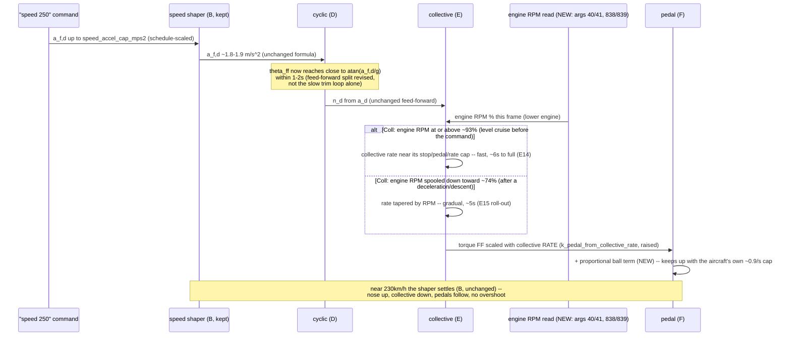

### Decisions answered (continuing U1–U8 above)

**Answered 2026-11-24 (user, verbatim), Q1 — collective-increase rate:** *"at higher speed,
collective can be increased faster. At level flight the engines are already at high/normal
output, so increasing collective is no problem. When descending or decelerating or both, the
engines spool down as torque is not needed. Then adding lot's of collective in that state quickly
slows down the rotor... That is why collective increase need to be gradual, when engine RPM is
low initially. When engine RPM is high initially, the collective increase can be fast as well."*
Built as an **engine-RPM-gated collective-rate schedule** (new, see "Collective rate" below),
reading a **new** engine-RPM read (args 40/41, operator 838/839, lower of the two) once its
calibration is confirmed (U9). *(Corrected 2026-11-24: first written as rotor-RPM-gated via
`read_rotor_rpm_pct()`; the user's readings showed that inverts the rule — see C.)*

**Answered 2026-11-24, Q2 — speed-change character:** *"brisk."* Built: the speed channel's own
feed-forward reaches its target promptly (1-2 s), superseding section I's "gentle transition" for
the speed channel specifically, on a take with a speed gap as well as an ordinary command.

**Answered 2026-11-24, Q3 — what ends a held bank:** *"as recommended"* — only a heading-type
command ("turn heading", "turn N left/right", "stop turn"/"level flight") ends it; height and
speed hold through it. Already true of `apply_set`'s shape (finding 1 above); the only new work is
giving the held state (`hdg_mode = "bank"`) the same immunity the existing "heading"/"turn" modes
already have, which it gets for free from the same per-field write discipline.

**Answered 2026-11-24, Q4 — handover mid-roll-out:** *"as recommended"* — keep the 5° rule as
stated; "stop turn" is one phrase. A take at 12° mid-roll-out holds 12° until the player says so
(vignette 5, accepted as a known, named consequence of the rule rather than a defect).

**Answered 2026-11-24, Q5 — pedal rate:** *"The Mi-24 limits pedal movement speed. We have
measurements... From there you can get the actual pedal delta speed."* Measured: the aircraft
itself caps pedal-arg travel at ~0.90-0.91/s (p99 0.72, max 1.29/s across the fourth re-fly's
hand-flown rows) on top of M0's τ ≈ 0.25 s lag; Petrovich's own pedal moved at p99 **0.16/s** —
about 5× below what the aircraft allows. Read as: the law's own commanded pedal rate should be
free to approach the aircraft's ~0.9/s cap; nothing here asks for a *slower* pedal, and finding 1
of the goal check (treating "pedals move more slowly in Mi-24 anyhow" as a request to slow them
further) is explicitly wrong and closed by this answer.

### A. Take rule — E11/E12 (new `hdg_mode = "bank"`)

**Where this lives: entirely in `flight_desired.lua`/`flight_control.lua` (Lua), not a round trip
through body-layer.** The take event (off/taking → m1, no m2 goal to carry) is detected and
measured in Lua already (`reseed_from_measured`, called from `tick`'s mode-edge dispatch); adding
a network hop to ask body-layer "what was the bank" would add latency to exactly the moment
decision 24 requires to be bit-exact, for a value only Lua has first. This also keeps the rule out
of the wire protocol's closed vocabularies — body-layer never states a bank angle, matching
`[[BL-16]]`'s "no LAN message carries a raw flight-axis value" invariant in spirit (this is an
attitude goal, not an axis write, but the same reasoning against a network round trip applies).

- **New `desired` field:** `bank_hold_deg` (signed, degrees), alongside the existing `heading_deg`/
  `turn_dir`/`turn_rate_deg_s`/`turn_style`. New `hdg_mode` value: `"bank"` (today's are `"heading"`
  and `"turn"`).
- **`reseed_from_measured()` (off/taking → m1, no m2 carry) reads the estimator's own averaged
  bank** `φ̄` (the running average already kept warm every mode, LV-0's "A. Estimator" — reused, not
  a new signal) rather than the raw single-frame bank, so a wobbly take cannot flip a 5-6° bank
  across the line (open assumption, "the 5° rule's input," now settled this way).
  - `|φ̄| < 5°` (profile `bank_hold_threshold_deg`, tunable, first cut 5.0 per the user's own
    figure): unchanged — `hdg_mode = "heading"`, `heading_deg` = measured heading.
  - `|φ̄| ≥ 5°`: `hdg_mode = "bank"`, `bank_hold_deg = φ̄`. `heading_deg`/`turn_dir`/
    `turn_rate_deg_s` are cleared (nil) — heading free-runs, there is no reference to chase.
  - `alt_m`/`ias_kmh` are captured exactly as today, in both branches — height and speed hold
    through the held bank for free, no change needed (E13).
- **The law (section D) gets a third `a_r,d` source, not a third mechanism.** Section C's
  `a_r,d = λ·V_t·r_d + …` (turn-rate-driven, what the existing continuous turn and break use) is
  **not** reused for a held bank — finding 2's own point: that mechanism flies the turn rate
  `MAX_TURN_BANK_DEG` produces at the current speed, so a 45° take rolls out to 20°, visibly, at
  the take. Instead, when `hdg_mode == "bank"`: `a_r,d = g·tan(bank_hold_deg)` directly — the
  geometric relation a steady bank implies, bypassing the turn-rate path entirely. Section D's
  existing formula `φ_ff = atan(a_r,d/(g+a_u,d))` then recovers `φ_ff ≈ bank_hold_deg` unchanged
  (in level flight; `a_u,d` near zero), so **no new formula in section D**, only a new source for
  one of its inputs in section C. Turn rate is whatever the held bank and the *current, changing*
  speed produce (`ψ̇ = g·tan(bank_hold_deg)/V_t`) — the turn tightens as speed falls inside the
  held bank, same as a real pilot holding a bank would fly it (the open assumption's own answer:
  "bank, as the user said").
- **Ending the held bank needs no new code.** `apply_set`'s existing `heading_deg ~= nil` and
  `turn ~= nil` branches unconditionally overwrite `hdg_mode`, regardless of its current value —
  they already end `"bank"` the same way they already end `"turn"` today. The **one thing that
  must be added**, so nothing leaks: both branches must also clear `bank_hold_deg = nil` (the
  Co-moving table below is where this is checked explicitly, because exactly this kind of leak —
  a new field a pre-existing branch doesn't know about — is this project's own recorded failure
  mode, `[[BL-B71]]`).
- **E12, mode 2 → mode 1 mid-turn (the "first goes level, then resumes" bug).** This is **not**
  the take-rule case above — the `desired` table is correctly left untouched on the m2→m1 edge
  (`tick`'s own comment: *"`desired` is left exactly as it stood; `law_init_at_take` reads it as
  the unpark seed"*) — `hdg_mode` is already whatever mode 2's standing heading goal was. The bug
  is in `law_init_at_take`'s unpark branch failing decision 24's own bit-exact guarantee for the
  *rate* state, not the attitude: the first frame must seed `φ_i` (or whatever state feeds `φ_ff`)
  from the **measured** bank/turn-rate exactly, so the heading shaper's S-curve starts already
  turning at the measured rate and closes the gap to the standing heading goal by adjusting rate
  smoothly — never by snapping the rate reference to 0 first and re-accelerating into the turn.
  This is a fix inside a function LV-1 already owns and is already touching (for the new `"bank"`
  branch above); it does not need its own stage. **Flagged, not fully traced** — the exact field
  responsible for the "first goes level" transient wants one more read of `law_init_at_take`'s
  unpark branch against the fourth re-fly's own trace (t=366.5/409.5, alignment finding, "Take
  from a bank, heading-hold case") before the implementer writes the fix; the goal-state in the
  table above is what the fix must achieve, not a line number.

### B. Speed changes — E14/E15

**The feed-forward/trim split (section D) is rebalanced for onset, not reverted.** Decision 5
("S-curves, no oscillation") and the "feedback, not a model" principle both survive: what changes
is how much of `θ_d` the feed-forward itself supplies on the first second of a commanded change,
versus how much is left for the several-seconds-slow trim loop to learn.

- **`c_theta` is raised** from 0.5 toward a value close to the full kinematic tilt (the user's own
  figure: "about `atan(a/g)`, slightly more" — about 12° of nose-down for 1.9 m/s², against
  `atan(1.9/9.81) ≈ 10.9°`). First cut: `c_theta = 0.85` (profile), leaving `θ_i` a smaller but
  still real residual to learn — the fuselage-trim unknown section D's own comment names, not
  reintroducing a model of it.
- **The slow trim loop's own time constant (`k_theta_trim`) is unchanged** — it still exists for
  exactly the reason section D gives it, to learn what the feed-forward cannot know. What moves is
  the feed-forward's own share, so the *onset* no longer waits three-trim-time-constants to reach
  the target.
- **Deceleration roll-out (E15) stays `θ_i`-driven, by the same mechanism, not a new one**: as
  speed approaches the target from above, the shaper's own S-curve (B, kept) reduces `a_f,d`
  itself, which both `Δθ_ff` and `θ_i` already track — no separate "roll-out mode" needed; the
  gentleness the user asked for at the very end of a deceleration (collective up over ~5 s) comes
  from the collective side (C below), not from slowing the pitch channel back down.
- **Section I's "gentle transition" on a take with a speed gap is restated for the speed channel
  only** (dated note added to section I above): a take 50 km/h below the desired speed now flies
  the same brisk `c_theta`-led pitch change as an ordinary command (Q2, "brisk"). The *bank* side
  of a take is unaffected by this — section A above is what governs it, and it stays bit-exact and
  gentle by construction (the shaper's own S-curve, never skipped).

### C. Collective rate — E14/E15/Q1, the engine-RPM-gated schedule (corrected from rotor RPM)

> **Corrected 2026-11-24, same day (main loop, from the user's cockpit readings):** gate on
> **engine** RPM, not rotor RPM. User, verbatim: *"In level flight, 170 km/h — engine RPM steady
> at ~93%, rotor RPM steady at ~96%. Fast acceleration — engine RPM ~98-100%, rotor RPM ~88%. Fast
> descent at collective full down — engine RPM ~74%, rotor RPM ~100%. When rotor RPM drops below
> ~85%, the generator trips off -> loss of electrical power. Therefore 85% is the rotor RPM low
> limit."* (`docs/acceptance/2026-11-24-sortie-feedback.md`). The two move in opposite directions:
> spooled-down engines (74%) coincide with the **highest** rotor RPM (100%), so a rotor-RPM gate
> would allow a fast increase exactly when the engines are behind. Therefore:
> - **The schedule below reads engine RPM**: pilot args **40/41** (left/right engine), operator
>   **838/839** (`aircraft-layer/research/2026-11-19-mi24p-readable-args-recon.md`, DCS-BIOS
>   cross-reference, calibration unconfirmed); use the lower of the two. At or above normal cruise
>   output (~93%) → fast; tapering toward ~74% (fully spooled down) → gentle, ~5 s. First-cut
>   thresholds from the user's readings, tunable.
> - **Rotor RPM (arg 42/845) keeps only its existing role**, the reactive floor guard, and the floor
>   is **85% because the generator trips below it** (electrical loss), not a soft preference. A
>   fast acceleration already runs ~88%, so the 5% guard margin above 85% will engage during the
>   brisk accelerations E14 asks for; that interaction is the implementer's to test on the toy
>   plant and the card's to check.
> - **Calibration (U9, reworded):** log args 40, 41, 42 (and 838/839/845) in the flight trace and
>   calibrate against the user's three reference states; until confirmed, the schedule stays off
>   (always "fast", today's behaviour) and the RPM guard stays on its dummy.
>
> Wherever the text below says "RPM" for the schedule, read **engine RPM**; diagram 2's "rotor RPM
> read" participant likewise means engine RPM.

**New, profile-level: `collective_rate_cap_from_rpm(rpm_pct)`.** Replaces nothing — the existing
reactive guards (`collective_rate_cap_near_rpm_floor`, `rotor_rpm_near_floor_margin_pct`) stay
exactly as they are, as the backstop they were always meant to be (alignment finding 3: "the RPM
guard is not the 'gently' the user asked for... the spool-up time is something to anticipate, not
detect"). This is the anticipatory layer above it:

- At/above a `spooled_rpm_pct` threshold (profile, first cut 97%): the collective-increase rate is
  capped only by the existing physical/pedal-margin caps — fast, matching the user's own 1-2 s full
  collective at level cruise (E14).
- Below it, down to the existing reactive margin: the increase rate is linearly tapered toward a
  gentle minimum (profile, first cut consistent with the user's own "~5 seconds" figure for a full
  collective swing starting from a spooled-down state).
- **Decreases are never gated by this** — spooling down is not the hazard; only a sharp *increase*
  while the engines are behind is.
- **One reading drives both E14 and E15 without a manoeuvre-class special case.** A level-cruise
  acceleration finds RPM already near 100% (fast); a deceleration's own roll-out collective-up
  finds RPM drooped from several seconds of low demand (gentle) — the same formula, read at the
  moment the increase is asked for, produces both outcomes the user described without the law
  having to know which manoeuvre it is in.

### D. Pedals — E16/Q5

- **`k_ball_pedal` gains a proportional term.** Today's pedal loop is integral-only on the ball
  (`ṭ_y = λ·K_β·(ball − centre)`); the measured row-4 climb needed a pedal response the pure
  integrator cannot give fast enough (ball grew to 0.12 over ~15 s before the integrator caught
  up). Add `t_y += K_β,p·(ball − centre)` (new profile field `k_ball_pedal_p`, first cut same order
  of magnitude as the existing integral gain) alongside the unchanged integral term — a standard
  PI, not a new loop shape, and finding 2 (never a heading/yaw-rate loop in forward flight) is
  untouched: this is still purely a ball-centring term.
- **`k_pedal_from_collective_rate` (the torque feed-forward) is raised** from 0.25 toward the
  measured ~0.6 the row-4 climb needed per unit collective rate.
- **No yaw-rate damping term is added in forward flight.** This resolves the conflict the
  alignment flagged between Q5 and plan F's "finding 2" (never a heading/yaw-rate loop in forward
  flight): Q5's own words are about the aircraft's *physical* pedal-travel limit, not about adding
  a new sensed term — the measured gap (0.16/s commanded against a ~0.9/s aircraft cap) is fully
  explained by the two gain increases above, with no rate-limit anywhere in the pedal path
  currently tighter than the aircraft's own (`OUTPUT_RATE_LIMIT_PER_S = 4.0` is already well above
  it). **Recommendation, not yet a decision needed:** keep finding 2 as stated through LV-1; if the
  raised ball/torque gains do not close the row-10 slow-flight yaw gap (LV-3 scope, not retested by
  this amendment), that is the point at which a yaw-rate term gets its own look, in LV-3, against
  the hover regime's pedal-yaw-loop section (F) rather than bolted onto forward flight.
  **Superseded, 2026-11-27** ("LV-3 amendment", D): they did not close it, and the user asked for
  yaw-based pedal in all flight. LV-3 adds a yaw-rate damper at every speed.

### E. Input shape — E16

**Satisfied by construction, no new mechanism.** "Fast, frequent, small corrections, never one big
delta at a fast rate" is what a rate-limited, feed-forward-led loop running at `law_hz` (30 Hz)
already produces once B–D above let it reach its target promptly: each 1/30 s step moves by a
rate-capped delta, so the output is inherently a sequence of small steps at a fast cadence, not one
jump — the *size* of each correction already shrinks as the remaining error shrinks (the
shaper/integrator combination), which is exactly "gentleness in the size, not the rate" (E16's own
amendment to E7). No profile constant is added for this section; it is the sum of A–D.

### F. Breaks — LV-2, recorded only

The user's own words, for the LV-2 section when it is built: *"Break turn starts fine, but then
nose rises too much and bank smooths soon. Could fly breaks more agressively, it is an escape
manouvre."* No design here — LV-2 is not in scope for this amendment, and designing against one
flight's worth of break feedback before LV-1's own fixes are flown risks tuning around a symptom
B-E above may already change (break entry currently shares the same pitch/collective channels).

### Co-moving Fields

Trigger (6a): `hdg_mode` is written both internally (take, roll-out settle, m2→m1 carry) and
externally (`apply_set`, a wire command), with several fields that must move with it
(`heading_deg`, `turn_dir`, `turn_rate_deg_s`, `turn_style`, and the new `bank_hold_deg`). Grepped
every construction/write site of `desired.hdg_mode` in `flight_desired.lua` at the detached tip:
`clear_desired`, `reseed_from_measured`, `reseed_from_overlay`, `convert_turn_to_heading_for_m2`,
the m2→m1 carry (a deliberate no-op), `apply_set`'s `heading_deg`/`turn` branches, and
`law_init_at_take`/`law_apply_goal` on the `flight_control.lua` side (the one place that *reads*
`hdg_mode` to decide what the law flies).

| Field | Written by | Transition | Must hold true after |
|---|---|---|---|
| `hdg_mode`, `heading_deg`, `turn_dir`, `turn_rate_deg_s`, `turn_style`, `bank_hold_deg` (NEW) | internal | `clear_desired` (mode → off) | all nil/default; next take rebuilds from scratch |
| same | internal (NEW branch) | `reseed_from_measured`, `|φ̄| < 5°` | `hdg_mode = "heading"`, `bank_hold_deg = nil`, `heading_deg` = measured heading |
| same | internal (NEW branch) | `reseed_from_measured`, `|φ̄| ≥ 5°` | `hdg_mode = "bank"`, `bank_hold_deg = φ̄`, `heading_deg`/`turn_dir`/`turn_rate_deg_s` = nil |
| same | internal | `reseed_from_overlay` (off → m2) | `hdg_mode = "heading"` from the overlay's held heading; `bank_hold_deg` must be set nil here too (new field, not yet written by this existing function) |
| same | internal | `convert_turn_to_heading_for_m2` (m1/off → m2, standing turn) | `hdg_mode = "heading"`; `bank_hold_deg` must be set nil here too (same reason — a standing `"bank"` take could reach this edge directly) |
| same | internal (deliberate no-op) | m2 → m1 carry | `desired` untouched; `law_init_at_take`'s unpark branch (E12 above) is what must seed the law's own state bit-exact from whatever `hdg_mode` already is, `"bank"` included |
| same | external (`apply_set`, `heading_deg` branch) | "turn heading", a break's heading target | `hdg_mode = "heading"`, `turn_dir = nil`; **`bank_hold_deg` must be set nil here too** (not written today — the one new write this branch needs) |
| same | external (`apply_set`, `turn` branch) | "turn left/right [no degrees]", "stop turn" (`turn = 0`) | `hdg_mode = "turn"`; **`bank_hold_deg` must be set nil here too** (same, new write) |
| `alt_m`, `alt_ref`, `ias_kmh` | external (`apply_set`, separate branches) | any altitude/speed command, any `hdg_mode` | unchanged by this amendment — already never touch `hdg_mode`/`bank_hold_deg` (finding 1) |

### Tuning constants

All new constants are declared in `flight_profile.lua` (Lua-edited data, this subproject's own
loop-constant convention — no `tuning.py`-equivalent exists outside body-layer, root `CLAUDE.md`):
`bank_hold_threshold_deg` (5.0), the bank-averaging window (reuse `w_v_s`/a similarly-sized new
window rather than inventing a second one — first cut: reuse the existing velocity window's time
constant, since both exist to reject the same vibration), `c_theta` (raised 0.5 → 0.85),
`spooled_rpm_pct` and the gentle-minimum collective rate it tapers to (new), `k_ball_pedal_p`
(new), `k_pedal_from_collective_rate` (raised 0.25 → ~0.6, pending the arg-42 calibration row, U9).
None of these governs anything a `tuning.py` constant already covers — grepped `flight_profile.lua`
in full (reproduced above) and `body-layer/config/defaults.toml`'s flight-control keys
(`MAX_TURN_BANK_DEG`, `MAX_ACCEL_MPS2`) before naming any of them; no existing key overlaps.

### Risks & Unknowns (amendment-specific)

- **`ROTOR_RPM_ARG_PILOT` (42)'s calibration is still unconfirmed** ("value × 100 = %RPM, unless
  the dial goes over 100%" — unverified). The collective-rate schedule in C is only as good as
  this reading; see U9.
- **E12's exact defect is named by its symptom, not its line.** The implementer may find the fix
  is smaller (or in a different function) than `law_init_at_take`'s unpark branch once the trace is
  read against the code directly.
- **`c_theta = 0.85` is a first cut**, like every gain in this plan; LV-1's card (speed
  150→220→150, now reflown) is where it is measured, same posture as the rest of section D.
- **The pedal gain increases (D) are not retested against the slow-flight row (row 10)** in this
  amendment — that row is LV-3 scope per the task's own framing, and per the alignment's "not
  expectations of this amendment" list.

### Decisions Requiring User Input (amendment)

- **Answered 2026-11-24 (user, on the diagram review):** *"accepted, as recommended"* — diagrams
  approved; U9 as reworded (log and calibrate engine/rotor RPM from one flight, schedule and guard
  off until then); U10 inside LV-1's own build, retested on rows 8–9.
- **U9 (reworded 2026-11-24 after the user's RPM readings — the schedule is on engine RPM, args
  40/41/838/839; rotor RPM 42/845 stays the 85% generator-trip floor; see C's correction):**
  calibrate both from one logged flight against the user's three reference states, schedule and
  guard off until then. Original wording kept below for the record.
- **U9 (original): Confirm the rotor-RPM arg-42 calibration before the collective-rate schedule (C) goes
  live, or ship it provisionally?** — recommend: add one calibration row to the (already-being-
  reflown) LV-1 card — hold a steady low-power descent/deceleration until RPM visibly droops on the
  cockpit gauge, compare the `arg_proxy` reading logged in the trace against the gauge by eye, then
  confirm or correct `ROTOR_RPM_ARG_SCALE_MAX_PCT`. Keep `ROTOR_RPM_SOURCE = "dummy"` (today's
  fixed 90%, meaning the new schedule never gentles — same absence of protection LV-1 already
  has today) until that row confirms the scale; never flip `arg_proxy` on blind, since a wrong
  calibration could gentle too little (RPM droop, the original fault) or too much (a brisk
  acceleration the user explicitly asked for becomes sluggish again).
- **U10: Should E12's fix (the "first goes level" unpark bug) get its own focused debugging pass
  before LV-1 ships, or ride inside LV-1's own build and card?** — recommend: inside LV-1 — it is a
  defect in a function (`law_init_at_take`'s unpark branch) LV-1 is already touching for the new
  `"bank"` take-mode seeding, and LV-1's card already has a bank-handover row to retest it against
  (rows 8-9). A separate debugging pass would retest the same code path twice.

## LV-2 amendment (2026-11-27)

Architect pass. Branch `fix/bl16-flight-epoch-bound`, tip `866fb63b` (*"BL-16 LV-2: capture break
explore answers (2 G, less pull, height to 50 m AGL, heading goal)"*), reached here via `lv2-plan`
at the same sha in this worktree's own object store (`feature/bl16-lift-vector-law`'s own tip,
`6a28a6a6`, is not an ancestor of `866fb63b` — the two diverged after LV-1's card pass; harvesting
this amendment back onto `feature/bl16-lift-vector-law` is the main loop's job, not this pass's).
LV-1 is flown and passed (user, verbatim: *"speed change: pass. proceed to next stage"*). Inputs
read in full: `explore-notes.md`'s "LV-2 explore — breaks (2026-11-27)"; this plan's sections B–G,
I, J (as amended 2026-11-24) and diagram 4; `alignment.md` E5/E17 and "Open assumptions"; `aircraft-
layer/research/2026-11-27-mi24p-rotor-engine-limits.md`; `docs/acceptance/2026-11-24-sortie-
feedback.md`'s fourth re-fly break note and `2026-11-27-sortie-feedback.md`. Code read in full for
every break-touching path: `flight_control.lua`'s `law_apply_goal` (break's `desired`→`state` write),
`law_update`'s heading/turn-rate step (the `else` branch, `rate_override_deg_s`), the altitude
shaper's break-floor clamp, and the shortfall chain (`n_d`/`e_u`/`u_c_rate`/`shortfall`/
`theta_speed_give`/`phi_scale`/`theta_i`/`phi_i`); `body-layer/src/belief/crew_console.py`'s
`axes_break_turn`/`axes_break_away`; `body-layer/config/rules/flight.lua`'s `BREAK_TURN_RATE_DEG_S`.

**Correction, same day (coordinator, from the user's own further words):** the user's answer 3
is *both* budgets, not one replacing the other — *"In a break turn, we should not lose more than
100 m of altitude. The 50 m AGL is the safety floor below which we must not descend in a break."*
So: height loss ≤ 100 m from the break's own entry height, **and** never below 50 m AGL (50
replaces the plan's old 40 m break floor; see "D. The floor" below for whether this also moves the
*ordinary*-flight floor). This is settled, not an open decision.

### What reading the code turned up (step 3a), before designing anything new

Three things this amendment needs already exist, and one gap explains the fourth/sixth re-fly's
break complaint better than a gain tune would:

1. **"A break is an ordinary heading goal" is already built, exactly as the user described it.**
   `axes_break_turn`/`axes_break_away` (`crew_console.py`) already compute `target = current ±
   90°`/`current − 180°` and send one `FlightControlGoalRequest(heading_deg=target,
   turn_rate_deg_s=±rate)`; `law_apply_goal`'s `goal.heading_deg` branch is the **one** place a
   break's `desired` reaches `state` — it writes `heading_goal_deg`, the signed
   `rate_override_deg_s`, and snapshots `break_entry_h_m`. There is no separate break state
   machine anywhere in Lua. **Ending needs no new code either**: `law_update`'s own "settling
   clears it" block (Decision 27) clears `rate_override_deg_s`/`break_entry_h_m` the instant
   `in_band_heading` goes true — a break ends by *reaching its heading goal*, nothing else, which
   is already answer 4 (*"just set desired heading as usual and fly to it"*) in full. This
   amendment changes none of this; it is cited so the implementer does not re-build it.
2. **The break's commanded rate has no bank/G cap today.** In `law_update`'s heading step, the
   `else` branch's `rate_limit` is `math.abs(state.rate_override_deg_s)` when a break is active —
   the fixed 40°/s `BREAK_TURN_RATE_DEG_S`, unconditionally, with **no comparison against any
   bank or load limit**. Contrast the ordinary/continuous-turn branch two cases above it, which
   derives its rate *from* a bank cap (`law_turn_rate_at_bank(limits.max_turn_bank_deg, v_t)`) —
   the break is the one heading-rate path in this file that commands a rate with nothing capping
   the resulting bank. At typical break-entry speeds (120–250 km/h) a steady 40°/s turn needs a
   bank well past 80° (`atan(ω·V/g)`), so this path is already relying on something *else* to keep
   the bank sane — and the thing that actually does is the item below, which reduces bank as a
   side-effect of pitching the nose up, not by capping the bank itself. This is the real "G cap"
   gap item 3 of the brief asks after; it is not a separate load-sensing mechanism to invent, it is
   a missing ceiling on an existing rate commanded with none.
3. **The envelope-shortfall chain is class-blind — it is the "too much pull back" bug.** Section G's
   prose gives the break a different absorber order (height, speed, turn rate) from ordinary flight
   (speed, turn rate, height), but the code implementing it (`law_update`, the `shortfall`/
   `theta_speed_give`/`phi_scale` block, right after the collective-rate guards) reads no manoeuvre
   class at all — the same `shortfall = max(0, u_c_rate_nominal − u_c_rate)` feeds
   `theta_speed_give` (pitch back) and `phi_scale` (bank eases) whether or not a break is active.
   Worse for a break specifically: `shortfall` is driven by `u_c_rate_nominal − u_c_rate`, and
   `u_c_rate` is already capped by the RPM-warning ease, the blade-stall margin, the pedal-limit
   margin and (LV-1 amendment C) the engine-RPM-gated schedule — all **rate** caps on how fast
   collective can rise. A break's fast roll-in (bank going 0→60–80° quickly, E5) asks `n_d` to
   jump from 1 toward ~2 in a second or two; if collective's *rate* cannot keep up with that jump
   even momentarily, `shortfall` appears and is converted **immediately** into aggressive pitch-
   back and bank easing — exactly *"roll-in is good, pull back is too much… bank smooths soon"*.
   This is not a gain-tuning symptom; it is the ordinary chain firing during a transient the break
   chain was never given a different answer for. Fixed in C below.

### Design Overview (diagrams)

**1. Break as a heading goal — confirming the existing mechanism, nothing new.** What changes this
amendment is only inside the shaded box.

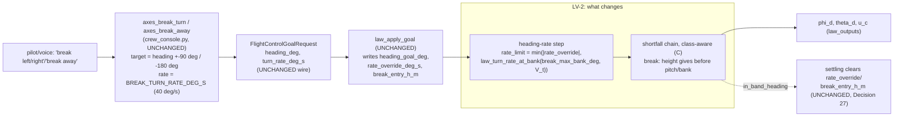

**2. Priority chain for a break, as it will actually run.** Height is consulted *before* the
shortfall reaches pitch or bank, not after (today it never is consulted at all — §3 above).

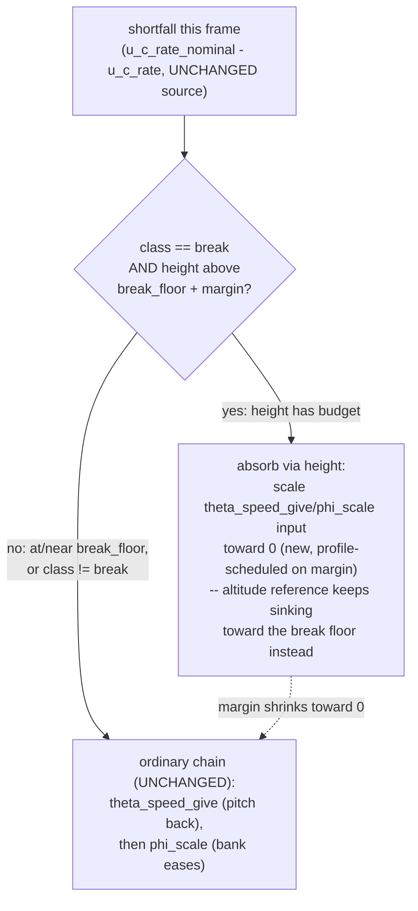

### B. Shape and G — the bank/rate cap (item 2 and 3 of the brief)

**New profile constants**, break-specific, so ordinary flight's own `max_turn_bank_deg` (20°) is
untouched:

- `break_max_bank_deg` — first cut **65°**. Chosen to land inside E5's own target window (60–80°)
  and close to the ~2 G the user accepts momentarily (`n = 1/cos(φ)`; 60° → 2.0 G exactly, 65° →
  2.37 G — deliberately a touch above 2.0 G rather than below it, since the user's own figure was
  "about 2 G", and the rate-cap below, not this angle alone, is what actually bounds the load a
  break reaches in practice: see the note on `n_d` below).
- **The heading-rate step's `else` branch gains one line**: when `state.rate_override_deg_s ~=
  nil` (a break), `rate_limit = math.min(math.abs(state.rate_override_deg_s),
  law_turn_rate_at_bank(profile.break_max_bank_deg, measured.v_t_mps))` — reusing
  `law_turn_rate_at_bank`, the same function the ordinary continuous-turn branch already calls
  with a different bank argument, not a new formula. `accel_limit` (the roll-in rate) is derived
  from this same capped `rate_limit` exactly as today (`rate_limit / profile.t_roll`).
- **Effect, by speed**: at 250 km/h, 40°/s would need ~75° bank (close to the cap, so the break
  flies near 40°/s, close to today); **main-loop correction:** `atan(ω·V/g)` gives 67° at 120,
  74° at 180, 79° at 250 km/h, so the 65° cap binds at all three card speeds — steady rate at 65°
  is ~36 / 24 / 17°/s (90° in ~2.5 / 3.7 / 5.2 s). The cap only binds where the commanded rate would otherwise ask for more
  bank than `break_max_bank_deg` allows — exactly "steep bank angle … to get a fast turn rate" (the
  turn rate is a *consequence* of flying to the bank/G cap, the same relationship ordinary turns
  already have with `max_turn_bank_deg`, not a second mechanism).
- **This does not, by itself, fix "too much pull back."** The resulting `n_d` from a capped bank
  alone is already ≈ 2 G by construction (`a_r_d = g·tan(break_max_bank_deg)`, feeding `law_phi_ff_
  deg`/`law_lift_length_g` exactly as section D/E already do) — the pitch-back/bank-easing the user
  reports comes from the **collective's own rate lagging the roll-in**, not from the target bank
  being too large. That is section C.

### C. Height gives first in a break (item 3's real fix, from §3 above)

**New, class-aware shortfall routing** — the one place `law_update`'s shortfall block changes:

- **Manoeuvre class, derived, never stored** (G's own stated design, now actually read):
  `class = "break"` if `state.rate_override_deg_s ~= nil`, else unchanged. (`low_slow_rpm`'s own
  class is out of this amendment's scope — LV-3.)
- **`break_floor_agl_m` (new, 50.0, see "D. The floor" below)** replaces `limits.floor_agl_m` only
  in the break-floor clamp the altitude shaper already computes (`break_floor = max(limits.
  break_floor_agl_m, state.break_entry_h_m − limits.break_max_height_loss_m)`, same formula,
  one constant swapped).
- **`height_margin_m = measured.h_m − break_floor`**, read at the same point in `law_update` the
  shaper already computed `break_floor` (hoisted one step earlier if needed so the shortfall block
  can read it; no second computation of the formula).
- **A new profile band, `break_height_give_band_m` (first cut 30.0)**: `height_available_frac =
  clamp(height_margin_m / break_height_give_band_m, 0, 1)` — 1 with plenty of height above the
  floor, ramping to 0 as the aircraft nears it.
- **The shortfall feeding `theta_speed_give`/`phi_scale` is scaled by this fraction only in break
  class**: `effective_shortfall = (class == "break") and (shortfall * (1 − height_available_frac))
  or shortfall`. With height to spare, `effective_shortfall ≈ 0` — no pitch-back, no bank easing —
  and the vertical loop's own `e_u` integrator (`u_c_i`, unchanged) is left to under-track `a_u,d`,
  which is exactly "height gives": the altitude reference itself sinks toward the break floor
  rather than the aircraft fighting to hold it with pitch or a shallower bank. As height runs out,
  `effective_shortfall` rises back toward the full `shortfall` and the ordinary absorbers (speed,
  then turn rate) take over near the floor — the order the user answered (U3, break: height,
  speed, turn rate), finally implemented rather than only described.
- **Nothing about the ordinary (non-break) chain changes** — `class != "break"` keeps
  `effective_shortfall = shortfall` exactly as today, so LV-1's own cards are not retested by this.

### D. The floor — both budgets, and whether the 50 m is break-only

**Superseded 2026-11-28** ("M3 amendment", A): one floor, `limits.floor_agl_m` = 50, for every goal
(user: *"one floor is better, use 50 m"*); `profile.break_floor_agl_m` is removed and the break floor
is `max(F_eff, entry − 100 m)`. The 100 m loss budget is unchanged.

The user's words apply to a break specifically (*"below which we must not descend **in a break**"*).
`limits.floor_agl_m` (40.0) is shared today by the break-floor clamp **and** the ordinary chain's
own passive height-giving and the unpark seed clamp (`flight_control.lua:2612-2613`) — raising it
globally to 50 would also raise the floor for ordinary flight and the unpark seed, which the user
did not ask for here (though it would match this project's own recorded 50–800 m AGL operating
envelope). **Kept separate, deliberately, to not expand scope silently**: a new
`break_floor_agl_m = 50.0` is added beside the unchanged `floor_agl_m = 40.0`; only the break-floor
clamp (section C above) reads the new one. `break_max_height_loss_m` (100.0) is unchanged — both
budgets apply together, exactly as the correction states (`break_floor =
max(break_floor_agl_m, break_entry_h_m − break_max_height_loss_m)`, the same `max()` shape as
today, so whichever is more restrictive at a given entry height still wins).

### E. U6 (a break entered slow turns more gently) — already satisfied, no new mechanism

Unchanged from the original plan's own claim: the roll-in's `accel_limit` is `heading_accel_cap *
schedule_g` (section B, kept), and `schedule_g` falls toward `profile.schedule_gain_min` at low
speed regardless of manoeuvre class. A break entered at ~100 km/h therefore ramps into its turn
rate more slowly than one entered at 250 km/h, with no break-specific code — confirmed by reading
the code (not re-derived), so no new constant is added for this item.

### F. The RPM/G-load items routed here from debug round 3 — status

Per the task brief: **both remain deferred, unbuilt, recorded only** — not retroactively built by
this amendment, since neither was asked for in items 1–4 and building either now risks tuning
against one flight's worth of symptom before this amendment's own fix is flown:

- **A general ordinary-flight G-load cap above 200 km/h** (1.8 G light / 1.5–1.6 G combat,
  tighter above 2 000 m or in turbulence, `aircraft-layer/research/2026-11-27-mi24p-rotor-engine-
  limits.md`) — this is a cap on *ordinary* flight's own accel demand, separate from the break-
  specific `break_max_bank_deg`/~2 G allowance just built; nothing here reads or enforces it.
- **Keeping rotor RPM ≥ 92 % at high speed** (a *proactive* floor, stricter than the existing
  *reactive* backstops this amendment relies on and leaves untouched: `rotor_rpm_warning_pct =
  88.0`'s ease guard, `rotor_rpm_floor_pct = 85.0`'s generator-trip floor, and the engine-RPM-gated
  collective schedule from the LV-1 amendment). Those three already exist and already bound a
  break's collective-rate excursions; a 92 % anticipatory floor is a different, additional
  mechanism and stays recorded-only.

### Tuning constants

All new, in `flight_profile.lua` (this subproject's loop-constant convention, no `tuning.py`
equivalent outside body-layer): `break_max_bank_deg` (65.0), `break_floor_agl_m` (50.0),
`break_height_give_band_m` (30.0). `break_max_height_loss_m` (100.0, `flight_control.lua` limits
table) is unchanged — confirmed by reading `flight_profile.lua` and `flight_control.lua`'s limits
table in full (widened 4a rule) before naming any of these; none overlaps an existing key.

**Non-finite check (standing rule).** `break_max_bank_deg`, `break_floor_agl_m` and
`break_height_give_band_m` are boundary floats read from profile/limits data the same way every
other constant in these tables is — the implementer checks each with `math.isfinite`-style
guarding (or the project's established pattern for these tables) the same way the other limits in
`flight_control.lua`'s bounds tables already are, per the architect/implementer/reviewer standing
rule on boundary floats (merged to `main` as `c0d8af86`).

### Co-moving Fields

Trigger (6a) checked: a break is a phase the law tracks via `rate_override_deg_s`/
`break_entry_h_m`, written both externally (`axes_break_turn`/`axes_break_away` → `goal.heading_deg`
+ `goal.turn_rate_deg_s`) and internally (settling clears both). **This amendment adds no new
persisted field** — `class` is derived fresh every frame from the existing `rate_override_deg_s`
(never stored), and `break_floor_agl_m`/`break_height_give_band_m` are profile constants, not
state. The full construction/write/clear table for `rate_override_deg_s`/`break_entry_h_m` is
already in the original plan's own Co-moving Fields section above (`law_apply_goal`'s `turn`/
`heading_deg` branches, the settling clear in `law_update`) and is unchanged by this amendment — no
new row is owed because no new field exists to leak.

### Tests

- Bank/rate cap: at 250 km/h a break commands bank approaching `break_max_bank_deg` (within the
  toy plant's settle tolerance), not the kinematic bank a bare 40°/s would imply; a speed low enough
  that 40°/s needs less than 65° (below ~105 km/h) shows the cap not binding.
- Height-gives-first: with the plant's collective rate artificially capped low (simulating a
  roll-in collective lag), a break entered with height to spare shows altitude sinking and
  `theta_i`/`phi_scale` essentially untouched; the same scenario entered near `break_floor_agl_m`
  shows `theta_speed_give`/`phi_scale` engaging at close to today's (pre-amendment) strength.
- Floor: `break_floor_agl_m` (50) binds instead of `floor_agl_m` (40) for the break-floor clamp;
  the ordinary chain's own floor and the unpark seed clamp are unaffected (still 40).
- Settle: unchanged from the original plan's own break tests (in-band heading clears
  `rate_override_deg_s`/`break_entry_h_m` the same frame, nothing left wound up).
- Regression: every LV-1 card scenario (`class != "break"`) produces bit-identical
  `effective_shortfall == shortfall`, i.e. no behaviour change outside break class.

### LV-2 card (rewritten against the answers)

SAU off before every take (U4, unchanged project-wide rule). Break left and right at 120, 180 and
250 km/h (watch: steep bank reached promptly, **little to no nose-up**, ball centred, speed near
entry, height loss ≤ 100 m and never below 50 m AGL, roll-out on the break heading); break away;
one break started at about 70 m AGL (both budgets should bind: the 100 m loss and the 50 m floor —
watch which one actually limits the sink at that entry height); one break entered at about 100
km/h (gentler roll-in, U6, no hand-back); one break entered already near the rotor-RPM warning
threshold (88 %) — e.g. right after a hard pull or a high-power climb, not a dummy toggle (the RPM
read is now live, `arg_proxy`, not `"dummy"` — the original card's "lowered `ROTOR_RPM_DUMMY_PCT`"
row no longer applies and is replaced by this one). Each row: note whether the fix reads as *"roll-
in good, pull-back gone"* against the fourth re-fly's own words, or whether the shortfall is still
reaching pitch/bank sooner than the margin band predicts — that comparison is this card's real
pass/fail, more than any single number.

### Risks & Unknowns (amendment-specific)

- **`break_max_bank_deg = 65°` and `break_height_give_band_m = 30 m` are first cuts**, like every
  gain in this plan — the card above is where they are measured, not derived analytically; 65°
  sits inside E5's 60–80° window but the resulting G depends on how close to the cap a given entry
  speed actually drives the bank.
- **The height-gives mechanism trades a known problem (pitch-back) for a new one (sink rate)** —
  if `break_height_give_band_m` is too wide, a break could sink more briskly than the fourth re-
  fly's own complaint anticipated; the card's 70 m AGL row is where this is checked against the
  50 m floor rather than discovered in a flight.
- **Interaction with the LV-1 amendment's engine-RPM-gated collective schedule (section C there)
  is untested until this card flies** — a break's roll-in is exactly the brisk-acceleration case
  that schedule already anticipates (collective fast when engine RPM is near 100 %), so the two
  mechanisms may already cooperate; if the card shows collective still lagging the bank, the
  schedule's own thresholds (not this amendment's height-gives logic) are the first place to look.
- **The deferred G-load cap and the 92 % RPM floor (F) stay unbuilt** — if the card's high-speed
  break rows show RPM or load excursions the existing reactive backstops do not catch cleanly,
  that is the point at which either gets its own look, not retrofitted blind into this amendment.

### Decisions Requiring User Input (amendment)

- **U11: Does the new 50 m break floor also move the ordinary-flight floor (`floor_agl_m`, still
  40 m) and the unpark seed clamp?** — recommend: no, keep them separate (`break_floor_agl_m`,
  new, 50 m, break-only; `floor_agl_m`, unchanged, 40 m, everything else) — the user's own words
  named the break specifically, and widening to ordinary flight is a separate, if plausible
  (matches the project's own 50–800 m AGL operating-envelope note), change this amendment was not
  asked to make. Flagging rather than deciding silently, per "do not expand scope silently."

**Answered (user, 2026-11-27, verbatim):** *"U11, only breaks"* — `break_floor_agl_m` (50 m) is
break-only; ordinary flight and the unpark seed keep `floor_agl_m` (40 m). Diagrams (throwaway
artifact): *"diagrams approved"*.
**U11 REVISED 2026-11-28** by the user's M3 answer *"one floor is better, use 50 m"*: see "M3
amendment", A (one floor; the unpark seed clamp is removed, E10).

**Plan-check CONCERNS resolved (main loop, 2026-11-27):** `alignment.md` Finding 1 — 65° binds at
every card speed, so a break sits at ~2.37 G for seconds, above the user's own *"about 2 G"*.
**`break_max_bank_deg` first cut is 60° (2.0 G)**, not 65°, matching the user's figure; still a
`flight_profile.lua` tunable the card measures. Steady rate at 60°: ~32 / 21 / 15°/s at 120 / 180 /
250 km/h. Where this section says 65°, read 60°.

### LV-2 fix pass (2026-11-27, `review-lv2.md` required fix 1) — "Effect, by speed" corrected

The two paragraphs above (and this section's own "steady rate at 60°: ~32/21/15°/s" figure) assumed
the bank/rate cap bound as soon as a break was commanded. It did not: section B's `rate_limit` was
correctly capped, but the `a_ref` formula feeding `r_ref` toward it reused the *ordinary*
`omega_heading` (0.3) — a critically-damped 2nd-order step response peaks at `err·ω/e`, independent
of speed and of any ceiling above that peak, so a bare 90° break error only ever drove the rate to
~9.95°/s at every speed, regardless of `break_max_bank_deg`. The cap this section built had,
almost always, nothing to cap (full finding and the measured numbers: `review-lv2.md`).

**Fix, same scope as section B, no new mechanism**: a second, break-only shaper bandwidth,
`break_omega_heading` (first cut **1.0 rad/s** — its own natural peak rate for a 90° error,
`90·1.0/e ≈ 33.1°/s`, exceeds every card speed's bank-derived cap, ~14–29°/s, so the cap now binds
at 120 km/h to ~97% and fully at 180/250 km/h), used only while `state.rate_override_deg_s ~= nil`
(the same test section B's own `rate_limit`/`accel_limit` selection already uses). `zeta` is
unchanged and shared — the shaper's own reference (`r_ref`/`psi_ref`) stays critically damped, zero
overshoot by construction, confirmed numerically independent of the cap. Ordinary (non-break)
heading flight reads `omega_heading` exactly as before — bit-identical, confirmed by the full
pre-existing regression suite and a new pinned test.

**Real numbers, toy-plant (closed loop through the real heading error, shipped profile), replacing
the two paragraphs above**:

| speed | 90° break: peak bank / 90%-of-turn time | ordinary 90° turn (unaffected) | 90° break overshoot | 180° break-away overshoot |
|---|---|---|---|---|
| 120 km/h | ~56° / ~5.4 s | ~23° / ~15.4 s | ~5.5° | ~10.1° |
| 180 km/h | ~63° / ~6.2 s | ~23° / ~20.9 s | ~5.4° | ~8.9° |
| 250 km/h | ~64° / ~7.3 s | ~23° / ~28.1 s | ~5.4° | ~6.9° |

The break is genuinely faster than before at every speed (previously it was not — both pre-fix
break and ordinary turns converged on the same ~10°/s shaper-limited peak) and now actually flies
close to the 60° bank cap rather than well under it.

**Known residual, not fixed by this pass, flagged for the card and for the user**: the real
(lagged) heading overshoots the break's own target by ~5.4–5.5° for a 90° break and ~7–10° for a
180° break-away, because the aircraft's own bank cannot reverse instantly once the shaper starts
decelerating — a single overshoot-and-settle (confirmed by zero-crossing count, never more than
one reversal), not sustained oscillation, but not the "no overshoot" this section's own earlier
text assumed either. This is a property of flying the turn *faster* (present at any
`break_omega_heading` above ~0.5, growing with the bandwidth) — the SHAPER's own reference is still
overshoot-free by design (zeta=1); it is the toy plant's own first-order bank lag, reached once the
break is fast enough to expose it, that overshoots. Not addressed here (would need a lookahead/
anticipation term ahead of the deceleration, a separate mechanism, out of this one-constant fix's
scope) — added to the LV-2 card's own "roll-out on the break heading" watch line for a live read
against these measured figures.

## LV-2 rework amendment (2026-11-28)

**Diagrams approved (user, verbatim, 2026-11-28):** *"break plan ok"* — reviewed as the throwaway
artifact https://claude.ai/artifact/HPQAEpYd11UibGVcc5SqE5 (this section's two diagrams plus a
by-channel change table).

Architect pass. Branch `fix/bl16-flight-epoch-bound` (pushed as `feature/bl16-lift-vector-law`),
tip `7773b8ef`. Supersedes the collective/vertical-channel design of "LV-2 amendment (2026-11-27)"
section C and the bank cap of section B — the first LV-2 card flew and failed
(`docs/acceptance/2026-11-28-sortie-feedback.md`, first sortie): roll-in to 66° overshoot, the
vertical loop demanding full collective to hold altitude at that bank, full collective pitching
the nose to +19° against full forward cyclic, IAS 213 → 120, then the pitch integrator winding to
−1 under the saturation and the nose falling to −52° once bank came off — h_ref 190 → 45 m, below
the 50 m floor. Inputs read in full: `explore-notes.md` "LV-2 re-explore — what a break turn
actually needs" and its five follow-up answers (the specification); `alignment.md` "Goal check —
2026-11-28 — LV-2 rework", BE1–BE10, the open assumptions and Findings 1–6 (every finding answered
below); `docs/acceptance/2026-11-28-sortie-feedback.md` (sortie 1's trace reading); the existing
"LV-2 amendment"/"LV-2 fix pass" sections above, read in full before changing them (not re-derived).
Code read in full for the paths this touches: `law_apply_goal`'s break branch (~L676–722),
`law_init_at_take`'s default/seed bookkeeping (~L930–945), `law_update`'s heading-rate step
(~L1137–1218), the altitude shaper and break floor (~L1236–1378), the desired-acceleration/
collective block (~L1433–1686), the inner tilt-loop integrators (~L1738–1748), the settling clear
(~L1840–1849), the unpark carry-over (~L3572–3593), and `law_outputs` (~L1895–1931).

### Why this amendment is judged (restated from `alignment.md`)

A break is the pilot's escape: heading changed fast, speed and rotor kept, height spent as the
currency — never the ground. The first design chased a *trajectory* (hold this much height loss,
solve for whatever lift vector that needs) and the solve demanded more collective exactly when bank
was steepest, which is what pitched the nose into the sky. The rework instead sets an *attitude*
(bank, pitch, a deliberate collective offset) the way the user actually flies it, and lets height be
whatever falls out — never commanding the vertical channel to fight for a number.

### A. What changes and what does not

| | old design (failed) | rework |
|---|---|---|
| Bank target | `break_max_bank_deg = 60°` (2.0 G) | **30°** (profile value, "for now" — BE1, Q1) |
| Pitch | — (no separate target; fell out of `a_u_d`'s climb/descent demand) | unchanged mechanism: the speed loop's own `a_f_d`/`theta_d` — "whatever holds entry speed" (BE2) — **no new code** |
| Collective | `a_u_d` tracks the break-floor altitude reference; `u_c_ff` solves for whatever lift length that bank+climb-demand needs | `a_u_d` blended toward **0** (no climb/descent demand) plus an explicit **drop** below level-flight trim, both scaled by the same release fraction (D) |
| Pedal | ball-centred (unchanged) | unchanged — **no new code** |
| Near-floor/no-margin safety net | `effective_shortfall` (height-gives) feeds `theta_speed_give`/`phi_scale` | **kept, same formula**, now gated by the widened release fraction (D) — this is what makes bank "come off" when collective genuinely cannot keep up (BE6), not a second mechanism |
| Roll-out height | shaper drives back to the standing `alt_goal_m` (implicit climb back) | **the height reached becomes the new standing goal** (E) — supersedes Decision 29's "a break never writes `alt_goal_m`" |
| Pitch-loop anti-windup | freezes `t_p`/`t_r` only at their *own* ±1 bound | freezes at the **combined output's** ±1 bound too (F) — a generic law fix, every regime, not break-specific |

### B. Bank — 30°, unchanged mechanism

`break_max_bank_deg: 60.0 → 30.0`. The rate-cap mechanism (section B of the earlier LV-2 amendment,
`law_turn_rate_at_bank(profile.break_max_bank_deg, v_t)` feeding `rate_limit`) is untouched — it is
exactly what turns "set a bank" into "a bank-derived turn rate." `break_omega_heading` (1.0) is also
unchanged: its natural peak rate for a 90° step (~33°/s) still exceeds every card speed's
30°-derived rate ceiling (9.7/5.8/4.7°/s at 120/200/250 km/h, BE5's table), so the cap binds
immediately and fully at every speed — "steep bank quickly" (BE1) falls out with no new tuning.
`break_max_bank_deg` is **not** scaled by margin or by anything else: the bank target is 30°
whenever a break is active, full stop — BE7's "steeper than ordinary turn's bank, even with no
height to spare" settles this directly (Finding 2's "just command more turn rate" reading is
answered: the ordinary 20° cap never applies to a break, by construction, regardless of margin). What
*does* ease the bank when it genuinely must (BE6) is the existing `phi_scale` safety net in D, not
this cap.

At 30°, the coordinated-turn lift length is `1/cos(30°) ≈ 1.15` — nowhere near the old 60°/65°
design's ~2 G. This is why the rework is materially safer even before the collective redesign in D:
holding altitude at 30° never demands a dramatic collective jump the way holding it at 60°+ did.

### C. Pitch — unchanged, no new mechanism

Confirmed by reading the code, not re-derived: `a_f_d` is driven by the ordinary speed shaper
(`v_ref` tracking `state.speed_goal_mps`, the *standing* commanded speed, untouched by a break) with
`k_speed_error` feedback, exactly as today. A break does not freeze or re-capture a separate "entry
speed" goal — it keeps using whatever `speed_goal_mps` already was, so a break called mid-
acceleration does not silently lose the commanded speed (the open assumption "which speed is kept,"
answered). `theta_d` (pitch target) is whatever that speed-hold produces; the user's own "≈ −10°" is
an outcome, not a target (BE2). No profile constant changes here.

### D. Collective & the vertical channel — the attitude-manoeuvre redesign (the sortie's actual fix)

**New state, co-moving with the break (full table in "Co-moving Fields" below):**
`break_entry_ias_kmh` — IAS at the moment a break's heading goal is applied, captured the same
frame and cleared the same way `break_entry_h_m` already is. Needs one new cached-from-measured
field, `state.measured_ias_kmh` (written every `law_update` frame exactly as `measured_v_t_mps`
already is at ~L1817/L938), since `law_apply_goal` has no access to the live `measured` table —
the same reason `measured_v_t_mps` exists.

**1. The release fraction (widens the existing `height_available_frac`, not a new mechanism).**
Hoisted right after `break_floor` is computed (~L1278), so both this section and the shortfall
block below (today's ~L1618–1634) read the same value:

```
height_margin_m = measured.h_m - break_floor
sink_lead_m      = profile.break_recovery_lead_s * max(0, -state.w_ref)   -- lead grows with sink rate (Finding 3)
effective_band_m = max(profile.break_height_give_band_m, sink_lead_m)
break_release     = clamp(height_margin_m / effective_band_m, 0, 1)        -- 1 = plenty of height, 0 = at/near the floor
```

`break_recovery_lead_s` (new, first cut 4.0 s) is what makes the near-floor reaction start *before*
the floor rather than at it (Finding 3): a break sinking faster gets a wider effective band, so the
recovery (D.2/D.3 below, and the existing `phi_scale` safety net) engages earlier. At `break_release
= 0` from the very first frame (a break called at 55–70 m AGL, BE7), the mechanism below falls
straight into "fully held," which is exactly BE7's "holds height and turns faster than ordinary"
with no separate entry-time branch needed.

**2. `a_u_d` is blended, not zeroed outright — and terrain safety always wins.** The ordinary
formula (today's `a_u_d`, unchanged, call it `a_u_d_ordinary`) still runs every frame, since M3's
terrain look-ahead (`w_floor`/`terrain_binding`, computed earlier at ~L1313–1321) must keep working
unconditionally through a break (the "terrain ahead during the break" open assumption):

```
a_u_d = terrain_binding and a_u_d_ordinary
     or ((1.0 - break_release) * a_u_d_ordinary)     -- only while class == "break"
```

`terrain_binding` (M3) overrides the release outright — ground/terrain safety never yields to the
attitude manoeuvre (E8's "envelope first"). Away from terrain and with height to spare
(`break_release = 1`), `a_u_d = 0`: no climb/descent is demanded at all, which is what lets the
aircraft actually sink rather than fight to hold a sinking reference (the sortie's root cause,
removed). As the margin shrinks, `a_u_d` fades back toward the full ordinary (height-tracking)
value — collective is asked to arrest the sink before the floor, not at it.

**3. The explicit collective drop — "collective visibly goes down ~20–30%" (BE1), in command-domain
units, not solved from a trajectory:**

```
speed_scale = clamp((break_entry_ias_kmh - break_drop_speed_low_kmh)
                     / (break_drop_speed_high_kmh - break_drop_speed_low_kmh),
                     break_drop_speed_scale_min, 1.0)
break_drop  = profile.break_collective_drop_frac * speed_scale
u_c_ff      = k_lift_ff * (n_d - 1.0) - ((not terrain_binding) and break_release * break_drop or 0.0)
```

(`n_d = law_lift_length_g(a_f_d, a_r_d, a_u_d)`, unchanged formula — fed the blended `a_u_d` from
D.2, so at `break_release = 1` away from terrain, `n_d` is already the "level, no climb" lift length
for the current bank/speed, ≈1.15 at 30°, and `u_c_ff` additionally subtracts the drop on top of
that — literally "less collective than level flight needs," the mechanism the user described.) At
100–120 km/h entry, `speed_scale ≈ 0.5–0.6` — "about half the collective drop" (BE/Q4). At 180 km/h
and above, `speed_scale = 1.0` — the full drop. The drop fades to 0 the same way `a_u_d` fades back
(both gated by `break_release`, and both suppressed outright when `terrain_binding`), so there is
one release fraction, not two independently-tuned ones.

**4. The existing near-floor safety net is kept, unchanged in formula, now gated by the same
fraction.** Today's `effective_shortfall = shortfall * (1.0 - height_available_frac)` (LV-2
amendment, section C) stays exactly as written — `height_available_frac` is simply `break_release`
from D.1, computed once. This is what makes bank genuinely "come off" (BE6) when the modest ~1.15 G
collective recovery still cannot keep up (an engine still spooling down from a prior manoeuvre, say)
— `phi_scale` eases the bank *as a consequence of a real shortfall*, not as a scheduled function of
margin. Most breaks at 30° never reach this: BE6's "comes off" is the exception path, not the
common one, which is the point — at the old 60–65° cap it was the common path, and that was the bug.

**No change to the RPM-warning ease, blade-stall, pedal-limit or engine-RPM-gated collective-rate
guards** — they are symmetric in sign only for *increases*; a break's collective is now mostly
*decreasing* at entry (D.3), which those guards never throttle. Only the anti-windup check at
`u_c` (unchanged, "Section H" today) still applies.

### E. Roll-out — level at the height reached (supersedes Decision 29)

**Decision 29 REVISED 2026-11-28.** Decision 29 and its restated comment ("a break replaces only
the heading goal," ~L1261) assumed the standing `alt_goal_m` is never touched by a break, so the
shaper drives back to it once the break settles — Finding 1 showed this means an uncommanded climb
back to the pre-break height, contradicting the user's own *"restore to whatever is needed for
level flight"* and BE8. The settling block (today's ~L1847–1849, the same frame `rate_override_
deg_s`/`break_entry_h_m`/`break_entry_ias_kmh` clear) gains one more write:

```
if state.alt_goal_ref == "agl" then next_state.alt_goal_m = measured.h_m
else                                 next_state.alt_goal_m = measured.asl_m end
```

(Either branch makes the shaper's own `alt_goal_agl` formula evaluate to the current height at that
instant — `asl_m - h_m` cancels for the baro branch — so there is no step in the reference, only a
redefinition of what "home" means from here.) The player re-commands a height if they want one
(BE8); nothing climbs on its own. This is the one place this amendment writes `alt_goal_m` from
inside `law_update` rather than from a desired-state command — flagged because it is a genuine,
deliberate exception to "a break never writes `alt_goal_m`," not a silent one.

### F. Pitch-loop anti-windup — all regimes, not break-specific

**The sortie's second failure, independent of the break redesign above.** Today's freeze condition
(`(state.t_p >= 1.0 and d_t_p > 0.0) or (state.t_p <= -1.0 and d_t_p < 0.0)`, ~L1740–1745) checks
only `t_p`'s *own* bound. But the value actually clamped at write time is the **combined** output,
`u_pitch = t_p + k_theta*(theta_d - pitch) - k_q*theta_rate` (`law_outputs`, ~L1899–1900) — and that
combination can saturate at ±1 while `t_p` itself is still well inside [-1, 1], because the
proportional/damping terms can carry the sum past the bound on their own. That is exactly the
sortie: full forward cyclic (`out_pitch = -1`) from t = 63.3 while `t_p` kept integrating toward −1
because its *own* value hadn't hit the bound yet — by the time it got there (wound up), bank had
come off and the nose fell to −52°. **Fix: estimate the combined output before deciding whether to
freeze, using the same terms `law_outputs` uses:**

```
u_pitch_est = state.t_p + profile.k_theta * (next_state.theta_d - measured.pitch_deg)
            - profile.k_q * (measured.theta_dot_deg_s or measured.q_deg_s)
d_t_p = profile.k_theta_i * (next_state.theta_d - measured.pitch_deg)
freeze if (u_pitch_est >= 1.0 and d_t_p > 0.0) or (u_pitch_est <= -1.0 and d_t_p < 0.0)
      or (state.t_p's own bound, as today)       -- OR'd, strictly more conservative, never less
```

Same change, same reasoning, for `t_r`/`u_roll` (~L1746 onward) — structurally identical risk, not
observed in this sortie but not break-specific either, and fixing one loop and not its twin would be
inconsistent for no stated reason. **Applies in every regime** (break or not, every speed): it is a
correctness fix to the generic law, not gated on `class == "break"`. `t_p`/`t_r`'s own ±1 clamp
stays as a second, independent guard — the new check only ever freezes *earlier*, never later.

### G. How BE6/BE7 fall out without a separate mechanism

Walking the two cases against B–D, so the plan does not merely assert they are covered:

- **BE7 (called low, e.g. 55–70 m AGL, no margin from frame 1):** `break_release ≈ 0` immediately
  (D.1). `a_u_d` is already ≈ `a_u_d_ordinary` (D.2) — the vertical loop is fully engaged from the
  first frame, holding height at 30° bank. `break_drop ≈ 0` (D.3, release gates it to zero). Bank
  stays at 30° throughout (B — never eased by margin). Result: a level turn at 30°, steeper than the
  ordinary 20° cap, height held — BE7, verbatim.
- **BE6 (reaches the floor mid-break, having flown most of it at `break_release = 1`):** as margin
  shrinks, `a_u_d` fades toward full height-tracking and `break_drop` fades to 0 (D.2/D.3) —
  collective "comes up." Bank itself stays commanded at 30° (B); it only actually eases if the
  ~1.15 G recovery genuinely outruns what collective-rate can deliver, via the unchanged
  `effective_shortfall`/`phi_scale` safety net (D.4) — "bank comes off... together [with collective
  rising]," the exception path, not a scheduled one.

### Tuning constants

All new, in `flight_profile.lua`. Checked the full table (widened 4a rule) before naming any of
these — none overlaps an existing key; `break_max_bank_deg` and `break_height_give_band_m` are
existing keys whose *value*/*role* change, not new keys.

| constant | first cut | role |
|---|---|---|
| `break_max_bank_deg` (existing, value changes) | 30.0 (was 60.0) | the break's bank target, B |
| `break_collective_drop_frac` | 0.25 | the "20–30%" lever-travel drop, full-speed value, D.3 |
| `break_drop_speed_scale_min` | 0.5 | the slow-entry floor on the drop's speed schedule, D.3 |
| `break_drop_speed_low_kmh` | 110.0 | entry IAS at/below which the drop scale floors at `break_drop_speed_scale_min` |
| `break_drop_speed_high_kmh` | 180.0 | entry IAS at/above which the drop scale reaches 1.0 (covers the 180/250 card rows at full) |
| `break_recovery_lead_s` | 4.0 | seconds of sink-rate lookahead widening the release band near the floor, D.1/Finding 3 |
| `break_height_give_band_m` (existing, role widens) | 30.0 (unchanged) | the release band at zero sink rate — floor of `effective_band_m`, D.1 |

**Non-finite check (standing rule).** All of the above are boundary floats read from profile data
the same way every other constant in these tables is — guarded with `math.isfinite`-style checking
the same way the existing bounds tables are, per the standing rule (merged to `main` as `c0d8af86`).
`break_entry_ias_kmh`/`measured_ias_kmh` are derived from `measured.ias_mps` (already finite-checked
at the telemetry boundary) — no new boundary-float path is introduced.

### Co-moving Fields

Trigger (6a) checked: a break is tracked by `rate_override_deg_s`/`break_entry_h_m`, written
externally (`axes_break_turn`/`axes_break_away` → `law_apply_goal`) and internally (the settling
clear). This amendment adds one more co-moving field (`break_entry_ias_kmh`) and one new
cached-from-measured field (`measured_ias_kmh`, written every frame like `measured_v_t_mps`, not a
phase field itself but read by the new capture). Every construction/write site of the break phase,
found by grep (`rate_override_deg_s\|break_entry_h_m`), gets the new field alongside it:

| site | writes today | `break_entry_ias_kmh` |
|---|---|---|
| `law_apply_goal`, `goal.turn` branch (~L692–693) | clears `rate_override_deg_s`/`break_entry_h_m` to `nil` (a continuous turn ends any break) | **add:** clear to `nil` too |
| `law_apply_goal`, `goal.heading_deg` branch (~L717–722) | sets `rate_override_deg_s`; snapshots `break_entry_h_m = state.h_ref` only if an override is present, else `nil` | **add:** snapshot `state.measured_ias_kmh` (or `nil`) the same way, same condition |
| `law_init_at_take` default seed (~L943–945) | `rate_override_deg_s = nil`, `break_entry_h_m = nil` (a fresh session never inherits a stale break) | **add:** `break_entry_ias_kmh = nil` |
| `law_init_at_take`'s own measured-cache seed (~L938, alongside `measured_v_t_mps`) | — | **add:** `measured_ias_kmh = ias_kmh` at the take instant |
| settling clear (today's ~L1847–1849) | clears `rate_override_deg_s`/`break_entry_h_m` to `nil` when `in_band_heading` and a break was active; **this amendment also writes `alt_goal_m`** here (E) | **add:** clear `break_entry_ias_kmh` to `nil` in the same `if` |
| unpark carry-over (~L3578–3587) | calls `law_apply_goal` directly with `heading_deg`/`turn_rate_deg_s` — covered automatically once the `goal.heading_deg` branch above carries the new field | no separate site — confirmed by reading the call, not assumed |
| `law_update`, every frame (~L1817, alongside `next_state.measured_v_t_mps`) | caches `measured.v_t_mps` | **add:** cache `measured.ias_kmh` (already computed locally as `ias_kmh` at ~L1066) the same way |

No other field is added or changed by this amendment; `break_release` (D.1) is a local, never
persisted, same posture as `shortfall`/`class` already are.

### Design Overview (diagrams)

**1. What a break actually commands, by regime — bank is constant; the vertical channel and the
collective offset are what move.**

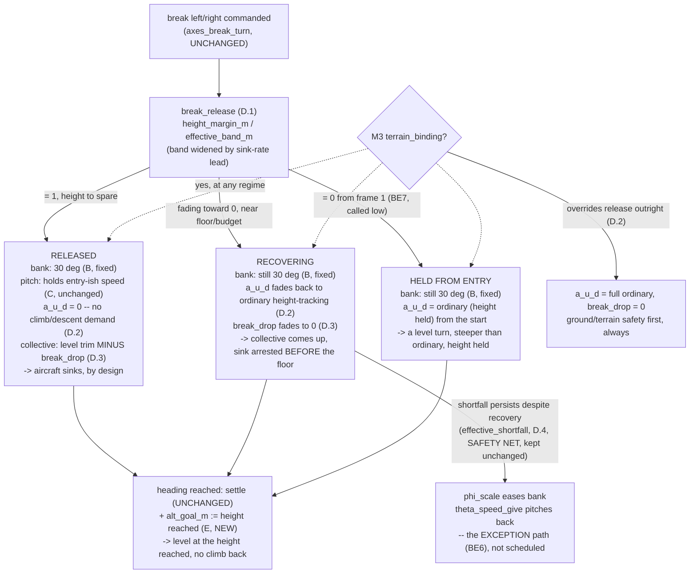

**2. Who owns what, by channel — contrast with the superseded design.**

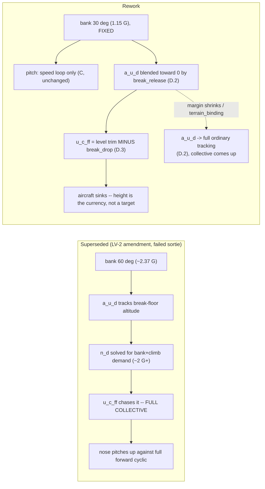

### Implementation Plan

1. **Cache `measured_ias_kmh`** in `state` every `law_update` frame (alongside `measured_v_t_mps`)
   and at `law_init_at_take`'s seed — no behaviour change by itself, just the data `break_entry_
   ias_kmh` needs.
2. **Capture/clear `break_entry_ias_kmh`** at every site in the Co-moving Fields table.
3. **Bank**: change `break_max_bank_deg` to 30.0. No other code change in section B.
4. **Collective & vertical channel (D)**: hoist `break_release`'s computation after `break_floor`
   (D.1); blend `a_u_d` (D.2); add the explicit drop to `u_c_ff` (D.3); re-point `effective_
   shortfall`'s `height_available_frac` input at the same `break_release` value (D.4, formula
   unchanged). Add the four new/changed tuning constants.
5. **Roll-out (E)**: add the `alt_goal_m` write to the settling-clear block.
6. **Pitch-loop anti-windup (F)**: change the freeze condition for `t_p` and `t_r` to also check the
   estimated combined output. No profile constants.
7. **Toy-plant tests** (below) before any card flight.

### Tests (real-Lua toy-plant harness)

- **Bank cap, three card speeds (120/200/250 km/h):** steady-state bank settles at 30° (within the
  toy plant's own tolerance), not 60°; `n_d` at settle ≈ 1.15.
- **Release/collective-offset, height to spare:** break entered well above the floor with the whole
  budget free — `a_u_d` reads ≈ 0 for the duration, `u_c_ff` sits `break_drop` below the level-trim
  value computed independently in the test, altitude sinks monotonically (never oscillates), no
  collective saturation.
- **Speed-scaled drop:** same scenario at a 110 km/h entry vs. a 200 km/h entry — the 110 km/h
  case's measured `u_c_ff` offset is ≈ half the 200 km/h case's, both read against the test's own
  independently-computed level-trim baseline.
- **BE7, no margin from entry:** a break commanded with the plant already at/near the floor —
  `break_release` reads 0 from the first `law_update` step, `a_u_d` tracks the ordinary height
  reference from the first frame (no sink-then-recover pumping), bank still reaches 30°.
- **Recovery before the floor (Finding 3):** a break with a fast artificial sink rate injected —
  `effective_band_m` (hence `break_release`'s fall-off) starts earlier than the fixed 30 m band
  alone would predict, and the plant's altitude never crosses below the floor in the scenario.
- **Terrain override:** `terrain_binding` forced true mid-break — `a_u_d` reads the full ordinary
  value and `break_drop` reads 0 for that frame regardless of `break_release`.
- **Roll-out height:** break settles (heading in-band) at a height below the pre-break standing
  goal — the plant holds that height afterward, no climb back; a speed or altitude command given
  after roll-out still works normally (re-commanding height is unaffected).
- **Anti-windup:** a scenario that drives the combined pitch output to saturation (e.g., a large
  commanded deceleration at low rotor-RPM-gated collective rate) while `t_p` itself is still well
  inside [-1, 1] — `t_p` stops advancing in the saturating direction the frame the *combined*
  output saturates, not later; a companion scenario confirms `t_r` behaves the same way on roll.
  Regression: every existing anti-windup test (the ones written against the old, `t_p`-own-bound-
  only condition) still passes — the new condition only ever freezes earlier or at the same time,
  never later.
- **Regression:** every LV-1 card scenario and every non-break LV-2/LV-3 toy-plant test is
  bit-identical (bank cap and `a_u_d`/`u_c_ff` changes are gated on `class == "break"`; the
  anti-windup change is the one exception that is *meant* to change ordinary-flight behaviour in the
  rare case it would have wound up, by design — F above).

### LV-2 card (rewritten against BE1–BE10)

SAU off before every take. Break left and right at **120, 180 and 250 km/h** (watch: bank reaches
~30° promptly, collective visibly comes down at entry, nose does *not* rise, speed stays near entry,
rotor RPM stays clear of 88%, height loss ≤ 100 m and never below the floor, roll-out holds the
height reached — no climb back). **For each of these three, time the 90° break and compare it
against an ordinary "turn right 90" at the same entry speed, and record the height used by
each** — this is BE5's own test, and the number that tells whether 30° is "a break" rather than a
slightly brisker ordinary turn (Finding 4). One break started at **55–70 m AGL** (BE7: watch for a
level turn held from the first second, not a sink-then-recover pump). One break entered at **100–
120 km/h** (BE/Q4: collective offset about half; watch roll-in gentleness, U6). One break away
(180°) at **30°** — record whether the 100 m budget is used up before the heading is reached
(Finding 4's own flag) and whether it needs a steeper bank, per Q6. One right break, watched
specifically for the pedal cap and yaw at the roll-out (item H below). Each row: note whether the
pitch stays near the speed-loop's own target throughout (no excursion toward the old +19°/−52°
pattern) — that comparison is this card's real pass/fail criterion, more than any single number.

### Risks & Unknowns (amendment-specific)

- **`break_collective_drop_frac` (0.25), the speed schedule's breakpoints, and `break_recovery_
  lead_s` (4.0 s) are all first cuts**, like every gain in this plan — this card is where they are
  measured, not derived analytically. A drop too small may not read as "visibly less collective"; a
  drop too large, combined with a long break away at cruise, may still spend the whole 100 m budget
  before the heading is reached (Finding 4's own flag, carried forward — 30° spends roughly 3× the
  height per degree of heading change that 60° did, for the same sink rate).
- **The near-floor safety net (D.4) is now the only mechanism standing between a genuinely
  under-powered recovery and the floor.** At 30° bank the demand is modest (≈1.15 G) compared to
  the old design, so this path should rarely engage — but if the card's 55–70 m AGL row or the
  break-away row shows `phi_scale` easing bank and it still sinks past the intended arrest point,
  `break_recovery_lead_s` (widen it) is the first tunable to revisit, not a new mechanism.
- **The anti-windup fix (F) changes ordinary (non-break) behaviour in the rare case where it would
  have wound up** — by design, but it is the one change in this amendment not gated to `class ==
  "break"`, so any LV-1/LV-3 card regression involving pitch should be checked against this fix
  first, not assumed unrelated.
- **Out of scope, named for where it would interact (per the task brief):** the right-pedal cap
  (DCS adjustable stops cap the effective pedal at ~0.57 right, `pedal_limit_positive` is 1.0) could
  bite during the D.4 recovery path's torque feed-forward (more collective coming back up → more
  right-pedal demand) and at the BE8 roll-out in a right break specifically — the card's right-break
  row (above) is where this would first show as a yaw/ball excursion, not a break-recipe defect. The
  λ-from-total-ground-speed defect (second sortie, slow-speed pedal runaway) is orthogonal to this
  amendment (it only matters once a break decays into LV-3's low-speed regime, BE9, which this
  amendment does not touch) but is named so a BE9 card row that misbehaves is not misdiagnosed as a
  break defect. The M4 SAU-at-take delay bug (sortie 2) must be fixed or worked around (confirm SAU
  off before the take, by hand if needed) before this card is flown, since SAU H/K/T on is a
  confound this amendment cannot be judged against.
- **`break_recovery_lead_s` uses `state.w_ref`, not measured vertical speed** — consistent with the
  rest of this file's "reference, not raw measurement, drives the law" posture, but it means the
  lead only grows once the shaper's own reference has started sinking, one frame or so behind a
  sudden real sink. Not expected to matter at `law_hz`, flagged because it is a design choice, not
  an oversight.

### Decisions Requiring User Input

None — every open question from the goal check (`alignment.md`, "Goal check — 2026-11-28 — LV-2
rework", Questions 1–6) was answered "as recommended" before this pass began, and Findings 1–6 are
each addressed above: Finding 1 (roll-out climbs back) by E; Finding 2 ("more turn rate" collapsing
to an ordinary turn) by B's fixed 30° regardless of margin; Finding 3 (floor reaction re-engaging
too late) by D.1's sink-rate lead; Finding 4 (30° spends more height per degree) carried forward as
a Risk and a card measurement, not a design change (the user chose 30° "for now"); Finding 5 (slow
entry) by D.3's speed schedule; Finding 6 (right breaks and the pedal cap) named in Risks, out of
this amendment's scope. The task brief's own two "out of scope, name the dependency" items (pedal
cap, λ-from-ground-speed) are named in Risks, not decided here.

## LV-3 amendment (2026-11-27)

Architect pass. Branch `fix/bl16-flight-epoch-bound` (pushed as `origin/feature/bl16-lift-vector-
law`), tip `a9afa8da`. LV-2 is built and approved, **not yet flown**. Inputs read in full:
`explore-notes.md` "LV-3 explore (2026-11-27)" (the specification; the user's words govern);
this plan's A–K, Implementation Plan item 4, Tests, Risks, and the LV-1 and LV-2 amendments;
`alignment.md` E1–E17; `docs/acceptance/2026-11-24-sortie-feedback.md` (row 10 and its trace note)
and `2026-11-27-sortie-feedback.md`; `plans/flight-control/explore-notes.md` "Mode-1 hover";
`body-layer/ROADMAP/BL-16.md` "Later — mode 1 hover". Code read at the tip:
`flight_control.lua` (`law_apply_goal`, `law_init_at_take`, `law_update`, `law_outputs`,
`est_sample`, `run_active_frame`, getters), `flight_profile.lua` in full, `flight_desired.lua`
(`reseed_from_measured`, `write_internal`), body-layer `clamp_speed`. **Trace read**:
`refly6_flight_trace.log` (sixth re-fly, the 60 km/h runaway, t = 330–363), from the
`DCS-petrobrain-epochfix` worktree where the gitignored logs live.

**Value against effort (1a).** Proportionate. The all-speed yaw damper is the cheapest piece and
fixes the one flown defect (the runaway); the hover pieces are what "any speed" (Q1) costs and are
already confirmed by the user. Hover *commands* (translate, fixed-spot hold, move up/down) stay in
BL-16 "Later — mode 1 hover" and are out of scope; a position term at `λ = 0` is where they plug in.

### What reading the code and the trace turned up (step 3a), before designing

1. **The 60 km/h "left-yaw runaway" was a sideslip build-up first, and a yaw only at the end.**
   Sixth re-fly, t = 337–363, decelerating 108 → 60 km/h on heading hold:

   | t (s) | ground speed (km/h) | along nose / sideways | sideslip `aoss` | yaw rate ψ̇ (°/s) | bank | ball | pedal cmd |
   |---|---|---|---|---|---|---|---|
   | 337 | 108 | 108 / 13 | 7° | −0.5 | 0° | 0.03 | +0.19 |
   | 346 | 86 | 80 / 30 | 21° | −0.6 | +2° | 0.00 | −0.07 |
   | 354 | 74 | 55 / 49 | 42° | −2.0 | +4.5° | 0.05 | +0.23 |
   | 358 | 82 | 28 / 77 | 68° | −8.8 | +12° | 0.16 | +0.56 |
   | 361 | 108 | −15 / 107 | 65° | −0.9 | +29° | 0.47 | +1.00 |

   For about 20 s the nose barely moved (ψ̇ −0.2 to −2 °/s) while the aircraft slid right through
   the air, ball centred, under the 2–5° of right bank that heading hold kept asking for (bank-to-
   turn, the forward law). The nose did not follow the bank. The violent yaw (−10 °/s) came only
   once the sideslip passed about 55°. **No wind in this segment:** `aoss` equals `atan(sideways/
   along-nose)` from the ground velocity to within 0.5° throughout, so air and ground velocity were
   the same. (The 2026-11-24 sortie note's "wind … ~40° crab" reading of its own row 10 may need the same
   check; that trace was not re-read here.) What follows from
   it:
   - The user's cue, *"nose moving sideways… the yaw movement"*, is the nose **not following the
     flight path**. "Yaw the bank does not explain" catches exactly this: the 2–5° bank implies
     +1 to +2 °/s of right yaw at that speed (`g·tan φ / V`, 2–4.5° at 24–21 m/s), the nose did
     −0.6 to −2, so the unexplained yaw was 2–4 °/s from the start of the slide, while the ball
     read nothing. **Unexplained yaw rate is the rate of change of sideslip**, so the damper
     below must not be washed out (high-pass filtered): a washout would filter out exactly this
     slow, 20 s build.
   - The `λ` source did not decide this case (U12): ground and air speed were equal.
   - **Probable contributor, unconfirmed:** pitch stayed nose-up 2–4° while the along-nose ground
     speed fell from 75 to below the 60 goal. If `LoGetIndicatedAirSpeed` is the total airspeed
     including the sideways part (ground speed stayed ~74 km/h), the speed loop kept decelerating
     the nose-forward component as the slide grew. The trace does not carry IAS, so this cannot be
     checked; LV-3 adds IAS and TAS to the trace (Risks).
2. **The right-pedal limit (+0.5) bounds only the `t_y` integrator, not the pedal command.**
   `law_update` clamps `t_y` to `[pedal_limit_negative, pedal_limit_positive]`; `law_outputs` adds
   the ball proportional term and `turn_coord_pedal` on top and clamps the sum only to ±1. In the
   runaway `t_y` sat at +0.5 while the command reached +1.0. The confirmed reading ("the existing
   absolute limits, right +0.5, still apply on top") assumes otherwise. U13.
3. **The existing heading shaper cannot meet "45° in ≤ 10 s" at hover.** At `omega_heading` 0.3 a
   45° step reaches 2° of the goal in ~17 s (simulated, the law's own shaper equations). `ω` 0.7
   with an 8 °/s rate cap and the hover accel cap (6 °/s² × `schedule_gain_min` 0.3 = 1.8 °/s²)
   gets there in ~9.7 s with zero overshoot. Also, `r_max` comes from `law_turn_rate_at_bank` and
   is meaningless near zero airspeed (0 below 1 m/s, then the 30 °/s fallback; 29 °/s at 7 m/s).
4. **The shapers can step their acceleration, so a commanded change steps the attitude target.**
   Each shaper is second-order: on a new goal its acceleration jumps straight to the (scheduled)
   cap. At 60 km/h a "speed 0" steps `a_f,d` by ~1.1 m/s², i.e. ~6° of pitch target in one law
   step, which the inner loop then flies at its own fast rate. That is what the user means by *"not
   the angles but how fast they change"*. Simulated: slewing that goal acceleration (not the
   reference) cuts the peak jerk of `a_f,d` from ~33 to ~1 m/s³ with the same settle time and no
   overshoot (D, "Low-speed gentleness"). A jerk limit **inside** the shapers instead overshoots
   badly (31° on a 45° heading step) because nothing brakes it; rejected.
5. **"Pedal leads collective at the same moment" is already built.** The torque feed-forward
   `k_pedal_from_collective_rate · u_c_rate · rotor_dir` is integrated into `t_y` in the same law
   step that moves collective. No change; LV-3 only keeps the hover band from cutting it (E).
6. **Latent leak:** `flight_desired.write_internal({heading_deg})` sets `hdg_mode = "heading"` but
   never clears `bank_hold_deg`. Harmless today (no settle path runs from a held bank); live as
   soon as LV-3's held-bank conversion (F) uses it.
7. **`in_band_speed` can never be true at a speed goal of 0** (`speed_band_frac × 0`).
8. **The estimator already computes a placeholder `λ`** (hard-coded 25 → 50 km/h on `v_g`, read by
   nothing, `est_reset` sets it to 0). LV-3 replaces it with the profile's breakpoints.
9. **`low_slow_rpm` (G) was never built** — the LV-2 amendment deferred it to LV-3; its card row
   relied on `ROTOR_RPM_DUMMY_PCT`, which no longer applies now that rotor RPM is read live. U17.

**Constants checked (widened 4a rule).** Grepped `flight_profile.lua` in full, `flight_control.
lua`'s `fc_limits`/`FC_LIMIT_BOUNDS`, and `body-layer/config/defaults.toml` for hover, yaw, pedal,
blend, drift, jerk, VRS and speed constants. **Reused:** `turn_settle_deg_s` (the "not turning"
test for learning the hover pedal), `k_turn_coord_pedal` (the hover yaw-rate feed-forward, as
is), `k_pedal_from_collective_rate` (the pedal lead), `k_speed_error` (the ground-speed term),
`heading_accel_cap_deg_s2 × schedule_g` (hover yaw acceleration), `schedule_gain_min`/
`schedule_full_speed_kmh` (unchanged, IAS-based), `vrs_*` (unchanged), `pedal_limit_*`
(unchanged, U13), `ball_centre`. **Replaced:** the estimator's hard-coded 25/50 `λ`. **No existing
constant governs** the 80 km/h blend top, the yaw damper, the hover yaw integrator, the hover
heading bandwidth and rate cap, the drift hold, the hover pedal band or the low-speed goal slew;
all new, all in the profile. `HELI_SURFACE_AGL_MAX_M`/`on_ground_agl_threshold_m` (10 m) still
refuse a take at or below 10 m AGL; hover card rows stay above it.

**Investigator not invoked (step 3).** Two DCS facts are unconfirmed: whether
`LoGetIndicatedAirSpeed` includes the sideways component, and whether `LoGetAngleOfSideSlip`'s
sign and units hold in wind. Neither is needed by the design below (the damper reads Euler yaw
rate and bank, which LV-0 confirmed); both are logged and watched on the card. A desk search would
give at best a forum claim; the trace answers both on the first LV-3 card flight.

### Design Overview (diagrams)

**1. Who owns what.** Grey is unchanged. LV-3 adds no wire field and no body-layer change.

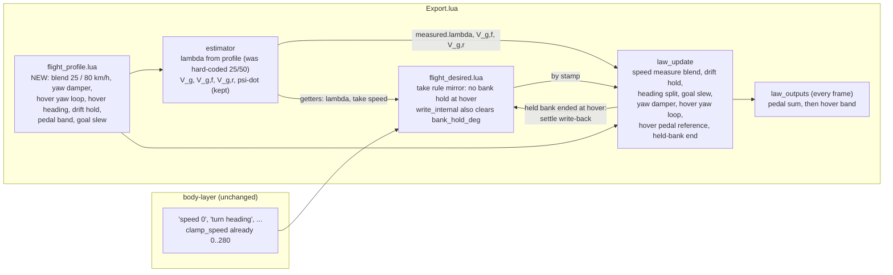

**2. One blend, three regimes.** `λ` from horizontal ground speed (vector length): 0 at or below
25 km/h, 1 at or above 80, linear between (U12). Above 80 km/h everything is LV-2 except the yaw
damper.

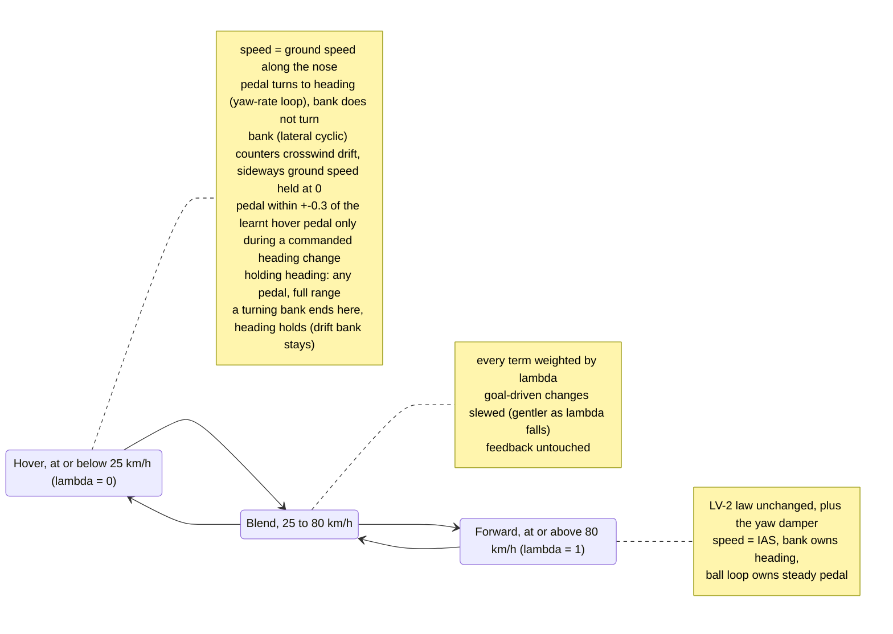

**3. The pedal channel.** One integrator, three overlays, one band. The yaw damper's reference
slides from "the rate the bank implies" (forward) to "the commanded rate" (hover), so one term is
both the all-speed damper and the hover yaw-rate loop's proportional part.

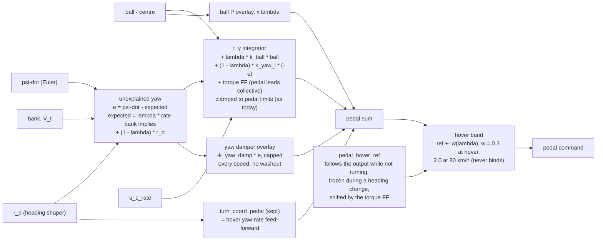

**4. Low-speed gentleness: slow the goal, not the feedback.** Only the shapers' own accelerations
are slewed, below 80 km/h. The references (`v_ref`, `h_ref`) are not touched, so they still cannot
overshoot; every correcting term is added after the slew.

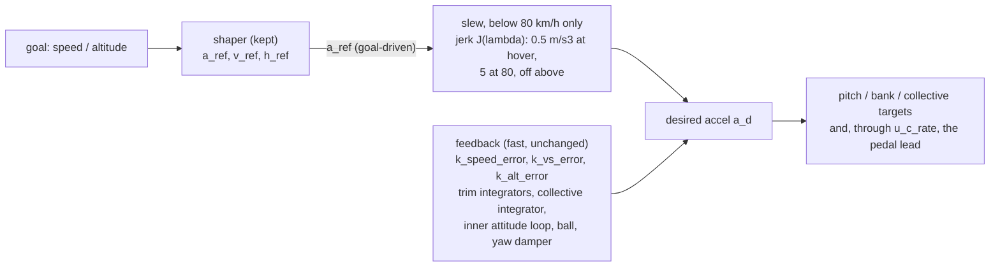

**5. The runaway, before and after.** What the trace shows, and which term now sees it.

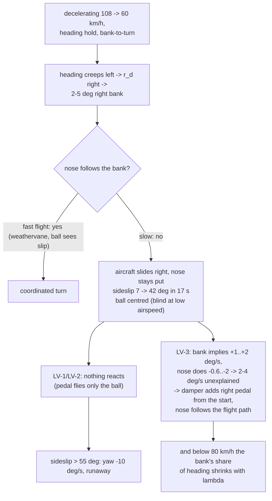

**6. A held bank as the aircraft slows (U15).**

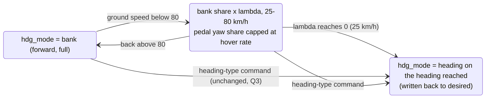

### A. Estimator: `λ` from the profile

- New profile fields `lambda_hover_kmh = 25.0` (the user's hover threshold, 2026-11-19) and
  `lambda_forward_kmh = 80.0` (the user's 2026-11-27 *"down to 80 km/h as implemented now"*).
- One pure helper, `law_lambda(v_g_mps, profile)`, linear between the two, clamped to [0, 1];
  **a non-finite or missing input returns 1.0** (the forward law, today's behaviour — the same as
  "unknown", never a plausible-looking hover). `est_sample` calls it; the hard-coded 25/50 goes.
  `est_reset` sets `est.lambda = nil` (was 0.0, which read as "hover"); `run_active_frame` merges
  `measured.lambda` only when primed, and every law function reads `measured.lambda or 1.0`.
- Input: `est.v_g` (horizontal ground speed, vector length), as the plan and the user's hover
  definition have it (U12).
- Trace gains `ias`, `tas`, `v_m`, `yaw_e`, `yaw_damp_pedal`, `pedal_hover_ref`, `a_f_goal_s`,
  `a_u_goal_s` (the runaway diagnosis needed IAS and could not have it). Status gains nothing new
  (`fc_est_lambda` already exists).

### B. Speed and drift: what "speed" means near hover (C, U2)

- **One blended measured speed** `V_m = λ·IAS + (1 − λ)·V_g,f` (ground speed along the nose,
  signed: backwards is negative). It replaces `measured.ias_mps` in exactly four places:
  the speed-error term of `a_f,d` (`k_speed_error·(v_ref − V_m)`), `in_band_speed`, the take's
  `v_ref` seed and the take's default `speed_goal_mps`. So "speed 0" means stopped over the ground,
  in wind too. The shaper itself is unchanged. `desired.ias_kmh` keeps its name and wire shape; near
  hover it carries `V_m` (no wire change, U2's "speed = ground speed near hover").
- `flight_desired.reseed_from_measured` seeds `desired.ias_kmh` from a new getter
  `flight_control.get_take_speed_kmh()` (`V_m`), falling back to IAS as today if the getter is
  missing.
- **Speed band floor:** `in_band_speed` uses `max(speed_band_frac · goal, speed_band_min_mps)`,
  `speed_band_min_mps = 1.0` (profile; 3.6 km/h), so a "speed 0" can be in band.
- **Drift hold** (C, kept from the plan): `a_r,d = λ·a_r,turn + (1 − λ)·(−k_drift_hold·V_g,r)`, with
  `a_r,turn` today's `V_t·r_d` (or the held-bank relation). Lateral cyclic stops sideways ground
  motion near hover; a position is not held (drift at speed 0 accepted, user answer 4).
  `k_drift_hold = 0.3` per s (1 m/s sideways asks 0.3 m/s², about 1.7° of bank).

### C. Heading near hover: the pedal yaws, the bank does not turn

**Corrected 2026-11-28 (user, verbatim):** *"not \"never bank\". Countering cross wind requires
bank. Sideways hover translate requires bank. Do not bank to turn to heading, use pedals, that is
true."* The rule is about **turning to a heading** only: near hover the pedal turns the nose and
the bank takes no share of the heading job. Bank stays fully available for everything else — the
drift hold (B, lateral cyclic against sideways ground speed, which is how a crosswind is countered)
and, later, sideways hover translate (BL-16 "Later"). Nothing below limits bank for those.


- The heading shaper's bandwidth, rate cap and accel cap blend with `λ`:
  `ω = λ·omega_heading + (1 − λ)·hover_omega_heading` (0.3 → 0.7);
  `rate_limit = λ·r_max + (1 − λ)·hover_yaw_rate_max_deg_s` (8 °/s at hover); the accel cap stays
  `heading_accel_cap_deg_s2 × schedule_g` (1.8 °/s² at hover). A 45° change at hover: within 2° in
  ~9.7 s, peak 8 °/s, no overshoot, a soft S. A break (`rate_override_deg_s`) keeps LV-2's own
  bandwidth and caps; below 80 km/h its `rate_limit` is blended the same way, so a break entered
  slow at hover-ish speed becomes a calm pedal turn (U6 holds).
- `r_d` goes to two places: the bank (through `a_r,turn`, weight `λ`) and the pedal (through the
  yaw loop, weight `1 − λ`, D). Nothing else changes in step 1.

### D. Pedals: yaw damper at every speed, yaw-rate loop near hover

**The unexplained yaw** `e = ψ̇ − ψ̇_exp`, with
`ψ̇_exp = λ·law_turn_rate_at_bank(φ, max(V_t, yaw_damp_v_floor_mps)) + (1 − λ)·r_d`
(reuses the existing helper; `ψ̇` is the estimator's Euler yaw rate). In forward flight `ψ̇_exp` is
the rate the bank implies, so in steady coordinated flight `e ≈ 0` and the term is silent; near
hover it is the commanded rate.

- **Yaw damper overlay (all speeds):** `yaw_damp_pedal = clamp(−k_yaw_damp·e, ±yaw_damp_max)`,
  recomputed every law step, never integrated, added at `law_outputs` — the same "position
  overlay" shape as `turn_coord_pedal` and the ball P term. Sign: nose yawing left of what the bank
  implies (`e < 0`) → right pedal (positive command). **No washout**, because unexplained yaw rate
  is the sideslip rate (finding 1). A small standing bias in forward flight (the bank-implied rate
  is approximate in a climbing or descending turn) is absorbed by the ball integrator: the pedal
  sum and the ball are unchanged at steady state, so no crossed controls.
- **Reconciling plan F / finding 2, in writing.** Finding 2 forbids a **heading or yaw-rate loop
  in forward flight** because bank owns heading there and a pedal loop on heading would fight it.
  The damper has no heading reference and no rate goal of its own: its forward-flight reference is
  whatever the measured bank already implies. It cannot hold a heading, cannot command a turn and
  reads zero in any coordinated turn, so the reason behind finding 2 still holds. What changes is
  "the pedal flies only the ball": the user asked for yaw-based pedal in all flight to damp the
  yaw oscillation seen "even when flying the ball". A deliberate change, not a reversal.
- **The ball's share is `λ`-weighted** (integral and proportional): at low airspeed the ball reads
  nothing (finding 1), so it fades as the yaw loop takes over.
- **Hover yaw-rate integral:** `ṫ_y += (1 − λ)·k_yaw_rate_i·(−e)` alongside `λ·k_ball·(ball −
  centre)` and the unchanged torque feed-forward. The integral learns the anti-torque pedal (the
  "hover-stable" value) and the extra pedal a steady yaw rate needs; `turn_coord_pedal`
  (`k_turn_coord_pedal·r_d`, kept as is) is the hover yaw-rate feed-forward.
- **Pedal leads collective**: the existing torque feed-forward, unchanged (finding 5). The growing
  right-pedal need in transitional lift and below is left to the integrator on yaw and the ball,
  per the user (*"this can be done with the control law from vertical speed and yaw"*). No
  speed-scheduled pedal trim.
- **In a break (LV-2, above 80 km/h):** on roll-in the bank leads the yaw, so `e < 0` for a right
  break and the damper adds pedal **into** the turn while the nose catches up; on roll-out the yaw
  outlives the bank and the damper pushes against it. Both act only while the nose and the bank
  disagree, both are capped at `yaw_damp_max`, and the ball loop still owns the steady pedal. It
  can only reduce, not add, yaw overshoot on roll-out; the LV-2 overshoot figures (~5.5° / 7–10°)
  are the baseline the card compares against. Setting `k_yaw_damp = 0` gives the LV-2 law back
  bit-exactly above 80 km/h (tested), for a comparison row.
- **Bit-exact at take:** `yaw_damp_pedal` is computed at take from the same measured frame and
  backed out of `t_y`'s seed together with the (now `λ`-weighted) ball P term — the established
  pattern (`t_y = command.pedals − t_y_p_at_take − yaw_damp_at_take`).

### E. The hover pedal band (±0.3, user)

**Corrected 2026-11-28 (user, verbatim):** *"\"pedal within +-0.3 of hover pedal\" -> applies to
commanded heading change. To maintain current heading in hover, any pedal settingn is allowed."*
So the band **binds only while a commanded heading change runs** (`|r_d| ≥ turn_settle_deg_s`).
While holding heading the clamp is not applied at all (the absolute pedal limits, U13, still are).
The bullets below are read with that gate: `pedal_hover_ref` still follows the pedal while holding
and freezes at the start of a heading change, and the clamp in the second bullet runs only during
the change. Test: holding heading at hover with a large yaw disturbance, the pedal goes beyond
ref ± 0.3 unclamped; during a commanded 45° change it stays inside.


- New law state `pedal_hover_ref`. Each law step: while the heading is not being changed
  (`|r_d| < turn_settle_deg_s`), it follows the pedal command (so it is "the value where hover is
  stable" whenever the aircraft is holding heading); while a heading change runs it is **frozen**,
  except that it moves with the torque feed-forward (`+ k_pedal_from_collective_rate · u_c_rate ·
  rotor_dir · dt`), so the band never cuts the pedal lead on collective.
- At `law_outputs`, after summing: `pedal = clamp(sum, ref − w, ref + w)` with
  `w = hover_pedal_band + λ·(hover_pedal_band_forward − hover_pedal_band)` (0.3 at hover, 2.0 at
  80 km/h and above, where it can never bind). The existing absolute limits stay where they are
  today (U13).
- At take `pedal_hover_ref = command.pedals`, so the take frame is inside the band (bit-exact).
- If the band binds, a hover heading change is slower than 10 s; that is the user's trade
  (*"we'll refine after testing if necessary"*), visible in the trace.

### F. Held bank and take at low speed (U15)

- **Take rule:** unchanged except that at `λ = 0` (25 km/h and below) a take with `|φ̄| ≥ 5°` holds
  heading, not the bank — in hover a bank is a sideways translation, not a turn (*"Bank in hover is
  not the way to change heading"*). Mirrored in `flight_desired.reseed_from_measured` via a new
  getter `flight_control.get_lambda()` (falls back to today's rule if missing).
- **A held bank while slowing:** between 80 and 25 km/h it keeps going with its bank share
  weighted by `λ` (flatter as speed falls) and its pedal share's rate capped at
  `hover_yaw_rate_max_deg_s` (without the cap, `g·tan(30°)/V_t` at 2 m/s is 160 °/s). Q3 still
  holds — a speed command does not end it. **When `λ` reaches 0 it ends**: `law_update` sets
  `bank_hold_deg = nil`, `heading_goal_deg = psi_ref`, and the existing heading shaper decays `r_ref`
  to zero (no snap). `run_active_frame` writes the heading back with the existing settle write-back
  (`prev_bank_hold ~= nil and fc_law.bank_hold_deg == nil` → `write_internal({heading_deg})`), and
  `write_internal`'s heading branch also clears `bank_hold_deg` (finding 6).

### G. Low-speed gentleness: slow the goal, keep the feedback fast

User: *"It's not the pitch/bank angles themselves but how fast they change. Same for collective and
pedals. While fast response may be needed to correct and stabilize, flight state changes should be
more gradual than in fast flight."* (This refines E16's "gentleness is in the size of each
correction": the corrections stay fast and small; the commanded change of state is what slows.)

- The speed and altitude shapers' accelerations (`a_ref_v`, `a_ref_h`) pass through a slew into new
  state `a_f_goal_s`/`a_u_goal_s` before they enter section C:
  `a_goal_s += clamp(a_ref − a_goal_s, −J·dt, J·dt)`, with
  `J = goal_jerk_hover_mps3 + λ·(goal_jerk_edge_mps3 − goal_jerk_hover_mps3)` below 80 km/h and
  **no slew at all at `λ = 1`** (`a_goal_s = a_ref`, so LV-2 is bit-identical above 80 km/h).
  First cut 0.5 m/s³ at hover (about 2.6 °/s of goal-driven pitch change) and 5 m/s³ at the 80 km/h
  edge (never binds in practice there).
- Everything after the slew is unchanged: `k_speed_error`, `k_vs_error`, `k_alt_error`, the trim
  and collective integrators (their errors are computed against the slewed `a_d`, so they do not
  wind up against it), the inner attitude loop, the ball, the damper. The references `v_ref`/`h_ref`
  are not slewed, so they keep their no-overshoot guarantee.
- **Collective and pedal follow for free:** the collective's goal-driven part comes from `a_u,d`
  and `n_d` (both slewed), and the pedal lead follows `u_c_rate`. **Bank and hover yaw** are already
  rate-shaped by the heading shaper's accel cap (a turn onset at 60 km/h is a bank-rate step of
  ~6 °/s, at hover a yaw-acceleration step of 1.8 °/s²); no further slew is added there.
- At take `a_f_goal_s = a_u_goal_s = 0`.
- **Altitude through a stop** is held by the unchanged collective integrator on vertical
  acceleration (`e_u`), which also supplies the extra collective of transitional lift and the
  reduction in ground effect, with no model (user answer 3). U14 asks about the deceleration
  collective nudge below 80 km/h.

### Tuning constants (all in `flight_profile.lua`; no `tuning.py` equivalent in aircraft-layer Lua)

| field | first cut | why |
|---|---|---|
| `lambda_hover_kmh` | 25.0 | user's hover threshold (2026-11-19) |
| `lambda_forward_kmh` | 80.0 | user: *"down to 80 km/h as implemented now"* |
| `k_yaw_damp` | 0.03 pedal per °/s | the runaway's 2–4 °/s unexplained yaw → 0.06–0.12 right pedal from its first seconds, where the ball gave 0; at hover an 8 °/s rate error asks 0.24, inside the cap and the band |
| `yaw_damp_max` | 0.25 | bounds a break roll-in transient (bank leading yaw by 10 °/s would ask 0.3) |
| `yaw_damp_v_floor_mps` | 5.0 | keeps `g·tan φ / V` finite near hover, where its weight is ~0 anyway |
| `k_yaw_rate_i` | 0.03 per (°/s)·s | 1 °/s of steady yaw-rate error moves the trim 0.03/s, the order of the ball integral's response |
| `hover_omega_heading` | 0.7 rad/s | 45° within 2° in ~9.7 s (finding 3) |
| `hover_yaw_rate_max_deg_s` | 8.0 | peak of a calm 45° S-turn; also caps a held bank's pedal share |
| `k_drift_hold` | 0.3 1/s | 1 m/s sideways → ~1.7° of bank |
| `speed_band_min_mps` | 1.0 | lets "speed 0" be in band (finding 7) |
| `hover_pedal_band` | 0.3 | user, confirmed (command domain, −1…+1) |
| `hover_pedal_band_forward` | 2.0 | band width at 80 km/h and above: never binds |
| `goal_jerk_hover_mps3` | 0.5 | ~2.6 °/s goal-driven pitch change at hover |
| `goal_jerk_edge_mps3` | 5.0 | at the 80 km/h edge; the slew is off above it |

Every field is Lua-edited data (no `lo`/`hi`, same trust level as every other profile field). **No
new boundary float** enters from outside the process: LV-3 reads no new telemetry for the law (IAS
and TAS are already read; adding them to the trace is diagnostic). The one non-finite path is `λ`
itself, handled in A (non-finite → 1.0).

### Co-moving fields

Trigger (6a): the regime is derived (`λ`, never stored), but new law state moves with it, and
`hdg_mode`/`bank_hold_deg` are written both externally (`apply_set`, `law_apply_goal`) and
internally (take, the new held-bank end). Construction sites grepped at `a9afa8da`:
`law_init_at_take` (the only place law state is created); `law_apply_goal`/`law_update` copy with
`pairs`, so a field exists only if `law_init_at_take` creates it; `fc_law = nil` at
`request_release`, `check_envelope` failure, the two park/arm sites in `run_flight_control`,
`on_stop`, `reset`. Estimator: `est_reset` (`est_sample` on a gap). Desired: `clear_desired`,
`reseed_from_measured`, `reseed_from_overlay`, `convert_turn_to_heading_for_m2`, `apply_set`,
`write_internal`.

| Field | Written by | Transition | Must hold true after |
|---|---|---|---|
| `a_f_goal_s`, `a_u_goal_s` (NEW) | internal | take (voice or unpark) | both 0; outputs bit-exact |
| same | internal | `λ` reaches 1 (≥ 80 km/h) | equal to the raw shaper accel every step (no slew); falling below 80 starts from that value, no step |
| `yaw_damp_pedal` (NEW) | internal | take | the take-frame value, backed out of `t_y`; sum equals `command.pedals` |
| `pedal_hover_ref` (NEW) | internal | take | `= command.pedals` |
| same | internal | heading change starts (`|r_d|` ≥ settle) | frozen, moved only by the torque feed-forward |
| same | internal | heading change ends | follows the pedal command again from the next step |
| `t_y` | internal | any `λ` | ball share `λ`, yaw share `1 − λ`; clamp to `pedal_limit_*` as today |
| `bank_hold_deg`, `heading_goal_deg`, `turn_mode` (law) | internal (NEW) | `λ` reaches 0 with a held bank | `bank_hold_deg = nil`, `heading_goal_deg = psi_ref`, `turn_mode = false`; `r_ref` decays through the shaper |
| `desired.hdg_mode`, `heading_deg`, `bank_hold_deg` | internal (write-back) | same | `"heading"`, heading reached, **`bank_hold_deg = nil`** (`write_internal` fix) |
| same | internal | take at `λ = 0`, `|φ̄| ≥ 5°` | `"heading"`, `bank_hold_deg = nil` (law and `reseed_from_measured` agree) |
| `v_ref`, `speed_goal_mps` (law), `desired.ias_kmh` | internal | voice take | seeded from `V_m`, not IAS |
| same | external | unpark with a mode-2 speed | seed used as given, interpreted as `V_m` (same number near forward flight) |
| `est.lambda` | internal | `est_reset`, first frame | `nil`; the law reads 1.0 until primed |
| every law field above | internal | release, envelope, park, stop, reset | `fc_law = nil`; next take rebuilds all |

### Implementation plan (LV-3, one batch)

1. **Toy plant first, failure reproduced.** A new low-speed driver in `test_flight_control_law.py`:
   ground velocity in 2D, airspeed = ground velocity − wind, heading with yaw dynamics (pedal →
   yaw acceleration, a pedal trim that rises with collective, yaw damping, a weathervane term ∝
   airspeed² × sideslip), side force and ball ∝ airspeed² × sideslip (blind near hover), bank →
   lateral acceleration, a power-required curve that rises below translational lift, optional
   ground effect. **Pass gate for the plant itself:** the current law (LV-2) reproduces the
   runaway — decelerating 108 → 60 km/h on heading hold, sideslip passes 30° with the ball inside
   ±0.05. A plant that cannot fail this way cannot show the fix. Every LV-3 test runs against the
   **shipped** `flight_profile.lua` values (reviewer memory: the shared `_PROFILE` table is a stale
   baseline for several fields).
2. **Yaw damper, all speeds** (D, minus the hover parts). The smallest change that addresses the
   flown defect. `λ` still 1 everywhere.
3. **The regime**: `λ` from the profile (A), `V_m` and the speed band floor (B), drift hold (B), the
   heading split and hover heading shaper (C), the `λ`-weighted ball, the hover yaw integral and
   the band (D, E), the held-bank end and take rule with the `write_internal` fix (F), the two
   getters.
4. **Low-speed goal slew** (G).
5. **Trace fields** (A) and the card.

Checks: `fast-tests.sh aircraft-layer` per stage; body-layer untouched. Performance and security
once, after stage 5 (one batch). Lua budget: `law_update` has 8 upvalues and `run_active_frame` 34
(of 60), measured with `luac5.1 -l`; LV-3 adds at most two to each. `flight_control.lua` has 122
top-level locals (of 200); LV-3 adds no module-level local beyond the two getters on `M`.

### Tests (real-Lua toy plant)

- **`λ` helper:** 0 at ≤ 25, 1 at ≥ 80, linear between; NaN, ±inf and nil → 1.0.
- **Runaway reproduced, then fixed:** the stage-1 scenario with `k_yaw_damp = 0` → sideslip > 30°
  (the plant gate); shipped profile → sideslip stays under 10°, `ψ̇` never below −5 °/s, ball
  centred.
- **Damper sign:** nose yawing left of the bank-implied rate drives the pedal positive (right).
- **Above 80 km/h, unchanged:** with `k_yaw_damp = 0`, every LV-1/LV-2 scenario is bit-identical to
  the tip; with the shipped damper, a steady coordinated 30° turn shows `|yaw_damp_pedal|` < 0.02
  and the ball centred; a 180 km/h break stays within LV-2's measured overshoot and
  `|yaw_damp_pedal| ≤ yaw_damp_max`.
- **Stop 150 → 0:** altitude in band throughout (power curve on); speed monotonic, no reversal
  past −2 km/h; above 80 km/h the pitch rate matches LV-2; below it the goal-driven pitch-target
  rate stays ≤ ~3 °/s; no output step as `λ` crosses 80 and 25 (largest per-step change bounded).
- **Accelerate 0 → 150:** smooth through the blend, the same bound.
- **Hover heading change 45° and 90°, both ways:** 45° within 2° in ≤ 10 s, overshoot ≤ 3°, bank
  within 3°, pedal inside `ref ± 0.3`; with a plant needing more than 0.3, the turn is slower and
  the pedal still never leaves the band.
- **Band does not cut the lead:** a collective step in hover with no heading change moves the pedal
  by the full torque feed-forward, past 0.3 if needed.
- **Speed 0 in a 5 m/s crosswind:** ground speed settles under 1 m/s; heading held by pedal; bank
  carries the drift hold; "speed 0" reaches `in_band_speed`.
- **Ground effect and transitional lift:** with the plant's ground-effect and power-curve terms on,
  altitude stays in band through the stop and in a low hover, with no model in the law.
- **Take at 20 km/h:** bit-exact (with the ball off-centre and a non-zero unexplained yaw at take,
  per the implementer memory on bit-exact tests); a 10° bank at take holds heading, not the bank;
  `speed_goal_mps` is `V_m`.
- **Held bank slowing through 25 km/h:** ends once, heading held on the heading reached, no snap;
  `test_flight_control_lua.py` checks the write-back and `desired.bank_hold_deg == nil`.
- **Low-speed slew:** at `λ = 1` `a_goal_s` equals `a_ref` exactly; below 80 its per-step change never
  exceeds `J·dt`.
- **Harness hygiene:** new fields and getters in the extraction tuples and the parity tests.

### LV-3 card rows (SAU H, K, T off before every take; branch named in the card)

1. **Ordinary flight, damper check** at 150 km/h: heading hold and a 30° turn each way. Ball
   centred as before, no new oscillation in yaw or pedal.
2. **The runaway row:** from 150 km/h, "speed 60", hold 30 s. Nose stays on the flight path (trace
   `aoss` under ~10°), no left yaw, pedal moves right as collective comes in.
3. **Stop:** from 150 km/h at ≥ 100 m AGL, "speed 0". No jerk; pitch changes gentle below 80;
   altitude held; settles over the ground; slow drift accepted.
4. **Hover heading:** "turn heading" +45°, −45°, +90° at speed 0. Calm, ≤ 10 s per 45°, wings stay
   level, nose does not overshoot; note whether the pedal band ever seems to limit it.
5. **Hover in wind** if the mission has any: speed 0 into, across and with the wind.
6. **Low hover** at ~15 m AGL (above the 10 m take threshold, inside ground effect): altitude held.
7. **Away:** "speed 150" from the hover. Smooth through 25–80 km/h.
8. **Voice take at ~20 km/h** (accepted; holds ground speed and heading; a banked take holds
   heading).
9. **Break at 180 km/h** with the damper (compare against the LV-2 card, U16).

### Risks & unknowns (LV-3)

- **The DCS Mi-24P's hover pedal need is unknown.** With the full pedal range (U13, 2026-11-28)
  no software cap stands in the way any more; what remains is the aircraft's own right-pedal margin
  at hover, which the user describes as small (*"not much right rudder left for additional right
  yaw"*, 2026-10-26). A right hover turn, a collective increase, or a gust from the left can then
  run the pedal into its physical stop — visible in the trace as the pedal output at +1.0 with a
  left yaw it cannot stop. Row 3 (hover heading change, both directions) watches for it; the
  near-stop collective-rate guard is the only protection built, and a slower right turn at hover
  is the first remedy if the card shows it.
- **IAS may include the sideways component** (finding 1). If row 2's trace shows IAS ≈ total ground
  speed while sliding, the speed loop decelerates the wrong component during a slide; a
  `cos(sideslip)` correction would then need `aoss` confirmed in wind. Not built; the damper should
  keep sideslip small enough (cos 10° = 0.985) that it does not matter.
- **The damper's forward-flight reference is approximate** in climbing or descending turns
  (`g` not `g + a_u`); the bias is a few percent and the ball integrator absorbs it. If row 1 shows
  a standing ball offset, switch to `g + a_u` (one line).
- **Wind at low speed** (U12): `λ` on ground speed means a strong tailwind puts low airspeed under
  the forward law; the damper covers the yaw side. A strong headwind means pedal-turning at
  60–80 km/h airspeed, uncoordinated but gentle.
- **The toy plant's weathervane and ball model is a guess.** It is good enough to reproduce the
  flown failure (the stage-1 gate) and no more; every number is a first cut, as throughout.
- **LV-2 unflown** (U16): flying LV-2 on the LV-3 build mixes the two changes.

### Second-order effect

The `λ = 0` regime with a pedal yaw loop and a ground-velocity hold is the slot BL-16's "Later —
mode 1 hover" plugs into: translate is a non-zero `V_g,f`/`V_g,r` goal, "hold" a position term on
the same `a_f`/`a_r`. The all-speed yaw damper also meets the SAU stage, whose heading channel damps
yaw too: the SAU plan must decide which of the two owns yaw damping when H is on.

### Decisions Requiring User Input (LV-3)

- **U12: What `λ` is computed from.** — recommend: horizontal **ground speed** (vector length), as
  the plan and your hover definition have it, one blend for every channel; why: the runaway was
  flown in no wind (sideslip matched the ground track to 0.5°), so the source did not decide it,
  and ground speed is what makes "speed 0" stop over the ground. The alternative is two blends —
  airspeed for the pedal/bank split, ground speed for the speed and drift references — better in
  strong wind, one more thing to tune; keep it for if a windy card shows trouble.
- **U13: Where the absolute pedal limits apply.** Today +0.5 right bounds only the integrator; the
  ball and turn overlays add on top (the runaway's command reached +1.0 with the integrator at
  +0.5). Your confirmed reading assumed the limit bounds the total. — recommend: leave the
  absolute limits where they are for LV-3 and apply the new ±0.3 hover band to the total; why:
  capping the total at +0.5 changes forward flight and break behaviour that LV-1/LV-2 were flown
  or built with, and would have capped the runaway's recovery at half. Find out on row 3 whether
  hover needs more than +0.5, then decide what the +0.5 should mean.
- **U14: The "slowing down is less collective" nudge below 80 km/h.** Your 2026-11-20 rule
  (*"Slowing down is always pitch back and also less collective"*) is built as a feed-forward that
  lowers collective while decelerating. Below roughly the minimum-power speed, slowing further
  needs **more** power (your own 2026-11-27 words: *"In transitional lift and slower the need for
  collective… increases"*), so the nudge then works against the altitude hold. — recommend: fade
  the nudge with `λ` (full at ≥ 80 km/h, gone at ≤ 25); why: altitude must hold through the stop,
  and the integrator would otherwise spend the stop undoing the nudge.
- **U15: A held bank as the aircraft slows, and a banked take at hover.** — recommend: the held
  bank continues through 80–25 km/h, flattening with `λ` (speed commands still do not end it, Q3),
  and ends at 25 km/h with heading held on the heading reached; a take at 25 km/h or slower holds
  heading even with ≥ 5° of bank; why: in a hover a bank is a sideways slide, not a turn (*"Bank in
  hover is not the way to change heading"*), and without an end the pedal would chase the bank's
  implied rate (160 °/s at 2 m/s).
- **U16: Fly the LV-2 card before LV-3 is built, or on the LV-3 build?** — recommend: before; why:
  the yaw damper also acts in breaks, so a break flown on LV-3 tests two changes at once. If you
  would rather fly once, the LV-3 build ships `k_yaw_damp = 0` as a one-line profile edit for the
  LV-2 rows.
- **U17: The low-slow-RPM "accelerate" class (plan G).** Never built; its card row depended on the
  RPM dummy that is now live RPM, and your LV-3 answers do not mention it. — recommend: take it out
  of LV-3 and record it as an open BL-16 item; why: today's rotor-RPM warning already eases
  collective, a deliberate forward acceleration out of a low hover needs its own look at obstacles
  and height, and nothing on the LV-3 card can exercise it safely.

**Answered 2026-11-28 (user, verbatim):**

> U12 - ground speed (also sideways component)
> U13 - why is there a limit? We should allow full range.
> U14 - yes
> U15 - yes with notes about when bank is required
> U16 - start LV-3 anyway
> U17 - make it it's own item inside BL-16
>
> OK to build LV-3

- **U12:** `λ` from horizontal ground speed, the full vector length including the sideways
  component (as recommended).
- **U13: full pedal range.** The +0.5 right limit was a software cap the main loop and architect
  derived from the user's 2026-10-26 remark that at slow speed *"there's not much right rudder left
  for additional right yaw"* — a description of the aircraft's own margin, never a request to cap
  the command. It removed half the travel the aircraft has. So `pedal_limit_positive = 1.0` and
  `pedal_limit_negative = −1.0` (full axis), applied to the pedal output; the near-right-stop
  collective-rate guard (`pedal_near_limit_margin`, `collective_rate_cap_near_pedal_limit`) stays,
  now measured against the real stop. The ±0.3 hover band (E, corrected 2026-11-28) still applies
  during a commanded heading change only. Where the plan above says "existing absolute limits stay
  where they are" or "+0.5", read full range.
- **U14:** yes — the deceleration collective nudge fades with `λ`.
- **U15:** yes — and per the 2026-11-28 correction to C, the held bank that ends at 25 km/h is the
  bank used **to turn**. Bank needed to counter crosswind drift (the drift hold, B) or, later, for
  sideways translate is not ended or limited by this; a take at 25 km/h or slower holds heading
  with pedal, and the drift hold keeps whatever bank the wind needs.
- **U16:** build LV-3 now, without waiting for the LV-2 card. The card's break rows can fly with
  `k_yaw_damp = 0` as a comparison if needed.
- **U17:** the low-slow-RPM "accelerate" class leaves LV-3 and becomes its own open item inside
  `[[BL-16]]` (the entry's "Open, within BL-16" list).

## M3 amendment (2026-11-28)

Architect pass. Branch `fix/bl16-flight-epoch-bound` (pushed as `feature/bl16-lift-vector-law`),
tip `5154e45c`. LV-3 is built, not flown. **The specification is the user's own words**:
`explore-notes.md` "M3 terrain floor explore (2026-11-28)" to the end, including the answers to
`alignment.md`'s M3 Q1–Q6, and the main loop's later direction (user, verbatim, 2026-11-28): *"Even
if I fly at 200 km/h, it takes a couple of seconds to travel 200m. Elevation polling can be 1 Hz or
even 0.5 Hz."* Inputs read in full: those notes; `alignment.md` "M3 terrain floor — goal check"
(E1–E10, Findings 1–4); `aircraft-layer/research/2026-11-28-bl16-m3-terrain-ahead-and-visibility.md`,
`2026-10-05-elevation-cost-probe-results.md`, `2026-09-29-bridge-call-cost-at-scale.md`,
`2026-09-29-bridge-terrain-probe-results.md`; this plan's A–K and the LV-1..LV-3 amendments; the old
`plans/flight-control/plan.md` Stage 3 (~L1895) and M3 (~L3045), history only. Code read at the tip:
`flight_control.lua` (`fc_limits`/`FC_LIMIT_BOUNDS`, `law_apply_goal`, `law_init_at_take`,
`law_update`'s altitude, speed and shortfall blocks, `read_measured`, the unpark seed),
`flight_profile.lua`, `flight_desired.lua` (`desired`, `reseed_from_measured`, `reseed_from_overlay`,
`apply_set`, `write_internal`), body-layer `belief/flight_control.py` (`FLOOR_AGL_M`,
`MAX_CLIMB_VS_MPS`, `clamp_altitude`, `flight_control_limits`), `belief/crew_console.py`'s
`axes_set_altitude`/`axes_step_altitude`/`axes_hold_altitude`/`axes_level_flight`,
`config/rules/flight.lua`'s altitude rules, `belief/flight_authority.py`'s carried-value check, the
BL-B111 `probe_points` path (`schema/line_of_sight.py`, `collector/command_sender.py`,
`api/server.py`), and the toy-plant drivers in `tests/test_flight_control_law.py`.

**Superseded by this amendment** (originals stay; each carries a pointer): the 40 m floor
everywhere it appears (diagram 4, G's "height gives" bullet, LV-2's card text); LV-2 section D's
separate `break_floor_agl_m` and its U11 answer (*"only breaks"*), now one floor by the user's later
*"one floor is better, use 50 m"*; `max_climb_vs_mps` (5 m/s) both ways; and, in the old
`plans/flight-control/plan.md`, M3's AGL-trend × `FLOOR_LOOKAHEAD_S` look-ahead and the "Climbing for
terrain." callout (E7 there).

### Goal

In mode 1, Petrovich never flies into terrain and the pilot still decides how low they go: one
floor, 50 m above bare ground, lowered only by an AGL height the pilot gave; a grid of terrain points
ahead of the nose lets him climb early enough to clear each point by the time he reaches it, slowing
down first when the climb does not fit; and he says nothing about any of it.

### Value against effort (1a)

Proportionate, now that the route is settled. Terrain heights at a point are **proven and cheap**:
`land.getHeight` through the Hook's scripting bridge is bit-identical to the mission-editor surface
(`2026-09-29-bridge-terrain-probe-results.md` Finding 1), ~1–9 µs a point, with ~0.5 ms fixed bridge
overhead (`2026-10-05-elevation-cost-probe-results.md`, `2026-09-29-bridge-call-cost-at-scale.md`);
16 points at 1 Hz is noise. The Hook → collector → body-layer → lease → Lua path is the shipped
BL-B111 shape. The real work is in the law, and most of it is owed regardless: the old 5 m/s cap goes
(user), and with it the altitude channel needs a power-based limit and a working "speed gives"
absorber, which section J promised and nobody built (finding 3 below).

### What reading the code turned up (step 3a), before designing

1. **No ordinary-flight floor exists in the law.** `limits.floor_agl_m` (40) is read in exactly one
   place, the unpark seed clamp (`flight_control.lua` ~L2892). G's "height gives, bounded by … the
   40 m floor" was never implemented, and a barometric goal has no floor at all. Today the only
   ordinary floor is body-layer's `clamp_altitude` on a *spoken* AGL height. So M3 is a floor in the
   law for the first time, not a 40 → 50 edit.
2. **The AGL hold sags on a slope, today, by `V·slope·6 s`.** The altitude shaper runs in the AGL
   frame, but its rate `w_ref` is compared with world vertical speed (`k_vs_error·(w_ref − w)`), and
   there is no integral on height. Over steadily rising ground the reference stays at the goal with
   `w_ref = 0`, so the steady climb is bought by height error: `k_vs·w = k_alt·Δh`, so
   `Δh = w·k_vs/k_alt = w·6 s`. **At 200 km/h up a 10 % slope (5.6 m/s) he sits ~33 m below the
   commanded AGL height; at 120 km/h on 5 %, ~10 m.** A barometric goal over rising ground has the
   same 6 s factor. This is the existing reactive AGL hold, never flown over a slope (old Flight M-B
   is unflown). It bears on E4 and on U21.
3. **Section J's absorber re-seat was never built, so "speed gives" fights the speed loop.** The
   shortfall chain pitches back (`theta_speed_give`), but `v_ref` stays at the commanded speed, so
   as speed falls `k_speed_error·(v_ref − V)` pushes the nose back down through `Δθ_ff` and the trim.
   With a 5 m/s cap this rarely mattered: the cap kept most climbs inside the collective's reach.
   With the cap gone (settled), a sustained shortfall is the normal case for a big climb, and
   "speed gives first, commanded speed resumes afterwards" needs J for the speed absorber.
4. **With no cap, nothing stops the altitude reference running away.** The shaper's own peak climb
   rate for a step is `err·ω/e` (500 m at `omega_alt` 0.5: ~92 m/s unconstrained; the accel cap
   brings it to ~20 m/s). The aircraft cannot follow, `h_ref` leads by tens of metres, and the
   position term winds up. "The limit is available power" therefore needs the reference held within
   reach of what the aircraft actually does while the lift is capped (C below).
5. **"Explicit" needs no flag** (U18). Every path that writes an AGL altitude goal is one of the cases
   the user named as explicit: `altitude <n>` (radar or no reference), `climb/descend <n>` in an AGL
   reference, `hold altitude`, `level flight`, the take (`reseed_from_measured` sets `alt_m = AGL`;
   `law_init_at_take` uses the stopping height of the current AGL: Q3, "maintain current altitude"),
   and the unpark carry of a mode-2 height (E10). Petrovich never chooses an AGL goal himself. So
   `F_eff = min(50, AGL goal)` for an AGL goal and 50 for a barometric one, derived each law step from
   the altitude goal the law already holds. Explicitness then travels with the goal by construction,
   across speed/heading/turn commands, park/unpark and the take seed (alignment Finding 2), and the
   desired state and its wire need no new field.
6. **`probe_points` cannot carry this as it is.** It answers `land.isVisible` (`"<seq>|<i>:<0|1|>"`),
   not heights; it is a single last-wins setter owned by BL-B111's expected-area checks, so a second
   user would overwrite them; and it is capped at 6 points by a fixed-shape template. M3 adds a
   **sibling op on the same mechanism**, `terrain_points`: same listener, same coalescing, same
   envelope-key pattern, `land.getHeight` only, its own cap and its own answer key.
7. **Relay points, not a floor.** The brief's fallback relayed a floor computed in body-layer. That
   puts the law in two places and makes routing latency a control error: a climb rate computed from a
   2 s old altitude and speed is wrong by however much both changed. Points in world coordinates do
   not go stale geometrically: Lua re-projects them against its *current* position, altitude and
   speed every law step, so age only shortens the reach (by `V·age`, ~110 m at 200 km/h and 2 s) and
   lets the grid lag the nose in a turn. The law then stays in one place whatever the sampler is.
8. **The recon note's lateral vector is the left one.** With heading `ψ` clockwise from north and
   `x` north / `z` east, the nose is `(cos ψ, sin ψ)` and the **right** is `(−sin ψ, cos ψ)`
   (heading 0 → east; heading 90 → south). The note's `(sin ψ, −cos ψ)` points left. Harmless for a
   symmetric ±200 m grid; it matters for the trace and the card's side check.
9. **The toy plants do have vertical dynamics**, contrary to the brief: several drivers integrate
   `w` from collective deflection (`plant_w_gain` 15 m/s² per unit) and `h` from `w`. What they lack:
   **terrain** (`h_m` is ASL over flat ground), **a power ceiling** below collective saturation (15
   m/s² of authority means the collective almost never saturates in a climb), and any **speed → climb
   capability** coupling. Test strategy below.

**Constants checked (widened 4a rule).** Grepped `flight_profile.lua` in full, `fc_limits`/
`FC_LIMIT_BOUNDS`, `api/server.py`'s lease bounds, and `body-layer/config/defaults.toml` for floor,
climb, descent, look-ahead, range, stale/age and ease terms. **Reused:** `FLOOR_AGL_M`/`floor_agl_m`
(value 40 → 50, meaning widened from "spoken-AGL clamp" to "the floor"), `BREAK_MAX_HEIGHT_LOSS_M`
(100), `VRS_IAS_THRESHOLD_KMH`/`VRS_MAX_DESCENT_MPS` (kept), `alt_accel_cap_mps2 × schedule_g` (the
floor's approach rate), `omega_alt`, `k_vs_error`/`k_alt_error`, `k_theta_speed_give`/
`speed_give_capacity`/`k_phi_give`, `on_ground_agl_threshold_m` (10 m, still refuses a take at or
below it), `alt_band_*` (end of the ease-down return). **Removed:** `MAX_CLIMB_VS_MPS`/
`max_climb_vs_mps` (tuning, limits, `FC_LIMIT_BOUNDS`, `fc_limits`, `api/server.py` bounds — removed,
not widened, the project's convention), `profile.break_floor_agl_m` (one floor). **No existing
constant governs** the look-ahead geometry, the lead, the look-ahead's minimum speed, terrain-data
age, the reference's lead over measured vertical speed, the speed-give floor or the ease-down rate;
all new, listed under Tuning constants. The nearest age constant, `ATTACK_RUN_RELATIVE_MAX_AGE_S`
(2 s, two crew polls), is a different concept and too tight for a ~1–3 s route.

**Investigator not invoked (step 3), deliberately.** The primary route rests on `land.getHeight`
through the scripting bridge, already proven live (three notes above). Two things remain inferred:
the `x` north / `z` east frame for the composed points (the project's working convention, already
used by every position read) and that `land.getHeight` and `LoGetAltitudeAboveSeaLevel` share one
vertical datum. Both are checked on the first card row by a control point: the grid's point 0 is the
ground **beneath** the aircraft at compose time, and `(ASL − AGL)` from telemetry at that moment must
match its height to within a metre over open ground (a swapped `x`/`z` or a datum offset shows at
once over sloping ground). `LoGetAltitude(x, z)` is not used (note at the end).

### Affected Modules / Files

- `aircraft-layer/dcs-export/Petrobrain/flight_control.lua` — `F_eff`, floor beneath, one break
  floor, look-ahead floor into the altitude shaper, `h_ref` follow while binding, ease-down return,
  power governor (cap removed), speed absorber (J), `asl_valid`, lease `terrain` parse into
  `fc_terrain`, projection into `measured.terrain`, unpark seed clamp removed, status/trace fields.
- `aircraft-layer/dcs-export/Petrobrain/flight_profile.lua` — new loop constants; `break_floor_agl_m`
  removed.
- `aircraft-layer/dcs-export/petrobrain-line-of-sight-hook.lua` — `terrain_points` op and `"terrain"`
  envelope key (`land.getHeight` only).
- `aircraft-layer/src/schema/line_of_sight.py` (`TerrainAnswers`, `MAX_TERRAIN_POINTS`),
  `collector/line_of_sight_receiver.py`, `collector/command_sender.py` (`send_terrain_points`, lease
  `terrain` passthrough), `api/server.py` (`POST /command/terrain_points`, lease `terrain` validation,
  `max_climb_vs_mps` bound removed); `aircraft-layer/CLAUDE.md`.
- `body-layer/src/belief/terrain_ahead.py` — **new**, pure: grid composition, answer join, relay
  encoding, age drop.
- `body-layer/src/belief/flight_control.py` — `FLOOR_AGL_M` 50, `MAX_CLIMB_VS_MPS` removed,
  `clamp_altitude` without the floor, limits dict; the four `TERRAIN_*` tuning constants (here or in
  `terrain_ahead.py`, the implementer's call; one home).
- `body-layer/src/body.py`, `src/aircraft_client.py` — compose and send per poll, read the
  answers, relay in the lease.
- `body-layer/config/defaults.toml` (regenerated), `body-layer/CLAUDE.md`.
- Tests: `aircraft-layer/tests/test_flight_control_law.py`, `test_flight_control_lua.py`, the API,
  schema, parity and local-order tests; `body-layer/tests/test_flight_control.py`,
  `test_flight_authority.py`, a new `test_terrain_ahead.py`, `test_body_flight_control.py`.
- `body-layer/ROADMAP/BL-16.md` (M3), `body-layer/ROADMAP/BL-B138.md` (range input),
  `docs/acceptance/<date>-bl16-m3-card.md`.
- **Not touched:** `flight_desired.lua`, the `flight` op, `ai_pilot_wheel.lua`, speech, rules.

### Design Overview (diagrams)

**1. Who owns what.** Grey seams unchanged; `NEW` marks what M3 adds. Body-layer owns the floor
number and the grid geometry (the user-facing, configurable numbers, `tuning.py` → `defaults.toml`)
and composes the points; the Hook is a height oracle; Lua owns every decision.

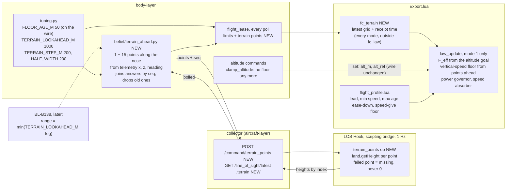

**2. How the floor and the look-ahead reach the vertical goal.** Everything right of the shaper is
new; the shaper, the VRS cap and the collective loop are kept.

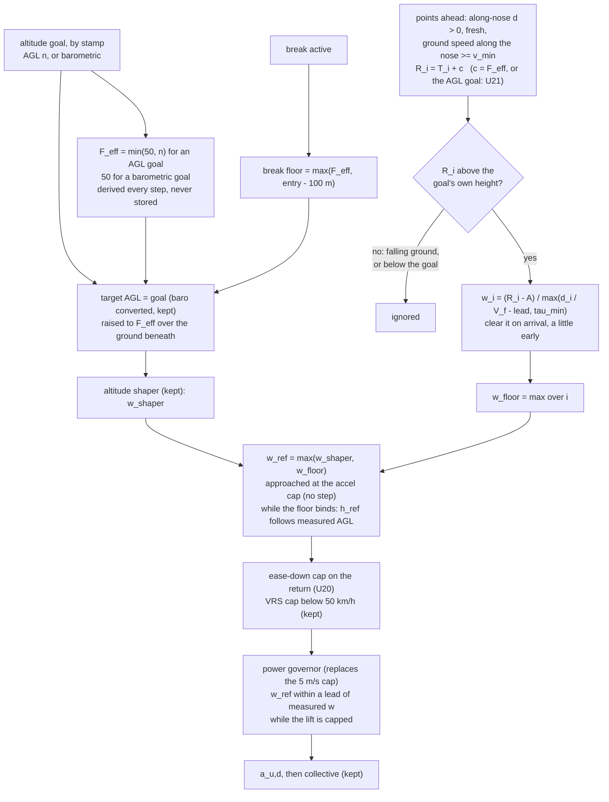

**3. The effective floor across commands, take, unpark and hand-back.** Nothing is stored, so
nothing can be carried wrong or forgotten: at every arrow the floor is whatever the altitude goal
now implies.

```mermaid
stateDiagram-v2
  direction LR
  Off: Off (player flies), no floor
  M1: Mode 1, F_eff = min(50, AGL goal), or 50 for baro
  M2: Mode 2 (ED AI flies), floor and look-ahead inactive, desired altitude kept
  Off --> M1: voice take, goal = current AGL
  M2 --> M1: unpark, goal = carried height, no clamp
  M1 --> M1: altitude n / climb / descend / hold, F_eff follows the new goal
  M1 --> M1: speed / heading / turn / break, goal untouched, F_eff unchanged
  M1 --> M2: park
  M1 --> Off: hand-back, release, envelope
  M2 --> Off: hand-back
```

**4. When the climb does not fit, speed gives first.** The commanded speed itself is never changed,
so the readback and the desired state stay true; only the reference the law chases yields.

```mermaid
flowchart TB
  D["vertical demand<br/>(goal, floor, look-ahead)"] --> C{"collective can deliver it?<br/>no shortfall: not at its stop,<br/>rotor RPM above the warning,<br/>stall and pedal guards quiet"}
  C -- yes --> OK["climb as demanded,<br/>commanded speed held"]
  C -- no --> S1["1. speed gives<br/>pitch back (kept) AND the speed reference<br/>yields to measured speed, NEW (section J)<br/>never below the speed-give floor (U19)"]
  S1 --> S2["2. turn gives: shallower bank (kept)"]
  S2 --> S3["3. height gives: he climbs slower<br/>(governor keeps the reference in reach)"]
  S1 -. "shortfall ends" .-> R["speed reference returns to the<br/>commanded speed through its S-curve"]
  BRK["break, or terrain floor binding:<br/>height is not available to give"] -.-> S1
```

**5. The terrain route and its latency.** One poll is 1 s; the Hook ticks at 1 Hz. A grid is
typically 1–3 s old when the law first uses it, which the user accepted (*"Elevation polling can be
1 Hz or even 0.5 Hz"*). The points are world coordinates, so age shortens the reach and lags a turn;
it does not bend the geometry.

```mermaid
sequenceDiagram
  participant B as body-layer (1 s poll)
  participant C as collector
  participant H as LOS Hook (1 Hz)
  participant L as Export.lua law
  B->>C: POST /command/terrain_points (seq, 16 points x,z)
  C->>H: UDP op terrain_points (coalesced, last wins)
  H->>H: land.getHeight x16 (~0.1 ms)
  H->>C: envelope key "terrain" (seq, then height by index)
  B->>C: GET /line_of_sight/latest (next poll)
  B->>L: flight_lease (limits, terrain: seq + x,z,h list)
  L->>L: new seq stamped at receipt (model time), projected against the current position every law step
```

### A. One floor, no spoken-height clamp

- **`FLOOR_AGL_M` = 50.0** (`tuning.py`, status `user`, the user's *"one floor is better, use
  50 m"*), still sent as `limits.floor_agl_m`; `fc_limits.floor_agl_m` startup default 50.0.
  Docstring rewritten: the floor of normal flight, above bare ground.
- **`profile.break_floor_agl_m` is removed.** The break floor becomes
  `max(F_eff, break_entry_h_m − break_max_height_loss_m)` (same formula, one floor), and LV-2
  section C's height margin reads it unchanged.
- **`F_eff`**, derived in `law_update` every step: `alt_goal_ref == "agl"` → `min(limits.floor_agl_m,
  alt_goal_m)`; `"baro"` → `limits.floor_agl_m`. Never stored.
- **The floor beneath**: after the baro conversion, `alt_goal_agl = max(alt_goal_agl, F_eff)`. A
  no-op for an AGL goal (its floor is itself, or 50 below it); for a barometric goal whose AGL
  equivalent falls below 50 m, the target is 50 m over the ground beneath (*"the 40 m floor is
  especially for barometric mode, we don't want to fly to terrain"*). Uses `measured.h_m` as today
  (radar when valid, else `LoGetAltitudeAboveGroundLevel`: *"for radar alt, use the telemetry AGL"*).
- **`clamp_altitude`**: the AGL floor clamp goes; an AGL goal is clamped only to `≥ 0` (a negative
  height is not an altitude). `"altitude 20"` reads back *"20 meters."* and is flown at 20 m
  (*"Allow player to command any altitude and then accept it"*). `flight_authority.py`'s carried-
  value check follows `clamp_altitude` and needs no edit.
- **The unpark seed clamp goes** (`flight_control.lua` ~L2892): a mode-2 height is carried as given
  (E10, no jump at the unpark). Its ceiling-only speed clamp is untouched.

### B. The look-ahead: clear each point by the time he reaches it (Q1 → A)

**Points (body-layer, `belief/terrain_ahead.py`, pure).** From the telemetry position `(x, z)` and
true heading `ψ`: point 0 directly beneath (the control point, not used by the law's floor), then
rows at `TERRAIN_STEP_M, 2·step, …, TERRAIN_LOOKAHEAD_M` along `(cos ψ, sin ψ)`, each with columns
at `0, ±step, …, ±TERRAIN_HALF_WIDTH_M` along the right vector `(−sin ψ, cos ψ)`: 1 + 5 × 3 = 16
points at the user's numbers (*"a rectangular shaped grid: 1 km ahead of aircraft, 200 m to both
sides"*). Boresight, not track (*"for simplicity use boresight as ahead"*); same at any light level
(Q6). A geometry that would exceed `MAX_TERRAIN_POINTS` (32, protocol constant) coarsens its rows,
never silently drops the far ones. A new `seq` per compose; composed every poll the lease is sent
(warm at a take, the estimator's own "every mode" posture; the law reads it in mode 1 only).

**Range is one input** (`TERRAIN_LOOKAHEAD_M`, body-side): `[[BL-B138]]` later clips it to
`min(TERRAIN_LOOKAHEAD_M, fog visibility)` in the composer, with no Lua change (Q5 → deferred; until
then he looks the full configured range in fog, the user's accepted gap, alignment Finding 4/E6).

**What the law does with them** (`law_update`, mode 1, a new pure helper beside it). Each law step,
from fresh points (received within `terrain_max_age_s`): along-nose distance `d_i` from the
**current** position, terrain height `T_i`, clearance height `R_i = T_i + c` with `c = F_eff` (or
the AGL goal, U21), current altitude `A = measured.asl_m`, ground speed along the nose `V_f =
measured.v_g_f`:

- Only points with `d_i > 0`, and only when `V_f ≥ terrain_min_speed_mps`: at hover and in a pedal
  turn nothing ahead is urgent, so nothing lifts him and the height does not pump as the nose sweeps
  (E8). Backward flight is not covered (the grid is ahead only; Risks).
- Only points whose `R_i` stands above **the goal's own height** (`goal_asl = A − h + alt_goal_agl`):
  falling ground, or a point already below where the shaper is taking him, says nothing. This keeps a
  commanded descent over flat ground free, and keeps the look-ahead from inventing a target.
- `w_i = (R_i − A) / max(d_i / V_f − terrain_lead_s, terrain_tau_min_s)`: the vertical speed that
  reaches `R_i` on arrival, with the arrival brought forward by the lead so the climb is established
  before it is needed (*"climb early"*). `w_floor = max_i w_i`.
- On a steady slope `s` at speed `V` this settles at `w = V·s`, the user's own *"climb needed ≈ speed
  × slope"*, riding `V·s·lead` above the clearance height (11 m at 200 km/h, 10 %, lead 2 s: every
  row agrees, so there is no hunting between rows).
- **Positive `w_floor`** climbs him early; **negative `w_floor`** bounds a descent toward a ridge
  that stands above the goal, so he arrives at its clearance height rather than diving and climbing
  again.
- A hill he is not moving toward contributes nothing (`d_i ≤ 0`, or `V_f` below the minimum); a hover
  behind a ridge stays behind it (Q1).

### C. The vertical channel: floor, ease-down, power governor

- **Floor into the shaper.** `w_ref = max(w_shaper, w_floor)`, approached at `alt_accel_cap ×
  schedule_g` so a new grid or a passing point never steps the reference; the lead covers the ramp.
  **While the floor binds, `h_ref` follows `measured.h_m`**: without that, an AGL-frame reference
  integrating a world climb rate would run ahead of the measured AGL on every upslope (finding 2's
  frame mismatch, the other way round) and add a climb nobody asked for. When it releases, the shaper
  continues from the measured state: no step.
- **Ease down past the crest (Q4).** The return after a terrain-driven climb is the ordinary shaper
  from the current climb, which turns it into a descent through its S-curve, never a push-over,
  bounded below by any ridge still ahead (B). How gently is U20: measured on the shaper with today's
  profile, a 100 m return at cruise peaks at ~10.6 m/s down (50 m: ~6.6 m/s; 200 m: ~16 m/s);
  U20 adds `terrain_ease_down_mps` on the return only. The return state `terrain_return` is set the
  step the floor stops binding, and cleared when altitude is back in band, on a new altitude goal
  (an ordinary command flies ordinarily), or by any `fc_law = nil`.
- **No numeric vertical-speed cap** at normal speed, either way (*"no number limit, limit comes from
  available power"*; *"At faster speeds there is no descent rate limit"*): the `max_climb_vs_mps`
  clamp goes. **Decision 31's VRS guard stays** (below 50 km/h, ≥ −4 m/s).
- **Power governor** (finding 4). While the lift length is capped (`shortfall > 0`, or collective at
  +1), `w_ref ≤ w + w_ref_lead_max_mps`; while collective is at −1, `w_ref ≥ w − w_ref_lead_max_mps`.
  The reference then tracks what the aircraft can actually do, which is the user's limit made
  literal, and the margin keeps the collective asking, so the shortfall persists and speed gives.
  It replaces the cap in the same line of `law_update`.

### D. Speed gives first, then resumes (settled 5; section J built for speed)

- **Trigger:** the existing shortfall (collective at its stop, the rotor-RPM warning ease, the
  blade-stall and pedal-limit guards, the engine-RPM schedule). No power model: feedback only, as
  throughout.
- **Action**, in the same block as `theta_speed_give` (which is kept): while `shortfall > 0`, the
  speed reference **yields**: `v_ref = min(v_ref, max(V_m, v_floor))`, `dv_ref = min(dv_ref, 0)`, so
  the speed error no longer pushes the nose down against the pitch-back. `v_floor` is
  `speed_give_floor_kmh` (U19). `speed_goal_mps` and `desired.ias_kmh` are never touched: what he
  read back is still the goal.
- **Resume:** once the shortfall ends, the speed shaper brings `v_ref` back to `speed_goal_mps`
  through its S-curve and braking ceiling (unchanged): *"commanded speed resumes afterwards."*
- **Which climbs it applies to** is U22, and it maps onto one number: the governor's lead (C).
  While the terrain floor binds, the lead is `w_ref_lead_max_mps`, so the collective keeps asking,
  the shortfall persists and speed gives. For a commanded climb with no terrain in the way, U22
  "terrain only" sets the lead to 0: the reference sits at what the aircraft achieves, `e_u` falls
  to ~0, the shortfall ends, speed is held and he climbs as fast as the power left allows (height
  gives). U22 "every climb" uses the same lead in both cases (U3's ordinary order). **Answered
  2026-11-28: every climb** (*"if we do not get climb rate at current speed, then change speed"*) —
  the lead is `w_ref_lead_max_mps` for ordinary commanded climbs too; no terrain-only branch. Transient
  shortfalls in turns and breaks are untouched either way: LV-1's `theta_speed_give` stays as built.
- **Break and terrain together:** while `w_floor` binds, LV-2's `height_available_frac` is 0 (the
  height a break would give is wanted for the ground ahead), so a break near rising ground gives
  speed, then turn rate, instead of height.
- **Steeper than he can climb:** with speed at its floor and power at its limit, the floor is not
  guaranteed. The look-ahead's early start makes this rare (at 100 km/h, 1 km is 36 s), and the pilot
  sees the terrain too (*"the player can see the terrain just as well"*). Risks.

### E. The data path (primary: Hook `land.getHeight`)

- **Hook** (`petrobrain-line-of-sight-hook.lua`): a `terrain_points` op on the 7797 listener,
  `{"op": "terrain_points", "seq", "points": [[x, z], ...]}`, at most `MAX_TERRAIN_POINTS`, coalesced
  to one setter call per frame (last wins), evaluated in the same scripting chunk after the probes:
  `land.getHeight({x = px, y = pz})` per point, `pcall`-wrapped; a failed or non-finite height
  answers **empty (missing)**, never 0, because 0 reads as low ground and would suppress a climb.
  Answer key `"terrain": "<seq>|<i>:<h>;..."` in the envelope, beside `"probes"`. The bridged chunk is
  a string literal, so its `luac5.1 -p` and `GETGLOBAL` checks run on the extracted literal
  (`aircraft-layer/CLAUDE.md`).
- **Collector/API:** `POST /command/terrain_points` (shape, count ≤ `MAX_TERRAIN_POINTS`, every
  coordinate `math.isfinite` and inside ±10⁷ m, else 400) → `command_sender.send_terrain_points`;
  `schema/line_of_sight.py` gains `TerrainAnswers.from_wire` (each height `math.isfinite`, else that
  index is `None`; a malformed key drops `terrain` alone, never the snapshot, the `probes` posture).
- **Body-layer:** composes (B), sends, reads the next snapshot's answers, joins by `seq` to the
  points it sent, and relays the newest answered grid in the lease as
  `"terrain": "<seq>|x,z,h;x,z,h;..."` (missing heights omitted). A grid older than
  `TERRAIN_RELAY_MAX_AGE_S` by the collector's own receive time is not relayed (empty field). The
  beneath control point is logged against `(ASL − AGL)` at compose time (the card's first row).
- **Lease** (`POST /command/flight_lease`): the `terrain` field is validated on its own (length,
  pattern, finite numbers); a bad `terrain` drops terrain only, **never the lease or its limits**,
  whose whole-message rejection is a safety property of its own.
- **Lua:** a new `seq` is parsed into module-level `fc_terrain` (points + receipt `LoGetModelTime`),
  outside `fc_law`, reset at `on_stop`/`reset(epoch)`; each height re-checked `h == h` and
  `|h| < 1e5`. `read_measured` gains `asl_valid`: the look-ahead is used only when ASL was actually
  read (today a failed ASL read falls back to the AGL value, the wrong datum for `A`).
  `run_active_frame` projects the fresh points into `measured.terrain = {{d, T}, ...}` (nil when
  stale, absent, or `asl_valid` is false), so `law_update` stays pure and the toy plant can feed it
  directly. With no fresh grid the law keeps only the floor beneath: today's reactive behaviour,
  silent (no callouts), visible in the status line and trace.
- **Kill switch** `profile.terrain_lookahead_enabled` (true): one profile edit flies the floor
  without the look-ahead if the data path misbehaves on the card.
- **Why body-layer composes, not the Hook or the collector** (local, reversible, decided here):
  BL-B111's shape is exactly "body-layer composes, Hook answers", the geometry is then typed Python
  with the user's numbers in `defaults.toml` where BL-B138 can clip them, and the Hook stays a height
  oracle. The collector could close the loop on the Windows box with less latency, but this layer
  holds no interpretation logic (`aircraft-layer/CLAUDE.md`); that is the next step only if a card
  shows latency mattering.

### F. Not changed

Mode 2 entirely (E10: the AI wheel's altitude is never clamped, the floor and look-ahead run in the
mode-1 law only). The `desired` table and the `flight` op (no new field, finding 5). The AGL source.
No speech at all: no callout is added and none existed to remove (E9, *"drop all call-outs"*). The
LV-3 hover regime, goal slew and yaw channel.

### Tuning constants

| constant | where | first cut | status |
|---|---|---|---|
| `FLOOR_AGL_M` (value change, was 40) | `tuning.py`, wire `floor_agl_m` | 50.0 m, lo 0, hi 500 | user |
| `TERRAIN_LOOKAHEAD_M` | `tuning.py` (composer) | 1000 m, lo 0, hi 3000 | user (*"1 km (configurable)"*) |
| `TERRAIN_STEP_M` | `tuning.py` | 200 m, lo 50, hi 1000 | user |
| `TERRAIN_HALF_WIDTH_M` | `tuning.py` | 200 m, lo 0, hi 1000 | user |
| `TERRAIN_RELAY_MAX_AGE_S` | `tuning.py` | 5.0 s, lo 1, hi 30 | judgement (~3 polls past the slowest normal route) |
| `terrain_lead_s` | `flight_profile.lua` | 2.0 s | judgement (time to set up a climb at the accel cap) |
| `terrain_tau_min_s` | `flight_profile.lua` | 1.0 s | judgement (bounds `w_i` for a point almost reached) |
| `terrain_min_speed_mps` | `flight_profile.lua` | 3.0 m/s (~11 km/h) | judgement (below it, nothing ahead is urgent: E8) |
| `terrain_max_age_s` | `flight_profile.lua` | 5.0 s | judgement (model time since receipt of the newest seq) |
| `terrain_lookahead_enabled` | `flight_profile.lua` | true | kill switch |
| `w_ref_lead_max_mps` | `flight_profile.lua` | 2.0 m/s | judgement (replaces `max_climb_vs_mps`) |
| `speed_give_floor_kmh` | `flight_profile.lua` | 100 km/h | judgement, U19 |
| `terrain_ease_down_mps` | `flight_profile.lua` | 10.0 m/s | user, U20 (*"put it at most 10. Slow speed limits apply"*; the VRS guard still caps below 50 km/h) |
| `MAX_TERRAIN_POINTS` | protocol constant, schema + Hook, parity test | 32 | not behaviour |

**Removed:** `MAX_CLIMB_VS_MPS`/`max_climb_vs_mps`, `profile.break_floor_agl_m`. The split follows
the existing one: the numbers the user set and may configure (floor, range, step, width) live in
`tuning.py` and render in `defaults.toml`; loop values live in the profile.

**Non-finite paths (standing rule).** Terrain heights: `math.isfinite` in `TerrainAnswers.from_wire`
and again in Lua; a non-finite height is a **missing point**, never 0. Composed coordinates: checked
before sending (a non-finite telemetry position composes no grid that poll); re-checked by the API.
The lease `terrain` string: API and Lua, failing to "no terrain". `asl_m`: `asl_valid` gates the
look-ahead. New `tuning.py` values: `lo`/`hi` bounds as usual; `floor_agl_m` keeps its
`FC_LIMIT_BOUNDS` entry. Every path lands on "no look-ahead, floor beneath only", never on a
plausible-looking default.

### Co-moving fields

Trigger (6a) checked: the altitude goal is written externally (`set`, the unpark carry) and
internally (the take seed), and M3 adds law state that must move with it. The floor itself is
**derived, never stored**, which is the point of finding 5. Construction sites grepped at `5154e45c`
as for LV-3: `law_init_at_take` (only creation), `law_apply_goal`/`law_update` copy with `pairs`,
`fc_law = nil` at `request_release`, `check_envelope` failure, the two park/arm sites, `on_stop`,
`reset`. `fc_terrain` lives outside `fc_law`, like the estimator.

| Field | Written by | Transition | Must hold true after |
|---|---|---|---|
| `F_eff` | derived each step | any | `min(floor, AGL goal)` or `floor` for baro; nothing to carry |
| `alt_goal_m`, `alt_goal_ref` | internal (take) | voice take | stopping height of current AGL, `"agl"`; `F_eff` = min(50, it) |
| same | external (desired seed) | unpark | carried value as given, **no clamp**; `F_eff` follows it |
| same | external (`set`) | altitude command | new goal; `F_eff` follows; `terrain_return = false` |
| same | — | speed/heading/turn/break `set` | untouched (no `alt_m` in the message), so `F_eff` unchanged |
| `terrain_return` (NEW) | internal | take (any) | `false` |
| same | internal | floor stops binding | `true` |
| same | internal | altitude in band, new altitude goal, `fc_law = nil` | `false` |
| `h_ref`, `w_ref` | internal | floor binds | `h_ref = measured.h_m`, `w_ref` rising toward `w_floor` at the accel cap |
| same | internal | floor releases | shaper continues from them: no step |
| `v_ref`, `dv_ref` | internal | shortfall begins/continues | `v_ref ≤ max(V_m, v_floor)`, `dv_ref ≤ 0`; `speed_goal_mps` untouched |
| same | internal | shortfall ends | free; shaper returns `v_ref` to `speed_goal_mps` |
| `break_entry_h_m` floor | derived | break active | `max(F_eff, entry − 100)` |
| `fc_terrain` (NEW, module) | external (lease) | new `seq` | parsed, receipt time stamped; bad field leaves the previous grid to age out |
| same | internal | `on_stop`, `reset(epoch)` | empty |
| every law field above | internal | release, envelope, park, stop, reset | `fc_law = nil`; next take rebuilds all |

### Implementation plan (one batch)

1. **One floor and the vertical channel, no terrain yet.** A (floor 50, `F_eff`, floor beneath, one
   break floor, `clamp_altitude`, unpark seed), C's cap removal and power governor, D's speed
   absorber (U19, U22 as answered). Toy plant first: a driver with a **capped climb authority** (a
   power ceiling below collective saturation) that reproduces the problem — with `v_ref` not
   yielding, a 300 m climb at 200 km/h shows the speed loop fighting the pitch-back — before the fix.
   body-layer and aircraft-layer checks.
2. **Terrain data path, in shadow.** E end to end (Hook op, schema, collector, API, composer, relay,
   lease field, `fc_terrain`, projection), with `w_floor` computed and put in the status line and
   trace but **not applied**.
3. **The look-ahead applied.** B and C (floor into the shaper, `h_ref` follows while binding, ease-
   down return, U20/U21), the break interaction, the hover gate.
4. **Trace, status, docs, card.** Status: `fc_floor_eff_m`, `fc_terrain_n`, `fc_terrain_age_s`,
   `fc_terrain_w_floor`, `fc_terrain_binding`, `fc_speed_giving`. Trace: the same plus `v_ref`,
   `h_ref`, `w_ref`, `terrain_return`. `aircraft-layer/CLAUDE.md` (LOS Hook op, lease field),
   `body-layer/CLAUDE.md` (flight_control entry), `[[BL-16]]` (M3 status), `[[BL-B138]]` (one line:
   `TERRAIN_LOOKAHEAD_M` is the single input its fog clip changes), `defaults.toml` regenerated.

Built back to back, so **one performance pass and one security pass after stage 4**. The security
surface is a new inbound Hook op and a new lease field, both bounded and failing to "no terrain".
Lua budget: `flight_control.lua` is at 122 top-level locals of 200; M3 adds `fc_terrain` and one
parse helper. `law_update` gains at most two upvalues (the helper and nothing else).

### Tests

**Lua, real-Lua toy plant** (`test_flight_control_law.py`, `test_flight_control_lua.py`):

- `F_eff`: AGL 20 → 20; AGL 300 → 50; baro → 50; a baro goal whose AGL equivalent is 20 is flown at
  50 m over the ground beneath; a break at 70 m AGL never goes below 50, after "altitude 40" never
  below 40.
- The look-ahead helper alone: hover (`V_f` < min) → no demand; a steady 10 % slope at 200 km/h →
  `w_floor ≈ V·s`, every row within 0.2 m/s of the others; points behind dropped; a ridge 200 m to
  the side counts; a non-finite height is dropped (and a 0 m height is **not** a substitute); a stale
  grid gives no demand; points whose clearance is below the goal give no demand; a ridge above the
  goal during a descent bounds the descent rate.
- **A new terrain driver**: ground height `g(x, z)` under a moving aircraft (ramp, ridge, crest then
  second ridge), `h_m = ASL − g`, the capped climb authority from stage 1, and the grid delivered
  **2 s late** at 1 Hz. Asserts: baro hold toward a rise never below 50 m and back to the goal after
  (E1); low cruise into a ridge clears it, speed falls and comes back, `speed_goal_mps` unchanged
  (E2); over the crest no push-over and the descent within U20's cap (E3/Q4); a long 10 % upslope
  with "altitude 60" stays within the U21 answer's band, not 150 m (E4); "altitude 30" clears a rise
  at 30 (E5); hover 300 m behind a ridge with ±90° pedal turns: height within band, no climb (E8);
  the reference never leads measured AGL by more than its band while the floor binds (finding 2's
  frame trap).
- Take and unpark: bit-exact first frame unchanged; unpark with a mode-2 25 m radar height seeds 25
  (no clamp); a take at 25 m AGL holds ~25.
- No cap: `max_climb_vs_mps` absent from `fc_limits`/`FC_LIMIT_BOUNDS`; a 300 m climb with authority
  to spare is not held to 5 m/s; with authority capped, `w_ref − w ≤ w_ref_lead_max_mps`; the VRS
  test stays green.
- U22 "every climb" (answered 2026-11-28): an **ordinary commanded climb with no terrain data**
  ("climb 300" at 220 km/h) driven through capped climb authority makes `v_ref` yield toward
  `speed_give_floor_kmh`, never below it, and return to the commanded speed once the shortfall
  ends — so a regression to "terrain only" fails a test.
- Regression: with no terrain data and the floor not binding, every pre-M3 scenario whose climbs
  never reached 5 m/s is bit-identical (the cap and the floor were not involved).
- Harness hygiene: new fields, `fc_terrain`, getters in the extraction tuples and parity tests;
  `MAX_TERRAIN_POINTS` parity Lua ↔ Python.

**Python:** composer geometry (heading 0 → rows north, columns east/west; heading 90 → rows east,
right column south), coarsening past the cap, seq join, relay encoding and age drop, non-finite
telemetry; `clamp_altitude(20, "agl") == 20`, `clamp_altitude(-5, "agl") == 0`; limits dict (no
`max_climb_vs_mps`, floor 50); API validation of `terrain_points` and of the lease `terrain` field
(a bad one leaves `limits` applied); `TerrainAnswers` parse (empty, missing indices, non-finite,
malformed).

**What the plant cannot show**, so the card must: the DCS frame and datum (`x`/`z`, `land.getHeight`
vs `LoGetAltitudeAboveSeaLevel`); whether slowing down actually buys climb in the DCS Mi-24P (the
plant has no speed-dependent climb capability); real rotor-RPM and engine behaviour at the power
limit; radar AGL over forest against bare ground; the real route's latency and jitter; transitional
lift at low speed.

### Card rows (mode 1, SAU handled at take by M4 once built, else H, K, T off; branch named in the card; the LOS Hook must be deployed)

1. **Data check, first:** status shows `fc_terrain_n` ≈ 15 and age ≤ 3 s in flight; the logged
   beneath control point matches `(ASL − AGL)` within ~1 m over open ground; along a valley wall the
   high column is on the correct side in the trace.
2. **"Altitude 20"** over flat ground: reads back *"20 meters."*, flown at 20 m.
3. **Barometric hold toward rising ground (E1):** a baro goal that brings the ground within 50 m:
   climbs early, never below 50 m, back to the baro goal afterwards; silent.
4. **Low cruise into a ridge at 200 km/h, 50 m (E2):** climbs early; on a steep one, nose back and
   speed falls (to no less than U19's floor), commanded speed back after the crest.
5. **Past the crest (E3/Q4):** eases down; note how gentle it feels against U20.
6. **Long upslope with "altitude 60" (E4):** stays near 60 (U21), not far above; note the sag if U21
   was answered no.
7. **"Altitude 30" toward a rise (E5)**, then "speed 150" and a heading change: still clears at 30;
   park and unpark: still 30, no jump (E10).
8. **"Hold altitude" at 25 m** (*"Holding 25 meters"*, flown at 25, Q2); **a take at 25 m** with no
   height: holds ~25 (Q3).
9. **Hover 300 m behind a ridge (E8):** pedal turns ±90°: no climb, no pumping; then "speed 20"
   toward it: a gentle climb only as he closes.
10. **Break at 70 m AGL (E7):** never below 50.
11. **"Climb 300" at 220 km/h:** no 5 m/s cap; if the climb rate is not there at 220, speed falls
    (toward U19's ~100 km/h floor, never below) and returns to 220 afterwards (U22, every climb); no
    overshoot at the top. **"Descend
    200" at cruise:** no rate cap; then **"speed 40", "descend 100":** at most 4 m/s (VRS kept).
12. **Mode 2 near terrain (E10):** nothing from M3 while parked.
13. **Forest:** 50 m AGL over forest edge: note radar AGL against the terrain beneath (Risks).
14. **Pause** during a terrain climb, then unpause: no jump; the grid ages out and refreshes.
15. **Silence throughout (E9).**

### Risks & unknowns

- **Frame and datum are inferred** until card row 1: a swapped `x`/`z` probes the wrong ground, a
  datum offset biases every clearance. The beneath control point is there to catch both before
  anything depends on them.
- **Routing latency** (~1–3 s, user-accepted): the reach shortens by `V·age`, and in a hard turn the
  grid lags the nose (a 15 °/s turn and a 3 s old grid: 45° off; the ±200 m columns cover part of it).
  If row 4 or a turn near terrain shows it biting, the collector-local loop (E) is the next step.
- **The LOS Hook must be running.** Without it there is no look-ahead, silently; the floor beneath
  still holds. Whether the user's deploy script copies `Scripts/Hooks/` is unconfirmed; the card
  must say so either way.
- **Steeper than the aircraft can climb at the speed floor**: not guaranteed (D). U19's choice
  decides how much margin a cliff gets.
- **Removing the 5 m/s cap changes every altitude command**, not only terrain: big climbs go to
  available power, and big climbs also trade speed down to U19's floor when the rate is not there
  (U22, every climb — so "climb 300" at 220 km/h may cost speed); big descents at speed are fast
  (~16 m/s peak for 200 m). Row 11.
- **Radar over trees**: if the radar altimeter reads to the canopy, the floor beneath flies higher
  than 50 m over bare ground (conservative); the look-ahead uses bare ground (`land.getHeight`; trees
  are not scenery objects and no `land.*` call sees them). The user's *"My 40 m floor includes tree
  avoidance"* is why the floor rose to 50; below 50 m the trees are the pilot's.
- **The ±200 m corridor** lifts him for a peak 200 m beside the track, by the user's own choice of
  grid; on a narrow valley floor that may read as an unneeded climb.
- **Backward and sideways flight at speed** are outside the grid (ahead only). At hover speeds the
  gate makes this moot; sideways translate (BL-16 "Later") will need its own look.
- **Fog** (`[[BL-B138]]`): until it lands he anticipates terrain he could not see (E6 deferred by
  the user).
- **The governor's lead and the lead time are first cuts**; too small a governor lead lets the
  shortfall vanish and speed stop giving early, too large lets the reference wind up.
- **The AGL shaper's frame mismatch (finding 2) remains for goals above the floor** unless U21 is
  yes; the plan does not re-frame the shaper (a larger change to flown behaviour than M3 needs).

### Second-order effect

The floor becomes a function of the altitude goal, so **any future feature that sets an AGL goal on
Petrovich's own initiative** (BL-16 "Later" hover move up/down, an attack-run height) silently lowers
the floor with it, and must state its own floor; the vertical-speed floor is the slot those and
BL-B138's range clip plug into. Building J for the speed absorber also changes what LV-2's ordinary
chain does under any sustained shortfall, so the LV-2 card's break rows fly on it. When this plan
merges, step 10 applies to the old `plans/flight-control/plan.md` M3 (REVISED pointer, done here) and
to `[[BL-B138]]` (range input).

### Note: `LoGetAltitude(x, z)` in-process (not planned)

If the user's grep of `Scripts/Export.lua` later confirms it returns bare terrain height at a point,
the sampler can move into Export.lua (fill `fc_terrain` locally at 1 Hz from the same 16 points),
removing the Hook op, the composer and the lease field; the law and every test of it are unchanged,
because `measured.terrain` is the only seam. **Optional probe, testing-aid path only:** a flag file
`aircraft_layer_terrain_probe.flag` makes Export.lua log once a second, `pcall`-wrapped,
`LoGetAltitude(x, z)`, `LoGetAltitude(z, x)` and `ASL − AGL` at the ownship position over sloping
ground; the call that matches `ASL − AGL` settles both existence and argument order. Not needed for
M3.

### Decisions Requiring User Input (M3)

**Answered 2026-11-28 (user, verbatim, after the diagram review):** *"U20, put it at most 10. Slow
speed limits apply. U22 - if we do not get climb rate at current speed, then change speed. Others as
recommended. I'll update the deploy script."*

- **U18: yes** (as recommended) — floor = min(50, AGL goal), 50 for barometric.
- **U19: ~100 km/h** (as recommended) — the speed-give floor. **SUPERSEDED by "M3 revision R1"
  (R1-a):** at most ~50 km/h below the commanded speed, never below 100.
- **U20: ease-down cap 10 m/s** (not the recommended 5), and the slow-speed limits still apply on
  top — Decision 31's VRS guard (below 50 km/h, 4 m/s down) is not loosened by it.
- **U21: yes** (as recommended) — the look-ahead clears the commanded AGL height (`c = AGL goal`);
  barometric goals get the 50 m floor only.
- **U22: speed gives for every climb, not terrain climbs only** (not the recommended "no"). If the
  climb rate is not available at the current speed, the speed reference yields (down to U19's
  floor) for an ordinary commanded climb too — the governor's lead is not zero for ordinary climbs.
  Diagram 4's order (speed, turn, height) applies to every vertical demand.
- **Deploy:** the user updates their deploy script to copy `Scripts/Hooks/` (the LOS Hook). The card
  still names the Hook as required.

- **U18: "Explicitly commanded" = every AGL height goal.** Every AGL goal in the system comes from
  you: "altitude n", climb/descend, hold, level flight, the take (your Q3), the mode-2 height carried
  at unpark (E10). So the floor is simply `min(50, AGL goal)`, or 50 for a barometric goal, with no
  flag to carry or lose. — recommend: yes; why: it is exactly your list, and it travels with the goal
  through every command, park and unpark by construction. The cost: a future feature where
  Petrovich picks a low AGL height himself must state its own floor (Second-order effect).
- **U19: How far speed gives.** — recommend: down to about **100 km/h**, then he simply climbs
  slower; why: your *"slow down a bit"*, and below roughly that speed a helicopter of this class
  climbs worse, not better (more power to hover). The alternative: let a terrain climb that still
  does not fit keep slowing, toward a hover, since with ground ahead clearing it matters more than
  climb rate (a slower helicopter gets more time per metre). First cut either way; row 4 measures it.
- **U20: How gently "ease down" past a crest.** Today's altitude shaper, starting from the climb,
  comes back down from a 100 m terrain climb peaking at about 10 m/s (6–7 m/s from 50 m, 16 m/s from
  200 m). — recommend: cap the return after a terrain climb at **5 m/s**, the rate every LV card
  descended at under the old cap; why: "ease down" was your choice over "straight down"; ordinary
  descents you command keep no limit.
- **U21: Should the look-ahead also protect the height you commanded, not only the floor?** Today
  an AGL hold sags on a slope by speed × slope × 6 s: "altitude 100" up a 10 % slope at 200 km/h is
  flown at about 67 m (finding 2). With the floor-only reading the look-ahead acts only on ground
  rising more than 50 m above the ground beneath him, so on shorter rises the sag stays. —
  recommend: yes, clear the commanded AGL height (one term, `c = AGL goal`); why: "altitude
  100" means 100 over the ground he is crossing, and it removes the sag with the same grid; a
  barometric goal still gets only the 50 m floor. No would keep your words literally (the floor only)
  and leave the sag for the card to show.
- **U22: Does a commanded climb also trade speed, now the 5 m/s cap is gone?** "Altitude 500" at
  220 km/h, nothing in the way. — recommend: **no, terrain climbs only**: a commanded climb keeps the
  commanded speed and climbs as fast as the remaining power allows (height gives); why: you asked for
  a speed and a height and nothing is in the way, while with terrain ahead the clearance comes first.
  The alternative is your U3 order (speed, turn, height) for every climb: faster to the height, at
  the cost of slowing to U19's floor on every big climb.

## M3 revision R1 (2026-11-28)

Built M3 (`ad949ef7`..`e458d1ce`, reviewed, security and performance approved) is unflown. This
revision changes one behaviour and folds in the non-blocking review items. One batch.

**User, verbatim:** *"Do the efficiency clean ups. About climb in normal flight. Trade speed for
lift when necessary, but slowing to 100 km/h is overkill. Instead slow down enough to get lift, but
speed delta should typically not exceed 50 km/h."*

### R1-a. U19 revised: speed gives at most ~50 km/h below the commanded speed

- **Supersedes U19's "~100 km/h"** in the Answered block, section D, the Tuning table, Tests and
  card rows 4 and 11.
- Section D's yield is unchanged in shape — `v_ref = min(v_ref, max(V_m, v_floor))` while
  `shortfall > 0`, so he slows only as long as the lift is short ("slow down enough to get lift") and
  returns through the speed shaper afterwards. Only `v_floor` changes:
  `v_floor = max(speed_goal − speed_give_max_delta_kmh, speed_give_floor_kmh)`.
- **New profile constant `speed_give_max_delta_kmh` = 50** (user). "Typically" = this is a tunable
  default, not a hard law.
- **`speed_give_floor_kmh` stays, at 100, as an absolute lower bound** (main-loop assumption, stated
  to the user): below roughly the minimum-power speed slowing further costs climb rather than giving
  it, so he never trades speed below it; a commanded speed at or below 100 gives no speed at all —
  height gives instead (diagram 4's order). Worked: commanded 220 → 170; 160 → 110; 140 → 100;
  ≤ 100 → no speed give.
- Tests: the U22 ordinary-climb test asserts the new floor (220 → 170 km/h), plus a case where the
  absolute floor binds (e.g. 130 → 100) and one where commanded ≤ 100 gives none. Card rows 4 and 11:
  "speed falls by at most ~50 km/h (not below 100)".

### R1-b. Performance cleanups (`performance-m3.md`)

- Finding 1: `run_active_frame`'s per-frame terrain projection
  (`flight_control.lua` ~3453–3467) allocates a table per point every frame while only `law_update`
  reads it at ~30 Hz. Reuse preallocated parallel arrays with a count field (the file's own
  `est_ring_*` shape), and/or project only when `law_due()` is true. Behaviour unchanged.
- Finding 2: `body.py`'s `_compose_and_relay_terrain` and the expected-area-check path each `GET
  /line_of_sight/latest` per poll. Fetch once per poll and share. Behaviour unchanged.

### R1-c. Security hardening (`security-m3.md`, findings 1–2, low)

- Bound the `flight_lease` terrain relay's `x`/`z` magnitudes (non-finite or out of range → point
  dropped, never 0), like `h`'s `|h| < 1e5`.
- Enforce the 32-point cap (`MAX_TERRAIN_POINTS`) the server comment claims, at both the collector
  endpoint and the Lua parse.

