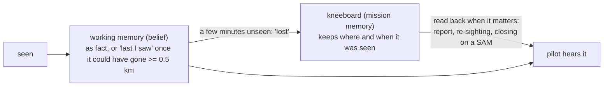

# BL-B112 — motion-aware contact certainty: alignment

## Goal check — 2026-11-12

**Verdict:** CONCERNS

Checked at `bfced060`, then **revised in place the same day** for the user's follow-up on "lost"
(`9cf8af1c`, `explore-notes.md`, "User, verbatim (2026-11-12, follow-up on 'lost')"):

> *""lost" contacts need to go to mission memory. Consider current belief as Petrovich "working
> memory". It's expected that things are dropped from there after a few minutes. Mission memory
> should keep then, using the kneeboard analogue. This also means that mission memory must be read
> from every now and then for known unit positions that are no more in belief."*

The inputs read were `explore-notes.md`, `BL-B112.md`, the 2026-10-13 direction, BL-B111's plan
Decision 1 and its DoD milestone answer, and `belief/decay.py`,
`association_over_time.contact_growth_rate_mps`, `position_belief`, `belief/motion.py`,
`perception/motion.py`, `perception/estimation.py` and `perception/object_model.py`. I read every
`certainty_of` consumer. I also read `mission_memory/` (`admission.py`, `query.py`, `tools.py`),
`belief/tool_api.py`, `BL-8.md`, `BR-2.md`, `plans/bl8-mission-memory/explore-notes.md` and the
architect memory `project_bl8_kneeboard_design.md`.

### Why

The pilot's threat picture should stay as solid as the world is. Petrovich holds what he is
working with right now in his head. That working memory is allowed to let a unit go after a few
minutes unseen. **What he has noted on the kneeboard he does not forget.** He goes back to it when
it matters, the way a crewman glances at his notes. A SAM site or a parked column does not turn
doubtful just because nobody looked at it for half a minute. It does not vanish from the crew's
picture just because it left working memory.

Petrovich should hedge ("last I saw") when, and only when, the unit could really have moved far
enough that the pilot would look in the wrong place. That holds whichever store the position came
from.

Ask why once more and the purpose is **where to look and what to avoid**. The labels, the "lost"
transition and the kneeboard are mechanisms. What the pilot gets from them is truthful wording and
a threat picture that persists.

### Player expectations

The hedge is driven by one quantity: **how far the unit could have moved since it was last seen.**
That is growth, not total position uncertainty (finding 2). "Lost" is a hand-off to the kneeboard,
not forgetting.



```
unseen for →                      30 s        2 min          10 min         30 min
fixed site (SA-2, dug-in)         as fact     → kneeboard;   still reported as fact, from the kneeboard
mobile, seen stopped (0.3 m/s)    as fact     → kneeboard;   as fact        last I saw   (0.5 km at ~28 min)
mobile, seen moving: truck 15     as fact     last I saw → kneeboard; last I saw, N min ago
```

- **E1** — Whenever the pilot asks about threats or ground units, a fixed SAM site (SA-2, an
  installation, a dug-in unit) seen any time this sortie is in the answer and stated as fact. It is
  never "last I saw", whether it is still in working memory or only on the kneeboard.
- **E2** — When a contact goes "lost", it is not forgotten. The kneeboard holds where and when it
  was last seen. Until someone looks at that place and finds it empty (BL-B111's absence route), or
  it is destroyed, the unit stays part of what Petrovich can tell the pilot. **What the pilot must
  still get from a fixed site that has left working memory:**
  - it is still in "report", "any SAMs" and threat answers;
  - it is warned about as he closes on its envelope;
  - when it is seen again, it is recognised as the unit already known.
- **E3** — While circling a known fixed site, the pilot does **not** hear it announced as a new or
  reacquired contact each time it drops out of working memory and is seen again. Seeing it again
  confirms the kneeboard note. It is not news.
- **E4** — A mobile unit Petrovich saw standing still is stated as fact (about 28 min at today's
  0.3 m/s drift) unless he sees it move. Once seen moving, it is treated as a mover. This holds
  from either store.
- **E5** — A unit Petrovich saw moving is reported "last I saw …" once it could have gone 0.5 km or
  more: a truck after about 30 s, a tank after about 1 min, infantry after about 4 min. Before that
  it is stated as fact. Coming from the kneeboard, it carries its age ("… a few minutes ago").
- **E6** — A contact being watched right now, or seen moments ago, is never hedged at any range.
- **E7** — What Petrovich says depends on what he perceived, never on DCS truth. That covers "fixed
  site", "stopped" and the kneeboard's positions. A kneeboard note **informs** what he says and
  where he looks. It never makes his belief about the unit more precise than when the note was
  written.

### Open assumptions

- **What the 0.5 km is measured on** — serves the why: growth since last seen. Would not: the total
  position radius, which already exceeds 0.5 km for one naked-eye fix beyond ~3 km (finding 2).
- **What "lost" is** — serves the why (now the user's own words): leaving working memory after a
  few minutes, handed to the kneeboard. Today's 120 s fits "a few minutes" well enough. Would not:
  lost meaning gone from everything the pilot hears, which is what it means today (finding 1).
- **Which lost contacts reach the kneeboard** — serves the why: every lost contact that was ever
  worth noting, with its **last-seen** position and time. Air defence is always noted today; other
  contacts are noted once they clear `GROUP_ENTRY_CONFIDENCE_FLOOR`, a floor the user kept on
  2026-10-31 so that "a single glimpse gets no entry". Would not: a note written only at first
  sighting or at the last 250 m change. For a mover, that note can be older than the last sighting,
  so the kneeboard would place it where it was before it last moved.
- **What the read-back is for, and what triggers it** — serves the why: the moments in E2 (the
  pilot asks, the unit is seen again, he closes on a known SAM). Would not: a periodic re-fold of
  noted positions into belief, which is the "precision laundering" the BL-8 design shut the door on
  (`fold_position` of an old snapshot shrinks covariance). Q1.
- **Which mobile/fixed fact is used** — serves the why: the type or class Petrovich identified,
  with an honest fallback at class level. Would not: the DCS `object_type` read through whatever
  his identification depth (finding 4).
- **What "seen stopped" means** — serves the why: watched long enough, at a range where motion
  would show. Would not: one glance below the angular-rate threshold (finding 3).
- **Never observed for motion (`motion is None`)** — serves the why: it keeps the 2026-10-30 drift
  of 0.3 m/s. Would not: the class speed, which widens gates the user narrowed on purpose.
- **Other time-keyed things** — `position_confidence` (exponential decay, half-life 30 s), the
  range-crossing `fresh` gate and `GROUP_REIDENTIFY_WINDOW_S` all assume the time ladder. For a
  fixed site, whatever the pilot hears should not decay on a timer.

### Findings

1. **Today "lost" is forgetting, as far as the pilot can tell, and nothing reads the kneeboard
   back in flight. So the hand-off the user describes is only half built.** Lens: Purpose, Crew
   sense.
   - *Working-memory side, in the code:* a `"lost"` contact is dropped from `report` answers
     (`crew_console._handle_report`), from follow targeting, from group clustering (BL-B23) and
     from callout proximity (`callouts.py:856`). The lost moment is silent. Coming back emits
     `CONTACT_REACQUIRED`, which renders a full positional callout.
   - *Kneeboard side, in the code:* `mission_memory.admission.step` already writes an entry for
     every air-defence contact and for every other contact past the confidence floor. It writes on
     first confident sighting and on material change (≥ 250 m, ≥ 60 s apart), not at the moment a
     contact goes lost. **The only reader is `recall_memory` in the brain's `TOOL_SET`. BR-2 is
     open: nothing dispatches `TOOL_SET`, and `BL-8.md` says "write-only in flight by design".**
     The BL-8 import rule (no `belief/` module imports `mission_memory` except `tool_api.py`) means
     the deterministic report and callout paths cannot read it today either.
   - *The pilot would see:* he circles an SA-2 at 5 km and asks "any SAMs?" three minutes later.
     It is not in the answer, even though it is on the kneeboard. Petrovich's eye comes round and
     "SAM, 2 o'clock, 5 km" is called as though it were new.
   - *Grounded in:* the user's follow-up quoted above, `BL-B112.md`'s "for the pilot", `BL-8.md`
     and `BR-2.md`.
   - *Suggests:* "lost" stays time-based, as the user said. What is missing is the read-back: the
     consumers in E2, and E3's "seen again, not news". That read-back is a new in-flight consumer
     of mission memory. It reverses BL-8's settled "write-only file, read-in-flight in memory, via
     the brain" path for deterministic code, and it must keep the fold door shut (E7). Q1 and Q5.

2. **"Location inaccuracy ≥ 0.5 km" has to mean growth since last seen, not total
   uncertainty.** Lens: World truth, Crew sense.
   - One naked-eye look has σ_down = 0.17 × range (`estimation.RANGE_FRACTIONAL_SIGMA`), about
     680 m at 4 km before any time passes.
   - Keyed on the total, most naked-eye contacts beyond about 3 km would be hedged while Petrovich
     is looking at them. That breaks E6.
   - *Grounded in:* code. No user question is needed.

3. **"Observed not moving" is one sub-threshold glance today, and at Mi-24 ranges that misses real
   movement.** Lens: World truth, Bounded knowledge, Non-obvious case.
   - The founding `apparent_motion=False` is adopted as `"stopped"` at once (`belief/motion.py`).
   - The threshold is 8 arcmin/s (`perception/motion.py`), which needs about 9 m/s across the line
     of sight at 4 km. A tank driving broadside, or anything driving toward or away from the
     helicopter, reads "stopped".
   - *Vignette:* a column heading for the helicopter is seen once at 4 km. It is then stated as
     fact at its first place for about 28 min, in working memory and then from the kneeboard,
     while it closes 10 km.
   - Today the cost is small, because growth is already 0.3 m/s. BL-B112 adds **confident
     wording** on top of that belief, and the read-back carries the same confidence into later
     answers. Q2.

4. **Fixed versus mobile can be known only at type depth, and SA-2 is not in the type table.**
   Lens: Bounded knowledge, World truth.
   - `installation_component=True` exists only for S-125 (SA-3) and Kub (SA-6). No row matches an
     S-75/SA-2 type string.
   - A naked-eye contact carries ED's coarse class. `OP_SRSAM` covers the fixed S-125 and the
     mobile Osa, Strela and Tor alike.
   - A glanced-at SAM is "stopped" anyway, so fixed versus mobile matters mostly past about 28 min,
     and for how the kneeboard note is worded. Q3.

5. **BL-B111's DoD expects BL-B112 to narrow its Decision 1 exclusion, and under this goal it will
   barely move.** Lens: Purpose.
   - The excluded case BL-B111 measured is armour **seen moving**: 8 m/s × 700 s, about 5.6 km
     wide. Moving units keep their class rate under every reading of the user's answers.
   - Stopped and `None` units already grow at 0.3 m/s, and installations at 0.
   - The acceptance check against `EXPECTED_AREA_MAX_HALF_WIDTH_DEG` should expect "unchanged,
     except fixed types now at zero".
   - Separately, the kneeboard read-back is a natural feed for BL-B111's "A". A unit seen again
     near a noted position should be checked against that note, not called new. This belongs to
     the read-back item, not to BL-B112.

6. **"Tracked" versus "estimated" stays a real player-facing difference only if it maps onto the
   hedge.** Lens: Purpose.
   - Today "Last I saw" is triggered by age past one scan cycle (`speech._is_stale`), not by the
     label.
   - *Serves the why:* tracked means stated as fact, estimated means "last I saw", and lost means
     handed to the kneeboard. One meaning per state.
   - A fixed site that stays tracked keeps range-crossing callouts alive while it is in working
     memory. After hand-off, the same warning has to come from the kneeboard, or it stops at
     "lost". Q4.

### Scope proposal

**Split it.** BL-B112 delivers E4–E6 and the working-memory half of E1:

- the hedge keyed on growth, with "tracked" and "estimated" mapped onto it;
- the fixed-site and observed-stopped distinction;
- the guarantee that **every contact going lost leaves a kneeboard note with its last-seen place
  and time** (the write half of the hand-off).

That stays inside today's architecture.

**A new body-layer item, the kneeboard read-back,** delivers E2, E3 and E1's kneeboard half:

- report and threat answers include noted units;
- a re-sighting near a noted unit is recognised rather than announced, which feeds BL-B111's "A";
- the pilot is warned when closing on a noted SAM.

It needs its own architect pass, because it opens a deterministic in-flight read path into
`mission_memory`. That reverses BL-8's settled "write-only in flight, read through the brain", and
it has to keep the fold door shut. It is also the thing BR-2 would otherwise be waited on for.

**Ship order matters.** Until the read-back lands, BL-B112 changes nothing about a fixed site
dropping out of answers at 120 s. That is today's behaviour, not a regression, and the test card
should say so plainly.

### Questions for the user

- **Q1** — When should Petrovich go back to the kneeboard for a unit no longer in his head: when
  you ask (report, "any SAMs"), when he sees something near a noted unit (so the SA-2 is
  recognised, not announced again), and when you close on a noted SAM's envelope? Or also on his
  own, turning his scan to look at noted positions again? *Recommended:* the first three now. Scan
  steering toward noted positions is worth having, but it is a larger change to how he looks, and
  can come later.
- **Q2** — "Observed not moving": is one glance enough, or must Petrovich have watched it for a
  few seconds? At 4 km a single look cannot tell a tank driving straight toward you from a parked
  one, and this change would then state its old position as fact for about half an hour, first in
  his head and then from the kneeboard. *Recommended:* a short watch, for example the existing 5 s
  stop confirmation, and nothing from one glance.
- **Q3** — Which SAM systems should count as "fixed site, never moves" in DCS: SA-2 and SA-3 for
  certain, and SA-6 (Kub), SA-10/S-300, SA-11 (Buk)? And when Petrovich only knows "short range
  SAM", not which one, treat it as mobile? *Recommended:* fixed = SA-2, SA-3, SA-10 site
  components; treat SA-6 as you rule; class-only "SAM" is mobile until identified.
- **Q4** — For a fixed SAM site that he has not seen for a while, should Petrovich still call
  "SAM inside 3 km" as you close on its noted position, from the kneeboard once it has left his
  head? *Recommended:* yes. A site cannot move, so the call is true, and it is the warning you
  would want most.
- **Q5** — Build this in two steps: BL-B112 first (wording, fixed and stopped units, every lost
  contact noted on the kneeboard), then a separate item for reading the kneeboard back in flight?
  *Recommended:* yes. Reading back is a design change to mission memory, which today is
  write-only in flight. Until the second step lands, a fixed site still drops out of answers after
  about 2 minutes, the same as today.

## Plan check — 2026-11-12

Tip `a4d0cf9f` (fast-forwarded cleanly from `c4b4454d`, ancestor; tree clean).

**Verdict:** CONCERNS

Checked against this file's own goal check (E1/E4–E7 in BL-B112's scope; E2/E3/Q1/Q4 moved to
`[[BL-B115]]`, acknowledged in the plan's Goal section and not re-checked here) and
`explore-notes.md`'s "User answers to the goal check" (Q2, Q3, Q5). Read `plan.md`,
`BL-B112.md`, `BL-B115.md`, the SA-2 `op_class` research note, `body-layer/CLAUDE.md`'s
mission-memory import-direction invariant, and `body-layer/research/2026-10-01-sam-site-
geometry.md` (graph-surfaced, for the Buk finding below). `memory-search.py` had nothing
indexed for this feature yet.

| expectation | stage | status |
|---|---|---|
| E1 (fixed site, stated as fact; kneeboard holds it once lost) | 1–3 (write half), 5c | met for the write half — see Finding 1 below for the read half, which is `[[BL-B115]]` by the accepted split |
| E4 (seen-stopped mobile unit stays fact ~28 min) | 3, 4 | met in working memory to 120 s only; the ~28 min figure needs `[[BL-B115]]`'s read-back, exactly as Stage 3's own prose says — not a gap in this plan |
| E5 (hedge once growth ≥ 0.5 km: truck ~30 s, tank ~1 min, infantry ~4 min) | 3, 7 | met — `LAST_I_SAW_GROWTH_THRESHOLD_M=500`, class rates give the stated figures (checked: `OP_TRUCK` 15 m/s → ~33 s) |
| E6 (contact under observation never hedged) | 3, 7 | met — `certainty_of` returns `"observed"` inside `OBSERVED_WINDOW_S` regardless of growth; `_needs_hedge` only fires on `"estimated"` |
| E7 (never more precise than when the note was written; no fold-back) | 5a–5c | met — this plan only writes `mission_memory`; nothing in it reads a note back into belief. `[[BL-B115]]` inherits the obligation, correctly named there, not settled here |
| growth-from-zero-to-mobile for Kub/SA-6, BL-B111 Decision 1 interaction | 2, 6 | met — Stage 6 explicitly names the reversal and corrects the goal check's own Finding 5 |
| "observed not moving" needs the 5 s watch, test rewrite | 4 | met — matches Q2's answer, test-rewrite flagged under Escalation Rules per `AGENTS.md` |
| lost stays time-based; every lost contact gets a kneeboard note; floor interaction | 5c | met — air-defence always, otherwise gated on `latest_entry is not None`, explicitly resolving the goal check's own open question the same way |

### Findings

1. **The plan's own forward note on Buk/SA-11 reasons from the wrong half of the user's rule, and
   this project's own prior research already says so.** Lens: World truth, Bounded knowledge.
   - The user's structural rule has two branches: *"SAM sites where radar and launchers are
     different units -> treat as not moving"* vs. *"Units that themselves are a mobile SAM
     platform that can… up and go at a moment's notice"* without deploying a separate radar.
   - The plan's Decisions section says Buk, if added later, "would land `immobile=True`" under
     the first branch, because "DCS models Buk's search radar/launcher/command post as separate
     units, same structural shape as Kub."
   - `body-layer/research/2026-10-01-sam-site-geometry.md` (already on file, not re-derived here)
     says the opposite of what that comparison needs: a Buk battalion's TAR is separate, but
     **each TELAR is itself "a self-contained radar+launcher vehicle (like Osa/Tor)"** — the
     launcher carries its own engagement radar and does not depend on the TAR to fire, unlike
     Kub's 2P25 TEL, which has no radar of its own at all and cannot engage without the separate
     1S91. That is exactly the second branch of the user's rule, the one that made SA-6 the
     explicit exception in the first place — not the first.
   - *The pilot would see, if this default ships unexamined later:* a Buk TELAR that drove off
     the moment Petrovich looked away gets called "SAM, 2 o'clock" at its old position as settled
     fact, the failure mode E1/E4 exist to prevent — for a system this project's own notes already
     say is self-propelled.
   - *Grounded in:* `body-layer/research/2026-10-01-sam-site-geometry.md` lines 72–77,
     cross-checked against the user's own Q3 wording in `explore-notes.md`.
   - *Suggests:* nothing here changes BL-B112's code — Buk is correctly left out of this plan.
     But the one-line default the plan leaves for "the next time Buk coverage is added" currently
     points the wrong way and should be corrected now, while it is cheap, rather than left to be
     re-discovered against a live SA-11 in a mission.

### Questions for the user

- **Q1** — The plan's forward note defaults a future Buk/SA-11 addition to `immobile=True` ("same
  structural shape as Kub"). This project's own 2026-10-01 SAM-site-geometry research says Buk's
  TELARs, unlike Kub's TEL, carry their own engagement radar and are themselves self-contained
  mobile platforms — the branch of your rule that made SA-6 mobile, not the branch that keeps
  SA-2/3/10 fixed. Should the plan's note be corrected now to default Buk to `immobile=False`
  (mobile, Kub's treatment) when it is eventually added? *Recommended:* yes — one sentence, and it
  stops a future implementer from wiring Buk the wrong way from a note that currently points at
  the wrong precedent.
