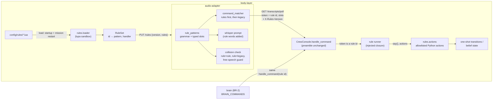

# BL-17 — Spoken commands as Lua rules: plan

Branch `feature/speech-rules`. Planned 2026-11-17 against tip `bc6622d1`. Inputs:
`body-layer/ROADMAP/BL-17.md` (including the three later relays), `plans/speech-rules/alignment.md`
(E1–E10), `plans/behaviour-trees/explore-notes.md` ("2026-11-17: speech commands as Lua rules",
rounds 1–3), `body-layer/ROADMAP/BL-B95.md`. Where a goal-check recommendation and a later user
answer differ, the answer wins: the first port is "turn left/right NN" on AI-overlay flight,
not "scan heading NNN" + "mark here".

### Goal

Every spoken command becomes a Lua rule: a fixed-wording pattern with typed slots, plus a handler
that calls exposed actions and writes its own readback. Matching, slot parsing and the actions stay
in code. This plan details stages 0–3: the engine and the bearing→heading rename, the "turn
left/right NN" port, and a test flight. The other ~80 commands are grouped and ordered, not detailed.

### How it fits together



### Decisions already taken by the user (also listed as U1–U16 below)

These came from **the explore** (rounds 1–3), **the goal-check answers**, or **three later
relays** from the main loop, all on 2026-11-17. The code decided none of them. Every one is a
numbered `U<n>` in the last section, so the ledger tracks it. Two **world facts** were settled by
the main loop, not the user: an offset mark sits at terrain elevation, and an offset is measured
from ownship position and heading at push-to-talk release. Both belong to the marks stage.

### Architecture decisions (this plan's own, with reasons)

- **D1 — Rule files load in body-layer, and their patterns are pushed to audio-adapter over HTTP.**
  Body-layer loads `config/rules/*.lua` with lupa, collects `(id, pattern)` pairs and sends them
  with a new `PUT /rules` (`{version, rules: [{id, pattern}]}`). Audio-adapter compiles the
  patterns, merges their words into the whisper prompt, checks for collisions, and answers
  `{version, accepted: [ids], rejected: [{id, reason}]}`. Handlers run only in body-layer.
  *Why:* this keeps the split that already exists. Normalisation, verb anchoring, fuzzy scoring and
  the whisper bias are recogniser facts, and they stay in the adapter (memory
  `project_voice_vocabulary_lives_in_audio_adapter`). Behaviour stays in body-layer. The seam stays
  HTTP/JSON (module independence), audio-adapter stays stdlib-only with no Lua, and the
  mission-restart reload (U11) needs no adapter restart because body-layer pushes again.
  *Rejected:* (a) moving matching into body-layer. That means 1,300 lines of matcher and the
  whisper-specific normalisation crossing a boundary, and the whisper prompt still has to live in
  the adapter. (b) A pattern file shared by both processes. That splits one rule across two files
  and adds file coupling between subprojects.
- **D2 — Re-push on version mismatch.** `version` is a hash of the sorted `(id, pattern)` set, so
  pushing the same set twice is harmless. Every `GET /transcripts/poll` response gains an
  `X-Rules-Version` header, absent until the first `PUT`. When it differs from the version
  body-layer last had accepted (an adapter restart, or a failed push), body-layer pushes again on
  that poll. The header leaves the row shape alone, so this is backward-compatible, and it rides
  the poll body-layer already makes, so there is no new timer.
- **D3 — A rule id is a command token, and a ported rule keeps its token's name and slot names.**
  "turn left/right NN" becomes rule `turn_heading_relative` with slots `direction` and `degrees`,
  exactly as today. That keeps the following unchanged: `--speech-log` rows, `join_voice_latency`,
  the confirm band, BR-2's `BRAIN_COMMANDS` allowlist, the command-map skill, and test cards.
- **D4 — Rules run inside `handle_command`, after its existing preamble.** The preamble covers the
  refusal mode, `_note_player_command`, the one-shot resets, the end of silence, the on-ground
  look gate and point supersession. Only the `elif token == …` dispatch branch is replaced. The
  runner is injected into `CrewConsole` as a closure from `body.py`, the same pattern as
  `speech_log_sink` and the mission-memory write. This avoids a `belief` ↔ `rules` import cycle.
  Anything that reads `DISPATCHED_COMMAND_TOKENS` (`crew_console.py:1110`, `:2596`, `:2861`, and
  the comment in `tool_api.py:724`) must accept *static tokens ∪ enabled rule ids*. A rule id that
  is no longer enabled, for example a transcript matched just before a reload, answers
  `render_unable("NO_SUCH_COMMAND")` and is never silent.
- **D5 — Actions are one allowlisted Python registry. The brain reaches it only through
  `handle_command`.** `body-layer/src/rules/actions.py` exposes named actions (one thing each,
  explicit params, result `{ok, reason?, …}`) and later named read-only params, per root
  `CLAUDE.md`'s "Behaviour as actions and params". The action bodies are extracted from today's
  handlers into `CrewConsole` or `belief/` functions, so Python and Lua call the same code. The
  brain does not get a second route: BR-2 already dispatches commands through `handle_command`
  (`BRAIN_COMMANDS` plus a planted `Mention`), and a ported command *is* a rule id, so a
  brain-carried command runs the same Lua handler and produces the same readback (E10, by
  construction, as BR-2's E3 was). Query params added later wrap the same `belief/tools.py`
  functions that `BRAIN_TOOLS` wraps, not new ones. *Departure, named:* `TOOL_SET`/`BRAIN_TOOLS`
  are not reused as the action registry. Their entries are brain-facing read-only queries
  returning `{facts, summary, phrasing_hints}` and `ToolObservation`, while rules need effects with
  small results. What the action registry does reuse is `BrainTool`'s shape: name, typed
  `ParamSpec`, an invoke over a body-bound context, and validation in Python of every value Lua
  passes in.
- **D6 — Failures (U10, U13).** Every failure is logged with `logger.error` to stderr. At startup
  and at each reload, one banner lists every failure, as effector sequences' D5 does. Petrovich
  says **"Action file error."** once per load, held until the SPU-8 intercom gate opens. This uses
  the `drain_config_error` shape: a new `action_file_error_pending` flag and
  `drain_action_file_error(now_sim, intercom_open=…)`. Unlike `CONFIG_ERROR_LINE`, the flag is
  **re-armed by every reload that has failures**, because a reload is the user's edit-and-retry
  loop (U11). Each failure is disabled at the finest grain that is honest:
  - a Lua syntax error, or an error while the file runs at load → that **file**'s rules are
    discarded (each file loads in its own environment table, so the other files are untouched);
  - a bad `when.speech` call, a pattern the adapter rejects (bad grammar or unknown slot type), or
    a duplicate rule id → that **rule** (for a duplicate id, every rule carrying it);
  - two rules claiming the same wording → **both** disabled (U10);
  - a rule that collides with a legacy phrase, or turns free speech into a command → that **rule**.
  - **A Lua error at dispatch time** → that command's reply is "Action file error." in place of
    the readback. The error and its traceback are logged, and every one-shot transition field set
    during this dispatch is cleared, so the action does not happen without the pilot hearing about
    it (E7). Actions that write immediately, such as a mark append, cannot be rolled back. They are
    marked `immediate` in the registry, and the marks stage must order them last in their rule.
- **D7 — Pattern grammar v1 and typed slots, designed now for the marks group.** Pattern elements:
  - a literal word;
  - `[ … ]`, an optional group that may contain literals *and* slots (needed for
    `[from <origin:origin>]`);
  - `<name:type>`, a slot of a type defined in code;
  - `<name:w1|w2>`, a word-set slot whose value is the word heard.

  The adapter strips punctuation and commas before matching ("set mark, from waypoint 1, …").
  Every slot type is a parser in the adapter that consumes words from the transcript. If it fails,
  the rule did not match. Slot values cross the wire as JSON: a scalar for a simple type, and an
  **object tagged `kind`** for a union type, so a union arrives in Lua as a table. Types:

  | type | spoken | value | stage |
  |---|---|---|---|
  | `angle` | 1–3 digits, digit by digit or whole ("two zero", "20") | int 1–359 | 1 |
  | `heading` | `heading` + exactly 3 digits | int 0–359 | 1 (rename) |
  | `bearing` | `bearing` + exactly 3 digits | int 0–359 | 1 (rename) |
  | `oclock` | 1–12 + `o'clock` | int hour | 1 |
  | word-set | one of the listed words | str | 1 |
  | `direction` (union) | heading NNN \| bearing NNN \| N o'clock \| compass word (`SECTOR_WORD_DEGREES`) | `{kind, deg}` / `{kind:"oclock", hour}` | marks |
  | `distance` | number (decimals: "three point five") + `km`/`kilometers`/`meters` | `{km}` | marks |
  | `origin` | `waypoint N` \| `mark N` (absent = ownship) | `{kind, n}` | marks |
  | `place` | feature-kind word + `at` + N o'clock | `{feature_kind, hour}` | marks |

  The type word anchors where each number starts and stops. That is what keeps "mark two three
  kilometers" unambiguous (explore round 1): heading and bearing take exactly three digits, and
  `o'clock` closes its number. **Choosing a unit or a place is never the adapter's job.** `place`
  only parses the words. Body-layer resolves the nearest matching map feature (U16), and a
  target-choice action returns one unit or `nil` (U5).
- **D8 — How rule matching sits in `match_transcript`.** Rule matching runs after the wake-word
  check and the HVRT bare words, and before the legacy slotted branches. The first literal of
  every active rule joins the verb-anchor set (`VERB_ANCHOR_WORDS` becomes legacy ∪ active rules).
  The literals are scored with the existing word-sequence scorer `_phrase_match_ratio`, with the
  slot spans taken out. The existing floors are reused: `VERB_FLOOR`, `MATCH_FLOOR`,
  `SEPARATION_MIN`, `_WORD_REPAIR_FLOOR`. Two rules scoring within `SEPARATION_MIN` set
  `ambiguous=True`, and the existing body-side disposition applies (E3). The compiled rule table is
  an immutable object swapped in with one assignment, because `ThreadingHTTPServer` can run
  `PUT /rules` and `/transcribe` at the same time.
- **D9 — The collision check, run by the adapter at `PUT` time, before anything is accepted.**
  1. Rule × rule: each rule's generated sample utterances (one per optional branch, slots filled
     with sample values from each type) are run against every other rule. A hit disables both.
  2. Rule × legacy: rule samples are run through the legacy matcher, and legacy `PHRASES` through
     the rule matcher. A hit at or above `MATCH_FLOOR` disables the rule.
  3. Free-speech guard: a fixed list of ordinary sentences that must stay non-commands
     ("the tanks are on the ridge", and the other pinned adversarial sentences in
     `test_command_matcher.py`, moved into one `vocabulary.FREE_SPEECH_GUARD` tuple that both the
     tests and the check read). If adding a rule makes any of them verb-anchored or matched,
     that rule is disabled.

  This turns the "attack"/"tanks" lesson (`vocabulary.py:645`; memory
  `feedback_new_verb_synonym_can_silently_widen_anchor_set`) into a load-time check instead of
  something a failing test discovers. It cannot catch a near-miss that only a real transcript
  produces. That case gets the runtime ambiguity answer (E3/E6), as alignment Finding 5 expected.
- **D10 — The whisper prompt becomes dynamic.** `WhisperCliEngine` takes a prompt provider instead
  of a fixed string. The adapter rebuilds the prompt from the legacy words plus the active rule
  words on every accepted `PUT`. The 224-token cap stays a test for the shipped vocabulary. At
  runtime, a set of user rules that exceeds the cap logs a warning (whisper drops the front of the
  prompt) and is not spoken. This is risk R3.
- **D11 — `--print-rules`**, in the shape of `--print-tuning`: it loads the rules standalone and
  prints every id, pattern and failure. With `--audio-adapter-url` it also pushes the rules and
  prints the adapter's verdict. This is how the pilot checks an edit without flying (E2/E5).
- **D12 — "Scan/report bearing NNN" becomes relative now, in Stage 1a, not when scan/report are
  ported.** The user accepted it as relative (U9). Leaving it unbuilt until Stage 6 would mean
  weeks of "say again" for a phrase the pilot uses out of habit. It runs on machinery that already
  exists. The relative bearing is rounded to the nearest clock hour, following the user's
  2026-09-23 *"o'clock direction is enough"*, and drives the existing `relative_clock_hour` scan or
  the `report_clock_N` report. Hours 5–7, which are behind the aircraft and outside
  `FORWARD_CLOCK_POSITIONS`, answer "unable" with a reason meaning "behind us". Grep
  `render_unable`'s catalogue first, and add a reason only if none fits (E7). The readback is
  plain, as U9 says: "Scanning bearing three two zero." The confirm text is
  "scan bearing three two zero, confirm?". The compass forms keep Decision 3's rule from
  `plans/voice-command-completeness/plan.md`: the confirm text names the rounded sector.

### Answers to the goal check's open assumptions (step 1b)

| assumption | answer in this plan |
|---|---|
| Mark elevation | Terrain elevation at the offset point (world fact, main loop). Marks stage; out of stages 1–3. |
| Moment an offset is measured from | Ownship pose at PTT release (world fact). The marks stage needs a short ownship-pose history in body-layer keyed by the release time the transcript row carries. Today's `t_wall` must first be checked to see whether it is release time or enqueue time (R7). "Turn left NN" keeps today's behaviour: relative to the AI's held heading at dispatch (E1). |
| Which commands take relative `bearing` | `scan` and `report`, from Stage 1a (D12, U9). No others until they are ported. |
| A ported rule fails to load | The command is missing, "Action file error." is spoken once at load, and there is **no** fallback to the old Python handler, which is deleted in the same stage (D6, E5). |
| Which rule wins a collision | Neither: both are disabled and the error is spoken (U10, U13). |
| Reference for "mark heading NNN" | Marks stage. The existing heading convention applies (U3). Whether marks need a different reference is answered there, because U3 settled "existing convention in code". |
| First port and flight | "turn left/right NN" on AI-overlay flight (U12). The card includes one rule edit and a mission restart between two attempts (Finding 3, E2). |

### Affected modules / files (stages 0–3)

**body-layer**
- `pyproject.toml`: `lupa` (pinned version from Stage 0). `body-layer/CLAUDE.md` "Tech stack" stops
  saying stdlib-only and names lupa as the one direct dependency, approved by the user (U7).
- `src/rules/__init__.py`, `src/rules/sandbox.py`: **the only module that imports lupa.** It builds
  the runtime, strips globals, gives each file its own environment, and sets the instruction and
  memory caps.
- `src/rules/loader.py`: reads `config/rules/*.lua` in sorted order and collects registrations
  and failures, one `RuleLoadError(file, rule_id | None, reason)` each.
- `src/rules/engine.py`: `RuleSet` (id → pattern, handler, file), `RuleSet.version`,
  `run_rule(id, slots, ctx) -> RuleOutcome(lines, error)`, plus the Lua-side API `when.speech`,
  `say`, `unable`, `digits`.
- `src/rules/actions.py`: the action registry. Stage 2 adds `flight.increment_heading(delta_deg)`.
- `config/rules/flight.lua` (Stage 2), `config/rules/README.md` (pattern grammar, slot types,
  API; one page for the pilot).
- `src/belief/crew_console.py`: rule dispatch inside `handle_command` (D4); the
  `DISPATCHED_COMMAND_TOKENS` readers; `action_file_error_pending` and `drain_action_file_error`;
  `ACTION_FILE_ERROR_LINE = "Action file error."`; one-shot rollback on a Lua error; Stage 1a
  renames; Stage 2 extracts `increment_ai_heading` and deletes the handler and branch.
- `src/belief/audio_client.py`: `put_rules(...)`, and `get_transcripts` reads `X-Rules-Version`.
- `src/body.py`: load at startup and in `_reset_mission_state`; push and re-push (D2); drain the
  action-file error each poll beside `drain_config_error`; `--rules-dir` (default
  `config/rules`, always on, not a debug flag) and `--print-rules`.
- `src/belief/tool_api.py`: `BRAIN_COMMANDS` `report_bearing_*` → `report_heading_*` (Stage 1a).
- Tests: see each stage.

**audio-adapter** (stays stdlib-only)
- `src/rule_patterns.py`: grammar parser, slot-type registry (wrapping the existing
  `_read_digits_after`, `parse_clock` and the rest), compiled matcher, sample generation,
  collision check (D7–D9).
- `src/command_matcher.py`: rule branch (D8); dynamic anchor set; `match_transcript(text,
  rules=None)`.
- `src/vocabulary.py`: Stage 1a renames; `FREE_SPEECH_GUARD`; `recognised_words`/`to_prompt` take
  the active rule words; Stage 2 removes `turn_heading_relative`, `parse_turn_relative` and its
  phrases.
- `src/server.py`: `PUT /rules`, the `X-Rules-Version` header, holding the current compiled rules.
- `src/stt_engine.py`, `src/audio_adapter/__main__.py`: prompt provider (D10).
- `audio-adapter/CLAUDE.md`: the new endpoint, and patterns arriving from body-layer.

**brain-layer**
- `tools/stage0_cases.json`, and any prompt text that names `report_bearing_*` (Stage 1a). The
  brain's command block is rendered from `BRAIN_COMMAND_SPECS`, so it follows automatically.

### Existing constants checked (step 3a, widened rule)

Matching thresholds: reused unchanged (`VERB_FLOOR`, `MATCH_FLOOR`, `SEPARATION_MIN`,
`_WORD_REPAIR_FLOOR`). No new threshold. `BEARING_RESOLUTION_DEG` and `LEGAL_BEARINGS_DEG` (the ×5
checksum) are **deleted** in Stage 1a (U2). The new constants are the Lua instruction cap per
handler call and per file load, and the Lua memory cap. Grepped `body-layer/src`,
`audio-adapter/src` and `body-layer/config/defaults.toml`: no existing constant governs script
execution. These are safety limits, not behaviour, so they stay ordinary literals and not
`tuning` declarations. The re-push needs no timer (D2). `WAYPOINT_CAPTURE_RADIUS_M` is unrelated.

### Implementation plan

**Stage 0 — lupa spike (Implementer, an hour, in the feature worktree).** Install lupa into
body-layer's venv. It is Python 3.14 on the Mac, so a cp314 macOS arm64 wheel must exist; if not,
pin the newest version that has one. Confirm and record in
`body-layer/research/2026-11-17-lupa-sandbox.md`:
- `lupa.lua54.LuaRuntime(register_eval=False, register_builtins=False,
  unpack_returned_tuples=True, max_memory=…)` works;
- an instruction-count abort is possible: `debug.sethook` set from Python before `debug` is
  stripped, or whatever lupa 2.x offers;
- `load(src, name, "t", env)` gives per-file environments and refuses binary chunks;
- `LuaError` carries file and line;
- whether lupa ships type stubs. Without them, confine `# type: ignore[import-untyped]` to
  `sandbox.py` and expose a typed wrapper;
- whether the runtime lock makes calls from the REPL thread and the poll thread safe (R4).

If the instruction cap cannot be had, stop and report. That decides whether a runaway rule can
freeze the poll loop.

**Stage 1a — the bearing→heading rename on the command surface (Python only, no Lua).** Scope as
recommended in U17; the open choice is there.
1. Vocabulary: "scan/report heading NNN" (compass, exactly three digits, any value 000–359) replaces
   "scan/report bearing NNN". The new "scan/report bearing NNN" is relative (D12). `parse_bearing`
   splits into `parse_heading_digits` and `parse_bearing_digits`, each keeping the three-way
   outcome (legal / heard-but-illegal / absent). Heard-but-illegal now means "not exactly three
   digits, or > 359", replacing "not a multiple of five". It is still a detected error, answered
   "say again". "Scan heading …" is matched on the verb (`scan`/`report`) with "heading" inside
   the utterance. `turn_heading` still anchors only when "heading" is the first word. A test pins
   both readings.
2. Tokens and slots: `scan_bearing_<pt>` → `scan_heading_<pt>`; `report_bearing_<pt>` →
   `report_heading_<pt>`; `scan_bearing_deg` → `scan_heading_deg`; `report_bearing_deg` →
   `report_heading_deg`. `scan_bearing_deg` and `report_bearing_deg` are now the relative tokens.
   Slot `bearing_degrees` → `heading_deg` (the same name `turn_heading` already uses) / `bearing_deg`.
   **Reusing `scan_bearing_deg` for the relative meaning is deliberate**: it is the right name
   under the new convention. The change of meaning and its date go in `vocabulary.py`'s docstring,
   because older `--speech-log` files used the token for compass. No log tool keys on it (grepped
   `body-layer/tools`, `.claude/skills`).
3. body-layer: the renamed tables (`_HEADING_SCAN_TOKENS`, `_HEADING_REPORT_TOKENS`); the relative
   handlers (D12); `_describe_token_for_confirm`; `BRAIN_COMMANDS`; brain-layer `stage0_cases.json`.
4. Tests renamed and extended: "scan heading three two one" is accepted (no checksum); "scan
   heading three two" says again; "scan bearing three two zero" scans 11 o'clock with a plain
   readback; "scan bearing one eight zero" answers unable; "heading three one five" is still
   `turn_heading`; the free-speech sentences are unchanged.
5. After merge, the main loop runs `/command-map`. Per step 10, amend the open plans that name the
   old forms (`plans/crew-query-path`, `plans/brain-tool-calls` Stage 4,
   `plans/9k113-scan-procedure/plan-stage2.md`, `plans/watch-reporting`) with a dated pointer
   (`Decision N REVISED`).

**Stage 1b — the rule engine, with no rules shipped yet.**
1. Adapter: `rule_patterns.py` (grammar v1, types `angle`/`heading`/`bearing`/`oclock`/word-set,
   samples, collision check); `PUT /rules`; header; dynamic prompt; rule branch in the matcher.
   With no `PUT`, the adapter behaves exactly as today. That is pinned by the whole existing
   matcher suite passing unchanged.
2. body-layer: sandbox, loader, engine, action registry (empty apart from `say`, `unable(reason)`,
   which renders through `render_unable`'s closed catalogue, and `digits(n)`, which reuses
   `_digit_readback`); `handle_command` dispatch (D4); push and re-push (D2); action-file error
   (D6); `--rules-dir`, `--print-rules`.
3. **The sandbox must hold now** (audience: the user, U7 and BL-B95):
   - no `io`, `os`, `require`, `package`, `debug`, `load`/`loadfile`/`dofile`/`loadstring`,
     `string.dump` or `collectgarbage`;
   - no `python` module, no Python objects handed to Lua: only wrapped functions that return plain
     tables (`attribute_filter` denies everything, as a second line of defence);
   - text-only chunks, an environment per file, instruction and memory caps;
   - every value Lua passes to an action is validated in Python for type and bounds. This is the
     same posture as `brain_reply`'s validation; security memory
     `project_ai_pilot_goal_lua_dispatch_missing_validation` is the recent miss of this shape;
   - `say` text is length-capped.

   **Deferred to BL-B95, for strangers' scripts:** a trust or permission model for rule
   directories; per-mission resource budgets; limits on how often a rule may speak; a review of
   lupa escape vectors (metatables, the coroutine library) against a hostile author; mission
   rules added to the common set.
4. Tests (body-layer): the sandbox denials, a runaway loop aborted, a memory cap hit; the loader
   (a syntax error disables only that file, a duplicate id disables both, a bad `when.speech`
   disables the rule); the engine (lines returned; a Lua error gives "Action file error." with the
   transitions cleared); `handle_command` (refusal mode beats a rule, a rule ends silence, a
   disabled id answers `NO_SUCH_COMMAND`); the reload re-reads an edited file in a temp directory;
   a header mismatch triggers a re-push; `drain_action_file_error` waits for the intercom gate and
   re-arms on reload. Tests (adapter): grammar good and bad; each slot type, including a leading
   zero ("zero one five") and two digits after `heading` (no match); all three collision checks,
   including a rule starting with `attack` rejected by the guard; `PUT /rules` and the header; the
   prompt containing rule words.

**Stage 2 — port "turn left/right NN" (U12).**
1. `crew_console.increment_ai_heading(delta_deg) -> ActionResult` is extracted from
   `_handle_turn_heading_relative`. It keeps the same math (held heading + delta, modulo 360) and
   the same `NOT_READY` when the held heading is `None`. It is exposed as
   `flight.increment_heading` with `delta_deg` validated as an int in −359…359.
2. `config/rules/flight.lua`. The readback is today's (E1); the card changes it (E2).
   ```lua
   -- Flying commands. Petrovich flies through the AI overlay (parked, mode 2).
   when.speech("turn_heading_relative", "turn <direction:left|right> <degrees:angle>",
     function(s)
       local r = flight.increment_heading(s.direction == "left" and -s.degrees or s.degrees)
       if not r.ok then return say(unable(r.reason)) end
       say(s.degrees .. " " .. s.direction .. ".")
     end)
   ```
3. Delete `turn_heading_relative` from `vocabulary.py` (the token, `PHRASES`, `parse_turn_relative`
   and the matcher branch) and from `crew_console.py` (the branch, the handler, and the
   `DISPATCHED_COMMAND_TOKENS` entry). There is one definition of the command, so there is no
   fallback (E5).
4. Tests: **a differential test written before the deletion**, recording the old handler's
   `AiPilotGoalRequest` and readback for left/right, a wrap past 0 and 360, and
   `NOT_READY`. The rule must reproduce them exactly. A body-layer test loads the **real**
   `config/rules/*.lua` with zero failures; shipped rule files must always load clean. An adapter
   test pushes the same pattern string and matches "turn left two zero", "turn right 45" and
   "turn left zero" (no match: `angle` ≥ 1). The pinned matcher tests that referenced the token
   move to the rule-pattern suite. That is a test *rewrite*, inherent in "all commands move"
   (U6), and is noted in `implementation.md` rather than escalated again.

**Stage 3 — test flight card** (`/test-card`). Per the auto-merge rule it names `main`; it names
the branch only if run before merge. The air start and AI-overlay setup are referenced from
`docs/acceptance/2026-11-17-bl16-p2-voice-goals-sortie.md`, not repeated.
1. On the Mac, before flying: `--print-rules --audio-adapter-url …` shows `turn_heading_relative`
   loaded and accepted, with nothing rejected.
2. AI overlay flying, player in the operator seat: "turn left two zero" → "20 left." and the
   aircraft turns about 20° left. "turn right four five" turns the other way.
3. Edit `flight.lua`'s readback to `"Left " .. s.degrees .. "."`, then **restart the mission, not
   body-layer**. The new readback is heard (E2, U11).
4. Add a second rule with the same pattern under another id, then restart the mission. One "Action
   file error." is heard, and "turn left two zero" is no longer acted on. Remove it, restart, and
   the command works again (E5, U10, U13).
5. Put a syntax error in `flight.lua`, restart the mission: the same single line, and the stderr
   banner names the file and line. Fix it.
6. Pilot seat, Petrovich scanning: "scan heading three two zero" → "Scanning northwest"; "scan
   bearing three two zero" → "Scanning bearing three two zero." and the scan sits at about 11
   o'clock; "scan heading three two one" is accepted.
7. Free speech: "the tanks are on the ridge" is still not a command.

**Later stages: the remaining ~80 commands, one rule file per group** (U6; planned in its own
pass when scheduled):

> **This run stops after Stage 3** (user, 2026-11-17): *"stop after stage 3. That's a good place to
> merge what is build and plan what stages to take next and whether some are needed sooner and some
> later. I'd say that we start with the flight control commnads and then see about the others."*
> Stages 0–3 go through Reviewer, Performance, Security and DoD as one batch, then merge. The table
> below is a provisional order only; it is re-planned with the user, flight-control commands first.

| stage | file | commands | why this order |
|---|---|---|---|
| 4 | `flight.lua` | `turn_heading` (three digits now enforced, U2), `level_flight`, speed, altitude, `hold_altitude`, `level_off`, HVRT bare words | same actions family as Stage 2, lowest risk; the bare single words test the guard (D9) |
| 5 | `crew.lua`, `weapons.lua` | `radio_check`, `greeting`, `silence`, `stop_talking`; `observ_on/off`, `weapons_armed/safe` | slot-free; checks that a rule may stay silent when its effector sequence speaks (`[[BL-B119]]`) |
| 6 | `scan.lua`, `report.lua` | every `scan_*`, `report*`, `where_is_it`, `cancel_scan` | largest set, allowlisted for the brain: the `BRAIN_COMMANDS` existence test moves to checking enabled rule ids; positional-readback deferral (`_speak_or_defer`) becomes action behaviour |
| 7 | `watch.lua`, `target.lua` | `watch_*`, `follow`, `cancel_watch/task`, `select_target`, `drop_target`, `step`, `engage`, `disengage`, `point` | target choice as an action returning one unit or `nil` (U5) |
| 8 | `marks.lua` | `mark_here`, `mark_target`, plus new offset, origin and place marks (U14–U16) | needs the union types (D7), ownship pose at PTT release, terrain elevation, waypoint numbering (R8), map-feature lookup |
| 9 | — | delete the legacy matcher branches and `PHRASES` apart from routing | — |
| 10 | — | full internal bearing→heading rename: compass-meaning "bearing" in perception, world-model, DCS-side Lua and tests; `BEARING_SIGMA_DEG` with the old key still read (U17). **Method, approved by the user 2026-11-17** (*"suggestion for stage 10 is a good one"*): classify every use by meaning first, then one mechanical rename per class — relative uses (`relative_bearing_deg`, `relative_now["bearing_deg"]`) **stay "bearing"**; compass direction *to a thing* (`geometry.bearing_deg`, `true_bearing_deg`) becomes `heading_to_*`, not plain "heading", because "heading" already means where a vehicle points or moves (`Group.heading_deg`, ownship `heading_true_deg`). A blind `sed` was measured and rejected: it inverts 10 relative identifiers, collides 5 names, and rewrites verbatim user quotes in 678 Markdown files. Docs keep historical quotes as said. | last, after every command is ported, so it touches settled code once |

These stay in code and never become rules: `wake_petrovich`, `cancel_nevermind`, `say_again`, and
the confirm-band answers. They route a transmission; they are not commands. The marks stage should
also file backlog entries for "scan near mark N" and "fly to mark N", so the number Petrovich reads
back has a visible consumer.

### Co-moving fields

Step 6a's trigger, applied to state that must move together across two processes. These are new
types, so there are no existing construction sites. The Implementer greps `RuleSet(` and
`CompiledRules(` once they exist, and every construction site must carry `version` and
`enabled_ids` together.

| Field | Written by | Transition | Must hold true after |
|---|---|---|---|
| body `RuleSet` (`version`, `enabled_ids`) | internal load | startup / mission-restart reload | built fresh from disk; Lua-level failures already excluded |
| body `adapter_accepted_version` | `PUT` response | a `PUT` answered | equals `RuleSet.version`; `enabled_ids` minus adapter-rejected ids |
| adapter compiled rules | external (`PUT`), reset by adapter restart | adapter restart | adapter version absent → body sees a header mismatch on the next poll and pushes again |
| body `enabled_ids` | the `PUT` response | adapter rejects ids | `handle_command` never runs a rejected id, even if a stale transcript names it (D4) |
| `action_file_error_pending` | load, `PUT` response | any failure in a load or a `PUT` | `True` until spoken once with the intercom open; re-armed only by a later load that also has failures |
| one-shot transitions (`ai_pilot_goal_transition`, …) | rule actions | Lua error during dispatch | all `None`/`False` again, as `handle_command`'s preamble left them |

### Risks and unknowns

- **R1:** the lupa wheel for Python 3.14, the instruction cap and thread safety are unverified until
  Stage 0. If there is no cap, a rule that loops forever freezes the poll loop. That is acceptable
  for the user alone only if the user knowingly accepts it.
- **R2:** the rule matcher is new matching code beside a carefully tuned one. Mitigations: the
  existing matcher suite passes unchanged with no rules pushed; the collision check (D9); and the
  pre-deletion differential test in Stage 2.
- **R3:** whisper prompt size grows with user rules (D10). This is fine for the shipped set; a
  large set of user rules degrades recognition quietly.
- **R4:** `handle_command` is reachable from the REPL thread as well as the poll thread. One Lua
  runtime touched by both needs lupa's lock, or rules must be refused from the REPL (Stage 0).
- **R5:** rule files are committed, and the user edits them in the root checkout. Edits not yet
  committed block `/merge` (AGENTS rule 3 stops and asks). See U18.
- **R6:** the meaning of `scan_bearing_deg` changes; old speech logs read differently.
- **R7 (marks stage):** the transcript row's `t_wall` may be enqueue time, not PTT release. E9
  needs release time, and `correlation_id` is minted at release, so the adapter may have to carry
  the timestamp. *Plan check:* confirmed — `server.py:395` stamps `t_wall=time.time()` at match
  completion; but `t_ptt_release_wall` is already minted at release and already sent to
  `POST /transcribe` (`transcribe_client.py:54`), used only for `_log_latency`. Stage 8 needs only
  the wiring into `TranscriptEvent`.
- **R8 (marks stage):** "waypoint 1" needs `--mission-understanding`'s route
  (`mission_phase.CompactRoutePoint`). With none loaded, the answer is unable. Route numbering
  (whether it starts at 0, and what the HSI or F10 shows) must match what the pilot reads.
- **R9:** "turn left NN" when not on AI overlay answers `NOT_READY`, as today. A goal set
  while parked becomes inactive on unpark (`_apply_ai_pilot_wheel_goal`). This is unchanged, so
  the flight is not expected to show it.

### Second-order effect

Rules become the unit of a command. BR-2's allowlist turns into a list of rule ids, so the brain
and the phrasebook share one handler (E10). `when.speech` is the first trigger kind of BL-B95's
event system, so `when.trigger(...)` and interrupts can be added later beside it without a new
engine. The marks group (Stage 8) is what makes "scan near mark N" and "fly to mark N" possible.

**BR-2 sequencing.** BR-2 Stages 0–3 are merged. The Stage 5 re-plan is dequeued (user,
2026-11-16), and `feature/br2-free-text` holds only a goal check. BL-17 does not wait for BR-2.
Stage 1a renames `report_bearing_*` in `BRAIN_COMMANDS`, which brain-layer picks up through the
rendered specs. Flight tokens stay excluded from the brain (BR-2 U2), so Stage 2 does not touch
it. When BR-2 resumes, it should target rule ids and treat "Action file error." / `NO_SUCH_COMMAND`
as the answer when a brain command names a disabled rule.

### Decisions Requiring User Input

**Answered 2026-11-17 (user, verbatim):** U1–U16 were settled in the explore, the goal-check
answers and three later relays. Each carries the user's words and its source. U17 and U18 are
open.

- **U1 [explore R1]: the fast path is fixed wording.** *"to get the deterministic (=fast) path, I
  use fixed wording"*. → Patterns are fixed phrases; loose speech goes to the brain.
- **U2 [explore R1, R3]: typed directions, three digits, no checksum.** *"numeric direction value
  must specify what type it is"*; *"heading/bearing <value> - value is \d\d\d - always three
  digits"*; *"multiple of 5 -> no, allow any three digit value"*. → D7 and Stage 1a.
- **U3 [explore R3]: bearing is relative, heading is compass; rename existing code.** *"Standard
  usage of bearing is ownship relative degrees. Standard usage of heading is compass degrees…
  Change the naming in existing code to reflect this."* and *"magneric vs true -> use existing
  convention in code"*. → Stage 1a. The scope question is U17.
- **U4 [explore R1]: each rule writes its own readback.** *"each rule writes it's own"*. → D5,
  Stage 2.
- **U5 [explore R1, R2]: target choice stays in code; `nil` → "no contact".** *"report no
  contact"*; *"as recommended"*. → D7, Stage 7.
- **U6 [explore R2]: all commands move, grouped into files.** *"all of them. Group by what they do,
  split to files as needed."* → Later-stages table.
- **U7 [explore R3]: lupa approved.** *"ok for lupa dependency"*; audience: *"for now, only me.
  Eventually, any user who wishes to use it could write their own."* → Stage 0, sandbox (Stage 1b
  item 3).
- **U8 [explore R3]: sequencing.** *"build the scructure first, then take one or two rules and port
  them. Then test flight is in order. Then we can schedule porting the rest in stages."* → Stages
  1–3, then 4–9.
- **U9 [goal-check answers]: "scan/report bearing NNN" is relative, with a plain readback**, chosen
  over refusing it or naming the clock position (BL-17.md; the user's exact words were not
  recorded). → D12.
- **U10 [goal-check answers]: two rules claiming the same wording → both disabled, with one
  spoken warning.** → D6 and D9; the wording comes from U13.
- **U11 [goal-check answers]: rule files reload at mission restart.** → D2, the `body.py` reload,
  card step 3.
- **U12 [relay 1]: the first port is on AI-overlay flight.** *"turn left/right can now be built for
  AI overlay flight. That'll do as first step."* → Stage 2. The card carries no "check P2 first"
  caveat.
- **U13 [relay 1]: every rule-file failure is logged and spoken as one fixed phrase.** *"Rule clash
  or lua error etc -> std error log and say aloud "action file error""*. → D6.
- **U14 [explore R2; goal-check answers]: marks are numbered and append-only, spoken number only
  for now.** *"yes, reference by number. Only ever add marks, edit and delete are not
  supported."* → Stage 8.
- **U15 [relay 2]: marks relative to known points and map features.** *"must work relative to known
  points as well: "set mark, from waypoint 1, heading 015, 3.5 km"; "set mark, from mark 3, north,
  1 km"; "mark, village at 2 o'clock" <- pick the nearest village that matches. This allows me to
  zero in on a location that's somehow important, by chaining steps. And then "scan near mark 5"
  becomes possible and meaningful. As well as "fly to mark 6", once we get to building such
  commands."* → D7 (`origin`, `direction` with compass words, decimal `distance`, `place`) and
  Stage 8.
- **U16 [relay 3]: a map-feature mark comes from the map.** It picks from the world model, not from
  sight; it takes the nearest matching feature to ownship within that clock direction; the clock
  is measured from the nose at PTT release. → Stage 8, as a body-layer action over the world-model
  place lookup (the precedent is `belief.tools.find_place`, which is a name lookup; a
  kind-plus-sector lookup is new).

- **U17: how far does the bearing→heading rename reach?** Measured: "bearing" appears about 670
  times in `body-layer/src`, 150 in `audio-adapter/src`, 63 in `world-model/src`, 79 in the
  `Export.lua` tree, and about 1,050 in tests. The large majority is perception geometry:
  `geometry.bearing_deg(observer, target)`, `true_bearing_deg`, `BEARING_SIGMA_DEG` (a tunable key
  in users' `tuning.toml`), and world-model's own `geometry`. That code is a direction *to a
  thing*, already qualified where it matters (`true_`/`relative_`), and never spoken. Renaming it
  is roughly 2,000 mechanical edits across three subprojects and the DCS-side Lua. It risks
  silent regressions in the most heavily calibrated code, and the pilot gains nothing. —
  **recommend:** rename the **command surface** only: spoken words, tokens, slots, parsers,
  command handlers and tables, readbacks, the brain allowlist and docs (about 150 occurrences plus
  tests). Leave perception and world-model geometry as it is, with one sentence in
  `docs/STRUCTURE.md` on the convention. **Why:** the user's words were about commands and
  vocabulary, and the cost sits almost entirely outside them.

  **Answered 2026-11-17 (user, verbatim): *"everything, but leave that as later stage"*.** So
  Stage 1a renames the command surface as recommended, and the full internal rename (perception,
  world-model, DCS-side Lua, tests, the `BEARING_SIGMA_DEG` tuning key) is Stage 10, after the
  port. A renamed tuning key needs the old key still read, or users' `tuning.toml` silently stops
  applying.
- **U18: where do you edit rule files?** (a) In place in `body-layer/config/rules/`, in the root
  checkout, committing when you are happy. That is simple, but uncommitted edits make `/merge` stop
  and ask (R5). (b) Point `--rules-dir` at your own copy outside git, the way `tuning.toml` works.
  — **recommend:** (a) for now. The flag exists either way, so (b) is one argument away if (a)
  gets in the way. **Why:** while you are the only author, the shipped files *are* your rules, and
  a copy would drift from them.

  **Answered 2026-11-17: (a), in place in the repo**, as recommended. Uncommitted rule edits in the
  root make `/merge` stop and ask (R5); that is accepted.
