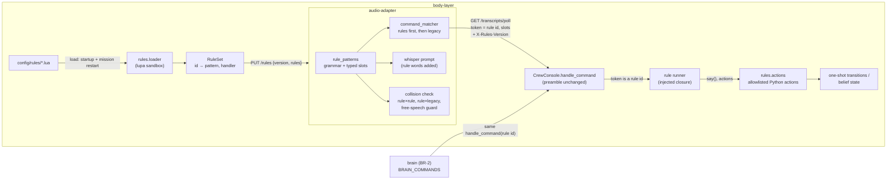

# BL-17 — Spoken commands as Lua rules: plan

Branch `feature/speech-rules`. Planned 2026-11-17 against tip `bc6622d1`. Inputs:
`body-layer/ROADMAP/BL-17.md` (including the three later relays), `plans/speech-rules/alignment.md`
(E1–E10), `plans/behaviour-trees/explore-notes.md` ("2026-11-17: speech commands as Lua rules",
rounds 1–3), `body-layer/ROADMAP/BL-B95.md`. Where a goal-check recommendation and a later user
answer differ, the answer wins: the first port is "turn left/right NN" on AI-overlay flight,
not "scan heading NNN" + "mark here".

### Goal

Every spoken command becomes a Lua rule: a fixed-wording pattern with typed slots, plus a handler
that calls exposed actions and writes its own readback. Matching, slot parsing and the actions stay
in code. This plan details stages 0–3: the engine and the bearing→heading rename, the "turn
left/right NN" port, and a test flight. The other ~80 commands are grouped and ordered, not detailed.

### How it fits together



### Decisions already taken by the user (also listed as U1–U16 below)

These came from **the explore** (rounds 1–3), **the goal-check answers**, or **three later
relays** from the main loop, all on 2026-11-17. The code decided none of them. Every one is a
numbered `U<n>` in the last section, so the ledger tracks it. Two **world facts** were settled by
the main loop, not the user: an offset mark sits at terrain elevation, and an offset is measured
from ownship position and heading at push-to-talk release. Both belong to the marks stage.

### Architecture decisions (this plan's own, with reasons)

- **D1 — Rule files load in body-layer, and their patterns are pushed to audio-adapter over HTTP.**
  Body-layer loads `config/rules/*.lua` with lupa, collects `(id, pattern)` pairs and sends them
  with a new `PUT /rules` (`{version, rules: [{id, pattern}]}`). Audio-adapter compiles the
  patterns, merges their words into the whisper prompt, checks for collisions, and answers
  `{version, accepted: [ids], rejected: [{id, reason}]}`. Handlers run only in body-layer.
  *Why:* this keeps the split that already exists. Normalisation, verb anchoring, fuzzy scoring and
  the whisper bias are recogniser facts, and they stay in the adapter (memory
  `project_voice_vocabulary_lives_in_audio_adapter`). Behaviour stays in body-layer. The seam stays
  HTTP/JSON (module independence), audio-adapter stays stdlib-only with no Lua, and the
  mission-restart reload (U11) needs no adapter restart because body-layer pushes again.
  *Rejected:* (a) moving matching into body-layer. That means 1,300 lines of matcher and the
  whisper-specific normalisation crossing a boundary, and the whisper prompt still has to live in
  the adapter. (b) A pattern file shared by both processes. That splits one rule across two files
  and adds file coupling between subprojects.
- **D2 — Re-push on version mismatch.** `version` is a hash of the sorted `(id, pattern)` set, so
  pushing the same set twice is harmless. Every `GET /transcripts/poll` response gains an
  `X-Rules-Version` header, absent until the first `PUT`. When it differs from the version
  body-layer last had accepted (an adapter restart, or a failed push), body-layer pushes again on
  that poll. The header leaves the row shape alone, so this is backward-compatible, and it rides
  the poll body-layer already makes, so there is no new timer.
- **D3 — A rule id is a command token, and a ported rule keeps its token's name and slot names.**
  "turn left/right NN" becomes rule `turn_heading_relative` with slots `direction` and `degrees`,
  exactly as today. That keeps the following unchanged: `--speech-log` rows, `join_voice_latency`,
  the confirm band, BR-2's `BRAIN_COMMANDS` allowlist, the command-map skill, and test cards.
- **D4 — Rules run inside `handle_command`, after its existing preamble.** The preamble covers the
  refusal mode, `_note_player_command`, the one-shot resets, the end of silence, the on-ground
  look gate and point supersession. Only the `elif token == …` dispatch branch is replaced. The
  runner is injected into `CrewConsole` as a closure from `body.py`, the same pattern as
  `speech_log_sink` and the mission-memory write. This avoids a `belief` ↔ `rules` import cycle.
  Anything that reads `DISPATCHED_COMMAND_TOKENS` (`crew_console.py:1110`, `:2596`, `:2861`, and
  the comment in `tool_api.py:724`) must accept *static tokens ∪ enabled rule ids*. A rule id that
  is no longer enabled, for example a transcript matched just before a reload, answers
  `render_unable("NO_SUCH_COMMAND")` and is never silent.
- **D5 — Actions are one allowlisted Python registry. The brain reaches it only through
  `handle_command`.** `body-layer/src/rules/actions.py` exposes named actions (one thing each,
  explicit params, result `{ok, reason?, …}`) and later named read-only params, per root
  `CLAUDE.md`'s "Behaviour as actions and params". The action bodies are extracted from today's
  handlers into `CrewConsole` or `belief/` functions, so Python and Lua call the same code. The
  brain does not get a second route: BR-2 already dispatches commands through `handle_command`
  (`BRAIN_COMMANDS` plus a planted `Mention`), and a ported command *is* a rule id, so a
  brain-carried command runs the same Lua handler and produces the same readback (E10, by
  construction, as BR-2's E3 was). Query params added later wrap the same `belief/tools.py`
  functions that `BRAIN_TOOLS` wraps, not new ones. *Departure, named:* `TOOL_SET`/`BRAIN_TOOLS`
  are not reused as the action registry. Their entries are brain-facing read-only queries
  returning `{facts, summary, phrasing_hints}` and `ToolObservation`, while rules need effects with
  small results. What the action registry does reuse is `BrainTool`'s shape: name, typed
  `ParamSpec`, an invoke over a body-bound context, and validation in Python of every value Lua
  passes in.
- **D6 — Failures (U10, U13).** Every failure is logged with `logger.error` to stderr. At startup
  and at each reload, one banner lists every failure, as effector sequences' D5 does. Petrovich
  says **"Action file error."** once per load, held until the SPU-8 intercom gate opens. This uses
  the `drain_config_error` shape: a new `action_file_error_pending` flag and
  `drain_action_file_error(now_sim, intercom_open=…)`. Unlike `CONFIG_ERROR_LINE`, the flag is
  **re-armed by every reload that has failures**, because a reload is the user's edit-and-retry
  loop (U11). Each failure is disabled at the finest grain that is honest:
  - a Lua syntax error, or an error while the file runs at load → that **file**'s rules are
    discarded (each file loads in its own environment table, so the other files are untouched);
  - a bad `when.speech` call, a pattern the adapter rejects (bad grammar or unknown slot type), or
    a duplicate rule id → that **rule** (for a duplicate id, every rule carrying it);
  - two rules claiming the same wording → **both** disabled (U10);
  - a rule that collides with a legacy phrase, or turns free speech into a command → that **rule**.
  - **A Lua error at dispatch time** → that command's reply is "Action file error." in place of
    the readback. The error and its traceback are logged, and every one-shot transition field set
    during this dispatch is cleared, so the action does not happen without the pilot hearing about
    it (E7). Actions that write immediately, such as a mark append, cannot be rolled back. They are
    marked `immediate` in the registry, and the marks stage must order them last in their rule.
- **D7 — Pattern grammar v1 and typed slots, designed now for the marks group.** Pattern elements:
  - a literal word;
  - `[ … ]`, an optional group that may contain literals *and* slots (needed for
    `[from <origin:origin>]`);
  - `<name:type>`, a slot of a type defined in code;
  - `<name:w1|w2>`, a word-set slot whose value is the word heard.

  The adapter strips punctuation and commas before matching ("set mark, from waypoint 1, …").
  Every slot type is a parser in the adapter that consumes words from the transcript. If it fails,
  the rule did not match. Slot values cross the wire as JSON: a scalar for a simple type, and an
  **object tagged `kind`** for a union type, so a union arrives in Lua as a table. Types:

  | type | spoken | value | stage |
  |---|---|---|---|
  | `angle` | 1–3 digits, digit by digit or whole ("two zero", "20") | int 1–359 | 1 |
  | `heading` | `heading` + exactly 3 digits | int 0–359 | 1 (rename) |
  | `bearing` | `bearing` + exactly 3 digits | int 0–359 | 1 (rename) |
  | `oclock` | 1–12 + `o'clock` | int hour | 1 |
  | word-set | one of the listed words | str | 1 |
  | `direction` (union) | heading NNN \| bearing NNN \| N o'clock \| compass word (`SECTOR_WORD_DEGREES`) | `{kind, deg}` / `{kind:"oclock", hour}` | marks |
  | `distance` | number (decimals: "three point five") + `km`/`kilometers`/`meters` | `{km}` | marks |
  | `origin` | `waypoint N` \| `mark N` (absent = ownship) | `{kind, n}` | marks |
  | `place` | feature-kind word + `at` + N o'clock | `{feature_kind, hour}` | marks |

  The type word anchors where each number starts and stops. That is what keeps "mark two three
  kilometers" unambiguous (explore round 1): heading and bearing take exactly three digits, and
  `o'clock` closes its number. **Choosing a unit or a place is never the adapter's job.** `place`
  only parses the words. Body-layer resolves the nearest matching map feature (U16), and a
  target-choice action returns one unit or `nil` (U5).
- **D8 — How rule matching sits in `match_transcript`.** Rule matching runs after the wake-word
  check and the HVRT bare words, and before the legacy slotted branches. The first literal of
  every active rule joins the verb-anchor set (`VERB_ANCHOR_WORDS` becomes legacy ∪ active rules).
  The literals are scored with the existing word-sequence scorer `_phrase_match_ratio`, with the
  slot spans taken out. The existing floors are reused: `VERB_FLOOR`, `MATCH_FLOOR`,
  `SEPARATION_MIN`, `_WORD_REPAIR_FLOOR`. Two rules scoring within `SEPARATION_MIN` set
  `ambiguous=True`, and the existing body-side disposition applies (E3). The compiled rule table is
  an immutable object swapped in with one assignment, because `ThreadingHTTPServer` can run
  `PUT /rules` and `/transcribe` at the same time.

  > **As built, 2026-11-17 (Stages 1b–2):** rule literals are **not** fuzzy-scored. Matching is
  > full-consumption, exact-literal (`audio-adapter/src/rule_patterns.py`), after the existing
  > filler/punctuation stripping — a scope-down disclosed in `implementation.md`, judged acceptable
  > for the one ported rule in `review-stage1b-2.md` ("Turn left, 30." still matches; "turn left
  > thirty" falls to "say again", as the legacy handler did). Revisit before Stage 4+ ports
  > longer literal phrasing, where the fuzzy scorer's tolerance matters more.
  >
  > **User decision, same day:** *"near-miss wording should still match -> yes. STT is imperfect,
  > we'll need some fuzzy matching."* Fuzzy rule matching is required, before or with the next
  > porting stage (`body-layer/ROADMAP/BL-17.md`, "Near-miss wording must still match").
- **D9 — The collision check, run by the adapter at `PUT` time, before anything is accepted.**
  1. Rule × rule: each rule's generated sample utterances (one per optional branch, slots filled
     with sample values from each type) are run against every other rule. A hit disables both.
  2. Rule × legacy: rule samples are run through the legacy matcher, and legacy `PHRASES` through
     the rule matcher. A hit at or above `MATCH_FLOOR` disables the rule.
  3. Free-speech guard: a fixed list of ordinary sentences that must stay non-commands
     ("the tanks are on the ridge", and the other pinned adversarial sentences in
     `test_command_matcher.py`, moved into one `vocabulary.FREE_SPEECH_GUARD` tuple that both the
     tests and the check read). If adding a rule makes any of them verb-anchored or matched,
     that rule is disabled.

  This turns the "attack"/"tanks" lesson (`vocabulary.py:645`; memory
  `feedback_new_verb_synonym_can_silently_widen_anchor_set`) into a load-time check instead of
  something a failing test discovers. It cannot catch a near-miss that only a real transcript
  produces. That case gets the runtime ambiguity answer (E3/E6), as alignment Finding 5 expected.
- **D10 — The whisper prompt becomes dynamic.** `WhisperCliEngine` takes a prompt provider instead
  of a fixed string. The adapter rebuilds the prompt from the legacy words plus the active rule
  words on every accepted `PUT`. The 224-token cap stays a test for the shipped vocabulary. At
  runtime, a set of user rules that exceeds the cap logs a warning (whisper drops the front of the
  prompt) and is not spoken. This is risk R3.
- **D11 — `--print-rules`**, in the shape of `--print-tuning`: it loads the rules standalone and
  prints every id, pattern and failure. With `--audio-adapter-url` it also pushes the rules and
  prints the adapter's verdict. This is how the pilot checks an edit without flying (E2/E5).
- **D12 — "Scan/report bearing NNN" becomes relative now, in Stage 1a, not when scan/report are
  ported.** The user accepted it as relative (U9). Leaving it unbuilt until Stage 6 would mean
  weeks of "say again" for a phrase the pilot uses out of habit. It runs on machinery that already
  exists. The relative bearing is rounded to the nearest clock hour, following the user's
  2026-09-23 *"o'clock direction is enough"*, and drives the existing `relative_clock_hour` scan or
  the `report_clock_N` report. Hours 5–7, which are behind the aircraft and outside
  `FORWARD_CLOCK_POSITIONS`, answer "unable" with a reason meaning "behind us". Grep
  `render_unable`'s catalogue first, and add a reason only if none fits (E7). The readback is
  plain, as U9 says: "Scanning bearing three two zero." The confirm text is
  "scan bearing three two zero, confirm?". The compass forms keep Decision 3's rule from
  `plans/voice-command-completeness/plan.md`: the confirm text names the rounded sector.

### Revision 2, 2026-11-17 — matching foundation, dispatch gates, flight-control port

Re-planned per the checkpoint after Stage 3 (`BL-17.md`): Stages 0–3 are merged; this revision
plans the next stages, starting with the flight-control commands as the user asked. Inputs: the
"Settled after the goal check"/"Near-miss wording"/"Number words count"/"Performance items"/
"Expected vocabulary"/"Answers to the second goal check" sections of `BL-17.md` (all 2026-11-17),
`alignment.md`'s second goal check (E11–E18), `BL-16.md`'s P2a/P2b merge, `BL-B123`/`BL-B117`/
`BL-B122`, and two mid-task course corrections from the coordinator (below, D16 and D20). Stage
numbers 3a/3b/3c/3d/4 are new; 4 was already reserved by the provisional later-stages table below,
which is now superseded for row 4 only (see that table's note).

**Mid-task correction 1 (coordinator, 2026-11-17), replacing this revision's original D16 draft
("each flight action checks the flying state itself")**: the gate is per **rule category**, run
once before any matched rule in that category executes — never a check repeated inside every
action. Verbatim: *"All the flight command category (or any other category) rules, before getting
executed, must pass the gate. In flight control case, Petrovich must have controls, otherwise it's
unable before any rule even executes. Likewise, copilot rule cannot execute when Petrovich is in
pilot seat and vice versa."* D16 below is written to this correction, not the original draft.

**Mid-task correction 2 (coordinator, 2026-11-17), adding D20**: *"effector sequences will
eventually move to lua rules. To that end, we must build support for writing effectors via rules
from the start."* The user is recording both corrections in `body-layer/ROADMAP/BL-17.md` on the
feature branch directly — not repeated verbatim here beyond what each decision below needs.

- **D13 — Fuzzy tolerance on a rule's own literal words; slot values stay exact.** Extends D8
  (Stage 1b/2's own documented scope-down, flagged by Reviewer and Security as needing revisit
  "before Stage 4+ ports longer literal phrasing"). `rule_patterns.match_pattern` keeps its
  existing full-consumption, positional walk over a rule's elements — that structure already
  solves what `_phrase_match_ratio`'s word-*sequence* alignment exists for (recovering from
  inserted/deleted/reordered words), because filler/punctuation stripping already runs upstream
  and a rule's own elements are already positional. What changes: a `LiteralElement` at position
  *i* now accepts the heard word at *i* either on exact equality (as today) or when
  `difflib.SequenceMatcher(None, heard, literal.word).ratio() >= _WORD_REPAIR_FLOOR` — **the exact
  same floor constant the legacy matcher's own per-word repair already uses**, imported from
  `command_matcher.py`, not a second hand-tuned number. A `SlotElement`/`WordSetElement` never gets
  this fallback: its own typed `consume` either succeeds exactly or the rule does not match at that
  position — this is what keeps E12 true ("fuzziness forgives the words, never the values") by
  construction, the same way D8 always intended, not a new rule.
  *Departure, named:* this reuses `_WORD_REPAIR_FLOOR`'s own per-word ratio check, not
  `_phrase_match_ratio`'s whole opcode-alignment algorithm — rule matching has no
  insertion/deletion/reordering case to solve (full-consumption already handles that), so only the
  *repair* half of the legacy scorer is the part that transfers.
  *Ratio and the tie-break (E3 preserved).* A rule match's own ratio is no longer always `1.0` —
  it is the mean of each literal position's ratio (`1.0` for an exact hit). Two rule matches (or a
  rule match and a legacy match) within `SEPARATION_MIN` of each other — **the same constant**,
  not a new one — are `ambiguous=True`, exactly the existing disposition for a legacy near-tie
  (E3). A single rule match at or above `MATCH_FLOOR`/`VERB_FLOOR` is unambiguous as before.
  *Collision check (D9), widened.* Looser literal matching raises clash risk, so `compile_rules`'s
  rule×rule and rule×legacy passes now also probe **one perturbed sample per rule** alongside the
  exact sample `generate_samples` already produces — one literal word replaced by a word scoring
  inside `[_WORD_REPAIR_FLOOR, 1.0)` against it (drawn from a small fixed adversarial list the way
  `FREE_SPEECH_GUARD` is a fixed list, not generated), so a rule that only collides *after* fuzzy
  tolerance is applied is caught at load time rather than first appearing as a live "say again"
  gone wrong. If no word in the adversarial list scores in that band against a given literal, the
  perturbed probe is skipped for that word (no collision risk to find).
- **D14 — Number-word slot types; `heading`/`angle`/`oclock` unchanged.** Two new slot types in
  `rule_patterns.SLOT_TYPES`:
  - **`quantity`** — accepts `_consume_digit_run` exactly as today (digit-by-digit or a whole
    numeral, any digit count 1–4) **or** a composed English number word/phrase: units
    (zero–nine), teens (ten–nineteen), tens (twenty…ninety, optionally + a unit — "twenty two"),
    and hundreds (a units/teens/tens word + "hundred" + an optional units/teens/tens — "three
    hundred", "three hundred twenty", "one hundred fifty three"). The grammar is written to
    *terminate* at the first complete number — it never concatenates two independent number
    words — so a paired form like "three fifteen" parses only as far as "three" (a complete
    unit, 3) and then stops; the following "fifteen" is left unconsumed, which (full-consumption
    matching) makes the whole rule fail to match rather than silently resolving to 315 or 15. This
    is what Q10 asks for ("not combinations of three fifteen and like") **falling out of a
    correctly terminating grammar**, not a separate reject rule. "Thousand" composition is
    out of scope this stage — a value past 999 is still reachable digit-by-digit
    ("two zero zero zero"), which already works; flagged (not built) if a flight actually needs a
    four-digit *natural* phrase.
  - **`speed_target`** — a union slot (the same `{kind, ...}` tagged-table convention D7 already
    plans for the marks stage's `direction`/`origin` types, pulled forward one stage early): the
    literal word "max" (`{"kind": "max"}`), or else `quantity`'s own grammar (`{"kind": "number",
    "value": N}`). This is what lets "speed max" and "speed two hundred" share one pattern slot
    rather than two separately-registered rules for the same command.
  - `heading`, `angle`, `oclock` are **not** touched — BL-17.md is explicit that number words do
    not change `heading`'s three-digit rule, and nothing in the goal check asks for natural words
    on a clock position or a relative angle either.

  > **Corrected 2026-11-17 by the main loop, from the plan check (`alignment.md`, "Plan check —
  > Revision 2", Finding 1):** the last bullet is wrong for `angle`. The user's own example for
  > wanting number words is a relative angle — *""turn left thirty" -> yes, I'd actually say that"*
  > (BL-17.md, "Number words count") — and Stage 3a's tests and Stage 4's card both expect it to
  > work. So **`angle` gains `quantity`'s number-word grammar**, same terminating parser (paired forms
  > still fail), with `angle`'s existing range check kept. `heading` (exactly three digits) and
  > `oclock` stay untouched.
- **D15 — The two performance fixes**, exactly as the Performance Reviewer's own suggestions
  (`performance-stage0-2.md`, both filed MONITOR, now taken since Stage 4 is where rule count
  starts actually growing):
  1. `_rule_anchor_words(rules)` and the rules tuple's sorted-by-id order are computed once, at
     the point `RuleRegistry`'s compiled rules are swapped in (the one assignment D8 already
     requires), not recomputed per transcript in `_match_rules`/`match_transcript`.
  2. The static legacy-vocabulary word list `to_prompt()` walks is built once (it never changes at
     runtime); only the rule-word tail is re-derived, keyed on `RuleRegistry.version` (which
     already changes exactly when the answer should).

  Neither is a behaviour change — both are pinned by the existing matcher/prompt test suites
  passing with identical outputs before and after.
- **D16 — Rule categories and dispatch gates** (coordinator correction, above). A matched rule's
  category decides, **before its Lua handler ever runs**, whether it may execute at all — this is
  the "when" (precondition), kept apart from the actions exactly as root `CLAUDE.md`'s "Behaviour
  as actions and params" already asks, generalising the project's existing ad hoc precedent (the
  on-ground look gate already in `handle_command`'s preamble, D4) into a declared, reusable
  mechanism for rules.

  **One shared state type, read by both the gate and the speech-to-text hint (D17), per the
  coordinator's own instruction** — `body-layer/src/belief/crew_state.py`, `CrewState` (frozen
  dataclass): `has_controls: bool` (`ParkedFlightState.parked_active`), `settling: bool`
  (`has_controls and held_heading is None` — the takeover-settle window, the same proxy every
  flight handler already checks today, promoted to one place [**corrected below**]), `seat: Literal["pilot",
  "copilot"]` (today always `"copilot"` — `[[BL-B123]]` is unbuilt, so this field is a named stub,
  not a guess: it exists so a gate can read it once BL-B123 lands, and today's gates that would
  depend on it simply never see anything but `"copilot"`), `hands_free: bool`/`eyes_free: bool`
  (also stubs pending `[[BL-B123]]`'s hands/eyes-busy model for the optic side; `has_controls`
  already implies `hands_free=False` for the flying case, which is all this batch needs).
  `CrewConsole.current_crew_state()` computes it fresh each poll from fields already read
  (`parked_flight_state`), never a second source of truth.

  > **Corrected 2026-11-17 (`review-stage3b.md`, Required Fix 1):** "the same proxy every flight
  > handler already checks" is false. Only `turn_heading_relative` checks `held_heading`;
  > `_handle_speed_step` checks `held_speed`, `_handle_altitude_step`/`_handle_hold_altitude`
  > check `held_altitude`, `_handle_level_flight` checks all three, and the absolute-set handlers
  > check nothing. **Stage 4 must not delete those per-handler checks on the strength of the shared
  > gate.** Either the gate's settle test becomes per-parameter (the rule declares which `held_*`
  > it needs) or each action keeps its own readiness check and maps it to HOLD; Stage 4's
  > implementer picks one and records it. A `None` must never reach the arithmetic.

  **`GateOutcome`** (`body-layer/src/rules/gates.py`) is one of three verdicts, not two:
  - `PASS` — run the handler now.
  - `HOLD(reason)` — do not run the handler yet, and do not refuse either; retry on a later poll
    (below).
  - `UNABLE(reason)` — run the handler. **Not required** — the rule never runs; its own
    closed-vocabulary `reason` token is spoken via `render_unable` immediately, same shape every
    other "unable" already has.

  **`GATE_REGISTRY: dict[str, GateFn]`**, closed, in `gates.py`. This batch declares two:
  - `"always"` — a trivial `PASS` regardless of `CrewState` (queries, describe, recall, the
    "you/I have controls" no-op — none of these are gated by seat or state, per BL-17.md's
    "always expected" layer).
  - `"flight_control"` — `UNABLE("NOT_FLYING")` if `not has_controls`; `HOLD("NOT_READY")` if
    `settling`; `PASS` otherwise. This is the coarse, category-wide precondition only ("has
    controls at all"). A *finer* per-rule precondition — HVRT's own "is the AI actually in
    HVR/HVRT mode" check — stays where it already is, inside the action/handler, because it is not
    a property of the whole category, it is specific to the HVRT sub-family; the coordinator's own
    "actions may still validate their own arguments" extends naturally to "and their own narrower
    state preconditions" (D5 already allows an action to return `{ok: false, reason: ...}`).

  Further categories (`"copilot_sight"`/9K113, a pilot-seat-tools category, a naked-eye/hands-busy
  category for scan/binoculars) are declared when those rule groups are ported (Stage 5/6+ in the
  table below), each with its own gate function in the same registry — not stubbed in now for
  commands that do not exist yet. Any category depending on `seat` reads today's always-`"copilot"`
  stub until `[[BL-B123]]` lands; that dependency is named here so it is not silently assumed away
  later.

  **Lua declaration, a signature change to `when.speech`**: `when.speech(id, pattern, category,
  handler)` — `category` a plain string, required (a missing or unrecognised category is a bad
  `when.speech` call, D6's existing finest-grain-honest handling: that one rule is disabled, not
  the file). Chosen over a file-level `category(...)` declaration (rejected: order-dependent —
  a rule registered before the file's own category call would silently take no category or the
  wrong one — and invisible at a glance per rule when a file ever needs to mix categories) and
  over a trailing options table (rejected: adds a second shape for one required field with nothing
  else in it yet). This is a breaking change to the one already-shipped rule
  (`turn_heading_relative` in `config/rules/flight.lua`) — it is migrated to `category="flight_control"`
  in this same stage, and `config/rules/README.md`'s API reference is updated. **U19.**

  **Dispatch wiring.** `CrewConsole._handle_rule` (D4) now: looks up the matched rule's category →
  `gates.check_gate(category, self.current_crew_state())` → on `PASS`, calls
  `self.rule_runner(token, slots)` exactly as today; on `UNABLE`, speaks `render_unable(reason)`
  and never calls the runner; on `HOLD`, sets a new one-shot field, `pending_rule_dispatch =
  PendingRuleDispatch(rule_id=token, slots=slots, category=category, held_since_sim=now_sim)`, and
  speaks nothing yet (Co-moving Fields table below).

  **Hold-and-retry (`BL-17.md`'s "hold and fly when ready", the takeover-settle vignette).**
  `drain_pending_rule_dispatch(now_sim)`, called once per poll from `body.py` beside
  `drain_ai_pilot_wheel_speech` (same spot, after `advance_parked_flight_state` has refreshed
  `parked_flight_state` this poll): re-runs `gates.check_gate` on the held category against the
  *current* `CrewState`. `PASS` → run the handler now and speak its lines (the command happens
  exactly as if it had been said at this later moment — not narrated as delayed, matching this
  project's existing "never narrate settlement" posture). Still `HOLD` and
  `now_sim - held_since_sim < RULE_GATE_HOLD_TIMEOUT_S` → do nothing, wait for the next poll.
  `UNABLE` (the player unparked while holding) or the timeout elapsed while still `HOLD` → speak
  `render_unable(reason)` once and clear the field. **A new command matched while one is already
  held replaces it — latest wins, the earlier hold is silently dropped**, the same convention
  `AiPilotGoalRequest`/E-P4 already use for an outstanding flight goal; not escalated, since this
  is the same precedent applied one level up (**U21** records it anyway, since it is a real,
  if narrow, behaviour choice).

  **`RULE_GATE_HOLD_TIMEOUT_S`** — a new behaviour-affecting constant (how long Petrovich holds an
  understood-but-not-yet-actionable command before giving up and saying "unable"), declared through
  `tuning.py` per root `CLAUDE.md`'s standing rule. Default and bounds: **U20**.

  **`increment_ai_heading`'s own `current is None` check becomes dead code once the gate is wired
  ahead of it, and is removed in this stage** (its action is now only ever called after
  `flight_control`'s gate has already confirmed `held_heading is not None`) — simplicity heuristic
  #2, and leaving an unreachable branch in place would read as a second source of truth for the
  same precondition the gate now owns.

  **Scope boundary, stated plainly**: this mechanism governs **rules only**. The existing ad hoc
  on-ground look gate in `handle_command`'s legacy preamble is unchanged — it is naturally
  subsumed once "look"/scan commands themselves become rules (Stage 6), at which point a
  `"naked_eye_scan"` category's gate absorbs it as that port's own work, not retrofitted here.
- **D17 — State-dependent speech-to-text hint**, built on D16's `CrewState`/category, measured
  before it ships (BL-17.md's own condition). A new endpoint, `PUT /crew_state`
  (`{"active_categories": [str, ...], "priority_category": str | null}`), pushed by body-layer only
  when `CrewState`'s category-relevant projection changes (not every poll) — **deliberately
  separate from `PUT /rules`**, so a state flip (several times a sortie) never re-runs D9's O(n²)
  collision check, which only needs to run when the *rule set* changes (a reload). The adapter
  stores the pushed state in a small holder the prompt provider reads; absent (no push yet, or an
  adapter restart) behaves exactly as today — the full, unnarrowed prompt, the same "additive,
  true no-op when absent" posture every other optional collaborator in this project has.
  `PUT /rules`'s own per-rule dict additionally carries `category` (needed here, not for the
  gate — gating is body-layer-only and never crosses the wire) so the adapter knows which rule's
  words belong to which category for ordering.

  **What narrowing changes, per the goal check's own resolution of Q7/Q8/Q11:**
  - In-state words (the active categories' own rule/legacy words) are included; out-of-state words
    are **never removed outright** in the shipped design — narrowing means *reordering*
    (in-state first, matching E11), not deletion, **unless the measurement (below) shows removal
    is actually safe** on the user's own corpus. This is the conservative default the goal check's
    Finding 3 asked for: a removed word cannot be heard at all, which is worse than being heard
    late.
  - The priority category's words (while flying: `flight_control`) are placed first in the
    reordered prompt — "flight words go first in the hint" (Q11).
  - Scan (naked-eye) words stay in the active set while flying (Q8's "yes" — `BL-B123`'s "no optic
    at all" does not cover the naked eye, alignment Finding resolved this already); only
    hands-requiring tools (binoculars, 9K113) would be narrowed out while flying, and neither is a
    rule yet (Stage 6+), so this batch's own narrowing set is just `{flight_control, always}` while
    flying, `{always, <whatever is ported so far>}` otherwise — a small, honest set given how
    little is ported.
  - An unclear transmission is **never** resolved toward a flight command by a tie-break — the
    hint can make flight words easier to *hear correctly*, but matching's own `SEPARATION_MIN`
    disposition (D13) is untouched; "say again" still wins a genuine near-tie (Q11's second half).

  **Measured before it ships** (the goal check's Finding 3, Q13): `stt_bench.py` run on a short
  corpus of the number forms and phrases D14/Stage 4 introduce, recorded by the user via
  `record_corpus.py` (the exact list is Stage 3c's own deliverable, below), comparing three
  prompt variants — today's full prompt (baseline), "in-state words first, nothing removed," and
  "out-of-state words removed." The column that decides is **unsafe errors** (a command recognised
  as a *different* command) and **out-of-state answers losing their "unable, &lt;reason&gt;"**
  (recognised as "say again" instead) — not raw accuracy, per the alignment finding and this
  project's own performance-reviewer convention that a *measured* number is what settles a sizing
  question. **Ship threshold: U23.**
- **D18 — Flight-control port (Stage 4).** `turn_heading`, `level_flight`, `set_speed`,
  `set_altitude`, `hold_altitude`, `level_off`, `altitude_step`, `speed_step`, the HVRT bare words,
  and "you/I have controls" all become rules in `config/rules/flight.lua`, category
  `"flight_control"` except "you/I have controls" (category `"always"`, a handler that calls
  nothing and says nothing — Q7's own answer). Every flight handler's own `held_* is None ->
  NOT_READY` check is **removed** — D16's gate now owns that precondition for the whole category,
  including the already-ported `turn_heading_relative`. The one exception: HVRT's
  `_ai_pilot_hvrt_ready()` (ai_mode in `HVR`/`HVRT`) stays as the action's own finer check, per D16.
  Readback text is **unchanged** from BL-16 P2 (E18) — only the refusal path moves, from a generic
  "Unable, not ready" to the gate's "unable, not flying" (immediate, permanent-until-handover) or
  the held-and-retried path (transient, during takeover settle). `"NOT_FLYING"`/`"HANDS_BUSY"` join
  `_UNABLE_TEMPLATES` (speech.py) as new closed reasons (Q9); `"PILOT_SEAT"` is **not** added yet —
  it names a seat distinction `[[BL-B123]]` has not built, and adding the string now with nothing
  that can ever select it would be a reason nobody can reach.

  **Differential tests before deletion**, the same shape Stage 2 used: for each of the seven
  commands above, the pre-rules handler's own behaviour (every branch, every edge — a wrap past
  0/360 for heading, the speed-max sentinel, the altitude reference-resolution cases, the HVRT
  hover precondition) is pinned in a test *before* the legacy branch is deleted, then the ported
  rule is asserted to reproduce it exactly, loading the **real** shipped `flight.lua`.
- **D19 — "Priority while flying" (Q11), a mechanism proposal, not yet built.** The goal check's
  own words: *"what it changes in code... is the architect's to propose and the user's to
  confirm."* Flight-rule readbacks already go out immediately today — `handle_command`'s dispatch
  returns a handler's lines directly, and flight tokens are not among the commands
  `_speak_or_defer` defers behind `CalloutScheduler.busy_until_sim` — so the "never queued behind"
  half of Q11 is already true by construction for anything issued *after* a flight readback. What
  is not yet true: a flight readback issued while a **routine callout is already in flight**
  (queued ahead of it in `SpeechWorker`'s FIFO) would still play after that callout finishes,
  because nothing today reorders the queue for it. **Proposal: route a `flight_control`-category
  rule's own readback through `CalloutScheduler.note_urgent`** — the same mechanism
  `!inject-urgent`'s test harness already exercises (`AudioPlaybackSender.interrupt`, which stops
  in-flight playback and resets `busy_until_sim` to the new line's own duration) — rather than
  building a second "skip the queue without killing what's playing" mechanism that does not exist
  today. *Why reuse rather than build new:* "do not reinvent the wheel" — this is exactly the
  already-built, already-tested "this must be heard now" path, and a flight readback silenced
  mid-callout for a couple of seconds is a real cost (the pilot steering by voice gets a late
  answer) that an in-progress contact callout, which will be repeated in essence by the next scan
  cycle, is not. **This is a real behaviour change (a flight readback can now cut off an in-flight
  routine callout mid-sentence) and is not built without confirmation: U22.**
- **D20 — The effector-write action surface** (coordinator correction, 2026-11-17, verbatim:
  *"effector sequences will eventually move to lua rules. To that end, we must build support for
  writing effectors via rules from the start... not a second write path"*). Built now, as
  foundation, in Stage 3d below — **no sequence file is migrated and no shipped rule calls this
  yet**; the point is that the mechanism exists before Stage 5 (`crew.lua`/`weapons.lua`,
  `observ_on/off`/`weapons_armed/safe`) needs it, so that stage ports onto an already-proven path
  rather than inventing one under schedule pressure.

  **Not a second write path: the engine is extended, not duplicated.** Today, `effector_engine.
  advance` processes only trigger-fired `SequenceFile` rows (`EffectorRunState.runs`, keyed by
  `EffectorTrigger`); the actual per-row execution (condition check → the implicit self-check →
  the `absolute_write` gate → `client.write_cockpit_switch` → `assumed_writes`/`commanded_values`
  update → the row's own `petrovich-says` line into `spoken`) is one contiguous block inside
  `advance`'s per-row loop (`effector_engine.py` lines ~399–497). This block is **extracted into
  its own function**, `_execute_switch_row` (same module), taking exactly the state
  (`effector_def`, the row's `value`/`condition`, the current `cursor`/`assumed_writes`/
  `failed_effectors`, `now_sim`, `client`) and returning what it already computes today (the next
  cursor, updated `assumed_writes`/`commanded_values`, and an optional spoken line) — `advance`'s
  sequence-row loop calls it exactly as before, now through the named function instead of inline.
  A **second, new kind of run**, `EffectorRunState.ad_hoc_runs: Mapping[str,
  _AdHocEffectorCursor]` (keyed by a request id the rule dispatch mints, not an `EffectorTrigger`
  — there is no sequence file or trigger behind one), holds a single target `(effector, value,
  says)` plus the same `_RunCursor`-shaped read/write progress a sequence row already carries.
  `advance` gains one more pass, after the trigger-run loop, that walks `ad_hoc_runs` and calls
  the **same** `_execute_switch_row` for each — sharing `assumed_writes`/`failed_effectors`/
  `spoken`/`commanded_values` with the trigger-run pass in the same call, so a rule-originated
  write and a sequence-row write to the same effector in the same poll still respect the existing
  same-poll collision rule (D9's "a write to this same effector already failed this poll... hold
  and retry next poll"). `body.py`'s existing single call site for `advance()` needs no change —
  the new pass rides inside it.

  **How a rule calls an effector write** — `rules/actions.py` gains a new namespace,
  `ACTION_NAMESPACES["effector"]`, one action: `effector.write(name, value, says)`. This needs
  `ActionParam` widened beyond its current "always a bounded integer" shape (its own docstring
  already anticipates this: "widen this... when a later action needs a different kind") to admit
  a **string parameter validated against a vocabulary**: `name` checked against the loaded
  aircraft's curated `effectors.toml` keys, `value` checked against *that* effector's own legal
  value names (the same `EffectorDef.values` mapping the engine itself reads), `says` a free-text,
  length-capped string (the same cap `say()` already enforces) or absent. An unknown effector or
  illegal value name is a **synchronous** validation failure — `{"ok": false, "reason":
  "UNKNOWN_EFFECTOR"}` — resolved in Python before the engine is ever touched, the same "validate
  every value Lua passes in" posture D5 already states.
  `_write_effector`'s own body does not call `effector_engine`/`effector_registry` directly — it
  calls a closure injected into `ActionContext` at construction (`request_effector_write:
  Callable[[str, str, str | None], dict[str, object]]`, built in `body.py` the same way
  `speech_log_sink`/`rule_runner` are already injected), which validates against the live registry
  and, on success, mints a request id and calls a new `effector_engine.request_write(state,
  request_id, name, value, says, now_sim) -> EffectorRunState` (mirrors `fire_trigger`'s own
  "start if idle" shape) against `body.py`'s own runner-owned `EffectorRunState`. This keeps
  `rules/` from needing a new import edge into `belief.effector_engine`/`effector_registry`
  specifically for this one piece of mutable, poll-owned state — the same reason `crew_console.py`
  avoids importing `rules.*` directly (D4).

  **Reporting running/succeeded/failed.** The *synchronous* action result is only ever "queued"
  (validated, enqueued) or a validation failure — the physical write's own outcome is not known at
  dispatch time, because it is multi-poll (a read, then a write, potentially spanning several
  polls under `EFFECTOR_CONDITION_READBACK_WAIT_S`/retry). So the rule's own Lua handler, on
  "queued," **says nothing** — the same silent-on-dispatch convention the four existing
  observ/weapons handlers already follow ("the sequence files' text is the only source" of the
  eventual confirmation, `body-layer/CLAUDE.md`). The eventual spoken confirmation is the `says`
  text the rule supplied at call time, carried on the ad hoc run and appended to
  `EffectorRunState.spoken` on completion — **the same `spoken`/`drain_effector_speech` pipe every
  sequence row already uses**, not a new speech path; `says` simply replaces a markdown row's
  `petrovich-says` cell as the source of that text. A genuine downstream failure (no readback
  within the wait window, or `write_cockpit_switch` raising) inherits the engine's **existing**
  posture exactly: no line is spoken, and the run retries indefinitely next poll — **this is a
  real tension with the rule engine's own "always say something" culture (D6's "Action file
  error." on a Lua error) that this stage does not resolve, only inherits; flagged as U24** rather
  than silently building a second failure-speech convention or silently leaving the pilot with no
  eventual answer. Each `_AdHocEffectorCursor` also carries a `status` field
  (`"pending"`/`"succeeded"`/`"failed_write"`/`"failed_no_readback"`) purely for introspection
  (e.g. a future `--print-rules`-style debug dump) — nothing reads it yet, since nothing beyond
  speech needs to today.

  **Category gates (the coordinator's own example — "copilot-only switches gated by seat") need no
  new mechanism.** A rule that calls `effector.write` declares its own category exactly like any
  other rule (D16) — e.g. a 9K113-switch-writing rule declares `"copilot_sight"`, whose gate is
  (today, pending `[[BL-B123]]`) the same trivial-pass stub D16 already names for that category.
  The effector registry itself stays seat-agnostic — which seat may touch a given switch is a
  property of the **rule's** declared category, never of the effector definition, keeping
  `effectors.toml`'s own format unchanged.

  **D6 rollback does not apply here, and should not.** D6's one-shot-transition rollback fires on
  a Lua error *during this dispatch*; an ad hoc effector write that later fails is not a dispatch-
  time error (dispatch already returned "queued" cleanly), and the write itself sets no
  `CrewConsole` one-shot field for anything to roll back — the two mechanisms are deliberately
  unrelated, stated here so a later reader does not look for a connection that was never intended.

  **Event triggers, mentioned as asked, not built.** The coordinator's own three new triggers
  (`attack-run-start`, `attack-run-start-missiles`, `attack-run-stop`, landing on a separate
  branch) extend `belief.effector_sequences.EffectorTrigger`/`TRIGGER_INFO` — the project's **one**
  declared trigger vocabulary. When BL-B95 eventually builds a `when.trigger(trigger_name,
  handler)` rule kind (named already in this plan's original "Second-order effect," below), it
  should dispatch on this same enum rather than a second trigger taxonomy — this falls out of
  `EffectorTrigger` already being the one place a "when" of this shape is named in the codebase,
  not something this stage needs to build. Not planned further here, per the coordinator's own
  instruction.

  **Migration, named only, not planned**: see the later-stages table's new row 11.

### Second-order effect (revision 2)

The category-gate mechanism (D16) is the first *generic* "when" layer this project's rule engine
has had — every later rule group (scan/report, watch/target, marks) inherits it rather than
inventing its own precondition shape, and `[[BL-B123]]`'s seat distinction, whenever it lands, is
a new category plus a new `CrewState` field rather than a new mechanism. `CrewState` is also the
first state type explicitly shared between a dispatch-time check and a recognition-time hint —
BL-B95's eventual `when.trigger(...)` interrupts will likely want the same state, so this is worth
keeping as one well-known type rather than letting a second ad hoc reader of `ParkedFlightState`
appear later. **D20's effector-write surface means the rule engine now reaches every write
mechanism this project has** (flight goals, and now cockpit switches) through one allowlisted
registry each — `[[BL-B90]]`'s effector sequences and `[[BL-17]]`'s rules were built independently
and now share one execution primitive (`_execute_switch_row`) rather than converging only at the
DCS wire; this is what makes the later-stages table's row 11 (sequence files becoming rules) a
rewrite of *how a row is declared*, not a rewrite of *how a row runs*.

### Co-moving Fields (revision 2)

Step 6a's trigger, applied to the new cross-process and cross-poll state this revision adds.

| Field | Written by | Transition | Must hold true after |
|---|---|---|---|
| `CrewState` (`has_controls`/`settling`/`seat`/...) | internal (`current_crew_state()`, every poll) | `parked_flight_state` refreshed this poll | both the gate check (`_handle_rule`/`drain_pending_rule_dispatch`) and the decision to push `PUT /crew_state` read the **same** computed value this poll — never two independent reads of `parked_flight_state` that could disagree within one poll |
| `pending_rule_dispatch` | internal (`_handle_rule`, on `HOLD`) | a flight-category rule matched while `settling` | set once; nothing spoken yet |
| `pending_rule_dispatch` | internal (`drain_pending_rule_dispatch`) | gate re-check: `PASS` | handler runs, lines spoken, field cleared |
| `pending_rule_dispatch` | internal | gate re-check: still `HOLD`, timeout not elapsed | unchanged, retried next poll |
| `pending_rule_dispatch` | internal | gate re-check: `UNABLE`, or timeout elapsed while `HOLD` | `render_unable(reason)` spoken once, field cleared |
| `pending_rule_dispatch` | external (voice, a second flight command) | a new rule matches while one is already held | the new one replaces the old (latest wins, U21); the old is dropped with no line spoken for it |
| `EffectorRunState.ad_hoc_runs` | external (a rule's `effector.write` call, via the injected closure) | request validated | one new entry, keyed by request id; shares `assumed_writes`/`failed_effectors` with the trigger-run pass in the same `advance()` call |
| `EffectorRunState.ad_hoc_runs` entry | internal (`advance`, via `_execute_switch_row`) | self-check satisfied or a write succeeds | removed from `ad_hoc_runs`; its `says` text (if any) appended to `EffectorRunState.spoken` this call |
| `EffectorRunState.ad_hoc_runs` entry | internal | no readback within the wait window, or a write fails | stays in `ad_hoc_runs`, `status` set to the matching `failed_*`, retried next poll (D20's own inherited-posture note; U24) |
| adapter's pushed crew-state holder | external (`PUT /crew_state`), reset by adapter restart | a push, or an adapter restart | absent → prompt provider falls back to the full, unnarrowed prompt (no silent partial state) |
| `reset_for_new_mission` | internal | mission (re)start | `pending_rule_dispatch` cleared to `None`, same as every other one-shot command-transition field |

### Answers to the goal check's open assumptions (step 1b)

| assumption | answer in this plan |
|---|---|
| Mark elevation | Terrain elevation at the offset point (world fact, main loop). Marks stage; out of stages 1–3. |
| Moment an offset is measured from | Ownship pose at PTT release (world fact). The marks stage needs a short ownship-pose history in body-layer keyed by the release time the transcript row carries. Today's `t_wall` must first be checked to see whether it is release time or enqueue time (R7). "Turn left NN" keeps today's behaviour: relative to the AI's held heading at dispatch (E1). |
| Which commands take relative `bearing` | `scan` and `report`, from Stage 1a (D12, U9). No others until they are ported. |
| A ported rule fails to load | The command is missing, "Action file error." is spoken once at load, and there is **no** fallback to the old Python handler, which is deleted in the same stage (D6, E5). |
| Which rule wins a collision | Neither: both are disabled and the error is spoken (U10, U13). |
| Reference for "mark heading NNN" | Marks stage. The existing heading convention applies (U3). Whether marks need a different reference is answered there, because U3 settled "existing convention in code". |
| First port and flight | "turn left/right NN" on AI-overlay flight (U12). The card includes one rule edit and a mission restart between two attempts (Finding 3, E2). |

### Affected modules / files (stages 0–3)

**body-layer**
- `pyproject.toml`: `lupa` (pinned version from Stage 0). `body-layer/CLAUDE.md` "Tech stack" stops
  saying stdlib-only and names lupa as the one direct dependency, approved by the user (U7).
- `src/rules/__init__.py`, `src/rules/sandbox.py`: **the only module that imports lupa.** It builds
  the runtime, strips globals, gives each file its own environment, and sets the instruction and
  memory caps.
- `src/rules/loader.py`: reads `config/rules/*.lua` in sorted order and collects registrations
  and failures, one `RuleLoadError(file, rule_id | None, reason)` each.
- `src/rules/engine.py`: `RuleSet` (id → pattern, handler, file), `RuleSet.version`,
  `run_rule(id, slots, ctx) -> RuleOutcome(lines, error)`, plus the Lua-side API `when.speech`,
  `say`, `unable`, `digits`.
- `src/rules/actions.py`: the action registry. Stage 2 adds `flight.increment_heading(delta_deg)`.
- `config/rules/flight.lua` (Stage 2), `config/rules/README.md` (pattern grammar, slot types,
  API; one page for the pilot).
- `src/belief/crew_console.py`: rule dispatch inside `handle_command` (D4); the
  `DISPATCHED_COMMAND_TOKENS` readers; `action_file_error_pending` and `drain_action_file_error`;
  `ACTION_FILE_ERROR_LINE = "Action file error."`; one-shot rollback on a Lua error; Stage 1a
  renames; Stage 2 extracts `increment_ai_heading` and deletes the handler and branch.
- `src/belief/audio_client.py`: `put_rules(...)`, and `get_transcripts` reads `X-Rules-Version`.
- `src/body.py`: load at startup and in `_reset_mission_state`; push and re-push (D2); drain the
  action-file error each poll beside `drain_config_error`; `--rules-dir` (default
  `config/rules`, always on, not a debug flag) and `--print-rules`.
- `src/belief/tool_api.py`: `BRAIN_COMMANDS` `report_bearing_*` → `report_heading_*` (Stage 1a).
- Tests: see each stage.

**audio-adapter** (stays stdlib-only)
- `src/rule_patterns.py`: grammar parser, slot-type registry (wrapping the existing
  `_read_digits_after`, `parse_clock` and the rest), compiled matcher, sample generation,
  collision check (D7–D9).
- `src/command_matcher.py`: rule branch (D8); dynamic anchor set; `match_transcript(text,
  rules=None)`.
- `src/vocabulary.py`: Stage 1a renames; `FREE_SPEECH_GUARD`; `recognised_words`/`to_prompt` take
  the active rule words; Stage 2 removes `turn_heading_relative`, `parse_turn_relative` and its
  phrases.
- `src/server.py`: `PUT /rules`, the `X-Rules-Version` header, holding the current compiled rules.
- `src/stt_engine.py`, `src/audio_adapter/__main__.py`: prompt provider (D10).
- `audio-adapter/CLAUDE.md`: the new endpoint, and patterns arriving from body-layer.

**brain-layer**
- `tools/stage0_cases.json`, and any prompt text that names `report_bearing_*` (Stage 1a). The
  brain's command block is rendered from `BRAIN_COMMAND_SPECS`, so it follows automatically.

### Existing constants checked (step 3a, widened rule)

Matching thresholds: reused unchanged (`VERB_FLOOR`, `MATCH_FLOOR`, `SEPARATION_MIN`,
`_WORD_REPAIR_FLOOR`). No new threshold. `BEARING_RESOLUTION_DEG` and `LEGAL_BEARINGS_DEG` (the ×5
checksum) are **deleted** in Stage 1a (U2). The new constants are the Lua instruction cap per
handler call and per file load, and the Lua memory cap. Grepped `body-layer/src`,
`audio-adapter/src` and `body-layer/config/defaults.toml`: no existing constant governs script
execution. These are safety limits, not behaviour, so they stay ordinary literals and not
`tuning` declarations. The re-push needs no timer (D2). `WAYPOINT_CAPTURE_RADIUS_M` is unrelated.

### Implementation plan

**Stage 0 — lupa spike (Implementer, an hour, in the feature worktree).** Install lupa into
body-layer's venv. It is Python 3.14 on the Mac, so a cp314 macOS arm64 wheel must exist; if not,
pin the newest version that has one. Confirm and record in
`body-layer/research/2026-11-17-lupa-sandbox.md`:
- `lupa.lua54.LuaRuntime(register_eval=False, register_builtins=False,
  unpack_returned_tuples=True, max_memory=…)` works;
- an instruction-count abort is possible: `debug.sethook` set from Python before `debug` is
  stripped, or whatever lupa 2.x offers;
- `load(src, name, "t", env)` gives per-file environments and refuses binary chunks;
- `LuaError` carries file and line;
- whether lupa ships type stubs. Without them, confine `# type: ignore[import-untyped]` to
  `sandbox.py` and expose a typed wrapper;
- whether the runtime lock makes calls from the REPL thread and the poll thread safe (R4).

If the instruction cap cannot be had, stop and report. That decides whether a runaway rule can
freeze the poll loop.

**Stage 1a — the bearing→heading rename on the command surface (Python only, no Lua).** Scope as
recommended in U17; the open choice is there.
1. Vocabulary: "scan/report heading NNN" (compass, exactly three digits, any value 000–359) replaces
   "scan/report bearing NNN". The new "scan/report bearing NNN" is relative (D12). `parse_bearing`
   splits into `parse_heading_digits` and `parse_bearing_digits`, each keeping the three-way
   outcome (legal / heard-but-illegal / absent). Heard-but-illegal now means "not exactly three
   digits, or > 359", replacing "not a multiple of five". It is still a detected error, answered
   "say again". "Scan heading …" is matched on the verb (`scan`/`report`) with "heading" inside
   the utterance. `turn_heading` still anchors only when "heading" is the first word. A test pins
   both readings.
2. Tokens and slots: `scan_bearing_<pt>` → `scan_heading_<pt>`; `report_bearing_<pt>` →
   `report_heading_<pt>`; `scan_bearing_deg` → `scan_heading_deg`; `report_bearing_deg` →
   `report_heading_deg`. `scan_bearing_deg` and `report_bearing_deg` are now the relative tokens.
   Slot `bearing_degrees` → `heading_deg` (the same name `turn_heading` already uses) / `bearing_deg`.
   **Reusing `scan_bearing_deg` for the relative meaning is deliberate**: it is the right name
   under the new convention. The change of meaning and its date go in `vocabulary.py`'s docstring,
   because older `--speech-log` files used the token for compass. No log tool keys on it (grepped
   `body-layer/tools`, `.claude/skills`).
3. body-layer: the renamed tables (`_HEADING_SCAN_TOKENS`, `_HEADING_REPORT_TOKENS`); the relative
   handlers (D12); `_describe_token_for_confirm`; `BRAIN_COMMANDS`; brain-layer `stage0_cases.json`.
4. Tests renamed and extended: "scan heading three two one" is accepted (no checksum); "scan
   heading three two" says again; "scan bearing three two zero" scans 11 o'clock with a plain
   readback; "scan bearing one eight zero" answers unable; "heading three one five" is still
   `turn_heading`; the free-speech sentences are unchanged.
5. After merge, the main loop runs `/command-map`. Per step 10, amend the open plans that name the
   old forms (`plans/crew-query-path`, `plans/brain-tool-calls` Stage 4,
   `plans/9k113-scan-procedure/plan-stage2.md`, `plans/watch-reporting`) with a dated pointer
   (`Decision N REVISED`).

**Stage 1b — the rule engine, with no rules shipped yet.**
1. Adapter: `rule_patterns.py` (grammar v1, types `angle`/`heading`/`bearing`/`oclock`/word-set,
   samples, collision check); `PUT /rules`; header; dynamic prompt; rule branch in the matcher.
   With no `PUT`, the adapter behaves exactly as today. That is pinned by the whole existing
   matcher suite passing unchanged.
2. body-layer: sandbox, loader, engine, action registry (empty apart from `say`, `unable(reason)`,
   which renders through `render_unable`'s closed catalogue, and `digits(n)`, which reuses
   `_digit_readback`); `handle_command` dispatch (D4); push and re-push (D2); action-file error
   (D6); `--rules-dir`, `--print-rules`.
3. **The sandbox must hold now** (audience: the user, U7 and BL-B95):
   - no `io`, `os`, `require`, `package`, `debug`, `load`/`loadfile`/`dofile`/`loadstring`,
     `string.dump` or `collectgarbage`;
   - no `python` module, no Python objects handed to Lua: only wrapped functions that return plain
     tables (`attribute_filter` denies everything, as a second line of defence);
   - text-only chunks, an environment per file, instruction and memory caps;
   - every value Lua passes to an action is validated in Python for type and bounds. This is the
     same posture as `brain_reply`'s validation; security memory
     `project_ai_pilot_goal_lua_dispatch_missing_validation` is the recent miss of this shape;
   - `say` text is length-capped.

   **Deferred to BL-B95, for strangers' scripts:** a trust or permission model for rule
   directories; per-mission resource budgets; limits on how often a rule may speak; a review of
   lupa escape vectors (metatables, the coroutine library) against a hostile author; mission
   rules added to the common set.
4. Tests (body-layer): the sandbox denials, a runaway loop aborted, a memory cap hit; the loader
   (a syntax error disables only that file, a duplicate id disables both, a bad `when.speech`
   disables the rule); the engine (lines returned; a Lua error gives "Action file error." with the
   transitions cleared); `handle_command` (refusal mode beats a rule, a rule ends silence, a
   disabled id answers `NO_SUCH_COMMAND`); the reload re-reads an edited file in a temp directory;
   a header mismatch triggers a re-push; `drain_action_file_error` waits for the intercom gate and
   re-arms on reload. Tests (adapter): grammar good and bad; each slot type, including a leading
   zero ("zero one five") and two digits after `heading` (no match); all three collision checks,
   including a rule starting with `attack` rejected by the guard; `PUT /rules` and the header; the
   prompt containing rule words.

**Stage 2 — port "turn left/right NN" (U12).**
1. `crew_console.increment_ai_heading(delta_deg) -> ActionResult` is extracted from
   `_handle_turn_heading_relative`. It keeps the same math (held heading + delta, modulo 360) and
   the same `NOT_READY` when the held heading is `None`. It is exposed as
   `flight.increment_heading` with `delta_deg` validated as an int in −359…359.
2. `config/rules/flight.lua`. The readback is today's (E1); the card changes it (E2).
   ```lua
   -- Flying commands. Petrovich flies through the AI overlay (parked, mode 2).
   when.speech("turn_heading_relative", "turn <direction:left|right> <degrees:angle>",
     function(s)
       local r = flight.increment_heading(s.direction == "left" and -s.degrees or s.degrees)
       if not r.ok then return say(unable(r.reason)) end
       say(s.degrees .. " " .. s.direction .. ".")
     end)
   ```
3. Delete `turn_heading_relative` from `vocabulary.py` (the token, `PHRASES`, `parse_turn_relative`
   and the matcher branch) and from `crew_console.py` (the branch, the handler, and the
   `DISPATCHED_COMMAND_TOKENS` entry). There is one definition of the command, so there is no
   fallback (E5).
4. Tests: **a differential test written before the deletion**, recording the old handler's
   `AiPilotGoalRequest` and readback for left/right, a wrap past 0 and 360, and
   `NOT_READY`. The rule must reproduce them exactly. A body-layer test loads the **real**
   `config/rules/*.lua` with zero failures; shipped rule files must always load clean. An adapter
   test pushes the same pattern string and matches "turn left two zero", "turn right 45" and
   "turn left zero" (no match: `angle` ≥ 1). The pinned matcher tests that referenced the token
   move to the rule-pattern suite. That is a test *rewrite*, inherent in "all commands move"
   (U6), and is noted in `implementation.md` rather than escalated again.

**Stage 3 — test flight card** (`/test-card`). Per the auto-merge rule it names `main`; it names
the branch only if run before merge. The air start and AI-overlay setup are referenced from
`docs/acceptance/2026-11-17-bl16-p2-voice-goals-sortie.md`, not repeated.
1. On the Mac, before flying: `--print-rules --audio-adapter-url …` shows `turn_heading_relative`
   loaded and accepted, with nothing rejected.
2. AI overlay flying, player in the operator seat: "turn left two zero" → "20 left." and the
   aircraft turns about 20° left. "turn right four five" turns the other way.
3. Edit `flight.lua`'s readback to `"Left " .. s.degrees .. "."`, then **restart the mission, not
   body-layer**. The new readback is heard (E2, U11).
4. Add a second rule with the same pattern under another id, then restart the mission. One "Action
   file error." is heard, and "turn left two zero" is no longer acted on. Remove it, restart, and
   the command works again (E5, U10, U13).
5. Put a syntax error in `flight.lua`, restart the mission: the same single line, and the stderr
   banner names the file and line. Fix it.
6. Pilot seat, Petrovich scanning: "scan heading three two zero" → "Scanning northwest"; "scan
   bearing three two zero" → "Scanning bearing three two zero." and the scan sits at about 11
   o'clock; "scan heading three two one" is accepted.
7. Free speech: "the tanks are on the ridge" is still not a command.

### Stage 3a — matching foundation: fuzzy words, number words, performance fixes

Builds D13/D14/D15. No new category/gate machinery yet (D16) and no new rules — this stage only
widens what the *existing* matching/collision/prompt machinery can recognise, so it can be built
and tested (audio-adapter mostly, plus `vocabulary.py`) without touching `handle_command`.

1. **Literal fuzz (D13).** `rule_patterns.match_pattern`'s `LiteralElement` branch gains the
   `_WORD_REPAIR_FLOOR` fallback; `_match_rules` computes a real ratio instead of always `1.0`;
   `match_transcript`'s ambiguity check applies `SEPARATION_MIN` between rule matches (and between
   a rule match and a legacy match) exactly as it already does between two legacy matches.
   `compile_rules`'s rule×rule/rule×legacy passes gain the one-perturbed-sample probe. Tests: "turn
   left thirty"/"Turn left, 30."/"turn left three zero" all still resolve to `turn_heading_relative`
   (closing the Reviewer-flagged gap from Stage 1b/2); a mis-transcribed literal ("turn *lift* two
   zero") still matches; "right" is never fuzzy-repaired into a slot value anywhere (E12 pin); two
   rules whose patterns only collide once `_WORD_REPAIR_FLOOR` is applied are caught by the
   perturbed-sample collision pass, with a synthetic fixture rule pair built for the test since the
   one real shipped rule has no such partner yet.
2. **Number words (D14).** `quantity`/`speed_target` added to `SLOT_TYPES`. Tests: every form Q10
   names ("three hundred twenty", "one hundred fifty three", "two hundred", "three two zero") parses
   to the same integer; "three fifteen"/"two twenty" (paired forms) fail to parse as a single
   number and the owning rule falls through to "say again"; "speed max" and "speed two hundred"
   both reach the same rule via `speed_target`; "turn left thirty" reaches `turn_heading_relative`
   with 30 (`angle` now takes `quantity`'s number words, D14 correction) and "turn left three
   fifteen" does not match; `heading`/`oclock`'s own existing tests are unchanged and `angle`'s
   digit forms still pass (regression pin).
3. **Performance (D15).** `_rule_anchor_words`/the sorted rule order cached at the `PUT /rules` swap
   point; the legacy-vocabulary word list in `to_prompt()` cached, keyed on `RuleRegistry.version`.
   Tests: a microbenchmark-shaped unit test asserting the cached path is not recomputed on a second
   call with an unchanged `rules`/`version` (a call-count spy on the underlying builder, not a wall-
   clock assertion); the existing matcher/prompt suites pass with byte-identical output.

### Stage 3b — rule categories and dispatch gates

Builds D16, the coordinator's mid-task correction. The one new piece of cross-process wiring is
`category` riding along in `PUT /rules`'s existing rule dicts (for D17's benefit, Stage 3c) — the
gate check itself is entirely local to body-layer.

1. `body-layer/src/belief/crew_state.py` — `CrewState` (frozen dataclass: `has_controls`,
   `settling`, `seat`, `hands_free`, `eyes_free`); `CrewConsole.current_crew_state()`.
2. `body-layer/src/rules/gates.py` — `GateOutcome` (`PASS`/`HOLD(reason)`/`UNABLE(reason)`),
   `GateFn = Callable[[CrewState], GateOutcome]`, `GATE_REGISTRY = {"always": ..., "flight_control":
   ...}`, `check_gate(category, state) -> GateOutcome` (an unregistered category is a defensive
   `UNABLE("NO_SUCH_COMMAND")` — should be unreachable once the loader validates categories at load
   time, but never silently `PASS`es on a programming error).
3. `body-layer/src/rules/loader.py` — `when.speech`'s Lua-side signature becomes `(id, pattern,
   category, handler)`; an unrecognised/missing `category` is a bad-call `RuleLoadError` disabling
   that one rule (D6), not the file.
4. `body-layer/src/belief/crew_console.py` — `_handle_rule` runs the gate before the rule runner
   (dispatch wiring above); `pending_rule_dispatch: PendingRuleDispatch | None`;
   `drain_pending_rule_dispatch(now_sim)`; `reset_for_new_mission` clears the new field.
5. `body-layer/src/body.py` — calls `drain_pending_rule_dispatch` once per poll, beside
   `drain_ai_pilot_wheel_speech`; `--print-rules` prints each rule's category alongside its id and
   pattern.
6. `body-layer/src/belief/speech.py` — `"NOT_FLYING"`/`"HANDS_BUSY"` reasons are **declared here**
   even though neither is reachable until Stage 4 (`"NOT_FLYING"`) or a later stage
   (`"HANDS_BUSY"`, Stage 6+) — added now so Stage 4 does not also need a `speech.py` change.
7. `body-layer/src/tuning.py` / `config/defaults.toml` — `RULE_GATE_HOLD_TIMEOUT_S` (U20).
8. `config/rules/flight.lua` — `turn_heading_relative`'s registration gains `"flight_control"`;
   `increment_ai_heading`'s own `current is None` check removed (dead once the gate runs first).
9. `audio-adapter/src/rule_patterns.py`/`server.py` — `PUT /rules`'s per-rule dict gains `category`
   (parsed and stored on `CompiledRule`, not yet read by anything in this stage — Stage 3c's own
   job; a missing `category` in the request body is the same 400 shape every other required field
   already gets).

**Tests.** `gates.py`: each registered category's three outcomes constructed directly (no Lua
involved — this is ordinary Python logic); an unregistered category degrading safely. `_handle_rule`:
`PASS` runs the handler unchanged from today; `UNABLE` speaks the reason and never calls the runner
(a spy runner asserting zero calls); `HOLD` sets `pending_rule_dispatch` and speaks nothing.
`drain_pending_rule_dispatch`: resolves to `PASS` on a later poll and runs the handler then, not at
dispatch time; stays `HOLD` and is silently retried while under the timeout; times out to
`render_unable`; a second held command replaces the first with no line spoken for the dropped one.
`reset_for_new_mission` clears `pending_rule_dispatch` (the generic field-preservation test in
`test_mission_start_reset.py` catches an omission here, per that module's own precedent). A loader
test for the new required `category` argument: present-and-valid loads; absent or unrecognised
disables that one rule, with the file's other rules unaffected. `turn_heading_relative` through the
real shipped `flight.lua`: `NOT_FLYING` when `parked_active` is `False`; held-then-passed when
`settling` resolves within the timeout; held-then-unable when it does not.

### Stage 3d — effector-write action surface

Builds D20. Part of the same "matching-foundation/gate" batch as 3b, built alongside it, before
any command group is ported onto it — **no sequence file is migrated and no shipped rule calls
this in this stage**; it is pure capability, proven by test rather than by a live command.

1. `body-layer/src/belief/effector_engine.py` — extract `_execute_switch_row` from `advance`'s
   inline per-row block (same behaviour, now a named, independently callable function);
   `EffectorRunState.ad_hoc_runs: Mapping[str, _AdHocEffectorCursor]`; `request_write(state,
   request_id, effector_name, value_name, says, now_sim) -> EffectorRunState`; `advance` gains the
   second pass over `ad_hoc_runs`, sharing `assumed_writes`/`failed_effectors`/`spoken` with the
   trigger-run pass in the same call.
2. `body-layer/src/rules/actions.py` — `ActionParam` widened to admit a validated string parameter
   (a closed/open vocabulary check, not just an integer bound); `ACTION_NAMESPACES["effector"]` =
   one action, `write(name, value, says)`, invoking the injected `request_effector_write` closure.
3. `body-layer/src/body.py` — builds `ActionContext.request_effector_write` as a closure over the
   loaded aircraft's curated registry and the runner-owned `EffectorRunState`, the same injection
   pattern `speech_log_sink`/`rule_runner` already use; `drain_effector_speech` (existing) needs no
   change — it already drains `EffectorRunState.spoken` regardless of which run produced a line.
4. **Tests.** `_execute_switch_row` extracted with zero behaviour change — the full existing
   `test_effector_engine.py` suite passes unchanged (a regression pin that the extraction is
   mechanical). `request_write`: enqueues an idle ad hoc run; a second request for the same
   effector while one is pending is a no-op (mirrors `fire_trigger`'s own D1 shape). `advance`
   processing `ad_hoc_runs`: the implicit self-check short-circuits to "succeeded" + `says` spoken,
   exactly as a sequence row would; a real write succeeds and speaks `says`; a failed write is
   silently retried next poll, never speaking anything (pin — the two cultures named in D20 stay
   distinguishable in the test suite, not just in prose); an ad hoc run and a trigger-fired
   sequence row targeting the *same* effector in the same poll respect D9's same-poll collision
   rule regardless of which kind each is. `effector.write` action: unknown effector/value name
   degrades to `{"ok": false, "reason": "UNKNOWN_EFFECTOR"}` without touching the engine at all; a
   valid call enqueues and returns `{"ok": true}` with no line spoken by the handler itself. A
   small synthetic rule (test-only, never shipped) calling `effector.write` end to end through the
   real sandbox, proving the whole chain — Lua call → validated action → ad hoc run → `advance` →
   `EffectorRunState.spoken` → `CrewConsole.drain_effector_speech` — without needing a real aircraft
   or a real sequence file.

### Stage 3c — state-dependent speech-to-text hint

Builds D17, on top of 3b's `CrewState`/`category`. The corpus and the measurement are this stage's
own deliverable, not a separate stage — the narrowing code does not ship until the measurement
supports it (U23).

1. **Wire.** `PUT /crew_state` (`audio-adapter/src/server.py`), body-layer pushes on `CrewState`
   change only (`body.py` compares this poll's `CrewState` against the last one pushed); the
   adapter's holder defaults to "no active-category restriction" (today's full prompt) until the
   first push.
2. **Hint construction** (`audio-adapter/src/vocabulary.py`/`stt_engine.py`'s prompt provider):
   given the pushed `active_categories`/`priority_category`, reorder (never remove, pending the
   measurement) `to_prompt()`'s word list so the priority category's rule words come first, then
   the rest of the active categories' words, then everything else unchanged. With no push, this is
   a no-op — the existing `to_prompt()` output, byte-identical.
3. **Corpus to record** (`audio-adapter/tools/record_corpus.py`, a testing aid — light, per root
   `CLAUDE.md`'s "Testing aids take the light path"; no plan/notes-harvest overhead for this part):
   a short list the user reads once, covering every new form this revision introduces plus the
   seven refusal cases, sized to record in a few minutes:
   - "turn left thirty", "turn left 30" (said aloud as digits), "turn left three zero"
   - "heading three one five", "level flight", "straight", "level off"
   - "speed two hundred", "speed max", "speed one hundred fifty three", "speed two two zero"
   - "altitude three hundred", "altitude three zero zero barometric", "climb fifty", "descend one
     hundred"
   - "hold altitude"
   - "left", "right", "forward", "back", "hold", "up", "down" (the HVRT bare words, said once each
     in isolation)
   - the three refusal cases, said while **not** in the matching state (the card should note which
     state to be in when recording each): "turn left thirty" (not flying → expect "unable, not
     flying"), "binoculars" or "watch nearest" while flying (→ "unable, hands busy", once Stage 6
     ports it — recorded now anyway so the corpus does not need a second recording session later)
   - five ordinary non-command sentences already in `FREE_SPEECH_GUARD`, read for contrast
   Run: `PYTHONPATH=src .venv/bin/python tools/record_corpus.py --list-prompts` to get the exact
   phrasing prompts, then `tools/record_corpus.py --out audio-adapter/tests/fixtures/corpus/bl17-stage3c/`
   (or wherever the existing corpus lives — see that tool's own docstring for the exact flag names).
4. **Measurement**: `tools/stt_bench.py` run three times against the recorded corpus (full prompt /
   in-state-first / out-of-state-removed), reported as `research/2026-11-17-state-hint-bench.md`
   (dated Investigator-style research note, since this is reconnaissance on recognition behaviour,
   not pipeline code — written by whoever runs the bench, following the format every other dated
   research note in this subproject uses). **Ships only if U23's threshold is met**; otherwise the
   wire/hint-construction code from steps 1–2 stays built (harmless, inert without a push) and the
   narrowing itself is parked as a backlog item until a later corpus shows it is safe.

### Stage 4 — flight-control port

Builds D18. Depends on 3a (fuzzy/number-word slots), 3b (the `flight_control` gate — every rule
here is dispatched under it), and 3c's hint (ships alongside if 3c's measurement supports it;
otherwise Stage 4 ships with today's full, unnarrowed prompt and the hint follows later).

1. **Actions**, extracted from the existing handlers into `rules/actions.py`'s `flight` namespace,
   each keeping the extracted handler's own math/readback text verbatim (E18): `set_heading`
   (from `_handle_turn_heading`), `level_flight` (from `_handle_level_flight`), `set_speed`/
   `step_speed` (from `_handle_set_speed`/`_handle_speed_step`), `set_altitude`/`step_altitude`
   (from `_handle_set_altitude`/`_handle_altitude_step`), `hold_altitude` (from
   `_handle_hold_altitude`), `level_off` (from `_handle_level_off`), and the three HVRT action
   families (translate/hold/step, from `_handle_hvrt_*`, each keeping its own
   `_ai_pilot_hvrt_ready()` check). Every `held_* is None -> NOT_READY` branch inside these is
   removed (D16/D18) — the gate already guarantees it by the time the action runs.
2. `config/rules/flight.lua` gains one `when.speech(id, pattern, "flight_control", handler)` per
   command above, using `heading` (for `turn_heading`'s absolute form, now that D14 confirms it is
   unaffected by the number-word work), `quantity` (altitude/climb/descend amounts),
   `speed_target` (speed), and the existing `angle`/word-set types (relative turn, HVRT directions).
   One more rule, category `"always"`: "you have controls"/"I have controls" — handler does
   nothing, says nothing (Q7).
3. `body-layer/src/belief/speech.py` — `"NOT_FLYING"`/`"HANDS_BUSY"` were already declared in 3b;
   `"NOT_FLYING"` becomes reachable here (the `flight_control` gate's own `UNABLE` reason).
   `"HANDS_BUSY"` stays unreachable until Stage 6 — declared, not dead code, since a reachable
   reason string with nothing yet pointing at it is a normal, temporary state for a closed
   vocabulary being built out in stages (compare `"PILOT_SEAT"`, deliberately *not* declared yet
   per D18 — the difference is that this batch's own gate can already produce `NOT_FLYING`/
   eventually `HANDS_BUSY`, where nothing in this batch or the next can ever produce `PILOT_SEAT`).
4. **Differential tests before deletion** (D18) for all seven ported commands plus the two HVRT
   families; a body-layer test loading the real shipped `flight.lua` with zero failures; an
   adapter test pushing the real patterns and matching every new slot form from the Stage 3c corpus
   list.
5. **Flight card** (`/test-card`, names `main` per the auto-merge rule): the seven commands plus
   HVRT bare words flown in AI-overlay mode; "turn left thirty" (number word) and "speed two
   hundred"/"speed max"; a flight command spoken immediately after Request Aircraft Control (the
   takeover-settle vignette) confirmed to be *held and flown*, not refused; "turn left 30" said
   while **not** parked confirmed to answer "unable, not flying" rather than silently accepting a
   readback (today's defect, BL-17.md Finding 2/E13); "you have controls" confirmed silent; the
   fuzzy near-miss cases from 3a ("turn left thirty" by the near-miss route, a mis-transcribed
   literal) confirmed to still work; the state-dependent hint (if 3c shipped) confirmed not to
   change what is *accepted*, only what is heard more reliably.

**Later stages: the remaining ~80 commands, one rule file per group** (U6; planned in its own
pass when scheduled):

> **This run stops after Stage 3** (user, 2026-11-17): *"stop after stage 3. That's a good place to
> merge what is build and plan what stages to take next and whether some are needed sooner and some
> later. I'd say that we start with the flight control commnads and then see about the others."*
> Stages 0–3 go through Reviewer, Performance, Security and DoD as one batch, then merge. The table
> below is a provisional order only; **its row 4 is superseded by this revision's own "Stage 4 —
> flight-control port" section above**, planned in full now per this run's own task. Rows 5–10
> stay provisional, re-planned with the user when scheduled.

| stage | file | commands | why this order |
|---|---|---|---|
| 4 | — | **superseded — see "Stage 4 — flight-control port" above** | — |
| 5 | `crew.lua`, `weapons.lua` | `radio_check`, `greeting`, `silence`, `stop_talking`; `observ_on/off`, `weapons_armed/safe` | slot-free; checks that a rule may stay silent when its effector sequence speaks (`[[BL-B119]]`); **first real user of D20/Stage 3d's `effector.write`** — whether `observ_on`/`weapons_armed` etc. call it directly or still fire the existing trigger-run path (today's `fire_trigger`) for their own sequence files is this stage's own decision, to be made once a real command is in front of it, not guessed here |
| 6 | `scan.lua`, `report.lua` | every `scan_*`, `report*`, `where_is_it`, `cancel_scan` | largest set, allowlisted for the brain: the `BRAIN_COMMANDS` existence test moves to checking enabled rule ids; positional-readback deferral (`_speak_or_defer`) becomes action behaviour |
| 7 | `watch.lua`, `target.lua` | `watch_*`, `follow`, `cancel_watch/task`, `select_target`, `drop_target`, `step`, `engage`, `disengage`, `point` | target choice as an action returning one unit or `nil` (U5) |
| 8 | `marks.lua` | `mark_here`, `mark_target`, plus new offset, origin and place marks (U14–U16) | needs the union types (D7), ownship pose at PTT release, terrain elevation, waypoint numbering (R8), map-feature lookup |
| 9 | — | delete the legacy matcher branches and `PHRASES` apart from routing | — |
| 10 | — | full internal bearing→heading rename: compass-meaning "bearing" in perception, world-model, DCS-side Lua and tests; `BEARING_SIGMA_DEG` with the old key still read (U17). **Method, approved by the user 2026-11-17** (*"suggestion for stage 10 is a good one"*): classify every use by meaning first, then one mechanical rename per class — relative uses (`relative_bearing_deg`, `relative_now["bearing_deg"]`) **stay "bearing"**; compass direction *to a thing* (`geometry.bearing_deg`, `true_bearing_deg`) becomes `heading_to_*`, not plain "heading", because "heading" already means where a vehicle points or moves (`Group.heading_deg`, ownship `heading_true_deg`). A blind `sed` was measured and rejected: it inverts 10 relative identifiers, collides 5 names, and rewrites verbatim user quotes in 678 Markdown files. Docs keep historical quotes as said. | last, after every command is ported, so it touches settled code once |
| 11 | — | **named only, not planned** (D20, coordinator direction 2026-11-17): `[[BL-B90]]`'s effector sequence `.md` files become rule files — each row's write becomes an `effector.write(...)` call in a rule's own handler body, a row's `condition` becomes a plain Lua `if`/the gate's own category check where it was really a seat/state precondition rather than a cockpit readback, and a `WaitRow` becomes a new engine primitive (`wait(s)`) rules do not have yet; `EffectorTrigger`-fired sequences become `when.trigger(...)` rules once `[[BL-B95]]` builds that trigger kind, reading the same `EffectorTrigger` enum rather than a second taxonomy. | after Stage 3d has been exercised by at least one real ported effector group (Stage 5), so the migration has a working example to generalise from, not a guess |

These stay in code and never become rules: `wake_petrovich`, `cancel_nevermind`, `say_again`, and
the confirm-band answers. They route a transmission; they are not commands. The marks stage should
also file backlog entries for "scan near mark N" and "fly to mark N", so the number Petrovich reads
back has a visible consumer.

### Co-moving fields

Step 6a's trigger, applied to state that must move together across two processes. These are new
types, so there are no existing construction sites. The Implementer greps `RuleSet(` and
`CompiledRules(` once they exist, and every construction site must carry `version` and
`enabled_ids` together.

| Field | Written by | Transition | Must hold true after |
|---|---|---|---|
| body `RuleSet` (`version`, `enabled_ids`) | internal load | startup / mission-restart reload | built fresh from disk; Lua-level failures already excluded |
| body `adapter_accepted_version` | `PUT` response | a `PUT` answered | equals `RuleSet.version`; `enabled_ids` minus adapter-rejected ids |
| adapter compiled rules | external (`PUT`), reset by adapter restart | adapter restart | adapter version absent → body sees a header mismatch on the next poll and pushes again |
| body `enabled_ids` | the `PUT` response | adapter rejects ids | `handle_command` never runs a rejected id, even if a stale transcript names it (D4) |
| `action_file_error_pending` | load, `PUT` response | any failure in a load or a `PUT` | `True` until spoken once with the intercom open; re-armed only by a later load that also has failures |
| one-shot transitions (`ai_pilot_goal_transition`, …) | rule actions | Lua error during dispatch | all `None`/`False` again, as `handle_command`'s preamble left them |

### Risks and unknowns

- **R1:** the lupa wheel for Python 3.14, the instruction cap and thread safety are unverified until
  Stage 0. If there is no cap, a rule that loops forever freezes the poll loop. That is acceptable
  for the user alone only if the user knowingly accepts it.
- **R2:** the rule matcher is new matching code beside a carefully tuned one. Mitigations: the
  existing matcher suite passes unchanged with no rules pushed; the collision check (D9); and the
  pre-deletion differential test in Stage 2.
- **R3:** whisper prompt size grows with user rules (D10). This is fine for the shipped set; a
  large set of user rules degrades recognition quietly.
- **R4:** `handle_command` is reachable from the REPL thread as well as the poll thread. One Lua
  runtime touched by both needs lupa's lock, or rules must be refused from the REPL (Stage 0).
- **R5:** rule files are committed, and the user edits them in the root checkout. Edits not yet
  committed block `/merge` (AGENTS rule 3 stops and asks). See U18.
- **R6:** the meaning of `scan_bearing_deg` changes; old speech logs read differently.
- **R7 (marks stage):** the transcript row's `t_wall` may be enqueue time, not PTT release. E9
  needs release time, and `correlation_id` is minted at release, so the adapter may have to carry
  the timestamp. *Plan check:* confirmed — `server.py:395` stamps `t_wall=time.time()` at match
  completion; but `t_ptt_release_wall` is already minted at release and already sent to
  `POST /transcribe` (`transcribe_client.py:54`), used only for `_log_latency`. Stage 8 needs only
  the wiring into `TranscriptEvent`.
- **R8 (marks stage):** "waypoint 1" needs `--mission-understanding`'s route
  (`mission_phase.CompactRoutePoint`). With none loaded, the answer is unable. Route numbering
  (whether it starts at 0, and what the HSI or F10 shows) must match what the pilot reads.
- **R9:** "turn left NN" when not on AI overlay answers `NOT_READY`, as today. A goal set
  while parked becomes inactive on unpark (`_apply_ai_pilot_wheel_goal`). This is unchanged, so
  the flight is not expected to show it.

### Second-order effect

Rules become the unit of a command. BR-2's allowlist turns into a list of rule ids, so the brain
and the phrasebook share one handler (E10). `when.speech` is the first trigger kind of BL-B95's
event system, so `when.trigger(...)` and interrupts can be added later beside it without a new
engine. The marks group (Stage 8) is what makes "scan near mark N" and "fly to mark N" possible.

**BR-2 sequencing.** BR-2 Stages 0–3 are merged. The Stage 5 re-plan is dequeued (user,
2026-11-16), and `feature/br2-free-text` holds only a goal check. BL-17 does not wait for BR-2.
Stage 1a renames `report_bearing_*` in `BRAIN_COMMANDS`, which brain-layer picks up through the
rendered specs. Flight tokens stay excluded from the brain (BR-2 U2), so Stage 2 does not touch
it. When BR-2 resumes, it should target rule ids and treat "Action file error." / `NO_SUCH_COMMAND`
as the answer when a brain command names a disabled rule.

### Decisions Requiring User Input

**Answered 2026-11-17 (user, verbatim):** U1–U16 were settled in the explore, the goal-check
answers and three later relays. Each carries the user's words and its source. U17 and U18 are
open.

- **U1 [explore R1]: the fast path is fixed wording.** *"to get the deterministic (=fast) path, I
  use fixed wording"*. → Patterns are fixed phrases; loose speech goes to the brain.
- **U2 [explore R1, R3]: typed directions, three digits, no checksum.** *"numeric direction value
  must specify what type it is"*; *"heading/bearing <value> - value is \d\d\d - always three
  digits"*; *"multiple of 5 -> no, allow any three digit value"*. → D7 and Stage 1a.
- **U3 [explore R3]: bearing is relative, heading is compass; rename existing code.** *"Standard
  usage of bearing is ownship relative degrees. Standard usage of heading is compass degrees…
  Change the naming in existing code to reflect this."* and *"magneric vs true -> use existing
  convention in code"*. → Stage 1a. The scope question is U17.
- **U4 [explore R1]: each rule writes its own readback.** *"each rule writes it's own"*. → D5,
  Stage 2.
- **U5 [explore R1, R2]: target choice stays in code; `nil` → "no contact".** *"report no
  contact"*; *"as recommended"*. → D7, Stage 7.
- **U6 [explore R2]: all commands move, grouped into files.** *"all of them. Group by what they do,
  split to files as needed."* → Later-stages table.
- **U7 [explore R3]: lupa approved.** *"ok for lupa dependency"*; audience: *"for now, only me.
  Eventually, any user who wishes to use it could write their own."* → Stage 0, sandbox (Stage 1b
  item 3).
- **U8 [explore R3]: sequencing.** *"build the scructure first, then take one or two rules and port
  them. Then test flight is in order. Then we can schedule porting the rest in stages."* → Stages
  1–3, then 4–9.
- **U9 [goal-check answers]: "scan/report bearing NNN" is relative, with a plain readback**, chosen
  over refusing it or naming the clock position (BL-17.md; the user's exact words were not
  recorded). → D12.
- **U10 [goal-check answers]: two rules claiming the same wording → both disabled, with one
  spoken warning.** → D6 and D9; the wording comes from U13.
- **U11 [goal-check answers]: rule files reload at mission restart.** → D2, the `body.py` reload,
  card step 3.
- **U12 [relay 1]: the first port is on AI-overlay flight.** *"turn left/right can now be built for
  AI overlay flight. That'll do as first step."* → Stage 2. The card carries no "check P2 first"
  caveat.
- **U13 [relay 1]: every rule-file failure is logged and spoken as one fixed phrase.** *"Rule clash
  or lua error etc -> std error log and say aloud "action file error""*. → D6.
- **U14 [explore R2; goal-check answers]: marks are numbered and append-only, spoken number only
  for now.** *"yes, reference by number. Only ever add marks, edit and delete are not
  supported."* → Stage 8.
- **U15 [relay 2]: marks relative to known points and map features.** *"must work relative to known
  points as well: "set mark, from waypoint 1, heading 015, 3.5 km"; "set mark, from mark 3, north,
  1 km"; "mark, village at 2 o'clock" <- pick the nearest village that matches. This allows me to
  zero in on a location that's somehow important, by chaining steps. And then "scan near mark 5"
  becomes possible and meaningful. As well as "fly to mark 6", once we get to building such
  commands."* → D7 (`origin`, `direction` with compass words, decimal `distance`, `place`) and
  Stage 8.
- **U16 [relay 3]: a map-feature mark comes from the map.** It picks from the world model, not from
  sight; it takes the nearest matching feature to ownship within that clock direction; the clock
  is measured from the nose at PTT release. → Stage 8, as a body-layer action over the world-model
  place lookup (the precedent is `belief.tools.find_place`, which is a name lookup; a
  kind-plus-sector lookup is new).

- **U17: how far does the bearing→heading rename reach?** Measured: "bearing" appears about 670
  times in `body-layer/src`, 150 in `audio-adapter/src`, 63 in `world-model/src`, 79 in the
  `Export.lua` tree, and about 1,050 in tests. The large majority is perception geometry:
  `geometry.bearing_deg(observer, target)`, `true_bearing_deg`, `BEARING_SIGMA_DEG` (a tunable key
  in users' `tuning.toml`), and world-model's own `geometry`. That code is a direction *to a
  thing*, already qualified where it matters (`true_`/`relative_`), and never spoken. Renaming it
  is roughly 2,000 mechanical edits across three subprojects and the DCS-side Lua. It risks
  silent regressions in the most heavily calibrated code, and the pilot gains nothing. —
  **recommend:** rename the **command surface** only: spoken words, tokens, slots, parsers,
  command handlers and tables, readbacks, the brain allowlist and docs (about 150 occurrences plus
  tests). Leave perception and world-model geometry as it is, with one sentence in
  `docs/STRUCTURE.md` on the convention. **Why:** the user's words were about commands and
  vocabulary, and the cost sits almost entirely outside them.

  **Answered 2026-11-17 (user, verbatim): *"everything, but leave that as later stage"*.** So
  Stage 1a renames the command surface as recommended, and the full internal rename (perception,
  world-model, DCS-side Lua, tests, the `BEARING_SIGMA_DEG` tuning key) is Stage 10, after the
  port. A renamed tuning key needs the old key still read, or users' `tuning.toml` silently stops
  applying.
- **U18: where do you edit rule files?** (a) In place in `body-layer/config/rules/`, in the root
  checkout, committing when you are happy. That is simple, but uncommitted edits make `/merge` stop
  and ask (R5). (b) Point `--rules-dir` at your own copy outside git, the way `tuning.toml` works.
  — **recommend:** (a) for now. The flag exists either way, so (b) is one argument away if (a)
  gets in the way. **Why:** while you are the only author, the shipped files *are* your rules, and
  a copy would drift from them.

  **Answered 2026-11-17: (a), in place in the repo**, as recommended. Uncommitted rule edits in the
  root make `/merge` stop and ask (R5); that is accepted.

### Revision 2's own open decisions (U19–U24)

> **Answered 2026-11-17.** User, to all six recommendations as put to them: *"as recommeded"*. So:
> U19 category required (no default); U20 `RULE_GATE_HOLD_TIMEOUT_S` = 5.0 s (lo 1.0 / hi 15.0),
> tunable; U21 latest held flight command wins; U22 flight readbacks may cut off a routine callout
> while he flies; U23 the narrowed hint ships only on zero new unsafe-command errors and zero lost
> "unable, <reason>" answers; U24 no change to failing-write behaviour now, revisit when the first
> effector-writing rule ships.

- **U19 — the `when.speech` signature change** (`when.speech(id, pattern, category, handler)`,
  D16). **Recommend: yes, proceed as a required positional argument**, not optional/defaulted and
  not a trailing options table. Why: a missing category is exactly the kind of mistake a closed,
  visible load error should catch (D6's own finest-grain-honest posture), and an optional field
  that silently defaults to `"always"` would make a flight-control rule gate-free by omission
  rather than by choice — the one already-shipped rule (`turn_heading_relative`) needs one line
  added either way.
- **U20 — `RULE_GATE_HOLD_TIMEOUT_S`'s default.** **Recommend: 5.0 s**, `lo=1.0`/`hi=15.0`. Why:
  the takeover-settle window the vignette describes is expected to be well under a second in the
  ordinary case (one status push after the handover) — 5 s is a generous margin that still fails
  fast if `held_heading` genuinely never arrives (a real fault, not a settle delay), rather than
  leaving the pilot wondering for the ~14 s the worst-case barometric-target correction can take.
  Needs confirming against a real takeover on the test card, same as every other timing constant
  in this feature family (`LONG_PRESS_HOLD_S`, `MODE_READ_SETTLE_S`) was.
- **U21 — a second held command replacing the first, silently.** **Recommend: as designed** —
  latest wins, the earlier hold dropped with no line spoken for it, mirroring `AiPilotGoalRequest`/
  E-P4's own precedent exactly. Flagged rather than silently assumed because it is a real, if
  narrow, behaviour choice (a pilot who says two things in quick succession during a takeover
  hears only the second one answered), not because there is a live disagreement about it.
- **U22 — flight-rule readbacks cutting off an in-flight routine callout** (D19,
  `CalloutScheduler.note_urgent` reuse). **Recommend: build it** — a flight readback is the one
  class of speech where lateness has a real cost (steering by voice), and the mechanism already
  exists and is already tested. **Needs your confirmation because it is a genuine behaviour
  change**: today a callout in progress finishes before anything else plays; after this, a flight
  command spoken mid-callout would cut that callout off mid-sentence. If that reads as too abrupt,
  the narrower alternative — never interrupt, only ensure a flight readback is never placed *behind*
  anything newly queued after it — is possible but has no existing mechanism and would be new code.
- **U23 — the narrowed-hint ship threshold** (D17, Stage 3c). **Recommend: ship the narrowed/
  in-state-first hint only if the recorded-corpus measurement shows zero *new* unsafe-command
  errors and zero *new* out-of-state answers losing their "unable, &lt;reason&gt;" (becoming "say
  again" instead), versus today's full-prompt baseline** — raw accuracy improving is not itself
  sufficient, per the alignment finding's own framing (a safety class of error, not an accuracy
  number). If the threshold is not met, ship Stage 4 with today's full, unnarrowed prompt and park
  the narrowing as a backlog item pending a larger corpus or a different ordering strategy.
- **U24 — a rule-originated effector write that keeps failing** (D20). Today's sequence engine
  never speaks on a failed write and retries forever, silently. A rule-originated write inherits
  that exact posture in this stage (no change). But rules otherwise always answer *something*
  (D6's "Action file error.", every `unable` reason) — should a rule-originated effector write
  that is still failing after some bound eventually say "unable, &lt;reason&gt;" instead of staying
  silent indefinitely, the way a sequence-file write never has? **Recommend: no change for now** —
  this stage ships no rule that calls `effector.write`, so there is nothing yet to observe the gap
  in practice; revisit when Stage 5 actually ports the first effector-writing command and a real
  flight either does or does not surface this as a problem.
