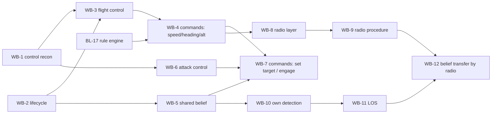

# Wingbrain — Roadmap

Wingbrain controls the DCS AI wingmen in the player's flight: how they fly and what they attack,
commanded by the player over a simulated radio. It is a simplified Petrovich for each wingman,
where performance matters more than simulation detail, and detection in particular is statistical
rather than an eyesight simulation. Concept, and the source of every entry here:
`docs/concept/wingbrain.md` (user, 2026-11-19).

**Roadmap only, no work started.** User, 2026-11-19: *"Read it and write roadmap for wingbrain. Then
stop, we will not do anything further to it yet."* No code, no `pyproject.toml`, no plan yet. The
roadmap gate and the graph corpus find this directory by its sentinel pointer, since there is no
`pyproject.toml` to find it by.

**ID prefix: `WB-`**, for milestones; `WB-B<n>` is for backlog items and `WB-W<n>` for work items,
as in every sibling. Numbers are never reused. Mint them with `.claude/scripts/mint-id.sh`.

This is the pointer's index. See `docs/DOC_CONVENTIONS.md` for the directory layout, ID scheme and
link form it follows. The index carries links and titles only; status lives on each entry.

Earlier history: `[[X-B21]]` ("Wingman brain", deferred 2026-09-13) is the direction this roadmap
scopes. `[[X-B41]]` (the AI-wingman command investigation, item 9 in `[[X-T29]]`) moved here as
`[[WB-1]]`.

## Scope

- Player is flight lead, with 0–3 AI wingmen; one wingman is the typical case. A flight of one
  starts no wingbrain and no radio layer.
- Wingmen are the player's own type. Mixed types, player not lead, and several simultaneous
  frequencies per member are out of scope for now (concept, "General concepts" and "Radio
  interface"). Multiplayer stays out of scope (root `CLAUDE.md`).
- DCS AI keeps flying formation by default; wingbrain takes over flight parameters only when
  commanded.
- Wingbrain behaviour is written as Lua rules and triggers, on the framework `[[BL-17]]` built.
- Every wingbrain shares the Mission Interpreter's mission understanding; briefing data is common
  to the whole flight.

## Order

Thin end to end first: control one wingman's flight from a spoken command (`[[WB-1]]`→`[[WB-4]]`),
then attack (`[[WB-5]]`→`[[WB-7]]`), then the radio (`[[WB-8]]`, `[[WB-9]]`), then the wingbrain's
own perception (`[[WB-10]]`→`[[WB-12]]`). The concept's goal numbers (1 flight, 2 attack,
3 commands, 4 radio, 5 perception) are interleaved because each command stage needs the control it
commands, and attack commands need a belief to name a target from.

## Open decisions (for the first Architect pass)

- **D1 — Where wingbrain runs, and one thread per wingman or not.** The concept asks for its own
  service or thread, one per wingman, and invites a challenge; it also asks to reuse existing code,
  refactoring it so wingbrain can call it. Those pull against the module-independence rule (root
  `CLAUDE.md`: HTTP/JSON across a subproject boundary; body-layer ↔ world-model is the only import
  exception). Wingbrain needs body-layer's rule engine, belief, aircraft client and speech path, so
  a separate service either duplicates them or makes a second import exception. Settle at
  `[[WB-2]]`.
- **D2 — Whether the radio layer is its own subproject.** The concept calls it *"its own layer"*,
  and Petrovich transmits on it too (`[[WB-12]]`), so it sits beside both crews rather than inside
  wingbrain. Settle at `[[WB-8]]`.

## Milestones

- [[WB-1]] — Wingman control recon: what DCS lets a script command an AI wingman to do (flight
  parameters and attack)
- [[WB-2]] — Wingbrain lifecycle: one per wingman, started and stopped with the mission
- [[WB-3]] — Flight control: fly heading/altitude/speed, fly to a point then hold or continue
- [[WB-4]] — Player commands, stage 1: speed, heading, altitude over the radio PTT
- [[WB-5]] — Shared belief: wingbrains use Petrovich's belief
- [[WB-6]] — Attack control: engage a given unit, with a given weapon if possible
- [[WB-7]] — Player commands, stage 2: set target and engage
- [[WB-8]] — Radio layer: simulated frequencies, transmissions with speech and data
- [[WB-9]] — Radio procedure: addressing by number, readbacks, flight check-in, channel changes
- [[WB-10]] — Own detection: statistical, cheap, each wingbrain holds its own belief
- [[WB-11]] — Line of sight for wingbrain detection, shared or cached
- [[WB-12]] — Belief transfer over the radio, including Petrovich transmitting target data

## Backlog

- [[WB-B1]] — Steering waypoints disturb the flight plan route
- [[WB-B2]] — Take control of wingman flight right after takeoff
